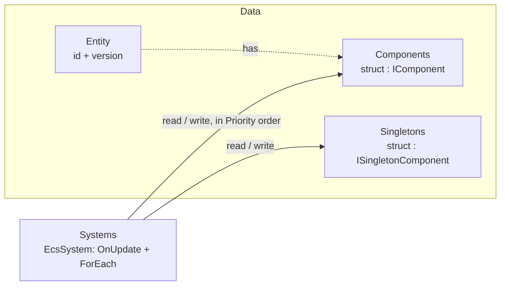

# EasyEcs

**A high-performance, allocation-free archetype ECS for .NET 10 servers.**
Write plain data and `[ForEach]` methods; the source generator turns them into inlined struct jobs, the analyzer
catches design mistakes at compile time, and a full server tick allocates 0 bytes.

[](https://www.nuget.org/packages/EasyEcs)
[](https://www.nuget.org/packages/EasyEcs)
[](https://github.com/JasonXuDeveloper/EasyEcs/actions/workflows/ci.yml)
[](https://dotnet.microsoft.com/download/dotnet/10.0)
[](https://github.com/JasonXuDeveloper/EasyEcs/blob/master/LICENSE)

One server tick of 9 systems (movement, AOI, combat, status effects, death, respawn, projectiles):

| Tick | Entities | Time | Allocated |
|---|---:|---:|---:|
| One world | 100,000 | **1.89&nbsp;ms** | **0 B** |
| Four worlds, one per thread | 100,000 | **1.08&nbsp;ms** | **0 B** |
| [Battle server](https://github.com/JasonXuDeveloper/EasyEcs/blob/master/doc/example.md), every feature | 100,000 | **2.36&nbsp;ms** | **0 B** |

<sub>BenchmarkDotNet, .NET 10, 4-core Xeon VM at 2.1 GHz; entities spawn, die, gain and lose components every tick.
The battle server turns every feature on: parallel steering and systems, replication, indexes, relations, timings.
A `[ForEach]` system adding `Velocity` to `Position` costs 0.8 ns per entity (one archetype), faster than two
plain arrays.
[Details](https://github.com/JasonXuDeveloper/EasyEcs/blob/master/doc/performance.md#benchmarks).</sub>

```bash
dotnet add package EasyEcs        # net10.0 · source generator and analyzer included
```

## Why EasyEcs

- **Fast and garbage-free.** Archetype tables with 64-byte-aligned columns that iteration and SIMD walk front to back,
  16-byte entity records (4 per cache line), JIT-inlined struct jobs instead of delegates, lock-free queries. After warm-up nothing allocates: a unit test guards the 0 B
  budget of updates, queries and structural changes on every run.
- **Structural changes are immediate and cheap.** Add and remove components, spawn and destroy, even in the middle of
  a pass; no command buffer to flush. Removing a status effect and adding it back flips a presence bit, the entity
  never moves. State can be tags, not flags.
- **Write the logic, not the plumbing.** A `[ForEach]` method is the whole system; filters are attributes
  (`[With<T>]`, `[Without<T>]`, `[WithAny<T>]`), singletons are parameters.
- **Built-in change tracking, indexes and relations.** `[Changed<T>]` visits only the rows written since a system last
  ran; `IIndexed<TKey>` components are found by value, and an `Entity` key makes a relation. Both follow every write,
  including writes through `ref`, with no events and nothing to keep in sync by hand.
- **Mistakes fail the build.** The bundled analyzer (EECS001-EECS014) reports invalid `[ForEach]` methods and
  systems, class components, stateful systems, systems that reference each other, batch methods mixing spans with
  per-entity parameters, parallel methods that would race, writes through read-only parameters, copied dynamic
  buffers and structural changes off the owner thread.
- **Decoupled by construction.** Systems cooperate only through data, in `Priority` order; system groups give you
  separate cadences (input on every wake, simulation on a fixed tick).
- **Built for servers that run for months.** Ids are recycled behind version-checked handles, memory is bounded by
  the peak entity count, a structural change off the owner thread throws or is reported at compile time instead of
  tearing the tables; the supported model is one owner thread per world (see [Threading](https://github.com/JasonXuDeveloper/EasyEcs/blob/master/doc/guide/threading.md)),
  and one world per thread scales across cores.

## Features

Everything EasyEcs gives you; each row links to its guide page with examples ([all features](https://github.com/JasonXuDeveloper/EasyEcs/blob/master/doc/features.md): what each
costs and when to use it).

| Feature | API | What it does |
|---|---|---|
| [Worlds and entities](https://github.com/JasonXuDeveloper/EasyEcs/blob/master/doc/guide/entities-and-components.md) | `new World(options)`, `CreateEntity`, `TryGetEntity`, `IsAlive`, `Destroy` | Isolated worlds of version-checked, recycled entity handles; lookup by id. |
| [Components and tags](https://github.com/JasonXuDeveloper/EasyEcs/blob/master/doc/guide/entities-and-components.md) | `struct : IComponent`, `Add`, `Set`, `Get`, `Read`, `TryGet`, `TryGetRef`, `GetOrAdd`, `Has`, `Remove` | Plain structs in archetype tables; an empty struct is a tag; up to 9 components per call. |
| [Immediate structural changes](https://github.com/JasonXuDeveloper/EasyEcs/blob/master/doc/guide/structural-changes.md) | any `Add` / `Remove` / create / destroy | Applied at once, even in the middle of a pass; no command buffer to flush. |
| [Systems and `[ForEach]`](https://github.com/JasonXuDeveloper/EasyEcs/blob/master/doc/guide/systems.md) | `EcsSystem`, `[ForEach]`, `Priority`, `OnCreate` / `OnUpdate` / `OnDestroy`, `AddSystem` / `RemoveSystem` / `GetSystem` | A method is the whole loop, compiled to an inlined struct job; `in` reads, `ref` writes, `Entity` and singletons as parameters. |
| [Filters](https://github.com/JasonXuDeveloper/EasyEcs/blob/master/doc/guide/queries.md) | `[With<T>]`, `[Without<T>]`, `[WithAny<T>]`, `[Changed<T>]`, `QueryFilter` | Narrow a system or query by presence, absence, any-of or recent writes. |
| [Ad-hoc queries](https://github.com/JasonXuDeveloper/EasyEcs/blob/master/doc/guide/queries.md) | `world.Query`, `Count`, `Any` | Iterate from any code (tools, tests, request handlers), allocation-free. |
| [Struct jobs](https://github.com/JasonXuDeveloper/EasyEcs/blob/master/doc/guide/queries.md#foreach-a-struct-job) | `IForEach`, `IForEachEntity`, `IForEachBatch`, `world.ForEach` / `ForEachEntity` / `ForEachBatch`, `INoStructuralChanges` | Ad-hoc loops with no delegate, inlined like a system; a job declares `Writes`. |
| [Batch methods](https://github.com/JasonXuDeveloper/EasyEcs/blob/master/doc/guide/systems.md#batch-methods) | `ForEachBatch`, span parameters | Contiguous runs of rows as spans, for SIMD. |
| [System groups and intervals](https://github.com/JasonXuDeveloper/EasyEcs/blob/master/doc/guide/systems.md) | `ISystemGroup`, `[UpdateInGroup<T>]`, `Update<TGroup>()`, `UpdateInterval`, `Enabled` | Separate cadences (input on every wake, simulation on a fixed tick), throttled and switchable systems. |
| [Singletons](https://github.com/JasonXuDeveloper/EasyEcs/blob/master/doc/guide/singletons.md) | `ISingletonComponent`, `AddSingleton`, `GetSingleton`, `SingletonRef<T>` | One value per world, passed to systems as `ref` / `in` parameters. |
| [Parallel systems](https://github.com/JasonXuDeveloper/EasyEcs/blob/master/doc/guide/threading.md) | `WorldOptions.ParallelSystems` | Systems of one priority that do not conflict run at once, with the sequential result. |
| [Parallel `[ForEach]`](https://github.com/JasonXuDeveloper/EasyEcs/blob/master/doc/guide/systems.md#parallel-methods) | `[ForEach(Parallel = true)]`, `ForEachParallel`, `ForEachEntityParallel`, `ChunkRows` | One heavy method's rows split across cores. |
| [Change tracking](https://github.com/JasonXuDeveloper/EasyEcs/blob/master/doc/guide/change-tracking.md) | `ITrackChanges`, `[Changed<T>]`, `QueryFilter.Changed<T>(since)` | Visit only the rows written since a system last ran; `ref` access counts as a write. |
| [Dynamic buffers](https://github.com/JasonXuDeveloper/EasyEcs/blob/master/doc/guide/dynamic-buffers.md) | `DynamicBuffer<T>`, `Add`, `RemoveAt`, `AsSpan`, `[Changed<DynamicBuffer<T>>]` | A list per entity as a component: written only through `ref`, so every change is tracked; copied by snapshots. |
| [Value indexes](https://github.com/JasonXuDeveloper/EasyEcs/blob/master/doc/guide/indexes-and-relations.md) | `IIndexed<TKey>`, `world.Index<T, TKey>()`, `Find`, `TryFind`, `Count` | Find entities by a component's value, kept in sync with every write. |
| [Relations](https://github.com/JasonXuDeveloper/EasyEcs/blob/master/doc/guide/indexes-and-relations.md) | an `IIndexed<Entity>` component | Entity-to-entity links with reverse lookup; a destroyed source leaves the index, a destroyed target matches no later entity (handles carry their version). |
| [Snapshots](https://github.com/JasonXuDeveloper/EasyEcs/blob/master/doc/guide/snapshots.md) | `world.Capture()`, `world.Restore(snapshot)` | Copy a world in memory and roll it back (replays, tests, rollback). |
| [Bulk create and destroy](https://github.com/JasonXuDeveloper/EasyEcs/blob/master/doc/guide/entities-and-components.md#entities) | `CreateEntities`, `DestroyEntities`, `EnsureEntityCapacity` | Spawn and clear waves in one pass through the structural gate. |
| [Per-system timing](https://github.com/JasonXuDeveloper/EasyEcs/blob/master/doc/guide/systems.md#measuring-systems) | `WorldOptions.MeasureSystems`, `system.Stats` | Run counts and times of every system. |
| [Errors](https://github.com/JasonXuDeveloper/EasyEcs/blob/master/doc/guide/systems.md#errors) | `World.SystemError` | A failing system is reported, can be switched off, and the tick goes on. |
| [Analyzer](https://github.com/JasonXuDeveloper/EasyEcs/blob/master/doc/guide/analyzer.md) | EECS001-EECS014 | ECS design mistakes (class components, stateful systems, systems referencing systems, …) fail the build. |
| [Threading and Native AOT](https://github.com/JasonXuDeveloper/EasyEcs/blob/master/doc/guide/threading.md) | one owner thread per world; no reflection on hot paths | Many worlds per process, one per thread; AOT works with nothing to configure. |

## Example

Data is plain structs, each system is one `[ForEach]` method, and systems cooperate only through the data they write:

```csharp
using EasyEcs;

public record struct Position(float X, float Y) : IComponent;
public record struct Velocity(float X, float Y) : IComponent;
public record struct Health(int Value) : IComponent, ITrackChanges;   // tracked: rows record their last write
public struct Dead : IComponent;                                       // a tag
public record struct Clock(float Dt) : ISingletonComponent;           // one value per world

public partial class MovementSystem : EcsSystem
{
    [ForEach, Without<Dead>]                                           // in reads, ref writes
    static void Move(ref Position p, in Velocity v, in Clock clock)
    {
        p.X += v.X * clock.Dt;
        p.Y += v.Y * clock.Dt;
    }
}

public partial class DeathSystem : EcsSystem
{
    public override int Priority => 10;                                // after movement

    [ForEach, Without<Dead>, Changed<Health>]                          // only healths written since its last run
    static void Die(Entity unit, in Health hp)
    {
        if (hp.Value <= 0) unit.Add<Dead>();                           // immediate: later systems see it this tick
    }
}
```

The host owns the world and ticks it:

```csharp
using var world = new World();
world.AddSingleton<Clock>() = new Clock(1 / 30f);
world.AddSystem<MovementSystem>();
world.AddSystem<DeathSystem>();

var hero = world.CreateEntity(new Position(0, 0), new Velocity(1, 0), new Health(100));
world.Update();                                                        // 0 B per update once warmed up
hero.Get<Health>().Value = 0;                                          // a write through a ref: tracked
world.Update();
System.Console.WriteLine(hero.Has<Dead>());                            // True
```

[A full battle server](https://github.com/JasonXuDeveloper/EasyEcs/blob/master/doc/example.md) uses every feature
(parallel steering, replication by change tracking, bags of loot in dynamic buffers, indexes, relations, snapshots,
system groups, struct jobs) in one world; it is the battle server benchmark below and the world of the scenario tests. The step-by-step tutorial is
[Getting started](https://github.com/JasonXuDeveloper/EasyEcs/blob/master/doc/getting-started.md).

## The model in one picture



| Concept | API | In one line |
|---|---|---|
| World | `World` | Owns entities, component storage, singletons and systems. Worlds share nothing. |
| Entity | `Entity` | A 16-byte, version-checked handle. Stale handles throw instead of touching a recycled id. |
| Component | `struct : IComponent` | Plain per-entity data. An empty struct is a tag. |
| Singleton | `struct : ISingletonComponent` | One value per world: clock, configuration, counters, a spatial grid. |
| System | `EcsSystem` | One responsibility: `OnUpdate` plus `[ForEach]` methods, run in `Priority` order. |
| Query | `[ForEach]`, `ForEach`, `Query`, `Count`, `Any` | Entities that have a set of components, filtered with `With` / `Without` / `WithAny` / `Changed`. |
| Index | `IIndexed<TKey>`, `world.Index<T, TKey>()` | Entities by a component's value, or by the entity a relation component points at. |

## When to use it

| Good fit | Probably not |
|---|---|
| Game servers and simulations on .NET 10: MMO maps and zones, AOI, combat | Unity or other runtimes below .NET 10 (`net10.0` only) |
| Worlds where state flips constantly (buffs, deaths, spawns): structural changes are immediate and cheap | Code that needs structural changes recorded from many threads at once (use one owner thread and a queue) |
| Long-running processes where GC pauses and unbounded growth matter | Code that wants objects with behavior, or systems calling each other |
| One world per thread, many worlds per process; `ParallelSystems` for heavy independent systems | Many threads mutating one world's component values without coordination |

## Performance

BenchmarkDotNet with the repository's job (`BenchmarkConfig.cs`), .NET 10, 4-core Xeon VM at 2.1 GHz. The headline benchmark is a realistic server tick,
not a toy loop ([what it simulates](https://github.com/JasonXuDeveloper/EasyEcs/blob/master/doc/performance.md#benchmarks)). "Allocated" is per tick.

| Benchmark | Entities | Mean | Allocated |
|---|---:|---:|---:|
| WorldSimulationBenchmark.Tick | 10,000 | 169 μs | 0 B |
| WorldSimulationBenchmark.Tick | 100,000 | 1.89 ms | 0 B |
| MultiWorldBenchmark.TickAllWorlds (4 worlds × 25k) | 100,000 | 1.08 ms | 0 B |
| BattleServerBenchmark.Tick (the [battle server example](https://github.com/JasonXuDeveloper/EasyEcs/blob/master/doc/example.md), every feature) | 100,000 | 2.36 ms | 0 B |

Against v4.0.1 (4.33 ms) the tick is 2.3x faster.

A `[ForEach]` system adding `Velocity` to `Position` over 10,000 entities (one archetype) takes 8.2 μs, against
10.7 μs for two plain arrays with no ECS at all (its columns are 64-byte aligned). Micro benchmarks (with v3.1.1 and
v4.0.1 numbers for comparison) and the per-operation comparison are in
[doc/performance.md](https://github.com/JasonXuDeveloper/EasyEcs/blob/master/doc/performance.md); their `ForEach` and
`Query` rows run on a world with two archetypes, so they are not directly comparable to the `[ForEach]` row.

```bash
dotnet run -c Release --project EasyEcs.Benchmark -- --filter '*'
```

## Compared with other ECS libraries

The same 100,000-entity tick, ported to each library's fast path with identical results checked in setup
([details](https://github.com/JasonXuDeveloper/EasyEcs/blob/master/doc/comparison.md)):

| Library | Tick (100,000 entities) | Allocated per tick |
|---|---:|---:|
| **EasyEcs 4.1** | **1.84 ms (1.00)** | **0 B** |
| Friflo.Engine.ECS 3.6 | 1.75 ms (0.95) | 0 B |
| Arch 2.1 | 5.46 ms (2.96) | 550 KB |
| DefaultEcs 0.17 | 5.96 ms (3.24) | 62 KB |

Friflo is about 5% faster on this tick (5-8% across runs on this VM); EasyEcs leads on one-component and SIMD iteration, filters and toggling a status component (2x Friflo); Friflo on
iteration that passes the entity. On change tracking (`[Changed<T>]`, 1,000 of 100,000 rows written per tick) EasyEcs
is the fastest of all four (33 μs; a scan takes 54-110 μs, a dirty tag 83-120 μs).

| | EasyEcs | Friflo.Engine.ECS | Arch | DefaultEcs |
|---|:-:|:-:|:-:|:-:|
| Structural changes inside a query loop, applied at once | ✅ | ❌ command buffer | ⚠️ unguarded | ⚠️ unsafe |
| Change tracking ("rows written since") | ✅ | ❌ | ❌ | ✅ explicit notify |
| Value index | ✅ | ✅ | ❌ | ✅ |
| Relations with reverse lookup | ✅ | ✅ | ❌ | ❌ |
| In-memory world snapshot | ✅ | ❌ | ❌ | ❌ |
| Systems, groups, parallel systems | ✅ | ✅ (no parallel systems) | ❌ core | ✅ |
| Source-generated systems + analyzer | ✅ | ❌ | ❌ | ❌ |
| 0 B per tick | ✅ | ✅ | ❌ | ❌ |
| Events, serialization | ❌ (state is data) | ✅ | events | ✅ |
| Unity / netstandard | ❌ net10.0 | ✅ | ✅ | ✅ |

The full matrix, the per-operation numbers and when to pick which library are in
[doc/comparison.md](https://github.com/JasonXuDeveloper/EasyEcs/blob/master/doc/comparison.md); every feature with
what it does, when to use it and what it costs is in
[doc/features.md](https://github.com/JasonXuDeveloper/EasyEcs/blob/master/doc/features.md).

## Documentation

| | |
|---|---|
| [Getting started](https://github.com/JasonXuDeveloper/EasyEcs/blob/master/doc/getting-started.md) | Step-by-step tutorial: entities, components, tags, queries, systems, singletons, groups, the update loop. |
| [Features](https://github.com/JasonXuDeveloper/EasyEcs/blob/master/doc/features.md) | Every feature: what it does, when to use it, when not, what it costs, which scenarios it serves. |
| [Comparison](https://github.com/JasonXuDeveloper/EasyEcs/blob/master/doc/comparison.md) | Features and benchmarks against Friflo.Engine.ECS, Arch and DefaultEcs. |
| [Guide](https://github.com/JasonXuDeveloper/EasyEcs/blob/master/doc/README.md#guide) | One page per concept: queries, systems, singletons, structural changes, change tracking, dynamic buffers, indexes and relations, snapshots, `ref` and `await`, threading, analyzer rules. |
| [ECS principles](https://github.com/JasonXuDeveloper/EasyEcs/blob/master/doc/ecs-principles.md) | How to design features with entities, components, singletons and systems. |
| [Design questions](https://github.com/JasonXuDeveloper/EasyEcs/blob/master/doc/faq.md) | Why there are no events and no serialization, what is thread-safe, how to change a component. |
| [API reference](https://github.com/JasonXuDeveloper/EasyEcs/blob/master/doc/api.md) | Every public API with its complexity. |
| [Performance guide](https://github.com/JasonXuDeveloper/EasyEcs/blob/master/doc/performance.md) | Which API to use when, do's and don'ts, benchmarks. |
| [Architecture](https://github.com/JasonXuDeveloper/EasyEcs/blob/master/doc/architecture.md) | Storage, memory layout, archetypes, id recycling, iteration safety, generators. |
| [Migration guide](https://github.com/JasonXuDeveloper/EasyEcs/blob/master/MIGRATION_GUIDE.md) | Upgrading from 4.0 to 4.1, from v3 (and from v2). |

The [documentation index](https://github.com/JasonXuDeveloper/EasyEcs/blob/master/doc/README.md) suggests a reading order.

## What's new in 4.1

- **Archetype tables.** Each archetype stores its components as columns of rows (structure of arrays); unmanaged
  columns are pinned and start on a 64-byte boundary. Iteration walks columns front to back, and tables stay dense:
  a removed row is filled by the last one at once, or when the pass that removed it ends.
- **Removing a component keeps the row.** It only clears a presence bit, so states that come and go (stunned,
  burning, dead) never move data; queries skip, walk or test 64 rows per bit word per table.
- **Stricter iteration with immediate changes.** A pass visits each entity at most once, and `[ForEach]` writes
  through `ref` parameters survive the body's own structural changes. No command buffer, no idempotency filters.
- **Batch `[ForEach]` methods** take `Span<T>` / `ReadOnlySpan<T>` and receive whole runs of rows for SIMD
  (`world.ForEachBatch` for ad-hoc jobs); `world.ForEachEntity` passes the handle to struct jobs.
- **Jobs that cannot change structure** (detected by the generator, or `INoStructuralChanges`) iterate with no
  per-entity bookkeeping; structural changes check a plain owner flag instead of a lock or an atomic.
- **Parallel `[ForEach]`:** `[ForEach(Parallel = true)]` splits one method's rows across threads, allocation-free
  (`world.ForEachParallel` / `ForEachEntityParallel` for ad-hoc jobs, `World.ChunkRows` rows per chunk); the analyzer
  rejects methods that could race (EECS010).
- **Snapshots:** `world.Capture()` / `world.Restore(snapshot)` roll a world back in memory (undo, prediction, tests).
- **Change tracking:** components marked `ITrackChanges` record each row's last write; `[Changed<T>]` methods visit
  only the rows written since their system last ran (replication, persistence), and `QueryFilter.Changed<T>(since)`
  does the same for queries.
- **Indexes and relations:** components implementing `IIndexed<TKey>` are found by value
  (`world.Index<T, TKey>().Find(key)`); an `Entity` key makes a relation (`ChildOf(Entity Parent)`) whose index
  lists the children of an entity.
- **New APIs:** `WithAny<T>` filters (`[WithAny<T>]` on `[ForEach]`), batch `CreateEntities` / `DestroyEntities`,
  per-system timing (`WorldOptions.MeasureSystems`, `system.Stats`), `entity.Read<T>()` (read-only, never a write) and
  `entity.TryGetRef<T>(out found)` (optional access by `ref`); Native AOT compatible.
- **`DynamicBuffer<T>`**: a list per entity, held as a component. Its writes take the buffer by `ref`, so each one is
  a tracked change (`[Changed<DynamicBuffer<T>>]` sends only the lists that changed) and a write through `in` does not
  compile; snapshots copy the elements; writes within the capacity allocate nothing.
- **Every analyzer rule is an error**, with four new ones: **EECS011** rejects a `[ForEach]` method that changes a
  collection or class held by an `in` parameter, **EECS012** a `DynamicBuffer<T>` copied by value, **EECS013** a
  structural change in a `[ForEach]` method that takes no `Entity` or `World`, **EECS014** a structural change in a
  delegate handed to another thread that races with other changes of the same world.
- **Structural changes belong to the owner thread.** They check a plain owner flag instead of a compare-and-swap (a
  create/destroy pair is about a quarter faster); one made inside a parallel batch or a parallel `[ForEach]`, or
  reentered, throws `InvalidOperationException` instead of tearing the tables.
- `Entity.GetHashCode()` is deterministic (`Id * 397 ^ Version`) and cheaper (relation lookups hash handles).
- **Renamed:** `WorldOptions.Parallel` is `WorldOptions.ParallelSystems` (apart from `[ForEach(Parallel = true)]`).
- **Removed:** `world.DestroyEntity(entity)`, a second spelling of `entity.Destroy()`.
- **Behavior changes:** `Query` results are ref structs (no `await` in the loop, items cannot be stored); refs can be
  invalidated by structural changes of other entities; iteration order follows table rows; with `ParallelSystems`, a
  subclass the generator did not see runs alone; structural changes from several threads at once are no longer
  serialized (owner thread only); `AddSingleton` resets an existing singleton in place; `IForEach` jobs
  receive only the components; stale handles answer `Has` / `TryGet` with false; `CompactArchetypes` is gone (tables
  stay dense on their own). See the
  [migration guide](https://github.com/JasonXuDeveloper/EasyEcs/blob/master/MIGRATION_GUIDE.md#v40--v41).
- A realistic 100k-entity server tick takes 1.89 ms instead of 4.33 ms; toggling a status component on 10,000
  entities 183 μs instead of 338 μs; reading a component through 1,000 random handles 3.41 μs instead of 3.56 μs.

## What's new in 4.0

v4 is a rewrite for .NET 10 with standard ECS vocabulary in a single `EasyEcs` namespace:

- `Context` → `World`, `GroupOf` → `Query`, and a single version-checked `Entity` handle whose accessors return `ref T`.
- Systems are synchronous `EcsSystem`s with source-generated `[ForEach]` methods (no UniTask dependency).
- Entity ids are recycled; singletons are per world; system groups with `[UpdateInGroup<T>]`.
- The analyzer enforces the ECS principles (EECS006-EECS008); events were replaced by state-as-data.
- `WorldOptions.Parallel` (`ParallelSystems` since 4.1) runs systems of one priority together only when their generated read/write access does
  not conflict: parallel with the same result as sequential, allocation-free.
- A `[ForEach]` method may take no component when a `[With<T>]` names what to query
  (`[ForEach, With<Dead>] static void Remove(Entity e)`).

See the [migration guide](https://github.com/JasonXuDeveloper/EasyEcs/blob/master/MIGRATION_GUIDE.md) for every rename and behavioral change.

## License

[MIT](https://github.com/JasonXuDeveloper/EasyEcs/blob/master/LICENSE)
