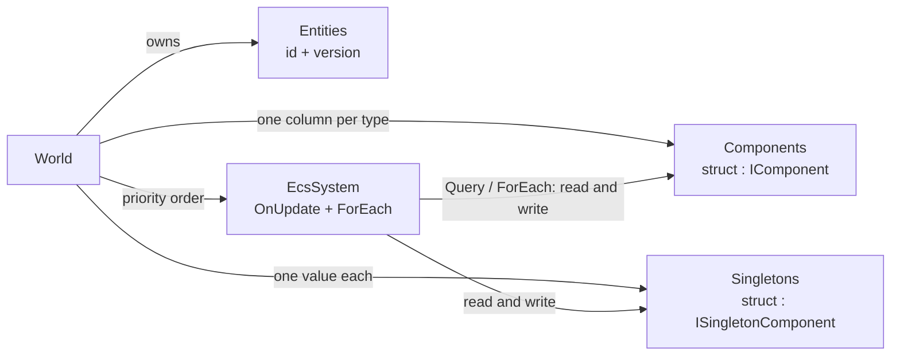
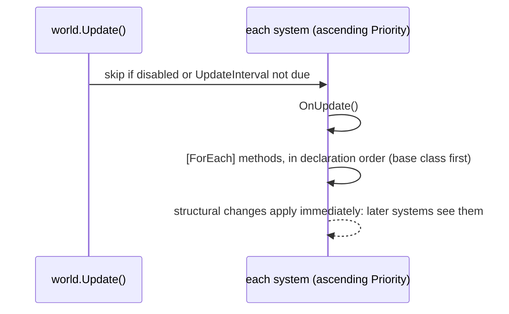
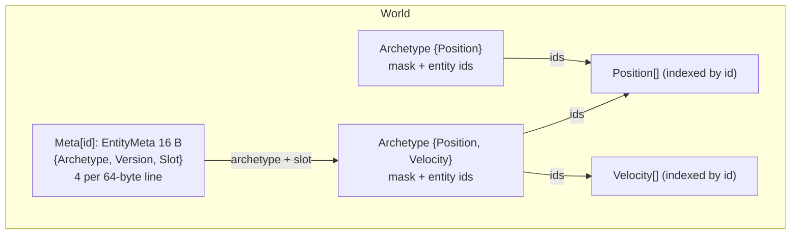

# EasyEcs


A fast, allocation-free Entity-Component-System for .NET 10 servers and other long-running processes.

- **Write the logic, the generator writes the plumbing.** A `[ForEach]` method becomes a JIT-inlined struct job.
  Misuse, including breaking the ECS principles, is reported at compile time.
- **Zero GC in steady state.** A full tick of a 100k-entity world allocates 0 bytes. That tick includes movement,
  AOI, combat, buff add/remove, projectile spawn/despawn, death and respawn, and a unit test guards the budget.
- **Cache-friendly.** Per entity, a world stores one 16-byte record (4 per cache line). Component data lives in one
  dense column per type. Compaction sorts entities so iteration walks each column front to back.
- **Cheap structural changes.** Archetype transitions are cached. Placement is single-step: `CreateEntity(a, b, c)`
  lands in its final archetype directly.
- **Decoupled modules, pure ECS.** Systems cooperate only through data (components and singletons) in the order
  their `Priority` declares. No callbacks, no hidden call order.
- **One namespace, standard vocabulary:** `World`, `Entity`, components, singletons, `EcsSystem`, `[ForEach]`,
  `Query`, system groups.

```
dotnet add package EasyEcs        # net10.0; source generator and analyzer included
```

## Quick start

```csharp
using EasyEcs;

// Data: plain structs.
public record struct Position(float X, float Y) : IComponent;
public record struct Velocity(float X, float Y) : IComponent;
public record struct Health(int Value) : IComponent;
public struct Dead : IComponent;                                         // tag component
public record struct Stats(long Tick, int Deaths) : ISingletonComponent; // world state lives in data, not systems

// Behavior: one stateless system per responsibility.
public partial class MovementSystem : EcsSystem
{
    [ForEach, Without<Dead>]                                             // once per matching entity
    static void Move(ref Position p, in Velocity v) => p = p with { X = p.X + v.X, Y = p.Y + v.Y };
}

public partial class DeathSystem : EcsSystem
{
    [ForEach, Without<Dead>]
    static void Die(Entity entity, in Health hp, ref Stats stats)        // singleton: resolved once per pass
    {
        if (hp.Value > 0) return;
        entity.Set(new Dead());                                          // state change = data
        stats.Deaths++;
    }
}

public partial class CorpseSystem : EcsSystem                            // reacts to the Dead state
{
    public override int Priority => 10;                                  // after everything else

    [ForEach]
    static void Remove(Entity entity, in Dead _) => entity.Destroy();
}

public sealed class ClockSystem : EcsSystem
{
    protected override void OnUpdate() => World.GetSingleton<Stats>().Tick++;   // once per update
}

using var world = new World(new WorldOptions { InitialEntityCapacity = 100_000 });
world.AddSingleton<Stats>();
world.AddSystem<MovementSystem>();
world.AddSystem<DeathSystem>();
world.AddSystem<CorpseSystem>();
world.AddSystem<ClockSystem>();

var e = world.CreateEntity(new Position(0, 0), new Velocity(1, 0), new Health(100));
e.Get<Health>().Value -= 100;                                        // Get returns ref T: writes go to storage

while (running) world.Update();
```

None of these systems knows the others exist: they share components and a singleton. Any of them can be removed,
reordered or tested alone. See [ECS principles](#ecs-principles).

## Concepts



| Concept | API | Meaning |
|---|---|---|
| World | `World` | Owns entities, component storage, singletons and systems. Worlds are fully isolated. |
| Entity | `Entity` | 16-byte handle (id, version, world). Every access validates the version, so stale handles throw. |
| Component | `struct : IComponent` | Plain data. A tag component is an empty struct. |
| Singleton | `struct : ISingletonComponent` | One value per world: clock, configuration, world state. |
| System | `EcsSystem` | `OnCreate`, then every update `OnUpdate` + `[ForEach]` methods, and `OnDestroy`. |
| Query | `Query`, `ForEach`, `Count`, `Any`, `QueryFilter` | Entities that have a set of components, optionally filtered. |

### One update



Systems with equal priority form a bucket. With `WorldOptions.Parallel`, the systems of a bucket run in parallel and
must touch disjoint data. Otherwise everything runs on the thread that calls `Update()`.

### `[ForEach]` methods

A `[ForEach]` method is declared in a `partial` class that derives from `EcsSystem`. It can be static or an instance
method. Its parameters:

| Parameter | Meaning |
|---|---|
| `ref T` / `in T` (`T : IComponent`) | component data, 1–9 of them (`ref` to write, `in` to read) |
| `ref T` / `in T` (`T : ISingletonComponent`) | the world's singleton, resolved once per pass (added if missing) |
| `Entity entity` | handle of the current entity (structural changes, destroy) |
| `World world` | the world (useful in static methods) |

Filters are `[With<T>]` (the entity must have T, but T is not passed in) and `[Without<T>]` (the entity must not
have T). Both can be repeated. Derived systems run the base class's methods first.

### System groups

`world.Update()` runs the default group. A system marked `[UpdateInGroup<TGroup>]` (where `TGroup` is a
`struct : ISystemGroup`) runs only when `world.Update<TGroup>()` is called. Use groups for different cadences. A
server can run input handling on every wake-up and the simulation at a fixed tick:

```csharp
public struct InputGroup : ISystemGroup;

[UpdateInGroup<InputGroup>]
public partial class ApplyInputSystem : EcsSystem { ... }

world.Update<InputGroup>();   // whenever input arrives
world.Update();               // fixed tick
```

Priority, `UpdateInterval` and `Enabled` apply within each group. The attribute is inherited.

### Compile-time checks (EasyEcs analyzer)

| Id | Error |
|---|---|
| EECS001 | a system with `[ForEach]` methods is not `partial` |
| EECS002 | invalid `[ForEach]` parameter |
| EECS003 | a `[ForEach]` method takes no components, or more than 9 |
| EECS004 | generic system or method |
| EECS005 | `[ForEach]` method outside an `EcsSystem` |
| EECS006 | a class implements `IComponent` or `ISingletonComponent` (they must be structs) |
| EECS007 (warning) | a system has a mutable field or settable auto-property (state belongs in components/singletons) |
| EECS008 (warning) | a system holds a reference to another system (communicate through data) |

## ECS principles

EasyEcs is fast because data and behavior are separate. Code stays maintainable for the same reason. Every type has
exactly one role:

| Element | Role | Rule |
|---|---|---|
| `Entity` | identity | An id. No data, no behavior. Hold it as a handle and never keep a `ref` into its storage. |
| Component | per-entity data | A struct with fields only (computed getters are fine). No logic and no references to systems. |
| Singleton | per-world data | Clock, configuration, counters, indexes: anything with one value per world. |
| System | behavior, one responsibility | Stateless, reads and writes components and singletons, never references another system. |

How to follow them:

1. **One system, one job.** Name a system after what it does (`MovementSystem`, `DeathSystem`). If a description
   needs "and", split it. Splitting costs nothing: each `[ForEach]` is a separate inlined job either way.
2. **Systems are stateless.** Keep counters, timers and caches that matter to the simulation in a singleton (per
   world) or a component (per entity), where queries, other systems, tests and persistence can see them. Readonly
   fields for dependencies or reusable scratch buffers are fine (EECS007 allows them).
3. **Systems never call systems** (EECS008). They cooperate through data: one writes a component or singleton,
   another reads it later in the update (order them with `Priority`).
4. **State changes are data.** Mark `Dead` with a tag (or set a field) so later systems can query it; they react in
   schedule order without the system that made the change knowing them.
5. **Prefer data flags to churn for frequent changes.** Adding and removing a component moves the entity between
   archetypes. That is cheap, but a field (`Changed`, `Ticks`) or a comparison against a sync component is cheaper
   for something that flips every tick.
6. **Keep `[ForEach]` jobs idempotent within an update.** Filter out what the job itself produces
   (`Without<Dead>` on a job that adds `Dead`): see [structural changes during iteration](#structural-changes-during-iteration).

More detail and examples are in [doc/ecs-principles.md](doc/ecs-principles.md).

## API and complexity

Notation:

- *n*: components in the call (1–9).
- *c*: components of the entity.
- *M*: archetypes matching a query.
- *S*: slots in those archetypes, alive entities plus tombstones.
- "Amortized": storage occasionally doubles.

### Entities

| API | Complexity | Notes |
|---|---|---|
| `world.CreateEntity()` | O(1) amortized | reuses recycled ids |
| `world.CreateEntity(in T1 … in Tn)` | O(n) amortized | placed directly in its final archetype |
| `entity.Destroy()` / `world.DestroyEntity(entity)` | O(c) | recycles the id; stale handles are ignored |
| `entity.IsAlive` | O(1) | |
| `world.TryGetEntity(id, out e)` / `GetEntity(id)` | O(1) | |
| `world.EntityCount` | O(1) | |
| `world.Entities` | O(capacity) | diagnostics |
| `world.EnsureEntityCapacity(n)` | O(capacity) | pre-size to avoid growth at runtime |

### Components

| API | Complexity | Notes |
|---|---|---|
| `entity.Get<T>()` → `ref T` | O(1) | version check + one mask test + one indexed load; throws if missing |
| `entity.Has<T>()` / `TryGet<T>(out T)` | O(1) | |
| `entity.Add<T>()` → `ref T` | O(1) amortized | adds (or resets) and returns a ref |
| `entity.GetOrAdd<T>()` → `ref T` | O(1) amortized | |
| `entity.Set(in T1 … in Tn)` → `Entity` | O(n) amortized | add or overwrite, one archetype transition, chainable |
| `entity.Remove<T1..Tn>()` | O(n) | one transition; missing components are ignored |

### Queries

| API | Complexity | Notes |
|---|---|---|
| `[ForEach]` method / `world.ForEach<T1..Tn, TJob>(ref job, filter)` | O(M + S) | fastest: struct job, no delegate |
| `foreach (var item in world.Query<T1..Tn>(filter))` | O(M + S) | `item.Entity`, `item.Component1..n` (refs) |
| `world.Count<T1..Tn>(filter)` | O(M) | sums archetype counts |
| `world.Any<T1..Tn>(filter)` | O(M) worst | early exit |
| `QueryFilter.Create().With<T>().Without<U>()` | O(1) | build once and keep it in a `static readonly` field |

The first time a query shape is used, building its cache entry costs O(all archetypes). After that, each lookup is
one hash probe.

### Systems, singletons, maintenance

| API | Complexity |
|---|---|
| `world.AddSystem<T>()` / `AddSystem(system)` (calls `OnCreate`) | O(systems) |
| `world.RemoveSystem<T>()` (calls `OnDestroy`) / `GetSystem<T>()` | O(systems) |
| `world.Update()` (default group) / `world.Update<TGroup>()` | Σ systems of the group, allocation-free |
| `world.AddSingleton<T>()` / `GetSingleton<T>()` / `GetOrAddSingleton<T>()` → `ref T` | O(1) |
| `world.SingletonRef<T>()` → `SingletonRef<T>` (stable handle, `.Value` is `ref T`; adds if missing) | O(1) |
| `world.TryGetSingleton<T>(out T)` / `HasSingleton<T>()` / `RemoveSingleton<T>()` | O(1) |
| `world.CompactArchetypes()` | O(S log S) |
| `world.GetFragmentationStats()` | O(archetypes) |

## `ref` everywhere, and `ref` across `await`

Components are structs stored in arrays. Always mutate them through a `ref`; changing a local copy changes nothing in
storage.

```csharp
var hp = entity.Get<Health>();        // ❌ a copy: the change below is lost
hp.Value -= 10;

ref var hp = ref entity.Get<Health>(); // ✅ a ref into storage
hp.Value -= 10;
entity.Get<Health>().Value -= 10;      // ✅ same thing, inline
```

**A `ref` into ECS storage is valid only until the next structural change.** Storage arrays grow, and are
reallocated, when entities, component types or archetypes are added, whether by your code or by another system. An
old `ref` then silently points at the stale copy. That is why `ref` and `await` must not mix:

- C# forbids `ref` locals that live across an `await`. Don't smuggle refs through `Unsafe`, pointers or `Span`
  fields either.
- While you `await`, other code runs. It may add entities or components (reallocating storage), or destroy your
  entity and recycle its id.
- After an `await`, **re-acquire** the data through the `Entity` handle. The handle is version-checked and throws
  if the entity was destroyed.

```csharp
async ValueTask SaveAsync(Entity player)
{
    int hp = player.Get<Health>().Value;           // read what you need before awaiting
    await database.SaveAsync(hp);                  // the world may change meanwhile
    if (player.IsAlive && player.Has<Health>())    // re-validate after the await
        player.Get<Health>().Value = hp;           // a fresh ref into current storage
}
```

Rules:

- Use `ref` freely inside `[ForEach]`, `ForEach` and `Query` bodies. They are synchronous and refresh their view of
  storage after structural changes.
- Never keep a `ref` in a field or across an `await`. Keep the `Entity` instead.
- Read what you need before awaiting; after the await, write back through a newly acquired ref.

## Structural changes during iteration

Inside `[ForEach]`, `ForEach` and `Query`, you can create and destroy entities and add or remove components. The
rules:

- Removed entities are skipped. Entities created during the pass may or may not be visited.
- **An entity that moves into another matching archetype during the pass may be visited again.** For example, a
  method that adds `Dead` to an entity it still matches will see that entity again. Make such methods idempotent with
  a filter (`[ForEach, Without<Dead>]`). This is the usual rule for immediate-mode ECS.

## Threading

- **Recommended: one `World` per shard (thread).** Worlds share nothing, so no synchronization is needed.
- Structural operations take a per-world `System.Threading.Lock`. Queries are lock-free over immutable copy-on-write
  archetype snapshots.
- Component **values** are not synchronized. Either each world has one owner thread, or (with
  `WorldOptions.Parallel`) systems of the same priority touch disjoint data.

## Memory layout



- An entity's component set is its archetype's mask, so it is not stored per entity. A version check plus a `Has`
  touches one 16-byte record and one shared, hot archetype.
- Archetypes hold entity ids, not component data. Adding or removing a component moves an *id*; component data never
  moves.
- Columns are indexed by entity id. `CompactArchetypes()` removes tombstones and sorts ids, which turns iteration
  into a forward, prefetch-friendly walk. Call it between updates after heavy churn.
- Columns whose type contains managed references are cleared on remove and destroy, so the GC can collect what they
  pointed to. Unmanaged columns are not cleared: `Add` and `Set` overwrite them anyway.

## Performance

All numbers come from BenchmarkDotNet. Reproduce them with
`dotnet run -c Release --project EasyEcs.Benchmark -- --filter '*'`. The headline benchmarks simulate a real server
tick, not a toy loop:

- **`WorldSimulationBenchmark.Tick`** is one tick of a world with 30% players, 70% NPCs, and projectiles on top. The
  tick runs:
  - movement, skipping entities that are `Stunned` or `Dead`
  - an AOI grid
  - combat that randomly adds `Burning` / `Stunned`
  - status expiry that removes those components
  - death, which adds `Dead` and updates the world statistics singleton
  - NPC despawn and respawn
  - projectile spawn (about 5% of players per tick) and expiry

  Setup asserts that the world is busy: hits, deaths, spawns and AOI changes all happen.
- **`ShardedWorldBenchmark.TickAllShards`** runs one world per core, each on its own long-lived thread. This is the
  recommended server layout.
- **`MicroBenchmarks`** isolate single operations for diagnosis. `RawArrayWrite` is the no-ECS floor.

Measured with BenchmarkDotNet's default job on .NET 10, on a 4-core Xeon VM at 2.1 GHz.

**Realistic server tick** (the "Allocated" column is per tick):

| Benchmark | Entities | Mean | Allocated |
|---|---:|---:|---:|
| WorldSimulation.Tick | 10,000 | 322 μs | 0 B |
| WorldSimulation.Tick | 100,000 | 4.33 ms | 0 B |
| ShardedWorld.TickAllShards (4 worlds × 25k) | 100,000 | 1.85 ms | 0 B |

**Micro benchmarks** (N = 10,000; the v3.1.1 column is BenchmarkDotNet ShortRun on the same machine). "–" means
the operation has no v3.1.1 equivalent (struct jobs, `[ForEach]` systems and handles are new in v4). Every
operation that exists in both versions is faster in v4 and allocates less or nothing:

| Benchmark | v3.1.1 | v4 | Allocated (v4) |
|---|---:|---:|---:|
| CreateAddDestroy (fresh world) | 5,358 μs | 1,795 μs | 1.57 MB (array growth of the new world) |
| Churn: 10 rounds of create, add and destroy in one world | 5,247 μs / 3.19 MB | 1,023 μs | 72 KB (steady state reached in round 1) |
| ToggleComponent: remove + add | 1,185 μs | 338 μs | 0 B |
| QueryIterate (`Query<P,V>` + reduction) | 40.6 μs | 35.3 μs | 0 B |
| ForEachIterate (`ForEach` struct job + reduction) | – | 30.6 μs | 0 B |
| QueryWrite (`Query`, pure write) | – | 28.3 μs | 0 B |
| ForEachSystemWrite (`[ForEach]` system) | – | 15.1 μs | 0 B |
| ForEachWrite (`ForEach` struct job) | – | 24.3 μs | 0 B |
| RawArrayWrite (two plain arrays, the floor) | – | 11.0 μs | 0 B |
| QueryIterate3 (half the entities match) | 16.2 μs | 9.1 μs | 0 B |
| HandleAccess (`Entity.Get`, ×1000) | – | 3.56 μs | 0 B |
| SingletonAccess (×1000) | 1.42 μs | 0.90 μs | 0 B |

## Upgrading from v3

v4 targets .NET 10 and moves everything into one `EasyEcs` namespace with standard ECS terms. The main renames are
`Context` → `World`, `GroupOf` → `Query`, and a single `Entity` handle. Systems are synchronous `EcsSystem`s with
`[ForEach]` methods, and entity ids are recycled. See
[MIGRATION_GUIDE.md](MIGRATION_GUIDE.md).

## Documentation

- [doc/ecs-principles.md](doc/ecs-principles.md): roles of entities, components, singletons and systems,
  and how to design with them.
- [doc/architecture.md](doc/architecture.md): storage, archetypes, id recycling, iteration safety, threading,
  generators.
- [doc/performance.md](doc/performance.md): which API to use when, do's and don'ts, how to measure.

## License

MIT
