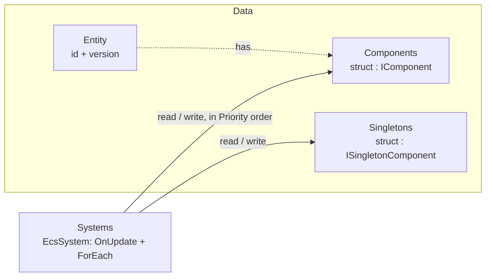

# EasyEcs

**An allocation-free archetype ECS for long-running .NET 10 servers.**
Write plain data and `[ForEach]` methods; the source generator writes the plumbing, the analyzer catches misuse at
compile time, and a full server tick allocates 0 bytes.

[](https://www.nuget.org/packages/EasyEcs)
[](https://www.nuget.org/packages/EasyEcs)
[](https://github.com/JasonXuDeveloper/EasyEcs/actions/workflows/ci.yml)
[](https://dotnet.microsoft.com/download/dotnet/10.0)
[](https://github.com/JasonXuDeveloper/EasyEcs/blob/master/LICENSE)

```bash
dotnet add package EasyEcs        # net10.0 · source generator and analyzer included
```

## Why EasyEcs

- **Zero GC in steady state.** One tick of a busy 100k-entity world (movement, AOI, combat, buffs, death, respawn,
  projectiles) allocates **0 B**, and a unit test guards that budget on every run.
- **Write the logic, not the plumbing.** A `[ForEach]` method becomes a generated struct job the JIT inlines: no
  delegates, no virtual call per entity.
- **Mistakes fail the build.** The bundled analyzer (EECS001-EECS008) reports invalid systems, class components,
  stateful systems and systems that reference each other.
- **Archetype storage, cheap structural changes.** One 16-byte record per entity (4 per cache line), one dense column
  per component type, cached archetype transitions, and `CreateEntity(a, b, c)` lands in its final archetype directly.
- **Decoupled by construction.** Systems cooperate only through data, in the order `Priority` declares. System
  groups give you separate cadences (input vs. fixed tick).
- **Built for servers that run for months.** Entity ids are recycled behind version-checked handles, memory is
  bounded by the peak entity count, structural changes are thread-safe, and queries are lock-free.

## Quick start

Data is plain structs; behavior is stateless systems.

```csharp
using EasyEcs;

public record struct Position(float X, float Y) : IComponent;
public record struct Velocity(float X, float Y) : IComponent;
public record struct Health(int Value) : IComponent;
public struct Dead : IComponent;                                         // tag: an empty component
public record struct Stats(long Tick, int Deaths) : ISingletonComponent; // one value per world

public partial class MovementSystem : EcsSystem
{
    [ForEach, Without<Dead>]                                             // runs once per matching entity
    static void Move(ref Position p, in Velocity v) => p = p with { X = p.X + v.X, Y = p.Y + v.Y };
}

public partial class DeathSystem : EcsSystem
{
    [ForEach, Without<Dead>]
    static void Die(Entity entity, in Health hp, ref Stats stats)        // singletons can be parameters too
    {
        if (hp.Value > 0) return;
        entity.Set(new Dead());                                          // a state change is data
        stats.Deaths++;
    }
}

public partial class CorpseSystem : EcsSystem
{
    public override int Priority => 10;                                  // lower runs first: this runs last

    [ForEach]
    static void Remove(Entity entity, in Dead _) => entity.Destroy();
}

public sealed class ClockSystem : EcsSystem
{
    protected override void OnUpdate() => World.GetSingleton<Stats>().Tick++;   // once per update
}
```

```csharp
using var world = new World(new WorldOptions { InitialEntityCapacity = 100_000 });
world.AddSingleton<Stats>();
world.AddSystem<MovementSystem>();
world.AddSystem<DeathSystem>();
world.AddSystem<CorpseSystem>();
world.AddSystem<ClockSystem>();

var e = world.CreateEntity(new Position(0, 0), new Velocity(1, 0), new Health(100));
e.Get<Health>().Value -= 100;                    // Get<T>() returns ref T: the write goes to storage

while (running) world.Update();                  // synchronous, allocation-free
```

None of these systems knows the others exist: they share components and a singleton, so each can be removed,
reordered or tested alone. The full walkthrough is in [Getting started](https://github.com/JasonXuDeveloper/EasyEcs/blob/master/doc/getting-started.md).

## The model in one picture



| Concept | API | In one line |
|---|---|---|
| World | `World` | Owns entities, component storage, singletons and systems. Worlds share nothing. |
| Entity | `Entity` | A 16-byte, version-checked handle. Stale handles throw instead of touching a recycled id. |
| Component | `struct : IComponent` | Plain per-entity data. An empty struct is a tag. |
| Singleton | `struct : ISingletonComponent` | One value per world: clock, configuration, counters, indexes. |
| System | `EcsSystem` | One responsibility: `OnUpdate` plus `[ForEach]` methods, run in `Priority` order. |
| Query | `[ForEach]`, `ForEach`, `Query`, `Count`, `Any` | Entities that have a set of components, filtered with `With` / `Without`. |

## When to use it

| Good fit | Probably not |
|---|---|
| Game servers and simulations on .NET 10: shards, MMO maps, AOI, combat | Unity or other runtimes below .NET 10 (`net10.0` only) |
| Worlds where state flips constantly (buffs, deaths, spawns): structural changes are O(1) | Pure number crunching that never changes structure and needs chunked SoA density |
| Long-running processes where GC pauses and unbounded growth matter | Code that wants objects with behavior, or systems calling each other |
| One world per thread, many worlds per process | Many threads mutating one world's component values without coordination |

## Performance

BenchmarkDotNet, default job, .NET 10, 4-core Xeon VM at 2.1 GHz. The headline benchmark is a realistic server tick,
not a toy loop ([what it simulates](https://github.com/JasonXuDeveloper/EasyEcs/blob/master/doc/performance.md#benchmarks)). "Allocated" is per tick.

| Benchmark | Entities | Mean | Allocated |
|---|---:|---:|---:|
| WorldSimulation.Tick | 10,000 | 322 μs | 0 B |
| WorldSimulation.Tick | 100,000 | 4.33 ms | 0 B |
| ShardedWorld.TickAllShards (4 worlds × 25k) | 100,000 | 1.85 ms | 0 B |

A `[ForEach]` system writing two components over 10,000 entities takes 15.1 μs, against 11.0 μs for two plain arrays
with no ECS at all. Micro benchmarks and the v3 comparison are in [doc/performance.md](https://github.com/JasonXuDeveloper/EasyEcs/blob/master/doc/performance.md).

```bash
dotnet run -c Release --project EasyEcs.Benchmark -- --filter '*'
```

## Documentation

| | |
|---|---|
| [Getting started](https://github.com/JasonXuDeveloper/EasyEcs/blob/master/doc/getting-started.md) | Step-by-step tutorial: entities, components, tags, queries, systems, singletons, groups, the update loop. |
| [Guide](https://github.com/JasonXuDeveloper/EasyEcs/blob/master/doc/README.md#guide) | One page per concept: queries, systems, singletons, structural changes, `ref` and `await`, threading, analyzer rules. |
| [ECS principles](https://github.com/JasonXuDeveloper/EasyEcs/blob/master/doc/ecs-principles.md) | How to design features with entities, components, singletons and systems. |
| [API reference](https://github.com/JasonXuDeveloper/EasyEcs/blob/master/doc/api.md) | Every public API with its complexity. |
| [Performance guide](https://github.com/JasonXuDeveloper/EasyEcs/blob/master/doc/performance.md) | Which API to use when, do's and don'ts, benchmarks. |
| [Architecture](https://github.com/JasonXuDeveloper/EasyEcs/blob/master/doc/architecture.md) | Storage, memory layout, archetypes, id recycling, iteration safety, generators. |
| [Migration guide](https://github.com/JasonXuDeveloper/EasyEcs/blob/master/MIGRATION_GUIDE.md) | Upgrading from v3 (and from v2). |

The [documentation index](https://github.com/JasonXuDeveloper/EasyEcs/blob/master/doc/README.md) suggests a reading order.

## What's new in 4.0

v4 is a rewrite for .NET 10 with standard ECS vocabulary in a single `EasyEcs` namespace:

- `Context` → `World`, `GroupOf` → `Query`, and a single version-checked `Entity` handle whose accessors return `ref T`.
- Systems are synchronous `EcsSystem`s with source-generated `[ForEach]` methods (no UniTask dependency).
- Entity ids are recycled; singletons are per world; system groups with `[UpdateInGroup<T>]`.
- The analyzer enforces the ECS principles (EECS006-EECS008); events were replaced by state-as-data.

See the [migration guide](https://github.com/JasonXuDeveloper/EasyEcs/blob/master/MIGRATION_GUIDE.md) for every rename and behavioral change.

## License

[MIT](https://github.com/JasonXuDeveloper/EasyEcs/blob/master/LICENSE)
