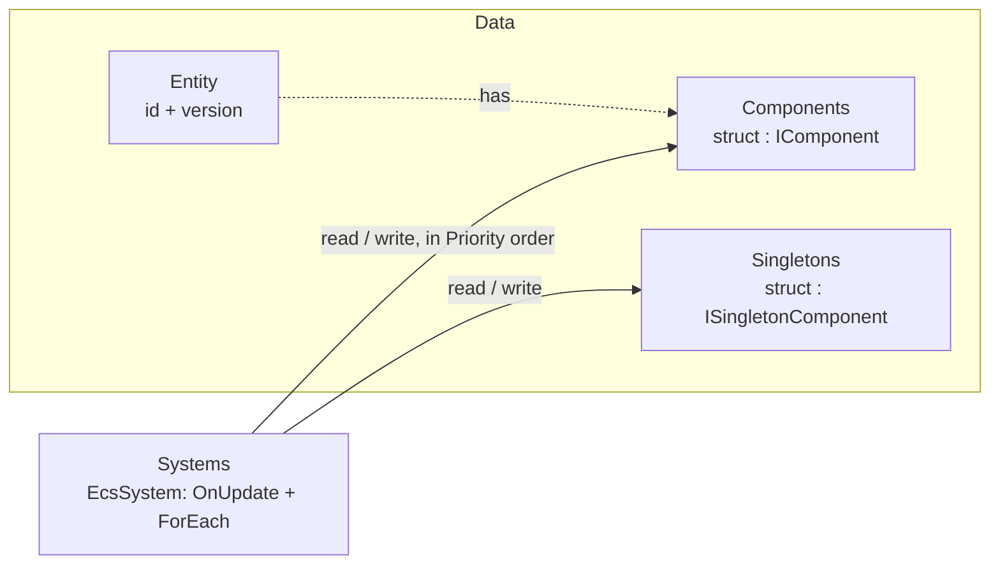

# EasyEcs

**A high-performance, allocation-free archetype ECS for .NET 10 servers.**
Write plain data and `[ForEach]` methods; the source generator turns them into inlined struct jobs, the analyzer
catches design mistakes at compile time, and a full server tick allocates 0 bytes.

[](https://www.nuget.org/packages/EasyEcs)
[](https://www.nuget.org/packages/EasyEcs)
[](https://github.com/JasonXuDeveloper/EasyEcs/actions/workflows/ci.yml)
[](https://dotnet.microsoft.com/download/dotnet/10.0)
[](https://github.com/JasonXuDeveloper/EasyEcs/blob/master/LICENSE)

| One server tick, 9 systems: movement, AOI, combat, status effects, death, respawn, projectiles | Entities | Time | Allocated |
|---|---:|---:|---:|
| One world | 100,000 | **1.90 ms** | **0 B** |
| Four worlds on four threads (one per thread) | 100,000 | **0.93 ms** | **0 B** |
| The [battle server below](#example-a-battle-server), every feature on: parallel steering, replication, indexes, relations | 100,000 | **2.76 ms** | **0 B** |

<sub>BenchmarkDotNet, .NET 10, 4-core Xeon VM at 2.1 GHz; entities spawn, die, gain and lose components every tick.
A `[ForEach]` system adding `Velocity` to `Position` costs 0.8 ns per entity (one archetype), faster than two
plain arrays.
[Details](https://github.com/JasonXuDeveloper/EasyEcs/blob/master/doc/performance.md#benchmarks).</sub>

```bash
dotnet add package EasyEcs        # net10.0 · source generator and analyzer included
```

## Why EasyEcs

- **Fast and garbage-free.** Archetype tables with 64-byte-aligned columns that iteration and SIMD walk front to back,
  16-byte entity records (4 per cache line), JIT-inlined struct jobs instead of delegates, lock-free queries. After warm-up nothing allocates: a unit test guards the 0 B
  budget of updates, queries and structural changes on every run.
- **Structural changes are immediate and cheap.** Add and remove components, spawn and destroy, even in the middle of
  a pass; no command buffer to flush. Removing a status effect and adding it back flips a presence bit, the entity
  never moves. State can be tags, not flags.
- **Write the logic, not the plumbing.** A `[ForEach]` method is the whole system; filters are attributes
  (`[With<T>]`, `[Without<T>]`, `[WithAny<T>]`), singletons are parameters.
- **Built-in change tracking, indexes and relations.** `[Changed<T>]` visits only the rows written since a system last
  ran; `IIndexed<TKey>` components are found by value, and an `Entity` key makes a relation. Both follow every write,
  including writes through `ref`, with no events and nothing to keep in sync by hand.
- **Mistakes fail the build.** The bundled analyzer (EECS001-EECS010) reports invalid systems, class components,
  stateful systems and systems that reference each other.
- **Decoupled by construction.** Systems cooperate only through data, in `Priority` order; system groups give you
  separate cadences (input on every wake, simulation on a fixed tick).
- **Built for servers that run for months.** Ids are recycled behind version-checked handles, memory is bounded by
  the peak entity count, structural bookkeeping is guarded and never tears; the supported model is one owner
  thread per world (see [Threading](https://github.com/JasonXuDeveloper/EasyEcs/blob/master/doc/guide/threading.md)),
  and one world per thread scales across cores.

## Example: a battle server

One zone of a battle server, using every feature: plain data, one job per system, systems that never know about each
other. It is the [benchmark world](https://github.com/JasonXuDeveloper/EasyEcs/blob/master/EasyEcs.Benchmark/BattleServer.cs)
measured below and the world of the
[scenario tests](https://github.com/JasonXuDeveloper/EasyEcs/blob/master/EasyEcs.UnitTest/BattleServerTests.cs).

| Feature | Where |
|---|---|
| Components, tags, singletons | `Position`, `Health`, `Player`, `Dead`; `Battle`, `Waypoints` |
| `[ForEach]` systems, filters (`With`, `Without`, `WithAny`) | every system; `StatusSystem.Count` counts burning **or** frozen units |
| `[ForEach(Parallel = true)]` | `SteeringSystem`: NPC steering on every core |
| Batch methods (`Span<T>`) | `MovementSystem`: whole runs of rows, SIMD-friendly |
| Immediate structural changes | statuses added and removed mid-pass, deaths, respawns, projectiles spawned and destroyed |
| Change tracking (`ITrackChanges`, `[Changed<T>]`) | `ReplicationSystem` sends only the healths written since its last run |
| Value index | `Zone : IIndexed<int>`: players per zone |
| Relation | `OwnedBy : IIndexed<Entity>`: a respawning player recalls its projectiles |
| System groups, `UpdateInterval` | `Replication` runs every third tick; `RegenerationSystem` every tenth update |
| Bulk creation, snapshots | `CreateEntities` for the players; `Capture` / `Restore` below |

**Data** is plain structs:

```csharp
using System;
using System.Runtime.CompilerServices;
using EasyEcs;

public record struct Position(float X, float Y) : IComponent;
public record struct Velocity(float X, float Y) : IComponent;
public record struct Health(int Value, int Max) : IComponent, ITrackChanges;    // replicated: writes are tracked
public record struct Replica(int Health) : IComponent;                        // what clients last received
public record struct Attack(int Damage, int Interval, int Cooldown) : IComponent;
public record struct Burning(int Ticks) : IComponent;                         // status effects come and go
public record struct Frozen(int Ticks) : IComponent;
public record struct Lifetime(int Ticks) : IComponent;
public record struct Zone(int Id) : IComponent, IIndexed<int> { public int Key => Id; }                  // players by zone
public record struct OwnedBy(Entity Owner) : IComponent, IIndexed<Entity> { public Entity Key => Owner; } // a relation
public struct Player : IComponent;                                            // tags: empty components
public struct Npc : IComponent;
public struct Dead : IComponent;

public record struct Battle(long Tick, int Hits, int Deaths, int Shots, int Replicated, int Afflicted) : ISingletonComponent;

public struct Waypoints : ISingletonComponent
{
    public const int Count = 8;
    public WaypointArray Points;
}

[InlineArray(Waypoints.Count)]
public struct WaypointArray { private Position _first; }

public struct Replication : ISystemGroup;                                     // runs when the server sends updates
```

**Systems** do one job each, in `Priority` order:

```csharp
public partial class SteeringSystem : EcsSystem                               // heavy per-entity math: on all cores
{
    [ForEach(Parallel = true), With<Npc>, Without<Dead>, Without<Frozen>]
    static void Steer(in Position p, ref Velocity v, in Waypoints waypoints)
    {
        var target = waypoints.Points[(int)(p.X + p.Y) & (Waypoints.Count - 1)];
        float dx = target.X - p.X, dy = target.Y - p.Y, length = MathF.Sqrt(dx * dx + dy * dy) + 1;
        v = new Velocity(dx / length * 2, dy / length * 2);
    }
}

public partial class MovementSystem : EcsSystem
{
    public override int Priority => 1;

    [ForEach, Without<Dead>, Without<Frozen>]                                 // whole runs of rows: SIMD-friendly
    static void Move(Span<Position> positions, ReadOnlySpan<Velocity> velocities)
    {
        for (int i = 0; i < positions.Length; i++)
            positions[i] = new Position(positions[i].X + velocities[i].X, positions[i].Y + velocities[i].Y);
    }
}

public partial class ZoneSystem : EcsSystem                                   // the zone index follows these writes
{
    public override int Priority => 2;

    [ForEach]
    static void Enter(Entity player, in Position p, in Zone zone)              // `in`: reading is not a change
    {
        int id = Math.Clamp((int)(p.X / 1024), 0, 3);
        if (zone.Id != id) player.Get<Zone>() = new Zone(id);                  // only real moves are writes
    }
}

public partial class CombatSystem : EcsSystem
{
    public override int Priority => 3;

    [ForEach, Without<Dead>, Without<Frozen>]
    static void Fight(Entity unit, ref Attack attack, ref Battle battle)
    {
        if (--attack.Cooldown > 0) return;
        attack.Cooldown = attack.Interval;
        unit.Get<Health>().Value -= attack.Damage;                            // a hit is a change of Health
        battle.Hits++;
        uint roll = Dice.Roll(battle.Tick, unit.Id);
        if (roll % 50 == 0 && !unit.Has<Burning>()) unit.Add<Burning>() = new Burning(10);   // applied at once
        else if (roll % 70 == 1 && !unit.Has<Frozen>()) unit.Add<Frozen>() = new Frozen(4);
    }
}

public partial class StatusSystem : EcsSystem
{
    public override int Priority => 4;

    [ForEach]
    static void Burn(Entity unit, ref Burning burning, ref Health hp)
    {
        hp.Value -= 3;
        if (--burning.Ticks == 0) unit.Remove<Burning>();                     // flips a bit: the row stays
    }

    [ForEach]
    static void Thaw(Entity unit, ref Frozen frozen)
    {
        if (--frozen.Ticks == 0) unit.Remove<Frozen>();
    }

    [ForEach, WithAny<Burning>, WithAny<Frozen>]                              // burning or frozen (or both)
    static void Count(in Health hp, ref Battle battle) => battle.Afflicted++;
}

public partial class DeathSystem : EcsSystem
{
    public override int Priority => 5;

    [ForEach, Without<Dead>]
    static void Die(Entity unit, in Health hp, ref Battle battle)
    {
        if (hp.Value > 0) return;
        unit.Add<Dead>();                                                     // whoever cares queries Dead
        battle.Deaths++;
    }
}

public partial class RespawnSystem : EcsSystem                                // DeathSystem does not know it exists
{
    public override int Priority => 6;

    [ForEach, With<Player>, With<Dead>]
    static void Respawn(Entity player, ref Health hp, World world)
    {
        foreach (var shot in world.Index<OwnedBy, Entity>().Find(player)) shot.Destroy();   // recall its projectiles
        hp.Value = hp.Max;
        player.Remove<Dead>();
    }

    [ForEach, With<Npc>, With<Dead>]
    static void Despawn(Entity npc, in Position p, World world)
    {
        npc.Destroy();
        BattleServer.SpawnNpc(world, new Position(p.Y, p.X), npc.Id);
    }
}

public partial class ProjectileSystem : EcsSystem
{
    public override int Priority => 7;

    [ForEach, With<Player>, Without<Dead>]
    static void Shoot(Entity player, in Position p, in Velocity v, ref Battle battle, World world)
    {
        if (Dice.Roll(battle.Tick, player.Id) % 20 != 0) return;
        battle.Shots++;
        world.CreateEntity(p, new Velocity(v.X * 4, v.Y * 4), new Lifetime(20), new OwnedBy(player));
    }

    [ForEach]
    static void Expire(Entity shot, ref Lifetime life)
    {
        if (--life.Ticks == 0) shot.Destroy();
    }
}

public partial class RegenerationSystem : EcsSystem
{
    public override int Priority => 8;
    public override int UpdateInterval => 10;                                 // every 10th update

    [ForEach, With<Player>, Without<Dead>]
    static void Regenerate(Entity player, in Health hp)
    {
        if (hp.Value < hp.Max) player.Get<Health>().Value = Math.Min(hp.Max, hp.Value + 20);
    }
}

public sealed class ClockSystem : EcsSystem
{
    public override int Priority => 100;
    protected override void OnUpdate() => World.GetSingleton<Battle>().Tick++;
}

[UpdateInGroup<Replication>]
public partial class ReplicationSystem : EcsSystem                            // only what changed since the last send
{
    [ForEach, Changed<Health>]
    static void Send(in Health hp, ref Replica replica, ref Battle battle)
    {
        replica = new Replica(hp.Value);
        battle.Replicated++;
    }
}
```

**Setup and the server loop:**

```csharp
public static class Dice                                       // deterministic per tick and entity
{
    public static uint Roll(long tick, int id)
    {
        ulong x = (ulong)tick * 0x9E3779B97F4A7C15UL ^ (uint)id * 0xBF58476D1CE4E5B9UL;
        x ^= x >> 31;
        x *= 0x94D049BB133111EBUL;
        return (uint)(x ^ (x >> 29));
    }
}

public static class BattleServer
{
    /// <summary>A world of <paramref name="units"/> units, a third of them players.</summary>
    public static World Create(int units)
    {
        var world = new World(new WorldOptions { InitialEntityCapacity = units * 2 });
        world.AddSingleton<Battle>();
        ref var waypoints = ref world.AddSingleton<Waypoints>();
        for (int i = 0; i < Waypoints.Count; i++) waypoints.Points[i] = new Position(512 + i * 400, 512 + (i * 1777) % 3000);
        world.AddSystem<SteeringSystem>();
        world.AddSystem<MovementSystem>();
        world.AddSystem<ZoneSystem>();
        world.AddSystem<CombatSystem>();
        world.AddSystem<StatusSystem>();
        world.AddSystem<DeathSystem>();
        world.AddSystem<RespawnSystem>();
        world.AddSystem<ProjectileSystem>();
        world.AddSystem<RegenerationSystem>();
        world.AddSystem<ClockSystem>();
        world.AddSystem<ReplicationSystem>();

        var players = new Entity[units / 3];                                  // one batch: one table growth
        world.CreateEntities(players, new Position(), new Velocity(1, 0), new Health(500, 500), new Replica(500),
            new Attack(8, 6, 0), new Zone(0), new Player());
        for (int i = 0; i < players.Length; i++)
        {
            uint r = Dice.Roll(0, i);
            players[i].Get<Position>() = new Position(r % 4096, (r >> 12) % 4096);
            players[i].Get<Velocity>() = new Velocity((int)(r % 5) - 2, (int)((r >> 8) % 5) - 2);
            players[i].Get<Attack>().Cooldown = (int)(r % 6);
        }

        for (int i = players.Length; i < units; i++)
        {
            uint r = Dice.Roll(0, i);
            SpawnNpc(world, new Position(r % 4096, (r >> 12) % 4096), i);
        }

        return world;
    }

    public static void SpawnNpc(World world, Position at, int seed)
    {
        uint r = Dice.Roll(seed, seed);
        int hp = 100 + (int)(r % 100);
        world.CreateEntity(at, new Velocity(), new Health(hp, hp), new Replica(hp),
            new Attack(5 + (int)(r % 5), 5 + (int)(r % 10), (int)(r % 10)), new Npc());
    }

    /// <summary>One server tick: the simulation every tick, replication every third.</summary>
    public static void Tick(World world)
    {
        world.Update();
        if (world.GetSingleton<Battle>().Tick % 3 == 0) world.Update<Replication>();
    }
}
```

```csharp
using var world = BattleServer.Create(100_000);
var zones = world.Index<Zone, int>();
var save = world.Capture();                       // e.g. before a risky admin command

while (running)
{
    BattleServer.Tick(world);                     // 0 B per tick once warmed up
    int crowded = zones.Count(0);                 // players in zone 0, kept current by the index
}

world.Restore(save);                              // roll the zone back in memory
```

Every system can be removed, reordered or tested alone: they share components and singletons, nothing else. The
step-by-step tutorial is [Getting started](https://github.com/JasonXuDeveloper/EasyEcs/blob/master/doc/getting-started.md).

## The model in one picture



| Concept | API | In one line |
|---|---|---|
| World | `World` | Owns entities, component storage, singletons and systems. Worlds share nothing. |
| Entity | `Entity` | A 16-byte, version-checked handle. Stale handles throw instead of touching a recycled id. |
| Component | `struct : IComponent` | Plain per-entity data. An empty struct is a tag. |
| Singleton | `struct : ISingletonComponent` | One value per world: clock, configuration, counters, a spatial grid. |
| System | `EcsSystem` | One responsibility: `OnUpdate` plus `[ForEach]` methods, run in `Priority` order. |
| Query | `[ForEach]`, `ForEach`, `Query`, `Count`, `Any` | Entities that have a set of components, filtered with `With` / `Without` / `WithAny` / `Changed`. |
| Index | `IIndexed<TKey>`, `world.Index<T, TKey>()` | Entities by a component's value, or by the entity a relation component points at. |

## When to use it

| Good fit | Probably not |
|---|---|
| Game servers and simulations on .NET 10: MMO maps and zones, AOI, combat | Unity or other runtimes below .NET 10 (`net10.0` only) |
| Worlds where state flips constantly (buffs, deaths, spawns): structural changes are immediate and cheap | Code that needs structural changes recorded from many threads at once (use one owner thread and a queue) |
| Long-running processes where GC pauses and unbounded growth matter | Code that wants objects with behavior, or systems calling each other |
| One world per thread, many worlds per process; `Parallel` for heavy independent systems | Many threads mutating one world's component values without coordination |

## Performance

BenchmarkDotNet, default job, .NET 10, 4-core Xeon VM at 2.1 GHz. The headline benchmark is a realistic server tick,
not a toy loop ([what it simulates](https://github.com/JasonXuDeveloper/EasyEcs/blob/master/doc/performance.md#benchmarks)). "Allocated" is per tick.

| Benchmark | Entities | Mean | Allocated |
|---|---:|---:|---:|
| WorldSimulationBenchmark.Tick | 10,000 | 175 μs | 0 B |
| WorldSimulationBenchmark.Tick | 100,000 | 1.90 ms | 0 B |
| MultiWorldBenchmark.TickAllWorlds (4 worlds × 25k) | 100,000 | 0.93 ms | 0 B |
| BattleServerBenchmark.Tick (the example above, every feature) | 100,000 | 2.76 ms | 0 B |

Against v4.0.1 (4.33 ms) the tick is 2.3x faster.

A `[ForEach]` system adding `Velocity` to `Position` over 10,000 entities (one archetype) takes 8.3 μs, against
10.3 μs for two plain arrays with no ECS at all (its columns are 64-byte aligned). Micro benchmarks (with v3.1.1 and
v4.0.1 numbers for comparison) and the per-operation comparison are in
[doc/performance.md](https://github.com/JasonXuDeveloper/EasyEcs/blob/master/doc/performance.md); their `ForEach` and
`Query` rows run on a world with two archetypes, so they are not directly comparable to the `[ForEach]` row.

```bash
dotnet run -c Release --project EasyEcs.Benchmark -- --filter '*'
```

## Compared with other ECS libraries

The same 100,000-entity tick, ported to each library's fast path with identical results checked in setup
([details](https://github.com/JasonXuDeveloper/EasyEcs/blob/master/doc/comparison.md)):

| Library | Tick (100,000 entities) | Allocated per tick |
|---|---:|---:|
| Friflo.Engine.ECS 3.6 | 1.75 ms (0.90) | 0 B |
| **EasyEcs 4.1** | **1.95 ms (1.00)** | **0 B** |
| Arch 2.1 | 5.20 ms (2.68) | 587 KB |
| DefaultEcs 0.17 | 5.40 ms (2.78) | 63 KB |

EasyEcs leads on one-component and SIMD iteration, filters and toggling a status component (2x Friflo); Friflo on
iteration that passes the entity. On change tracking (`[Changed<T>]`, 1,000 of 100,000 rows written per tick) EasyEcs
is the fastest of all four (39 μs; a scan takes 53-119 μs, a dirty tag 80-121 μs).

| | EasyEcs | Friflo.Engine.ECS | Arch | DefaultEcs |
|---|:-:|:-:|:-:|:-:|
| Structural changes inside a query loop, applied at once | ✅ | ❌ command buffer | ⚠️ unguarded | ⚠️ unsafe |
| Change tracking ("rows written since") | ✅ | ❌ | ❌ | ✅ explicit notify |
| Value index | ✅ | ✅ | ❌ | ✅ |
| Relations with reverse lookup | ✅ | ✅ | ❌ | ❌ |
| In-memory world snapshot | ✅ | ❌ | ❌ | ❌ |
| Systems, groups, parallel systems | ✅ | ✅ (no parallel systems) | ❌ core | ✅ |
| Source-generated systems + analyzer | ✅ | ❌ | ❌ | ❌ |
| 0 B per tick | ✅ | ✅ | ❌ | ❌ |
| Events, serialization | ❌ (state is data) | ✅ | events | ✅ |
| Unity / netstandard | ❌ net10.0 | ✅ | ✅ | ✅ |

The full matrix, the per-operation numbers and when to pick which library are in
[doc/comparison.md](https://github.com/JasonXuDeveloper/EasyEcs/blob/master/doc/comparison.md); every feature with
what it does, when to use it and what it costs is in
[doc/features.md](https://github.com/JasonXuDeveloper/EasyEcs/blob/master/doc/features.md).

## Documentation

| | |
|---|---|
| [Getting started](https://github.com/JasonXuDeveloper/EasyEcs/blob/master/doc/getting-started.md) | Step-by-step tutorial: entities, components, tags, queries, systems, singletons, groups, the update loop. |
| [Features](https://github.com/JasonXuDeveloper/EasyEcs/blob/master/doc/features.md) | Every feature: what it does, when to use it, when not, what it costs, which scenarios it serves. |
| [Comparison](https://github.com/JasonXuDeveloper/EasyEcs/blob/master/doc/comparison.md) | Features and benchmarks against Friflo.Engine.ECS, Arch and DefaultEcs. |
| [Guide](https://github.com/JasonXuDeveloper/EasyEcs/blob/master/doc/README.md#guide) | One page per concept: queries, systems, singletons, structural changes, change tracking, indexes and relations, snapshots, `ref` and `await`, threading, analyzer rules. |
| [ECS principles](https://github.com/JasonXuDeveloper/EasyEcs/blob/master/doc/ecs-principles.md) | How to design features with entities, components, singletons and systems. |
| [API reference](https://github.com/JasonXuDeveloper/EasyEcs/blob/master/doc/api.md) | Every public API with its complexity. |
| [Performance guide](https://github.com/JasonXuDeveloper/EasyEcs/blob/master/doc/performance.md) | Which API to use when, do's and don'ts, benchmarks. |
| [Architecture](https://github.com/JasonXuDeveloper/EasyEcs/blob/master/doc/architecture.md) | Storage, memory layout, archetypes, id recycling, iteration safety, generators. |
| [Migration guide](https://github.com/JasonXuDeveloper/EasyEcs/blob/master/MIGRATION_GUIDE.md) | Upgrading from 4.0 to 4.1, from v3 (and from v2). |

The [documentation index](https://github.com/JasonXuDeveloper/EasyEcs/blob/master/doc/README.md) suggests a reading order.

## What's new in 4.1

- **Archetype tables.** Each archetype stores its components as columns of rows (structure of arrays); unmanaged
  columns are pinned and start on a 64-byte boundary. Iteration walks columns front to back, and tables stay dense:
  a removed row is filled by the last one at once, or when the pass that removed it ends.
- **Removing a component keeps the row.** It only clears a presence bit, so states that come and go (stunned,
  burning, dead) never move data; queries skip, walk or test 64 rows per bit word per table.
- **Stricter iteration with immediate changes.** A pass visits each entity at most once, and `[ForEach]` writes
  through `ref` parameters survive the body's own structural changes. No command buffer, no idempotency filters.
- **Batch `[ForEach]` methods** take `Span<T>` / `ReadOnlySpan<T>` and receive whole runs of rows for SIMD
  (`world.ForEachBatch` for ad-hoc jobs); `world.ForEachEntity` passes the handle to struct jobs.
- **Jobs that cannot change structure** (detected by the generator, or `INoStructuralChanges`) iterate with no
  per-entity bookkeeping; structural bookkeeping uses a compare-and-swap gate instead of a lock.
- **Parallel `[ForEach]`:** `[ForEach(Parallel = true)]` splits one method's rows across threads, allocation-free;
  the analyzer rejects methods that could race (EECS010).
- **Snapshots:** `world.Capture()` / `world.Restore(snapshot)` roll a world back in memory (undo, prediction, tests).
- **Change tracking:** components marked `ITrackChanges` record each row's last write; `[Changed<T>]` methods visit
  only the rows written since their system last ran (replication, persistence), and `QueryFilter.Changed<T>()`
  does the same for queries.
- **Indexes and relations:** components implementing `IIndexed<TKey>` are found by value
  (`world.Index<T, TKey>().Find(key)`); an `Entity` key makes a relation (`ChildOf(Entity Parent)`) whose index
  lists the children of an entity.
- **New APIs:** `WithAny<T>` filters (`[WithAny<T>]` on `[ForEach]`), batch `CreateEntities` / `DestroyEntities`,
  per-system timing (`WorldOptions.MeasureSystems`, `system.Stats`); Native AOT compatible.
- `Entity.GetHashCode()` is deterministic (`Id * 397 ^ Version`) and cheaper (relation lookups hash handles).
- A realistic 100k-entity server tick takes 1.90 ms instead of 4.33 ms; toggling a status component on 10,000
  entities 174 μs instead of 338 μs. Reading a component through a handle is about 14% slower (4.05 vs 3.56 μs per
  1,000 random handles): the entity's record leads to a table row instead of a column indexed by id.

## What's new in 4.0

v4 is a rewrite for .NET 10 with standard ECS vocabulary in a single `EasyEcs` namespace:

- `Context` → `World`, `GroupOf` → `Query`, and a single version-checked `Entity` handle whose accessors return `ref T`.
- Systems are synchronous `EcsSystem`s with source-generated `[ForEach]` methods (no UniTask dependency).
- Entity ids are recycled; singletons are per world; system groups with `[UpdateInGroup<T>]`.
- The analyzer enforces the ECS principles (EECS006-EECS008); events were replaced by state-as-data.
- `WorldOptions.Parallel` runs systems of one priority together only when their generated read/write access does
  not conflict: parallel with the same result as sequential, allocation-free.
- A `[ForEach]` method may take no component when a `[With<T>]` names what to query
  (`[ForEach, With<Dead>] static void Remove(Entity e)`).

See the [migration guide](https://github.com/JasonXuDeveloper/EasyEcs/blob/master/MIGRATION_GUIDE.md) for every rename and behavioral change.

## License

[MIT](https://github.com/JasonXuDeveloper/EasyEcs/blob/master/LICENSE)
