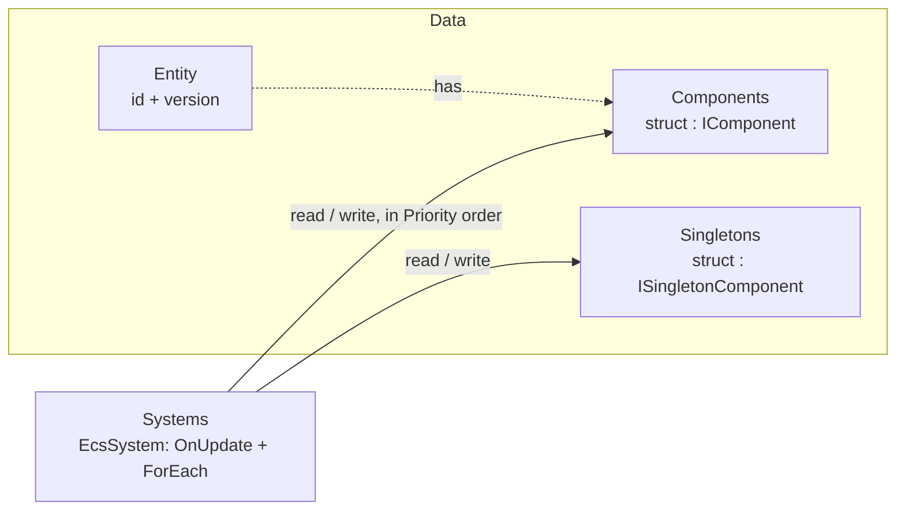

# EasyEcs

**A high-performance, allocation-free archetype ECS for .NET 10 servers.**
Write plain data and `[ForEach]` methods; the source generator turns them into inlined struct jobs, the analyzer
catches design mistakes at compile time, and a full server tick allocates 0 bytes.

[](https://www.nuget.org/packages/EasyEcs)
[](https://www.nuget.org/packages/EasyEcs)
[](https://github.com/JasonXuDeveloper/EasyEcs/actions/workflows/ci.yml)
[](https://dotnet.microsoft.com/download/dotnet/10.0)
[](https://github.com/JasonXuDeveloper/EasyEcs/blob/master/LICENSE)

| One server tick, 9 systems: movement, AOI, combat, status effects, death, respawn, projectiles | Entities | Time | Allocated |
|---|---:|---:|---:|
| One world | 100,000 | **4.33 ms** | **0 B** |
| Four worlds on four threads (one per thread) | 100,000 | **1.85 ms** | **0 B** |

<sub>BenchmarkDotNet, .NET 10, 4-core Xeon VM at 2.1 GHz; entities spawn, die, gain and lose components every tick.
A `[ForEach]` system adding `Velocity` to `Position` costs 1.5 ns per entity (one archetype), within 1.4x of two
plain arrays.
[Details](https://github.com/JasonXuDeveloper/EasyEcs/blob/master/doc/performance.md#benchmarks).</sub>

```bash
dotnet add package EasyEcs        # net10.0 · source generator and analyzer included
```

## Why EasyEcs

- **Fast and garbage-free.** Dense columns per component type, 16-byte entity records (4 per cache line), JIT-inlined
  struct jobs instead of delegates, lock-free queries. After warm-up nothing allocates: a unit test guards the 0 B
  budget of updates, queries and structural changes on every run.
- **Structural changes are cheap.** Adding a status effect, killing a unit or spawning a projectile moves one entity
  through a cached archetype edge, even in the middle of a pass. State can be tags, not flags.
- **Write the logic, not the plumbing.** A `[ForEach]` method is the whole system; filters are attributes
  (`[With<T>]`, `[Without<T>]`), singletons are parameters.
- **Mistakes fail the build.** The bundled analyzer (EECS001-EECS008) reports invalid systems, class components,
  stateful systems and systems that reference each other.
- **Decoupled by construction.** Systems cooperate only through data, in `Priority` order; system groups give you
  separate cadences (input on every wake, simulation on a fixed tick).
- **Built for servers that run for months.** Ids are recycled behind version-checked handles, memory is bounded by
  the peak entity count, structural bookkeeping is lock-protected and never tears; the supported model is one owner
  thread per world (see [Threading](https://github.com/JasonXuDeveloper/EasyEcs/blob/master/doc/guide/threading.md)),
  and one world per thread scales across cores.

## Example: a battle server

Data is plain structs; behavior is one-job systems that never know about each other.

```csharp
using EasyEcs;

public record struct Position(float X, float Y) : IComponent;
public record struct Velocity(float X, float Y) : IComponent;
public record struct Health(int Value, int Max) : IComponent;
public record struct Hits(int Damage, int Interval, int Cooldown) : IComponent;  // damage taken every Interval ticks
public record struct Burning(int Ticks) : IComponent;      // a status effect: added and removed at run time
public record struct Lifetime(int Ticks) : IComponent;
public struct Player : IComponent;                         // tags: empty components used as filters
public struct Dead : IComponent;
public record struct Battle(long Tick, int Deaths) : ISingletonComponent;   // one value per world

public partial class MovementSystem : EcsSystem
{
    [ForEach, Without<Dead>]                               // runs once per matching entity, as an inlined struct job
    static void Move(ref Position p, in Velocity v) => p = new Position(p.X + v.X, p.Y + v.Y);
}

public partial class CombatSystem : EcsSystem
{
    public override int Priority => 1;                     // lower runs first

    [ForEach, Without<Dead>]
    static void TakeHits(Entity unit, ref Hits hits, ref Health hp, in Battle battle)   // singletons are parameters
    {
        if (--hits.Cooldown > 0) return;
        hits.Cooldown = hits.Interval;
        hp.Value -= hits.Damage;
        if (battle.Tick % 20 == 0 && !unit.Has<Burning>()) unit.Add<Burning>() = new Burning(10);
    }
}

public partial class BurnSystem : EcsSystem
{
    public override int Priority => 2;

    [ForEach]
    static void Burn(Entity unit, ref Burning burning, ref Health hp)
    {
        hp.Value -= 3;
        if (--burning.Ticks == 0) unit.Remove<Burning>();   // structural changes are safe mid-pass
    }
}

public partial class DeathSystem : EcsSystem
{
    public override int Priority => 3;

    [ForEach, Without<Dead>]
    static void Die(Entity unit, in Health hp, ref Battle battle)
    {
        if (hp.Value > 0) return;
        unit.Add<Dead>();                                  // a state change is data: whoever cares queries it
        battle.Deaths++;
    }
}

public partial class RespawnSystem : EcsSystem              // reacts to Dead; DeathSystem does not know it exists
{
    public override int Priority => 4;

    [ForEach, With<Player>, With<Dead>]
    static void Respawn(Entity unit, ref Health hp) { hp.Value = hp.Max; unit.Remove<Dead>(); }

    [ForEach, With<Dead>, Without<Player>]   // filters only: the method takes just the entity
    static void Despawn(Entity unit) => unit.Destroy();
}

public partial class ProjectileSystem : EcsSystem
{
    public override int Priority => 5;

    [ForEach, With<Player>, Without<Dead>]
    static void Shoot(in Position p, in Velocity v, in Battle battle, World world)
    {
        if (battle.Tick % 10 == 0) world.CreateEntity(p, new Velocity(v.X * 4, v.Y * 4), new Lifetime(20));
    }

    [ForEach]
    static void Expire(Entity projectile, ref Lifetime life) { if (--life.Ticks == 0) projectile.Destroy(); }
}

public sealed class ClockSystem : EcsSystem
{
    public override int Priority => 100;
    protected override void OnUpdate() => World.GetSingleton<Battle>().Tick++;
}
```

```csharp
using var world = new World(new WorldOptions { InitialEntityCapacity = 200_000 });
world.AddSingleton<Battle>();
world.AddSystem<MovementSystem>();
world.AddSystem<CombatSystem>();
world.AddSystem<BurnSystem>();
world.AddSystem<DeathSystem>();
world.AddSystem<RespawnSystem>();
world.AddSystem<ProjectileSystem>();
world.AddSystem<ClockSystem>();

for (int i = 0; i < 100_000; i++)
{
    var unit = world.CreateEntity(new Position(i % 4096, i / 4096), new Velocity(1, 0),   // lands in its final
        new Health(100, 100), new Hits(5, 8, i % 8));                                    // archetype directly
    if (i % 3 == 0) unit.Add<Player>();
}

while (running) world.Update();   // synchronous; 0 B per tick once warmed up
```

Every system can be removed, reordered or tested alone: they share components and a singleton, nothing else. This
is a trimmed version of the [benchmark world](https://github.com/JasonXuDeveloper/EasyEcs/blob/master/EasyEcs.Benchmark/WorldSimulation.cs) measured above. The
step-by-step tutorial is [Getting started](https://github.com/JasonXuDeveloper/EasyEcs/blob/master/doc/getting-started.md).

## The model in one picture



| Concept | API | In one line |
|---|---|---|
| World | `World` | Owns entities, component storage, singletons and systems. Worlds share nothing. |
| Entity | `Entity` | A 16-byte, version-checked handle. Stale handles throw instead of touching a recycled id. |
| Component | `struct : IComponent` | Plain per-entity data. An empty struct is a tag. |
| Singleton | `struct : ISingletonComponent` | One value per world: clock, configuration, counters, indexes. |
| System | `EcsSystem` | One responsibility: `OnUpdate` plus `[ForEach]` methods, run in `Priority` order. |
| Query | `[ForEach]`, `ForEach`, `Query`, `Count`, `Any` | Entities that have a set of components, filtered with `With` / `Without`. |

## When to use it

| Good fit | Probably not |
|---|---|
| Game servers and simulations on .NET 10: MMO maps and zones, AOI, combat | Unity or other runtimes below .NET 10 (`net10.0` only) |
| Worlds where state flips constantly (buffs, deaths, spawns): structural changes are O(1) | Pure number crunching that never changes structure and needs chunked SoA density |
| Long-running processes where GC pauses and unbounded growth matter | Code that wants objects with behavior, or systems calling each other |
| One world per thread, many worlds per process; `Parallel` for heavy independent systems | Many threads mutating one world's component values without coordination |

## Performance

BenchmarkDotNet, default job, .NET 10, 4-core Xeon VM at 2.1 GHz. The headline benchmark is a realistic server tick,
not a toy loop ([what it simulates](https://github.com/JasonXuDeveloper/EasyEcs/blob/master/doc/performance.md#benchmarks)). "Allocated" is per tick.

| Benchmark | Entities | Mean | Allocated |
|---|---:|---:|---:|
| WorldSimulationBenchmark.Tick | 10,000 | 252 μs | 0 B |
| WorldSimulationBenchmark.Tick | 100,000 | 3.01 ms | 0 B |
| MultiWorldBenchmark.TickAllWorlds (4 worlds × 25k) | 100,000 | 1.27 ms | 0 B |

A `[ForEach]` system adding `Velocity` to `Position` over 10,000 entities (one archetype) takes 15.2 μs, against
10.6 μs for two plain arrays with no ECS at all. Micro benchmarks (with v3.1.1 numbers for comparison) are in
[doc/performance.md](https://github.com/JasonXuDeveloper/EasyEcs/blob/master/doc/performance.md); their `ForEach` and
`Query` rows run on a world with two interleaved archetypes, so they are not directly comparable to the `[ForEach]` row.

```bash
dotnet run -c Release --project EasyEcs.Benchmark -- --filter '*'
```

## Documentation

| | |
|---|---|
| [Getting started](https://github.com/JasonXuDeveloper/EasyEcs/blob/master/doc/getting-started.md) | Step-by-step tutorial: entities, components, tags, queries, systems, singletons, groups, the update loop. |
| [Guide](https://github.com/JasonXuDeveloper/EasyEcs/blob/master/doc/README.md#guide) | One page per concept: queries, systems, singletons, structural changes, `ref` and `await`, threading, analyzer rules. |
| [ECS principles](https://github.com/JasonXuDeveloper/EasyEcs/blob/master/doc/ecs-principles.md) | How to design features with entities, components, singletons and systems. |
| [API reference](https://github.com/JasonXuDeveloper/EasyEcs/blob/master/doc/api.md) | Every public API with its complexity. |
| [Performance guide](https://github.com/JasonXuDeveloper/EasyEcs/blob/master/doc/performance.md) | Which API to use when, do's and don'ts, benchmarks. |
| [Architecture](https://github.com/JasonXuDeveloper/EasyEcs/blob/master/doc/architecture.md) | Storage, memory layout, archetypes, id recycling, iteration safety, generators. |
| [Migration guide](https://github.com/JasonXuDeveloper/EasyEcs/blob/master/MIGRATION_GUIDE.md) | Upgrading from 4.0 to 4.1, from v3 (and from v2). |

The [documentation index](https://github.com/JasonXuDeveloper/EasyEcs/blob/master/doc/README.md) suggests a reading order.

## What's new in 4.1

- Structural changes are cheaper: `CreateEntity(a, b, ...)`, `Set(a, b, ...)` and `Remove<A, B>()` follow cached
  per-archetype edges (no mask clone or dictionary lookup after the first call per source archetype), and `Destroy`
  visits only the archetype's precomputed list of columns holding references.
- Archetypes keep themselves sorted: `Update` / `Update<TGroup>()` re-sort the archetypes that churn disordered
  (bitmap sort, 0 B), so iteration walks columns forward without calling `CompactArchetypes()`. Don't call them while
  a query of the same world is iterating. `WorldOptions.SortArchetypesOnUpdate` (default on) turns it off.
- A realistic 100k-entity server tick went from 4.21 ms to 3.01 ms on the same machine; churn from 986 μs to 617 μs.

## What's new in 4.0

v4 is a rewrite for .NET 10 with standard ECS vocabulary in a single `EasyEcs` namespace:

- `Context` → `World`, `GroupOf` → `Query`, and a single version-checked `Entity` handle whose accessors return `ref T`.
- Systems are synchronous `EcsSystem`s with source-generated `[ForEach]` methods (no UniTask dependency).
- Entity ids are recycled; singletons are per world; system groups with `[UpdateInGroup<T>]`.
- The analyzer enforces the ECS principles (EECS006-EECS008); events were replaced by state-as-data.
- `WorldOptions.Parallel` runs systems of one priority together only when their generated read/write access does
  not conflict: parallel with the same result as sequential, allocation-free.
- A `[ForEach]` method may take no component when a `[With<T>]` names what to query
  (`[ForEach, With<Dead>] static void Remove(Entity e)`).

See the [migration guide](https://github.com/JasonXuDeveloper/EasyEcs/blob/master/MIGRATION_GUIDE.md) for every rename and behavioral change.

## License

[MIT](https://github.com/JasonXuDeveloper/EasyEcs/blob/master/LICENSE)
