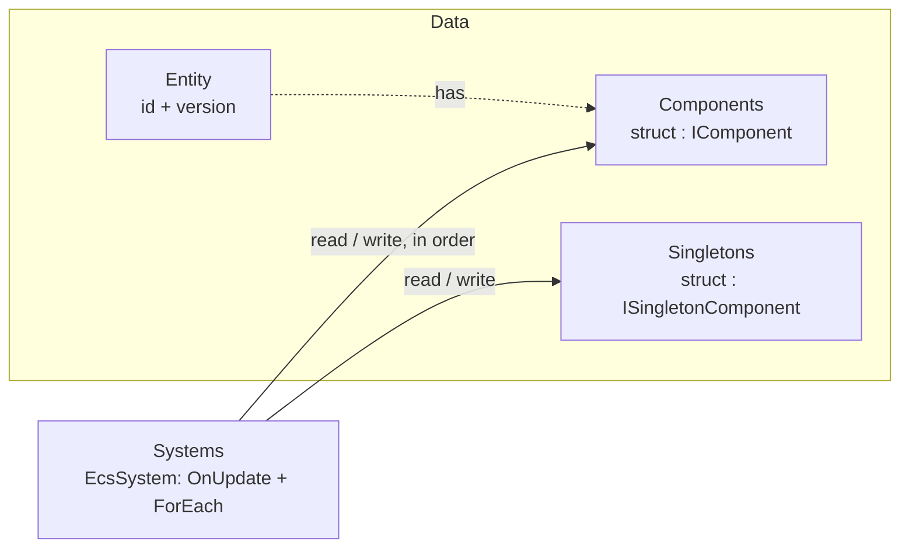

# EasyEcs

**EasyEcs is a high-performance archetype Entity Component System (ECS) for C# and .NET 10,
for anything that updates many entities every frame or tick: game servers, Godot 4 games, simulations and real-time
backends.** A warmed-up world of 100,000 entities runs nine simulation
systems in 1.72 ms with 0 B allocated. Across 37 head-to-head benchmarks against Friflo.Engine.ECS, Arch and
DefaultEcs, EasyEcs leads in 24, is within measurement error in 11 and trails in 2
([full comparison](https://ecs.xgamedev.net/en/docs/comparison#feature-by-feature)). Write plain structs and
`[ForEach]` methods; a source generator builds the iteration jobs and an analyzer catches mistakes at compile time.

**Documentation: [ecs.xgamedev.net](https://ecs.xgamedev.net)** (English · [中文](https://ecs.xgamedev.net/zh))

[](https://www.nuget.org/packages/EasyEcs)
[](https://www.nuget.org/packages/EasyEcs)
[](https://github.com/JasonXuDeveloper/EasyEcs/actions/workflows/ci.yml)
[](https://dotnet.microsoft.com/download/dotnet/10.0)
[](https://github.com/JasonXuDeveloper/EasyEcs/blob/master/LICENSE)

**Try it in your browser:** set the [live particle demo](https://ecs.xgamedev.net/en/docs/demo) to **100k**, then
move your pointer across the particles. The demo's C# runs through Mono AOT to WebAssembly; its batched drag and
movement systems took about 0.1 ms on an M4 during this capture. The rest of the systems and rendering are separate
from that reading. The [batch system source](demo/EasyEcs.Demo/Systems/MovementBatchSystem.cs) shows the
`[ForEach]` + Span + SIMD path.

<a href="https://ecs.xgamedev.net/en/docs/demo"></a>

One server tick of 9 systems (movement, AOI, combat, status effects, death, respawn, projectiles):

| Tick | Entities | Time | Allocated |
|---|---:|---:|---:|
| One world | 100,000 | **1.72&nbsp;ms** | **0 B** |
| Four worlds, one per thread | 100,000 | **0.92&nbsp;ms** | **0 B** |
| [Battle server](https://ecs.xgamedev.net/docs/example), every feature | 100,000 | **2.97&nbsp;ms** | **0 B** |

<sub>BenchmarkDotNet 0.15.2 (`EasyEcs.Benchmark`), 4-core Intel Xeon VM at 2.1 GHz (Ubuntu 24.04), .NET 10.0.13; entities spawn, die, gain and lose components every tick.
The battle server turns every feature on: parallel steering and systems, replication, indexes, relations, timings.
A `[ForEach]` system adding `Velocity` to `Position` costs 0.9 ns per entity (one archetype), faster than two
plain arrays.
[Details](https://ecs.xgamedev.net/docs/performance#benchmarks).</sub>

```bash
dotnet add package EasyEcs        # net10.0 · source generator, analyzer and Nino included
```

## Why EasyEcs

- **Fast and garbage-free.** Archetype tables with 64-byte-aligned columns that iteration and SIMD walk front to back,
  16-byte entity records (4 per cache line), JIT-inlined struct jobs instead of delegates, lock-free queries. After warm-up nothing allocates: a unit test guards the 0 B
  budget of updates, queries and structural changes on every run.
- **Structural changes are immediate and cheap.** Add and remove components, spawn and destroy, even in the middle of
  a pass; no command buffer to flush. Removing a status effect and adding it back flips a presence bit, the entity
  never moves. State can be tags, not flags.
- **Write the logic, not the plumbing.** A `[ForEach]` method is the whole system; filters are attributes
  (`[With<T>]`, `[Without<T>]`, `[WithAny<T>]`), singletons are parameters.
- **Built-in change tracking, removal detection, indexes and relations.** `[Changed<T>]` visits only the rows written
  since a system last ran, including writes through `ref` (or only the rows whose value changed, through `Mut<T>`),
  `[ChangedAny<A, B>]` those where any of several changed, `[Removed<T>]` the entities that lost a component, and a
  destroy log the entities destroyed since each client's tick;
  `IIndexed<TKey>` components are found by value, and an `IIndexed<EntityId>` component or an `IRelation` buffer
  (`Link`) makes a relation, kept current by every `Set`.
  No events and nothing to keep in sync by hand.
- **Prefabs that stay out of your queries.** A `Prefab` is a recipe of component values that belongs to no world:
  `world.Instantiate(prefab)` spawns from it (a whole wave in one pass), and no system ever has to filter templates
  out. `entity.Clone()` copies a living entity.
- **Mistakes fail the build.** The bundled analyzer (EECS002-EECS052, with code fixes) reports invalid `[ForEach]`
  methods and systems, class components, stateful systems, systems that reference each other, batch methods mixing
  spans with per-entity parameters, parallel methods that would race, writes through read-only parameters, copied
  dynamic buffers, structural changes off the owner thread, indexed components written behind their index's back,
  removal filters no entity can pass and ordering cycles; it warns about `Entity` handles stored in components.
- **Decoupled by construction.** Systems cooperate only through data, in registration order unless `[UpdateBefore<T>]` /
  `[UpdateAfter<T>]` say otherwise; system groups give you
  separate cadences (input on every wake, simulation on a fixed tick).
- **Built for processes that run for months.** Ids are recycled behind version-checked handles, memory is bounded by
  the peak entity count, a structural change off the owner thread throws or is reported at compile time instead of
  tearing the tables; the supported model is one owner thread per world (see [Threading](https://ecs.xgamedev.net/docs/guide/threading)),
  and one world per thread scales across cores.

## Features

Everything EasyEcs gives you; each row links to its guide page with examples ([all features](https://ecs.xgamedev.net/docs/features): what each
costs and when to use it).

| Feature | API | What it does |
|---|---|---|
| [Worlds and entities](https://ecs.xgamedev.net/docs/guide/entities-and-components) | `new World(options)`, `CreateEntity`, `TryGetEntity`, `IsAlive`, `Destroy` | Isolated worlds of version-checked, recycled entity handles; lookup by id. |
| [Components and tags](https://ecs.xgamedev.net/docs/guide/entities-and-components) | `struct : IComponent`, `Set`, `Get`, `Read`, `TryGet`, `TryGetRef`, `GetOrAdd`, `Has`, `Remove`; generated `e.Position`, `SetX`, `IsDead` | Plain structs in archetype tables; an empty struct is a tag; up to 9 components per call. |
| [Prefabs and cloning](https://ecs.xgamedev.net/docs/guide/prefabs) | `Prefab`, generated `prefab.SetX(…)`, `world.Instantiate(prefab)`, `Instantiate(prefab, span)`, `Instantiate(prefab, new ChildOf(p), …)`, `entity.Clone()` | Kinds of entities defined once as data that belongs to no world, spawned with components of their own in one row copy; copies of a living entity. |
| [Immediate structural changes](https://ecs.xgamedev.net/docs/guide/structural-changes) | any `Set` / `Remove` / create / `Instantiate` / destroy | Applied at once, even in the middle of a pass; no command buffer to flush. |
| [Systems and `[ForEach]`](https://ecs.xgamedev.net/docs/guide/systems) | `EcsSystem`, `[ForEach]`, `[UpdateBefore<T>]` / `[UpdateAfter<T>]`, `OnCreate` / `OnUpdate` / `OnDestroy`, `AddSystem` / `RemoveSystem` / `TryGetSystem` | A method is the whole loop, compiled to an inlined struct job; `in` reads, `ref` writes, `Entity` and singletons as parameters. |
| [Filters](https://ecs.xgamedev.net/docs/guide/queries) | `[With<T>]`, `[Without<T>]`, `[WithAny<T>]`, `[Changed<T>]`, `[Removed<T>]`, `[ChangedAny<A, B>]`, `[RemovedAny<A, B>]`, `QueryFilter` | Narrow a system or query by presence, absence, any-of, recent writes or recent removals. |
| [Group filters](https://ecs.xgamedev.net/docs/guide/systems#group-filters) | `[With<T>]` / `[Without<T>]` / `[WithAny<T>]` on an `ISystemGroup`, `ISystemGroupWith<T>`, `ISystemGroupWithout<T>` | One filter for every system of a group; through an interface, a generic group gives each actor type its own. |
| [Optional components](https://ecs.xgamedev.net/docs/guide/systems) | `Maybe<T>` parameter, `HasValue`, `Value` | One method for entities with and without a small optional part. |
| [Ad-hoc queries](https://ecs.xgamedev.net/docs/guide/queries) | `world.Query`, `Count`, `Any` | Iterate from any code (tools, tests, request handlers), allocation-free. |
| [Struct jobs](https://ecs.xgamedev.net/docs/guide/queries#foreach-a-struct-job) | `IForEach`, `IForEachEntity`, `IForEachBatch`, `world.ForEach` / `ForEachEntity` / `ForEachBatch`, `INoStructuralChanges` | Ad-hoc loops with no delegate, inlined like a system; a job declares `WriteMask`. |
| [One entity](https://ecs.xgamedev.net/en/docs/guide/queries#run-on-one-entity) | `entity.Run(ref job)`, `Run(ref job, filter)` | A struct job on one entity (a request, a message to an actor) with the refs and guarantees of a pass; `false` when it does not match. |
| [Batch methods](https://ecs.xgamedev.net/docs/guide/systems#batch-methods) | `ForEachBatch`, span parameters | Contiguous runs of rows as spans, for SIMD. |
| [System groups and intervals](https://ecs.xgamedev.net/docs/guide/systems) | `ISystemGroup`, `[UpdateInGroup<T>]`, `Update<TGroup>()`, `UpdateInterval`, `Enabled` | Separate cadences (input on every wake, simulation on a fixed tick), throttled and switchable systems. |
| [Slices](https://ecs.xgamedev.net/docs/guide/systems) | `[ForEach(Slices = N)]`, `QueryFilter.Slice`, `system.RunCount` | Spread a method's rows over N runs: every row once per N runs, about 1 / N of the work per update. |
| [Generic systems](https://ecs.xgamedev.net/docs/guide/systems#generic-systems) | `class CountOf<T> : EcsSystem` | Each closed type is a system of its own, scheduled on its own. |
| [Singletons](https://ecs.xgamedev.net/docs/guide/singletons) | `ISingletonComponent`, `AddSingleton`, `GetSingleton`, `SingletonRef<T>` | One value per world, passed to systems as `ref` / `in` parameters. |
| [Parallel systems](https://ecs.xgamedev.net/docs/guide/threading) | `WorldOptions.ParallelSystems` | Systems with no order and no conflict between them run at once, with the sequential result. |
| [Parallel `[ForEach]`](https://ecs.xgamedev.net/docs/guide/systems#parallel-methods) | `[ForEach(Parallel = true)]`, `ForEachParallel`, `ForEachEntityParallel`, `ParallelChunkRows` | One heavy method's rows split across cores. |
| [Change tracking](https://ecs.xgamedev.net/docs/guide/change-tracking) | `ITracked`, `[Changed<T>]`, `[ChangedAny<A, B>]`, `QueryFilter.Changed<T>(since)`, `ChangedAny<A, B>(since)`, `Since(tick)` | Visit only the rows written since a system last ran, or since each client's tick; `ref` access counts as a write. |
| [Writes only when changed](https://ecs.xgamedev.net/docs/guide/change-tracking) | `Mut<T>` parameter, `SetIfChanged`, generated `SetXIfChanged(…)` | Stamp only the rows whose value really changed, so readers skip the rest. |
| [Removal detection](https://ecs.xgamedev.net/docs/guide/change-tracking#removal-detection) | `[Removed<T>]`, `[RemovedAny<A, B>]`, `QueryFilter.Removed<T>(since)` | Visit only the entities that lost a tracked component since a system last ran (replicate what went away). |
| [Destroy log](https://ecs.xgamedev.net/docs/guide/change-tracking) | `WorldOptions.DestroyLogCapacity`, `world.DestroyedSince(since, into, out count)` | The entities destroyed since each reader's tick, for despawns to many clients; a reader older than the log resynchronizes. |
| [Cleanup components](https://ecs.xgamedev.net/docs/guide/cleanup-and-disable) | `ICleanupComponent`, `Retired` | An entity outlives `Destroy` until a system releases its external resource (a socket, a seat). |
| [Disable and enable](https://ecs.xgamedev.net/docs/guide/cleanup-and-disable#disable-a-component) | `entity.Disable<T>()`, `Enable<T>()`, `Disabled<T>`, `DisableAll` / `EnableAll` | Hide a component from queries and keep its value. |
| [Dynamic buffers](https://ecs.xgamedev.net/docs/guide/dynamic-buffers) | `DynamicBuffer<T>`, `Add`, `RemoveAt`, `AsSpan`, `[Changed<DynamicBuffer<T>>]` | A list per entity as a component: written only through `ref`, so every change is tracked; copied by snapshots. |
| [Value indexes](https://ecs.xgamedev.net/docs/guide/indexes-and-relations) | `IIndexed<TKey>`, `world.Index<T, TKey>()`, `Find`, `TryFind`, `Count` | Find entities by a component's value, kept in sync with every write. |
| [Unique keys](https://ecs.xgamedev.net/docs/guide/indexes-and-relations) | `IUniqueIndexed<TKey>`, `index.Get(key)`, `TryGet` | One entity per key (an account, a session); a write that would duplicate a key throws before it changes anything. |
| [Ordered ranges](https://ecs.xgamedev.net/docs/guide/indexes-and-relations) | `index.Range(min, max)`, `RangeDescending`, `Ascending()`, `Descending()` | Walk a comparable key in order: leaderboards, rating brackets. |
| [Relations](https://ecs.xgamedev.net/docs/guide/indexes-and-relations) | an `IIndexed<EntityId>` component; `IRelation` elements with `Link` / `Unlink`, `world.Relations<T>()`; `WhenTargetDestroyed` | One or many entity-to-entity links with reverse lookup; what a link does when its target dies (keep, remove, destroy). |
| [Hierarchy](https://ecs.xgamedev.net/docs/guide/hierarchy) | `ChildOf`, `world.Children(parent)`, `world.Descendants(root)` | Parents and children; destroying a parent destroys its subtree; a whole subtree in one walk. |
| [Table groups](https://ecs.xgamedev.net/docs/guide/groups) | `IGroup`, `world.GroupBy<T>()`, `QueryFilter.InGroup<T>(group)` | Split tables by a value (zone, map, match), so a query walks one group's rows only. |
| [Snapshots](https://ecs.xgamedev.net/docs/guide/snapshots) | `world.Capture()`, `world.Restore(snapshot)` | Copy a world in memory and roll it back (replays, tests, rollback). |
| [Saves](https://ecs.xgamedev.net/docs/guide/saves) | `world.Save(writer)`, `world.Load(bytes)`; `SaveWithout(writer, exclude)`, `LoadKeeping(bytes, keep, markWritten: false)` | A whole world as bytes through Nino, for restarts and other processes; a restart leaves runtime state out and keeps the new configuration. |
| [Migration and records](https://ecs.xgamedev.net/docs/guide/migration-and-unload) | `SaveEntities`, `SaveEntitiesWith` (a `ComponentSet`), `LoadEntities`, `LoadEntitiesInto` (`markWritten: false`), `MoveEntities` | A group of entities to another world or server, links rewritten; a record of what persists, restored onto existing entities. |
| [Unloading plugin types](https://ecs.xgamedev.net/docs/guide/migration-and-unload#remove-types) | `world.RemoveTypes(assembly or context)` | Remove a plugin's types so its `AssemblyLoadContext` unloads: hot reload on a live server. |
| [Bulk create and destroy](https://ecs.xgamedev.net/docs/guide/entities-and-components#entities) | `CreateEntities`, `Instantiate(prefab, span)`, `DestroyAll`, `DestroyEntities(ids)`, `Reserve` | Spawn and clear waves in one pass through the structural gate. |
| [Per-system timing](https://ecs.xgamedev.net/docs/guide/systems#measuring-systems) | `WorldOptions.MeasureSystems`, `system.Stats` | Run counts, times, allocated bytes and visited entities of every system. |
| [Schedule](https://ecs.xgamedev.net/docs/guide/diagnostics) | `world.DescribeSchedule()`, `ToString()`, `ToMermaid()` | The stages, each system's reads and writes, why it waits, and the pairs only registration orders. |
| [Errors](https://ecs.xgamedev.net/docs/guide/systems#errors) | `WorldOptions.SystemErrors`, `system.Error` | A failing system throws out of the update, or is switched off with its exception kept while the tick goes on. |
| [Introspection](https://ecs.xgamedev.net/docs/guide/diagnostics) | `world.DescribeTables()`, `entity.Describe()` | Tables, columns, rows and bytes; an entity's component values, for tools and debuggers. |
| [Giving memory back](https://ecs.xgamedev.net/docs/guide/diagnostics) | `world.TrimExcess()` | After a peak: drop empty tables, shrink the others, release save and load buffers. |
| [Analyzer](https://ecs.xgamedev.net/docs/guide/analyzer) | EECS002-EECS052 | ECS design mistakes (class components, stateful systems, systems referencing systems, …) fail the build. |
| [Threading and Native AOT](https://ecs.xgamedev.net/docs/guide/threading) | one owner thread per world; no reflection on hot paths | Many worlds per process, one per thread; AOT works with nothing to configure. |

## Example

Data is plain structs, each system is one `[ForEach]` method, and systems cooperate only through the data they write:

```csharp
using EasyEcs;

public record struct Position(float X, float Y) : IComponent;
public record struct Velocity(float X, float Y) : IComponent;
public record struct Health(int Value) : IComponent, ITracked;         // tracked: rows record their last write
public struct Dead : IComponent;                                       // a tag
public record struct Clock(float Dt) : ISingletonComponent;           // one value per world

public class MovementSystem : EcsSystem
{
    [ForEach, Without<Dead>]                                           // in reads, ref writes
    static void Move(ref Position p, in Velocity v, in Clock clock)
    {
        p.X += v.X * clock.Dt;
        p.Y += v.Y * clock.Dt;
    }
}

[UpdateAfter<MovementSystem>]                                          // registration order otherwise
public class DeathSystem : EcsSystem
{
    [ForEach, Without<Dead>, Changed<Health>]                          // only healths written since its last run
    static void Die(Entity unit, in Health hp)
    {
        if (hp.Value <= 0) unit.SetDead();                             // immediate: later systems see it this tick
    }
}
```

The host owns the world and ticks it:

```csharp
using var world = new World();
world.SetClock(1 / 30f);                                               // singletons before the first update
world.AddSystem<MovementSystem>();
world.AddSystem<DeathSystem>();

var hero = world.CreateEntity(new Position(0, 0), new Velocity(1, 0), new Health(100));
world.Update();                                                        // 0 B per update once warmed up
hero.SetHealth(0);                                                     // a tracked write: DeathSystem sees it
world.Update();
System.Console.WriteLine(hero.IsDead);                                 // True
```

[A full battle server](https://ecs.xgamedev.net/docs/example) uses every feature
(parallel steering, replication by change tracking and removal detection, NPC kinds as prefabs, bags of loot in
dynamic buffers, indexes, relations, snapshots, system groups, struct jobs) in one world; it is the battle server benchmark below and the world of the scenario tests. The step-by-step tutorial is
[Getting started](https://ecs.xgamedev.net/docs/getting-started).

## The model in one picture



| Concept | API | In one line |
|---|---|---|
| World | `World` | Owns entities, component storage, singletons and systems. Worlds share nothing. |
| Entity | `Entity` | A 16-byte, version-checked handle. Stale handles throw instead of touching a recycled id. |
| Component | `struct : IComponent` | Plain per-entity data. An empty struct is a tag. |
| Singleton | `struct : ISingletonComponent` | One value per world: clock, configuration, counters, a spatial grid. |
| System | `EcsSystem` | One responsibility: `OnUpdate` plus `[ForEach]` methods, run in registration order or as `[UpdateBefore<T>]` / `[UpdateAfter<T>]` say. |
| Query | `[ForEach]`, `ForEach`, `Query`, `Count`, `Any` | Entities that have a set of components, filtered with `With` / `Without` / `WithAny` / `Changed` / `Removed`. |
| Prefab | `Prefab`, `world.Instantiate` | A recipe of component values outside every world, copied into entities. |
| Index | `IIndexed<TKey>`, `world.Index<T, TKey>()` | Entities by a component's value, or by the entity a relation component points at. |

## When to use it

| Good fit | Probably not |
|---|---|
| Game servers and simulations on .NET 10: MMO maps and zones, AOI, combat | Unity or other runtimes below .NET 10 (`net10.0` only; Unity support is [being evaluated](https://ecs.xgamedev.net/en/docs/roadmap#unity)) |
| Godot 4 .NET games: the project targets `net10.0` ([sample](samples/Godot)) | |
| Worlds where state flips constantly (buffs, deaths, spawns): structural changes are immediate and cheap | Code that needs structural changes recorded from many threads at once (use one owner thread and a queue) |
| Long-running processes where GC pauses and unbounded growth matter | Code that wants objects with behavior, or systems calling each other |
| One world per thread, many worlds per process; `ParallelSystems` for heavy independent systems | Many threads mutating one world's component values without coordination |

## Performance

BenchmarkDotNet 0.15.2 with the repository's job (`BenchmarkConfig.cs`), 4-core Intel Xeon VM at 2.1 GHz (Ubuntu 24.04), .NET 10.0.13, project `EasyEcs.Benchmark`. The headline benchmark is a realistic server tick,
not a toy loop ([what it simulates](https://ecs.xgamedev.net/docs/performance#benchmarks)). "Allocated" is per tick.

| Benchmark | Entities | Mean | Allocated |
|---|---:|---:|---:|
| WorldSimulationBenchmark.Tick | 10,000 | 158 μs | 0 B |
| WorldSimulationBenchmark.Tick | 100,000 | 1.72 ms | 0 B |
| MultiWorldBenchmark.TickAllWorlds (4 worlds × 25k) | 100,000 | 0.92 ms | 0 B |
| BattleServerBenchmark.Tick (the [battle server example](https://ecs.xgamedev.net/docs/example), every feature) | 100,000 | 2.97 ms | 0 B |

Against v4.0.1 (4.33 ms, measured in an earlier run on the same VM; v4.0.1 is not part of this run) the tick is
2.5x faster.

A `[ForEach]` system adding `Velocity` to `Position` over 10,000 entities (one archetype) takes 9.1 μs, against
12.8 μs for two plain arrays with no ECS at all (its columns are 64-byte aligned). Micro benchmarks and the
per-operation comparison are in
[Performance](https://ecs.xgamedev.net/docs/performance); their `ForEach` and
`Query` rows run on a world with two archetypes, so they are not directly comparable to the `[ForEach]` row.

```bash
dotnet run -c Release --project benchmarks/EasyEcs.Benchmark -- --filter '*'
```

## Compared with other ECS libraries

37 head-to-head benchmarks (project `EasyEcs.Comparison`, same VM) port the same work to Friflo.Engine.ECS 3.6, Arch
2.1 and DefaultEcs 0.17, each library its own idiomatic way, and check in setup that every library computes the same
result. EasyEcs is faster in 24, within the measurement error in 11 and slower in 2. "Its time vs EasyEcs" is the
time of the fastest other library over the time of EasyEcs (2× = it takes twice as long); the site sorts the same
data live ([feature by feature](https://ecs.xgamedev.net/docs/comparison#feature-by-feature)).

**Clear leads**, where the next-fastest library takes at least 1.25 times as long:

| What is measured | EasyEcs | Next fastest | Its time vs EasyEcs |
|---|---:|---|---:|
| [Save 10,000 entities and load them back](https://ecs.xgamedev.net/docs/comparison#saves) | 146 μs | DefaultEcs 4.33 ms, 4.37 MB allocated | **30×** |
| [Add a component to 100,000 entities by query, then remove it](https://ecs.xgamedev.net/docs/comparison#bulk) | 78.7 μs | Arch 1.21 ms | **15×** |
| [Spawn 10,000 entities beside 100,000, then destroy them](https://ecs.xgamedev.net/docs/comparison#bulk) | 138 μs | Friflo.Engine.ECS 380 μs | **2.75×** |
| [Query 100,000 players by value: a rating range, zone sums](https://ecs.xgamedev.net/docs/comparison#indexes-and-relations) | 127 μs | Friflo.Engine.ECS 317 μs | **2.49×** |
| [Create 1,000 parent-child squads, destroy them in cascade](https://ecs.xgamedev.net/docs/comparison#hierarchy) | 452 μs | Friflo.Engine.ECS 1.06 ms | **2.35×** |
| [Count 100 inventories through an index (1 item traded)](https://ecs.xgamedev.net/docs/comparison#indexes-and-relations) | 425 ns | DefaultEcs 838 ns | **1.97×** |
| [Add a status component to 5% of 100,000 entities, then remove it](https://ecs.xgamedev.net/docs/comparison#operations) | 517 μs | Friflo.Engine.ECS 1.00 ms | **1.94×** |
| [Find the 10 of 100,000 entities written this tick](https://ecs.xgamedev.net/docs/comparison#change-tracking) | 507 ns | Arch 966 ns | **1.91×** |
| [Spawn 5,000 entities from a prefab, then destroy them](https://ecs.xgamedev.net/docs/comparison#operations) | 164 μs | Friflo.Engine.ECS 276 μs | **1.68×** |
| [Create 100,000 three-component entities one by one in a fresh world, room reserved first](https://ecs.xgamedev.net/docs/comparison#cold-create) | 2.60 ms | Arch 4.21 ms | **1.62×** |
| [Iterate one component over 100,000 entities](https://ecs.xgamedev.net/docs/comparison#operations) | 37.7 μs | Friflo.Engine.ECS 59.9 μs | **1.59×** |
| [Put 10,000 of 100,000 entities to sleep, wake the last ones](https://ecs.xgamedev.net/docs/comparison#disabling) | 478 μs | DefaultEcs 745 μs | **1.56×** |
| [Create 100,000 three-component entities in a fresh world in one call (the others' fastest way)](https://ecs.xgamedev.net/docs/comparison#cold-create) | 2.71 ms | Arch 4.21 ms | **1.56×** |
| [Count 100 inventories through an index (100 items traded)](https://ecs.xgamedev.net/docs/comparison#indexes-and-relations) | 5.11 μs | DefaultEcs 7.87 μs | **1.54×** |
| [Iterate with a filter: the players among 100,000 entities](https://ecs.xgamedev.net/docs/comparison#operations) | 11.3 μs | Friflo.Engine.ECS 16.6 μs | **1.46×** |
| [Find the 1,000 of 100,000 entities written this tick](https://ecs.xgamedev.net/docs/comparison#change-tracking) | 38.5 μs | Friflo.Engine.ECS 53.7 μs | **1.40×** |
| [Iterate with the entity handle of each row](https://ecs.xgamedev.net/docs/comparison#operations) | 49.0 μs | Friflo.Engine.ECS 67.2 μs | **1.37×** |

**Close**, EasyEcs ahead by less than that. The full server tick is one of these: most of a tick is iteration over
dense columns, bound by memory more than by the library, and Arch and DefaultEcs take 3.42× and 3.71× as long there
and allocate 535 KB and 61 KB per tick (EasyEcs and Friflo: 0 B):

| What is measured | EasyEcs | Next fastest | Its time vs EasyEcs |
|---|---:|---|---:|
| [Four independent systems over 100,000 entities, one after another](https://ecs.xgamedev.net/docs/comparison#parallel) | 395 μs | DefaultEcs 471 μs | 1.19× |
| [Rewire 100 of 10,000 friend lists, walk 100 follower sets](https://ecs.xgamedev.net/docs/comparison#indexes-and-relations) | 22.0 μs | Friflo.Engine.ECS 26.1 μs | 1.19× |
| [Move 100,000 entities with SIMD over spans](https://ecs.xgamedev.net/docs/comparison#operations) | 69.5 μs | Friflo.Engine.ECS 80.7 μs | 1.16× |
| [Create 5,000 entities one by one, then destroy them](https://ecs.xgamedev.net/docs/comparison#operations) | 190 μs | Friflo.Engine.ECS 215 μs | 1.13× |
| [Add and remove a tag in the passes that find them (1,000 of 100,000)](https://ecs.xgamedev.net/docs/comparison#structural-changes) | 163 μs | Friflo.Engine.ECS 183 μs | 1.12× |
| [Put 100 of 100,000 entities to sleep, wake the last ones](https://ecs.xgamedev.net/docs/comparison#disabling) | 41.4 μs | Friflo.Engine.ECS 45.9 μs | 1.11× |
| [Four independent systems over 100,000 entities, in parallel](https://ecs.xgamedev.net/docs/comparison#parallel) | 370 μs | DefaultEcs 405 μs | 1.09× (within error) |
| [The full server tick: nine systems over 100,000 entities](https://ecs.xgamedev.net/docs/comparison#the-same-server-tick) | 1.68 ms | Friflo.Engine.ECS 1.83 ms | 1.08× |
| [Find the 1,000 of 100,000 entities that lost a component](https://ecs.xgamedev.net/docs/comparison#removal-detection) | 66.7 μs | Friflo.Engine.ECS 71.7 μs | 1.08× (within error) |
| [The full server tick: nine systems over 10,000 entities](https://ecs.xgamedev.net/docs/comparison#the-same-server-tick) | 175 μs | Friflo.Engine.ECS 183 μs | 1.05× (within error) |
| [Iterate two components and a singleton](https://ecs.xgamedev.net/docs/comparison#operations) | 212 μs | Friflo.Engine.ECS 222 μs | 1.05× (within error) |
| [Scan 100,000 entities for the 10 written, without a change filter](https://ecs.xgamedev.net/docs/comparison#change-tracking) | 38.2 μs | Friflo.Engine.ECS 39.9 μs | 1.04× (within error) |
| [Move 100,000 entities: two components, per entity](https://ecs.xgamedev.net/docs/comparison#operations) | 253 μs | Friflo.Engine.ECS 257 μs | 1.02× (within error) |

**Where another library is faster**, with the reason from the benchmark's source:

| What is measured | EasyEcs | Faster library | Its time vs EasyEcs | Why |
|---|---:|---|---:|---|
| [Iterate three components over 100,000 entities](https://ecs.xgamedev.net/docs/comparison#operations) | 71.0 μs | Friflo.Engine.ECS 70.7 μs | 0.99× (within error) | The same span loop over the same dense columns in both libraries: the loop is bound by memory, not by the library. |
| [Add and remove a tag in the passes that find them (10 of 100,000)](https://ecs.xgamedev.net/docs/comparison#structural-changes) | 78.2 μs | Friflo.Engine.ECS 75.4 μs | 0.96× (within error) | Friflo defers the changes to its command buffer, so both of its passes are plain span loops. A `[ForEach]` that may change structure checks after every row that its table did not move, and over 100,000 rows that costs more than 10 deferred changes; from about 1,000 changes on, applying them at once is faster. |
| [Iterate in batches, reading entity ids only where needed](https://ecs.xgamedev.net/docs/comparison#operations) | 38.5 μs | Friflo.Engine.ECS 37.0 μs | 0.96× (within error) | The same loop over the same rows: Friflo's is written inline in the benchmark, EasyEcs' is generated from a batch `[ForEach]` method and runs as a system group. |
| [Steer 100,000 agents on all cores (parallel query)](https://ecs.xgamedev.net/docs/comparison#parallel) | 766 μs | Arch 685 μs | 0.89× (within error) | Arch's and Friflo's runners keep worker threads of their own, which win when passes run back to back, as BenchmarkDotNet runs them. EasyEcs wakes thread-pool helpers only while they pay: in a real server tick a dedicated crew measured worse tail latency and more CPU per tick (D22). |
| [Scan 100,000 entities for the 1,000 written, without a change filter](https://ecs.xgamedev.net/docs/comparison#change-tracking) | 61.4 μs | Friflo.Engine.ECS 53.7 μs | 0.88× | Not the way to do it in EasyEcs: the component is `ITracked`, so each of the 1,000 writes also stamps its row's change tick, which `[Changed<T>]` needs and the scan ignores; Friflo's component is not tracked. `[Changed<T>]` does the same job faster than every library's scan. |
| [Find the 10 of 100,000 entities that lost a component](https://ecs.xgamedev.net/docs/comparison#removal-detection) | 830 ns | Friflo.Engine.ECS 697 ns | 0.84× (within error) | Friflo's `OnComponentRemoved` event pushes each id into a list you keep as the removal happens, a cost per removal; `[Removed<T>]` finds the removals through per-block summaries, a fixed cost per pass that 10 removals do not cover. From 1,000 removals on, EasyEcs leads, with no subscription to write. |
| [Create 100,000 three-component entities one by one in a fresh world, nothing reserved](https://ecs.xgamedev.net/docs/comparison#cold-create) | 7.13 ms | Arch 4.77 ms | 0.67× | A fresh EasyEcs world grows its table and entity storage by doubling, and the arrays past 85,000 bytes land on the large object heap; together they pass the budget that sets off a full collection, once per new world (D28). Arch keeps entities in 16 KB chunks, which never reach that heap. Reserve the table with `Reserve<T1..Tn>(count)` or create the entities with `CreateEntities`, and EasyEcs is the fastest of the four. |

What each library has built in:

| | EasyEcs | Friflo.Engine.ECS | Arch | DefaultEcs |
|---|:-:|:-:|:-:|:-:|
| Structural changes inside a query loop, applied at once | ✅ | ❌ command buffer | ⚠️ unguarded | ⚠️ unsafe |
| Change tracking ("rows written since") | ✅ | ❌ | ❌ | ✅ explicit notify |
| Removal detection ("entities that lost a component since") | ✅ | ⚠️ events | ⚠️ events or a marker tag | ✅ `WhenRemoved` sets |
| Prefabs and cloning | ✅ prefabs outside the world, `Clone` | ⚠️ clone an entity of the store | ❌ | ⚠️ `CopyTo` an entity |
| Value index | ✅ | ✅ | ❌ | ✅ |
| Relations with reverse lookup | ✅ | ✅ | ❌ | ❌ |
| In-memory world snapshot | ✅ | ❌ | ❌ | ❌ |
| Systems, groups, parallel systems | ✅ | ✅ (no parallel systems) | ❌ core | ✅ |
| Source-generated systems + analyzer | ✅ | ❌ | ❌ | ❌ |
| 0 B per tick | ✅ | ✅ | ❌ | ❌ |
| Events | ❌ (state is data) | ✅ | ✅ | ✅ |
| Serialization | ✅ `Save` / `Load` (Nino) | ✅ JSON | ❌ | ✅ text, binary |
| Godot 4 (.NET) | ✅ net10.0 project | ✅ | ✅ | ✅ |
| Unity / netstandard | ❌ net10.0 | ✅ | ✅ | ✅ |

The full matrix, the per-operation numbers and when to pick which library are in
[Comparison](https://ecs.xgamedev.net/docs/comparison); every feature with
what it does, when to use it and what it costs is in
[Features](https://ecs.xgamedev.net/docs/features).

## Documentation

The documentation lives at **[ecs.xgamedev.net](https://ecs.xgamedev.net)**; its sources are the markdown files in
[`docs/content`](docs/content).

| | |
|---|---|
| [Getting started](https://ecs.xgamedev.net/docs/getting-started) | Step-by-step tutorial: entities, components, tags, queries, systems, singletons, groups, the update loop. |
| [Features](https://ecs.xgamedev.net/docs/features) | Every feature: what it does, when to use it, when not, what it costs, which scenarios it serves. |
| [Comparison](https://ecs.xgamedev.net/docs/comparison) | Features and benchmarks against Friflo.Engine.ECS, Arch and DefaultEcs. |
| [Guide](https://ecs.xgamedev.net/docs#guide) | One page per concept: entities and components, prefabs and cloning, queries, systems, singletons, structural changes, change tracking and removal detection, dynamic buffers, indexes and relations, hierarchy, groups, cleanup and disable, bulk changes, snapshots, saves, migration and unloading, `ref` and `await`, threading, hosting, testing, troubleshooting, analyzer rules. |
| [ECS principles](https://ecs.xgamedev.net/docs/ecs-principles) | How to design features with entities, components, singletons and systems. |
| [Design questions](https://ecs.xgamedev.net/docs/faq) | Why there are no events, what is thread-safe, how to change a component. |
| [Samples](https://ecs.xgamedev.net/en/docs/samples) | Runnable programs in learning order: hello world, a game loop, saving and loading, one world per thread, hot reload, actors, a Minecraft-style server, a Godot project. |
| [API reference](https://ecs.xgamedev.net/docs/api) | Every public API with its complexity. |
| [Performance guide](https://ecs.xgamedev.net/docs/performance) | Which API to use when, do's and don'ts, benchmarks. |
| [Architecture](https://ecs.xgamedev.net/docs/architecture) | Storage, memory layout, archetypes, id recycling, iteration safety, generators. |
| [Migration guide](https://ecs.xgamedev.net/en/docs/migration) | What to change when upgrading: between 4.x releases, from v3 to v4 and from v2 to v3. |

The [documentation index](https://ecs.xgamedev.net/docs) suggests a reading order.

## What's new in 4.8

- **Large buffers that come and go allocate nothing.** `DynamicBuffer<T>.PoolCapacity` sets, per element type, how long
  a list the buffer pool keeps, so the blocks of chunks loaded and unloaded around players reuse one another's lists
  ([dynamic buffers](https://ecs.xgamedev.net/en/docs/guide/dynamic-buffers#what-it-costs)).
- **Enum elements get named members.** A `DynamicBuffer<Block>` of an enum gets `chunk.Block`, `WriteBlock()` and the
  rest, like a buffer of a struct.
- **A Minecraft-style sample and a Samples section.** [VoxelServer](https://ecs.xgamedev.net/en/docs/samples/voxel-server)
  runs chunks, flowing water, areas of interest, zombies, replication and saves at 20 ticks a second; the
  [Samples](https://ecs.xgamedev.net/en/docs/samples) section of the site walks through every sample.

## What's new in 4.7

- **Writes that count only when the value changed.** A `Mut<T>` parameter stamps only the rows a method writes, and
  `SetIfChanged` / the generated `SetHealthIfChanged(…)` skip an equal value, so a value recomputed every tick no
  longer sends every row to `[Changed<T>]` readers
  ([change tracking](https://ecs.xgamedev.net/en/docs/guide/change-tracking)).
- **Replication per client.** `[ChangedAny<A, B>]` / `QueryFilter.ChangedAny<A, B>(since)` select rows where any of
  several components changed, one filter serving every client with `Since(ack)`; `WorldOptions.DestroyLogCapacity` and
  `world.DestroyedSince` report the entities destroyed since each client's tick.
- **Unique keys.** `IUniqueIndexed<TKey>` names one entity per key (`index.Get(key)`); a write that would duplicate a
  key throws before it changes anything
  ([indexes and relations](https://ecs.xgamedev.net/en/docs/guide/indexes-and-relations)).
- **Counts without a walk, subtrees without a loop.** `index.Find(key).Count` sizes a buffer in O(1), `KeyCount` /
  `TargetCount` count distinct keys and targets, and `world.Descendants(root).AddTo(ids, includeRoot: true)` collects
  the ids `MoveEntities` and `SaveEntities` take
  ([hierarchy](https://ecs.xgamedev.net/en/docs/guide/hierarchy#moving)).
- **Spawns with their own components.** `world.Instantiate(prefab, new ChildOf(parent), …)` in one row copy, and a
  prefab with members can be instantiated by a system too, during its pass
  ([prefabs](https://ecs.xgamedev.net/en/docs/guide/prefabs)).
- **Work spread over updates.** `[ForEach(Slices = N)]` visits about 1 / N of the rows per run
  ([systems](https://ecs.xgamedev.net/en/docs/guide/systems)).
- **Operating a long-running server.** `world.TrimExcess()` gives a peak's memory back; `SystemStats` adds allocated
  bytes and visited entities; `world.DescribeSchedule()` shows the stages and why each system waits
  ([diagnostics](https://ecs.xgamedev.net/en/docs/guide/diagnostics)).
- **Restarts that leave runtime state behind.** `SaveWithout(writer, exclude)` and `LoadKeeping(bytes, keep, markWritten: false)`
  ([restart](https://ecs.xgamedev.net/en/docs/guide/saves#restart)).
- **Generated members for `ChildOf`** (`entity.SetChildOf(parent)`, `world.ChildOfIndex`, …) and
  `entity.IsRetired`; a `[ForEach]` method that uses its `Entity` only as an identity no longer runs alone.
- **Reads that stamp nothing.** `world.Read<T1..Tn>()` walks a query with `ref readonly` items, so a loop that only
  reads no longer sends rows to `[Changed<T>]` readers; EECS046 points at such `Query` loops
  ([queries](https://ecs.xgamedev.net/en/docs/guide/queries#read)).
- **Names that say what a call does**: `Reserve`, `DestroyAll`, `SaveEntitiesWith`, `LoadKeeping`, `UnlinkX(target)`,
  and `DestroyEntities(ids)` for a list of ids; `entity.Link` / `Unlink` / `Links` and the generated `LinkX(target)`
  for relations, `ITracked`, `TryGetSystem`, `DescribeTables`, `DestroyLogCapacity`, the `Retired` tag and more
  ([renames](https://ecs.xgamedev.net/en/docs/migration#v4-7-renames)).
- **Retired entities stay retired.** An entity kept alive for its cleanup components (tagged `Retired`) is not
  moved, cloned or brought back by `SetAll`, reports no removals, and a moved entity leaves its cleanup components behind
  ([cleanup components](https://ecs.xgamedev.net/en/docs/guide/cleanup-and-disable#cleanup-components)).
- **`AddSingleton` on an existing singleton throws** instead of resetting it; reset with `world.SetX(…)`.
- **Analyzer rules up to EECS052** (calls that compile but throw, lose writes or keep a ref across a structural
  change; filters that never match; a `Set` right after a creation), and a fix: parallel `[ForEach]` methods that write tracked components no longer
  lose change stamps. Upgrading: the [migration guide](https://ecs.xgamedev.net/en/docs/migration#v4-6-to-v4-7).

## What's new in 4.6

- **Restarts that resume a world.** `world.Load(bytes, markWritten: false)` loads a save without change ticks, so
  `[Changed<T>]` savers and replicators do not send the whole world again
  ([restart](https://ecs.xgamedev.net/en/docs/guide/saves#restart)); `world.AddSystem<T>(changesFromNow: true)`
  starts a system at the current tick.
- **Native AOT without warnings**, also with tracked and disabled components: CI publishes the battle server natively
  with warnings as errors and runs it.

## What's new in 4.5

- **One entity, one job.** `entity.Run(ref job)` (and `Run(ref job, filter)`) runs an `IForEachEntity` job on a
  single entity with the guarantees of a pass: change ticks, refs that survive structural changes, in O(1) plus O(1)
  per component the filter names ([one entity](https://ecs.xgamedev.net/en/docs/guide/queries#run-on-one-entity)).
- **Group filters through interfaces.** `IGroupWith<T>` / `IGroupWithout<T>` give generic groups their filters
  (`IActorGroup<TActor> : IGroupWith<Inbox<TActor>>`) ([group filters](https://ecs.xgamedev.net/en/docs/guide/systems#group-filters)).
- **`world.Descendants(root)`** walks a whole subtree, and `LoadEntitiesInto(input, entities, markWritten: false)`
  restores a record without counting it as a change.
- **No Nino package to add.** The EasyEcs package brings Nino with its generator: `[NinoType]` components get their
  formatters from the EasyEcs reference alone ([saves](https://ecs.xgamedev.net/en/docs/guide/saves#declare)).
- **The analyzer knows the new calls.** `entity.Run` and `LoadEntitiesInto` are structural: rejected in parallel
  `[ForEach]` methods (EECS010), in methods that promise no structural change (EECS013) and on other threads (EECS014).
- **An actors sample.** [`samples/Actors`](https://github.com/JasonXuDeveloper/EasyEcs/tree/master/samples/Actors):
  one type per kind of actor that is its key component, its system group and the group's filter, with requests run
  on their entity by `entity.Run`.

## What's new in 4.4

- **Records of what persists.** `SaveEntitiesWith(output, ids, set)` saves only the components of a `ComponentSet`
  (runtime components need no formatter), and `LoadEntitiesInto` loads them onto entities that exist already, each
  moving table once ([a record of what persists](https://ecs.xgamedev.net/en/docs/guide/migration-and-unload#records)).
- **Saved components can evolve.** Saves record types by Nino type id, so `[NinoFormerName]` keeps a renamed
  component's saves, and an unmanaged `[NinoType]` component is written by its formatter, so a `VersionTolerant` one
  may gain members ([when the code changed](https://ecs.xgamedev.net/en/docs/guide/saves#versioning)).
- **Buffers that come and go allocate nothing**: a dead `DynamicBuffer<T>`'s list goes to the next buffer of its
  element type.
- The save format changed (saves of 4.3 do not load) and EasyEcs builds on Nino 4.0.0-rc.6: see the
  [migration guide](https://ecs.xgamedev.net/en/docs/migration#v4-3-to-v4-4).

## What's new in 4.3

- **Performance rules in the analyzer** ([EECS025 to EECS034](https://ecs.xgamedev.net/en/docs/guide/analyzer#eecs025)): a `ref` that only reads, an
  unused `[ForEach]` parameter, a lookup through the visited `Entity` on every row, an allocation in code that runs
  every update, an instance `[ForEach]` method, a structural change entity by entity over a query, creation one by one
  in a counted loop, `Count() > 0` instead of `Any()` (warnings: the code costs); the generic call that has a
  generated member (a suggestion: the same cost, shorter); `World.Update()` inside a system (an error). Most come with a code fix. Builds that treat
  warnings as errors may need changes: see the
  [migration guide](https://ecs.xgamedev.net/en/docs/migration#v4-2-to-v4-3).

## What's new in 4.2

- **Reading a missing singleton throws everywhere.** A `[ForEach]` method's singleton parameter (and
  `world.SingletonRef<T>()`) used to add the default value; it now throws `InvalidOperationException` on the system's
  first run, like `world.X` and `GetSingleton<T>()`, and the message names the call to add it. A forgotten
  `world.SetClock(…)` fails at once instead of running on a clock with no step; `world.GetOrAddClock()` is the
  explicit default. See the [migration guide](https://ecs.xgamedev.net/en/docs/migration#v4-1-to-v4-2).
- A `[ForEach]` method with a parameter named `owner` builds again (the generated code no longer fails with CS0100).

## What's new in 4.1

- **Archetype tables.** Each archetype stores its components as columns of rows (structure of arrays); unmanaged
  columns are pinned and start on a 64-byte boundary. Iteration walks columns front to back, and tables stay dense:
  a removed row is filled by the last one at once, or when the pass that removed it ends.
- **Removing a component keeps the row.** It only clears a presence bit, so states that come and go (stunned,
  burning, dead) never move data; queries skip, walk or test 64 rows per bit word per table.
- **Stricter iteration with immediate changes.** A pass visits each entity at most once, and `[ForEach]` writes
  through `ref` parameters survive the body's own structural changes. No command buffer, no idempotency filters.
- **Batch `[ForEach]` methods** take `Span<T>` / `ReadOnlySpan<T>` and receive whole runs of rows for SIMD
  (`world.ForEachBatch` for ad-hoc jobs), with an `EntitySpan` of the run's entities built only where indexed;
  `world.ForEachEntity` passes the handle to struct jobs.
- **Jobs that cannot change structure** (detected by the generator, or `INoStructuralChanges`) iterate with no
  per-entity bookkeeping and freeze the world's structure (a broken promise throws); structural changes check a plain
  owner flag instead of a lock or an atomic.
- **Parallel `[ForEach]`:** `[ForEach(Parallel = true)]` splits one method's rows across threads, allocation-free
  (`world.ForEachParallel` / `ForEachEntityParallel` for ad-hoc jobs, `World.ParallelChunkRows` rows per chunk); the analyzer
  rejects methods that could race (EECS010).
- **Snapshots:** `world.Capture()` / `world.Restore(snapshot)` roll a world back in memory (undo, prediction, tests).
- **Change tracking:** components marked `ITrackChanges` record each row's last write; `[Changed<T>]` methods visit
  only the rows written since their system last ran (replication, persistence), and `QueryFilter.Changed<T>(since)`
  does the same for queries (`Since(tick)` moves a kept filter's tick).
- **Removal detection:** removing a tracked component stamps its row, which the entity keeps; `[Removed<T>]` methods
  visit the entities that lost `T` since their system last ran, once per removal and with their other components
  (replicate a fire that went out), and `QueryFilter.Removed<T>(since)` does the same for queries. Destroyed entities
  are not reported; **EECS016** rejects a method that also requires `T`.
- **Prefabs and cloning:** `new Prefab().SetHealth(60, 60).SetNpc()` (generated writers, or `Set(a, b)`) is a recipe
  of component values that belongs to no world, so no query sees it; `world.Instantiate(prefab)` (or `Instantiate(prefab, span)` for a wave, one gate pass) creates
  entities from it with one row copy each, and `entity.Clone()` copies a living entity. Copies get their own dynamic
  buffers, are indexed at once and count as written for change tracking.
- **Indexes and relations:** components implementing `IIndexed<TKey>` are found by value
  (`world.Index<T, TKey>().Find(key)`); an `EntityId` key makes a relation (`ChildOf(EntityId Parent)`) whose index
  lists the children of an entity. `Set` and `CreateEntity` re-index at once; writes through a `ref` are rejected
  (EECS015).
- **Generated members:** every component gets named C# 14 extension members, in the spirit of Entitas but for
  structs, tags, singletons and indexes: `hero.Position.X += 1`, `hero.HasVelocity`, `hero.SetVelocity(1, 0)`,
  `hero.IsDead` / `hero.SetDead()`, `world.Battle.Tick++`, `world.ZoneIndex.Find(3)`, `item.Position` on the items of each
  `Query<Position, …>` the code calls, and on prefabs `prefab.SetHealth(60, 60).SetNpc()`. Tracked and indexed components get a read-only property, so reading them never counts as a write; the analyzer treats `SetX` / `RemoveX` as the
  structural changes they are.
- **New APIs:** `WithAny<T>` filters (`[WithAny<T>]` on `[ForEach]`), bulk `CreateEntities` / `DestroyEntities`,
  per-system timing (`WorldOptions.MeasureSystems`, `system.Stats`), `entity.Read<T>()` (read-only, never a write) and
  `entity.TryGetRef<T>(out found)` (optional access by `ref`); Native AOT compatible.
- **`DynamicBuffer<T>`**: a list per entity, held as a component. Its writes take the buffer by `ref`, so each one is
  a tracked change (`[Changed<DynamicBuffer<T>>]` sends only the lists that changed) and a write through `in` does not
  compile; snapshots copy the elements; writes within the capacity allocate nothing.
- **Disable, cleanup, hierarchy:** `entity.Disable<T>()` keeps a component's value while queries see it as gone;
  cleanup components keep a destroyed entity until its resources are released; `ChildOf` parents destroy their
  children. Bulk `SetAll` / `RemoveAll` / `DisableAll` / `EnableAll` change every match 64 rows at a time.
- **Relations, ordered indexes, groups:** `IRelation` buffers link an entity to many targets, found back by target;
  value indexes walk keys in order (`Range`, `Ascending`) for leaderboards and timers; `GroupBy<T>()` splits tables by
  a value, so a query for one zone or team walks only its own tables.
- **Saves and moves:** `world.Save` / `Load` (through Nino), and `SaveEntities` / `LoadEntities` / `MoveEntities` hand a
  group of entities to another world or process with their `EntityId`s rewritten.
- **Hot-reloaded game logic:** `world.RemoveTypes(assembly)` takes a plugin's systems and components out of a world so
  its collectible `AssemblyLoadContext` can unload.
- **Systems:** ordering by dependency (`[UpdateBefore<T>]` / `[UpdateAfter<T>]`), `UpdatePhase`, errors as data
  (`SystemErrorPolicy.Disable`, `system.Error`), `Maybe<T>` parameters, static `[ForEach]` methods outside systems,
  generic systems, filters on system groups, and no `partial` needed.
- **Tools:** `world.Describe()`, a debugger view of entities, and code fixes for the analyzer's diagnostics.
- **Analyzer rules up to EECS024**, errors except three warnings (EECS017 `Entity` handles in components, EECS018
  schedules that are not constants, EECS020 orderings across groups); among the new errors: **EECS011** rejects a `[ForEach]` method that changes a
  collection or class held by an `in` parameter, **EECS012** a `DynamicBuffer<T>` copied by value, **EECS013** a
  structural change in a `[ForEach]` method that takes no `Entity` or `World`, **EECS014** a structural change in a
  delegate handed to another thread that races with other changes of the same world, **EECS015** a write of an
  indexed component through a `ref`, **EECS016** a `[Removed<T>]` method that requires `T`.
- **Structural changes belong to the owner thread.** They check a plain owner flag instead of a compare-and-swap (a
  create/destroy pair is about a quarter faster); one made inside a parallel stage of systems or a parallel `[ForEach]`, or
  reentered, throws `InvalidOperationException` instead of tearing the tables.
- `Entity.GetHashCode()` is deterministic (`Index ^ (Version << 20)`) and cheaper (relation lookups hash handles).
- **Renamed:** `WorldOptions.Parallel` is `WorldOptions.ParallelSystems` (apart from `[ForEach(Parallel = true)]`);
  `Entity.Id` is an `EntityId` (`Id.Index`, `Id.Version`), the id to store in components.
- **Removed:** `EcsSystem.Priority` (order by dependency instead), the `World.SystemError` event (errors are data),
  `world.DestroyEntity(entity)`, a second spelling of `entity.Destroy()`; `entity.Add<T>()`, which reset
  a component the entity already had (write `Set(new T(…))` / the generated `SetX(…)` to add or replace, `GetOrAdd<T>()`
  to add a default only when missing); `world.CompactArchetypes()` and `world.GetFragmentationStats()` (tables stay
  dense on their own).
- **Behavior changes:** `Query` results are ref structs (no `await` in the loop, items cannot be stored); refs can be
  invalidated by structural changes of other entities; iteration order follows table rows; with `ParallelSystems`, a
  subclass the generator did not see runs alone; structural changes from several threads at once are no longer
  serialized (owner thread only); `AddSingleton` resets an existing singleton in place; `IForEach` jobs
  receive only the components; stale handles answer `Has` / `TryGet` with false. See the
  [migration guide](https://ecs.xgamedev.net/en/docs/migration#v4-0-to-v4-1).
- A realistic 100k-entity server tick takes 1.72 ms instead of 4.33 ms; toggling a status component on 10,000
  entities 158 μs instead of 338 μs; reading a component through 1,000 random handles 3.33 μs instead of 3.56 μs
  (the v4.0.1 numbers are from an earlier run on the same VM).

## What's new in 4.0

v4 is a rewrite for .NET 10 with standard ECS vocabulary in a single `EasyEcs` namespace:

- `Context` → `World`, `GroupOf` → `Query`, and a single version-checked `Entity` handle whose accessors return `ref T`.
- Systems are synchronous `EcsSystem`s with source-generated `[ForEach]` methods (no UniTask dependency).
- Entity ids are recycled; singletons are per world; system groups with `[UpdateInGroup<T>]`.
- The analyzer enforces the ECS principles (EECS006-EECS008); events were replaced by state-as-data.
- `WorldOptions.Parallel` (`ParallelSystems` since 4.1) runs consecutive systems of a group that no `[UpdateBefore<T>]` /
  `[UpdateAfter<T>]` ordering separates together, only when their generated read/write access does not conflict: parallel with the same result as sequential, allocation-free.
- A `[ForEach]` method may take no component when a `[With<T>]` names what to query
  (`[ForEach, With<Dead>] static void Remove(Entity e)`).

See the [migration guide](https://ecs.xgamedev.net/en/docs/migration) for every rename and behavioral change.

## License

[MIT](https://github.com/JasonXuDeveloper/EasyEcs/blob/master/LICENSE)
