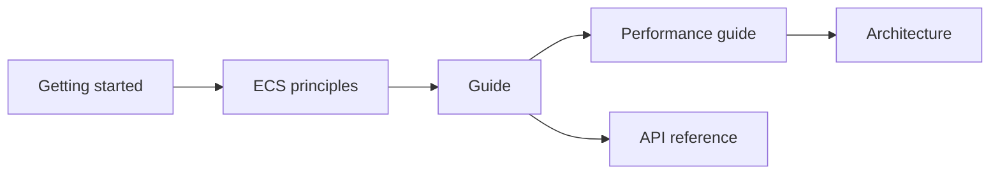

# EasyEcs documentation

New to EasyEcs? Read the pages in this order. The [project README](../README.md) has the pitch, the quick start and
the headline numbers.

## Start here

| Page | Read it to |
|---|---|
| [Getting started](getting-started.md) | Build a small simulation step by step: world, entities, components, tags, queries, systems, singletons, groups, update loop. |
| [ECS principles](ecs-principles.md) | Learn how to design features as data plus one-job systems, and why the analyzer enforces it. |

## Guide

One page per concept, in a sensible reading order:

| Page | Covers |
|---|---|
| [Entities and components](guide/entities-and-components.md) | Handles, id recycling and versions, component operations, tags. |
| [Queries and filters](guide/queries.md) | `Query`, `ForEach` struct jobs, `Count`, `Any`, `QueryFilter`. |
| [Systems, `[ForEach]` and groups](guide/systems.md) | Lifecycle, `Priority`, `UpdateInterval`, `[ForEach]` parameters and filters, system groups, errors. |
| [Singletons](guide/singletons.md) | Per-world state, singleton parameters, `SingletonRef<T>`. |
| [Structural changes during iteration](guide/structural-changes.md) | What happens when you add, remove, create or destroy while iterating. |
| [`ref` and `await`](guide/refs-and-await.md) | Mutating through refs, and why refs never cross an `await`. |
| [Threading](guide/threading.md) | One world per shard, what is locked, `WorldOptions.Parallel`. |
| [Analyzer rules](guide/analyzer.md) | EECS001-EECS008: meaning and fix. |

## Reference

| Page | Contents |
|---|---|
| [API reference](api.md) | Every public API with its complexity. |
| [Performance guide](performance.md) | Choosing an iteration API, do's and don'ts, benchmarks and how to measure. |
| [Architecture](architecture.md) | Storage and memory layout, entity lifecycle, archetype transitions, query cache, systems, generators. |
| [Migration guide](../MIGRATION_GUIDE.md) | Upgrading from v3 to v4 (and from v2 to v3). |
