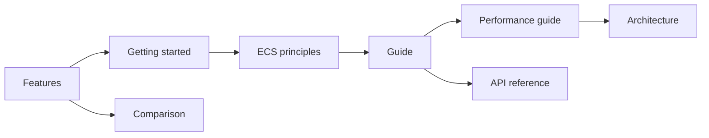

# EasyEcs documentation

New to EasyEcs? Read the pages in this order. The [project README](../README.md) has the pitch, the quick start and
the headline numbers.

## Start here

| Page | Read it to |
|---|---|
| [Features](features.md) | See every feature on one page: what it does, when to use it, what it costs, which scenarios it serves. |
| [Comparison](comparison.md) | Compare EasyEcs with Friflo.Engine.ECS, Arch and DefaultEcs: features, the same server tick, operations, change tracking, removal detection, indexes. |
| [Getting started](getting-started.md) | Build a small simulation step by step: world, entities, components, tags, queries, systems, singletons, groups, update loop. |
| [ECS principles](ecs-principles.md) | Learn how to design features as data plus one-job systems, and why the analyzer enforces it. |
| [Example: a battle server](example.md) | See every feature in one world: the code of the battle server benchmark and scenario tests. |
| [Design questions](faq.md) | Why there are no events and no serialization, what is thread-safe, how to change a component. |

## Guide

One page per concept, in a sensible reading order:

| Page | Covers |
|---|---|
| [Entities and components](guide/entities-and-components.md) | Handles, id recycling and versions, component operations, tags, generated members. |
| [Prefabs and cloning](guide/prefabs.md) | `Prefab`, `world.Instantiate`, `entity.Clone()`: spawn kinds of entities defined once, copy a living entity. |
| [Queries and filters](guide/queries.md) | `Query`, `ForEach` struct jobs, `Count`, `Any`, `QueryFilter`. |
| [Systems, `[ForEach]` and groups](guide/systems.md) | Lifecycle, `Priority`, `UpdateInterval`, `[ForEach]` parameters and filters, system groups, errors. |
| [Singletons](guide/singletons.md) | Per-world state, singleton parameters, `SingletonRef<T>`. |
| [Structural changes during iteration](guide/structural-changes.md) | What happens when you add, remove, create or destroy while iterating. |
| [`ref` and `await`](guide/refs-and-await.md) | Mutating through refs, and why refs never cross an `await`. |
| [Change tracking](guide/change-tracking.md) | `ITrackChanges`, `[Changed<T>]`, `[Removed<T>]`, `QueryFilter.Changed<T>(since)` / `Removed<T>(since)`: visit only what was written, or removed, since a system last ran. |
| [Dynamic buffers](guide/dynamic-buffers.md) | `DynamicBuffer<T>`: a list per entity as a component, every write tracked, copied by snapshots. |
| [Indexes and relations](guide/indexes-and-relations.md) | `IIndexed<TKey>`, `world.Index<T, TKey>()`: find entities by a value; relations (`ChildOf(Entity Parent)`) and their reverse lookup. |
| [Snapshots](guide/snapshots.md) | Capture and restore a world in memory: undo, prediction, replays, tests. |
| [Threading](guide/threading.md) | Process, world and owner thread; system order; safe `WorldOptions.ParallelSystems`; what the structural gate guards. |
| [Analyzer rules](guide/analyzer.md) | EECS001-EECS016: meaning and fix. |

## Reference

| Page | Contents |
|---|---|
| [API reference](api.md) | Every public API with its complexity. |
| [Performance guide](performance.md) | Choosing an iteration API, do's and don'ts, benchmarks and how to measure. |
| [Architecture](architecture.md) | Storage and memory layout, entity lifecycle, archetype transitions, query cache, systems, generators. |
| [Migration guide](../MIGRATION_GUIDE.md) | Upgrading from 4.0 to 4.1, from v3 to v4 (and from v2 to v3). |
