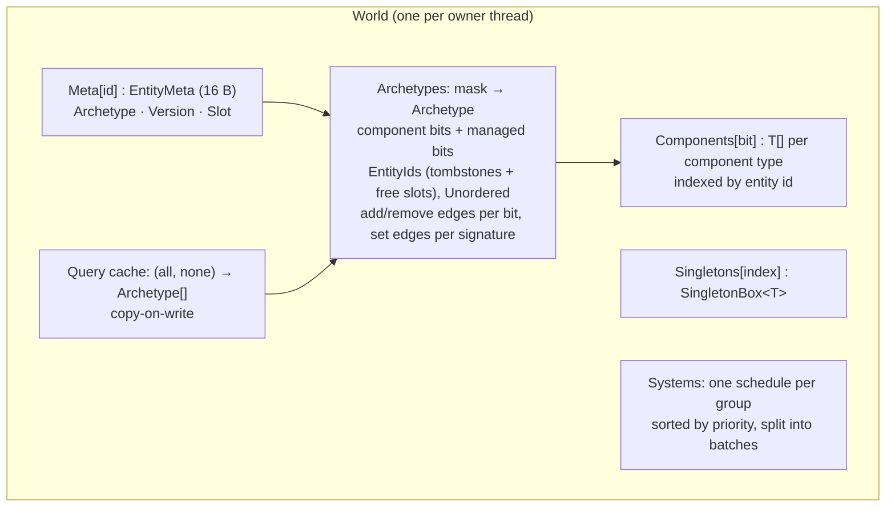
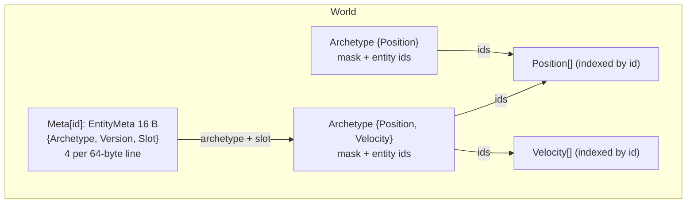
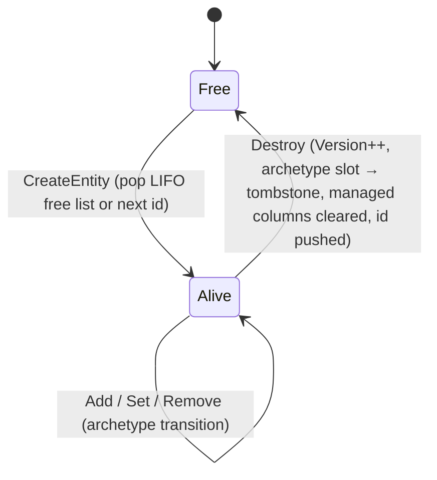

# Architecture

[Docs index](README.md) · How EasyEcs stores data and why. For using the library, start with
[Getting started](getting-started.md); this page is for contributors and the curious. Changes must keep these guarantees:

- zero allocation on hot paths
- bounded memory under churn
- cache-friendly layouts
- safe structural changes during iteration

## Storage model

- **Per entity**, the world stores exactly one `EntityMeta`: 16 bytes, so 4 fit in a 64-byte line.
  - The component set is the archetype's mask, so it is not duplicated per entity.
  - `entity.Has<T>()` / `Get<T>()` touch the entity's meta record and its archetype's mask. Archetypes are few and
    hot, so the mask is almost always cached.
- **Component data** lives in one array per component type, indexed by entity id: `Components[bit][id]`.
  - Lookups are a single indirection.
  - Columns grow with the entity capacity (doubling), and every growth bumps `StorageVersion`.
  - A column records whether `T` contains managed references. Only those columns are cleared on remove and destroy,
    so references don't outlive the entity. Unmanaged data is simply overwritten by the next `Add` or `Set`.
- **Archetypes** hold entity ids, not data. Moving an entity between archetypes moves an id; component data never
  moves. This keeps structural changes O(1), which suits servers, where state flips constantly (buffs, combat, AOI).
- **Masks** (`Tag`) are 256-bit SIMD bitsets with overflow. Up to 65,536 component types are supported (bits are
  `ushort`): the first 256 are inline (two `Vector256` tests, required and excluded, per archetype match); beyond
  that a mask carries an overflow array (at least 4 × 256 bits, doubled when needed). Overflow masks are allocated
  when an archetype or a transition edge is first built, never on the iteration or add/remove path after warm-up.

Trade-off: iteration reads archetype ids and then gathers from each column. That is not as dense as chunked SoA
storage, but structural changes are much cheaper. Ids are kept **ascending**: each archetype counts insertions that
break the order, and `Update` re-sorts the archetypes where that count plus tombstones exceeds 1/8 of the alive
entities (+64) with a bitmap sort (O(S + id range / 64), S = the archetype's slots including tombstones; scratch
pre-allocated, 0 B). The gathers therefore walk each column forward, which hardware prefetchers handle well, without
paying a full sort every tick. `CompactArchetypes()` does the same for every archetype at once.

## Memory layout at a glance

- An entity's component set is its archetype's mask, so it is not stored per entity. A version check plus a `Has`
  touches one 16-byte record and one shared, hot archetype.
- Archetypes hold entity ids, not component data. Adding or removing a component moves an *id*; component data never
  moves.
- Columns are indexed by entity id. Archetypes whose order churn degraded are re-sorted at the start of `Update`,
  which keeps iteration a forward, prefetch-friendly walk (`WorldOptions.SortArchetypesOnUpdate`).
- `CreateEntity(a, b, ...)`, `Set(a, b, ...)` and `Remove<A, B>()` follow edges cached per archetype and keyed by the
  generic signature, so a repeated multi-component change is one array load.
- Columns whose type contains managed references are cleared on remove and destroy, so the GC can collect what they
  pointed to. Unmanaged columns are not cleared: `Add` and `Set` overwrite them anyway.

## Entity lifecycle

- `Entity` is a handle: world, id and version. Every operation validates the version, so a handle to a destroyed
  entity can never touch the entity that reuses its id.
- Ids are recycled LIFO. Recently freed ids still have their cache lines warm, and every array stays bounded by the
  **peak** number of live entities.
- `Meta` never shrinks, even on `Dispose`, where it is cleared instead. That invariant lets handles index it without
  bounds checks.

## Archetype transitions

- `Archetype.EntityIds` uses tombstones (`-1`) plus a free-slot stack. Removal is O(1), and slots never shift, so an
  iteration in progress stays valid.
- Adding or removing a single component follows **edges** cached on the archetype per component bit. An edge is
  created once and linked in both directions (add edge on one archetype, remove edge on the other), so the hot path
  never hashes a mask.
- Adding or removing several components (`CreateEntity(a, b)`, `Set(a, b)`, `Remove<A, B>()`) follows **set edges**
  cached per archetype and keyed by the dense index of the generic signature
  (`TypeIndex<ComponentSignature, (T1, …, Tn)>`). The first call per (archetype, signature) builds the target mask and
  does one hash lookup; later calls are one array load. Set edges are cached on the source archetype only.
- `CreateEntity(in T1 … in Tn)` places the entity in its final archetype directly (through the empty archetype's add
  edge for one component, or its set edge for several), without intermediate moves.

## Query cache

`GetMatchingArchetypes(bits, filter)` keys a `ConcurrentDictionary` by (required mask, excluded mask). Each entry holds
an immutable `Archetype[]`. When a new archetype is created, under the structural lock, every matching entry is
replaced copy-on-write and published with `Volatile.Write`. Readers never lock and never observe a list being
mutated.

## Iteration and structural changes

- `ForEach` caches the column and id arrays and, after each entity, refreshes them whenever `StorageVersion` changed.
  The refs already passed to the current body are not refreshed, so a body that reallocates storage (for example
  `CreateEntity` past capacity) must not use them afterwards. Any code path that reallocates storage must bump the
  version: columns, `Meta`, archetype id arrays and compaction (including the re-sort at the start of `Update`).
- `Query` re-reads the archetype count and ids on every step.
- Removed entities are skipped through their tombstones. Entities added during a pass may or may not be visited.
- An entity moved into a *later* matching archetype during a pass may be visited again. Systems make their methods
  idempotent with filters. This is documented for users in
  [Structural changes during iteration](guide/structural-changes.md).

## Systems

- Each system group has one schedule: its systems sorted by `Priority`, with registration order breaking ties, split
  into batches of consecutive, pairwise non-conflicting systems of one priority (`SystemAccess`). Both arrays are
  copy-on-write.
- `Update()` / `Update<TGroup>()` are synchronous. Each first re-sorts the archetypes whose id order degraded (with
  `WorldOptions.SortArchetypesOnUpdate`), then for each due, enabled system calls `OnUpdate()` and the generated
  `GeneratedUpdate()` ([ForEach] methods).
- `AddSystem` calls `OnCreate()`; `RemoveSystem` and `Dispose` call `OnDestroy()`, `Dispose` in reverse order.
- Systems cooperate through data only, so all behavior runs in schedule order (see
  [ecs-principles.md](ecs-principles.md#4-state-changes-are-data)).
- Errors go to `World.SystemError`. Without a subscriber they propagate.
- System groups (`[UpdateInGroup<TGroup>]`) each have their own schedule; `Update()` runs group 0 (the default),
  `Update<TGroup>()` runs that group. User-facing details: [Systems](guide/systems.md).

## Source generators and analyzer (`EasyEcs.Generator`)

| Component | What it does |
|---|---|
| `ArityGenerator` | Emits every T1..T9 family of `EasyEcs.Core` from one template each: `Entity.Set` / `Remove`, `World.CreateEntity`, `IForEach`, `ForEach`, `Query`, `Count`, `Any`, `QueryItem` / `QueryEnumerator`. Runs only for `EasyEcs.Core`. |
| `SystemGenerator` | Turns `[ForEach]` methods into struct jobs, static filters, a `GeneratedUpdate` override and a `GeneratedAccess` override (reads and writes, or `RunsAlone`) used for `Parallel` batching. |
| `EasyEcsAnalyzer` | Reports EECS001–EECS006 (errors) and EECS007–EECS008 (ECS-principle warnings). Every rule with its fix: [Analyzer rules](guide/analyzer.md). |

Following the incremental-generator guidelines:

- Entry points are `ForAttributeWithMetadataName`, or a syntax-only predicate before any semantic work.
- Models are equatable records of strings. No `ISymbol`, `SyntaxNode` or `Location` survives the transform.
- Generators never report diagnostics. They skip invalid input, and the analyzer reports it using the same shared
  checks (`Symbols`).
- Every stage has a tracking name. `GeneratorTests.UnrelatedEditsHitTheCache` asserts that an unrelated edit leaves
  the `SystemGenerator` stages (`ForEachMethods`, `SystemUpdates`) `Cached` or `Unchanged`.
- Sources are added as UTF-8 `SourceText`.

## Type indices

`TypeIndex<TFamily, T>` assigns each type a dense, process-wide index within a family on first use. It is a static
readonly field, so the JIT folds it to a constant. The families:

- `ComponentType<T>.Bit`: mask bit and column index (a `ushort`, so up to 65,536 component types).
- `SingletonType<T>.Index`: singleton slot.
- `SystemGroup<T>.Index`: system group (0 is the default group, so group indices start at 1).
- `ComponentSignature`: one index per generic signature `(T1, …, Tn)` of a multi-component `CreateEntity`, `Set` or
  `Remove`, keying the set edges of each archetype.

Every world uses the same indices, so masks are comparable across worlds.

## Threading

- Structural operations, system changes and singleton creation take the world's `System.Threading.Lock`.
- Queries, `Get` and `Has` are lock-free. The first use of a query shape takes the lock once to build its cache
  entry.
- Component values are unsynchronized by design. The recommended layout is **one world per owner
  thread**, where the lock is always uncontended. User-facing rules: [Threading](guide/threading.md).
- `WorldOptions.Parallel`: every system carries a `SystemAccess` (component and singleton read/write bitsets, or
  "runs alone"), generated from its `[ForEach]` parameters and read once by `AddSystem`. The schedule splits each
  priority into batches of consecutive, pairwise non-conflicting systems and publishes them as one copy-on-write
  array. A batch runs on the calling thread plus reusable `IThreadPoolWorkItem` helpers that claim systems through
  one `Interlocked` cursor (epoch in the high 32 bits, so a helper that starts late never touches the next batch);
  nothing is allocated per update.
