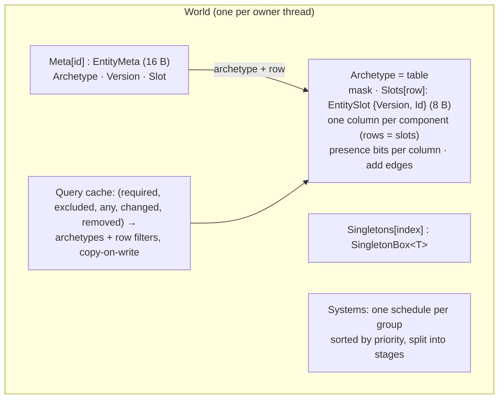
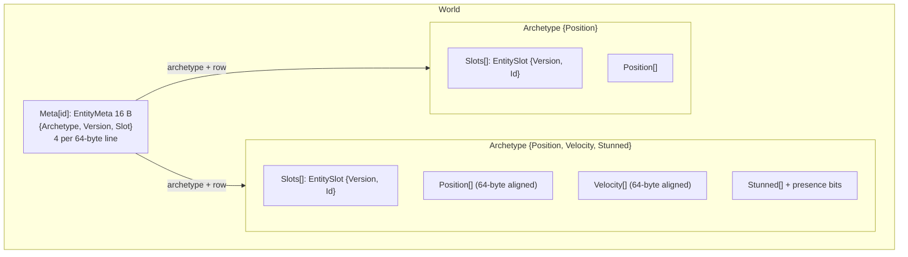
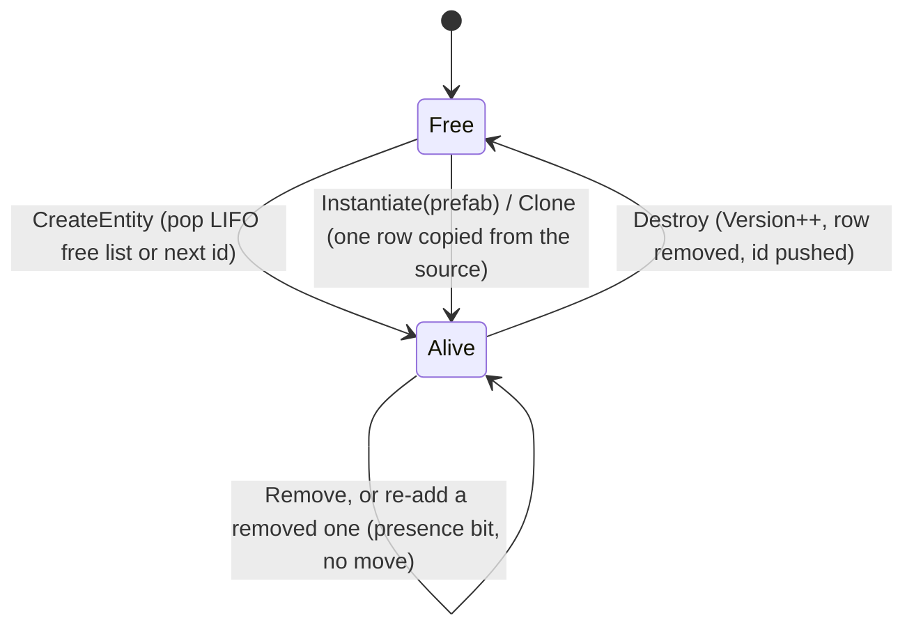

# Architecture

[Docs index](README.md) · How EasyEcs stores data and why. For using the library, start with
[Getting started](getting-started.md); this page is for contributors and the curious. Changes must keep these guarantees:

- zero allocation on hot paths
- bounded memory under churn
- cache-friendly layouts (64-byte lines) that SIMD can walk
- immediate structural changes, safe during iteration

## Storage model

- **Per entity**, the world stores exactly one `EntityMeta`: its archetype, version and row (16 bytes, so 4 fit in a
  64-byte line). The component set is the archetype's mask, so it is not duplicated per entity. (A value index, when
  a world creates one, keeps its own node per entity id; see the value indexes below.)
- **Archetypes are tables** (structure of arrays): one column per component type, a row per entity, plus one
  8-byte `EntitySlot` per row (version and id side by side, so a handle is one load). Iteration walks the columns of a table front to back, which hardware
  prefetchers and SIMD handle best.
  - Unmanaged columns are pinned arrays on the pinned object heap whose row 0 starts on a 64-byte boundary, so a row
    of a power-of-two-sized component never straddles two cache lines and vector loads stay aligned.
  - Columns whose type holds managed references are plain `T[]`; a row's references are cleared when the row loses
    its entity or its component, so the GC can collect what they pointed to.
  - A `DynamicBuffer<T>` column is such a column: each row holds one reference to its own list (a store object with
    an array and a count, made by the row's first write). Moving the row moves the reference; snapshots copy the
    elements into new stores (`ComponentInfo.CopyRows` reads the column as store references, valid because the
    buffer's only field is that reference).
  - Tables double when full and never shrink: each is bounded by the peak number of entities it held.
- **Presence bits.** Removing a component keeps the entity in its table and clears the row's bit for that component
  (one bit per row, 64 rows per `ulong`). A column gets its bits on the first removal; until then every row has the
  component and the column carries no bits at all. Each column also counts its alive rows lacking the component, so a
  query knows per table whether it can skip the table, walk every row, or test the bits. `Count` and `Any` answer a
  table where only one required or excluded column varies from that count, without reading bits.
- **Masks** (`BitMask`) are 256-bit SIMD bitsets with overflow. Up to 65,536 component types are supported (bits are
  `ushort`): the first 256 are inline (one `Vector256` test per archetype match); beyond that a mask carries an
  overflow array (at least 4 × 256 bits, doubled when needed). Overflow masks are allocated when an archetype or a
  transition edge is first built, never on the iteration or structural-change path after warm-up.

- **Change ticks.** A component marked `ITrackChanges` brings a hidden companion column (`ChangeTicks<T>`, 8 bytes
  per row) into every table that has it: the world's change tick of each row's last write. Writes stamp it (a run of
  rows with one vectorized fill) and keep summaries: the latest tick of the column and of each block of 4,096 rows
  (upper bounds), and per 64-row word its latest tick, the rows holding that tick and a bound for the ticks of its
  other rows. Stamps carry the world's current tick, the latest of all, so a write through a handle to a word already
  at it only sets its row's bit. A pass that writes row after row (a query, a per-entity job) notes each word once
  and raises its bound to the tick instead, as rebuilding the rows bit by bit would cost every write a
  read-modify-write; a run of rows sets whole words. A row copied to another row (a move, a filled hole) brings its own tick and updates the target
  word by comparing. A `Changed` filter skips a table older than the pass's tick with one load, then unwritten blocks,
  then unwritten words (4 summaries per SIMD compare); a word whose other rows are older than the tick yields its
  written rows directly, and only words mixing older and newer ticks compare their rows (4 per SIMD instruction).
  The result is 64 bits per word, like the presence bits: it rides on the row-filter machinery.
  Removing a tracked component stamps its row's tick too, while the row keeps its column and clears its presence bit:
  a `Removed` filter is an excluded column (the presence bit clear) whose rows must also reach the pass's tick, so
  removal detection needs no extra storage, and the `Changed` filters of the same component skip the row because they
  require it.
  Untracked components have no column and no stamping code (the checks are JIT-time constants).
- **Value indexes** (`IIndexed<TKey>`, `world.Index<T, TKey>()`): a dictionary from key to the head and length of a
  doubly linked list of entity ids (nodes in an array indexed by id); relation heads (keys that are entities of the
  world) sit in an array indexed by the target's id instead, so a relation lookup hashes nothing. The index is kept on
  write: `Set`, `CreateEntity` and `CreateEntities` call one inlined hook that the JIT removes for components without
  an index (`ComponentType<T>.Indexed` is a static readonly constant), and the hook re-links the entity only when its
  key changed. A write through a `ref` cannot be seen (the ref is handed out before the value changes), so the
  analyzer rejects those (EECS015) instead of the index paying for every lookup. The first lookup builds the index with
  one query; destroying an entity or removing an indexed component unlinks it at once (one null check on those paths
  while the world has no index), so counts are exact and enumeration needs no validation.

Trade-off: a table copies an entity's row when the entity gains a component its table has no column for, which is
what makes iteration dense. States that come and go (stunned, burning, dead) only flip presence bits after the first
time, so they cost no copy; a table with many rows lacking a queried component is walked 64 rows per bit word.

Columns are contiguous arrays, not pages. Paged columns (a few thousand rows per page) iterate at the same speed but
put one more indirection on every handle access; all they save is the copy when a table grows, a warm-up cost that
`InitialEntityCapacity` removes, while handle access is paid on every tick.

## Memory layout at a glance

- `entity.Get<T>()` is a version check on the 16-byte record, a column lookup in the archetype (bit → column, a small
  array) and, when the column has presence bits, one bit test; then an indexed load from the column.
- `CreateEntity(a, b, ...)`, `Set(a, b, ...)` and `GetOrAdd<T>()` follow transitions cached per archetype (per component
  bit, and per generic signature for several components), so a repeated structural change is one array load plus
  the row copy.

## Entity lifecycle

- `Entity` is a handle: world, id and version. Every operation validates the version, so a handle to a destroyed
  entity can never touch the entity that reuses its id.
- Ids are recycled LIFO. Recently freed ids still have their cache lines warm, and `Meta` stays bounded by the
  **peak** number of live entities.
- `Meta` never shrinks, even on `Dispose`, where it is cleared instead. That invariant lets handles index it without
  bounds checks.

## Archetype transitions and row removal

- An entity moves only when it gains a component its table has no column for. The move copies the components both
  tables have (a copy plan of column pairs, computed once per edge) into a new row of the target table. Unmanaged
  elements are copied as bytes with fixed-width loads; managed ones through their typed copy.
- Removing a component never moves the entity: the row clears its presence bit (and a managed value). Adding that
  component back sets the bit again.
- Single-component adds follow **edges** cached on the archetype per component bit. Multi-component adds
  (`CreateEntity(a, b)`, `Set(a, b)`) follow **set edges** cached per archetype and keyed by the dense index of the
  generic signature (`TypeIndex<ComponentSignature, (T1, …, Tn)>`). The first call per (archetype, signature) builds
  the target mask and does one hash lookup; later calls are one array load.
- `CreateEntity(in T1 … in Tn)` places the entity in its final table directly, without intermediate moves.
- **Prefabs and clones.** A `Prefab` is one row of a private world of its own (capacity 1), so it belongs to no world
  the user queries. `Instantiate` finds the target world's table with the prefab table's mask once and caches it per
  prefab table (`_prefabTables`); `Clone` uses the original's table. Then `Archetype.CloneRows` copies the row (into every row of a wave): the
  bytes of unmanaged columns, managed values through `ComponentInfo.CloneManaged` (a `DynamicBuffer<T>` gets a new
  store with the same elements), presence bits for what the source lacks, and the change tick of each tracked
  component the source has set to the current tick (0 for one it lacks: never removed here). The new entity is then
  indexed like a created one. `Instantiate(prefab, span)` reserves ids and table rows once for the wave.
- A row that loses its entity (destroyed or moved away) is filled at once by the table's last row when no pass is
  iterating the world, so tables stay dense. While a pass iterates, the row becomes a **tombstone** (id `-1`) instead,
  so rows never shift under the pass; the last pass to end closes the tombstones (moving the last rows into them,
  found with vectorized scans of the rows read as `long`s: a tombstone's id, the high half, is negative).

## Query cache

`GetMatchingArchetypes(bits, filter)` keys a `ConcurrentDictionary` by the query's components (required, excluded,
`WithAny`, `Changed`, `Removed`). Each entry holds an immutable snapshot: the archetypes whose mask contains every
required component and the column of every `Removed` component (and, with `WithAny`, at least one of those columns), and one row filter per archetype (the columns whose
presence bits and change ticks the query tests). A value index holds its entry (`GetQueryEntry`), so it sees new
tables without a lookup. An excluded component does not rule a table out, since its rows may lack it; the row filter
does. When a new archetype is created, under the structural gate, every matching entry is replaced copy-on-write and
published with `Volatile.Write`. Readers never lock and never observe a list being mutated.

Per pass and table, the row filter picks one of three modes from the column counts: skip the table (no row can
pass), walk every row (no row lacks a required component or has an excluded one), or test presence bits. A filter
with `Changed<T>` or `Removed<T>` always tests: its words also AND in the rows whose tick reaches the pass's tick (the cached plan is
shared by every pass; the tick travels with the pass).

## Iteration and structural changes

Every iteration API walks tables front to back. What differs is how much bookkeeping a pass needs:

- **Jobs that make no structural change** (`INoStructuralChanges`, added by the generator to static `[ForEach]`
  methods that take no `World` and use their `Entity` parameter, if any, only to read: `Id`, `Version`, `IsAlive`,
  `Has`, `Get`, `Read`, `TryGet`, `TryGetRef`) walk dense tables with no per-row check, and walk tables with presence bits 64 rows per bit
  word. `ForEachBatch` and `[ForEach]` methods taking spans hand whole runs of consecutive passing rows to the job;
  such jobs must not make structural changes at all.
- **Other passes** register with the world (`BeginPass` / `EndPass`), so removed rows become tombstones instead of
  being filled. Before walking, a pass records each matching table's row count; rows appended during the pass
  (entities created or moved into a matching table) are past that count and not visited. Each entity is therefore
  visited at most once, and an entity that loses a queried component or is destroyed before its turn is skipped.
- After each entity, a pass compares `StorageVersion` with the value it last saw. Every change that can reallocate
  storage, move rows or flip presence bits bumps it: the row loop then returns the next row to the pass, which
  re-reads the column refs and presence bits and enters a row loop again from there (so the loop keeps only its row
  state live across the job, in registers). A table whose rows all pass is walked by a lean loop; once a change makes
  some rows fail, by a loop that tests bits once per run of passing rows.
- When a job changes the archetype of the entity it is visiting, its writes through the refs land in the old row
  (now a tombstone). After the job returns, the pass copies the components the job writes (`Writes`, generated from
  its `ref` parameters) to the entity's new row, so the job's writes are never lost.
- `Query` follows the same visiting rules. Its enumerator keeps the hot state (row, row count, entity rows, column
  refs) in its own fields and is never passed by reference: every member
  a loop calls is inlined, so the JIT keeps those fields in registers. The cold state (each table's row count at the
  start, the row filter, change-stamp bookkeeping) lives in a `QueryWalk`, pooled per thread (one per nesting level
  once warmed up: no allocation in steady state), reached by value once per table and per structural change (and once per
  passing row of a table whose rows must be tested). Keeping a word's passing bits in the enumerator as well was
  measured and rejected: the two extra values pushed the column refs of every loop out of registers. The slot and the
  row count are native ints, so row addressing needs no sign extension on x64 or arm64. A ticket tells a walk's current use from a copy of an enumerator that already ended.

## Systems

- Each system group has one schedule: its systems sorted by `Priority`, with registration order breaking ties, split
  into stages of consecutive, pairwise non-conflicting systems of one priority (`SystemAccess`). Both arrays are
  copy-on-write. Each stage advances the change tick once, whether its systems run together or not.
- `Update()` / `Update<TGroup>()` are synchronous. For each due, enabled system they call `OnUpdate()` and the
  generated `GeneratedUpdate()` (`[ForEach]` methods). If a pass was interrupted by an exception, the update first
  closes the tombstones it left.
- `AddSystem` calls `OnCreate()`; `RemoveSystem` and `Dispose` call `OnDestroy()`, `Dispose` in reverse order.
- Systems cooperate through data only, so all behavior runs in schedule order (see
  [ecs-principles.md](ecs-principles.md#4-state-changes-are-data)).
- Errors go to `World.SystemError`. Without a subscriber they propagate.
- System groups (`[UpdateInGroup<TGroup>]`) each have their own schedule; `Update()` runs group 0 (the default),
  `Update<TGroup>()` runs that group. User-facing details: [Systems](guide/systems.md).

## Source generators and analyzer (`EasyEcs.Generator`)

| Component | What it does |
|---|---|
| `ArityGenerator` | Emits every T1..T9 family of `EasyEcs.Core` from one template each: `Entity.Set` / `Remove`, `World.CreateEntity` / `CreateEntities` / `DestroyEntities`, `IForEach` / `IForEachEntity` / `IForEachBatch`, `ForEach` / `ForEachEntity` / `ForEachBatch` / `ForEachParallel` / `ForEachEntityParallel`, `Query`, `Count`, `Any`, `QueryItem` / `QueryEnumerator`. Runs only for `EasyEcs.Core`. |
| `SystemGenerator` | Turns `[ForEach]` methods into struct jobs (per entity, or per run of rows for span parameters), static filters, a `GeneratedUpdate` override, a `GeneratedAccess` override (reads and writes, or `RunsAlone`) used to split systems into `ParallelSystems` stages, and a `GeneratedFor` override naming the class it was generated for (a subclass the generator did not see inherits it, so its access is unknown and it runs alone). `[Changed<T>]` and `[Removed<T>]` become `Since(LastRunTick + 1)` on the method's filter and a declared read of `T`; `[ForEach(Parallel = true)]` runs the job over chunks of rows. Jobs that cannot change structure get `INoStructuralChanges`; jobs record which components they write (`Writes`) and whether they read the entity id. |
| `EasyEcsAnalyzer` | Reports EECS001–EECS016, all errors: invalid input the generator skips, and code that breaks the ECS principles. Every rule with its fix: [Analyzer rules](guide/analyzer.md). |

Following the incremental-generator guidelines:

- Entry points are `ForAttributeWithMetadataName`, or a syntax-only predicate before any semantic work.
- Models are equatable records of strings. No `ISymbol`, `SyntaxNode` or `Location` survives the transform.
- Generators never report diagnostics. They skip invalid input, and the analyzer reports it using the same shared
  checks (`Symbols`).
- Every stage has a tracking name. `GeneratorTests.UnrelatedEditsHitTheCache` asserts that an unrelated edit leaves
  the `SystemGenerator` stages (`ForEachMethods`, `SystemUpdates`) `Cached` or `Unchanged`.
- Sources are added as UTF-8 `SourceText`.

## Type indices

`TypeIndex<TFamily, T>` assigns each type a dense, process-wide index within a family on first use. It is a static
readonly field, so the JIT folds it to a constant. The families:

- `ComponentType<T>.Bit`: mask bit (a `ushort`, so up to 65,536 component types). Assigning it registers the type's
  `ComponentInfo` (element size, managed or not, typed column operations), which tables use without knowing `T`.
- `SingletonType<T>.Index`: singleton slot.
- `SystemGroup<T>.Index`: system group (0 is the default group, so group indices start at 1).
- `ComponentSignature`: one index per generic signature `(T1, …, Tn)` of a multi-component `CreateEntity` or `Set`,
  keying the set edges of each archetype.
- `ValueIndexFamily`: the slot of a component's value index in its world (`world.Index<T, TKey>()`).

An `ITrackChanges` component also registers its hidden `ChangeTicks<T>` column, paired with the component's own
column in `ComponentInfo`, so every copy, move and growth of a row carries its change tick.

Every world uses the same indices, so masks are comparable across worlds.

## Threading

- Structural operations, system changes, `Capture` and `Restore` enter the world's **structural gate**, which
  belongs to the owner thread: a plain flag, checked and set on the way in, cleared on the way out (no atomic
  instruction, so a create/destroy pair costs no `lock cmpxchg`). A parallel stage of systems and the chunks of a
  parallel `[ForEach]` add a region count to the same flag while they run, so any structural change inside them throws
  `InvalidOperationException`, deterministically; so does one reentered under the gate.
- The cold paths the threads of a parallel stage reach on their own take a separate **shared gate** (a
  compare-and-swap flag with a spinning wait): the first match of a query shape, a singleton a system resolves first,
  and closing the tombstones when the last pass ends. Both flags sit on their own cache line.
- Queries, `Get` and `Has` are lock-free. Component values are unsynchronized by design. The recommended layout is
  **one world per owner thread**. The analyzer reports structural changes in `[ForEach]` methods that promise none
  (EECS013) and in delegates handed to other threads that race (EECS014). User-facing rules:
  [Threading](guide/threading.md).
- `WorldOptions.ParallelSystems`: every system carries a `SystemAccess` (component and singleton read/write bitsets, or
  "runs alone"), generated from its `[ForEach]` parameters and read once by `AddSystem`. The schedule splits each
  priority into stages of consecutive, pairwise non-conflicting systems and publishes them as one copy-on-write
  array. A stage runs on the calling thread plus reusable `IThreadPoolWorkItem` helpers that claim systems through
  one `Interlocked` cursor (epoch in the high 32 bits, so a helper that starts late never touches the next stage);
  nothing is allocated per update.
