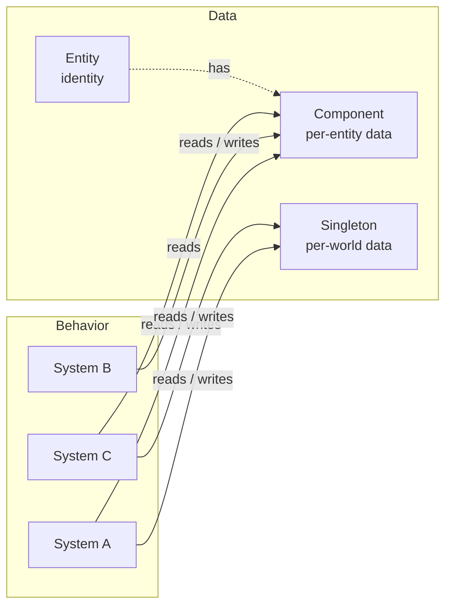
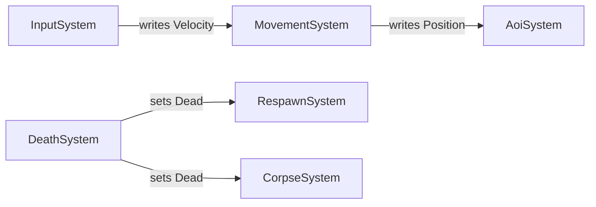

# ECS principles

EasyEcs separates **data** (entities, components, singletons) from **behavior** (systems). That separation is
what makes iteration fast (dense columns, no virtual calls per entity), and it is also what keeps a large code base
decoupled: systems never know about each other, only about data. This page explains each role and how to design
features with them. The analyzer enforces the mechanical parts (EECS006–008).

## Roles



There are no arrows between systems. Every dependency goes through data, and every piece of behavior runs inside
the schedule, in the order `Priority` declares.

| Element | Is | Is not |
|---|---|---|
| **Entity** | An identity (id + version). | A container of logic, a base class, a place for fields. |
| **Component** | A struct of fields for one aspect of one entity (`Health`, `Velocity`). Computed getters are fine. | A class, an object with behavior, a holder of references to systems or services. |
| **Tag** | An empty component (`Dead`, `Frozen`) used as a query filter. | A boolean you flip every tick (use a field instead). |
| **Singleton** | One struct per world: clock, configuration, counters, spatial indexes. | A static field (it would be shared by every world). |
| **System** | Behavior with one responsibility. Reads and writes data. | A place to keep state, or a service other systems call. |

## Rules and how to follow them

### 1. One system, one responsibility

Name a system after the one thing it does. If its description needs "and", split it.

```csharp
// Before: status effects AND death AND rewards in one system.
public partial class StatusSystem : EcsSystem
{
    [ForEach] static void Burn(Entity e, ref Burning b, ref Health h) { ... }
    [ForEach] static void CheckDeath(Entity e, ref Health h, World w) { ... }
}

// After: each concern can be removed, reordered or tested on its own.
public partial class StatusSystem : EcsSystem
{
    [ForEach] static void Burn(Entity e, ref Burning b, ref Health h) { ... }
}

public partial class DeathSystem : EcsSystem
{
    [ForEach, Without<Dead>] static void CheckDeath(Entity e, in Health h, World w) { ... }
}
```

Splitting costs nothing at run time: every `[ForEach]` method is its own inlined struct job either way, and the
per-system overhead of `Update` is a virtual call.

### 2. Systems are stateless

State in a system is invisible to queries, to other systems, to tests and to persistence, and it disappears or
doubles when the system is removed or added twice. Put it in data:

| State | Where |
|---|---|
| Per entity (cooldown, target, path) | a component |
| Per world (tick, score, configuration, spatial grid) | a singleton |
| Derived and rebuildable (scratch list reused every update) | a `readonly` field on the system is fine |

```csharp
// Before (EECS007): the count lives in the system.
public partial class DeathSystem : EcsSystem
{
    public int Deaths;

    [ForEach, Without<Dead>]
    void Die(Entity e, in Health h) { if (h.Value <= 0) { e.Set(new Dead()); Deaths++; } }
}

// After: the count is world state; anyone can read it.
public record struct Score(int Deaths) : ISingletonComponent;

public partial class DeathSystem : EcsSystem
{
    [ForEach, Without<Dead>]
    static void Die(Entity e, in Health h, ref Score score)
    {
        if (h.Value > 0) return;
        e.Set(new Dead());
        score.Deaths++;
    }
}
```

### 3. Systems never reference systems

A system that calls another system (EECS008), or reaches it through `World.GetSystem<T>()`, can no longer be
removed, reordered or tested alone. Cooperate through data instead:

- **Pipeline:** an earlier system writes a component, a later one reads it. Order them with `Priority`.
- **Reacting to a state:** a system queries the state another one wrote (`[ForEach] ... in Dead _`); the writer does
  not change when a reader is added (rule 4).



### 4. State changes are data

When something happens to an entity, write its new state: set a tag (`Dead`) or a field. Systems that care query
that state later in the update, in the order `Priority` declares: movement and combat skip `Dead` entities,
`CorpseSystem` removes them, `RespawnSystem` revives players. None of them is known to `DeathSystem`.

### 5. Choose the cheapest representation for frequent changes

Adding or removing a component moves the entity to another archetype: a cached edge lookup plus copying its
components. That is fine for changes that happen every few ticks (a buff starts or ends). For something that flips
every tick, a field is cheaper:

- a countdown field (`Burning.Ticks`) instead of re-adding a component every tick;
- change detection by comparison: keep the last sent value in a component (`NetSync`) and compare it to the
  current value, instead of adding and removing a `Changed` tag.

### 6. Keep jobs idempotent within an update

Changes are immediate. An entity that a `[ForEach]` job moves into another archetype that the same job matches may be
visited again in the same pass. Filter out what the job produces:

```csharp
[ForEach, Without<Dead>]   // the job adds Dead, so it skips entities that already have it
static void CheckDeath(Entity e, in Health h) { if (h.Value <= 0) e.Set(new Dead()); }
```

### 7. Never hold `ref`s or handles to storage across boundaries

A `ref` from `Get<T>()` or a `[ForEach]` parameter is valid until the next structural change of that entity and
never across `await`. Keep `Entity` handles (validated on every access) and re-read components when you need them.
See the README section on `ref` across `await`.

## Checklist for a new feature

1. List the data: which components (per entity) and singletons (per world) does it need?
2. List the behaviors, one system each, named by what it does.
3. Order systems by data flow (`Priority`): producers before consumers.
4. Express cross-module reactions as systems querying the state another system wrote, never as calls between
   systems.
5. Make sure the analyzer reports no EECS warnings.
6. Test each system alone: create a world, add the system and the data it reads, `Update()`, assert on data.
