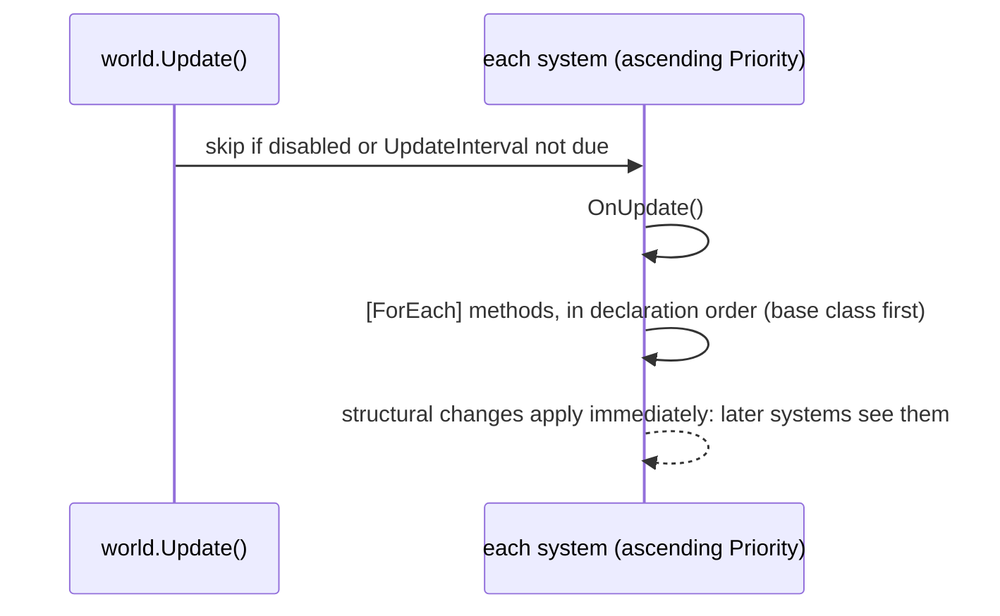

# Systems, `[ForEach]` and groups

[Docs index](../README.md) · Related: [ECS principles](../ecs-principles.md) · [Analyzer rules](analyzer.md) ·
[Threading](threading.md) · [API reference](../api.md#systems-singletons-maintenance)

A system is behavior with one responsibility. It derives from `EcsSystem`, keeps no state (state is in components
and singletons) and never references another system.

## Lifecycle

| Hook / member | When |
|---|---|
| `OnCreate()` | once, when the system is added (`world.AddSystem<T>()` / `AddSystem(system)`) |
| `OnUpdate()` | every update of its group, before its `[ForEach]` methods |
| `[ForEach]` methods | every update, after `OnUpdate`, in declaration order (base class first) |
| `OnDestroy()` | once, on `world.RemoveSystem<T>()` or `world.Dispose()` (reverse order) |
| `World` | the owning world, set before `OnCreate` |
| `Priority` (override) | execution order: lower runs first; default 0 |
| `UpdateInterval` (override) | run every N-th update of its group; default 1 |
| `Enabled` | disabled systems are skipped |

`AddSystem<T>()` returns the system; `GetSystem<T>()` finds one (for tooling and tests, not for other systems:
see [EECS008](analyzer.md#eecs008)).

## One update



Systems are sorted by `Priority`, registration order breaking ties. By default everything runs on the thread that
calls `Update()`. With `WorldOptions.Parallel`, systems of one priority whose generated access does not conflict
(`ref` = write, `in` = read) run at the same time; the result is the same as running them in order (see
[Threading](threading.md#parallel-systems)).

## `[ForEach]` methods

A `[ForEach]` method is declared in a `partial` class that derives from `EcsSystem`. It can be static or an instance
method, and the generator compiles it to a struct job with a static filter.

| Parameter | Meaning |
|---|---|
| `ref T` / `in T` (`T : IComponent`) | component data, 1-9 of them (`ref` to write, `in` to read) |
| `ref T` / `in T` (`T : ISingletonComponent`) | the world's singleton, resolved once per pass (added if missing) |
| `Entity entity` | handle of the current entity (structural changes, destroy) |
| `World world` | the world (useful in static methods) |

| Attribute | Meaning |
|---|---|
| `[ForEach]` | run the method for every matching entity |
| `[With<T>]` | the entity must have `T`, which is not passed in; repeatable. With no component parameter, the first `[With<T>]` is the queried component (`[ForEach, With<Dead>] static void Remove(Entity e)`) |
| `[Without<T>]` | the entity must not have `T`; repeatable |

```csharp
public record struct Burning(int Ticks, int DamagePerTick) : IComponent;
public struct Player : IComponent;      // tag
public record struct Stats(int BurnDamage) : ISingletonComponent;

public partial class BurnSystem : EcsSystem
{
    [ForEach, With<Player>, Without<Dead>]   // players only (Player is not passed in), living only
    static void Burn(ref Health hp, in Burning burning, ref Stats stats)   // two components + a singleton
    {
        hp.Value -= burning.DamagePerTick;
        stats.BurnDamage += burning.DamagePerTick;
    }
}
```

Derived systems run the base class's `[ForEach]` methods first. Mistakes (missing `partial`, an invalid parameter,
zero or more than 9 components, generic systems, `[ForEach]` outside a system) are compile errors: see
[Analyzer rules](analyzer.md).

Make methods that change the entity's archetype idempotent with a filter: see
[Structural changes during iteration](structural-changes.md).

## System groups

`world.Update()` runs the default group. A system marked `[UpdateInGroup<TGroup>]` (where `TGroup` is a
`struct : ISystemGroup`) runs only when `world.Update<TGroup>()` is called. Use groups for different cadences; a
server can run input handling on every wake-up and the simulation at a fixed tick:

```csharp
public struct InputGroup : ISystemGroup;

[UpdateInGroup<InputGroup>]
public partial class ApplyInputSystem : EcsSystem { /* [ForEach] methods */ }
```

```csharp
world.Update<InputGroup>();   // whenever input arrives
world.Update();               // fixed tick
```

`Priority`, `UpdateInterval` and `Enabled` apply within each group, and the attribute is inherited. Updating a group
with no systems is a no-op.

## Errors

Subscribe to `world.SystemError` (`Action<EcsSystem, Exception>`) to handle exceptions thrown by systems (including
`OnDestroy` during `Dispose`); the update continues with the next system. Without a subscriber the exception
propagates out of `Update()`.
