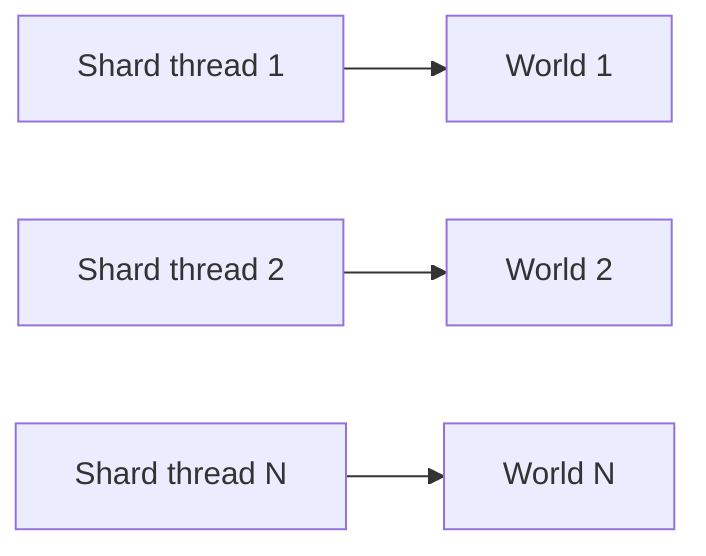

# Threading

[Docs index](../README.md) · Related: [Architecture: threading](../architecture.md#threading) ·
[Systems](systems.md#one-update)

## Recommended: one world per shard

Worlds share nothing, so a server that gives each shard (thread) its own `World` needs no synchronization at all,
and every lock inside the world stays uncontended. `ShardedWorldBenchmark` measures exactly this layout (one world per
core, each on its own long-lived thread): see [Performance](../performance.md#benchmarks).

## What is synchronized

| Operation | Safety |
|---|---|
| Structural changes (create/destroy, `Add`/`Set`/`Remove`), system changes, singleton add/remove | Take a per-world `System.Threading.Lock`. Thread-safe. |
| Queries, `Get`, `Has` | Lock-free over immutable, copy-on-write archetype snapshots. |
| Component and singleton **values** | Not synchronized, by design. |

So either each world has one owner thread, or, with `WorldOptions.Parallel = true`, systems of the same priority
(one bucket) run in parallel on the thread pool and must touch disjoint data. `MaxDegreeOfParallelism` limits that
parallelism. `Parallel` is off by default.

Hand work to a world from another thread the same way you would to any single-owner structure: post it to the
owning thread, which applies it before or between updates.
