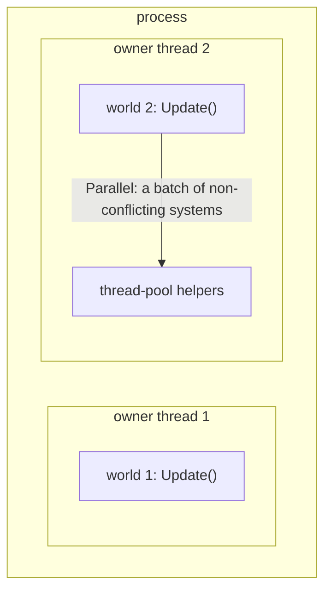
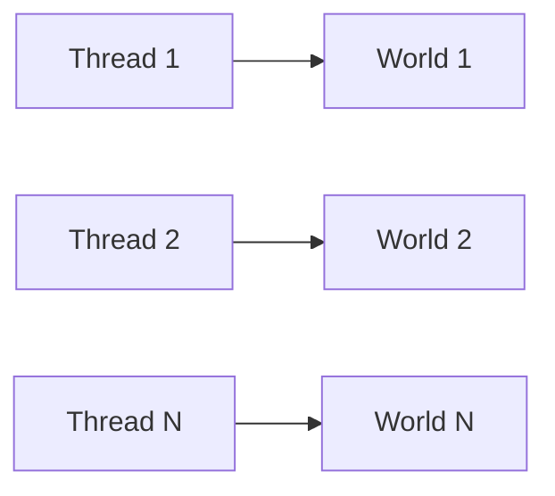
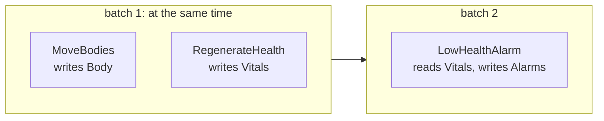

# Threading

[Docs index](../README.md) · Related: [Architecture: threading](../architecture.md#threading) ·
[Systems](systems.md#one-update)

- [Terms: process, world, owner thread](#terms-process-world-owner-thread)
- [Recommended: one world per thread](#recommended-one-world-per-thread)
- [Order of systems](#order-of-systems)
- [Parallel systems](#parallel-systems)
- [What the world synchronizes](#what-the-world-synchronizes)
- [Compared with other ECS libraries](#compared-with-other-ecs-libraries)

## Terms: process, world, owner thread

| Term | Meaning |
|---|---|
| **Process** | Your server. It can hold any number of worlds; nothing is shared between them except type indices. |
| **World** | One isolated set of entities, components, singletons and systems (`new World()`). |
| **Owner thread** | The thread that calls `world.Update()` and touches the world's data. One at a time per world. |
| **`Parallel`** | Inside one `Update()` call, the world borrows thread-pool threads to run a batch of non-conflicting systems; the owner thread takes part and `Update()` returns only when the batch is done. Ownership does not change. |

So it is not "one process per world": a process runs many worlds side by side (typically one per thread), and each world can
additionally spread one update over several cores with `Parallel`.



## Recommended: one world per thread

Worlds share nothing, so a server that splits its entities over several worlds, each owned by one thread (for example
one world per map or zone), needs no synchronization at all,
and the world's structural gate stays uncontended. `MultiWorldBenchmark` measures exactly this layout (one world per
core, each on its own long-lived thread): see [Performance](../performance.md#benchmarks).



Hand work to a world from another thread the way you would to any single-owner structure: post it to the owning
thread (a queue the owner thread drains), which applies it before or between updates.

## Order of systems

The order is explicit and deterministic: `Update()` runs systems in ascending `Priority`, and systems with the same
priority in registration order. Systems never call each other; a system that consumes what another produces gets a
higher priority ([ECS principles](../ecs-principles.md#3-systems-never-reference-systems)).

Structural changes apply immediately, so a later system in the same update already sees an entity that an earlier
one created, destroyed or tagged. There are no command buffers to play back and no "end of frame" sync points.

Dependencies are expressed through data and `Priority`, never through `before`/`after` links between systems:

- **A produces, B consumes a component** (A writes `Velocity`, B reads it): give B a higher priority, or register it
  after A. Even at the same priority with `Parallel`, they conflict on `Velocity`, so they are in different batches and
  A finishes first.
- **A changes structure, B reacts** (A adds `Dead`, B destroys dead entities): A needs an `Entity` parameter to add the
  tag, so it runs alone; B runs after it.
- **A and B touch disjoint data**: their order cannot change the result, so `Parallel` may run them together.

In every case the result of an update equals running the systems one by one in `Priority` / registration order.

## Parallel systems

With `WorldOptions.Parallel = true`, systems of the same priority that do not conflict run at the same time. Nothing
is left to discipline: the generator declares every `[ForEach]` system's access from its parameters, and the
scheduler only puts non-conflicting systems together.

| `[ForEach]` parameter | Declares |
|---|---|
| `ref T` component / singleton | writes `T` |
| `in T` component / singleton | reads `T` |
| `[With<T>]` / `[Without<T>]` | nothing (filters read the archetype and presence bits, which no parallel system changes) |
| `Entity` or `World`, an instance method, an `OnUpdate` override, or no `[ForEach]` method | runs alone |

Two systems conflict when one writes a component or singleton the other reads or writes, or when either runs alone.
A system "runs alone" when it can reach the world beyond its parameters: through an `Entity` it can read any
component or make structural changes, so it never shares a batch.

The systems of one priority are split into **batches of consecutive, pairwise non-conflicting systems**. Batches run
one after another; the systems of a batch run at the same time.

```csharp
public record struct Body(float X, float Y, float Vx, float Vy) : IComponent;
public record struct Vitals(int Health, int Max) : IComponent;
public record struct Alarms(int Count) : ISingletonComponent;

public partial class MoveBodies : EcsSystem        // writes Body
{
    [ForEach] static void Move(ref Body b) { b.X += b.Vx; b.Y += b.Vy; }
}

public partial class RegenerateHealth : EcsSystem  // writes Vitals
{
    [ForEach] static void Regenerate(ref Vitals v) => v.Health = Math.Min(v.Health + 1, v.Max);
}

public partial class LowHealthAlarm : EcsSystem    // reads Vitals: conflicts with RegenerateHealth
{
    [ForEach] static void Count(in Vitals v, ref Alarms alarms) { if (v.Health < 10) alarms.Count++; }
}
```



Because batches are consecutive, registration order keeps its meaning: of two conflicting systems, the one registered
first always finishes first, and the result is the same as a sequential update. A system that should run alone or in
another order gets its own priority.

Execution is allocation-free: the calling thread works through a batch together with up to
`MaxDegreeOfParallelism - 1` reusable thread-pool work items (no `Parallel.For` closures, no tasks). The first
exception thrown in a batch is rethrown on the calling thread after the batch (later ones are dropped); with a
`SystemError` subscriber every exception is reported instead, possibly from a thread-pool thread.

When to turn it on: a world with several heavy, independent systems per priority and spare cores. Each batch costs a
hand-off to the thread pool (microseconds), so it pays for systems that iterate thousands of entities, not for a
handful. For a server, one world per thread usually uses the cores better: see
[Performance](../performance.md#benchmarks) (`ParallelSystemsBenchmark`, `MultiWorldBenchmark`).

## What the world synchronizes

| Operation | Safety |
|---|---|
| Structural changes (create/destroy, `Add`/`Set`/`Remove`), adding/removing systems and singletons | Enter the world's structural gate (a compare-and-swap flag): the world's structure never tears. |
| Query matching, `Has`, `Get` lookups | Lock-free over immutable, copy-on-write archetype snapshots (the first use of a query shape enters the gate once to build its cache entry). |
| Component and singleton **values** | Not synchronized, by design: the owner thread, or the parallel scheduler, decides who touches them. |

The gate protects the world's bookkeeping, not your data: a `ref` or a running query on one thread does not survive a
structural change made by another thread. So use one owner thread per world, with `Parallel` for systems the
scheduler checked; do not mutate one world from several threads of your own.

## Input from other threads

A world has one owner thread, and EasyEcs adds no cross-thread queue of its own: structural changes are immediate on
that thread, so there is nothing to defer. Input from other threads (network, timers, a database) goes through a queue
the caller owns, and a system on the owner thread drains it into data:

```csharp
using System.Collections.Concurrent;

public record struct MoveRequest(int PlayerId, float X, float Y);           // a message, not a component
public record struct MoveIntent(int PlayerId, float X, float Y) : IComponent;

public sealed class ReceiveMoves(ConcurrentQueue<MoveRequest> inbox) : EcsSystem
{
    private readonly ConcurrentQueue<MoveRequest> _inbox = inbox;          // filled by the network threads

    protected override void OnUpdate()
    {
        while (_inbox.TryDequeue(out var move))
            World.CreateEntity(new MoveIntent(move.PlayerId, move.X, move.Y));   // input becomes data
    }
}
```

Register it with `world.AddSystem(new ReceiveMoves(inbox))`, before the systems that consume `MoveIntent` (and destroy
it when handled). The queue's type, bound and back-pressure are the application's choice. Other libraries meet the
same need with thread-safe command buffers (Arch, Friflo's synced buffer, DefaultEcs' recorder, Unity's parallel
writer), which exist mainly so parallel jobs can record structural changes; Bevy uses this same pattern, a channel
drained by a system.

## Compared with other ECS libraries

| Library | Order of systems | Systems in parallel | How conflicts are avoided |
|---|---|---|---|
| **EasyEcs** | `Priority`, then registration order | Non-conflicting systems of one priority (`Parallel`) | Access generated from `ref`/`in` parameters; conflicting systems never share a batch |
| Entitas | Order added to `Feature`/`Systems` | No; a `JobSystem` splits one system's entities across threads | You keep job bodies independent |
| Arch | Your own call order (Arch.System: group order) | Within one query (`ParallelQuery`, chunk jobs) | You keep parallel query bodies independent |
| Friflo.Engine.ECS | `SystemRoot` / `SystemGroup` order | Within one query (`RunParallel`, chunk tasks) | You keep parallel query bodies independent |
| DefaultEcs | `SequentialSystem` order | `ParallelSystem` (all children at once) and per-set runners | You put only independent systems into a `ParallelSystem` |
| Bevy (Rust) | Ambiguous unless ordered (`before`/`after`) | Any systems whose access does not conflict | Access read from parameter types by the scheduler |
| Unity DOTS | `UpdateBefore`/`UpdateAfter` attributes in groups | Jobs | Read/write handles plus the job safety system (dependencies) |

EasyEcs takes the access-based model of Bevy and Unity DOTS, but keeps the order total and deterministic: within a
priority it only runs systems together when their access proves that the order cannot matter.
