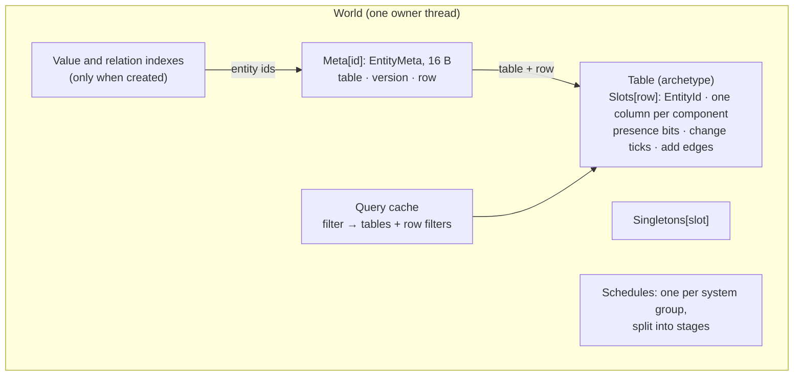
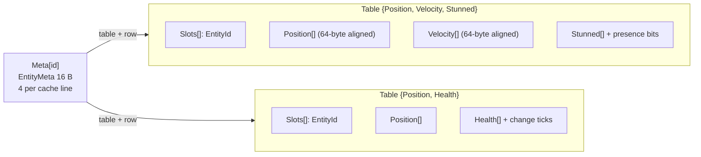
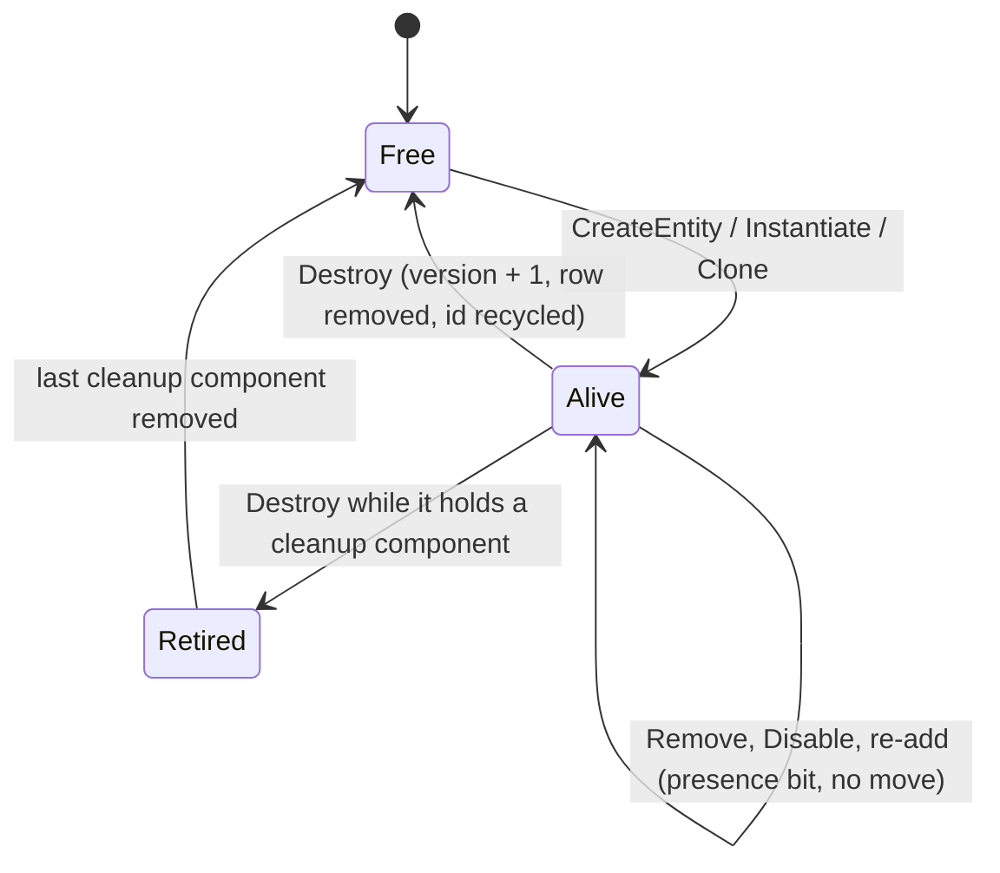
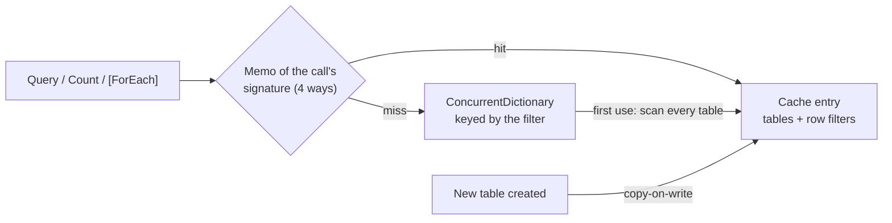
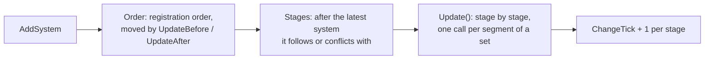
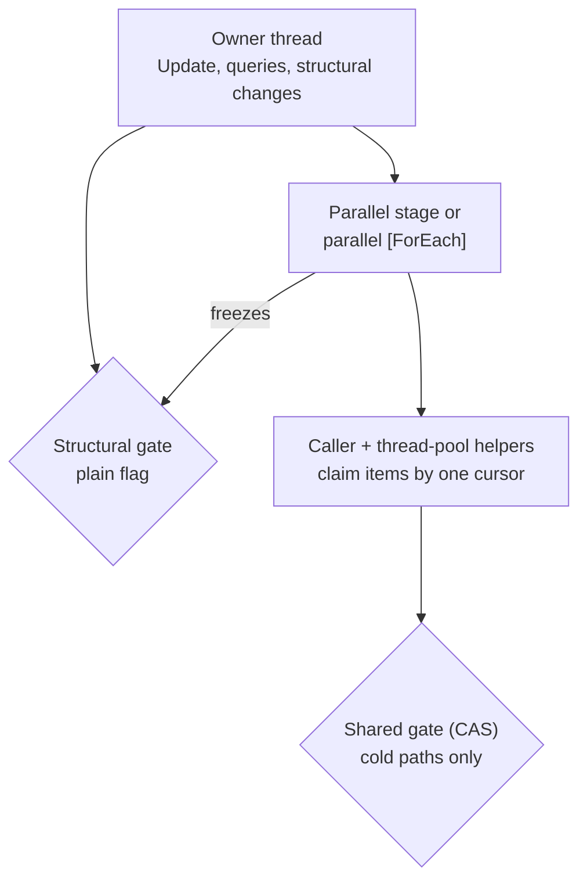

import { BookText, Gauge, Lightbulb, Scale } from 'lucide-react';

How EasyEcs stores data, walks it and schedules the code that changes it, and why. You do not need this page to use
the library ([Getting started](/en/docs/getting-started) is the place for that); it is for contributors and for
anyone who wants to know what a call costs before making it. Every change to EasyEcs must keep four guarantees:

- **No allocation on hot paths**: queries, iteration, component access and structural changes after warm-up.
- **Bounded memory under churn**: ids, rows and buffers are recycled, so memory follows the peak population, and
  `TrimExcess` gives back what a past peak left when the owner asks.
- **Cache-friendly layouts**: 64-byte lines, columns that SIMD can walk front to back.
- **Immediate structural changes**: adding, removing, creating and destroying take effect at once, also while a
  pass iterates.

## Storage model [#storage-model]

- **Per entity**, the world keeps one `EntityMeta`: its table, version and row, 16 bytes, so four share a 64-byte
  line. The component set is the table's mask and is not stored per entity. The only other per-entity state is
  opt-in: a value index, once a world creates one, keeps a node per entity id.
- **Tables are structures of arrays.** An archetype is a table with one column per component type and one row per
  entity, plus an `EntityId` per row (index and version side by side, 8 bytes, so a handle needs one load). Passes walk
  columns front to back, which hardware prefetchers and SIMD handle best.
  - Unmanaged columns are pinned arrays (pinned object heap) whose row 0 starts on a 64-byte boundary: a row of a
    power-of-two-sized component never straddles two lines, and vector loads stay aligned.
  - Columns of types that hold references are plain `T[]`; a row's references are cleared when the row loses its
    entity or its component, so the GC can collect what they pointed to.
  - A [`DynamicBuffer<T>`](/en/docs/guide/dynamic-buffers) column holds one reference per row to that row's own
    list, created by its first write. Moving the row moves the reference; snapshots and clones copy the elements into
    new lists.
  - Tables double when full and never shrink on their own: each is bounded by the most entities it ever held.
    `world.TrimExcess()` is the one call that gives memory back: it drops the empty tables (from the registry,
    their edges and every cached query match; a later change creates them again) and shrinks the others to their
    entities rounded up to a power of two, 64 rows at least, with their presence bits and change-tick summaries. It
    bumps `StorageVersion` once and keeps every table a live snapshot holds rows of
    ([give memory back](/en/docs/guide/diagnostics#trim)).
- **Presence bits.** Removing a component keeps the entity in its table and clears the row's bit for that
  component (one bit per row, 64 rows per `ulong`). A column gets its bits on its first removal; until then every row
  has the component and the column carries no bits. Each column also counts its living rows that lack the component,
  so a pass knows per table whether it can skip it, walk every row, or test bits. `Count` and `Any` answer a table
  from those counts when only one column varies, without reading bits.
- **Disabled components** are presence bits too: `entity.Disable<T>()` clears `T`'s bit and adds a `Disabled<T>` tag,
  whose column the table gains on the first disable (one row move per table, then bit flips).
- **Groups.** `[GroupBy]` on the type (or `world.GroupBy<T>()`) keys tables by the value of an
  [`IGroup`](/en/docs/guide/groups) component as well as by their mask, so the entities of one group are contiguous
  and `QueryFilter.InGroup<T>(g)` walks only their tables.
- **Masks** (`BitMask`) are 256-bit SIMD bitsets with an overflow. Component bits are `ushort`s, so a process can use
  up to 65,536 component types: the first 256 are inline (one `Vector256` test per table match), the rest go to an
  overflow array that is allocated when a table or a transition is first built, never on a hot path.
  `QueryFilter` keeps its bits past 255 as an interned id, so a filter holds no object reference
  ([D18](/en/docs/decisions#d18-no-interceptors-for-query-calls-filters-carry-no-references)).

### Change ticks [#change-ticks]

A component marked `ITracked` brings a hidden column of 8-byte ticks into every table that has it: the world's
change tick of each row's last write. Writes stamp it (a run of rows with one vectorized fill) and keep summaries at
three levels, so a pass can skip what nobody wrote. A `ref` parameter of a `[ForEach]` method stamps every row the pass
visits; a `Mut<T>` parameter stamps per write instead, only the rows it writes (directly by row where the method cannot move entities, through the entity's record where it can), and
its `SetIfChanged` only when the value differs:

| Level | Summary | Lets a `Changed<T>` pass |
| --- | --- | --- |
| Column | the latest tick of any row | skip a table nobody wrote since its tick, with one load |
| Block of 4,096 rows | the words at the block's latest tick (a bit mask) and a bound for the others | find the next written word with one bit scan |
| Word of 64 rows | 32 bytes: latest tick, the rows holding it, a bound for the other rows, a bound for removals | take a word's written rows from its summary, without reading their ticks |

Only words that mix older and newer ticks compare their rows, four per SIMD instruction. The result is 64 bits per
word, like presence bits, so it rides on the same row filters. Removing a tracked component stamps its row's tick and
clears its presence bit: a `Removed<T>` filter is "bit clear and tick recent enough", so removal detection needs no
extra storage, and removals keep their own block summaries so that writes do not make removal passes visit their
words ([D23](/en/docs/decisions#d23-change-summaries-per-block-removals-summarized-apart)). Untracked components
have no tick column and no stamping code: the checks are JIT-time constants.

### Value and relation indexes [#indexes]

`world.Index<T, TKey>()` keeps, per key, the key's entities in one id array (`IndexHead`); a leaving entity's hole
is filled by the key's next entity, so entities never move under a loop
([D24](/en/docs/decisions#d24-an-indexs-key-holds-its-entities-in-one-array)). Keys that are entities of the world
(relations, `ChildOf`) sit in an array indexed by the target's id, so a relation lookup hashes nothing. The index is
kept on write: `Set`, `CreateEntity` and `CreateEntities` call one inlined hook that the JIT removes for components
without an index. A write through a `ref` cannot be seen (the ref is handed out before the value changes), so the
analyzer rejects it ([EECS015](/en/docs/guide/analyzer)) instead of every lookup paying for it. The first lookup
builds the index with one query; destroying an entity or removing an indexed component unlinks it at once.

### Why rows move only on adds [#why-rows-move-only-on-adds]

A table copies an entity's row when the entity gains a component its table has no column for: that is what keeps
iteration dense. States that come and go (stunned, burning, dead) flip presence bits after their first time, so they
copy nothing ([D6](/en/docs/decisions#d6-removing-a-component-keeps-the-row)). Columns are contiguous arrays, not
pages: paged columns iterate at the same speed but add an indirection to every handle access, and save only the copy
when a table grows, which `InitialEntityCapacity` and `Reserve` remove
([D7](/en/docs/decisions#d7-contiguous-columns-not-pages)).

## Memory layout at a glance [#memory-layout]

- `entity.Get<T>()` is a version check on the 16-byte record, a column lookup in the table (bit to column, a small
  array), one presence-bit test when the column has bits, then an indexed load.
- `CreateEntity(a, b, …)`, `Set(a, b, …)` and `GetOrAdd<T>()` follow transitions cached per table, so a repeated
  structural change is one array load plus the row copy.

## Entity lifecycle [#entity-lifecycle]

- `Entity` is a handle: world, id and version. Every operation validates the version, so a handle to a destroyed
  entity never touches the entity that reuses its index. Store `EntityId`s in components, not handles.
- Ids are recycled last in, first out: recently freed ids still have warm cache lines, and `Meta` stays bounded by
  the peak number of live entities. `Meta` never shrinks (on `Dispose` it is cleared), which lets handles index it
  without bounds checks.
- `Destroy` on an entity that holds an [`ICleanupComponent`](/en/docs/guide/cleanup-and-disable) retires it: it loses its
  other components and keeps a `Retired` tag until a system removes its last cleanup component.
- With `WorldOptions.DestroyLogCapacity`, the world records every id when it stops being alive (a destroy, a cascade, a move
  out, the last cleanup component removed, an entity a `Restore` or `Load` takes away) in a fixed ring of 16-byte
  records (`EntityId` and change tick), preallocated with the world. Readers keep their own tick and read with
  `DestroyedSince`; a reader older than the ring's oldest record is told to resynchronize. Off, a destroy costs
  nothing more.

## Archetype transitions and row removal [#transitions]

- An entity moves only when it gains a component its table has no column for. The move copies the components both
  tables have (a copy plan of column pairs, computed once per edge) into a new row of the target table: unmanaged
  values as bytes, managed ones through their typed copy.
- Single-component adds follow **edges** cached on the table per component bit. Multi-component adds follow **set
  edges** keyed by the dense index of the call's generic signature (`(T1, …, Tn)`). The first call per table and
  signature builds the target mask and does one hash lookup; later calls are one array load.
- `CreateEntity(in T1 … in Tn)` places the entity in its final table directly.
- **Prefabs and clones.** A `Prefab` is one row of a private world, so no query of yours sees it. `Instantiate` finds
  the target table from the prefab table's mask once and caches it; `Clone` uses the original's table. Then one row
  copy fills the new entity: unmanaged bytes, managed values through their clone (a `DynamicBuffer<T>` gets a new list
  with the same elements), presence bits for what the source lacks, and the current tick for each tracked component
  it has. `Instantiate(prefab, span)` reserves ids and rows once for the whole wave.
- A row that loses its entity is filled at once by the table's last row when no pass is iterating, so tables stay
  dense. While a pass iterates, the row becomes a **tombstone** (index -1) instead, so rows never shift under the
  pass; the last pass to end closes the tombstones, found with vectorized scans of the rows read as `long`s.

## Query cache [#query-cache]

A query's key is its component sets: required, excluded, `WithAny`, `Changed`, `Removed` and the `InGroup` group. Its entry
holds an immutable snapshot: the tables whose mask has every required component and the column of every `Removed`
component (and, with `WithAny`, at least one of those), each with a row filter naming the columns whose presence bits
and ticks the pass tests. An excluded component does not rule a table out, since its rows may lack it; the row filter
does. Each call signature keeps a memo of its first four filters, so a hot call usually finds its entry without
hashing; past the memo, the dictionary's alternate lookup probes with the call's own bits.

When a new table is created, under the structural gate, every matching entry is replaced copy-on-write and published
with `Volatile.Write`: readers never lock and never see a list being changed. The first use of a query shape costs one
scan of every table; a new table costs a pass over the cached shapes. Both are cold paths.

Per pass and table, the row filter picks one of three modes from the column counts: skip the table, walk every row,
or test bits. A `Changed` or `Removed` filter always tests: its words also AND in the rows whose tick reaches the
pass's tick, which travels with the pass while the plan is shared.

## Iteration and structural changes [#iteration-and-structural-changes]

Every iteration API walks tables front to back. What differs is the bookkeeping a pass needs:

- **Jobs that make no structural change** (`INoStructuralChanges`, which the generator adds to a static `[ForEach]`
  method that takes no `World` and only reads through its `Entity` parameter) walk dense tables with no per-row check
  and tables with presence bits 64 rows per word. Their passes freeze the world's structure: a structural change
  inside throws. Batch methods (spans) and `ForEachBatch` receive whole runs of consecutive passing rows.
- **Other passes** register with the world (`BeginPass` / `EndPass`), so removed rows become tombstones instead of
  being filled. A pass records each matching table's row count before walking it; rows appended during the pass
  (entities created or moved into a matching table) are past that count and not visited. Each entity is visited at
  most once, and one that loses a queried component or is destroyed before its turn is skipped.
- Each table is walked by a row loop compiled twice: for a table with tombstones (each row tests its id) and for one
  without (no test) ([D25](/en/docs/decisions#d25-structural-row-loops-are-compiled-for-tables-without-tombstones)).
  After each entity, the pass compares the world's `StorageVersion` with the value it last saw: every change that can
  reallocate storage, move rows or flip presence bits bumps it, and the pass then re-reads its column refs and bits
  from the next row.
- When a job changes the archetype of the entity it visits, its writes through the refs land in the old row (now a
  tombstone). After the job returns, the pass copies the components the job writes (`WriteMask`, generated from its
  `ref` parameters) to the entity's new row, so no write is lost.
- `Query` follows the same rules. Its enumerator keeps the hot state (row, row count, entity rows, column refs) in its
  own fields, and every member a loop calls is inlined, so the JIT keeps them in registers. The cold state lives in a
  `QueryWalk`, pooled per thread, reached once per table and per structural change. A ticket tells a walk's current
  use from a copy of an enumerator that already ended.

The rules from the user's side: [Structural changes during iteration](/en/docs/guide/structural-changes).

## Systems [#systems]

- Each system group has one schedule: its systems in registration order, moved as `[UpdateBefore<T>]` /
  `[UpdateAfter<T>]` require (a stable topological sort; a cycle throws in `AddSystem` before anything changes). The
  schedule is split into stages: a system goes to the stage after the latest one holding a system it must follow,
  by an ordering or by an earlier conflicting access (`SystemAccess`). Of two conflicting systems the earlier one
  always finishes first. Both arrays are copy-on-write; rebuilding them is O(systems²), once per `AddSystem` or
  `RemoveSystem`.
- A system is never an object. Its type is an `[EcsSystem] ref struct` of static methods; the generator writes its
  code as a struct of static members (`ISystemCode`: `Update`, `Create`, `Destroy`, `Access`, the cadence), and per
  assembly one **system set** (`__EasyEcsSystems : ISystemSet`) that numbers the assembly's systems, and the closed
  generic systems it names, with a `switch` per hook whose cases call each code struct directly. A module initializer
  registers the set; the registry holds it weakly, so a collectible assembly unloads
  ([D102](/en/docs/decisions#d102-systems-are-ref-structs), [D103](/en/docs/decisions#d103-system-sets)).
- What the world knows of a system is a record in an array (enabled, error, interval and phase, last run tick, run
  count, stats, its set and number); `SystemHandle` is the world, the record's index and its version, as `Entity` is
  for a row, so a handle of a removed system is stale.
- Each stage is cut into **segments**, consecutive systems of one set. `Update()` and `Update<TGroup>()` are
  synchronous: per segment one call through a function pointer bound once per set, which walks its systems (enabled,
  due) and calls each one's code through the set's `switch`, so the systems of one assembly call each other's code
  directly. A system's code runs its `OnUpdate` method, then the generated `[ForEach]` jobs. Each stage advances
  the change tick once, and each update once more.
- `AddSystem` calls the `OnCreate` method; `RemoveSystem` and `Dispose` call the `OnDestroy` method, `Dispose`
  in reverse order.
- An exception propagates out of the update, or, with `SystemErrorPolicy.Disable`, switches its system off and stays
  in `system.Error`.
- Systems cooperate through data only ([D1](/en/docs/decisions#d1-state-changes-are-data-no-events-or-callbacks)),
  so all behavior runs in schedule order. User-facing details: [Systems](/en/docs/guide/systems).

## Source generators and analyzer [#source-generators-and-analyzer-easyecsgenerator]

| Part | What it does |
| --- | --- |
| `ArityGenerator` | Writes every T1..T9 family of `EasyEcs.Core` from one template each (`Entity.Set` / `Remove`, `World.CreateEntity` / `CreateEntities` / `DestroyAll`, the job interfaces, `ForEach` and its variants, `Query`, `Count`, `Any`). Runs only for `EasyEcs.Core`. |
| `SystemGenerator` | Turns `[ForEach]` methods into struct jobs (per entity, or per run of rows for span parameters) in a file class of their own, which call the user's method through `[UnsafeAccessor]` ([D16](/en/docs/decisions#d16-no-partial-generated-code-lives-outside-the-users-type)). Each `[EcsSystem]` gets a code struct (`__X_SystemCode : ISystemCode`: its hooks, jobs, access set and cadence), and each assembly a system set (`__EasyEcsSystems`) registered by a module initializer; a static method outside a system gets an entry point. A generated job declares `OneQuery` (its filter is a constant), so its passes read the query the world keeps for the job type ([D104](/en/docs/decisions#d104-one-query-per-job-type)). `[Changed<T>]` / `[Removed<T>]` become `Since(LastRunTick + 1)` and a declared read of `T`; `Parallel = true` runs the job over chunks. Jobs that cannot change structure get `INoStructuralChanges`. A per-entity method over numbers gets a vector loop written from its body (`Kernel`: masks for branches, narrow lanes, struct values, wide rows; [D68](/en/docs/decisions#d68-vector-loops-without-opting-in)), or the reason it runs row by row; `[ForEntity]`, `[Consume]` and `[UpdateInterval]` are compiled here too. |
| `ComponentGenerator` | C# 14 extension members per component and singleton: `entity.Health`, `HasHealth`, `SetHealth(…)`, `IsDead`, `world.Clock`, `world.KillsIndex`, `item.Position` per query shape, the buffer and prefab writers, and the registration of the types a save may name and of the setup a type declares (`[GroupBy]`, `[WhenTargetDestroyed]`, `[NotSaved]`). |
| `PartGenerator` | Writes what a partial struct declares with attributes into a part of it: `IReduction<T>` from `[Sum]` .. `[Any]`, the explicit `Key` of `[LookupKey]` / `[UniqueKey]`, the `Group` of `[Group]` ([D101](/en/docs/decisions#d101-declaration-attributes)). |
| `EasyEcsAnalyzer` | Reports EECS002–EECS103: input the generators skip, code that breaks the [ECS principles](/en/docs/ecs-principles), and code that works but costs. One analyzer per area (declarations, systems, performance, usage, threads, parts, forms, lambda passes, views, records, fusion; `EasyEcsAnalyzer.All`), so a `NoWarn` of an area's rules skips its cost. Generators never report diagnostics; both use the same checks. [EasyEcs.CodeFixes](/en/docs/guide/analyzer) offers the mechanical fixes. |

The generators follow the incremental rules: `ForAttributeWithMetadataName` or syntax-only predicates first, models
that are equatable records of strings (no symbol, node or location survives a transform), a tracking name per stage,
and tests (`GeneratorTests`) that an edit reruns only the stages it changes, in a build and as the IDE runs the
generators while typing (implementation outputs skipped), and that no transform binds a member body: a transform runs
again on every compilation for every node it matches, so it reads declarations and type names only.

## Type indices [#type-indices]

`TypeIndex<TFamily, T>` gives each type a dense, process-wide index within a family on first use. It is a static
readonly field, so the JIT folds it to a constant:

- `ComponentType<T>.Bit`: the mask bit. Assigning it registers the type's column operations (size, managed or not,
  create, grow, copy, clone, clear), which tables use without knowing `T`. A tracked component also registers its
  hidden tick column, paired with its own, so every copy, move and growth carries the ticks.
- `SingletonType<T>.Index`: the singleton slot. `SystemGroup<T>.Index`: the system group (0 is the default group).
- `ComponentSignature`: one index per generic signature of a multi-component call, keying set edges and query memos.

Every world uses the same indices, so masks are comparable across worlds. When a collectible assembly unloads,
its component bits are reused once no live world mentions them
([D17](/en/docs/decisions#d17-unloading-removes-types-from-worlds-bits-are-reused)).

## Threading [#threading]

- Structural changes, system changes, `Capture` and `Restore` enter the world's **structural gate**, which belongs to
  the owner thread: a plain flag, checked and set on the way in, cleared on the way out, with no atomic instruction.
  A parallel stage of systems, the chunks of a parallel `[ForEach]` and a batch job freeze it while they run, so a
  structural change inside them throws `InvalidOperationException`, deterministically, as does one reentered under
  the gate. A pass on the owner thread while nothing holds the gate (a `ForEach`, a batch or masked pass, a query
  walk) freezes it and counts itself with plain stores, no locked instruction: no other thread touches the gate
  outside a region the owner opened ([D105](/en/docs/decisions#d105-owner-thread-passes)).
- The cold paths that the threads of a parallel stage reach on their own (the first match of a query shape, a
  singleton resolved first, closing tombstones when the last pass ends) take a separate **shared gate**, a
  compare-and-swap flag with a spinning wait. Both flags sit on a cache line of their own.
- Queries, `Get` and `Has` are lock-free; component values are unsynchronized by design. The model is
  **one world per owner thread** ([D13](/en/docs/decisions#d13-one-owner-thread-per-world)). The analyzer reports
  structural changes in `[ForEach]` methods that promise none (EECS013) and in delegates handed to other threads
  (EECS014).
- Where the runtime synchronizes, it takes a `System.Threading.Lock` (a `lock` statement over one compiles to
  `Lock.EnterScope`; cold, process-wide registries: component types, systems, interned filters, the buffer and record
  pools) or swaps an immutable array by compare-and-swap (the query cache, the query memo and the queries kept per job
  type, whose reset is one `Interlocked.Exchange`). It never locks a plain object (`lock (this)`, `lock (list)`), whose
  monitor sits in the object header and inflates under contention ([D106](/en/docs/decisions#d106-lock-or-cas)).
- Parallel runs use the calling thread plus reusable `IThreadPoolWorkItem` helpers that claim items through one
  `Interlocked` cursor, alone on its cache line (the run's epoch in the high 32 bits, so a helper that starts late never
  touches the next run): dynamic scheduling, OpenMP's `schedule(dynamic, n)`. The chunks of a parallel `[ForEach]` are multiples of
  64 rows, so no two threads share a presence-bit word; by default a job that writes a tracked component cuts at
  multiples of 4,096 rows, so no two threads share a block's change-tick summary. With `ChunkRows` its chunks may split
  a block: the pass opens the blocks it covers at its tick first, and their summaries take an atomic OR per 64 written
  rows ([D67](/en/docs/decisions#d67-chunk-rows)). Each job and stage measures its runs and wakes helpers only while they make a run at least a fifth faster
  ([D22](/en/docs/decisions#d22-parallel-runs-use-the-thread-pool-and-wake-helpers-only-when-they-pay)). Nothing is
  allocated per update.
- A run's synchronization is per chunk and per run, never per row: a chunk is claimed by one compare-and-swap on the
  cursor and finished by one `Interlocked.Decrement` of the chunks remaining (and an `Interlocked.Add` of its time);
  the caller spins on `Volatile.Read` of that count, and each `Decrement`'s full fence orders the chunk's writes, its
  partial result included, before the merge ([how the runner synchronizes](/en/docs/guide/threading#runner-contract)).

The rules from the user's side: [Threading](/en/docs/guide/threading).

## Related [#related]

<Cards>
  <Card icon={<Lightbulb />} title="Design decisions" href="/en/docs/decisions">
    Why each of these choices was made, what was weighed against it, and the numbers.
  </Card>
  <Card icon={<Gauge />} title="Performance" href="/en/docs/performance">
    What these structures mean for the API you pick.
  </Card>
  <Card icon={<BookText />} title="API and complexity" href="/en/docs/api">
    The cost of every public call.
  </Card>
  <Card icon={<Scale />} title="Comparison" href="/en/docs/comparison">
    The same storage questions answered by Friflo, Arch and DefaultEcs.
  </Card>
</Cards>
