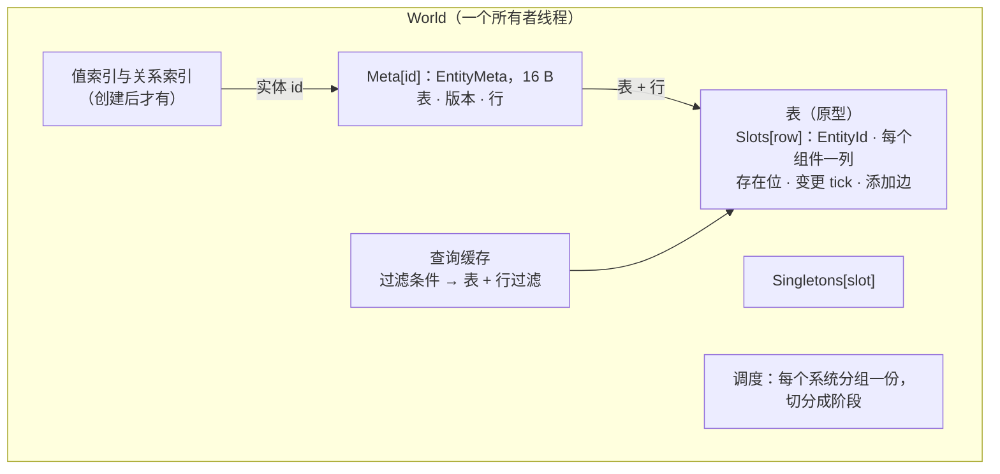
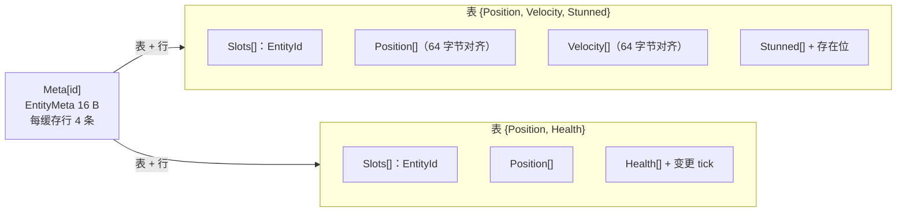
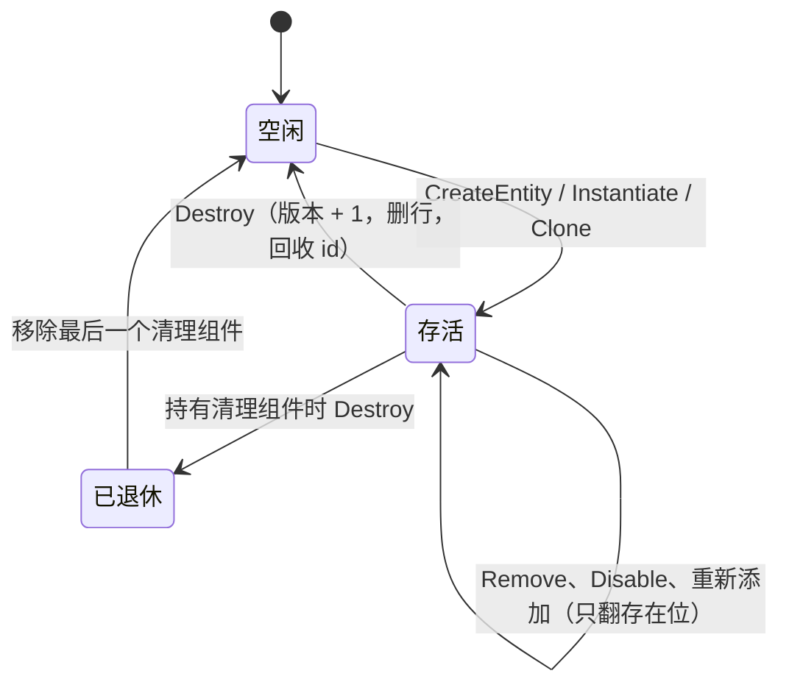
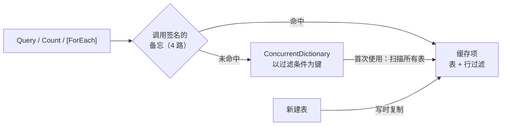
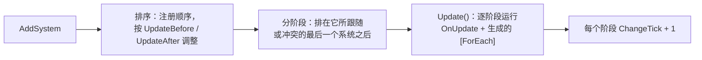
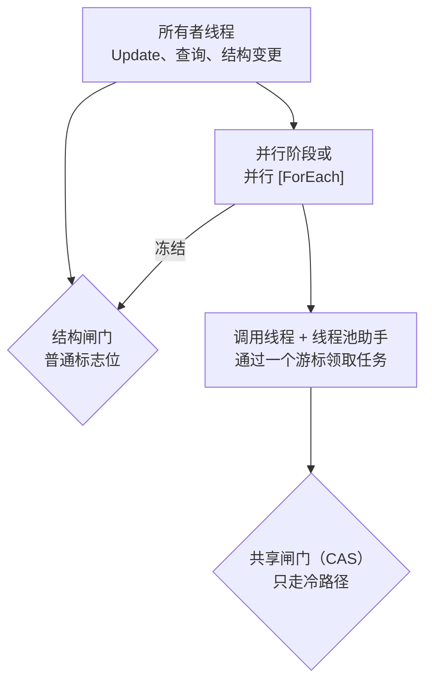

import { BookText, Gauge, Lightbulb, Scale } from 'lucide-react';

本页讲 EasyEcs 怎样存数据、怎样遍历、怎样调度修改数据的代码，以及背后的原因。只是使用这个库并不需要读它
（入门请看[快速开始](/zh/docs/getting-started)）；它写给贡献者，也写给想在调用之前弄清开销的人。EasyEcs 的每次改动都必须守住四条保证：

- **热路径零分配**：查询、遍历、组件访问，以及预热之后的结构变更。
- **频繁增删下内存有界**：id、行和缓冲都会复用，内存只跟峰值规模走；所有者需要时，`TrimExcess` 把过去的峰值留下的内存还回去。
- **对缓存友好的布局**：按 64 字节缓存行设计，列可以被 SIMD 从头扫到尾。
- **结构变更立即生效**：增删组件、创建销毁实体立刻生效，遍历途中也一样。

## 存储模型 [#storage-model]

- **每个实体**只占一条 `EntityMeta`：所在的表、版本和行号，共 16 字节，一条 64 字节缓存行放得下四条。实体有哪些组件由表的掩码决定，
  不按实体重复存。除此之外唯一的每实体状态是可选的：World 创建了值索引之后，索引会按实体 id 维护一个节点。
- **表是数组结构（SoA）。** 一个原型（archetype）就是一张表：每种组件一列，每个实体一行，外加每行一个 `EntityId`
  （索引和版本挨在一起，8 字节，拿句柄只需一次读取）。遍历从头到尾扫列，这正是硬件预取和 SIMD 最擅长的访问方式。
  - 非托管列是固定在 POH（pinned object heap）上的数组，第 0 行从 64 字节边界开始：大小是 2 的幂的组件，一行永远不会跨两条缓存行，
    向量读取也始终对齐。
  - 含引用的类型用普通 `T[]` 存；一行失去实体或组件时，这行的引用会被清掉，GC 才能回收它们指向的对象。
  - [`DynamicBuffer<T>`](/zh/docs/guide/dynamic-buffers) 列每行存一个引用，指向这一行自己的列表，第一次写入时才创建。
    搬行时只搬引用；快照和克隆会把元素复制进新列表。
  - 表满了翻倍，自己从不收缩：每张表的大小以它曾经容纳的最多实体数为上限。`world.TrimExcess()` 是唯一会还回内存的调用：它丢掉
    空表（从注册表、转移边和每个缓存查询的匹配里去掉；之后的变更需要时再创建），把其余的表缩到实体数向上取整到 2 的幂、最少 64 行，
    存在位和变更 tick 摘要一起缩。它只把 `StorageVersion` 加一次，并保留所有仍被存活快照持有行的表
    （[还回内存](/zh/docs/guide/diagnostics#trim)）。
- **存在位。** 移除组件时实体留在原表，只清掉这一行对应组件的位（每行一位，每个 `ulong` 管 64 行）。一列在第一次移除时才有存在位；
  在那之前每行都有这个组件，列上也没有任何位。每列还记着有多少存活行缺这个组件，遍历据此按表决定：整张跳过、逐行全走，还是测位。
  只有一列有差异时，`Count` 和 `Any` 直接用这些计数作答，不读位。
- **禁用组件**也是存在位：`entity.Disable<T>()` 清掉 `T` 的位并加上 `Disabled<T>` 标签；表在第一次禁用时多出这个标签列
  （每张表搬一次行，之后只是翻位）。
- **分组。** `world.GroupBy<T>()` 让表除了按掩码，还按 [`IGroup`](/zh/docs/guide/groups) 组件的值区分，同一分组的实体在内存里连续，
  `QueryFilter.InGroup<T>(g)` 只走这个分组的表。
- **掩码**（`BitMask`）是带溢出区的 256 位 SIMD 位集。组件位是 `ushort`，一个进程最多可用 65,536 种组件：前 256 种内联
  （每次匹配表只需一次 `Vector256` 测试），其余放进溢出数组；溢出数组在第一次建表或建迁移边时分配，从不在热路径上分配。
  `QueryFilter` 把 255 以后的位保存成一个驻留 id，所以过滤条件不持有任何对象引用
  （[D18](/zh/docs/decisions#d18-no-interceptors-for-query-calls-filters-carry-no-references)）。

### 变更 tick [#change-ticks]

标了 `ITracked` 的组件会给每张含它的表带来一列隐藏的 8 字节 tick：每行最后一次写入时 World 的变更 tick。写入时打上 tick
（一段连续行用一次向量化填充），同时维护三级摘要，让遍历跳过没人写过的部分。`[ForEach]` 方法的 `ref` 参数给遍历访问到的每一行
打 tick；`Mut<T>` 参数改成按写入打 tick，只给真正写了的行打（方法不会搬动实体时直接按行打，会搬动时先查实体记录），它的 `SetIfChanged` 只在值不同时才打：

| 层级 | 摘要 | `Changed<T>` 遍历因此可以 |
| --- | --- | --- |
| 列 | 所有行中最新的 tick | 一次读取就跳过自某 tick 以来没人写过的整张表 |
| 4,096 行的块 | 处于块内最新 tick 的字（位掩码），以及其余字的上界 | 一次位扫描找到下一个被写过的字 |
| 64 行的字 | 32 字节：最新 tick、持有它的行、其余行的上界、移除的上界 | 不读每行 tick，直接从摘要拿出被写过的行 |

只有新旧 tick 混在一起的字才逐行比较，一条 SIMD 指令比四行。结果是每字 64 位，和存在位一样，直接复用行过滤的机制。
移除一个被追踪的组件时，会给这一行打上 tick 并清掉存在位：`Removed<T>` 过滤就是“位已清且 tick 足够新”，移除检测不需要额外存储；
移除还有自己的块摘要，写入不会让移除遍历去访问那些字
（[D23](/zh/docs/decisions#d23-change-summaries-per-block-removals-summarized-apart)）。没有追踪的组件既没有 tick 列，也没有打 tick 的代码：
这些判断在 JIT 时就是常量。

### 值索引与关系索引 [#indexes]

`world.Index<T, TKey>()` 为每个键把它的实体放在一个 id 数组里（`IndexHead`）；实体离开留下的空位由这个键的下一个实体补上，
遍历途中实体不会挪位置（[D24](/zh/docs/decisions#d24-an-indexs-key-holds-its-entities-in-one-array)）。键是本 World 实体的情况
（关系、`ChildOf`）放在按目标 id 索引的数组里，查关系不用算哈希。索引在写入时维护：`Set`、`CreateEntity` 和 `CreateEntities`
调用一个内联钩子，对没有索引的组件，JIT 会把它整个删掉。通过 `ref` 的写入无法被发现（`ref` 在值改变之前就交出去了），
所以分析器直接拒绝它（[EECS015](/zh/docs/guide/analyzer)），而不是让每次查找都为此买单。第一次查找用一次查询建好索引；
销毁实体或移除被索引的组件会立刻把它从索引里摘掉。

### 为什么只有添加才搬行 [#why-rows-move-only-on-adds]

实体获得一个所在表没有对应列的组件时，表才会复制它的行：这是遍历保持紧凑的代价。来来去去的状态（眩晕、着火、死亡）
第一次之后只是翻存在位，不复制任何数据（[D6](/zh/docs/decisions#d6-removing-a-component-keeps-the-row)）。列是连续数组而不是分页：
分页的遍历速度一样，却给每次句柄访问多加一层间接，省下的只是表扩容时的那次复制，而 `InitialEntityCapacity` 和 `Reserve`
本来就能消掉它（[D7](/zh/docs/decisions#d7-contiguous-columns-not-pages)）。

## 内存布局一览 [#memory-layout]

- `entity.Get<T>()` 是：检查 16 字节记录里的版本，在表里查列（位到列的小数组），列有存在位时测一位，然后按下标读一次。
- `CreateEntity(a, b, …)`、`Set(a, b, …)` 和 `GetOrAdd<T>()` 走每张表缓存的迁移边，重复的结构变更只是一次数组读取加一次行复制。

## 实体生命周期 [#entity-lifecycle]

- `Entity` 是句柄：World、id 和版本。每个操作都校验版本，指向已销毁实体的句柄永远碰不到复用同一索引的新实体。
  组件里存 `EntityId`，不要存句柄。
- id 后进先出地回收：刚释放的 id 缓存行还是热的，`Meta` 的大小也只取决于存活实体数的峰值。`Meta` 永不收缩（`Dispose` 时只清零），
  句柄访问它因此不需要边界检查。
- 对持有 [`ICleanupComponent`](/zh/docs/guide/cleanup-and-disable) 的实体调用 `Destroy` 会让它退休：失去其他组件，带着 `Retired` 标签留下，
  直到某个系统移除它最后一个清理组件。
- 开启 `WorldOptions.DestroyLogCapacity` 后，每个 id 不再存活时（销毁、级联、迁出、最后一个清理组件被移除、`Restore` 或 `Load` 拿掉的实体），
  World 都会把它记进一个固定大小的环，每条记录 16 字节（`EntityId` 加变更 tick），随 World 一起预分配。读者各自保存自己的 tick，用
  `DestroyedSince` 读；比环里最旧记录还旧的读者会被告知需要重新同步。关掉时销毁没有任何额外开销。

## 原型迁移与删行 [#transitions]

- 实体只在获得所在表没有对应列的组件时才搬家。搬家把两张表都有的组件（列对的复制计划，每条边算一次）复制进目标表的新行：
  非托管值按字节复制，托管值走带类型的复制。
- 添加单个组件走表上按组件位缓存的**边**。一次添加多个组件走**集合边**，键是这次调用泛型签名 `(T1, …, Tn)` 的稠密下标。
  每张表、每个签名第一次调用时算出目标掩码、做一次哈希查找，之后都是一次数组读取。
- `CreateEntity(in T1 … in Tn)` 直接把实体放进最终的表。
- **预制体与克隆。** `Prefab` 是一个私有 World 里的一行，你的任何查询都看不到它。`Instantiate` 按预制体表的掩码找一次目标表并缓存，
  `Clone` 直接用原实体的表。之后一次行复制填好新实体：非托管字节、托管值的克隆（`DynamicBuffer<T>` 得到一份元素相同的新列表）、
  源缺失组件的存在位，以及每个被追踪组件的当前 tick。`Instantiate(prefab, span)` 为整波实体一次性预留 id 和行。
- 没有遍历在进行时，失去实体的行立刻由表的最后一行补上，表始终紧凑。遍历进行中，这一行变成**墓碑**（索引为 -1），
  行不会在遍历脚下移动；最后一个结束的遍历负责关闭墓碑，找墓碑时把行当作 `long` 做向量化扫描。

## 查询缓存 [#query-cache]

查询的键是它的几个组件集合：必需、排除、`WithAny`、`Changed`、`Removed`，再加 `InGroup` 的分组。缓存项保存一份不可变快照：掩码包含所有必需组件和每个
`Removed` 组件对应列的表（有 `WithAny` 时还至少要有其中一列），每张表配一个行过滤，指明这次遍历要测哪些列的存在位和 tick。
排除的组件不会把整张表排除掉，因为表里可能有行缺它，由行过滤去判断。每个调用签名为它最先用到的四个过滤条件保留备忘，
热调用通常不用算哈希就能找到缓存项；超出备忘时，字典的 alternate lookup 直接用调用自己的位去探测。

新建表时（在结构闸门内），每个匹配的缓存项都以写时复制的方式替换，并用 `Volatile.Write` 发布：读者从不加锁，也不会看到正在修改的列表。
一种查询形状第一次使用要扫描所有表；新建一张表要过一遍已缓存的形状。两者都是冷路径。

每次遍历、每张表，行过滤根据列计数三选一：跳过整张表、逐行全走、测位。带 `Changed` 或 `Removed` 的过滤总是测位：
每个字还要与上“tick 达到本次遍历 tick 的行”。tick 随遍历传递，计划本身是共享的。

## 遍历与结构变更 [#iteration-and-structural-changes]

所有遍历 API 都从头到尾扫表，区别只在于遍历要做多少簿记：

- **不做结构变更的 job**（`INoStructuralChanges`；生成器会给不接收 `World`、对 `Entity` 参数只做读取的静态 `[ForEach]` 方法加上它）
  扫紧凑的表时不做逐行检查，扫带存在位的表时一次 64 行。这类遍历会冻结 World 的结构：在里面做结构变更会抛异常。
  批处理方法（span）和 `ForEachBatch` 一次拿到一整段连续通过的行。
- **其他遍历**会向 World 登记（`BeginPass` / `EndPass`），被移除的行变成墓碑而不是被填上。遍历开始扫一张表之前先记下它的行数；
  遍历期间追加的行（新建的实体、迁入匹配表的实体）在这个行数之外，不会被访问。每个实体最多被访问一次；轮到它之前失去了被查询组件
  或被销毁的实体会被跳过。
- 每张表用编译了两份的行循环来扫：一份给有墓碑的表（每行检查 id），一份给没有墓碑的表（不检查）
  （[D25](/zh/docs/decisions#d25-structural-row-loops-are-compiled-for-tables-without-tombstones)）。每处理完一个实体，
  遍历把 World 的 `StorageVersion` 和上次看到的值比较：任何可能重新分配存储、搬行或翻存在位的改动都会让它加一，遍历随即从下一行起
  重新读取列引用和位。
- job 改变了正在访问的实体的原型时，它通过 `ref` 写的东西落在旧行（现在是墓碑）里。job 返回后，遍历把 job 写的组件
  （`WriteMask`，由 `ref` 参数生成）复制到实体的新行，写入一个都不会丢。
- `Query` 遵循同样的规则。它的枚举器把热状态（行号、行数、实体行、列引用）放在自己的字段里，循环调用的每个成员都内联，
  JIT 因此能把它们留在寄存器里。冷状态放在按线程池化的 `QueryWalk` 里，每张表、每次结构变更才访问一次。
  一个票据（ticket）用来区分遍历的当前使用者和已经结束的枚举器副本。

使用者视角的规则见[遍历中的结构变更](/zh/docs/guide/structural-changes)。

## 系统 [#systems]

- 每个系统分组有一份调度：系统按注册顺序排列，再按 `[UpdateBefore<T>]` / `[UpdateAfter<T>]` 调整（稳定的拓扑排序；出现环时
  `AddSystem` 在改动任何东西之前抛异常）。调度再切成阶段：一个系统进入“它必须跟随的系统所在的最后一个阶段”的下一个阶段，
  跟随关系来自排序约束，或来自更早注册且访问冲突的系统（`SystemAccess`）。两个冲突的系统，先注册的总是先跑完。两个数组都是写时复制；
  重建是 O(系统数²)，每次 `AddSystem` 或 `RemoveSystem` 做一次。
- `Update()` 和 `Update<TGroup>()` 是同步的。对每个到期且启用的系统，先调用 `OnUpdate()`，再跑生成的 `[ForEach]` 方法。
  每个阶段让变更 tick 加一，每次更新结束再加一。
- `AddSystem` 调用 `OnCreate()`；`RemoveSystem` 和 `Dispose` 调用 `OnDestroy()`，`Dispose` 按逆序调用。
- 异常会从更新中抛出；在 `SystemErrorPolicy.Disable` 下，抛异常的系统被关掉，异常留在 `system.Error` 里。
- 系统之间只通过数据协作（[D1](/zh/docs/decisions#d1-state-changes-are-data-no-events-or-callbacks)），所有行为都按调度顺序执行。
  使用细节见[系统](/zh/docs/guide/systems)。

## 源生成器与分析器 [#source-generators-and-analyzer-easyecsgenerator]

| 部分 | 做什么 |
| --- | --- |
| `ArityGenerator` | 用一个模板生成 `EasyEcs.Core` 里每一族 T1..T9 重载（`Entity.Set` / `Remove`、`World.CreateEntity` / `CreateEntities` / `DestroyAll`、各个 job 接口、`ForEach` 及其变体、`Query`、`Count`、`Any`）。只对 `EasyEcs.Core` 运行。 |
| `SystemGenerator` | 把 `[ForEach]` 方法变成结构体 job（逐实体，或对 span 参数按连续行段），放在单独的 file 类里，通过 `[UnsafeAccessor]` 调用用户方法（[D16](/zh/docs/decisions#d16-no-partial-generated-code-lives-outside-the-users-type)）。每个系统得到一个 `SystemCode`（更新逻辑和访问集），由模块初始化器注册；系统之外的静态方法得到一个入口。`[Changed<T>]` / `[Removed<T>]` 变成 `Since(LastRunTick + 1)` 加一次对 `T` 的读声明；`Parallel = true` 把 job 分块执行。不可能做结构变更的 job 会加上 `INoStructuralChanges`。 |
| `ComponentGenerator` | 为每个组件和单例生成 C# 14 扩展成员：`entity.Health`、`HasHealth`、`SetHealth(…)`、`IsDead`、`world.Clock`、`world.KillsIndex`、每种查询形状的 `item.Position`、缓冲和预制体的写方法，以及存档可以引用的类型的注册。 |
| `EasyEcsAnalyzer` | 报告 EECS002–EECS046：生成器跳过的无效输入，以及违反 [ECS 设计原则](/zh/docs/ecs-principles)的代码。生成器从不报诊断，两者共用同一套检查。机械性的修复由 [EasyEcs.CodeFixes](/zh/docs/guide/analyzer) 提供。 |

生成器遵循增量生成的规则：先用 `ForAttributeWithMetadataName` 或纯语法谓词过滤；模型是由字符串组成、可比较相等的 record
（任何符号、语法节点或位置都不会留到变换之后）；每个阶段都有追踪名；还有一个测试（`GeneratorTests`）保证无关的编辑不会让这些阶段失效。

## 类型下标 [#type-indices]

`TypeIndex<TFamily, T>` 在某个类型第一次用到时，给它分配一个所在族内、进程级的稠密下标。它是 static readonly 字段，JIT 会把它折叠成常量：

- `ComponentType<T>.Bit`：掩码位。分配时登记这个类型的列操作（大小、是否托管、创建、扩容、复制、克隆、清除），表不需要知道 `T`
  就能用。被追踪的组件还会登记它的隐藏 tick 列，与组件列配对，所以每次复制、搬行和扩容都会带上 tick。
- `SingletonType<T>.Index`：单例槽位。`SystemGroup<T>.Index`：系统分组（0 是默认分组）。
- `ComponentSignature`：多组件调用的每个泛型签名一个下标，作为集合边和查询备忘的键。

所有 World 用同一套下标，所以掩码可以跨 World 比较。可回收的程序集卸载后，只要没有存活的 World 还引用它的组件位，这些位就会被复用
（[D17](/zh/docs/decisions#d17-unloading-removes-types-from-worlds-bits-are-reused)）。

## 线程模型 [#threading]

- 结构变更、增删系统、`Capture` 和 `Restore` 都要进入 World 的**结构闸门**。它属于所有者线程：一个普通标志位，进入时检查并置位，
  离开时清零，没有任何原子指令。并行的系统阶段、并行 `[ForEach]` 的分块和批处理 job 运行期间会冻结它，所以在其中做结构变更会确定地抛出
  `InvalidOperationException`；在闸门内重入也一样。
- 并行阶段的线程各自会走到的冷路径（某种查询形状的第一次匹配、第一次解析某个单例、最后一个遍历结束时关闭墓碑）走另一个**共享闸门**：
  一个带自旋等待的 CAS 标志位。两个标志位独占一条缓存行。
- 查询、`Get` 和 `Has` 无锁；组件值按设计不做同步。推荐的模型是**每个 World 一个所有者线程**
  （[D13](/zh/docs/decisions#d13-one-owner-thread-per-world)）。分析器会报告声称不做结构变更的 `[ForEach]` 方法里的结构变更（EECS013），
  以及交给其他线程的委托里的结构变更（EECS014）。
- 并行运行使用调用线程，加上可复用的 `IThreadPoolWorkItem` 助手；助手通过一个 `Interlocked` 游标领取任务（高 32 位是本次运行的纪元，
  启动太晚的助手不会碰到下一次运行），也就是动态调度，OpenMP 的 `schedule(dynamic, n)`。并行 `[ForEach]` 的块是 64 行的倍数，两个线程
  不会共用一个存在位字；写追踪组件的 job 默认按 4,096 行的倍数切块，两个线程不会共用一个块的变更 tick 摘要。设了 `ChunkRows` 时块可以切开
  一个 4,096 行块：遍历先按自己的 tick 打开它覆盖的块，摘要每写 64 行做一次原子 OR（[D67](/zh/docs/decisions#d67-chunk-rows)）。每个 job 和阶段都会测量自己的运行，只有当助手能让一次运行快至少五分之一时才唤醒它们
  （[D22](/zh/docs/decisions#d22-parallel-runs-use-the-thread-pool-and-wake-helpers-only-when-they-pay)）。每次更新零分配。
- 一次运行的同步只按块、按次，从不按行：领一块是在游标上做一次比较并交换，做完一块是对剩余块数做一次 `Interlocked.Decrement`（再对用时做一次
  `Interlocked.Add`）；调用线程用 `Volatile.Read` 自旋等这个计数，每次 `Decrement` 的完整内存屏障让这一块的写入（包括它的部分结果）排在合并之前
  （[运行器怎样同步](/zh/docs/guide/threading#runner-contract)）。

使用者视角的规则见[多线程与并行](/zh/docs/guide/threading)。

## 相关页面 [#related]

<Cards>
  <Card icon={<Lightbulb />} title="设计决策" href="/zh/docs/decisions">
    每个选择的原因、权衡过的方案和数据。
  </Card>
  <Card icon={<Gauge />} title="性能指南" href="/zh/docs/performance">
    这些结构对你选哪个 API 意味着什么。
  </Card>
  <Card icon={<BookText />} title="API 与复杂度" href="/zh/docs/api">
    每个公开调用的开销。
  </Card>
  <Card icon={<Scale />} title="横向对比" href="/zh/docs/comparison">
    Friflo、Arch 和 DefaultEcs 对同样的存储问题怎么回答。
  </Card>
</Cards>
