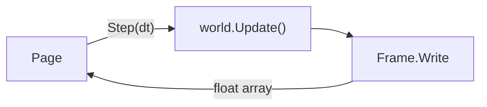

import { BookOpen, Compass, Gauge, Rocket } from 'lucide-react';

This page runs an EasyEcs world in your browser. Sparks move, bounce off the walls and glow, fade out at the end of
their life and are replaced from a prefab: five systems, a few components, the code below. Pick a count, pause it,
reset it, and watch what one `world.Update()` costs.

<EcsDemo />

<Callout type="info" title="Not a benchmark">
  The browser runs .NET in WebAssembly: the Mono runtime interprets the IL (its jiterpreter compiles hot paths to
  WebAssembly as they run), on one thread. That is several times slower than .NET on a server, so the update time here
  is a lower bound of what EasyEcs does, not a measurement of it. The numbers measured with BenchmarkDotNet on a real
  machine are on the [performance page](/en/docs/performance).
</Callout>

## What runs here [#what-runs]

The world is `demo/EasyEcs.Demo` in the repository: a .NET 10 WebAssembly app that references EasyEcs.Core and its
generator like any other project. Each animation frame, the page calls `Demo.Step(dt)` once:

1. The host writes the step into the `Clock` singleton and calls `world.Update()`, which runs the systems in the
   order they were added: `LifetimeSystem` destroys the sparks whose time ran out, `SpawnSystem` instantiates the
   `Spark` prefab until the `Population` target is met again, `MovementSystem` moves, `BounceSystem` turns sparks
   back at the walls and gives them a `Flash`, and `FadeSystem` dims the flash and removes it.
2. `Frame.Write`, a `[ForEach]` method outside any system, copies each spark's position, glow and opacity into one
   float array.
3. The page reads that array in place, through a view of the WebAssembly memory, and draws it.

No call crosses between JavaScript and .NET per entity, and nothing is allocated per frame on either side: the
array lives on the pinned object heap, so its address never changes.

## The code [#code]

These are the files the demo is built from, included from the repository. Every system has one job and keeps no
state: the clock, the walls and the population target are singletons, and a bounce is written as data (`Flash`) for
`FadeSystem` to pick up ([ECS principles](/en/docs/ecs-principles)).

<Tabs items={['Components', 'LifetimeSystem', 'SpawnSystem', 'MovementSystem', 'BounceSystem', 'FadeSystem', 'Units', 'Frame', 'Host']}>
<Tab value="Components">
<include lang="csharp" meta='title="Components.cs"'>../../demo/EasyEcs.Demo/Components.cs</include>
</Tab>
<Tab value="LifetimeSystem">
<include lang="csharp" meta='title="Systems/LifetimeSystem.cs"'>../../demo/EasyEcs.Demo/Systems/LifetimeSystem.cs</include>
</Tab>
<Tab value="SpawnSystem">
<include lang="csharp" meta='title="Systems/SpawnSystem.cs"'>../../demo/EasyEcs.Demo/Systems/SpawnSystem.cs</include>
</Tab>
<Tab value="MovementSystem">
<include lang="csharp" meta='title="Systems/MovementSystem.cs"'>../../demo/EasyEcs.Demo/Systems/MovementSystem.cs</include>
</Tab>
<Tab value="BounceSystem">
<include lang="csharp" meta='title="Systems/BounceSystem.cs"'>../../demo/EasyEcs.Demo/Systems/BounceSystem.cs</include>
</Tab>
<Tab value="FadeSystem">
<include lang="csharp" meta='title="Systems/FadeSystem.cs"'>../../demo/EasyEcs.Demo/Systems/FadeSystem.cs</include>
</Tab>
<Tab value="Units">
<include lang="csharp" meta='title="Units.cs"'>../../demo/EasyEcs.Demo/Units.cs</include>
</Tab>
<Tab value="Frame">
<include lang="csharp" meta='title="Frame.cs"'>../../demo/EasyEcs.Demo/Frame.cs</include>
</Tab>
<Tab value="Host">
<include lang="csharp" meta='title="Demo.cs"'>../../demo/EasyEcs.Demo/Demo.cs</include>
</Tab>
</Tabs>

## Why is it slower than the benchmarks? [#slower]

Three things a server has and this page does not:

- **A JIT.** The browser build is interpreted, with the jiterpreter compiling hot loops as they run; a server compiles
  every `[ForEach]` job to native code with RyuJIT.
- **Threads.** The page runs on the browser's main thread. `ParallelSystems` and `[ForEach(Parallel = true)]` need
  more than one, so the demo leaves them off.
- **A quiet machine.** The page shares its thread with drawing, the browser and every other tab, so the update time
  moves from frame to frame.

The data layout, the generated jobs and the zero allocations are the same in both: what you see here is the shape
of the work, and the [performance page](/en/docs/performance) is its speed.

## Run it yourself [#run-it]

The page loads the runtime from `docs/public/demo/_framework`, published from `demo/EasyEcs.Demo` by
`docs/scripts/build-demo.sh` (`bun run demo:build` in `docs/`). Change a system, run the script, and
`bun run dev` serves the page with your code. The same systems run unchanged in a console app or a server: only
`Demo.cs`, the host, knows about the browser.

## Related [#related]

<Cards>
  <Card icon={<Rocket />} title="Getting started" href="/en/docs/getting-started">
    Install EasyEcs and write a world like this one step by step.
  </Card>
  <Card icon={<Compass />} title="ECS principles" href="/en/docs/ecs-principles">
    Why each system here has one job and talks to the others only through data.
  </Card>
  <Card icon={<BookOpen />} title="Example: a battle server" href="/en/docs/example">
    A larger world that uses every feature.
  </Card>
  <Card icon={<Gauge />} title="Performance" href="/en/docs/performance">
    The numbers measured with BenchmarkDotNet on a real machine.
  </Card>
</Cards>
