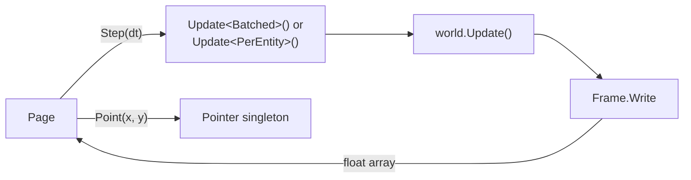

import { BookOpen, Compass, Gauge, Rocket } from 'lucide-react';

This page runs an EasyEcs world in your browser. Emitters drift along a curve and fire rings of sparks; drag
slows the sparks down, so their color, set by speed, cools as they age; they flash where they hit a wall and fade out
at the end of their life, and the emitters replace them. Move the pointer over the canvas and the sparks swirl
towards it. Pick a count and watch what an update costs, and what the batch systems save over per-entity ones.

<EcsDemo />

<Callout type="info" title="Not a benchmark">
  Browsers do not run .NET's usual runtime, CoreCLR, yet: CoreCLR on WebAssembly is only a preview in .NET 11, and
  an interpreter there. This page runs on .NET's Mono runtime, compiled ahead of time to WebAssembly (Mono AOT),
  with WebAssembly's 128-bit SIMD, on one thread. That is slower than .NET on a server, so the update time here is
  not a measurement of EasyEcs. The numbers measured with BenchmarkDotNet on a real machine are on the
  [performance page](/en/docs/performance).
</Callout>

## What runs here [#what-runs]

The world is `demo/EasyEcs.Demo` in the repository: a .NET 10 WebAssembly app that references EasyEcs.Core and its
generator like any other project. Each animation frame, the page calls `Demo.Step(dt)` once:

1. The host writes the step into the `Clock` singleton and updates a motion group: `world.Update<Batched>()` and
   `world.Update<PerEntity>()` take turns, one per frame. Either one slows every spark by drag, then moves it.
2. `world.Update()` runs the default group in the order the systems were added: `LifetimeSystem` destroys the sparks
   whose time ran out, `OrbitSystem` moves the emitters along their curve, `BurstSystem` fires a ring from each
   emitter whose cooldown is over until the `Population` target is met again, `AttractSystem` pulls the sparks
   towards the `Pointer`, `BounceSystem` turns them back at the walls and gives them a `Flash`, and `FadeSystem`
   dims the flash and removes it.
3. `Frame.Write`, a `[ForEach]` method outside any system, copies each spark's position, heat (its speed) and light
   into one float array.
4. The page uploads that array to the GPU in one call, straight from the WebAssembly memory, and draws every spark
   as a soft point of light. The light fades a little each frame instead of being cleared, which draws the trails.

No call crosses between JavaScript and .NET per entity, and nothing is allocated per frame on either side: the
array lives on the pinned object heap, so its address never changes. The pointer is input, and input is data: the
page writes it into the `Pointer` singleton, and `AttractSystem` reads it on the next update.

## Batch methods and SIMD [#batch-simd]

Below the canvas, the page shows what the same motion costs written two ways, measured live. `DragSystem` and
`MovementSystem` are plain `[ForEach]` methods, called once per spark. `DragBatchSystem` and `MovementBatchSystem` are
[batch methods](/en/docs/guide/systems#batch-methods): they receive spans over runs of whole rows, cast them to
`Vector128<float>` and work on two sparks per instruction, with one scalar step for an odd spark at the end. The cast
is valid because `Position` and `Velocity` are two floats each, so a run of rows is one float array.

Both pairs do the same work and give the same result. They sit in two system groups, `Batched` and `PerEntity`, and
the host updates them in turns, one per frame, timing each: the picture does not change, both are measured on the
same sparks, and the systems hold no mode flag. WebAssembly SIMD is 128 bits wide, so `Vector128` runs as hardware
SIMD here while wider vectors do not; on a server the same code can use `Vector256` or `Vector<float>`. The larger
the count, the more the batch version saves.

## The code [#code]

These are the files the demo is built from, included from the repository. Every system has one job and keeps no
state: the clock, the walls, the pointer and the population target are singletons, and a wall hit is written as data
(`Flash`) for `FadeSystem` to pick up ([ECS principles](/en/docs/ecs-principles)).

<Tabs items={['Components', 'Groups', 'MovementBatchSystem', 'DragBatchSystem', 'MovementSystem', 'DragSystem', 'LifetimeSystem', 'OrbitSystem', 'BurstSystem', 'AttractSystem', 'BounceSystem', 'FadeSystem', 'Units', 'Frame', 'Host']}>
<Tab value="Components">
<include lang="csharp" meta='title="Components.cs"'>../../demo/EasyEcs.Demo/Components.cs</include>
</Tab>
<Tab value="Groups">
<include lang="csharp" meta='title="Groups.cs"'>../../demo/EasyEcs.Demo/Groups.cs</include>
</Tab>
<Tab value="MovementBatchSystem">
<include lang="csharp" meta='title="Systems/MovementBatchSystem.cs"'>../../demo/EasyEcs.Demo/Systems/MovementBatchSystem.cs</include>
</Tab>
<Tab value="DragBatchSystem">
<include lang="csharp" meta='title="Systems/DragBatchSystem.cs"'>../../demo/EasyEcs.Demo/Systems/DragBatchSystem.cs</include>
</Tab>
<Tab value="MovementSystem">
<include lang="csharp" meta='title="Systems/MovementSystem.cs"'>../../demo/EasyEcs.Demo/Systems/MovementSystem.cs</include>
</Tab>
<Tab value="DragSystem">
<include lang="csharp" meta='title="Systems/DragSystem.cs"'>../../demo/EasyEcs.Demo/Systems/DragSystem.cs</include>
</Tab>
<Tab value="LifetimeSystem">
<include lang="csharp" meta='title="Systems/LifetimeSystem.cs"'>../../demo/EasyEcs.Demo/Systems/LifetimeSystem.cs</include>
</Tab>
<Tab value="OrbitSystem">
<include lang="csharp" meta='title="Systems/OrbitSystem.cs"'>../../demo/EasyEcs.Demo/Systems/OrbitSystem.cs</include>
</Tab>
<Tab value="BurstSystem">
<include lang="csharp" meta='title="Systems/BurstSystem.cs"'>../../demo/EasyEcs.Demo/Systems/BurstSystem.cs</include>
</Tab>
<Tab value="AttractSystem">
<include lang="csharp" meta='title="Systems/AttractSystem.cs"'>../../demo/EasyEcs.Demo/Systems/AttractSystem.cs</include>
</Tab>
<Tab value="BounceSystem">
<include lang="csharp" meta='title="Systems/BounceSystem.cs"'>../../demo/EasyEcs.Demo/Systems/BounceSystem.cs</include>
</Tab>
<Tab value="FadeSystem">
<include lang="csharp" meta='title="Systems/FadeSystem.cs"'>../../demo/EasyEcs.Demo/Systems/FadeSystem.cs</include>
</Tab>
<Tab value="Units">
<include lang="csharp" meta='title="Units.cs"'>../../demo/EasyEcs.Demo/Units.cs</include>
</Tab>
<Tab value="Frame">
<include lang="csharp" meta='title="Frame.cs"'>../../demo/EasyEcs.Demo/Frame.cs</include>
</Tab>
<Tab value="Host">
<include lang="csharp" meta='title="Demo.cs"'>../../demo/EasyEcs.Demo/Demo.cs</include>
</Tab>
</Tabs>

## Why is it slower than the benchmarks? [#slower]

Three things a server has and this page does not:

- **CoreCLR and RyuJIT.** The browser runs Mono, compiled ahead of time to WebAssembly, which the browser compiles
  again to machine code. That code is good, but not as tight as what RyuJIT makes for the machine it runs on, and
  vectors stop at 128 bits.
- **Threads.** The page runs on the browser's main thread. `ParallelSystems` and `[ForEach(Parallel = true)]` need
  more than one, so the demo leaves them off.
- **A quiet machine.** The page shares its thread with drawing, the browser and every other tab, so the update time
  moves from frame to frame.

The data layout, the generated jobs and the zero allocations are the same in both: what you see here is the shape
of the work, and the [performance page](/en/docs/performance) is its speed.

## Run it yourself [#run-it]

The page loads the runtime from `docs/public/demo/_framework`, published from `demo/EasyEcs.Demo` by
`docs/scripts/build-demo.sh` (`bun run demo:build` in `docs/`), which installs the `wasm-tools` workload that Mono AOT
needs when it is missing. Change a system, run the script, and `bun run dev` serves the page with your code. The
same systems run unchanged in a console app or a server: only `Demo.cs`, the host, knows about the browser.

## Related [#related]

<Cards>
  <Card icon={<Rocket />} title="Getting started" href="/en/docs/getting-started">
    Install EasyEcs and write a world like this one step by step.
  </Card>
  <Card icon={<Compass />} title="ECS principles" href="/en/docs/ecs-principles">
    Why each system here has one job and talks to the others only through data.
  </Card>
  <Card icon={<BookOpen />} title="Example: a battle server" href="/en/docs/example">
    A larger world that uses every feature.
  </Card>
  <Card icon={<Gauge />} title="Performance" href="/en/docs/performance">
    The numbers measured with BenchmarkDotNet on a real machine.
  </Card>
</Cards>
