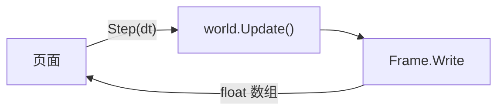

import { BookOpen, Compass, Gauge, Rocket } from 'lucide-react';

这个页面在你的浏览器里运行一个 EasyEcs World。粒子移动、撞墙反弹并发光，寿命将尽时淡出，再由预制体补上：五个系统、几个组件，代码就在下面。可以切换数量、暂停、重置，看看一次 `world.Update()` 要花多少时间。

<EcsDemo />

<Callout type="info" title="这不是基准测试">
  浏览器里的 .NET 跑在 WebAssembly 上：Mono 运行时解释执行 IL（jiterpreter 会在运行中把热点路径编译成 WebAssembly），而且只有一个线程。这比服务器上的 .NET 慢好几倍，所以这里的更新耗时只能看作 EasyEcs 的下限，不是它的测量值。用 BenchmarkDotNet 在真实机器上测出的数据见[性能页面](/zh/docs/performance)。
</Callout>

## 这里运行的是什么 [#what-runs]

这个 World 就是仓库里的 `demo/EasyEcs.Demo`：一个 .NET 10 WebAssembly 应用，像普通项目一样引用 EasyEcs.Core 和它的源生成器。每个动画帧，页面调用一次 `Demo.Step(dt)`：

1. 宿主把步长写进 `Clock` 单例，然后调用 `world.Update()`，系统按添加顺序运行：`LifetimeSystem` 销毁寿命耗尽的粒子，`SpawnSystem` 实例化 `Spark` 预制体，直到数量重新达到 `Population` 的目标；`MovementSystem` 负责移动，`BounceSystem` 让撞墙的粒子掉头并给它一个 `Flash`，`FadeSystem` 让光逐渐变暗，最后移除它。
2. `Frame.Write` 是一个不属于任何系统的 `[ForEach]` 方法，把每个粒子的位置、光亮和不透明度写进同一个 float 数组。
3. 页面通过 WebAssembly 内存的视图原地读取这个数组，然后绘制。

JavaScript 和 .NET 之间没有逐实体的调用，两边每帧都不分配内存：数组放在固定对象堆（POH）上，地址永远不变。

## 代码 [#code]

下面是演示用到的全部文件，直接从仓库引入。每个系统只做一件事，自己不存状态：时钟、墙壁和目标数量都是单例，反弹写成数据（`Flash`），由 `FadeSystem` 接着处理（[ECS 原则](/zh/docs/ecs-principles)）。

<Tabs items={['Components', 'LifetimeSystem', 'SpawnSystem', 'MovementSystem', 'BounceSystem', 'FadeSystem', 'Units', 'Frame', 'Host']}>
<Tab value="Components">
<include lang="csharp" meta='title="Components.cs"'>../../demo/EasyEcs.Demo/Components.cs</include>
</Tab>
<Tab value="LifetimeSystem">
<include lang="csharp" meta='title="Systems/LifetimeSystem.cs"'>../../demo/EasyEcs.Demo/Systems/LifetimeSystem.cs</include>
</Tab>
<Tab value="SpawnSystem">
<include lang="csharp" meta='title="Systems/SpawnSystem.cs"'>../../demo/EasyEcs.Demo/Systems/SpawnSystem.cs</include>
</Tab>
<Tab value="MovementSystem">
<include lang="csharp" meta='title="Systems/MovementSystem.cs"'>../../demo/EasyEcs.Demo/Systems/MovementSystem.cs</include>
</Tab>
<Tab value="BounceSystem">
<include lang="csharp" meta='title="Systems/BounceSystem.cs"'>../../demo/EasyEcs.Demo/Systems/BounceSystem.cs</include>
</Tab>
<Tab value="FadeSystem">
<include lang="csharp" meta='title="Systems/FadeSystem.cs"'>../../demo/EasyEcs.Demo/Systems/FadeSystem.cs</include>
</Tab>
<Tab value="Units">
<include lang="csharp" meta='title="Units.cs"'>../../demo/EasyEcs.Demo/Units.cs</include>
</Tab>
<Tab value="Frame">
<include lang="csharp" meta='title="Frame.cs"'>../../demo/EasyEcs.Demo/Frame.cs</include>
</Tab>
<Tab value="Host">
<include lang="csharp" meta='title="Demo.cs"'>../../demo/EasyEcs.Demo/Demo.cs</include>
</Tab>
</Tabs>

## 为什么比基准测试慢 [#slower]

服务器有、这个页面没有的三样东西：

- **JIT。** 浏览器版本是解释执行的，jiterpreter 只在运行中编译热点循环；服务器上每个 `[ForEach]` 作业都由 RyuJIT 编译成本机代码。
- **线程。** 页面跑在浏览器主线程上。`ParallelSystems` 和 `[ForEach(Parallel = true)]` 需要多个线程，所以演示没有开启。
- **安静的机器。** 这个线程还要负责绘制，并和浏览器本身、其他标签页共用，更新耗时每帧都会波动。

数据布局、生成的作业和零分配在两边完全一样：这里看到的是工作的形状，速度请看[性能页面](/zh/docs/performance)。

## 自己运行 [#run-it]

页面从 `docs/public/demo/_framework` 加载运行时，这些文件由 `docs/scripts/build-demo.sh`（在 `docs/` 下运行`bun run demo:build`）从 `demo/EasyEcs.Demo` 发布出来。改一个系统，跑一遍脚本，`bun run dev` 打开的页面就是你的代码。同样的系统原封不动就能跑在控制台程序或服务器里：只有宿主 `Demo.cs` 知道浏览器的存在。

## 相关页面 [#related]

<Cards>
  <Card icon={<Rocket />} title="快速开始" href="/zh/docs/getting-started">
    安装 EasyEcs，一步步写出这样一个 World。
  </Card>
  <Card icon={<Compass />} title="ECS 原则" href="/zh/docs/ecs-principles">
    为什么这里每个系统只做一件事，只通过数据和其他系统协作。
  </Card>
  <Card icon={<BookOpen />} title="示例：战斗服务器" href="/zh/docs/example">
    一个用到全部功能的更大的 World。
  </Card>
  <Card icon={<Gauge />} title="性能" href="/zh/docs/performance">
    用 BenchmarkDotNet 在真实机器上测出的数据。
  </Card>
</Cards>
