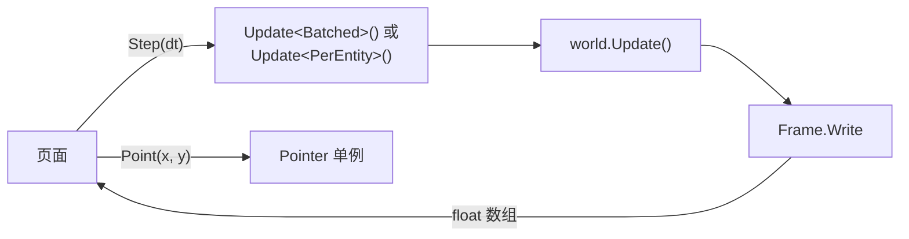

import { BookOpen, Compass, Gauge, Rocket } from 'lucide-react';

这个页面在你的浏览器里运行一个 EasyEcs World。几个发射器沿着一条曲线缓缓移动，一圈一圈地喷出粒子；阻力让粒子逐渐减速，颜色按速度变化，所以越老的粒子颜色越冷；撞到墙会闪一下，寿命将尽时淡出，再由发射器补上。把指针移到画布上，粒子会旋转着被吸过去。可以切换数量，看批量系统和逐实体系统各花多少时间，以及一次更新的总耗时。

<EcsDemo />

<Callout type="info" title="这不是基准测试">
  浏览器还跑不了 .NET 平常用的 CoreCLR 运行时：WebAssembly 上的 CoreCLR 在 .NET 11 里还只是预览版，而且只能解释执行。这个页面用的是 .NET 的 Mono 运行时，提前编译（AOT）成 WebAssembly，用 WebAssembly 的 128 位 SIMD，只有一个线程。这比服务器上的 .NET 慢，所以这里的更新耗时不是 EasyEcs 的测量值。用 BenchmarkDotNet 在真实机器上测出的数据见[性能页面](/zh/docs/performance)。
</Callout>

## 这里运行的是什么 [#what-runs]

这个 World 就是仓库里的 `demo/EasyEcs.Demo`：一个 .NET 10 WebAssembly 应用，像普通项目一样引用 EasyEcs.Core 和它的源生成器。每个动画帧，页面调用一次 `Demo.Step(dt)`：

1. 宿主把步长写进 `Clock` 单例，然后更新一个移动组：`world.Update<Batched>()` 和 `world.Update<PerEntity>()` 每帧轮流。两个组做的事一样：先按阻力给每个粒子减速，再移动它。
2. `world.Update()` 按添加顺序运行默认组：`LifetimeSystem` 销毁寿命耗尽的粒子，`OrbitSystem` 让发射器沿曲线移动，`BurstSystem` 让冷却结束的发射器喷出一圈粒子，直到数量重新达到 `Population` 的目标；`AttractSystem` 把粒子吸向 `Pointer`，`BounceSystem` 让撞墙的粒子掉头并给它一个 `Flash`，`FadeSystem` 让闪光逐渐变暗，最后移除它。
3. `Frame.Write` 是一个不属于任何系统的 `[ForEach]` 方法，把每个粒子的位置、热度（它的速度）和亮度写进同一个 float 数组。
4. 页面直接从 WebAssembly 内存把这个数组一次性上传到 GPU，把每个粒子画成一个柔和的光点。每帧不清屏，只让上一帧的光淡去一点，拖尾就是这样画出来的。

JavaScript 和 .NET 之间没有逐实体的调用，两边每帧都不分配内存：数组放在固定对象堆（POH）上，地址永远不变。指针是输入，输入就是数据：页面把它写进 `Pointer` 单例，`AttractSystem` 在下一次更新时读取。

## 批量方法和 SIMD [#batch-simd]

画布下方实时显示同一份移动工作的两种写法各花多少时间。`DragSystem` 和 `MovementSystem` 是普通的 `[ForEach]` 方法，每个粒子调用一次。`DragBatchSystem` 和 `MovementBatchSystem` 是[批量方法](/zh/docs/guide/systems#batch-methods)：拿到的是一整段连续行的 span，转换成 `Vector128<float>` 后一条指令处理两个粒子，段尾剩下的单个粒子用一次标量计算补上。能这样转换，是因为 `Position` 和 `Velocity` 都正好是两个 float，一段行就是一个 float 数组。

两组系统做的事和结果完全一样，分别放在 `Batched` 和 `PerEntity` 两个系统组里。宿主每帧轮流更新其中一个，并分别计时，所以画面不受影响，两边的耗时也测在同一批粒子上；系统里没有任何模式开关。WebAssembly 的 SIMD 是 128 位，所以这里 `Vector128` 走硬件 SIMD，更宽的向量不行；在服务器上，同样的代码可以换成 `Vector256` 或 `Vector<float>`。数量越大，批量版本省下的时间越明显。

## 代码 [#code]

下面是演示用到的全部文件，直接从仓库引入。每个系统只做一件事，自己不存状态：时钟、墙壁、指针和目标数量都是单例，撞墙写成数据（`Flash`），由 `FadeSystem` 接着处理（[ECS 原则](/zh/docs/ecs-principles)）。

<Tabs items={['Components', 'Groups', 'MovementBatchSystem', 'DragBatchSystem', 'MovementSystem', 'DragSystem', 'LifetimeSystem', 'OrbitSystem', 'BurstSystem', 'AttractSystem', 'BounceSystem', 'FadeSystem', 'Units', 'Frame', 'Host']}>
<Tab value="Components">
<include lang="csharp" meta='title="Components.cs"'>../../demo/EasyEcs.Demo/Components.cs</include>
</Tab>
<Tab value="Groups">
<include lang="csharp" meta='title="Groups.cs"'>../../demo/EasyEcs.Demo/Groups.cs</include>
</Tab>
<Tab value="MovementBatchSystem">
<include lang="csharp" meta='title="Systems/MovementBatchSystem.cs"'>../../demo/EasyEcs.Demo/Systems/MovementBatchSystem.cs</include>
</Tab>
<Tab value="DragBatchSystem">
<include lang="csharp" meta='title="Systems/DragBatchSystem.cs"'>../../demo/EasyEcs.Demo/Systems/DragBatchSystem.cs</include>
</Tab>
<Tab value="MovementSystem">
<include lang="csharp" meta='title="Systems/MovementSystem.cs"'>../../demo/EasyEcs.Demo/Systems/MovementSystem.cs</include>
</Tab>
<Tab value="DragSystem">
<include lang="csharp" meta='title="Systems/DragSystem.cs"'>../../demo/EasyEcs.Demo/Systems/DragSystem.cs</include>
</Tab>
<Tab value="LifetimeSystem">
<include lang="csharp" meta='title="Systems/LifetimeSystem.cs"'>../../demo/EasyEcs.Demo/Systems/LifetimeSystem.cs</include>
</Tab>
<Tab value="OrbitSystem">
<include lang="csharp" meta='title="Systems/OrbitSystem.cs"'>../../demo/EasyEcs.Demo/Systems/OrbitSystem.cs</include>
</Tab>
<Tab value="BurstSystem">
<include lang="csharp" meta='title="Systems/BurstSystem.cs"'>../../demo/EasyEcs.Demo/Systems/BurstSystem.cs</include>
</Tab>
<Tab value="AttractSystem">
<include lang="csharp" meta='title="Systems/AttractSystem.cs"'>../../demo/EasyEcs.Demo/Systems/AttractSystem.cs</include>
</Tab>
<Tab value="BounceSystem">
<include lang="csharp" meta='title="Systems/BounceSystem.cs"'>../../demo/EasyEcs.Demo/Systems/BounceSystem.cs</include>
</Tab>
<Tab value="FadeSystem">
<include lang="csharp" meta='title="Systems/FadeSystem.cs"'>../../demo/EasyEcs.Demo/Systems/FadeSystem.cs</include>
</Tab>
<Tab value="Units">
<include lang="csharp" meta='title="Units.cs"'>../../demo/EasyEcs.Demo/Units.cs</include>
</Tab>
<Tab value="Frame">
<include lang="csharp" meta='title="Frame.cs"'>../../demo/EasyEcs.Demo/Frame.cs</include>
</Tab>
<Tab value="Host">
<include lang="csharp" meta='title="Demo.cs"'>../../demo/EasyEcs.Demo/Demo.cs</include>
</Tab>
</Tabs>

## 为什么比基准测试慢 [#slower]

服务器有、这个页面没有的三样东西：

- **CoreCLR 和 RyuJIT。** 浏览器里跑的是 Mono，提前编译成 WebAssembly，再由浏览器编译成机器码。生成的代码不差，但比不上 RyuJIT 针对所在机器生成的代码，向量也最多 128 位。
- **线程。** 页面跑在浏览器主线程上。`ParallelSystems` 和 `[ForEach(Parallel = true)]` 需要多个线程，所以演示没有开启。
- **安静的机器。** 这个线程还要负责绘制，并和浏览器本身、其他标签页共用，更新耗时每帧都会波动。

数据布局、生成的作业和零分配在两边完全一样：这里看到的是工作的形状，速度请看[性能页面](/zh/docs/performance)。

## 自己运行 [#run-it]

页面从 `docs/public/demo/_framework` 加载运行时，这些文件由 `docs/scripts/build-demo.sh`（在 `docs/` 下运行 `bun run demo:build`）从 `demo/EasyEcs.Demo` 发布出来；缺少 Mono AOT 需要的 `wasm-tools` 工作负载时，脚本会先装上。改一个系统，跑一遍脚本，`bun run dev` 打开的页面就是你的代码。同样的系统原封不动就能跑在控制台程序或服务器里：只有宿主 `Demo.cs` 知道浏览器的存在。

## 相关页面 [#related]

<Cards>
  <Card icon={<Rocket />} title="快速开始" href="/zh/docs/getting-started">
    安装 EasyEcs，一步步写出这样一个 World。
  </Card>
  <Card icon={<Compass />} title="ECS 设计原则" href="/zh/docs/ecs-principles">
    为什么这里每个系统只做一件事，只通过数据和其他系统协作。
  </Card>
  <Card icon={<BookOpen />} title="示例：战斗服务器" href="/zh/docs/example">
    一个用到全部功能的更大的 World。
  </Card>
  <Card icon={<Gauge />} title="性能" href="/zh/docs/performance">
    用 BenchmarkDotNet 在真实机器上测出的数据。
  </Card>
</Cards>
