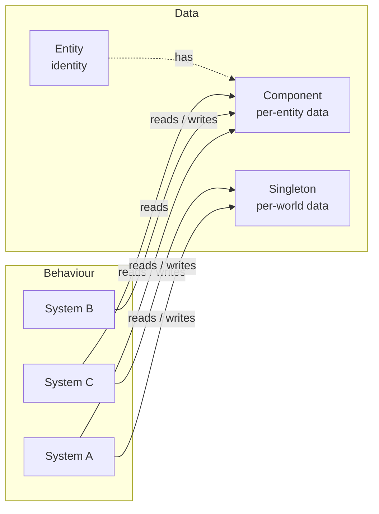
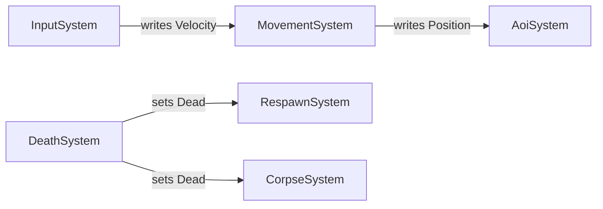

EasyEcs separates **data** (entities, components, singletons) from **behaviour** (systems). That split is what makes
iteration fast, with dense columns and no virtual call per entity, and it is also what keeps a large code base
decoupled: systems never know about each other, only about data. This page gives each role, eight rules for
designing with them and a checklist for a new feature. The analyzer enforces the mechanical parts at build time.

## Who does what [#roles]



There are no arrows between systems. Every dependency goes through data, and every piece of behaviour runs inside
the schedule, in registration order or in the order `[UpdateBefore<T>]` / `[UpdateAfter<T>]` declare.

| Element | Is | Is not |
| --- | --- | --- |
| **Entity** | An identity (index and version), held as an `Entity` handle in code and as an `EntityId` in data | A container of logic, a base class, a place for fields |
| **Component** | A struct of fields for one aspect of one entity (`Health`, `Velocity`); computed getters are fine | A class, an object with behaviour, a holder of references to systems or services |
| **Tag** | An empty component (`Dead`, `Frozen`) used as a filter | A boolean flipped every tick (use a field) |
| **Singleton** | One struct per world: clock, configuration, counters, a spatial grid | A static field (it would be shared by every world) |
| **System** | Behaviour with one responsibility, reading and writing components and singletons | A place to keep state, or a service other systems call |

## The rules [#rules]

The examples share these components:

```csharp
public record struct Health(int Value) : IComponent;
public record struct Burning(int Ticks, int DamagePerTick) : IComponent;   // a status effect
public struct Dead : IComponent;                                           // a tag
```

### 1. One system, one responsibility [#1-one-system-one-responsibility]

Name a system after the one thing it does. If its description needs "and", split it.

```csharp tab="Before"
// Before: burning AND death in one system. Death is noticed only for burning units:
// a unit killed by anything else is never marked Dead.
public class StatusSystem : EcsSystem
{
    [ForEach, Without<Dead>]
    static void Tick(Entity unit, ref Burning burning, ref Health hp)
    {
        hp.Value -= burning.DamagePerTick;
        if (--burning.Ticks == 0) unit.RemoveBurning();
        if (hp.Value <= 0) unit.SetDead();
    }
}
```

```csharp tab="After"
// After: each concern can be removed, reordered or tested alone, and death covers every damage source.
public class BurnSystem : EcsSystem
{
    [ForEach, Without<Dead>]
    static void Burn(Entity unit, ref Burning burning, ref Health hp)
    {
        hp.Value -= burning.DamagePerTick;
        if (--burning.Ticks == 0) unit.RemoveBurning();
    }
}

[UpdateAfter<BurnSystem>]   // after the systems that deal damage
public class DeathSystem : EcsSystem
{
    [ForEach, Without<Dead>]
    static void Die(Entity unit, in Health hp)   // `in`: it only reads Health
    {
        if (hp.Value <= 0) unit.SetDead();
    }
}
```

Splitting costs nothing at run time. Every `[ForEach]` method is its own inlined struct job either way, and the
per-system cost of an update is two virtual calls (`OnUpdate` and the generated code) plus one
query-cache lookup per `[ForEach]` method and one lookup per singleton parameter. When in doubt, split.

### 2. Systems are stateless [#2-systems-are-stateless]

State inside a system is invisible to queries, to other systems, to tests and to saves, and it disappears or doubles
when the system is removed or added twice. Put it in data:

| State | Where |
| --- | --- |
| Per entity (cooldown, target, path) | A component |
| Per world (tick, score, configuration, spatial grid) | A singleton |
| Lookups by value (a player by name, the items of an owner) | An indexed component ([indexes and relations](/en/docs/guide/indexes-and-relations)), not a dictionary kept in sync by hand |
| Derived and rebuildable (a scratch list reused every update) | A `readonly` field on the system is fine |

```csharp tab="Before" doccheck=expect-EECS007
// Before (EECS007): the count lives in the system, where no query, test or other system can see it.
public class DeathSystem : EcsSystem
{
    public int Deaths;

    [ForEach, Without<Dead>]
    void Die(Entity unit, in Health hp)
    {
        if (hp.Value > 0) return;
        unit.SetDead();
        Deaths++;
    }
}
```

```csharp tab="After"
// After: the count is world state; anyone can read it (world.Score.Deaths).
public record struct Score(int Deaths) : ISingletonComponent;

[UpdateAfter<BurnSystem>]
public class DeathSystem : EcsSystem
{
    [ForEach, Without<Dead>]
    static void Die(Entity unit, in Health hp, ref Score score)   // a singleton parameter
    {
        if (hp.Value > 0) return;
        unit.SetDead();
        score.Deaths++;
    }
}
```

`readonly` fields for dependencies or reusable scratch buffers, `init`-only properties and computed properties are
allowed ([EECS007](/en/docs/guide/analyzer#eecs007)).

### 3. Systems never reference systems [#3-systems-never-reference-systems]

A system that holds another system ([EECS008](/en/docs/guide/analyzer#eecs008)), or reaches one through
`World.TryGetSystem<T>(out …)`, can no longer be removed, reordered or tested alone. Cooperate through data instead:

- **Pipeline:** an earlier system writes a component, a later one reads it. Register the writer first, or order them
  with `[UpdateAfter<T>]`.
- **Reacting to a state:** a system queries the state another one wrote; the writer does not change when a reader is
  added ([rule 4](#4-state-changes-are-data)).

```csharp
// Reacts to Dead; DeathSystem does not know it exists.
[UpdateAfter<DeathSystem>]
public sealed class CorpseSystem : EcsSystem
{
    protected override void OnUpdate() => World.DestroyAll<Dead>();   // every corpse in one pass
}
```



`TryGetSystem<T>(out …)` is for tooling, tests and the code that hosts the world.

### 4. State changes are data [#4-state-changes-are-data]

When something happens to an entity, write its new state: set a tag (`Dead`) or a field. The systems that care query
that state later in the update, in the order of the schedule: movement and combat skip `Dead` entities,
`CorpseSystem` removes them, a `RespawnSystem` could revive players. None of them is known to `DeathSystem`, and
adding one changes no existing system.

The same holds for what an entity leaves behind. A resource outside the world (a socket, a reserved seat) is a
[cleanup component](/en/docs/guide/cleanup-and-disable): `Destroy` retires the entity, which stays, tagged `Retired`,
until a system releases the resource. There is no destroy event to subscribe to.

### 5. Choose the cheapest representation for frequent changes [#5-choose-the-cheapest-representation-for-frequent-changes]

Removing a component, or adding back one the entity had before, flips a presence bit: the entity keeps its row.
Gaining a component its table has no column for copies the entity's row into another table, once. Tags for states
that come and go (`Stunned`, `Burning`, `Dead`) are therefore cheap. For values that change every tick, a field is
still cheaper than a structural change:

- a countdown field (`Burning.Ticks`) instead of re-adding a component every tick;
- change detection by change ticks: mark the component `ITracked` and give the consumer `[Changed<T>]`, instead
  of adding and removing a `Changed` tag or scanning every row ([change tracking](/en/docs/guide/change-tracking)).
  A write is any `ref` access, so a writer that may leave the value as it was writes through a `Mut<T>` parameter
  and `SetIfChanged` (`entity.SetIfChanged` / `SetXIfChanged` outside a `[ForEach]`), which stamps only a value that
  differs: readers then never compare ([write only when the value changed](/en/docs/guide/change-tracking#set-if-changed)),
  and a loop that only reads walks `world.Read<T…>()`, which stamps nothing;
- removal detection the same way: `[Removed<T>]` visits the entities that lost a tracked `T`, instead of a `Lost` tag
  added next to every removal ([removal detection](/en/docs/guide/change-tracking#removal-detection));
- pausing with `Disable<T>()`, which hides a component and keeps its value, instead of removing it and storing the
  value elsewhere ([cleanup and disable](/en/docs/guide/cleanup-and-disable));
- kinds of entities as [prefabs](/en/docs/guide/prefabs): data that belongs to no world, instantiated where needed,
  instead of template entities that every query must exclude.

```csharp
public record struct Facing(float Angle) : IComponent, ITracked;      // tracked: rows record their last write
public record struct NetSync(Facing Sent) : IComponent;               // what clients last heard
public record struct Outbox(int Updates) : ISingletonComponent;

public class FacingSystem : EcsSystem
{
    // Recomputed every tick, rarely different: only a new angle stamps the row.
    [ForEach]
    static void Face(Mut<Facing> facing, in Velocity v) =>
        facing.SetIfChanged(new Facing(MathF.Atan2(v.Y, v.X)));
}

[UpdateAfter<FacingSystem>]
public class SyncSystem : EcsSystem
{
    [ForEach, Changed<Facing>]   // only entities whose Facing changed since this system last ran
    static void Sync(in Facing facing, ref NetSync sync, ref Outbox outbox)
    {
        sync = new NetSync(facing);
        outbox.Updates++;          // a real server queues the update here
    }
}
```

### 6. Let the schedule order effects [#6-let-the-schedule-order-effects]

Changes are immediate: a component a system adds is visible to every later system of the same update, and to the
rest of the same pass. Within one pass each entity is visited at most once, and entities that join a matching table
during the pass (created, or moved into a matching table) wait for the next pass. So the order of effects is the
order of systems, never the order in which a system happens to visit entities:

```csharp
[UpdateAfter<BurnSystem>]   // after the damage; respawn and loot are ordered after it
public class DeathSystem : EcsSystem
{
    [ForEach, Without<Dead>]
    static void Die(Entity unit, in Health hp, ref Score score)
    {
        if (hp.Value > 0) return;
        unit.SetDead();                    // systems after DeathSystem see Dead in this update
        score.Deaths++;
    }
}
```

The full rules are in [Structural changes](/en/docs/guide/structural-changes).

### 7. Keep entity handles, never refs, across boundaries [#7-keep-entity-handles-never-refs-across-boundaries]

A `ref` from `Get<T>()` or a `Query` item is valid until the next structural change (of any entity); the `ref`
parameters of a `[ForEach]` method stay valid through their own body's changes. None is valid across `await`. Keep
`Entity` handles, which are checked on every access, and read components again when you need them
([ref and await](/en/docs/guide/refs-and-await)).

Inside data, keep the `EntityId` instead of the handle: an `Entity` field makes a component managed
([EECS017](/en/docs/guide/analyzer#eecs017)), and `world.TryGetEntity(id, out var entity)` turns the id back into
a handle and tells you whether the entity still lives.

### 8. Choose how to hold a collection [#8-choose-how-to-hold-a-collection]

A component may hold a `List<T>`, a `Dictionary<K, V>` or an array, but its row stores only the reference. The
world sees a write when code takes the component by `ref`, not when the collection behind it changes. So:

- **Change it only through `ref`** (a `ref` parameter, `Get`, `TryGetRef`): the row is stamped for `[Changed<T>]`,
  and parallel systems schedule the write. Changing it through an `in` parameter is a race that goes unnoticed; the
  analyzer reports it ([EECS011](/en/docs/guide/analyzer#eecs011)).
- **Snapshots share it**: `Capture` copies the reference, not the collection, so restoring brings back the list as
  it is now. Snapshots are for plain data; saves serialize the collection anyway. A `DynamicBuffer<T>` has neither
  problem: its writes need a `ref`, and snapshots copy its elements.

Then pick the representation by what the items are:

| Items | Hold them as | Why |
| --- | --- | --- |
| Things with their own state, queried or changed on their own (inventory items, guild members, buffs) | **One entity per item** with a link to its owner ([indexes and relations](/en/docs/guide/indexes-and-relations)) | Each item has its own components, change ticks, queries and parallel schedule, copied by value in snapshots |
| A list that belongs to one entity, sent or saved when it changes (a bag of loot, a path, recent hits) | **A [`DynamicBuffer<T>`](/en/docs/guide/dynamic-buffers)** component | Every write needs a `ref`, so each change is tracked; snapshots copy the elements; a write through `in` does not compile |
| A small, bounded set of values (cooldown slots, the last few inputs) | **A fixed `[InlineArray]` array** in an unmanaged component | No GC, copied by value everywhere, every change a `ref` write |
| Data read and written as a whole, usually with the save (quest progress, settings, unlocked achievements) | **A collection in a component**, changed through `ref` | One row per player instead of thousands of entities; loaded and saved with the player |
| Read-mostly data replaced as a whole (a patrol route) | **An immutable collection** (`ImmutableArray<T>`) | Assigning a new one through `ref` is a tracked write; a snapshot keeps the old one |

```csharp
[System.Runtime.CompilerServices.InlineArray(4)]
public struct Slots4 { private int _first; }                                 // 4 ints stored inline

public struct Cooldowns : IComponent, ITracked { public Slots4 ReadyAt; }  // unmanaged: nothing to share
public struct Quests : IComponent, ITracked                             // saved and loaded with the player
{
    public Dictionary<int, int> Progress;
}

public record struct ItemOf(EntityId Owner) : IComponent, IIndexed<EntityId> // an inventory: items point at players
{
    public EntityId Key => Owner;
}

public static class PlayerRules
{
    // The tick a slot is ready again, not a countdown: no system writes every row every tick, so only uses are changes
    public static bool TryUse(Entity player, int slot, int tick, int cooldown)
    {
        if (player.Cooldowns.ReadyAt[slot] > tick) return false;             // a read: no stamp
        player.WriteCooldowns().ReadyAt[slot] = tick + cooldown;              // a write: the row is stamped
        return true;
    }

    public static void Advance(Entity player, int quest)
    {
        var progress = player.WriteQuests().Progress;                         // a write: the row is stamped
        progress[quest] = progress.TryGetValue(quest, out int step) ? step + 1 : 1;
    }

    public static void Give(World world, Entity player, int item) =>
        world.CreateEntity(new ItemOf(player), new Health(item));             // a new row: tracked, indexed, snapshotted

    public static int Carried(World world, Entity player) => world.ItemOfIndex.Count(player);
}
```

## How the rules are enforced [#enforced]

The analyzer turns the mechanical parts of these rules into build errors, so a code review does not have to catch
them:

| Rule | Broken by | Caught by |
| --- | --- | --- |
| Components are data | A class implementing `IComponent` | [EECS006](/en/docs/guide/analyzer#eecs006) |
| [2. Systems are stateless](#2-systems-are-stateless) | A mutable field, settable property or event on a system | [EECS007](/en/docs/guide/analyzer#eecs007) |
| [3. Systems never reference systems](#3-systems-never-reference-systems) | A system-typed member, `TryGetSystem<T>(out …)` inside a system | [EECS008](/en/docs/guide/analyzer#eecs008) |
| [5. Choose the cheapest representation](#5-choose-the-cheapest-representation-for-frequent-changes) | A `Query` loop that only reads tracked components (every row stamped) | [EECS046](/en/docs/guide/analyzer#eecs046) (warning) |
| [6. Let the schedule order effects](#6-let-the-schedule-order-effects) | `[UpdateBefore<T>]` / `[UpdateAfter<T>]` in a cycle | [EECS019](/en/docs/guide/analyzer#eecs019) |
| [7. Keep handles, not refs](#7-keep-entity-handles-never-refs-across-boundaries) | An `Entity` field in a component; a `ref` used after a structural change | [EECS017](/en/docs/guide/analyzer#eecs017), [EECS047](/en/docs/guide/analyzer#eecs047) (warnings) |
| [8. Choose how to hold a collection](#8-choose-how-to-hold-a-collection) | Changing a collection through `in` | [EECS011](/en/docs/guide/analyzer#eecs011) |

The full list, with a fix for each rule, is in [Analyzer rules](/en/docs/guide/analyzer).

## Checklist for a new feature [#checklist]

1. List the data: which components (per entity) and singletons (per world) does it need?
2. List the behaviours, one system each, named by what it does.
3. Order the systems by data flow (registration order, `[UpdateBefore<T>]` / `[UpdateAfter<T>]`): producers before
   consumers.
4. Express reactions across modules as systems querying the state another system wrote, never as calls between
   systems.
5. Pick how each collection is held ([rule 8](#8-choose-how-to-hold-a-collection)).
6. Build: the analyzer rejects what breaks these rules.
7. Test each system alone: create a world, add the system and the data it reads, call `Update()`, assert on data.

## Related [#related]

<Cards>
  <Card title="Getting started" href="/en/docs/getting-started">
    The rules applied, step by step, in a small simulation.
  </Card>
  <Card title="Systems" href="/en/docs/guide/systems">
    Parameters, filters, ordering and groups of `[ForEach]` methods.
  </Card>
  <Card title="Analyzer rules" href="/en/docs/guide/analyzer">
    Every EECS rule, why it exists and how to fix it.
  </Card>
</Cards>
