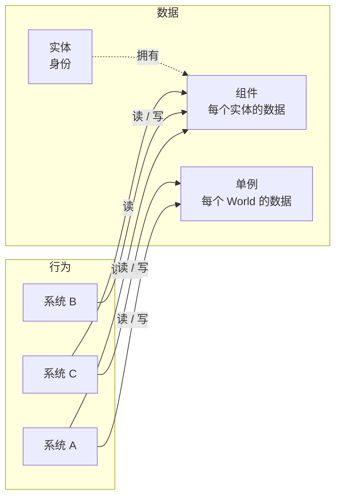
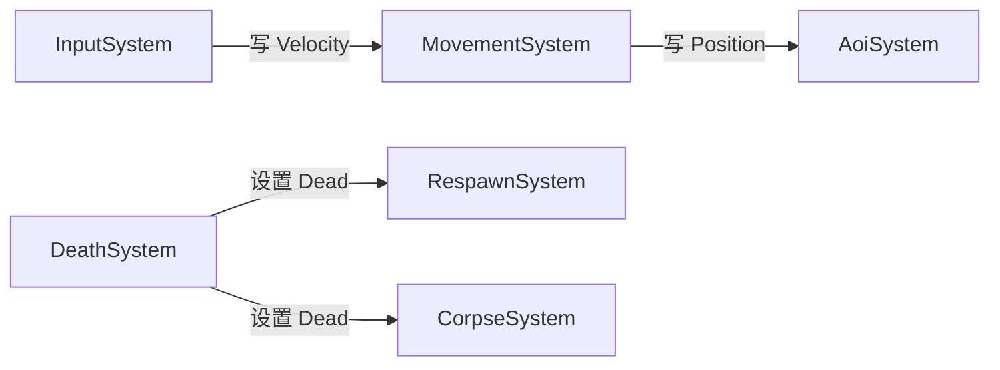

EasyEcs 把**数据**（实体、组件、单例）和**行为**（系统）分开。正是这种拆分让遍历变快：列是连续的，每个实体也没有虚调用；
同样是它让大型代码库保持解耦：系统彼此一无所知，只认数据。本页讲清每个角色、八条设计规则和一份新功能检查清单。
其中机械性的部分由分析器在编译期把关。

## 谁负责什么 [#roles]



系统之间没有箭头。所有依赖都经过数据，所有行为都在调度里执行：按注册顺序，或者按 `[UpdateBefore<T>]` / `[UpdateAfter<T>]`
声明的顺序。

| 角色 | 是什么 | 不是什么 |
| --- | --- | --- |
| **实体** | 一个身份（下标加版本号）：代码里持有 `Entity` 句柄，数据里存 `EntityId` | 逻辑的容器、基类、放字段的地方 |
| **组件** | 描述某个实体某一方面的字段结构体（`Health`、`Velocity`）；计算属性没问题 | 类、带行为的对象、引用系统或服务的地方 |
| **标签** | 用作过滤的空组件（`Dead`、`Frozen`） | 每个 tick 翻来翻去的布尔值（那该用字段） |
| **单例** | 每个 World 一份的结构体：时钟、配置、计数器、空间网格 | 静态字段（会被所有 World 共享） |
| **系统** | 只负责一件事的行为，读写组件和单例 | 存状态的地方，或者供其他系统调用的服务 |

## 规则 [#rules]

示例共用这些组件：

```csharp
public record struct Health(int Value) : IComponent;
public record struct Burning(int Ticks, int DamagePerTick) : IComponent;   // 一种状态效果
public struct Dead : IComponent;                                           // 标签
```

### 1. 一个系统只做一件事 [#1-one-system-one-responsibility]

系统按它做的那一件事命名。描述里需要用“并且”，就拆开。

```csharp tab="之前"
// 之前：燃烧“并且”死亡写在一个系统里。只有着火的单位才会被判定死亡：
// 被别的原因打死的单位永远不会被标记为 Dead。
public class StatusSystem : EcsSystem
{
    [ForEach, Without<Dead>]
    static void Tick(Entity unit, ref Burning burning, ref Health hp)
    {
        hp.Value -= burning.DamagePerTick;
        if (--burning.Ticks == 0) unit.RemoveBurning();
        if (hp.Value <= 0) unit.SetDead();
    }
}
```

```csharp tab="之后"
// 之后：每块逻辑都能单独移除、调整顺序、单独测试，死亡判定也覆盖了所有伤害来源。
public class BurnSystem : EcsSystem
{
    [ForEach, Without<Dead>]
    static void Burn(Entity unit, ref Burning burning, ref Health hp)
    {
        hp.Value -= burning.DamagePerTick;
        if (--burning.Ticks == 0) unit.RemoveBurning();
    }
}

[UpdateAfter<BurnSystem>]   // 排在造成伤害的系统之后
public class DeathSystem : EcsSystem
{
    [ForEach, Without<Dead>]
    static void Die(Entity unit, in Health hp)   // `in`：只读 Health
    {
        if (hp.Value <= 0) unit.SetDead();
    }
}
```

拆分在运行时没有代价。每个 `[ForEach]` 方法本来就是各自内联的结构体 job；每个系统每次更新的开销是三次虚调用
（`UpdateInterval`、`OnUpdate` 和生成的代码），再加每个 `[ForEach]` 方法一次查询缓存查找、每个单例参数一次查找。拿不准就拆。

### 2. 系统不保存状态 [#2-systems-are-stateless]

藏在系统里的状态，查询看不到，其他系统看不到，测试和存档也看不到；系统被移除时它就丢了，系统被加两次它就重复了。
把它放进数据：

| 状态 | 放在哪 |
| --- | --- |
| 每个实体一份（冷却、目标、路径） | 组件 |
| 每个 World 一份（tick、比分、配置、空间网格） | 单例 |
| 按值查找（按名字找玩家、找某人拥有的物品） | 被索引的组件（[索引与关系](/zh/docs/guide/indexes-and-relations)），不要手工维护一个字典 |
| 派生、可重建的数据（每次更新复用的临时列表） | 系统上的 `readonly` 字段即可 |

```csharp tab="之前" doccheck=expect-EECS007
// 之前（EECS007）：计数放在系统里，查询、测试和其他系统都看不到。
public class DeathSystem : EcsSystem
{
    public int Deaths;

    [ForEach, Without<Dead>]
    void Die(Entity unit, in Health hp)
    {
        if (hp.Value > 0) return;
        unit.SetDead();
        Deaths++;
    }
}
```

```csharp tab="之后"
// 之后：计数是 World 级状态，谁都能读（world.Score.Deaths）。
public record struct Score(int Deaths) : ISingletonComponent;

[UpdateAfter<BurnSystem>]
public class DeathSystem : EcsSystem
{
    [ForEach, Without<Dead>]
    static void Die(Entity unit, in Health hp, ref Score score)   // 单例参数
    {
        if (hp.Value > 0) return;
        unit.SetDead();
        score.Deaths++;
    }
}
```

用于依赖或可复用临时缓冲的 `readonly` 字段、`init` 属性和计算属性都是允许的（[EECS007](/zh/docs/guide/analyzer#eecs007)）。

### 3. 系统从不引用系统 [#3-systems-never-reference-systems]

持有另一个系统（[EECS008](/zh/docs/guide/analyzer#eecs008)），或者通过 `World.TryGetSystem<T>(out …)` 拿到它的系统，再也没法单独移除、
调整顺序或单独测试。改为通过数据协作：

- **流水线：** 前一个系统写组件，后一个系统读。先注册写的那个，或者用 `[UpdateAfter<T>]` 排序。
- **响应状态：** 一个系统查询另一个系统写下的状态；新增读者时，写的那个系统不用改（[规则 4](#4-state-changes-are-data)）。

```csharp
// 响应 Dead；DeathSystem 不知道它存在。
[UpdateAfter<DeathSystem>]
public sealed class CorpseSystem : EcsSystem
{
    protected override void OnUpdate() => World.DestroyAll<Dead>();   // 一次遍历清掉所有尸体
}
```



`TryGetSystem<T>(out …)` 留给工具、测试和承载 World 的宿主代码。

### 4. 状态变化就是数据 [#4-state-changes-are-data]

实体身上发生了什么，就写下它的新状态：打一个标签（`Dead`），或者改一个字段。关心它的系统在同一次更新里稍后查询这个状态，
顺序由调度决定：移动和战斗跳过 `Dead` 实体，`CorpseSystem` 清掉它们，`RespawnSystem` 可以让玩家复活。`DeathSystem` 一个都不认识，
新增一个也不用改任何已有系统。

实体留下的东西也一样。World 之外的资源（一个连接、一个预留的座位）用[清理组件](/zh/docs/guide/cleanup-and-disable)表示：
`Destroy` 让实体退休：它带着 `Retired` 标签留下来，直到某个系统释放资源。没有销毁事件需要订阅。

### 5. 频繁的变化选最便宜的表示 [#5-choose-the-cheapest-representation-for-frequent-changes]

移除组件，或者加回实体以前有过的组件，只是翻一个存在位，实体的行不动。获得一个它所在的表没有对应列的组件，会把这一行拷到另一张表，
只拷一次。所以给来来去去的状态（`Stunned`、`Burning`、`Dead`）用标签很便宜。但对每个 tick 都变的值，字段仍然比结构变更便宜：

- 用倒计时字段（`Burning.Ticks`），不要每个 tick 重新添加组件；
- 用变更 tick 检测变化：给组件加上 `ITracked`，让消费方用 `[Changed<T>]`，不要增删一个 `Changed` 标签，也不要扫描每一行
  （[变更追踪](/zh/docs/guide/change-tracking)）。任何 `ref` 访问都算写入，所以可能写入原值的一方改用 `Mut<T>`
  参数和 `SetIfChanged`（`[ForEach]` 之外用 `entity.SetIfChanged` / `SetXIfChanged`），值不同才打上 tick，读的一方就不用再比较
  （[值变了才写](/zh/docs/guide/change-tracking#set-if-changed)）；只读的循环走 `world.Read<T…>()`，它不打 tick；
- 移除检测同理：`[Removed<T>]` 访问失去了被追踪 `T` 的实体，不要每次移除都顺手加一个 `Lost` 标签
  （[移除检测](/zh/docs/guide/change-tracking#removal-detection)）；
- 暂停用 `Disable<T>()`：隐藏组件、保留它的值，不要先移除、再把值存到别处（[清理与禁用](/zh/docs/guide/cleanup-and-disable)）；
- 实体的种类用[预制体](/zh/docs/guide/prefabs)：不属于任何 World 的数据，用到时再实例化，不要放一批模板实体，让每个查询都去排除它们。

```csharp
public record struct Facing(float Angle) : IComponent, ITracked;      // 被追踪：每行记录最后一次写入
public record struct NetSync(Facing Sent) : IComponent;               // 客户端上次收到的值
public record struct Outbox(int Updates) : ISingletonComponent;

public class FacingSystem : EcsSystem
{
    // 每个 tick 都重算，但很少变：只有新的角度才给这一行打上 tick。
    [ForEach]
    static void Face(Mut<Facing> facing, in Velocity v) =>
        facing.SetIfChanged(new Facing(MathF.Atan2(v.Y, v.X)));
}

[UpdateAfter<FacingSystem>]
public class SyncSystem : EcsSystem
{
    [ForEach, Changed<Facing>]   // 只访问本系统上次执行后 Facing 变过的实体
    static void Sync(in Facing facing, ref NetSync sync, ref Outbox outbox)
    {
        sync = new NetSync(facing);
        outbox.Updates++;          // 真实的服务器在这里把更新放进发送队列
    }
}
```

### 6. 让调度决定效果的先后 [#6-let-the-schedule-order-effects]

变更立即生效：一个系统添加的组件，同一次更新里后面的系统都能看到，同一次遍历的剩余部分也能看到。一次遍历里每个实体最多访问一次，
遍历途中新进入匹配表的实体（新建的，或者搬进匹配表的）留到下一次遍历。所以效果的先后就是系统的先后，而不是某个系统碰巧访问实体的顺序：

```csharp
[UpdateAfter<BurnSystem>]   // 排在伤害之后；复活和掉落排在它之后
public class DeathSystem : EcsSystem
{
    [ForEach, Without<Dead>]
    static void Die(Entity unit, in Health hp, ref Score score)
    {
        if (hp.Value > 0) return;
        unit.SetDead();                    // DeathSystem 之后的系统在这次更新里就能看到 Dead
        score.Deaths++;
    }
}
```

完整规则见[结构变更](/zh/docs/guide/structural-changes)。

### 7. 跨边界保存实体句柄，不要保存 ref [#7-keep-entity-handles-never-refs-across-boundaries]

`Get<T>()` 或 `Query` 元素给出的 `ref`，在下一次结构变更（任何实体的）之前有效；`[ForEach]` 方法的 `ref` 参数在方法体自己做的变更之后
依然有效。跨 `await` 的一律无效。保存 `Entity` 句柄（每次访问都会校验），需要时再重新读组件
（[`ref` 与 `await`](/zh/docs/guide/refs-and-await)）。

在数据里，存 `EntityId` 而不是句柄：`Entity` 字段会让组件变成托管类型（[EECS017](/zh/docs/guide/analyzer#eecs017)），
而 `world.TryGetEntity(id, out var entity)` 能把 id 换回句柄，顺便告诉你这个实体是否还活着。

### 8. 选好集合的存放方式 [#8-choose-how-to-hold-a-collection]

组件里可以放 `List<T>`、`Dictionary<K, V>` 或数组，但行里只存引用。World 看到的写入，是代码以 `ref` 拿组件这件事，而不是背后集合的变化。所以：

- **只经由 `ref` 修改它**（`ref` 参数、`Get`、`TryGetRef`）：这一行会被打上 tick，供 `[Changed<T>]` 使用，并行系统也会据此安排写入。
  经 `in` 参数修改是一个没人察觉的数据竞争，分析器会报出来（[EECS011](/zh/docs/guide/analyzer#eecs011)）。
- **快照共享它**：`Capture` 拷贝的是引用，不是集合，所以恢复后看到的是这个列表现在的样子。快照适合纯数据；存档反正会序列化集合。
  `DynamicBuffer<T>` 两个问题都没有：写它必须拿 `ref`，快照会拷贝它的元素。

再按元素是什么来选表示方式：

| 元素 | 怎么存 | 为什么 |
| --- | --- | --- |
| 有自己状态、会被单独查询或修改的东西（背包物品、公会成员、增益效果） | **每个元素一个实体**，带一条指向主人的链接（[索引与关系](/zh/docs/guide/indexes-and-relations)） | 每个元素都有自己的组件、变更 tick、查询和并行调度，快照里按值拷贝 |
| 属于某个实体、变了就要发送或保存的列表（一袋战利品、一条路径、最近的命中记录） | **[`DynamicBuffer<T>`](/zh/docs/guide/dynamic-buffers)** 组件 | 每次写入都要 `ref`，所以每次修改都被追踪；快照拷贝元素；经 `in` 写入编译不过 |
| 数量很少、有上限的一组值（冷却槽、最近几次输入） | 非托管组件里的**定长 `[InlineArray]` 数组** | 没有 GC，处处按值拷贝，每次修改都是一次 `ref` 写入 |
| 整体读写、通常随存档一起走的数据（任务进度、设置、已解锁成就） | **组件里的集合**，经由 `ref` 修改 | 每个玩家一行，而不是成千上万个实体；随玩家一起加载和保存 |
| 读多写少、整体替换的数据（一条巡逻路线） | **不可变集合**（`ImmutableArray<T>`） | 经 `ref` 赋一个新值就是一次被追踪的写入；快照保留旧值 |

```csharp
[System.Runtime.CompilerServices.InlineArray(4)]
public struct Slots4 { private int _first; }                                 // 4 个 int 内联存放

public struct Cooldowns : IComponent, ITracked { public Slots4 ReadyAt; }  // 非托管：没有共享问题
public struct Quests : IComponent, ITracked                             // 随玩家一起保存和加载
{
    public Dictionary<int, int> Progress;
}

public record struct ItemOf(EntityId Owner) : IComponent, IIndexed<EntityId> // 背包：物品指向玩家
{
    public EntityId Key => Owner;
}

public static class PlayerRules
{
    // 存的是槽位再次可用的 tick，而不是倒计时：没有系统每个 tick 写每一行，所以只有使用才算变化
    public static bool TryUse(Entity player, int slot, int tick, int cooldown)
    {
        if (player.Cooldowns.ReadyAt[slot] > tick) return false;             // 只读：不打 tick
        player.WriteCooldowns().ReadyAt[slot] = tick + cooldown;              // 写入：这一行打上 tick
        return true;
    }

    public static void Advance(Entity player, int quest)
    {
        var progress = player.WriteQuests().Progress;                         // 写入：这一行打上 tick
        progress[quest] = progress.TryGetValue(quest, out int step) ? step + 1 : 1;
    }

    public static void Give(World world, Entity player, int item) =>
        world.CreateEntity(new ItemOf(player), new Health(item));             // 新的一行：被追踪、被索引、进快照

    public static int Carried(World world, Entity player) => world.ItemOfIndex.Count(player);
}
```

## 规则怎么落实 [#enforced]

分析器把这些规则里机械性的部分变成编译错误，代码评审不必再盯着它们：

| 规则 | 怎么会被破坏 | 由谁拦下 |
| --- | --- | --- |
| 组件是数据 | 一个实现了 `IComponent` 的类 | [EECS006](/zh/docs/guide/analyzer#eecs006) |
| [2. 系统不保存状态](#2-systems-are-stateless) | 系统上的可变字段、可写属性或事件 | [EECS007](/zh/docs/guide/analyzer#eecs007) |
| [3. 系统从不引用系统](#3-systems-never-reference-systems) | 类型为系统的成员，系统内调用 `TryGetSystem<T>(out …)` | [EECS008](/zh/docs/guide/analyzer#eecs008) |
| [5. 频繁的变化选最便宜的表示](#5-choose-the-cheapest-representation-for-frequent-changes) | 只读追踪组件的 `Query` 循环（每一行都被打 tick） | [EECS046](/zh/docs/guide/analyzer#eecs046)（警告） |
| [6. 让调度决定效果的先后](#6-let-the-schedule-order-effects) | `[UpdateBefore<T>]` / `[UpdateAfter<T>]` 成环 | [EECS019](/zh/docs/guide/analyzer#eecs019) |
| [7. 保存句柄，不要保存 ref](#7-keep-entity-handles-never-refs-across-boundaries) | 组件里的 `Entity` 字段；结构变更之后还用旧的 `ref` | [EECS017](/zh/docs/guide/analyzer#eecs017)、[EECS047](/zh/docs/guide/analyzer#eecs047)（警告） |
| [8. 选好集合的存放方式](#8-choose-how-to-hold-a-collection) | 经 `in` 修改集合 | [EECS011](/zh/docs/guide/analyzer#eecs011) |

完整的规则列表和每条的修复方法见[分析器规则](/zh/docs/guide/analyzer)。

## 新功能检查清单 [#checklist]

1. 列出数据：需要哪些组件（每个实体）和单例（每个 World）？
2. 列出行为，每个一个系统，按它做的事命名。
3. 按数据流给系统排序（注册顺序、`[UpdateBefore<T>]` / `[UpdateAfter<T>]`）：生产者在前，消费者在后。
4. 跨模块的响应写成系统查询另一个系统写下的状态，绝不写成系统之间的调用。
5. 决定每个集合怎么存（[规则 8](#8-choose-how-to-hold-a-collection)）。
6. 编译：违反这些规则的代码过不了分析器。
7. 每个系统单独测试：建一个 World，加上这个系统和它要读的数据，调用 `Update()`，对数据做断言。

## 相关页面 [#related]

<Cards>
  <Card title="快速开始" href="/zh/docs/getting-started">
    在一个小型模拟里一步一步应用这些规则。
  </Card>
  <Card title="系统" href="/zh/docs/guide/systems">
    `[ForEach]` 方法的参数、过滤条件、排序和分组。
  </Card>
  <Card title="分析器规则" href="/zh/docs/guide/analyzer">
    每条 EECS 规则为什么存在、怎么修复。
  </Card>
</Cards>
