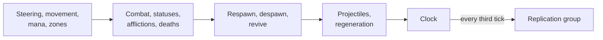

import { FlaskConical, Gauge, Rocket, Shapes } from 'lucide-react';

A battle server that uses every feature of EasyEcs the way it is meant to be used: plain data, one job per system,
systems that never know about each other, and a host that ticks the world and answers questions between ticks. This
page walks through it section by section. Every code block on it is included from
[`BattleServer.cs`](https://github.com/JasonXuDeveloper/EasyEcs/blob/master/benchmarks/EasyEcs.Benchmark/BattleServer.cs),
the same file that `BattleServerBenchmark` measures and
[`BattleServerTests`](https://github.com/JasonXuDeveloper/EasyEcs/blob/master/tests/EasyEcs.UnitTest/BattleServerTests.cs)
checks feature by feature, so what you read here is the code that runs.

## What the world simulates [#what-it-simulates]

A battle of `units` entities, a third of them players and the rest NPCs, on a 4,096 × 4,096 map split into four
zones:

- NPCs steer towards waypoints; every unit moves, attacks on a cooldown, and may catch fire or freeze.
- A unit whose health reaches zero dies. Players respawn next to a living friend; an NPC drops loot for a player of
  its zone and comes back later as a new NPC.
- Players spend mana on projectiles that fly for twenty ticks and belong to their shooter.
- Every third tick the server replicates what changed: healths, fires that started or went out, bags of loot.
- Between ticks the host answers questions: a census, the nearest player, the top killers, a save, a rollback.

One call to `Tick()` runs the default group of systems, in this order, and the `Replication` group every third tick:



With `ParallelSystems` on, systems with no order and no conflicting access between them share a stage and run at
once (`MovementSystem` and `ManaSystem` touch different components); the result is the same as running them one
after the other.

## Where each feature is [#feature-map]

Coming from another ECS? [Comparison](/en/docs/comparison) maps their features to EasyEcs; this table maps
EasyEcs' features to their place in this file.

| Feature | Where |
| --- | --- |
| [Components, tags, singletons](/en/docs/guide/entities-and-components) | `Position`, `Health`, `Player`, `Dead`; singletons `Battle`, `Rules`, `Waypoints` |
| Generated members | `players[i].Position = …`, `SetZone`, `SetFrozen`, `RemoveBurning`, `SetDead`, `IsDead`, `TryGetMana`, `WriteHealth()`, `World.Battle`, `KillsIndex`; buffers `player.Loot`, `WriteLoot()`; `DisableAttack` / `EnableAttack`; on prefabs `SetHealth`, `SetNpc` |
| [Systems](/en/docs/guide/systems), filters (`With`, `Without`, `WithAny`) | every system; `AfflictionSystem` counts burning **or** frozen units with `World.Count` |
| [Parallel `[ForEach]`](/en/docs/guide/threading) | `SteeringSystem`; `Reports.HealFully` and `Reports.Scatter` in `NewRound` |
| Parallel systems (`WorldOptions.ParallelSystems`) | `MovementSystem` and `ManaSystem`: disjoint data |
| Batch methods (`Span<T>`), SIMD | `MovementSystem`; `Reports.SumHealth` |
| `[ForEach]` runners outside systems | `Reports` |
| `Maybe<T>` | `RegenerationSystem` heals burning players less |
| [Disabling components](/en/docs/guide/cleanup-and-disable) | a frozen unit's `Attack` and `Velocity`; `NewRound` enables them all in bulk |
| [Cleanup components](/en/docs/guide/cleanup-and-disable) (`ICleanupComponent`, `Destroyed`) | `Spawn`: a destroyed NPC leaves it behind for `RespawnSystem.Revive` |
| [Hierarchy](/en/docs/guide/hierarchy) (`ChildOf`, `Children`) | projectiles are children of their player |
| [Structural changes during passes](/en/docs/guide/structural-changes) | statuses, deaths, respawns, projectiles spawned and destroyed mid-pass |
| [Prefabs](/en/docs/guide/prefabs) (`Prefab`, `Instantiate`, `EnsureCapacity`), cloning | `Hero`, `Grunt`, `Brute` (a variant of `Grunt`); `Mirror` clones a living unit |
| [Change tracking](/en/docs/guide/change-tracking) and removal detection | `ReplicationSystem`; `WrittenSinceCheckpoint` |
| [Dynamic buffers](/en/docs/guide/dynamic-buffers) | every player's bag of `Loot` |
| [Groups](/en/docs/guide/groups) (`IGroup`, `GroupBy`, `InGroup`) | `Zone`: a table per zone |
| [Ordered index, relations, target policies](/en/docs/guide/indexes-and-relations) | `Kills` leaderboard; `Friend` links, dropped when a player leaves |
| System groups, `UpdateInterval`, `UpdatePhase`, ordering, lifecycle | `Replication`; `ManaSystem`, `RegenerationSystem`; `ClockSystem`; `SteeringSystem.OnCreate` |
| [Queries](/en/docs/guide/queries) and handles | `NearestPlayer`, `Census`, `ShotsLeft`, `Hit` |
| [Bulk operations](/en/docs/guide/bulk) | `Instantiate(prefab, span)`, `DestroyEntities`, `RemoveAll`, `EnableAll` |
| [Snapshots](/en/docs/guide/snapshots), [saves and moves](/en/docs/guide/saves) | `Checkpoint` / `Rewind`, `Save` / `Load`, `Transfer` |
| Introspection, diagnostics, error policy | `Tables`, `Slowest`, `Failure` |

## The data [#data]

### Components [#components]

Every component is a plain `record struct`. Three markers change how the world stores one: `ITrackChanges` gives it
a hidden column of change ticks (`Health` and `Burning` are replicated), `IGroup` splits tables by its value (one
table set per `Zone`), and `IIndexed<TKey>` keeps a value index of it (`Kills`, the leaderboard). `Spawn` is a
cleanup component, `Loot` and `Friend` are the elements of dynamic buffers, and the empty structs are tags.

<include lang="csharp" meta='title="BattleServer.cs"'>../../benchmarks/EasyEcs.Benchmark/BattleServer.cs#components</include>

### Singletons and a system group [#singletons]

State that exists once per battle is a singleton: `Battle` counts what happened, `Rules` holds the battle's rules as
data, and `Waypoints` is a fixed-size array the steering reads. `Replication` is an empty struct that names a system
group, updated by its own call.

<include lang="csharp" meta='title="BattleServer.cs"'>../../benchmarks/EasyEcs.Benchmark/BattleServer.cs#singletons</include>

## The systems [#systems]

Each system does one job and shares nothing with the others but components and singletons. `ref` marks what a
`[ForEach]` method writes and `in` what it reads; the generator builds the loop and the access set from those two
words.

### Moving [#moving]

`SteeringSystem` is heavy per-entity math, so it runs on every core (`Parallel = true`); it creates the `Waypoints`
singleton it reads in `OnCreate` and removes it in `OnDestroy`. `MovementSystem` takes spans and adds whole runs of
rows as `Vector<float>`. `ManaSystem` runs every tenth update, five updates after `RegenerationSystem`, so their work
falls on different ticks. `ZoneSystem` writes `Zone` only when a unit really changes zone, which moves its row to the
zone's table.

<include lang="csharp" meta='title="BattleServer.cs"'>../../benchmarks/EasyEcs.Benchmark/BattleServer.cs#movement</include>

### Fighting [#fighting]

Combat is split into damage (`CombatSystem`) and statuses (`StatusSystem`). Freezing a unit disables its `Attack` and
`Velocity`: the values are kept, but no query sees them until `Thaw` enables them again, so a frozen unit neither
attacks, moves nor shoots without any system checking for `Frozen`. `AfflictionSystem` counts burning or frozen
units without a loop: `Count` reads presence bits 64 rows at a time. `DeathSystem` marks the dead with a tag that
other systems filter on.

<include lang="csharp" meta='title="BattleServer.cs"'>../../benchmarks/EasyEcs.Benchmark/BattleServer.cs#combat</include>

### Death and respawn [#respawn]

`RespawnSystem` reacts to the `Dead` tag; `DeathSystem` does not know it exists. A player recalls its projectiles
(its children), empties its bag, comes back next to a living friend found through its `Friend` links, and loses its
statuses in one `Remove<Dead, Burning, Frozen>()`. An NPC writes where the next one should appear into its `Spawn`
cleanup component, gives its loot to a player of its zone (one group's table to look at) and is destroyed: its
`Spawn` stays behind with the `Destroyed` tag until `Revive` spawns the next NPC and removes it, which frees the old
entity.

<include lang="csharp" meta='title="BattleServer.cs"'>../../benchmarks/EasyEcs.Benchmark/BattleServer.cs#respawn</include>

### Projectiles, regeneration and the clock [#projectiles]

A projectile is an entity with a `ChildOf` link to its player, so destroying the player destroys its shots.
`RegenerationSystem` heals burning players less with one method: `Maybe<Burning>` tells whether this entity has the
component. `ClockSystem` is registered first but runs last, because `[UpdateAfter<RegenerationSystem>]` moves it.

<include lang="csharp" meta='title="BattleServer.cs"'>../../benchmarks/EasyEcs.Benchmark/BattleServer.cs#projectiles</include>

## Replication by change tracking [#replication]

`ReplicationSystem` belongs to the `Replication` group, which the host updates every third tick. Each method visits
only what changed since the system last ran: the healths written (`[Changed<Health>]`), the units set on fire
(`[Changed<Burning>]`), the fires that went out (`[Removed<Burning>]`, the entities that lost the component and
still lack it) and the bags written through a `ref` (`[Changed<DynamicBuffer<Loot>>]`). Nothing marks rows dirty by
hand: a write through a `ref` is the mark.

<include lang="csharp" meta='title="BattleServer.cs"'>../../benchmarks/EasyEcs.Benchmark/BattleServer.cs#replication</include>

Why it pays and what counts as a write: [Change tracking](/en/docs/guide/change-tracking) and
[removal detection](/en/docs/guide/change-tracking#removal-detection).

## Passes outside the tick [#reports]

A static `[ForEach]` method of an ordinary static class is a runner: the generator writes an entry point that takes
the world and the method's other arguments (`Reports.SumMana(world, ref total)`). The host calls them between ticks.
`SumHealth` reads whole runs of rows as `Vector<int>` lanes; `HealFully` and `Scatter` run in parallel chunks.
`Dice` is a pure function of the tick and the entity, so a roll is the same on any thread.

<include lang="csharp" meta='title="BattleServer.cs"'>../../benchmarks/EasyEcs.Benchmark/BattleServer.cs#reports</include>

## The host [#host]

`BattleServer` owns one world on one thread, ticks it, and answers questions about it between ticks.

### Filters and prefabs [#prefabs]

Filters are built once, in `static readonly` fields; `WrittenPlayers` takes its tick per call with `Since`. The
prefabs are recipes that belong to no world, so no query sees them: `Hero` sets its components several at once or
one by one through the generated writers, and `Brute` is a variant, a copy of `Grunt` with three values changed.

<include lang="csharp" meta='title="BattleServer.cs"'>../../benchmarks/EasyEcs.Benchmark/BattleServer.cs#prefabs</include>

### Setting up the world [#setup]

The constructor configures the world (parallel systems, timings, a failing system switched off instead of thrown),
groups tables by `Zone`, sets the friend links' target policy, registers the systems in tick order and spawns the
units in bulk: one table growth per wave. `EnsureCapacity` sizes the NPC tables for respawn waves, so they never grow
during a tick.

<include lang="csharp" meta='title="BattleServer.cs"'>../../benchmarks/EasyEcs.Benchmark/BattleServer.cs#setup</include>

### The tick [#the-tick]

`Tick()` is two calls. `Battle` reads the counters through a `SingletonRef`, resolved once. `Failure` finds a system
that threw: under `SystemErrorPolicy.Disable` the exception is data in `system.Error`, and the battle goes on.
`Ceasefire` is a rule, so changing it is a write to a singleton, not a call into a system.

<include lang="csharp" meta='title="BattleServer.cs"'>../../benchmarks/EasyEcs.Benchmark/BattleServer.cs#tick</include>

### Questions between ticks [#queries]

`PlayersIn` counts one group's table. `Any` stops at the first match. `ShotsLeft` and `Hit` start from a handle or an
id a client sent: a stale one answers false, and `TryGetRef` takes `Health` by `ref` only if the unit has it.

<include lang="csharp" meta='title="BattleServer.cs"'>../../benchmarks/EasyEcs.Benchmark/BattleServer.cs#queries</include>

### Bags, clones, leaderboards and friends [#buffers-and-indexes]

`Mirror` clones a living unit with everything it has; indexes, groups and the next replication learn about the copy.
`LootValue` reads a bag without counting as a write; `Give` checks with reads first, then writes both bags.
`TopKillers` walks the ordered `Kills` index from the top, and `FriendsOf` asks the relation index who links to a
player.

<include lang="csharp" meta='title="BattleServer.cs"'>../../benchmarks/EasyEcs.Benchmark/BattleServer.cs#buffers-and-indexes</include>

### Leaving and changing battles [#leave-and-transfer]

A player who leaves is destroyed: its projectiles go with it (children), and the target policy removes it from every
friend list. `Transfer` moves a player and its projectiles to another battle of the same thread with `MoveEntities`:
they arrive as new entities, the shots still its children.

<include lang="csharp" meta='title="BattleServer.cs"'>../../benchmarks/EasyEcs.Benchmark/BattleServer.cs#leave-and-transfer</include>

### A census [#census]

An ad-hoc `Query` finds the nearest living player; the census adds up runners and counts.

<include lang="csharp" meta='title="BattleServer.cs"'>../../benchmarks/EasyEcs.Benchmark/BattleServer.cs#census</include>

### A new round [#new-round]

Bulk calls change every match table by table: projectiles destroyed in one pass, statuses removed, disabled
components enabled, then two parallel runners heal and scatter.

<include lang="csharp" meta='title="BattleServer.cs"'>../../benchmarks/EasyEcs.Benchmark/BattleServer.cs#new-round</include>

### Snapshots and saves [#snapshots-and-saves]

A checkpoint is an in-memory snapshot plus the change tick it was taken at, so the host can count the players
written since. `Save` and `Load` write and read the whole battle as bytes; entities keep their ids, so `EntityId`
links still point at the right entities.

<include lang="csharp" meta='title="BattleServer.cs"'>../../benchmarks/EasyEcs.Benchmark/BattleServer.cs#snapshots-and-saves</include>

### Diagnostics [#diagnostics]

`Describe` lists every table with its columns, rows and bytes, for a dashboard. With `MeasureSystems` on, every
system's runs are timed into `system.Stats`.

<include lang="csharp" meta='title="BattleServer.cs"'>../../benchmarks/EasyEcs.Benchmark/BattleServer.cs#diagnostics</include>

## Running it [#running-it]

```csharp title="Program.cs" doccheck=skip
using System.Buffers;
using EasyEcs.Benchmark.Showcase;

using var server = new BattleServer(100_000);
server.Checkpoint();                                      // e.g. before a risky admin command

while (running)
{
    server.Tick();                                        // allocates nothing once the tables reach their peak
    if (server.WrittenSinceCheckpoint > 1_000) server.Checkpoint();
}

var census = server.Census();                             // between ticks: runners, Count, groups
Console.WriteLine($"{census.Alive}/{census.Players} alive, {server.PlayersIn(0)} in zone 0, slowest {server.Slowest()}");
server.Ceasefire = true;                                  // a rule as data: players hold fire, shots in flight expire
server.NewRound();
server.Rewind();                                          // roll the battle back in memory

var save = new ArrayBufferWriter<byte>();
server.Save(save);                                        // to disk, or to another process: Load(save.WrittenSpan)

using var other = new BattleServer(10_000);
server.Transfer(server.NearestPlayer(default), other);    // a player and its projectiles change battles

// One world per thread scales across cores: worlds share nothing.
var threads = new Thread[4];
for (int i = 0; i < threads.Length; i++)
    (threads[i] = new Thread(() => { using var battle = new BattleServer(25_000); while (running) battle.Tick(); })).Start();
```

Every system can be removed, reordered or tested alone: they share components and singletons, nothing else.

## What a tick costs [#measured]

`BattleServerBenchmark` ticks a battle of 100,000 units 1,200 times to bring every table to its peak population, then
measures one tick: every system above, with replication every third tick.

<BenchTable bench="BattleServerBenchmark" />

<BenchSource />

The other benchmarks, and how to run them: [Performance](/en/docs/performance).

## More programs [#more-programs]

- [`samples/`](https://github.com/JasonXuDeveloper/EasyEcs/tree/master/samples): complete programs in learning
  order: hello world, a fixed-tick game loop fed by a network thread, saves and moves between worlds, one world per
  thread, hot-reloaded game logic.
- The guide: the pages of single features have a full example of that feature alone, for instance
  [change tracking](/en/docs/guide/change-tracking#full-example).
- [`templates/`](https://github.com/JasonXuDeveloper/EasyEcs/tree/master/templates): `dotnet new` templates for a
  new project.

## Related [#related]

<Cards>
  <Card icon={<Rocket />} title="Getting started" href="/en/docs/getting-started">
    Build a smaller simulation step by step.
  </Card>
  <Card icon={<Shapes />} title="ECS principles" href="/en/docs/ecs-principles">
    Why every system here has one job and talks to others only through data.
  </Card>
  <Card icon={<FlaskConical />} title="Change tracking" href="/en/docs/guide/change-tracking">
    The replication above: what counts as a write, ticks, removals.
  </Card>
  <Card icon={<Gauge />} title="Performance" href="/en/docs/performance">
    Which API to use when, and every benchmark.
  </Card>
</Cards>
