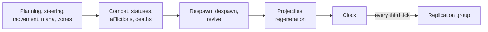

import { FlaskConical, Gauge, Rocket, Shapes } from 'lucide-react';

A battle server that uses every feature of EasyEcs the way it is meant to be used: plain data, one job per system,
systems that never know about each other, and a host that ticks the world and answers questions between ticks. This
page walks through it section by section. Every code block on it is included from
[`BattleServer.cs`](https://github.com/JasonXuDeveloper/EasyEcs/blob/master/benchmarks/EasyEcs.Benchmark/BattleServer.cs),
the same file that `BattleServerBenchmark` measures and
[`BattleServerTests`](https://github.com/JasonXuDeveloper/EasyEcs/blob/master/tests/EasyEcs.UnitTest/BattleServerTests.cs)
checks feature by feature, so what you read here is the code that runs.

## What the world simulates [#what-it-simulates]

A battle of `units` entities, a third of them players and the rest NPCs, on a 4,096 × 4,096 map split into four
zones:

- NPCs plan which waypoint to head for and steer towards it; every unit moves, attacks on a cooldown, and may catch
  fire or freeze.
- A unit whose health reaches zero dies. Players respawn next to a living friend; an NPC drops loot for a player of
  its zone and comes back later as a new NPC.
- Players spend mana on projectiles that fly for twenty ticks and belong to their shooter.
- The players the battle starts with are bots; a client joins with its account and gets a hero of its own.
- Every third tick the server replicates what changed: healths, fires that started or went out, NPC goals, bags of
  loot. A client that comes back after a gap catches up from the last tick it acknowledged.
- Between ticks the host answers questions: a census, the nearest player, the top killers, a save, a rollback.

One call to `Tick()` runs the default group of systems, in this order, and the `Replication` group every third tick:



With `ParallelSystems` on, systems with no order and no conflicting access between them share a stage and run at
once (`ManaSystem` touches nothing `PlanningSystem` does, so the two run side by side); the result is the same as
running them one after the other. `Schedule()` prints the stages and why each system waits.

## Where each feature is [#feature-map]

Coming from another ECS? [Comparison](/en/docs/comparison) maps their features to EasyEcs; this table maps
EasyEcs' features to their place in this file.

| Feature | Where |
| --- | --- |
| [Components, tags, singletons](/en/docs/guide/entities-and-components) | `Position`, `Health`, `Player`, `Dead`; singletons `Battle`, `Rules`, `Waypoints` |
| Generated members | `players[i].Position = …`, `SetZone`, `SetFrozen`, `RemoveBurning`, `SetDead`, `IsDead`, `HasAccount`, `TryGetMana`, `World.Battle`, `KillsIndex`, `AccountIndex`; buffers `player.Loot`, `WriteLoot()`; `DisableAttack` / `EnableAttack`; on prefabs `SetHealth`, `SetNpc`, `SetLifetime` |
| [Systems](/en/docs/guide/systems), filters (`With`, `Without`, `WithAny`) | every system; `AfflictionSystem` counts burning **or** frozen units with `World.Count` |
| Parallel [`[ForEach]`](/en/docs/guide/threading) | `SteeringSystem`; `Reports.HealFully` and `Reports.Scatter` in `NewRound` |
| Parallel systems (`WorldOptions.ParallelSystems`), [`DescribeSchedule`](/en/docs/guide/diagnostics#schedule) | `PlanningSystem` and `ManaSystem`: disjoint data; `Schedule()` shows it |
| [Slices](/en/docs/guide/systems#slices) (`[ForEach(Slices = N)]`, `RunCount`) | `PlanningSystem` plans a quarter of the NPCs per run |
| [`Mut<T>`](/en/docs/guide/change-tracking#set-if-changed) and [`SetIfChanged`](/en/docs/guide/change-tracking#set-if-changed) | `PlanningSystem.Plan` writes a goal only when it changes; `CombatSystem` and `RegenerationSystem` stamp `Health` only on a hit or a heal |
| Batch methods (`Span<T>`), SIMD | `MovementSystem`; `Reports.SumHealth` |
| `[ForEach]` runners outside systems | `Reports` |
| `Maybe<T>` | `RegenerationSystem` heals burning players less |
| [Disabling components](/en/docs/guide/cleanup-and-disable) | a frozen unit's `Attack` and `Velocity`; `NewRound` enables them all in bulk |
| [Cleanup components](/en/docs/guide/cleanup-and-disable) (`ICleanupComponent`, `Retired`), `[Consume]` | `Spawn`: `Despawn` consumes a dead NPC, retired and kept for `RespawnSystem.Revive` |
| [Hierarchy](/en/docs/guide/hierarchy) (`ChildOf`, `Children`, `Descendants`) | projectiles are children of their player; `Transfer` collects the subtree |
| [Structural changes during passes](/en/docs/guide/structural-changes) | statuses, deaths, respawns, projectiles spawned and destroyed mid-pass |
| [Prefabs](/en/docs/guide/prefabs) (`Prefab`, `Instantiate`, `Reserve`), cloning | `Hero`, `Grunt`, `Brute` (a variant of `Grunt`); `Mirror` clones a living unit |
| [Instantiate with values](/en/docs/guide/prefabs#instantiate-with-values) | `Shot` with its position, velocity and `ChildOf`; `SpawnNpc`; `Join` |
| [Change tracking](/en/docs/guide/change-tracking) and removal detection | `ReplicationSystem`; `WrittenSinceCheckpoint` |
| [`ChangedAny`](/en/docs/guide/change-tracking#changed-any) per client, [destroy log](/en/docs/guide/change-tracking#destroy-log) | `CatchUp`: one kept filter, each client's tick; `DestroyedSince` |
| [Dynamic buffers](/en/docs/guide/dynamic-buffers) | every player's bag of `Loot` |
| [Groups](/en/docs/guide/groups) (`IGroup`, `GroupBy`, `InGroup`) | `Zone`: a table per zone |
| [Ordered index, relations, target policies](/en/docs/guide/indexes-and-relations) | `Kills` leaderboard; `Friend` links, dropped when a player leaves |
| [Unique keys](/en/docs/guide/indexes-and-relations#unique-keys) (`IUniqueIndexed`, `Get` / `TryGet`) | `Account`: `Join` and `Kick` find a hero by account |
| System groups, `[UpdateInterval(n, Phase = p)]`, ordering, lifecycle | `Replication`; `ManaSystem`, `RegenerationSystem`; `ClockSystem`; `PlanningSystem.OnCreate` |
| [Queries](/en/docs/guide/queries), handles and [one-entity methods](/en/docs/guide/queries#run-on-one-entity) | `NearestPlayer`, `Census`, `ShotsLeft`; `Hit` calls the `[ForEntity]` method `Requests.TakeHit` |
| [Bulk operations](/en/docs/guide/bulk) | `Instantiate(prefab, span)`, `DestroyAll`, `RemoveAll`, `EnableAll` |
| [Snapshots](/en/docs/guide/snapshots), [saves and moves](/en/docs/guide/saves) | `Checkpoint` / `Rewind`, `Save` / `Load`, `Transfer` |
| Introspection, diagnostics, error policy | `Tables`, `Schedule`, `Slowest`, `Failure` |

## The data [#data]

### Components [#components]

Every component is a plain `record struct`. Four markers change how the world stores one: `ITracked` gives it
a hidden column of change ticks (`Health`, `Burning` and `Goal` are replicated), `IGroup` splits tables by its value
(one table set per `Zone`), `IIndexed<TKey>` keeps a value index of it (`Kills`, the leaderboard), and
`IUniqueIndexed<TKey>` makes its key name one entity (`Account`: one hero per account). `Spawn` is a cleanup
component, `Loot` and `Friend` are the elements of dynamic buffers, and the empty structs are tags.

<include lang="csharp" meta='title="BattleServer.cs"'>../../benchmarks/EasyEcs.Benchmark/BattleServer.cs#components</include>

### Singletons and a system group [#singletons]

State that exists once per battle is a singleton: `Battle` counts what happened, `Rules` holds the battle's rules as
data, and `Waypoints` is a fixed-size array the planning and the steering read. `Replication` is an empty struct that names a system
group, updated by its own call.

<include lang="csharp" meta='title="BattleServer.cs"'>../../benchmarks/EasyEcs.Benchmark/BattleServer.cs#singletons</include>

## The systems [#systems]

Each system does one job and shares nothing with the others but components and singletons. A `[ForEach]` method's
parameters say what it does: `in` reads, `ref` writes every row it visits, `Mut<T>` writes only the rows it changes, and
a `Span<T>` takes a run of rows at once; the generator builds the loop and the access set from them.

### Moving [#moving]

`PlanningSystem` picks the waypoint each NPC heads for: the nearest one it has not reached. It creates the
`Waypoints` singleton it plans with in `OnCreate` and removes it in `OnDestroy`. A plan need not be fresh every tick,
so `[ForEach(Slices = 4)]` spreads it over four runs: each run plans a quarter of the NPCs, and each NPC is planned
every fourth tick, without a spike on any tick. Most plans end with the goal the NPC already had, and `Goal` is
replicated, so the method takes a `Mut<Goal>` instead of a `ref Goal`: a `ref` parameter of a tracked component counts
as a write of every row the method visits, while `SetIfChanged` stamps only the goals that changed, and replication
sends only those. `SteeringSystem` is heavy per-entity math, so it runs on every core (`Parallel = true`) and steers
towards the goal. `MovementSystem` takes spans and adds whole runs of rows as `Vector<float>`. `ManaSystem` runs every tenth update, five updates after `RegenerationSystem`, so their work
falls on different ticks. `ZoneSystem` writes `Zone` only when a unit really changes zone, which moves its row to the
zone's table.

<include lang="csharp" meta='title="BattleServer.cs"'>../../benchmarks/EasyEcs.Benchmark/BattleServer.cs#movement</include>

### Fighting [#fighting]

Combat is split into damage (`CombatSystem`) and statuses (`StatusSystem`). Freezing a unit disables its `Attack` and
`Velocity`: the values are kept, but no query sees them until `Thaw` enables them again, so a frozen unit neither
attacks, moves nor shoots without any system checking for `Frozen`. `AfflictionSystem` counts burning or frozen
units without a loop: `Count` reads presence bits 64 rows at a time. `DeathSystem` marks the dead with a tag that
other systems filter on. `CombatSystem` takes `Health` as a `Mut<Health>`: most units are between two attacks, and
only the ones that hit get their `Health` stamped, with no lookup of the entity per row; the scheduler sees what the
system reads and writes instead of a system that reaches components through `Entity`.

<include lang="csharp" meta='title="BattleServer.cs"'>../../benchmarks/EasyEcs.Benchmark/BattleServer.cs#combat</include>

### Death and respawn [#respawn]

`RespawnSystem` reacts to the `Dead` tag; `DeathSystem` does not know it exists. A player recalls its projectiles
(its children), empties its bag, comes back next to a living friend found through its `Friend` links, and loses its
statuses in one `Remove<Dead, Burning, Frozen>()`. An NPC writes where the next one should appear into its `Spawn`
cleanup component, gives its loot to a player of its zone (one group's table to look at); `[Consume]` destroys it after the method, which retires it:
its `Spawn` stays behind with the `Retired` tag until `Revive` spawns the next NPC and removes it, which frees the old
entity.

<include lang="csharp" meta='title="BattleServer.cs"'>../../benchmarks/EasyEcs.Benchmark/BattleServer.cs#respawn</include>

### Projectiles, regeneration and the clock [#projectiles]

A projectile is an entity with a `ChildOf` link to its player, so destroying the player destroys its shots.
`Instantiate(Shot, p, velocity, new ChildOf(player))` copies the `Shot` prefab with the three values given: the shot
lands in its final table in one row copy, already linked to its player.
`RegenerationSystem` heals burning players less with one method: `Maybe<Burning>` tells whether this entity has the
component, and `Mut<Health>` stamps only the players it heals, not the ones at full health. `ClockSystem` is registered first but runs last, because `[UpdateAfter<RegenerationSystem>]` moves it.

<include lang="csharp" meta='title="BattleServer.cs"'>../../benchmarks/EasyEcs.Benchmark/BattleServer.cs#projectiles</include>

## Replication by change tracking [#replication]

`ReplicationSystem` belongs to the `Replication` group, which the host updates every third tick. Each method visits
only what changed since the system last ran: the healths written (`[Changed<Health>]`), the units set on fire
(`[Changed<Burning>]`), the fires that went out (`[Removed<Burning>]`, the entities that lost the component and
still lack it), the goals that changed (`[Changed<Goal>]`: the few `Plan` wrote, not every NPC it visited) and the bags
written through a `ref` (`[Changed<DynamicBuffer<Loot>>]`). Nothing marks rows dirty by hand: a write is the mark, through a `ref`
or through `Mut<T>`.

<include lang="csharp" meta='title="BattleServer.cs"'>../../benchmarks/EasyEcs.Benchmark/BattleServer.cs#replication</include>

### A client that catches up [#catch-up]

`ReplicationSystem` serves clients that receive every send. A client that comes back after a gap (a reconnect, a lost
packet) has acknowledged an older tick, and each client has its own. `CatchUp` answers it from the tick alone, with no
state per client on the server: `ChangedAny<Health, Burning, Goal>` keeps one filter for the units where any of the
three changed, and `Since(acked)` runs it with this client's tick; `Removed<Burning>` adds the fires that went out.
Clients must also learn which units are gone, and a destroyed entity has no row left to find, so the world keeps a
destroy log (`WorldOptions.DestroyLogCapacity`, a ring of the last destroyed ids): `DestroyedSince` lists the ids destroyed
since the client's tick. When the client lags further back than the ring reaches, it returns false and the client gets
the whole battle again.

<include lang="csharp" meta='title="BattleServer.cs"'>../../benchmarks/EasyEcs.Benchmark/BattleServer.cs#catch-up</include>

Why it pays and what counts as a write: [Change tracking](/en/docs/guide/change-tracking) and
[removal detection](/en/docs/guide/change-tracking#removal-detection).

## Passes outside the tick [#reports]

A static `[ForEach]` method of an ordinary static class is a runner: the generator writes an entry point that takes
the world and the method's other arguments (`Reports.SumMana(world, ref total)`). The host calls them between ticks.
`SumHealth` reads whole runs of rows as `Vector<int>` lanes; `HealFully` and `Scatter` run in parallel chunks.
`Dice` is a pure function of the tick and the entity, so a roll is the same on any thread.

<include lang="csharp" meta='title="BattleServer.cs"'>../../benchmarks/EasyEcs.Benchmark/BattleServer.cs#reports</include>

## The host [#host]

`BattleServer` owns one world on one thread, ticks it, and answers questions about it between ticks.

### Filters and prefabs [#prefabs]

Filters are built once, in `static readonly` fields; `WrittenPlayers`, `ClientChanges` and `FiresOut` take their tick
per call with `Since`. The prefabs are recipes that belong to no world, so no query sees them: `Hero` sets its
components several at once or one by one through the generated writers, `Brute` is a variant, a copy of `Grunt` with
three values changed, and `Shot` holds only what every shot shares: the rest is given when it is fired.

<include lang="csharp" meta='title="BattleServer.cs"'>../../benchmarks/EasyEcs.Benchmark/BattleServer.cs#prefabs</include>

### Setting up the world [#setup]

The constructor configures the world (parallel systems, timings, a failing system switched off instead of thrown, a
destroy log of one id per unit), groups tables by `Zone`, sets the friend links' target policy, registers the systems
in tick order and spawns the units in bulk: one table growth per wave. `Reserve` sizes the NPC tables for
respawn waves, so they never grow during a tick. `SpawnNpc` instantiates a respawned NPC with its position given.

<include lang="csharp" meta='title="BattleServer.cs"'>../../benchmarks/EasyEcs.Benchmark/BattleServer.cs#setup</include>

### The tick [#the-tick]

`Tick()` is two calls. `Battle` reads the counters through a `SingletonRef`, resolved once. `Failure` finds a system
that threw: under `SystemErrorPolicy.Disable` the exception is data in `system.Error`, and the battle goes on.
`Ceasefire` is a rule, so changing it is a write to a singleton, not a call into a system.

<include lang="csharp" meta='title="BattleServer.cs"'>../../benchmarks/EasyEcs.Benchmark/BattleServer.cs#tick</include>

### Joining with an account [#accounts]

A client logs in with its account. `Account` is `IUniqueIndexed<int>`: its key names one entity, so `TryGet` finds the
hero of an account with one hash probe, and a write that would give a second hero an account already taken throws
before it changes anything. `Join` gives a new account a hero with `Instantiate(Hero, at, new Account(account))`, the
position and the account written in the same row copy as the prefab's components; an account that already has a hero
gets it back (a reconnect). `Kick` finds the hero the same way. `Get` is the lookup that throws when no entity has the
key.

<include lang="csharp" meta='title="BattleServer.cs"'>../../benchmarks/EasyEcs.Benchmark/BattleServer.cs#accounts</include>

### Questions between ticks [#queries]

`PlayersIn` counts one group's table. `Any` stops at the first match. `ShotsLeft` and `Hit` start from a handle or an
id a client sent: a stale one answers false. `Hit` is a request on one unit, so it calls `Requests.TakeHit`, the entry point of a
`[ForEntity]` method: one lookup for the method's components, and `[Without<Dead>]` turns a dead unit away. The method
takes `Health` by `ref`, so the hit is stamped for the next replication.

<include lang="csharp" meta='tab="Queries" title="BattleServer.cs"'>../../benchmarks/EasyEcs.Benchmark/BattleServer.cs#queries</include>

<include lang="csharp" meta='tab="Requests" title="BattleServer.cs"'>../../benchmarks/EasyEcs.Benchmark/BattleServer.cs#requests</include>

### Bags, clones, leaderboards and friends [#buffers-and-indexes]

`Mirror` clones a living unit with everything it has; indexes, groups and the next replication learn about the copy.
A copy of a hero would share its account, which a unique key refuses (`Clone` throws), so only bots and NPCs are
mirrored.
`LootValue` reads a bag without counting as a write; `Give` checks with reads first, then writes both bags.
`TopKillers` walks the ordered `Kills` index from the top, and `FriendsOf` asks the relation index who links to a
player.

<include lang="csharp" meta='title="BattleServer.cs"'>../../benchmarks/EasyEcs.Benchmark/BattleServer.cs#buffers-and-indexes</include>

### Leaving and changing battles [#leave-and-transfer]

A player who leaves is destroyed: its projectiles go with it (children), and the target policy removes it from every
friend list. `Transfer` collects the player's whole subtree into a reused list with `Descendants(player).AddTo` and moves it to another battle of the same
thread with `MoveEntities`: they arrive as new entities, the shots still its children.

<include lang="csharp" meta='title="BattleServer.cs"'>../../benchmarks/EasyEcs.Benchmark/BattleServer.cs#leave-and-transfer</include>

### A census [#census]

An ad-hoc `Query` finds the nearest living player; the census adds up runners and counts.

<include lang="csharp" meta='title="BattleServer.cs"'>../../benchmarks/EasyEcs.Benchmark/BattleServer.cs#census</include>

### A new round [#new-round]

Bulk calls change every match table by table: projectiles destroyed in one pass, statuses removed, disabled
components enabled, then two parallel runners heal and scatter.

<include lang="csharp" meta='title="BattleServer.cs"'>../../benchmarks/EasyEcs.Benchmark/BattleServer.cs#new-round</include>

### Snapshots and saves [#snapshots-and-saves]

A checkpoint is an in-memory snapshot plus the change tick it was taken at, so the host can count the players
written since. `Save` and `Load` write and read the whole battle as bytes; entities keep their ids, so `EntityId`
links still point at the right entities.

<include lang="csharp" meta='title="BattleServer.cs"'>../../benchmarks/EasyEcs.Benchmark/BattleServer.cs#snapshots-and-saves</include>

### Diagnostics [#diagnostics]

`DescribeTables` lists every table with its columns, rows and bytes, for a dashboard. `Schedule` describes how the systems
run: the stages of each group, what every system reads and writes, and why it waits for an earlier stage; the server
logs it once at startup. With `MeasureSystems` on, every system's runs are timed into `system.Stats`, with the bytes
they allocated and the entities they visited.

<include lang="csharp" meta='title="BattleServer.cs"'>../../benchmarks/EasyEcs.Benchmark/BattleServer.cs#diagnostics</include>

## Running it [#running-it]

```csharp title="Program.cs" doccheck=skip
using System.Buffers;
using EasyEcs.Benchmark.Showcase;

using var server = new BattleServer(100_000);
Console.WriteLine(server.Schedule());                     // once at startup: stages, access, waits
server.Checkpoint();                                      // e.g. before a risky admin command
var hero = server.Join(1001, new Position(2048, 2048));   // a client logs in with its account

while (running)
{
    server.Tick();                                        // allocates nothing once the tables reach their peak
    if (server.WrittenSinceCheckpoint > 1_000) server.Checkpoint();
}

var gone = new EntityId[100_000];                         // WorldOptions.DestroyLogCapacity ids: room for them all
if (!server.CatchUp(acked, gone, out int updates, out int destroyed))   // acked: the tick a client confirmed
    SendWholeBattle();                                    // the client lags further back than the log reaches

var census = server.Census();                             // between ticks: runners, Count, groups
Console.WriteLine($"{census.Alive}/{census.Players} alive, {server.PlayersIn(0)} in zone 0, slowest {server.Slowest()}");
server.Ceasefire = true;                                  // a rule as data: players hold fire, shots in flight expire
server.NewRound();
server.Rewind();                                          // roll the battle back in memory

var save = new ArrayBufferWriter<byte>();
server.Save(save);                                        // to disk, or to another process: Load(save.WrittenSpan)

using var other = new BattleServer(10_000);
server.Transfer(server.NearestPlayer(default), other);    // a player and its projectiles change battles

// One world per thread scales across cores: worlds share nothing.
var threads = new Thread[4];
for (int i = 0; i < threads.Length; i++)
    (threads[i] = new Thread(() => { using var battle = new BattleServer(25_000); while (running) battle.Tick(); })).Start();
```

Every system can be removed, reordered or tested alone: they share components and singletons, nothing else.

## What a tick costs [#measured]

`BattleServerBenchmark` ticks a battle of 100,000 units 1,200 times to bring every table to its peak population, then
measures one tick: every system above, with replication every third tick.

<BenchTable bench="BattleServerBenchmark" />

<BenchSource />

The other benchmarks, and how to run them: [Performance](/en/docs/performance).

## More programs [#more-programs]

- [Samples](/en/docs/samples): complete programs in learning order, from a first world to a Minecraft-style server,
  each with a walkthrough of its files.
- The guide: the pages of single features have a full example of that feature alone, for instance
  [change tracking](/en/docs/guide/change-tracking#full-example).
- [`templates/`](https://github.com/JasonXuDeveloper/EasyEcs/tree/master/templates): `dotnet new` templates for a
  new project.

## Related [#related]

<Cards>
  <Card icon={<Rocket />} title="Getting started" href="/en/docs/getting-started">
    Build a smaller simulation step by step.
  </Card>
  <Card icon={<Shapes />} title="ECS principles" href="/en/docs/ecs-principles">
    Why every system here has one job and talks to others only through data.
  </Card>
  <Card icon={<FlaskConical />} title="Change tracking" href="/en/docs/guide/change-tracking">
    The replication above: what counts as a write, ticks, removals.
  </Card>
  <Card icon={<Gauge />} title="Performance" href="/en/docs/performance">
    Which API to use when, and every benchmark.
  </Card>
</Cards>
