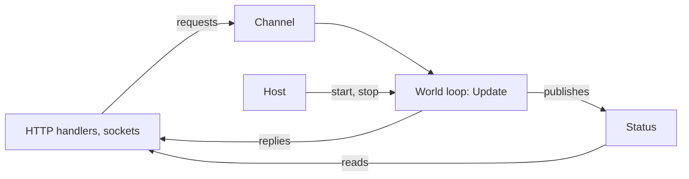

A real server is an ASP.NET Core app or a Worker Service: request handlers, sockets and timers run on the thread pool,
while a world takes structural changes from one thread at a time. Give the world one owner, a hosted service that
builds it, runs its tick and saves it when the host stops, and let everything else talk to it through a channel.
EasyEcs needs no hosting package for this: the pattern is a few classes of your own.

## When to use it [#when-to-use-it]

<Callout type="idea" title="Use it for">
  A game server, simulation or matchmaker inside ASP.NET Core, a Worker Service or any app built on
  `Microsoft.Extensions.Hosting`, with HTTP endpoints, health checks and metrics next to the world.
</Callout>

<Callout type="warn" title="Skip it for">
  A console tool, a benchmark or a test: `new World()` and a loop are enough ([getting started](/en/docs/getting-started),
  [testing](/en/docs/guide/testing)). Do not share one world between request handlers behind a lock: a lock around
  every request serializes the server anyway, and reads without it race with the tick.
</Callout>

## How to use it [#how-to-use-it]

Everything that is not the world's owner reaches it through two doors: a channel of requests the tick drains, and an
immutable status the tick publishes.



### Give the world one owner [#owner]

One object owns the world, and only its loop touches it. A `PeriodicTimer` sets the tick; every `world.Update()`
runs all systems synchronously and returns before the next `await`.

```csharp
public sealed class WorldLoop(World world)
{
    private readonly World _world = world;

    public async Task RunAsync(CancellationToken stop)
    {
        using var timer = new PeriodicTimer(TimeSpan.FromMilliseconds(50));   // 20 ticks per second
        try
        {
            while (await timer.WaitForNextTickAsync(stop))
                _world.Update();
        }
        catch (OperationCanceledException)
        {
            // the host is stopping
        }
    }
}
```

After an `await`, the loop may resume on another thread-pool thread. That is allowed: the owner is whoever changes the
world, one at a time, and each `await` orders one tick after the other. Use a dedicated thread (`new Thread`, or
`Task.Factory.StartNew` with `TaskCreationOptions.LongRunning`) when the tick needs steadier timing than a busy thread
pool gives.

### Start and stop with the host [#hosted-service]

A `BackgroundService` runs the loop for the life of the app. On Ctrl+C or `SIGTERM` the host cancels the token and
waits for `ExecuteAsync` to finish, up to `HostOptions.ShutdownTimeout` (30 seconds by default), so a final save
fits there.

```csharp doccheck=skip
public sealed class WorldService(WorldLoop loop) : BackgroundService
{
    protected override Task ExecuteAsync(CancellationToken stoppingToken) => loop.RunAsync(stoppingToken);
}

builder.Services.AddSingleton(new WorldLoop(world));
builder.Services.AddHostedService<WorldService>();
```

An exception that leaves `Update()` (a system threw, under the default `SystemErrorPolicy.Throw`) ends `ExecuteAsync`,
and the host stops: the process fails fast and the platform restarts it. With
`new WorldOptions { SystemErrors = SystemErrorPolicy.Disable }` the failing system is switched off instead and the
tick goes on; report its `system.Error` from a health check ([errors](/en/docs/guide/systems#errors)).

### Hand requests to the world [#requests]

A request is a message, not a component. Handlers write it into a bounded `Channel<T>`; a system drains the channel at
the start of each tick and turns each message into data. A request that needs an answer carries a
`TaskCompletionSource<T>` the system completes:

```csharp
using System.Threading.Channels;

public readonly record struct SpawnRequest(float X, float Y, TaskCompletionSource<EntityId> Reply);

public sealed class ReceiveSpawns(ChannelReader<SpawnRequest> requests) : EcsSystem
{
    private readonly ChannelReader<SpawnRequest> _requests = requests;   // a dependency: allowed (EECS007)

    protected override void OnUpdate()
    {
        while (_requests.TryRead(out var request))
        {
            var unit = World.CreateEntity(new Position(request.X, request.Y));
            request.Reply.TrySetResult(unit.Id);                       // answer with an id, never a handle
        }
    }
}
```

Create each reply with `TaskCreationOptions.RunContinuationsAsynchronously`. Without it, `TrySetResult` runs the
handler's continuation inline, on the world's thread, in the middle of the tick. Answer with an `EntityId` or a copy
of the values: an `Entity` handle used by the handler later would touch the world from another thread.

Bound the channel (`Channel.CreateBounded`) so a world that falls behind slows its callers down
(`BoundedChannelFullMode.Wait`) or refuses them (`DropWrite`, `TryWrite` returning false) instead of growing without
limit. The [threading guide](/en/docs/guide/threading#input-from-other-threads) shows the same pattern with a plain
`ConcurrentQueue<T>`.

### Let handlers read without a round trip [#reads]

Handlers never read the world directly: component values are not synchronized, and the tick moves and rewrites rows
while a handler would read them. Instead, a system copies what handlers may see into an immutable object and
publishes it with one atomic write; handlers read the latest copy without waiting for a tick:

```csharp
public sealed record ArenaStatus(long Tick, int Units);

public sealed class StatusBoard
{
    private ArenaStatus _current = new(Tick: 0, Units: 0);

    public ArenaStatus Current => Volatile.Read(ref _current);

    public void Publish(ArenaStatus status) => Volatile.Write(ref _current, status);
}

public sealed class PublishStatus(StatusBoard board) : EcsSystem
{
    private readonly StatusBoard _board = board;

    public override int UpdateInterval => 20;                          // once a second at 20 Hz

    protected override void OnUpdate() =>
        _board.Publish(new ArenaStatus(World.UpdateCount, World.Count<Position>()));
}
```

`UpdateInterval` keeps the copy (and its allocation) off most ticks. A read that must see the state of this very tick
goes through the channel as a request with a reply, like a write.

### Load at start, save at stop [#persistence]

Load the last save before the first tick, then add only the singletons the save did not hold: `Load` replaces the
world's singletons, and `AddSingleton` would reset one that was loaded. Save after the loop ends, into a temporary
file moved over the old one, so a crash during the write never leaves half a save:

```csharp
using Nino.Core;

public static class Persistence
{
    public static void LoadOrStart(World world, string path)
    {
        if (File.Exists(path))
            world.Load(File.ReadAllBytes(path));
        if (!world.HasSingleton<Clock>())
            world.AddSingleton<Clock>();
    }

    public static void Save(World world, string path)
    {
        var output = new NinoArrayBufferWriter();
        world.Save(output);
        File.WriteAllBytes(path + ".tmp", output.WrittenSpan);
        File.Move(path + ".tmp", path, overwrite: true);
    }
}

public record struct Clock(long Tick) : ISingletonComponent;
```

For autosaves while the server runs, call `Save` on the owner between two ticks, then hand the bytes to another thread
for the disk write: the world is only needed while it encodes. What a save holds and what survives a code change are
in [saves](/en/docs/guide/saves#versioning).

### Several worlds, health and metrics [#operations]

- **Several worlds:** one loop per world, each its own owner (one hosted service per zone, or one service that starts
  a loop per world). They share nothing, so they need no locks
  ([one world per thread](/en/docs/guide/threading#recommended-one-world-per-thread)). Lower
  `WorldOptions.MaxDegreeOfParallelism` when `ParallelSystems` worlds and Kestrel share the cores.
- **Metrics:** with `WorldOptions.MeasureSystems`, read `system.Stats` (`Runs`, `Last`, `Average`) for each system of
  `world.Systems` on the loop, between two updates, and publish the numbers with the status
  ([measuring systems](/en/docs/guide/systems#measuring-systems)).
- **Health:** under `SystemErrorPolicy.Disable`, a system with a non-null `Error` is switched off; publish that list
  and let the health check report it.

### Deploy [#deploy]

- **Native AOT:** `<PublishAot>true</PublishAot>` publishes the world and its systems as a native executable:
  `EasyEcs.Core` is marked `IsAotCompatible` and the generated code calls your methods directly. The AOT compiler
  reports one IL3054 warning (generic recursion through the change-tick column type) in programs with tracked
  components, and a generic system closed only by another assembly needs `MakeGenericType`, which Native AOT cannot do
  ([FAQ](/en/docs/faq#native-aot)). ASP.NET Core has AOT rules of its own (`WebApplication.CreateSlimBuilder`, JSON
  source generation): see Microsoft's
  [Native AOT guide for ASP.NET Core](https://learn.microsoft.com/aspnet/core/fundamentals/native-aot).
- **Containers:** `docker stop` and Kubernetes send `SIGTERM`, which the host turns into the shutdown above. Give the
  container a grace period longer than the final save.
- **No IO in systems:** a system that awaits or blocks stalls the whole tick. Systems hand IO out as data (a request
  in a queue, bytes in an outbox) and the host does it outside `Update()`.

## Full example [#full-example]

An ASP.NET Core server with one arena: `POST /units` spawns a unit and answers with its id, `GET /status` reads the
copy the world publishes once a second, and the world is saved on shutdown and loaded on the next start. Create it
with `dotnet new web -n Arena`, add `dotnet add package EasyEcs`, and replace `Program.cs` with these files.

<Accordions>
<Accordion title="Components.cs">

```csharp title="Components.cs" doccheck=example
using EasyEcs;

public record struct Position(float X, float Y) : IComponent;

public record struct Velocity(float X, float Y) : IComponent;

// The tick and its length, kept in the world: systems read it and a save keeps it.
public record struct Clock(long Tick, float DeltaTime) : ISingletonComponent;
```

</Accordion>
<Accordion title="Messages.cs">

```csharp title="Messages.cs" doccheck=example
using EasyEcs;

// What a request handler asks of the world: a message, not a component.
// The world's thread answers through Reply.
public readonly record struct SpawnRequest(float X, float Y, TaskCompletionSource<EntityId> Reply);

// What request handlers read: an immutable copy the world's thread publishes.
public sealed record ArenaStatus(long Tick, int Units);

// The one object both sides share: the world's thread writes it, any thread reads it.
public sealed class StatusBoard
{
    private ArenaStatus _current = new(Tick: 0, Units: 0);

    public ArenaStatus Current => Volatile.Read(ref _current);

    public void Publish(ArenaStatus status) => Volatile.Write(ref _current, status);
}
```

</Accordion>
<Accordion title="Systems.cs">

```csharp title="Systems.cs" doccheck=example
using System.Threading.Channels;
using EasyEcs;

// Turns the requests that arrived since the last tick into units, on the world's thread.
public sealed class ReceiveSpawns(ChannelReader<SpawnRequest> requests) : EcsSystem
{
    // A dependency, not state: readonly fields are allowed (EECS007).
    private readonly ChannelReader<SpawnRequest> _requests = requests;

    protected override void OnUpdate()
    {
        while (_requests.TryRead(out var request))
        {
            var unit = World.CreateEntity(new Position(request.X, request.Y), new Velocity(1, 0));
            request.Reply.TrySetResult(unit.Id);
        }
    }
}

public class MovementSystem : EcsSystem
{
    [ForEach]
    static void Move(ref Position position, in Velocity velocity, in Clock clock)
    {
        position = new Position(
            position.X + velocity.X * clock.DeltaTime,
            position.Y + velocity.Y * clock.DeltaTime);
    }
}

public class ClockSystem : EcsSystem
{
    protected override void OnUpdate() => World.Clock.Tick++;
}

// Copies what request handlers may read, once a second at 20 ticks per second.
public sealed class PublishStatus(StatusBoard board) : EcsSystem
{
    private readonly StatusBoard _board = board;

    public override int UpdateInterval => 20;

    protected override void OnUpdate()
    {
        _board.Publish(new ArenaStatus(World.Clock.Tick, World.Count<Position>()));
    }
}
```

</Accordion>
<Accordion title="Arena.cs">

```csharp title="Arena.cs" doccheck=example
using Nino.Core;
using System.Threading.Channels;
using EasyEcs;

// Owns the world: builds it, loads the last save, runs the tick, saves on the way out.
// Only RunAsync touches the world, one tick after another: that makes it the owner.
public sealed class Arena : IDisposable
{
    public const int TicksPerSecond = 20;

    private readonly World _world = new();
    private readonly ChannelReader<SpawnRequest> _requests;
    private readonly string _savePath;

    public Arena(ChannelReader<SpawnRequest> requests, StatusBoard board, string savePath)
    {
        _requests = requests;
        _savePath = savePath;

        // Load replaces entities, components and singletons; systems are not saved.
        if (File.Exists(savePath))
        {
            _world.Load(File.ReadAllBytes(savePath));
        }

        if (!_world.HasClock)
        {
            _world.SetClock(Tick: 0, DeltaTime: 1f / TicksPerSecond);
        }

        // Registration order is the tick's order.
        _world.AddSystem(new ReceiveSpawns(requests));
        _world.AddSystem<MovementSystem>();
        _world.AddSystem<ClockSystem>();
        _world.AddSystem(new PublishStatus(board));
    }

    public async Task RunAsync(CancellationToken stop)
    {
        using var timer = new PeriodicTimer(TimeSpan.FromSeconds(1.0 / TicksPerSecond));
        try
        {
            // Each tick may resume on another thread-pool thread: still one at a time.
            while (await timer.WaitForNextTickAsync(stop))
            {
                _world.Update();
            }
        }
        catch (OperationCanceledException)
        {
            // The host is stopping.
        }

        // Requests that arrived too late get an answer too.
        while (_requests.TryRead(out var late))
        {
            late.Reply.TrySetCanceled();
        }

        Save();
    }

    private void Save()
    {
        var output = new NinoArrayBufferWriter();
        _world.Save(output);

        // Write a temporary file and move it over the old save: a crash never leaves half a save.
        string temporary = _savePath + ".tmp";
        File.WriteAllBytes(temporary, output.WrittenSpan);
        File.Move(temporary, _savePath, overwrite: true);
    }

    public void Dispose() => _world.Dispose();
}
```

</Accordion>
<Accordion title="ArenaService.cs">

```csharp title="ArenaService.cs" doccheck=skip
// The host starts the loop with the app and cancels it on shutdown (Ctrl+C, SIGTERM).
public sealed class ArenaService(Arena arena) : BackgroundService
{
    protected override Task ExecuteAsync(CancellationToken stoppingToken) => arena.RunAsync(stoppingToken);
}
```

</Accordion>
<Accordion title="Program.cs">

```csharp title="Program.cs" doccheck=skip
using System.Threading.Channels;
using EasyEcs;

var builder = WebApplication.CreateBuilder(args);

// Bounded: when the world falls behind, handlers wait instead of filling memory.
var requests = Channel.CreateBounded<SpawnRequest>(
    new BoundedChannelOptions(1024) { SingleReader = true, FullMode = BoundedChannelFullMode.Wait });
var board = new StatusBoard();

builder.Services.AddSingleton(board);
builder.Services.AddSingleton(new Arena(requests.Reader, board, savePath: "arena.sav"));
builder.Services.AddHostedService<ArenaService>();

var app = builder.Build();

// A write: hand it to the world's thread and wait for its answer.
app.MapPost("/units", async (float x, float y, CancellationToken aborted) =>
{
    // RunContinuationsAsynchronously: this handler resumes on the thread pool,
    // never inside the world's tick.
    var reply = new TaskCompletionSource<EntityId>(TaskCreationOptions.RunContinuationsAsynchronously);
    await requests.Writer.WriteAsync(new SpawnRequest(x, y, reply), aborted);
    EntityId id = await reply.Task.WaitAsync(aborted);
    return new { id.Index, id.Version };
});

// A read: the copy the world published, no trip to its thread.
app.MapGet("/status", (StatusBoard status) => status.Current);

app.Run();
```

</Accordion>
</Accordions>

Run it with `dotnet run --urls http://localhost:5000`. In a second terminal, spawn two units and read the status;
then stop the server with Ctrl+C, start it again, and repeat:

```text
$ curl -X POST "localhost:5000/units?x=0&y=0"
{"index":0,"version":1}
$ curl -X POST "localhost:5000/units?x=5&y=5"
{"index":1,"version":1}
$ curl localhost:5000/status
{"tick":60,"units":2}

$ curl -X POST "localhost:5000/units?x=0&y=0"
{"index":2,"version":1}
$ curl -X POST "localhost:5000/units?x=5&y=5"
{"index":3,"version":1}
$ curl localhost:5000/status
{"tick":125,"units":4}
```

The second run starts from the save: the two units of the first run are still there (four units in all), new ids
continue after theirs, and the clock goes on from where it stopped instead of starting at zero. The status is at most
a second old, and reading it never waits for the world.

## How to use it fast [#how-to-use-it-fast]

| Instead of | Do | Why |
| --- | --- | --- |
| A lock around the world for every request | A channel the tick drains | One owner, no lock on the tick |
| A request per read | A status the tick publishes | Reads cost a volatile load, not a tick of latency |
| Publishing every tick | `UpdateInterval` on the publishing system | The copy is made only when it is due |
| Writing the save file on the tick | `Save` on the owner, the file write on another thread | The tick waits for encoding only |
| One world for every zone | One world and loop per zone | Worlds share nothing and scale across cores |

The tick itself is the cost that matters. A world of 100,000 entities updates in <BenchValue k="tick.oneWorld" /> per
tick, allocating <BenchValue k="tick.oneWorld.alloc" /> (`WorldSimulationBenchmark`), so a 20 Hz tick leaves the
rest of each 50 ms to request handlers.

<BenchSource />

## What it costs [#what-it-costs]

- **The loop:** one timer and one `Update()` per tick; nothing allocated by EasyEcs.
- **A request:** a channel write and read, plus the reply's `TaskCompletionSource` (allocated per request, on the
  handler's side).
- **A status:** one immutable object per publish, read with a volatile load.
- **Shutdown:** one `Save` and one file write, within `HostOptions.ShutdownTimeout`.

## Pitfalls [#pitfalls]

| Mistake | What happens | Caught by |
| --- | --- | --- |
| A handler calls `world.CreateEntity` or `entity.Set` | Two threads change one world | [EECS014](/en/docs/guide/analyzer#eecs014) for lambdas handed to `Task.Run` and the like; the runtime when two changes collide; otherwise nothing |
| A handler reads components directly | Values torn or stale while the tick moves rows | Nothing: publish a copy |
| A reply without `RunContinuationsAsynchronously` | The handler runs inside the tick, on the world's thread | Code review |
| Replying with an `Entity` handle | The handler later touches the world from its own thread | Reply with an `EntityId` or copied values |
| `AddSingleton` after `Load` | The loaded singleton is reset | Check `HasSingleton<T>()` (or the generated `HasX`) first |
| An unbounded channel | A world that falls behind fills memory | Use `Channel.CreateBounded` |
| `await` or blocking IO in a system | The whole tick waits | Hand the IO to the host as data |

## Related [#related]

<Cards>
  <Card title="Threading" href="/en/docs/guide/threading">
    The owner thread, input from other threads and parallel systems.
  </Card>
  <Card title="Saves" href="/en/docs/guide/saves">
    What `Save` writes, and which code changes a save survives.
  </Card>
  <Card title="Testing systems" href="/en/docs/guide/testing">
    The same world, built in a test and checked after one update.
  </Card>
  <Card title="Sample: GameLoop" href="https://github.com/JasonXuDeveloper/EasyEcs/tree/master/samples/GameLoop">
    A fixed tick, a mailbox from a network thread and replication of what changed.
  </Card>
</Cards>
