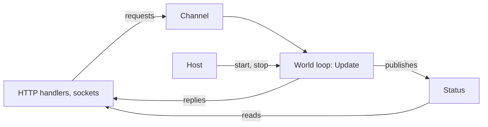

An ECS-powered game server, simulation or real-time backend can host EasyEcs in ASP.NET Core or a Worker Service:
request handlers, sockets and timers run on the thread pool,
while a world takes structural changes from one thread at a time. Give the world one owner, a hosted service that
builds it, runs its tick and saves it when the host stops, and let everything else talk to it through a channel.
EasyEcs provides the ECS world, not network transport or a complete application framework. It needs no hosting package
for this pattern: the host and channel are a few classes of your own.

## When to use it [#when-to-use-it]

<Callout type="idea" title="Use it for">
  A game server, simulation or matchmaker inside ASP.NET Core, a Worker Service or any app built on
  `Microsoft.Extensions.Hosting`, with HTTP endpoints, health checks and metrics next to the world.
</Callout>

<Callout type="warn" title="Skip it for">
  A console tool, a benchmark or a test: `new World()` and a loop are enough ([getting started](/en/docs/getting-started),
  [testing](/en/docs/guide/testing)). Do not share one world between request handlers behind a lock: a lock around
  every request serializes the server anyway, and reads without it race with the tick.
</Callout>

## How to use it [#how-to-use-it]

Everything that is not the world's owner reaches it through two doors: a channel of requests the tick drains, and an
immutable status the tick publishes.



### Give the world one owner [#owner]

One object owns the world, and only its loop touches it. A `PeriodicTimer` sets the tick; every `world.Update()`
runs all systems synchronously and returns before the next `await`.

```csharp
public sealed class WorldLoop(World world)
{
    private readonly World _world = world;

    public async Task RunAsync(CancellationToken stop)
    {
        using var timer = new PeriodicTimer(TimeSpan.FromMilliseconds(50));   // 20 ticks per second
        try
        {
            while (await timer.WaitForNextTickAsync(stop))
                _world.Update();
        }
        catch (OperationCanceledException)
        {
            // the host is stopping
        }
    }
}
```

After an `await`, the loop may resume on another thread-pool thread. That is allowed: the owner is whoever changes the
world, one at a time, and each `await` orders one tick after the other. Use a dedicated thread (`new Thread`, or
`Task.Factory.StartNew` with `TaskCreationOptions.LongRunning`) when the tick needs steadier timing than a busy thread
pool gives.

### A fixed step that catches up [#fixed-step]

A `PeriodicTimer` that falls behind (a garbage collection, a slow tick, a busy thread pool) does not queue the ticks it
missed: the next wait completes at once, and the rest are lost. When game time must follow wall time, as with
cooldowns in ticks or a `Clock` singleton with a fixed `DeltaTime`, accumulate the time that passed and run one
update per step of it. Cap the catch-up: each extra update takes time too, so a world that is slower than its tick
would fall further behind with every frame. Past the cap, drop the rest and log it:

```csharp
using System.Diagnostics;

public sealed class FixedStepLoop(World world)
{
    private static readonly TimeSpan Step = TimeSpan.FromMilliseconds(50);   // 20 ticks per second
    private const int MaxCatchUp = 4;                                         // updates per wake-up, at most

    private readonly World _world = world;

    public async Task RunAsync(CancellationToken stop)
    {
        using var timer = new PeriodicTimer(Step);
        long last = Stopwatch.GetTimestamp();
        var due = TimeSpan.Zero;
        try
        {
            while (await timer.WaitForNextTickAsync(stop))
            {
                long now = Stopwatch.GetTimestamp();
                due += Stopwatch.GetElapsedTime(last, now);
                last = now;

                int ran = 0;
                while (due >= Step && ran < MaxCatchUp)
                {
                    _world.Update();
                    due -= Step;
                    ran++;
                }

                if (due >= Step)
                {
                    // Too far behind: game time slows down instead of the server spiralling.
                    long dropped = due.Ticks / Step.Ticks;
                    Console.Error.WriteLine($"world behind: {dropped} ticks dropped");
                    due = TimeSpan.FromTicks(due.Ticks % Step.Ticks);
                }
            }
        }
        catch (OperationCanceledException)
        {
            // the host is stopping
        }
    }
}
```

Systems keep a fixed step (a `DeltaTime` in a singleton, or counts of ticks), so the same inputs give the same
result however the updates were spread over frames. The log line is the signal to look at
[`system.Stats`](/en/docs/guide/diagnostics#timing): a world that drops ticks often needs less work per tick, more
cores, or fewer entities per world.

### Flatten the spikes of large populations [#slices]

A system whose work per entity is heavy (a think step of an AI, a path request, a visibility scan) does not need to
run for every entity on every tick. `[ForEach(Slices = N)]` visits about one N-th of each matching table per run,
taking the next slice on the next run, so every entity is visited once every N updates and each tick pays a quarter
of the spike for `Slices = 4`:

```csharp
public record struct Wander(float TargetX, float TargetY) : IComponent;

[EcsSystem]
public ref struct ThinkSystem
{
    // 100,000 NPCs: a quarter of them think per tick, each one every fourth tick.
    [ForEach(Slices = 4)]
    static void Think(in Position position, in Wander wander, ref Velocity velocity)
    {
        float dx = wander.TargetX - position.X;
        float dy = wander.TargetY - position.Y;
        float length = MathF.Sqrt(dx * dx + dy * dy) + 0.001f;
        velocity.X = dx / length;
        velocity.Y = dy / length;
    }
}
```

Tables are cut at 64-row words and many small tables spread over the slices, so the work per tick stays even
without a round-robin of your own. With `[UpdateInterval(M)]` as well, each entity is visited once every N × M updates.
A slice is not exact under churn (an entity that moves between tables may be skipped or visited twice in one cycle),
and `[Changed<T>]` / `[Removed<T>]` methods cannot be sliced ([EECS035](/en/docs/guide/analyzer#eecs035)); the
rules are in [systems](/en/docs/guide/systems#update-interval).

### Start and stop with the host [#hosted-service]

A `BackgroundService` runs the loop for the life of the app. On Ctrl+C or `SIGTERM` the host cancels the token and
waits for `ExecuteAsync` to finish, up to `HostOptions.ShutdownTimeout` (30 seconds by default), so a final save
fits there.

```csharp tab="WorldService.cs" doccheck=skip
public sealed class WorldService(WorldLoop loop) : BackgroundService
{
    protected override Task ExecuteAsync(CancellationToken stoppingToken) => loop.RunAsync(stoppingToken);
}
```

```csharp tab="Program.cs" doccheck=skip
using EasyEcs;

var builder = Host.CreateApplicationBuilder(args);

var world = new World();
builder.Services.AddSingleton(new WorldLoop(world));
builder.Services.AddHostedService<WorldService>();

builder.Build().Run();
```

These two blocks are skipped by the docs' compile check only because it does not reference
`Microsoft.Extensions.Hosting`; in a Worker Service or ASP.NET Core project they build as they are.

An exception that leaves `Update()` (a system threw, under the default `SystemErrorPolicy.Throw`) ends `ExecuteAsync`,
and the host stops: the process fails fast and the platform restarts it. With
`new WorldOptions { SystemErrors = SystemErrorPolicy.Disable }` the failing system is switched off instead and the
tick goes on; report its `system.Error` from a health check ([errors](/en/docs/guide/systems#errors)).

### Hand requests to the world [#requests]

A request is a message, not a component. Handlers write it into a bounded `Channel<T>`; a system drains the channel at
the start of each tick and turns each message into data. A request that needs an answer carries a
`TaskCompletionSource<T>` the system completes:

```csharp
using System.Threading.Channels;

public readonly record struct SpawnRequest(float X, float Y, TaskCompletionSource<EntityId> Reply);

// The world's end of the channel: a singleton no save holds (a channel has no formatter).
[NotSaved]
public record struct SpawnInbox(ChannelReader<SpawnRequest> Requests) : ISingletonComponent;

[EcsSystem]
public ref struct ReceiveSpawns
{
    [OnUpdate]
    static void OnUpdate(World world)
    {
        var requests = world.SpawnInbox.Requests;
        while (requests.TryRead(out var request))
        {
            var unit = world.CreateEntity(new Position(request.X, request.Y));
            request.Reply.TrySetResult(unit.Id);                       // answer with an id, never a handle
        }
    }
}
```

Create each reply with `TaskCreationOptions.RunContinuationsAsynchronously`. Without it, `TrySetResult` runs the
handler's continuation inline, on the world's thread, in the middle of the tick. Answer with an `EntityId` or a copy
of the values: an `Entity` handle used by the handler later would touch the world from another thread.

Bound the channel (`Channel.CreateBounded`) so a world that falls behind slows its callers down
(`BoundedChannelFullMode.Wait`) or refuses them (`DropWrite`, `TryWrite` returning false) instead of growing without
limit. The [threading guide](/en/docs/guide/threading#input-from-other-threads) shows the same pattern with a plain
`ConcurrentQueue<T>`. The reader lives in a [`[NotSaved]`](/en/docs/guide/saves#not-saved) singleton the host sets:
no save writes it, so the channel needs no formatter, and a load keeps the world's own.

On shutdown, complete the writer (`requests.Writer.TryComplete()`) after the last tick, then answer what is still in
the channel. A handler that writes after that gets a `ChannelClosedException` at once instead of a reply that never
comes ([full example](#full-example), `Arena.RunAsync`).

A request about an entity that exists already carries its `EntityId`. The system finds the entity and runs a
[`[ForEntity]`](/en/docs/guide/queries#run-on-one-entity) method on it: one lookup for all the method's components, and
a filter that rules out a dead unit. The entry point returns `false` when the entity is gone, fails the filter or lacks
a component, which is the reply:

```csharp
using System.Threading.Channels;

public readonly record struct HealRequest(EntityId Unit, int Amount, TaskCompletionSource<bool> Reply);

public static class Heals
{
    [ForEntity, Without<Dead>]                                         // a dead unit is refused, as a pass skips it
    static void Heal(ref Health health, int amount) => health.Value += amount;
}

[NotSaved]
public record struct HealInbox(ChannelReader<HealRequest> Requests) : ISingletonComponent;   // its own channel

[EcsSystem]
public ref struct ReceiveHeals
{
    [OnUpdate]
    static void OnUpdate(World world)
    {
        var requests = world.HealInbox.Requests;
        while (requests.TryRead(out var request))
        {
            bool healed = world.TryGetEntity(request.Unit, out var unit)
                && Heals.Heal(unit, request.Amount);                       // false: gone, dead or no Health
            request.Reply.TrySetResult(healed);
        }
    }
}
```

### Let handlers read without a round trip [#reads]

Handlers never read the world directly: component values are not synchronized, and the tick moves and rewrites rows
while a handler would read them. Instead, a system copies what handlers may see into an immutable object and
publishes it with one atomic write; handlers read the latest copy without waiting for a tick:

```csharp
public sealed record ArenaStatus(long Tick, int Units);

public sealed class StatusBoard
{
    private ArenaStatus _current = new(Tick: 0, Units: 0);

    public ArenaStatus Current => Volatile.Read(ref _current);

    public void Publish(ArenaStatus status) => Volatile.Write(ref _current, status);
}

// The board, set by the host: a [NotSaved] singleton like the inbox.
[NotSaved]
public record struct Publisher(StatusBoard Board) : ISingletonComponent;

[EcsSystem, UpdateInterval(20)]                                        // once a second at 20 Hz
public ref struct PublishStatus
{
    [OnUpdate]
    static void OnUpdate(World world) =>
        world.Publisher.Board.Publish(new ArenaStatus(world.DefaultUpdateCount, world.Count<Position>()));
}
```

`UpdateInterval` keeps the copy (and its allocation) off most ticks. A read that must see the state of this very tick
goes through the channel as a request with a reply, like a write.

### Load at start, save at stop [#persistence]

Load the last save before the first tick, then add only the singletons the save did not hold: `Load` replaces the
world's singletons, and `AddSingleton` throws on one that was loaded. Save after the loop ends, into a temporary
file moved over the old one, so a crash during the write never leaves half a save. When systems save or replicate
`[Changed<T>]` rows, load with `markWritten: false`, so the first tick does not send the loaded world again
([restart](/en/docs/guide/saves#restart)):

```csharp
using Nino.Core;

public static class Persistence
{
    public static void LoadOrStart(World world, string path)
    {
        if (File.Exists(path))
            world.Load(File.ReadAllBytes(path));
        if (!world.HasClock)
            world.AddSingleton<Clock>();
    }

    public static void Save(World world, string path)
    {
        var output = new NinoArrayBufferWriter();
        world.Save(output);
        File.WriteAllBytes(path + ".tmp", output.WrittenSpan);
        File.Move(path + ".tmp", path, overwrite: true);
    }
}

public record struct Clock(long Tick) : ISingletonComponent;
```

For autosaves while the server runs, call `Save` on the owner between two ticks, then hand the bytes to another thread
for the disk write: the world is only needed while it encodes. What a save holds and what survives a code change are
in [saves](/en/docs/guide/saves#versioning).

A restart (a deploy, a rolling update) resumes the game but not the process: the new process has its own
configuration, and connections did not survive. Save without what belongs to the process, and load while keeping
the configuration the new process set:

```csharp
using Nino.Core;

public record struct ServerConfig(int MaxPlayers) : ISingletonComponent;   // from this process's settings
public record struct Session(int Socket) : IComponent;                     // a connection: gone with the process

public static class Restart
{
    // What belongs to the process, not to the game.
    private static readonly ComponentSet Runtime = ComponentSet.Create().WithSingleton<ServerConfig>().With<Session>();
    private static readonly ComponentSet Configuration = ComponentSet.Create().WithSingleton<ServerConfig>();

    public static void Save(World world, NinoArrayBufferWriter output) => world.SaveWithout(output, in Runtime);

    public static void Resume(World world, ReadOnlySpan<byte> save, int maxPlayers)
    {
        world.SetServerConfig(maxPlayers);                        // this process's configuration
        world.LoadKeeping(save, in Configuration, markWritten: false);   // the game as saved, the configuration kept
    }
}
```

`Load` keeps the singletons in the set exactly as the world holds them, and `markWritten: false` keeps the first tick
from replicating or saving the whole world again ([restart](/en/docs/guide/saves#restart)).

### Several worlds, health and metrics [#operations]

- **Several worlds:** one loop per world, each its own owner (one hosted service per zone, or one service that starts
  a loop per world). They share nothing, so they need no locks
  ([one world per thread](/en/docs/guide/threading#recommended-one-world-per-thread)). Lower
  `WorldOptions.MaxDegreeOfParallelism` when `ParallelSystems` worlds and Kestrel share the cores.
- **Metrics:** with `WorldOptions.MeasureSystems`, read `system.Stats` (`LastTime`, `LastAllocated`, `LastEntities` and
  their totals) for each system of `world.Systems` on the loop, between two updates, and publish a copy: as a status,
  or as a `Meter` that OpenTelemetry collects ([metrics](/en/docs/guide/diagnostics#metrics)). Log
  `world.DescribeSchedule()` once at startup, so each deployment's log says which systems ran together
  ([schedule](/en/docs/guide/diagnostics#schedule)).
- **Memory after a peak:** a world keeps the rows of its largest wave. After a match ends, or from a maintenance
  timer when `world.EntityCount` is well below its peak, call `world.TrimExcess()` on the loop between two updates:
  it drops the empty tables and shrinks the others ([give memory back](/en/docs/guide/diagnostics#trim)). Not every
  tick: what it drops is allocated again by the next wave.
- **Health:** under `SystemErrorPolicy.Disable`, a system with a non-null `Error` is switched off; publish that list
  and let the health check report it.

### Deploy [#deploy]

- **Native AOT:** `<PublishAot>true</PublishAot>` publishes the world and its systems as a native executable:
  `EasyEcs.Core` is marked `IsAotCompatible` and the generated code calls your methods directly, and the publish has no
  warnings. Add `<IlcInstructionSet>native</IlcInstructionSet>` (or a level such as `x86-64-v4`): the default baseline
  compiles out the `Vector512` tier of the generated vector loops ([FAQ](/en/docs/faq#native-aot)). ASP.NET Core has AOT rules of its own (`WebApplication.CreateSlimBuilder`, JSON
  source generation): see Microsoft's
  [Native AOT guide for ASP.NET Core](https://learn.microsoft.com/aspnet/core/fundamentals/native-aot).
- **Containers:** `docker stop` and Kubernetes send `SIGTERM`, which the host turns into the shutdown above. Give the
  container a grace period longer than the final save.
- **No IO in systems:** a system that awaits or blocks stalls the whole tick. Systems hand IO out as data (a request
  in a queue, bytes in an outbox) and the host does it outside `Update()`.

## Full example [#full-example]

An ASP.NET Core server with one arena: `POST /units` spawns a unit and answers with its id, `GET /status` reads the
copy the world publishes once a second, and the world is saved on shutdown and loaded on the next start. Create it
with `dotnet new web -n Arena`, add `dotnet add package EasyEcs`, and replace `Program.cs` with these files.

<Accordions>
<Accordion title="Components.cs">

```csharp title="Components.cs" doccheck=example
using EasyEcs;

public record struct Position(float X, float Y) : IComponent;

public record struct Velocity(float X, float Y) : IComponent;

// The tick and its length, kept in the world: systems read it and a save keeps it.
public record struct Clock(long Tick, float DeltaTime) : ISingletonComponent;
```

</Accordion>
<Accordion title="Messages.cs">

```csharp title="Messages.cs" doccheck=example
using EasyEcs;

// What a request handler asks of the world: a message, not a component.
// The world's thread answers through Reply.
public readonly record struct SpawnRequest(float X, float Y, TaskCompletionSource<EntityId> Reply);

// What request handlers read: an immutable copy the world's thread publishes.
public sealed record ArenaStatus(long Tick, int Units);

// The world's ends of the two: singletons no save holds (a channel and a board have no formatter),
// and that a load leaves as the host set them.
[NotSaved]
public record struct SpawnInbox(ChannelReader<SpawnRequest> Requests) : ISingletonComponent;

[NotSaved]
public record struct Publisher(StatusBoard Board) : ISingletonComponent;

// The one object both sides share: the world's thread writes it, any thread reads it.
public sealed class StatusBoard
{
    private ArenaStatus _current = new(Tick: 0, Units: 0);

    public ArenaStatus Current => Volatile.Read(ref _current);

    public void Publish(ArenaStatus status) => Volatile.Write(ref _current, status);
}
```

</Accordion>
<Accordion title="Systems.cs">

```csharp title="Systems.cs" doccheck=example
using System.Threading.Channels;
using EasyEcs;

// Turns the requests that arrived since the last tick into units, on the world's thread.
[EcsSystem]
public ref struct ReceiveSpawns
{
    [OnUpdate]
    static void OnUpdate(World world)
    {
        var requests = world.SpawnInbox.Requests;
        while (requests.TryRead(out var request))
        {
            var unit = world.CreateEntity(new Position(request.X, request.Y), new Velocity(1, 0));
            request.Reply.TrySetResult(unit.Id);
        }
    }
}

[EcsSystem]
public ref struct MovementSystem
{
    [ForEach]
    static void Move(ref Position position, in Velocity velocity, in Clock clock)
    {
        position.X += velocity.X * clock.DeltaTime;
        position.Y += velocity.Y * clock.DeltaTime;
    }
}

[EcsSystem]
public ref struct ClockSystem
{
    [OnUpdate]
    static void OnUpdate(World world) => world.Clock.Tick++;
}

// Copies what request handlers may read, once a second at 20 ticks per second.
[EcsSystem, UpdateInterval(20)]
public ref struct PublishStatus
{
    [OnUpdate]
    static void OnUpdate(World world)
    {
        world.Publisher.Board.Publish(new ArenaStatus(world.Clock.Tick, world.Count<Position>()));
    }
}
```

</Accordion>
<Accordion title="Arena.cs">

```csharp title="Arena.cs" doccheck=example
using Nino.Core;
using System.Threading.Channels;
using EasyEcs;

// Owns the world: builds it, loads the last save, runs the tick, saves on the way out.
// Only RunAsync touches the world, one tick after another: that makes it the owner.
public sealed class Arena : IDisposable
{
    public const int TicksPerSecond = 20;

    private readonly World _world = new();
    private readonly Channel<SpawnRequest> _requests;
    private readonly string _savePath;

    public Arena(Channel<SpawnRequest> requests, StatusBoard board, string savePath)
    {
        _requests = requests;
        _savePath = savePath;

        // Load replaces entities, components and singletons; systems are not saved.
        if (File.Exists(savePath))
        {
            _world.Load(File.ReadAllBytes(savePath));
        }

        if (!_world.HasClock)
        {
            _world.SetClock(Tick: 0, DeltaTime: 1f / TicksPerSecond);
        }

        // The world's connections to the handlers: [NotSaved], so a load keeps them.
        _world.SetSpawnInbox(requests.Reader);
        _world.SetPublisher(board);

        // Registration order is the tick's order.
        _world.AddSystem<ReceiveSpawns>();
        _world.AddSystem<MovementSystem>();
        _world.AddSystem<ClockSystem>();
        _world.AddSystem<PublishStatus>();
    }

    public async Task RunAsync(CancellationToken stop)
    {
        using var timer = new PeriodicTimer(TimeSpan.FromSeconds(1.0 / TicksPerSecond));
        try
        {
            // Each tick may resume on another thread-pool thread: still one at a time.
            while (await timer.WaitForNextTickAsync(stop))
            {
                _world.Update();
            }
        }
        catch (OperationCanceledException)
        {
            // The host is stopping.
        }

        // No more requests: a handler that writes now gets ChannelClosedException at once.
        _requests.Writer.TryComplete();

        // Requests that arrived too late get an answer too.
        while (_requests.Reader.TryRead(out var late))
        {
            late.Reply.TrySetCanceled();
        }

        Save();
    }

    private void Save()
    {
        var output = new NinoArrayBufferWriter();
        _world.Save(output);

        // Write a temporary file and move it over the old save: a crash never leaves half a save.
        string temporary = _savePath + ".tmp";
        File.WriteAllBytes(temporary, output.WrittenSpan);
        File.Move(temporary, _savePath, overwrite: true);
    }

    public void Dispose() => _world.Dispose();
}
```

</Accordion>
<Accordion title="ArenaService.cs">

```csharp title="ArenaService.cs" doccheck=skip
// The host starts the loop with the app and cancels it on shutdown (Ctrl+C, SIGTERM).
public sealed class ArenaService(Arena arena) : BackgroundService
{
    protected override Task ExecuteAsync(CancellationToken stoppingToken) => arena.RunAsync(stoppingToken);
}
```

</Accordion>
<Accordion title="Program.cs">

```csharp title="Program.cs" doccheck=skip
using System.Threading.Channels;
using EasyEcs;

var builder = WebApplication.CreateBuilder(args);

// Bounded: when the world falls behind, handlers wait instead of filling memory.
var requests = Channel.CreateBounded<SpawnRequest>(
    new BoundedChannelOptions(1024) { SingleReader = true, FullMode = BoundedChannelFullMode.Wait });
var board = new StatusBoard();

builder.Services.AddSingleton(board);
builder.Services.AddSingleton(new Arena(requests, board, savePath: "arena.sav"));
builder.Services.AddHostedService<ArenaService>();

var app = builder.Build();

// A write: hand it to the world's thread and wait for its answer.
app.MapPost("/units", async (float x, float y, CancellationToken aborted) =>
{
    // RunContinuationsAsynchronously: this handler resumes on the thread pool,
    // never inside the world's tick.
    var reply = new TaskCompletionSource<EntityId>(TaskCreationOptions.RunContinuationsAsynchronously);
    await requests.Writer.WriteAsync(new SpawnRequest(x, y, reply), aborted);
    EntityId id = await reply.Task.WaitAsync(aborted);
    return new { id.Index, id.Version };
});

// A read: the copy the world published, no trip to its thread.
app.MapGet("/status", (StatusBoard status) => status.Current);

app.Run();
```

</Accordion>
</Accordions>

Run it with `dotnet run --urls http://localhost:5000`. In a second terminal, spawn two units and read the status;
then stop the server with Ctrl+C, start it again, and repeat:

```text
$ curl -X POST "localhost:5000/units?x=0&y=0"
{"index":0,"version":1}
$ curl -X POST "localhost:5000/units?x=5&y=5"
{"index":1,"version":1}
$ curl localhost:5000/status
{"tick":60,"units":2}

$ curl -X POST "localhost:5000/units?x=0&y=0"
{"index":2,"version":1}
$ curl -X POST "localhost:5000/units?x=5&y=5"
{"index":3,"version":1}
$ curl localhost:5000/status
{"tick":125,"units":4}
```

The second run starts from the save: the two units of the first run are still there (four units in all), new ids
continue after theirs, and the clock goes on from where it stopped instead of starting at zero. The status is at most
a second old, and reading it never waits for the world.

## How to use it fast [#how-to-use-it-fast]

| Instead of | Do | Why |
| --- | --- | --- |
| A lock around the world for every request | A channel the tick drains | One owner, no lock on the tick |
| A request per read | A status the tick publishes | Reads cost a volatile load, not a tick of latency |
| Publishing every tick | `UpdateInterval` on the publishing system | The copy is made only when it is due |
| Writing the save file on the tick | `Save` on the owner, the file write on another thread | The tick waits for encoding only |
| One world for every zone | One world and loop per zone | Worlds share nothing and scale across cores |
| A heavy system over every entity every tick | `[ForEach(Slices = N)]` | Each tick pays about 1 / N of the work |
| A timer that silently skips ticks | A fixed step with a catch-up cap | Game time follows wall time; overload is logged |

The tick itself is the cost that matters. A world of 100,000 entities updates in <BenchValue k="tick.oneWorld" /> per
tick, allocating <BenchValue k="tick.oneWorld.alloc" /> (`WorldSimulationBenchmark`), so a 20 Hz tick leaves the
rest of each 50 ms to request handlers.

<BenchSource />

## What it costs [#what-it-costs]

- **The loop:** one timer and one `Update()` per tick; nothing allocated by EasyEcs.
- **A request:** a channel write and read, plus the reply's `TaskCompletionSource` (allocated per request, on the
  handler's side).
- **A status:** one immutable object per publish, read with a volatile load.
- **Shutdown:** one `Save` and one file write, within `HostOptions.ShutdownTimeout`.
- **A fixed step:** two timestamp reads per wake-up; the updates it catches up are ordinary updates.
- **Maintenance:** `TrimExcess` is cold and allocates; run it at a quiet moment, not on a schedule shorter than the
  waves it gives memory back from.

## Pitfalls [#pitfalls]

| Mistake | What happens | Caught by |
| --- | --- | --- |
| A handler calls `world.CreateEntity` or `entity.Set` | Two threads change one world | [EECS014](/en/docs/guide/analyzer#eecs014) for lambdas handed to `Task.Run` and the like; the runtime when two changes collide; otherwise nothing |
| A handler reads components directly | Values torn or stale while the tick moves rows | Nothing: publish a copy |
| A reply without `RunContinuationsAsynchronously` | The handler runs inside the tick, on the world's thread | Code review |
| Replying with an `Entity` handle | The handler later touches the world from its own thread | Reply with an `EntityId` or copied values |
| `AddSingleton` after `Load` | `InvalidOperationException`: the save held the singleton | Check `HasSingleton<T>()` (or the generated `HasX`) first |
| An unbounded channel | A world that falls behind fills memory | Use `Channel.CreateBounded` |
| The channel left open on shutdown | A handler that writes after the last drain, or waits on a full channel, never gets its reply | `requests.Writer.TryComplete()` after the last tick, then answer what is left |
| `await` or blocking IO in a system | The whole tick waits | Hand the IO to the host as data |
| Catching up every missed tick | A slow world falls further behind with each frame | Cap the catch-up and log the dropped ticks |
| `TrimExcess()` every tick | Tables dropped and rebuilt, allocations on the tick | A maintenance task after a peak |
| Saving the process's configuration with the game | The new process starts with the old settings | `SaveWithout(output, in exclude)`, then `LoadKeeping(input, in keep)` |

## Related [#related]

<Cards>
  <Card title="Threading" href="/en/docs/guide/threading">
    The owner thread, input from other threads and parallel systems.
  </Card>
  <Card title="Saves" href="/en/docs/guide/saves">
    What `Save` writes, and which code changes a save survives.
  </Card>
  <Card title="Testing systems" href="/en/docs/guide/testing">
    The same world, built in a test and checked after one update.
  </Card>
  <Card title="Sample: GameLoop" href="https://github.com/JasonXuDeveloper/EasyEcs/tree/master/samples/GameLoop">
    A fixed tick, a mailbox from a network thread and replication of what changed.
  </Card>
</Cards>
