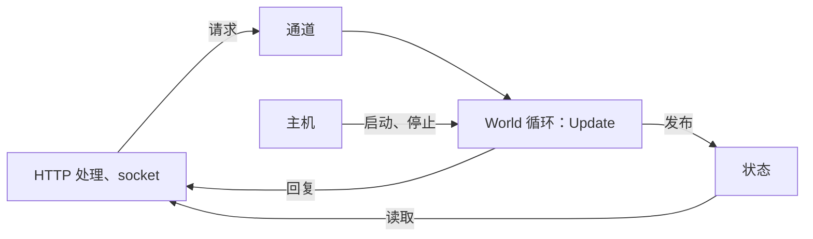

游戏服务端、模拟程序或实时后端可以把 EasyEcs 托管在 ASP.NET Core 或 Worker Service：请求处理、socket、定时器都跑在线程池上，
而一个 World 同一时刻只接受一个线程的结构变更。给 World 指定唯一的所有者：一个托管服务（hosted service）负责建 World、跑 tick、
主机停止时存档；其他代码都通过
通道（channel）和它打交道。EasyEcs 提供 ECS World，不提供网络传输或完整的应用框架。这个模式不需要专门的托管包：
主机和通道就是你自己的几个类。

## 什么时候用 [#when-to-use-it]

<Callout type="idea" title="适合">
  跑在 ASP.NET Core、Worker Service 或任何基于 `Microsoft.Extensions.Hosting` 的应用里的游戏服务器、模拟或匹配服务，旁边还有
  HTTP 接口、健康检查和指标。
</Callout>

<Callout type="warn" title="不适合">
  控制台工具、基准测试或单元测试：`new World()` 加一个循环就够了（[快速开始](/zh/docs/getting-started)、
  [测试系统](/zh/docs/guide/testing)）。也不要用锁让请求处理共享一个 World：每个请求都加锁，服务器照样被串行化；不加锁去读，又会和
  tick 竞争。
</Callout>

## 怎么用 [#how-to-use-it]

World 的所有者之外，一切都只走两扇门：tick 消费的请求通道，以及 tick 发布的不可变状态。



### 给 World 指定一个所有者 [#owner]

一个对象拥有 World，只有它的循环碰 World。`PeriodicTimer` 决定 tick 节奏；每次 `world.Update()` 同步跑完所有系统，在下一次
`await` 之前返回。

```csharp
public sealed class WorldLoop(World world)
{
    private readonly World _world = world;

    public async Task RunAsync(CancellationToken stop)
    {
        using var timer = new PeriodicTimer(TimeSpan.FromMilliseconds(50));   // 每秒 20 个 tick
        try
        {
            while (await timer.WaitForNextTickAsync(stop))
                _world.Update();
        }
        catch (OperationCanceledException)
        {
            // 主机正在停止
        }
    }
}
```

`await` 之后，循环可能在另一个线程池线程上继续。这是允许的：所有者指的是“同一时刻只有一个改动 World 的人”，每次 `await` 都把
前后两个 tick 排好了先后。tick 需要比繁忙的线程池更稳定的节奏时，改用专用线程（`new Thread`，或带
`TaskCreationOptions.LongRunning` 的 `Task.Factory.StartNew`）。

### 固定步长与追帧 [#fixed-step]

`PeriodicTimer` 落后了（一次 GC、一个慢 tick、线程池太忙），错过的 tick 不会排队补上：下一次等待立刻返回，其余的就没了。如果
游戏时间必须跟着墙上时间走，比如按 tick 计的冷却，或者 `Clock` 单例里固定的 `DeltaTime`，就把流逝的时间累加起来，每够一个步长
跑一次更新。追帧要设上限：多跑的每次更新也要花时间，World 本来就比 tick 慢的话，每一帧都会落后得更多。超过上限就把剩下的丢掉，
记一行日志：

```csharp
using System.Diagnostics;

public sealed class FixedStepLoop(World world)
{
    private static readonly TimeSpan Step = TimeSpan.FromMilliseconds(50);   // 每秒 20 个 tick
    private const int MaxCatchUp = 4;                                         // 每次唤醒最多跑几次更新

    private readonly World _world = world;

    public async Task RunAsync(CancellationToken stop)
    {
        using var timer = new PeriodicTimer(Step);
        long last = Stopwatch.GetTimestamp();
        var due = TimeSpan.Zero;
        try
        {
            while (await timer.WaitForNextTickAsync(stop))
            {
                long now = Stopwatch.GetTimestamp();
                due += Stopwatch.GetElapsedTime(last, now);
                last = now;

                int ran = 0;
                while (due >= Step && ran < MaxCatchUp)
                {
                    _world.Update();
                    due -= Step;
                    ran++;
                }

                if (due >= Step)
                {
                    // 落后太多：让游戏时间变慢，而不是让服务器越追越慢。
                    long dropped = due.Ticks / Step.Ticks;
                    Console.Error.WriteLine($"world behind: {dropped} ticks dropped");
                    due = TimeSpan.FromTicks(due.Ticks % Step.Ticks);
                }
            }
        }
        catch (OperationCanceledException)
        {
            // 宿主正在停止
        }
    }
}
```

系统保持固定步长（单例里的 `DeltaTime`，或者按 tick 计数），所以同样的输入不管更新怎么分布在各帧里，结果都一样。那行日志就是
该去看 [`system.Stats`](/zh/docs/guide/diagnostics#timing) 的信号：经常丢 tick 的 World，要么每个 tick 的活要减，要么要更多核，
要么每个 World 的实体要少一些。

### 摊平大量实体带来的峰值 [#slices]

每个实体活很重的系统（AI 的思考、寻路请求、视野扫描），不必每个 tick 对每个实体都跑一遍。`[ForEach(Slices = N)]` 每次运行只访问
每张匹配表的大约 N 分之一，下一次运行接着访问下一片，所以每个实体每 N 次更新被访问一次；`Slices = 4` 时每个 tick 只付四分之一的
峰值：

```csharp
public record struct Wander(float TargetX, float TargetY) : IComponent;

[EcsSystem]
public ref struct ThinkSystem
{
    // 100,000 个 NPC：每个 tick 四分之一在思考，每个 NPC 每四个 tick 思考一次。
    [ForEach(Slices = 4)]
    static void Think(in Position position, in Wander wander, ref Velocity velocity)
    {
        float dx = wander.TargetX - position.X;
        float dy = wander.TargetY - position.Y;
        float length = MathF.Sqrt(dx * dx + dy * dy) + 0.001f;
        velocity.X = dx / length;
        velocity.Y = dy / length;
    }
}
```

表按 64 行的字切开，很多小表也会分散到各片里，不用自己写轮转，每个 tick 的工作量就是均匀的。再加上 `[UpdateInterval(M)]`，每个
实体每 N × M 次更新被访问一次。实体频繁变动时分片不是精确的（在表之间移动的实体，一轮里可能被跳过或访问两次）；
`[Changed<T>]` / `[Removed<T>]` 方法不能分片（[EECS035](/zh/docs/guide/analyzer#eecs035)）。规则见[系统](/zh/docs/guide/systems#update-interval)。

### 跟随主机启动和停止 [#hosted-service]

`BackgroundService` 在应用的整个生命周期里跑这个循环。收到 Ctrl+C 或 `SIGTERM` 时，主机取消令牌，并等待 `ExecuteAsync` 结束，
最长 `HostOptions.ShutdownTimeout`（默认 30 秒），最后一次存档就在这段时间里完成。

```csharp tab="WorldService.cs" doccheck=skip
public sealed class WorldService(WorldLoop loop) : BackgroundService
{
    protected override Task ExecuteAsync(CancellationToken stoppingToken) => loop.RunAsync(stoppingToken);
}
```

```csharp tab="Program.cs" doccheck=skip
using EasyEcs;

var builder = Host.CreateApplicationBuilder(args);

var world = new World();
builder.Services.AddSingleton(new WorldLoop(world));
builder.Services.AddHostedService<WorldService>();

builder.Build().Run();
```

文档的编译检查跳过这两段，只是因为它没有引用 `Microsoft.Extensions.Hosting`；放进 Worker Service 或 ASP.NET Core 项目里可以直接编译。

异常一旦离开 `Update()`（默认的 `SystemErrorPolicy.Throw` 下某个系统抛了异常），`ExecuteAsync` 就结束，主机随之停止：进程快速
失败，由平台重启。设置 `new WorldOptions { SystemErrors = SystemErrorPolicy.Disable }` 后，出错的系统被关掉，tick 继续；在健康
检查里报告它的 `system.Error`（[错误](/zh/docs/guide/systems#errors)）。

### 把请求交给 World [#requests]

请求是消息，不是组件。处理代码把它写进有界的 `Channel<T>`；一个系统在每个 tick 开头把通道读空，把每条消息变成数据。需要回复的
请求带一个 `TaskCompletionSource<T>`，由系统完成：

```csharp
using System.Threading.Channels;

public readonly record struct SpawnRequest(float X, float Y, TaskCompletionSource<EntityId> Reply);

// World 这一端的通道：存档不会写它的单例（通道没有格式化器）。
[NotSaved]
public record struct SpawnInbox(ChannelReader<SpawnRequest> Requests) : ISingletonComponent;

[EcsSystem]
public ref struct ReceiveSpawns
{
    static void OnUpdate(World world)
    {
        var requests = world.SpawnInbox.Requests;
        while (requests.TryRead(out var request))
        {
            var unit = world.CreateEntity(new Position(request.X, request.Y));
            request.Reply.TrySetResult(unit.Id);                       // 回复 id，不回复句柄
        }
    }
}
```

每个回复都用 `TaskCreationOptions.RunContinuationsAsynchronously` 创建。不加的话，`TrySetResult` 会就地执行处理代码的后续部分：
在 World 的线程上，在 tick 的中间。回复 `EntityId` 或值的拷贝：处理代码拿着 `Entity` 句柄稍后再用，就是从另一个线程碰 World。

通道要有界（`Channel.CreateBounded`）：World 跟不上时，让调用方等待（`BoundedChannelFullMode.Wait`）或被拒绝（`DropWrite`、
`TryWrite` 返回 false），而不是无限增长。[多线程与并行](/zh/docs/guide/threading#input-from-other-threads)一页用普通的
`ConcurrentQueue<T>` 展示了同样的做法。读取端放进宿主设置的 [`[NotSaved]`](/zh/docs/guide/saves#not-saved) 单例：
存档不会写它，所以通道不需要格式化器，读档也保留 World 自己的值。

停机时，在最后一个 tick 之后完成写入端（`requests.Writer.TryComplete()`），再答复通道里剩下的请求。之后再写入的处理代码会立刻
拿到 `ChannelClosedException`，而不是等一个永远不来的答复（见[完整例子](#full-example)的 `Arena.RunAsync`）。

针对已有实体的请求带上它的 `EntityId`。系统找到这个实体，在它上面跑一个
[`[ForEntity]`](/zh/docs/guide/queries#run-on-one-entity) 方法：方法的所有组件只查找一次，再用过滤条件排除死掉的单位。实体已经不在、
过滤条件不通过或者缺组件时，入口方法返回 `false`，这正好就是答复：

```csharp
using System.Threading.Channels;

public readonly record struct HealRequest(EntityId Unit, int Amount, TaskCompletionSource<bool> Reply);

public static class Heals
{
    [ForEntity, Without<Dead>]                                         // 死掉的单位被拒绝，就像遍历会跳过它
    static void Heal(ref Health health, int amount) => health.Value += amount;
}

[NotSaved]
public record struct HealInbox(ChannelReader<HealRequest> Requests) : ISingletonComponent;   // 它自己的通道

[EcsSystem]
public ref struct ReceiveHeals
{
    static void OnUpdate(World world)
    {
        var requests = world.HealInbox.Requests;
        while (requests.TryRead(out var request))
        {
            bool healed = world.TryGetEntity(request.Unit, out var unit)
                && Heals.Heal(unit, request.Amount);                       // false：不在了、死了或没有 Health
            request.Reply.TrySetResult(healed);
        }
    }
}
```

### 读取不必绕一圈 [#reads]

处理代码从不直接读 World：组件值不做同步，处理代码读的时候，tick 可能正在搬动、改写这些行。改由一个系统把允许外部看到的内容拷进
一个不可变对象，用一次原子写发布出去；处理代码读最新的拷贝，不用等 tick：

```csharp
public sealed record ArenaStatus(long Tick, int Units);

public sealed class StatusBoard
{
    private ArenaStatus _current = new(Tick: 0, Units: 0);

    public ArenaStatus Current => Volatile.Read(ref _current);

    public void Publish(ArenaStatus status) => Volatile.Write(ref _current, status);
}

// 宿主设置的看板：和收件箱一样是 [NotSaved] 单例。
[NotSaved]
public record struct Publisher(StatusBoard Board) : ISingletonComponent;

[EcsSystem, UpdateInterval(20)]                                        // 20 Hz 下每秒一次
public ref struct PublishStatus
{
    static void OnUpdate(World world) =>
        world.Publisher.Board.Publish(new ArenaStatus(world.DefaultUpdateCount, world.Count<Position>()));
}
```

`UpdateInterval` 让拷贝（和它的分配）不出现在大多数 tick 上。必须看到本 tick 状态的读取，就和写一样，作为带回复的请求走通道。

### 启动时加载，停止时存档 [#persistence]

第一个 tick 之前加载上一次的存档，然后只补上存档里没有的单例：`Load` 会替换 World 的单例，对刚加载的单例调用 `AddSingleton` 会抛异常。
循环结束后存档，先写临时文件再覆盖旧文件，写到一半崩溃也不会留下半个存档。如果有系统按 `[Changed<T>]` 存档或同步，
读档时传 `markWritten: false`，第一个 tick 就不会把读进来的 World 再发一遍（[重启](/zh/docs/guide/saves#restart)）：

```csharp
using Nino.Core;

public static class Persistence
{
    public static void LoadOrStart(World world, string path)
    {
        if (File.Exists(path))
            world.Load(File.ReadAllBytes(path));
        if (!world.HasClock)
            world.AddSingleton<Clock>();
    }

    public static void Save(World world, string path)
    {
        var output = new NinoArrayBufferWriter();
        world.Save(output);
        File.WriteAllBytes(path + ".tmp", output.WrittenSpan);
        File.Move(path + ".tmp", path, overwrite: true);
    }
}

public record struct Clock(long Tick) : ISingletonComponent;
```

服务器运行中的自动存档：在所有者线程上、两个 tick 之间调用 `Save`，再把字节交给另一个线程写盘：只有编码时才需要 World。存档包含
什么、代码改了之后哪些还能加载，见[存档](/zh/docs/guide/saves#versioning)。

重启（发版、滚动更新）延续的是游戏，不是进程：新进程有自己的配置，连接也活不过重启。存档时去掉属于进程的东西，加载时保留新进程
设好的配置：

```csharp
using Nino.Core;

public record struct ServerConfig(int MaxPlayers) : ISingletonComponent;   // 来自这个进程的配置
public record struct Session(int Socket) : IComponent;                     // 一个连接：进程没了它就没了

public static class Restart
{
    // 属于进程、不属于游戏的数据。
    private static readonly ComponentSet Runtime = ComponentSet.Create().WithSingleton<ServerConfig>().With<Session>();
    private static readonly ComponentSet Configuration = ComponentSet.Create().WithSingleton<ServerConfig>();

    public static void Save(World world, NinoArrayBufferWriter output) => world.SaveWithout(output, in Runtime);

    public static void Resume(World world, ReadOnlySpan<byte> save, int maxPlayers)
    {
        world.SetServerConfig(maxPlayers);                        // 这个进程的配置
        world.LoadKeeping(save, in Configuration, markWritten: false);   // 游戏按存档恢复，配置保留
    }
}
```

`Load` 会让集合里的单例保持 World 现有的样子，`markWritten: false` 让第一个 tick 不会把整个 World 再复制或存一遍
（[重启](/zh/docs/guide/saves#restart)）。

### 多个 World、健康检查和指标 [#operations]

- **多个 World：**每个 World 一个循环，各自是所有者（每个区域一个托管服务，或一个服务为每个 World 启动一个循环）。它们什么都不共享，
  不需要锁（[每线程一个 World](/zh/docs/guide/threading#recommended-one-world-per-thread)）。开了 `ParallelSystems` 的 World
  和 Kestrel 共用核心时，调低 `WorldOptions.MaxDegreeOfParallelism`。
- **指标：**开启 `WorldOptions.MeasureSystems` 后，在循环里、两次更新之间，读 `world.Systems` 中每个系统的 `system.Stats`
  （`LastTime`、`LastAllocated`、`LastEntities` 和它们的累计值），发布一份拷贝：随状态一起发布，或者做成一个 `Meter` 交给
  OpenTelemetry 采集（[指标](/zh/docs/guide/diagnostics#metrics)）。启动时把 `world.DescribeSchedule()` 写一次日志，每次部署的
  日志里就记着哪些系统一起跑（[调度](/zh/docs/guide/diagnostics#schedule)）。
- **高峰过后的内存：**World 会留着最大那一波实体的行。一局比赛结束后，或者维护定时器发现 `world.EntityCount` 远低于峰值时，在循环里、
  两次更新之间调 `world.TrimExcess()`：它丢掉空表，缩小其余的表（[还回内存](/zh/docs/guide/diagnostics#trim)）。别每个 tick 都调：
  它丢掉的东西，下一波实体还要再分配。
- **健康检查：**`SystemErrorPolicy.Disable` 下，`Error` 不为 null 的系统已被关掉；把这份列表发布出去，交给健康检查报告。

### 部署 [#deploy]

- **Native AOT：**`<PublishAot>true</PublishAot>` 把 World 和系统发布成原生可执行文件：`EasyEcs.Core` 标记了
  `IsAotCompatible`，生成的代码直接调用你的方法，发布没有警告。再加上 `<IlcInstructionSet>native</IlcInstructionSet>`（或 `x86-64-v4` 这样的级别）：默认的基线会把生成的向量循环里 `Vector512` 那一档编译掉（[FAQ](/zh/docs/faq#native-aot)）。ASP.NET
  Core 有自己的 AOT 规则（`WebApplication.CreateSlimBuilder`、JSON 源生成）：见微软的
  [ASP.NET Core Native AOT 指南](https://learn.microsoft.com/aspnet/core/fundamentals/native-aot)。
- **容器：**`docker stop` 和 Kubernetes 发送 `SIGTERM`，主机把它变成上面的停机流程。容器的宽限期要比最后一次存档长。
- **系统里不做 IO：**系统里 await 或阻塞，会卡住整个 tick。系统把 IO 作为数据交出去（队列里的请求、发件箱里的字节），由主机在
  `Update()` 之外完成。

## 完整例子 [#full-example]

一个带竞技场的 ASP.NET Core 服务器：`POST /units` 生成一个单位并回复它的 id，`GET /status` 读取 World 每秒发布一次的拷贝；停机时
存档，下次启动时加载。用 `dotnet new web -n Arena` 创建项目，执行 `dotnet add package EasyEcs`，用下面这些文件替换 `Program.cs`。

<Accordions>
<Accordion title="Components.cs">

```csharp title="Components.cs" doccheck=example
using EasyEcs;

public record struct Position(float X, float Y) : IComponent;

public record struct Velocity(float X, float Y) : IComponent;

// tick 和它的时长放在 World 里：系统读得到，存档也会保留。
public record struct Clock(long Tick, float DeltaTime) : ISingletonComponent;
```

</Accordion>
<Accordion title="Messages.cs">

```csharp title="Messages.cs" doccheck=example
using EasyEcs;

// 请求处理代码要 World 做的事：是消息，不是组件。
// World 的线程通过 Reply 回复。
public readonly record struct SpawnRequest(float X, float Y, TaskCompletionSource<EntityId> Reply);

// 请求处理代码读取的内容：World 的线程发布的不可变拷贝。
public sealed record ArenaStatus(long Tick, int Units);

// 两者在 World 这一端：存档不会写的单例（通道和看板都没有格式化器），读档也保持宿主设置的值。
[NotSaved]
public record struct SpawnInbox(ChannelReader<SpawnRequest> Requests) : ISingletonComponent;

[NotSaved]
public record struct Publisher(StatusBoard Board) : ISingletonComponent;

// 双方唯一共享的对象：World 的线程写，任何线程都可以读。
public sealed class StatusBoard
{
    private ArenaStatus _current = new(Tick: 0, Units: 0);

    public ArenaStatus Current => Volatile.Read(ref _current);

    public void Publish(ArenaStatus status) => Volatile.Write(ref _current, status);
}
```

</Accordion>
<Accordion title="Systems.cs">

```csharp title="Systems.cs" doccheck=example
using System.Threading.Channels;
using EasyEcs;

// 在 World 的线程上，把上个 tick 以来到达的请求变成单位。
[EcsSystem]
public ref struct ReceiveSpawns
{
    static void OnUpdate(World world)
    {
        var requests = world.SpawnInbox.Requests;
        while (requests.TryRead(out var request))
        {
            var unit = world.CreateEntity(new Position(request.X, request.Y), new Velocity(1, 0));
            request.Reply.TrySetResult(unit.Id);
        }
    }
}

[EcsSystem]
public ref struct MovementSystem
{
    [ForEach]
    static void Move(ref Position position, in Velocity velocity, in Clock clock)
    {
        position.X += velocity.X * clock.DeltaTime;
        position.Y += velocity.Y * clock.DeltaTime;
    }
}

[EcsSystem]
public ref struct ClockSystem
{
    static void OnUpdate(World world) => world.Clock.Tick++;
}

// 拷贝请求处理代码可以读的内容，每秒 20 个 tick 时每秒一次。
[EcsSystem, UpdateInterval(20)]
public ref struct PublishStatus
{
    static void OnUpdate(World world)
    {
        world.Publisher.Board.Publish(new ArenaStatus(world.Clock.Tick, world.Count<Position>()));
    }
}
```

</Accordion>
<Accordion title="Arena.cs">

```csharp title="Arena.cs" doccheck=example
using Nino.Core;
using System.Threading.Channels;
using EasyEcs;

// 拥有 World：建 World、加载上次的存档、跑 tick、退出时存档。
// 只有 RunAsync 碰 World，一个 tick 接一个 tick：所以它就是所有者。
public sealed class Arena : IDisposable
{
    public const int TicksPerSecond = 20;

    private readonly World _world = new();
    private readonly Channel<SpawnRequest> _requests;
    private readonly string _savePath;

    public Arena(Channel<SpawnRequest> requests, StatusBoard board, string savePath)
    {
        _requests = requests;
        _savePath = savePath;

        // Load 替换实体、组件和单例；系统不会存档。
        if (File.Exists(savePath))
        {
            _world.Load(File.ReadAllBytes(savePath));
        }

        if (!_world.HasClock)
        {
            _world.SetClock(Tick: 0, DeltaTime: 1f / TicksPerSecond);
        }

        // World 和处理代码之间的连接：[NotSaved]，读档会保留它们。
        _world.SetSpawnInbox(requests.Reader);
        _world.SetPublisher(board);

        // 注册顺序就是 tick 里的执行顺序。
        _world.AddSystem<ReceiveSpawns>();
        _world.AddSystem<MovementSystem>();
        _world.AddSystem<ClockSystem>();
        _world.AddSystem<PublishStatus>();
    }

    public async Task RunAsync(CancellationToken stop)
    {
        using var timer = new PeriodicTimer(TimeSpan.FromSeconds(1.0 / TicksPerSecond));
        try
        {
            // 每个 tick 可能在另一个线程池线程上继续：仍然一次只有一个。
            while (await timer.WaitForNextTickAsync(stop))
            {
                _world.Update();
            }
        }
        catch (OperationCanceledException)
        {
            // 主机正在停止。
        }

        // 不再接收请求：此后写入的处理代码立刻拿到 ChannelClosedException。
        _requests.Writer.TryComplete();

        // 来得太晚的请求也给个答复。
        while (_requests.Reader.TryRead(out var late))
        {
            late.Reply.TrySetCanceled();
        }

        Save();
    }

    private void Save()
    {
        var output = new NinoArrayBufferWriter();
        _world.Save(output);

        // 先写临时文件再覆盖旧存档：崩溃时不会留下半个存档。
        string temporary = _savePath + ".tmp";
        File.WriteAllBytes(temporary, output.WrittenSpan);
        File.Move(temporary, _savePath, overwrite: true);
    }

    public void Dispose() => _world.Dispose();
}
```

</Accordion>
<Accordion title="ArenaService.cs">

```csharp title="ArenaService.cs" doccheck=skip
// 主机随应用启动循环，停机时（Ctrl+C、SIGTERM）取消它。
public sealed class ArenaService(Arena arena) : BackgroundService
{
    protected override Task ExecuteAsync(CancellationToken stoppingToken) => arena.RunAsync(stoppingToken);
}
```

</Accordion>
<Accordion title="Program.cs">

```csharp title="Program.cs" doccheck=skip
using System.Threading.Channels;
using EasyEcs;

var builder = WebApplication.CreateBuilder(args);

// 有界：World 跟不上时，处理代码等待，而不是把内存塞满。
var requests = Channel.CreateBounded<SpawnRequest>(
    new BoundedChannelOptions(1024) { SingleReader = true, FullMode = BoundedChannelFullMode.Wait });
var board = new StatusBoard();

builder.Services.AddSingleton(board);
builder.Services.AddSingleton(new Arena(requests, board, savePath: "arena.sav"));
builder.Services.AddHostedService<ArenaService>();

var app = builder.Build();

// 写：交给 World 的线程，等它回复。
app.MapPost("/units", async (float x, float y, CancellationToken aborted) =>
{
    // RunContinuationsAsynchronously：这个处理代码在线程池上继续，
    // 绝不会跑进 World 的 tick 里。
    var reply = new TaskCompletionSource<EntityId>(TaskCreationOptions.RunContinuationsAsynchronously);
    await requests.Writer.WriteAsync(new SpawnRequest(x, y, reply), aborted);
    EntityId id = await reply.Task.WaitAsync(aborted);
    return new { id.Index, id.Version };
});

// 读：World 发布的拷贝，不用去它的线程走一趟。
app.MapGet("/status", (StatusBoard status) => status.Current);

app.Run();
```

</Accordion>
</Accordions>

用 `dotnet run --urls http://localhost:5000` 运行。在第二个终端里生成两个单位、读取状态；然后按 Ctrl+C 停掉服务器，再启动一次，
重复一遍：

```text
$ curl -X POST "localhost:5000/units?x=0&y=0"
{"index":0,"version":1}
$ curl -X POST "localhost:5000/units?x=5&y=5"
{"index":1,"version":1}
$ curl localhost:5000/status
{"tick":60,"units":2}

$ curl -X POST "localhost:5000/units?x=0&y=0"
{"index":2,"version":1}
$ curl -X POST "localhost:5000/units?x=5&y=5"
{"index":3,"version":1}
$ curl localhost:5000/status
{"tick":125,"units":4}
```

第二次运行从存档开始：第一次的两个单位还在（一共四个），新 id 接着它们往后排，时钟也从停下的地方继续，而不是从零开始。状态最多
落后一秒，读取它永远不用等 World。

## 怎么用得快 [#how-to-use-it-fast]

| 别这样 | 这样做 | 为什么 |
| --- | --- | --- |
| 每个请求都给 World 加锁 | tick 读空的通道 | 一个所有者，tick 上没有锁 |
| 每次读取都发请求 | tick 发布的状态 | 读取只是一次 volatile 读，不用多等一个 tick |
| 每个 tick 都发布 | 发布系统设 `UpdateInterval` | 只在到期时拷贝 |
| 在 tick 里写存档文件 | 所有者上 `Save`，写文件交给别的线程 | tick 只等编码 |
| 所有区域共用一个 World | 每个区域一个 World 和循环 | World 互不共享，能铺满多个核 |
| 很重的系统每个 tick 访问所有实体 | `[ForEach(Slices = N)]` | 每个 tick 只付大约 1 / N 的工作 |
| 定时器悄悄跳过 tick | 固定步长加追帧上限 | 游戏时间跟着墙上时间走，过载会记日志 |

真正要紧的开销是 tick 本身。10 万个实体的 World 每个 tick 耗时 <BenchValue k="tick.oneWorld" />，分配
<BenchValue k="tick.oneWorld.alloc" />（`WorldSimulationBenchmark`），所以 20 Hz 的 tick 把每 50 ms 的大部分留给了请求处理。

<BenchSource />

## 开销 [#what-it-costs]

- **循环：**每个 tick 一个定时器、一次 `Update()`；EasyEcs 不分配。
- **请求：**一次通道写和读，加上回复用的 `TaskCompletionSource`（每个请求分配一次，在处理代码那一侧）。
- **状态：**每次发布一个不可变对象，读取是一次 volatile 读。
- **停机：**一次 `Save` 和一次写文件，要在 `HostOptions.ShutdownTimeout` 之内完成。
- **固定步长：**每次唤醒读两次时间戳；追帧跑的就是普通的更新。
- **维护：**`TrimExcess` 是冷路径，会分配；在安静的时候跑，间隔不要比它要回收的那些波次还短。

## 常见陷阱 [#pitfalls]

| 错误 | 后果 | 谁能发现 |
| --- | --- | --- |
| 处理代码调用 `world.CreateEntity` 或 `entity.Set` | 两个线程改同一个 World | 交给 `Task.Run` 等的 lambda 由 [EECS014](/zh/docs/guide/analyzer#eecs014) 发现；两次改动撞上时由运行时发现；其余情况发现不了 |
| 处理代码直接读组件 | tick 搬动行时读到撕裂或过期的值 | 发现不了：发布拷贝 |
| 回复没加 `RunContinuationsAsynchronously` | 处理代码在 World 的线程上、tick 里面运行 | 代码审查 |
| 回复 `Entity` 句柄 | 处理代码之后从自己的线程碰 World | 回复 `EntityId` 或拷贝的值 |
| `Load` 之后 `AddSingleton` | 抛 `InvalidOperationException`：存档里已经有这个单例 | 先查 `HasSingleton<T>()`（或生成的 `HasX`） |
| 无界通道 | World 跟不上时内存被塞满 | 用 `Channel.CreateBounded` |
| 停机时通道没关 | 最后一次收取之后才写入、或者在满的通道上等待的处理代码，永远等不到答复 | 最后一个 tick 之后 `requests.Writer.TryComplete()`，再答复剩下的请求 |
| 系统里 `await` 或阻塞 IO | 整个 tick 都在等 | 把 IO 作为数据交给主机 |
| 错过的 tick 全部补跑 | 慢的 World 每一帧都落后得更多 | 给追帧设上限，记下丢掉的 tick |
| 每个 tick 都调 `TrimExcess()` | 表被丢掉又重建，tick 上出现分配 | 高峰过后放在维护任务里调 |
| 进程的配置和游戏一起存档 | 新进程用的还是旧配置 | 先 `SaveWithout(output, in exclude)`，再 `LoadKeeping(input, in keep)` |

## 相关页面 [#related]

<Cards>
  <Card title="多线程与并行" href="/zh/docs/guide/threading">
    所有者线程、来自其他线程的输入和并行系统。
  </Card>
  <Card title="存档" href="/zh/docs/guide/saves">
    `Save` 写了什么，代码改了之后存档还能不能加载。
  </Card>
  <Card title="测试系统" href="/zh/docs/guide/testing">
    同样的 World，在测试里搭起来，跑一次更新后检查。
  </Card>
  <Card title="示例：GameLoop" href="https://github.com/JasonXuDeveloper/EasyEcs/tree/master/samples/GameLoop">
    固定 tick、来自网络线程的邮箱，以及只同步变化的部分。
  </Card>
</Cards>
