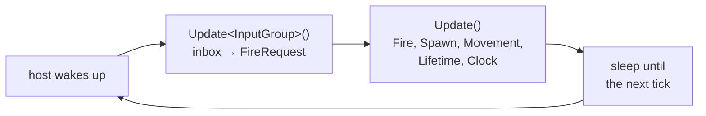

A server outgrows one file fast. This page lays out an EasyEcs project the way the `dotnet new easyecs` template
does and says where each part goes: data in `Components/`, rules in `Systems/`, the loop in `Program.cs`, one test
file per system. Each part has one job, so a new feature is a new component and a new system, never an edit to the
loop.

## When to use it [#when-to-use-it]

<Callout type="idea" title="Use it for">
  Any server or tool that will grow past the [getting started](/en/docs/getting-started) program: a game server, a
  simulation, a bot farm. The layout also fits a world hosted in ASP.NET Core or a Worker Service; only the host
  changes ([hosting](/en/docs/guide/hosting)).
</Callout>

<Callout type="warn" title="Skip it for">
  A one-file experiment or a benchmark: there, folders add nothing. Splitting one world's logic over several
  assemblies is not needed either, unless you reload part of it at runtime (see
  [persistence and hot reload](#persistence-and-hot-reload)).
</Callout>

## How to use it [#how-to-use-it]

<Steps>
<Step>

### Start from the template's project structure [#start-from-the-template]

`EasyEcs.Templates` creates a console server that updates a world 20 times a second until Ctrl+C. `--tests` adds an
NUnit project with one test file per system.

```bash
dotnet new install EasyEcs.Templates
dotnet new easyecs -n MyServer --tests
cd MyServer
dotnet run -- --ticks 100
```

<Files>
  <Folder name="MyServer" defaultOpen>
    <File name="MyServer.csproj" />
    <File name="Program.cs" />
    <Folder name="Components" defaultOpen>
      <File name="Movement.cs" />
      <File name="Lifetime.cs" />
      <File name="Clock.cs" />
      <File name="Spawner.cs" />
    </Folder>
    <Folder name="Systems" defaultOpen>
      <File name="SpawnSystem.cs" />
      <File name="MovementSystem.cs" />
      <File name="LifetimeSystem.cs" />
      <File name="ClockSystem.cs" />
    </Folder>
    <Folder name="MyServer.Tests" defaultOpen>
      <File name="MyServer.Tests.csproj" />
      <File name="SpawnSystemTests.cs" />
      <File name="MovementSystemTests.cs" />
      <File name="LifetimeSystemTests.cs" />
      <File name="ClockSystemTests.cs" />
    </Folder>
  </Folder>
</Files>

The package carries the generator and the analyzer, so `MyServer.csproj` holds one `PackageReference` and nothing to
configure.

</Step>
<Step>

### Put data in `Components/` [#components]

One file per thing the data describes, holding its components: `Movement.cs` has `Position` and `Velocity`,
`Lifetime.cs` has `Lifetime`. Singletons go there too, one file each. Components are plain data: no methods, no
references to services, and small enough that a system reads only what it needs
([ECS principles](/en/docs/ecs-principles)).

```csharp title="Components/Lifetime.cs"
// How many ticks an entity has left. LifetimeSystem destroys it when they run out.
public record struct Lifetime(int Ticks) : IComponent;
```

</Step>
<Step>

### One system per file, one job per system [#systems]

Each file in `Systems/` holds one system with one responsibility, named after it: `MovementSystem` moves,
`LifetimeSystem` expires. The game's rules all live here, even "spawn a wave every second", so they run in the
order you choose and can be tested one by one. Add a system with the item template:

```bash
dotnet new easyecs-system -n RegenSystem -o Systems
```

Systems keep no state of their own ([EECS007](/en/docs/guide/analyzer#eecs007)) and never call each other
([EECS008](/en/docs/guide/analyzer#eecs008)): what one system leaves for another is a component or a singleton.
See [Systems and `[ForEach]`](/en/docs/guide/systems).

</Step>
<Step>

### `Program.cs` is only the host [#host]

`Program.cs` builds the world, sets the singletons, adds the systems and runs the loop. It holds no game rule: when
you are about to write an `if` about the game there, write a system instead.

Set every singleton before the first update. A system that reads a missing singleton throws on its first run,
naming it and the call that adds it ([D27](/en/docs/decisions#d27-reading-a-missing-singleton-throws-everywhere)):

```text
Singleton Spawner was not added to this world: set it before the systems that read it run
(world.SetSpawner(...) or world.AddSingleton<Spawner>()), or use GetOrAddSpawner() where a default is meant
```

Where the default value is right, such as a counter that starts at zero, `GetOrAddX()` says so in the code that
reads it. Singletons that come from a save are not set again after `Load`
([load at start, save at stop](/en/docs/guide/hosting#persistence)).

</Step>
<Step>

### Keep the order in one place [#order]

Systems run in the order they are added. Put the `AddSystem` calls in one method that `Program.cs` and the tests
both call, so a test of the whole tick runs the tick the server runs
([share the setup](/en/docs/guide/testing#share-the-setup)):

```csharp title="Game.cs"
public static class Game
{
    public static void AddSystems(World world)
    {
        world.AddSystem<MoveSystem>();
        world.AddSystem<ExpireSystem>();
    }
}

public record struct Ttl(int Ticks) : IComponent;

public class MoveSystem : EcsSystem
{
    [ForEach]
    static void Move(ref Position position, in Velocity velocity) =>
        position = new Position(position.X + velocity.X, position.Y + velocity.Y);
}

public class ExpireSystem : EcsSystem
{
    [ForEach]
    static void Expire(Entity entity, ref Ttl ttl)
    {
        if (--ttl.Ticks <= 0) entity.Destroy();
    }
}
```

</Step>
<Step>

### Give each cadence a group [#cadence]

Not everything runs every tick. A system group is a cadence the host calls: systems marked `[UpdateInGroup<G>]` run
on `world.Update<G>()`, the others on `world.Update()`. Use one group for input read whenever it arrives, one for
replication every few ticks, one for autosaves. Inside a group, `UpdateInterval` runs a slow system every N-th
update and `UpdatePhase` spreads systems with the same interval
([`UpdateInterval` and `UpdatePhase`](/en/docs/guide/systems#update-interval)):

```csharp
public record struct Census(int Entities) : ISingletonComponent;

// Every 20th update of its group: once a second at 20 ticks a second.
public class CensusSystem : EcsSystem
{
    public override int UpdateInterval => 20;

    protected override void OnUpdate() => World.GetOrAddCensus().Entities = World.EntityCount;
}
```

One tick of the [full example](#full-example), as the host runs it:



</Step>
<Step>

### Take input through a mailbox [#input]

The network, timers and the database run on other threads; the world belongs to the one thread that updates it.
They meet in a queue you own: other threads post messages, and a system on the world's thread takes them and turns
each into data. The queue is a `readonly` field of that system, handed in when it is added: a dependency, not state,
so [EECS007](/en/docs/guide/analyzer#eecs007) allows it. Not a singleton: `World.Save` writes every singleton, and a
queue has no formatter.

```csharp
using System.Collections.Concurrent;

public readonly record struct FireCommand(float Vx, float Vy);   // a message, not a component
public record struct FireRequest(float Vx, float Vy) : IComponent;

public struct InputGroup : ISystemGroup;

[UpdateInGroup<InputGroup>]
public class ReceiveCommandsSystem(ConcurrentQueue<FireCommand> inbox) : EcsSystem
{
    private readonly ConcurrentQueue<FireCommand> _inbox = inbox;   // filled by the network threads

    protected override void OnUpdate()
    {
        while (_inbox.TryDequeue(out var command))
            World.CreateEntity(new FireRequest(command.Vx, command.Vy));
    }
}
```

Add it with `world.AddSystem(new ReceiveCommandsSystem(inbox))`, and give the same queue to the network code.

The queue's bound and what happens when it is full are yours to choose. The details are in
[input from other threads](/en/docs/guide/threading#input-from-other-threads); a server that answers requests is in
[hosting](/en/docs/guide/hosting#requests).

</Step>
<Step>

### One test file per system [#tests]

`MyServer.Tests` has a test file per system: a world of its own with the singletons and entities the system needs,
one update, assertions on the data it left. Add a test of the whole tick through `Game.AddSystems`. The template's
`MyServer.csproj` leaves the test folder out of the server's build (`<Compile Remove="MyServer.Tests\**"/>`). See
[Testing systems](/en/docs/guide/testing).

</Step>
<Step>

### Look inside when something is off [#diagnostics]

`WorldOptions.MeasureSystems` times every system, `SystemErrors = SystemErrorPolicy.Disable` turns a failing system
off instead of stopping the tick, and `world.DescribeTables()` shows the tables. Add them to the host's options when you
need them; see [Debugging and diagnostics](/en/docs/guide/diagnostics).

</Step>
<Step>

### Persistence and hot reload [#persistence-and-hot-reload]

- **Saves:** load the last save before the first tick and save after the loop ends, from the host
  ([saves](/en/docs/guide/saves), [load at start, save at stop](/en/docs/guide/hosting#persistence)). The
  [SaveLoad sample](https://github.com/JasonXuDeveloper/EasyEcs/tree/master/samples/SaveLoad) saves a world, a
  group of entities, and moves entities between worlds.
- **Hot reload:** to replace game logic while the world runs, move those systems and components into a plugin
  assembly and load it into a collectible context
  ([migration and unloading](/en/docs/guide/migration-and-unload)). The
  [HotReload sample](https://github.com/JasonXuDeveloper/EasyEcs/tree/master/samples/HotReload) splits the project
  into contracts, plugin and host.

</Step>
</Steps>

## Full example [#full-example]

The template's server with the two parts a real one adds: commands from a network thread, read through a mailbox
in an input group, and the system order in `Game.cs`, shared with the tests. Create it with
`dotnet new easyecs -n MyServer --tests`, add the new files, and run it with `dotnet run -- --ticks 60`.

<Accordions>
<Accordion title="Components/Movement.cs">

```csharp title="Components/Movement.cs" doccheck=example
using EasyEcs;

namespace MyServer;

// Components are plain data on entities: fields, no logic. Keep them small. A field that
// a system does not read every tick belongs in a component of its own.
public record struct Position(float X, float Y) : IComponent;

public record struct Velocity(float X, float Y) : IComponent;
```

</Accordion>
<Accordion title="Components/Lifetime.cs">

```csharp title="Components/Lifetime.cs" doccheck=example
using EasyEcs;

namespace MyServer;

// How many ticks an entity has left. LifetimeSystem destroys it when they run out.
public record struct Lifetime(int Ticks) : IComponent;
```

</Accordion>
<Accordion title="Components/Clock.cs">

```csharp title="Components/Clock.cs" doccheck=example
using EasyEcs;

namespace MyServer;

// A singleton: one value per world instead of one per entity.
// Tick counts the updates; DeltaTime is the length of one tick in seconds.
public record struct Clock(long Tick, float DeltaTime) : ISingletonComponent;
```

</Accordion>
<Accordion title="Components/Spawner.cs">

```csharp title="Components/Spawner.cs" doccheck=example
using EasyEcs;

namespace MyServer;

// What SpawnSystem creates, and how often. Bullet is a prefab: a recipe of component values
// that every spawned entity starts from. A wave of Wave bullets appears every Interval ticks.
public record struct Spawner(Prefab Bullet, int Wave, int Interval) : ISingletonComponent;
```

</Accordion>
<Accordion title="Components/Input.cs (new)">

```csharp title="Components/Input.cs" doccheck=example
using EasyEcs;

namespace MyServer;

// What a client sends. A message, not a component: ReceiveCommandsSystem turns it into data.
public readonly record struct FireCommand(float Vx, float Vy);

// A command as data: FireSystem handles it on the next tick, then destroys it.
public record struct FireRequest(float Vx, float Vy) : IComponent;
```

</Accordion>
<Accordion title="Systems/InputGroup.cs (new)">

```csharp title="Systems/InputGroup.cs" doccheck=example
using EasyEcs;

namespace MyServer;

// A cadence of its own: the host runs world.Update<InputGroup>() whenever it wants input read,
// independently of the simulation tick that world.Update() runs.
public struct InputGroup : ISystemGroup;
```

</Accordion>
<Accordion title="Systems/ReceiveCommandsSystem.cs (new)">

```csharp title="Systems/ReceiveCommandsSystem.cs" doccheck=example
using System.Collections.Concurrent;
using EasyEcs;

namespace MyServer;

// Turns every command waiting in the inbox into a FireRequest entity.
// It runs on the world's thread, so creating entities here is safe; the network
// threads only ever touch the queue.
[UpdateInGroup<InputGroup>]
public class ReceiveCommandsSystem(ConcurrentQueue<FireCommand> inbox) : EcsSystem
{
    // The mailbox from the network threads. A readonly field is a dependency, not state
    // (EECS007 allows it); a singleton would not do, since World.Save writes every singleton.
    private readonly ConcurrentQueue<FireCommand> _inbox = inbox;

    protected override void OnUpdate()
    {
        while (_inbox.TryDequeue(out var command))
        {
            World.CreateEntity(new FireRequest(command.Vx, command.Vy));
        }
    }
}
```

</Accordion>
<Accordion title="Systems/FireSystem.cs (new)">

```csharp title="Systems/FireSystem.cs" doccheck=example
using EasyEcs;

namespace MyServer;

// Fires one bullet per request, from the spawner's prefab, then destroys the request.
// Creating and destroying entities in the middle of the pass is safe.
public class FireSystem : EcsSystem
{
    [ForEach]
    static void Fire(World world, Entity request, in FireRequest fire, in Spawner spawner)
    {
        world.Instantiate(spawner.Bullet, new Velocity(fire.Vx, fire.Vy));
        request.Destroy();
    }
}
```

</Accordion>
<Accordion title="Systems/SpawnSystem.cs">

```csharp title="Systems/SpawnSystem.cs" doccheck=example
using EasyEcs;

namespace MyServer;

// Spawns a wave of bullets from the spawner's prefab every Interval ticks.
// The game's rules live in systems like this one, never in Program.cs.
public class SpawnSystem : EcsSystem
{
    protected override void OnUpdate()
    {
        ref readonly var spawner = ref World.Spawner;
        bool waveDue = World.Clock.Tick % spawner.Interval == 0;
        if (!waveDue)
        {
            return;
        }

        for (int i = 0; i < spawner.Wave; i++)
        {
            World.Instantiate(spawner.Bullet);
        }
    }
}
```

</Accordion>
<Accordion title="Systems/MovementSystem.cs">

```csharp title="Systems/MovementSystem.cs" doccheck=example
using EasyEcs;

namespace MyServer;

// Moves every entity with a position and a velocity over one tick.
// A [ForEach] method runs once per entity that has all of its component parameters:
// `ref` for what it writes, `in` for what it reads. A singleton can be a parameter too.
public class MovementSystem : EcsSystem
{
    [ForEach]
    static void Move(ref Position position, in Velocity velocity, in Clock clock)
    {
        float dt = clock.DeltaTime;
        position = new Position(position.X + velocity.X * dt, position.Y + velocity.Y * dt);
    }
}
```

</Accordion>
<Accordion title="Systems/LifetimeSystem.cs">

```csharp title="Systems/LifetimeSystem.cs" doccheck=example
using EasyEcs;

namespace MyServer;

// Counts down every lifetime and destroys the entity when it runs out.
// Destroying an entity in the middle of the pass is safe.
public class LifetimeSystem : EcsSystem
{
    [ForEach]
    static void Age(Entity entity, ref Lifetime lifetime)
    {
        lifetime.Ticks--;
        if (lifetime.Ticks <= 0)
        {
            entity.Destroy();
        }
    }
}
```

</Accordion>
<Accordion title="Systems/ClockSystem.cs">

```csharp title="Systems/ClockSystem.cs" doccheck=example
using EasyEcs;

namespace MyServer;

// Advances the clock once per update. OnUpdate runs once per update, not once per entity.
// Game.AddSystems adds it last, so every other system sees the tick the update started with.
public class ClockSystem : EcsSystem
{
    protected override void OnUpdate()
    {
        World.Clock.Tick++;
    }
}
```

</Accordion>
<Accordion title="Game.cs (new)">

```csharp title="Game.cs" doccheck=example
using System.Collections.Concurrent;
using EasyEcs;

namespace MyServer;

// The server's systems, in the order they run. Program.cs and the tests both call it,
// so a test of the whole tick runs the tick the server runs.
public static class Game
{
    public static void AddSystems(World world, ConcurrentQueue<FireCommand> inbox)
    {
        // Input group: runs on world.Update<InputGroup>(), when the host reads input.
        world.AddSystem(new ReceiveCommandsSystem(inbox));

        // Default group: the simulation, once per world.Update(), in this order.
        world.AddSystem<FireSystem>();
        world.AddSystem<SpawnSystem>();
        world.AddSystem<MovementSystem>();
        world.AddSystem<LifetimeSystem>();
        world.AddSystem<ClockSystem>();
    }
}
```

</Accordion>
<Accordion title="Host/FakeClient.cs (new)">

```csharp title="Host/FakeClient.cs" doccheck=example
using System.Collections.Concurrent;

namespace MyServer.Host;

// Plumbing, not ECS: stands in for the network. A thread of its own posts five fire
// commands, 100 ms apart, into the inbox. It never touches the world.
public static class FakeClient
{
    public static Thread Start(ConcurrentQueue<FireCommand> inbox)
    {
        var thread = new Thread(() =>
        {
            for (int i = 0; i < 5; i++)
            {
                Thread.Sleep(100);
                inbox.Enqueue(new FireCommand(Vx: 0, Vy: 20));
            }
        });
        thread.IsBackground = true;
        thread.Start();
        return thread;
    }
}
```

</Accordion>
<Accordion title="Program.cs">

```csharp title="Program.cs" doccheck=example
using System.Collections.Concurrent;
using System.Diagnostics;
using EasyEcs;
using MyServer;
using MyServer.Host;

// The host: it builds the world, then updates it on a fixed tick until Ctrl+C
// (or `--ticks N`). The game itself is in Components/ and Systems/.
const int TicksPerSecond = 20;

long ticksToRun = long.MaxValue;
if (args.Length == 2 && args[0] == "--ticks")
{
    ticksToRun = long.Parse(args[1]);
}

// Ctrl+C stops the loop cleanly instead of killing the process.
using var stop = new CancellationTokenSource();
Console.CancelKeyPress += (_, e) =>
{
    e.Cancel = true;
    stop.Cancel();
};

using var world = new World();

// Singletons first: the systems read them, and a missing one throws on the first update.
var inbox = new ConcurrentQueue<FireCommand>();
world.SetClock(Tick: 0, DeltaTime: 1f / TicksPerSecond);
world.SetSpawner(
    Bullet: new Prefab().SetPosition(0, 0).SetVelocity(10, 0).SetLifetime(3 * TicksPerSecond),
    Wave: 100,
    Interval: TicksPerSecond);

Game.AddSystems(world, inbox);

// The network: another thread, which only posts to the inbox.
FakeClient.Start(inbox);

var tickLength = TimeSpan.FromSeconds(1.0 / TicksPerSecond);
var clock = Stopwatch.StartNew();
var nextTick = TimeSpan.Zero;
while (world.Clock.Tick < ticksToRun && !stop.IsCancellationRequested)
{
    // Read the input that arrived, then run one tick of the simulation.
    world.Update<InputGroup>();
    world.Update();

    long tick = world.Clock.Tick;
    if (tick % TicksPerSecond == 0)
    {
        Console.WriteLine($"tick {tick}: {world.EntityCount} entities");
    }

    // Sleep until the next tick is due.
    nextTick += tickLength;
    TimeSpan wait = nextTick - clock.Elapsed;
    if (wait > TimeSpan.Zero)
    {
        stop.Token.WaitHandle.WaitOne(wait);
    }
}

Console.WriteLine($"stopped after {world.Clock.Tick} ticks");
```

</Accordion>
<Accordion title="MyServer.Tests/TickTests.cs (new)">

```csharp title="MyServer.Tests/TickTests.cs" doccheck=skip
using System.Collections.Concurrent;
using EasyEcs;
using NUnit.Framework;

namespace MyServer.Tests;

// The whole tick, through the same Game.AddSystems the server calls.
public class TickTests
{
    [Test]
    public void AQueuedCommandBecomesABulletOnTheNextTick()
    {
        using var world = new World();
        var inbox = new ConcurrentQueue<FireCommand>();
        // Tick 1: no wave is due, so the only bullet is the one fired.
        world.SetClock(Tick: 1, DeltaTime: 0.05f);
        world.SetSpawner(
            Bullet: new Prefab().SetPosition(0, 0).SetVelocity(0, 0).SetLifetime(10),
            Wave: 100,
            Interval: 20);
        Game.AddSystems(world, inbox);
        inbox.Enqueue(new FireCommand(Vx: 0, Vy: 20));

        world.Update<InputGroup>();
        world.Update();

        Assert.That(world.Count<Lifetime>(), Is.EqualTo(1));
        Assert.That(world.Count<FireRequest>(), Is.Zero);
    }
}
```

</Accordion>
</Accordions>

It prints:

```text
tick 20: 105 entities
tick 40: 205 entities
tick 60: 205 entities
stopped after 60 ticks
```

The five commands arrive during the first half second and become five bullets next to the first wave of 100. At
tick 60 the first wave has run out of time while the third one appears; the fired bullets, a few ticks younger,
are still alive. No line of `Program.cs` knows about bullets: the host only sets data, adds systems and keeps time.

## How to use it fast [#how-to-use-it-fast]

The layout itself has no cost to tune: folders and files are gone once the project compiles. What decides the speed
of the tick is in the systems: `in` for what a method only reads, a group or `UpdateInterval` for what does not run
every tick, and the choices the [performance guide](/en/docs/performance) measures.

## What it costs [#what-it-costs]

Nothing at run time: one system per file compiles to the same code as one file of systems, and a group is a call
the host makes. The tick costs what its systems cost; [performance](/en/docs/performance) has the numbers per
feature.

## Pitfalls [#pitfalls]

| Mistake | What happens | Caught by |
| --- | --- | --- |
| A game rule in `Program.cs` (a wave every second, a win condition) | It cannot be tested alone or ordered against the systems | Review: move it into a system that reads a singleton |
| Program and tests adding the systems in different orders | The tests pass on a tick the server never runs | Share one `Game.AddSystems` |
| A singleton set after the first update, or never | The first system that reads it throws `InvalidOperationException` naming it | The runtime, on the first update |
| A system keeping a counter or a timer in a field | State no save, snapshot or test sees | [EECS007](/en/docs/guide/analyzer#eecs007) |
| The network thread creating entities itself | An exception from the structural gate, or torn tables when it misses the race | [EECS014](/en/docs/guide/analyzer#eecs014) when it can see it; post to the mailbox |
| The test folder inside the server project | NUnit types compiled into the server | `<Compile Remove="MyServer.Tests\**"/>` (the template has it) |

## Related [#related]

<Cards>
  <Card title="Getting started" href="/en/docs/getting-started">
    The concepts this layout organizes, one step at a time.
  </Card>
  <Card title="Testing systems" href="/en/docs/guide/testing">
    A world per test, shared setup, errors and allocation budgets.
  </Card>
  <Card title="Hosting in a .NET server" href="/en/docs/guide/hosting">
    The same world inside ASP.NET Core or a Worker Service.
  </Card>
  <Card title="Threading" href="/en/docs/guide/threading">
    The owner thread, input from other threads and parallel systems.
  </Card>
</Cards>
