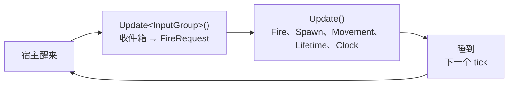

服务器很快就会超出一个文件。这一页按 `dotnet new easyecs` 模板的方式组织一个 EasyEcs 项目，讲清每样东西放在哪：数据放
`Components/`，规则放 `Systems/`，主循环放 `Program.cs`，每个系统一个测试文件。各部分只做一件事，所以加一个功能就是加一个组件、
加一个系统，主循环不用动。

## 什么时候用 [#when-to-use-it]

<Callout type="idea" title="适合">
  会长得比[快速开始](/zh/docs/getting-started)那个程序更大的服务器或工具：游戏服务器、模拟、机器人集群。World 托管在 ASP.NET Core
  或 Worker Service 里时同样适用，只是宿主换了（[托管](/zh/docs/guide/hosting)）。
</Callout>

<Callout type="warn" title="不适合">
  一个文件就能写完的实验或基准测试：分目录没有好处。也不必把一个 World 的逻辑拆进多个程序集，除非要在运行时替换其中一部分
  （见[存档与热重载](#persistence-and-hot-reload)）。
</Callout>

## 怎么用 [#how-to-use-it]

<Steps>
<Step>

### 从模板开始 [#start-from-the-template]

`EasyEcs.Templates` 生成一个控制台服务器，每秒更新 World 20 次，直到按下 Ctrl+C。加上 `--tests` 还会生成一个 NUnit 项目，
每个系统一个测试文件。

```bash
dotnet new install EasyEcs.Templates
dotnet new easyecs -n MyServer --tests
cd MyServer
dotnet run -- --ticks 100
```

<Files>
  <Folder name="MyServer" defaultOpen>
    <File name="MyServer.csproj" />
    <File name="Program.cs" />
    <Folder name="Components" defaultOpen>
      <File name="Movement.cs" />
      <File name="Lifetime.cs" />
      <File name="Clock.cs" />
      <File name="Spawner.cs" />
    </Folder>
    <Folder name="Systems" defaultOpen>
      <File name="SpawnSystem.cs" />
      <File name="MovementSystem.cs" />
      <File name="LifetimeSystem.cs" />
      <File name="ClockSystem.cs" />
    </Folder>
    <Folder name="MyServer.Tests" defaultOpen>
      <File name="MyServer.Tests.csproj" />
      <File name="SpawnSystemTests.cs" />
      <File name="MovementSystemTests.cs" />
      <File name="LifetimeSystemTests.cs" />
      <File name="ClockSystemTests.cs" />
    </Folder>
  </Folder>
</Files>

NuGet 包里自带生成器和分析器，所以 `MyServer.csproj` 只有一行 `PackageReference`，没有别的要配。

</Step>
<Step>

### 数据放进 `Components/` [#components]

按数据描述的对象分文件，每个文件放它的组件：`Movement.cs` 里是 `Position` 和 `Velocity`，`Lifetime.cs` 里是 `Lifetime`。
单例也放这里，一个单例一个文件。组件是纯数据：没有方法，不引用服务，并且足够小，系统只读它要用的那部分
（[ECS 设计原则](/zh/docs/ecs-principles)）。

```csharp title="Components/Lifetime.cs"
// 实体还剩多少个 tick。用完时由 LifetimeSystem 销毁。
public record struct Lifetime(int Ticks) : IComponent;
```

</Step>
<Step>

### 一个文件一个系统，一个系统一件事 [#systems]

`Systems/` 里每个文件放一个系统，只负责一件事，并以这件事命名：`MovementSystem` 负责移动，`LifetimeSystem` 负责到期销毁。
游戏规则全都写在这里，连“每秒刷一波”也是，这样它们按你定的顺序执行，也能逐个测试。用项模板加系统：

```bash
dotnet new easyecs-system -n RegenSystem -o Systems
```

系统自己不保存状态（[EECS007](/zh/docs/guide/analyzer#eecs007)），也从不调用别的系统
（[EECS008](/zh/docs/guide/analyzer#eecs008)）：一个系统留给另一个系统的东西，就是一个组件或一个单例。
见[系统与 `[ForEach]`](/zh/docs/guide/systems)。

</Step>
<Step>

### `Program.cs` 只做宿主 [#host]

`Program.cs` 创建 World、设置单例、添加系统、跑主循环，不写任何游戏规则：一旦想在这里写一个和玩法有关的 `if`，就改写成一个系统。

第一次更新之前设置好所有单例。系统读到缺失的单例时，第一次运行就会抛异常，并说出是哪个单例、该用哪个调用添加
（[D27](/zh/docs/decisions#d27-reading-a-missing-singleton-throws-everywhere)）：

```text
Singleton Spawner was not added to this world: set it before the systems that read it run
(world.SetSpawner(...) or world.AddSingleton<Spawner>()), or use GetOrAddSpawner() where a default is meant
```

默认值本来就对的单例，比如从零开始的计数器，在读它的地方用 `GetOrAddX()` 表明这一点。从存档里加载的单例，`Load` 之后不要再设置
一遍（[启动时加载，停止时存档](/zh/docs/guide/hosting#persistence)）。

</Step>
<Step>

### 系统顺序只写在一处 [#order]

系统按添加的顺序执行。把 `AddSystem` 调用放进一个方法，让 `Program.cs` 和测试都调用它，整个 tick 的测试跑的就是服务器跑的那个
tick（[和服务器共用初始化](/zh/docs/guide/testing#share-the-setup)）：

```csharp title="Game.cs"
public static class Game
{
    public static void AddSystems(World world)
    {
        world.AddSystem<MoveSystem>();
        world.AddSystem<ExpireSystem>();
    }
}

public record struct Ttl(int Ticks) : IComponent;

public class MoveSystem : EcsSystem
{
    [ForEach]
    static void Move(ref Position position, in Velocity velocity) =>
        position = new Position(position.X + velocity.X, position.Y + velocity.Y);
}

public class ExpireSystem : EcsSystem
{
    [ForEach]
    static void Expire(Entity entity, ref Ttl ttl)
    {
        if (--ttl.Ticks <= 0) entity.Destroy();
    }
}
```

</Step>
<Step>

### 每种节奏一个分组 [#cadence]

不是所有逻辑都每个 tick 跑。系统分组就是一种由宿主调用的节奏：标了 `[UpdateInGroup<G>]` 的系统在 `world.Update<G>()` 时执行，
其余的在 `world.Update()` 时执行。输入一到就读，用一个分组；每隔几个 tick 同步一次状态，用一个分组；定时存盘，再用一个分组。
分组内部，`UpdateInterval` 让慢系统每 N 次更新跑一次，`UpdatePhase` 把间隔相同的系统错开
（[`UpdateInterval` 和 `UpdatePhase`](/zh/docs/guide/systems#update-interval)）：

```csharp
public record struct Census(int Entities) : ISingletonComponent;

// 所在分组每更新 20 次跑一次：每秒 20 个 tick 时就是每秒一次。
public class CensusSystem : EcsSystem
{
    public override int UpdateInterval => 20;

    protected override void OnUpdate() => World.GetOrAddCensus().Entities = World.EntityCount;
}
```

[完整例子](#full-example)里，宿主这样跑一个 tick：



</Step>
<Step>

### 输入走邮箱 [#input]

网络、定时器、数据库都跑在别的线程上，而 World 只属于更新它的那一个线程。两边在一个由你持有的队列里交接：别的线程投递消息，
World 所在线程上的一个系统取出消息，把每条变成数据。队列放在单例里，系统就不用保存状态：

```csharp
using System.Collections.Concurrent;

public readonly record struct FireCommand(float Vx, float Vy);   // 消息，不是组件
public record struct Inbox(ConcurrentQueue<FireCommand> Commands) : ISingletonComponent;
public record struct FireRequest(float Vx, float Vy) : IComponent;

public struct InputGroup : ISystemGroup;

[UpdateInGroup<InputGroup>]
public class ReceiveCommandsSystem : EcsSystem
{
    protected override void OnUpdate()
    {
        var commands = World.Inbox.Commands;
        while (commands.TryDequeue(out var command))
            World.CreateEntity(new FireRequest(command.Vx, command.Vy));
    }
}
```

队列的容量上限、满了怎么办，都由你决定。细节见[来自其他线程的输入](/zh/docs/guide/threading#input-from-other-threads)；
处理请求的服务器见[托管](/zh/docs/guide/hosting#requests)。

</Step>
<Step>

### 每个系统一个测试文件 [#tests]

`MyServer.Tests` 里每个系统一个测试文件：一个独立的 World，放进这个系统需要的单例和实体，更新一次，再断言它留下的数据。
再通过 `Game.AddSystems` 加一个测整个 tick 的测试。模板的 `MyServer.csproj` 已经把测试目录排除在服务器的编译之外
（`<Compile Remove="MyServer.Tests\**"/>`）。见[测试系统](/zh/docs/guide/testing)。

</Step>
<Step>

### 出问题时往里看 [#diagnostics]

`WorldOptions.MeasureSystems` 给每个系统计时，`SystemErrors = SystemErrorPolicy.Disable` 让出错的系统停用而不是中断整个 tick，
`world.Describe()` 列出所有表。需要时把它们加进宿主的选项里，见[调试与诊断](/zh/docs/guide/diagnostics)。

</Step>
<Step>

### 存档与热重载 [#persistence-and-hot-reload]

- **存档：**由宿主在第一个 tick 之前加载上一次的存档，在主循环结束后存档（[存档](/zh/docs/guide/saves)、
  [启动时加载，停止时存档](/zh/docs/guide/hosting#persistence)）。
  [SaveLoad 示例](https://github.com/JasonXuDeveloper/EasyEcs/tree/master/samples/SaveLoad)演示了保存整个 World、保存一组实体，
  以及在 World 之间搬移实体。
- **热重载：**想在 World 运行时替换游戏逻辑，就把这些系统和组件挪进一个插件程序集，加载到可回收上下文里
  （[迁移与卸载](/zh/docs/guide/migration-and-unload)）。
  [HotReload 示例](https://github.com/JasonXuDeveloper/EasyEcs/tree/master/samples/HotReload)把项目拆成契约、插件和宿主三部分。

</Step>
</Steps>

## 完整例子 [#full-example]

模板生成的服务器，加上真实服务器都会有的两样东西：来自网络线程的指令，经邮箱在输入分组里读取；以及写在 `Game.cs` 里、
和测试共用的系统顺序。用 `dotnet new easyecs -n MyServer --tests` 生成项目，加上新文件，再用 `dotnet run -- --ticks 60` 运行。

<Accordions>
<Accordion title="Components/Movement.cs">

```csharp title="Components/Movement.cs" doccheck=example
using EasyEcs;

namespace MyServer;

// 组件是实体上的纯数据：只有字段，没有逻辑。尽量小：
// 系统不是每个 tick 都读的字段，应该放进单独的组件。
public record struct Position(float X, float Y) : IComponent;

public record struct Velocity(float X, float Y) : IComponent;
```

</Accordion>
<Accordion title="Components/Lifetime.cs">

```csharp title="Components/Lifetime.cs" doccheck=example
using EasyEcs;

namespace MyServer;

// 实体还剩多少个 tick。用完时由 LifetimeSystem 销毁。
public record struct Lifetime(int Ticks) : IComponent;
```

</Accordion>
<Accordion title="Components/Clock.cs">

```csharp title="Components/Clock.cs" doccheck=example
using EasyEcs;

namespace MyServer;

// 单例：每个 World 一份，而不是每个实体一份。
// Tick 记录更新次数；DeltaTime 是一个 tick 的秒数。
public record struct Clock(long Tick, float DeltaTime) : ISingletonComponent;
```

</Accordion>
<Accordion title="Components/Spawner.cs">

```csharp title="Components/Spawner.cs" doccheck=example
using EasyEcs;

namespace MyServer;

// SpawnSystem 刷什么、多久刷一次。Bullet 是预制体：每个刷出来的实体
// 都从这份组件值配方开始。每 Interval 个 tick 刷一波，每波 Wave 发子弹。
public record struct Spawner(Prefab Bullet, int Wave, int Interval) : ISingletonComponent;
```

</Accordion>
<Accordion title="Components/Input.cs（新增）">

```csharp title="Components/Input.cs" doccheck=example
using System.Collections.Concurrent;
using EasyEcs;

namespace MyServer;

// 客户端发来的东西。它是消息，不是组件：ReceiveCommandsSystem 把它变成数据。
public readonly record struct FireCommand(float Vx, float Vy);

// 从网络线程到 World 所在线程的邮箱。放在单例里，
// 取消息的系统自己就不用保存状态。
public record struct Inbox(ConcurrentQueue<FireCommand> Commands) : ISingletonComponent;

// 变成数据的指令：FireSystem 在下一个 tick 处理它，然后销毁。
public record struct FireRequest(float Vx, float Vy) : IComponent;
```

</Accordion>
<Accordion title="Systems/InputGroup.cs（新增）">

```csharp title="Systems/InputGroup.cs" doccheck=example
using EasyEcs;

namespace MyServer;

// 一种独立的节奏：宿主想读输入时就调用 world.Update<InputGroup>()，
// 和 world.Update() 跑的模拟 tick 互不相干。
public struct InputGroup : ISystemGroup;
```

</Accordion>
<Accordion title="Systems/ReceiveCommandsSystem.cs（新增）">

```csharp title="Systems/ReceiveCommandsSystem.cs" doccheck=example
using EasyEcs;

namespace MyServer;

// 把收件箱里等着的每条指令变成一个 FireRequest 实体。
// 它跑在 World 所在的线程上，所以在这里创建实体是安全的；
// 网络线程只碰队列。
[UpdateInGroup<InputGroup>]
public class ReceiveCommandsSystem : EcsSystem
{
    protected override void OnUpdate()
    {
        var commands = World.Inbox.Commands;
        while (commands.TryDequeue(out var command))
        {
            World.CreateEntity(new FireRequest(command.Vx, command.Vy));
        }
    }
}
```

</Accordion>
<Accordion title="Systems/FireSystem.cs（新增）">

```csharp title="Systems/FireSystem.cs" doccheck=example
using EasyEcs;

namespace MyServer;

// 每个请求用刷新器的预制体发一颗子弹，然后销毁这个请求。
// 遍历途中创建、销毁实体都是安全的。
public class FireSystem : EcsSystem
{
    [ForEach]
    static void Fire(World world, Entity request, in FireRequest fire, in Spawner spawner)
    {
        Entity bullet = world.Instantiate(spawner.Bullet);
        bullet.SetVelocity(fire.Vx, fire.Vy);
        request.Destroy();
    }
}
```

</Accordion>
<Accordion title="Systems/SpawnSystem.cs">

```csharp title="Systems/SpawnSystem.cs" doccheck=example
using EasyEcs;

namespace MyServer;

// 每 Interval 个 tick 用刷新器的预制体刷一波子弹。
// 游戏规则写在这样的系统里，永远不写在 Program.cs 里。
public class SpawnSystem : EcsSystem
{
    protected override void OnUpdate()
    {
        ref readonly var spawner = ref World.Spawner;
        bool waveDue = World.Clock.Tick % spawner.Interval == 0;
        if (!waveDue)
        {
            return;
        }

        for (int i = 0; i < spawner.Wave; i++)
        {
            World.Instantiate(spawner.Bullet);
        }
    }
}
```

</Accordion>
<Accordion title="Systems/MovementSystem.cs">

```csharp title="Systems/MovementSystem.cs" doccheck=example
using EasyEcs;

namespace MyServer;

// 按速度把每个有位置和速度的实体移动一个 tick。
// [ForEach] 方法对每个拥有它全部组件参数的实体各执行一次：
// 要写的用 `ref`，只读的用 `in`。单例也可以作为参数。
public class MovementSystem : EcsSystem
{
    [ForEach]
    static void Move(ref Position position, in Velocity velocity, in Clock clock)
    {
        float dt = clock.DeltaTime;
        position = new Position(position.X + velocity.X * dt, position.Y + velocity.Y * dt);
    }
}
```

</Accordion>
<Accordion title="Systems/LifetimeSystem.cs">

```csharp title="Systems/LifetimeSystem.cs" doccheck=example
using EasyEcs;

namespace MyServer;

// 每个 tick 把剩余寿命减一，用完就销毁实体。
// 遍历途中销毁实体是安全的。
public class LifetimeSystem : EcsSystem
{
    [ForEach]
    static void Age(Entity entity, ref Lifetime lifetime)
    {
        lifetime.Ticks--;
        if (lifetime.Ticks <= 0)
        {
            entity.Destroy();
        }
    }
}
```

</Accordion>
<Accordion title="Systems/ClockSystem.cs">

```csharp title="Systems/ClockSystem.cs" doccheck=example
using EasyEcs;

namespace MyServer;

// 每次更新把时钟推进一格。OnUpdate 每次更新执行一次，不是每个实体一次。
// Game.AddSystems 最后才添加它，所以其他系统看到的都是这次更新开始时的 tick。
public class ClockSystem : EcsSystem
{
    protected override void OnUpdate()
    {
        World.Clock.Tick++;
    }
}
```

</Accordion>
<Accordion title="Game.cs（新增）">

```csharp title="Game.cs" doccheck=example
using EasyEcs;

namespace MyServer;

// 服务器的所有系统，按执行顺序排列。Program.cs 和测试都调用它，
// 所以整个 tick 的测试跑的就是服务器跑的那个 tick。
public static class Game
{
    public static void AddSystems(World world)
    {
        // 输入分组：宿主读输入时，通过 world.Update<InputGroup>() 执行。
        world.AddSystem<ReceiveCommandsSystem>();

        // 默认分组：模拟本身，每次 world.Update() 按这个顺序执行一遍。
        world.AddSystem<FireSystem>();
        world.AddSystem<SpawnSystem>();
        world.AddSystem<MovementSystem>();
        world.AddSystem<LifetimeSystem>();
        world.AddSystem<ClockSystem>();
    }
}
```

</Accordion>
<Accordion title="Host/FakeClient.cs（新增）">

```csharp title="Host/FakeClient.cs" doccheck=example
using System.Collections.Concurrent;

namespace MyServer.Host;

// 管道代码，不是 ECS：代替网络。它在自己的线程上
// 每隔 100 毫秒往收件箱投一条开火指令，共五条。它从不碰 World。
public static class FakeClient
{
    public static Thread Start(ConcurrentQueue<FireCommand> inbox)
    {
        var thread = new Thread(() =>
        {
            for (int i = 0; i < 5; i++)
            {
                Thread.Sleep(100);
                inbox.Enqueue(new FireCommand(Vx: 0, Vy: 20));
            }
        });
        thread.IsBackground = true;
        thread.Start();
        return thread;
    }
}
```

</Accordion>
<Accordion title="Program.cs">

```csharp title="Program.cs" doccheck=example
using System.Collections.Concurrent;
using System.Diagnostics;
using EasyEcs;
using MyServer;
using MyServer.Host;

// 宿主：创建 World，然后按固定 tick 更新它，直到按下 Ctrl+C
// （或者跑完 `--ticks N`）。游戏本身在 Components/ 和 Systems/ 里。
const int TicksPerSecond = 20;

long ticksToRun = long.MaxValue;
if (args.Length == 2 && args[0] == "--ticks")
{
    ticksToRun = long.Parse(args[1]);
}

// Ctrl+C 干净地结束循环，而不是直接杀掉进程。
using var stop = new CancellationTokenSource();
Console.CancelKeyPress += (_, e) =>
{
    e.Cancel = true;
    stop.Cancel();
};

using var world = new World();

// 先设单例：系统要读它们，缺了的话第一次更新就会抛异常。
var inbox = new ConcurrentQueue<FireCommand>();
world.SetClock(Tick: 0, DeltaTime: 1f / TicksPerSecond);
world.SetSpawner(
    Bullet: new Prefab().SetPosition(0, 0).SetVelocity(10, 0).SetLifetime(3 * TicksPerSecond),
    Wave: 100,
    Interval: TicksPerSecond);
world.SetInbox(Commands: inbox);

Game.AddSystems(world);

// 网络：另一个线程，只往收件箱里投消息。
FakeClient.Start(inbox);

var tickLength = TimeSpan.FromSeconds(1.0 / TicksPerSecond);
var clock = Stopwatch.StartNew();
var nextTick = TimeSpan.Zero;
while (world.Clock.Tick < ticksToRun && !stop.IsCancellationRequested)
{
    // 先读到达的输入，再跑一个模拟 tick。
    world.Update<InputGroup>();
    world.Update();

    long tick = world.Clock.Tick;
    if (tick % TicksPerSecond == 0)
    {
        Console.WriteLine($"tick {tick}: {world.EntityCount} entities");
    }

    // 睡到下一个 tick。
    nextTick += tickLength;
    TimeSpan wait = nextTick - clock.Elapsed;
    if (wait > TimeSpan.Zero)
    {
        stop.Token.WaitHandle.WaitOne(wait);
    }
}

Console.WriteLine($"stopped after {world.Clock.Tick} ticks");
```

</Accordion>
<Accordion title="MyServer.Tests/TickTests.cs（新增）">

```csharp title="MyServer.Tests/TickTests.cs" doccheck=skip
using System.Collections.Concurrent;
using EasyEcs;
using NUnit.Framework;

namespace MyServer.Tests;

// 整个 tick，用的是服务器调用的同一个 Game.AddSystems。
public class TickTests
{
    [Test]
    public void AQueuedCommandBecomesABulletOnTheNextTick()
    {
        using var world = new World();
        var inbox = new ConcurrentQueue<FireCommand>();
        // 第 1 个 tick 不刷波次，所以唯一的子弹就是打出去的那颗。
        world.SetClock(Tick: 1, DeltaTime: 0.05f);
        world.SetSpawner(
            Bullet: new Prefab().SetPosition(0, 0).SetVelocity(0, 0).SetLifetime(10),
            Wave: 100,
            Interval: 20);
        world.SetInbox(Commands: inbox);
        Game.AddSystems(world);
        inbox.Enqueue(new FireCommand(Vx: 0, Vy: 20));

        world.Update<InputGroup>();
        world.Update();

        Assert.That(world.Count<Lifetime>(), Is.EqualTo(1));
        Assert.That(world.Count<FireRequest>(), Is.Zero);
    }
}
```

</Accordion>
</Accordions>

输出：

```text
tick 20: 105 entities
tick 40: 205 entities
tick 60: 205 entities
stopped after 60 ticks
```

五条指令在前半秒内到达，变成五颗子弹，和第一波的 100 发一起飞。到第 60 个 tick，第一波寿命用完，第三波刚刷出来；打出去的子弹晚了几个
tick 才出生，所以还活着。`Program.cs` 没有一行知道子弹的存在：宿主只设置数据、添加系统、掌握时间。

## 常见陷阱 [#pitfalls]

| 错误 | 后果 | 谁能发现 |
| --- | --- | --- |
| 游戏规则写在 `Program.cs` 里（每秒刷一波、胜负判定） | 没法单独测试，也没法和系统排顺序 | 代码审查：改成读单例的系统 |
| `Program.cs` 和测试各自按不同顺序添加系统 | 测试通过的 tick 是服务器从来不跑的那个 | 共用一个 `Game.AddSystems` |
| 第一次更新之后才设置单例，或者根本没设 | 第一个读它的系统抛 `InvalidOperationException`，并说出它的名字 | 运行时，第一次更新时 |
| 系统用字段保存计数器或计时器 | 存档、快照和测试都看不到这份状态 | [EECS007](/zh/docs/guide/analyzer#eecs007) |
| 网络线程自己创建实体 | 结构闸门抛异常；闸门没赶上竞争时，表被写坏 | [EECS014](/zh/docs/guide/analyzer#eecs014)（能看到时）；改成投递到邮箱 |
| 测试目录放在服务器项目里 | NUnit 的类型被编译进服务器 | `<Compile Remove="MyServer.Tests\**"/>`（模板已经写好） |

## 相关页面 [#related]

<Cards>
  <Card title="快速开始" href="/zh/docs/getting-started">
    这套结构所组织的概念，一步一步讲。
  </Card>
  <Card title="测试系统" href="/zh/docs/guide/testing">
    每个测试一个 World、共用初始化代码、错误处理和零分配预算。
  </Card>
  <Card title="在 .NET 服务器里托管" href="/zh/docs/guide/hosting">
    同一个 World 放进 ASP.NET Core 或 Worker Service。
  </Card>
  <Card title="多线程" href="/zh/docs/guide/threading">
    所有者线程、来自其他线程的输入和并行系统。
  </Card>
</Cards>
