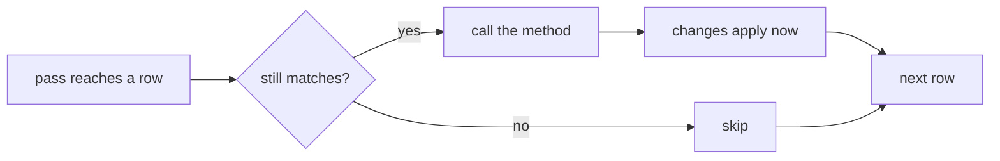

A structural change is anything that changes which components an entity has, or which entities exist: creating
(`CreateEntity`, `Instantiate`, `Clone`), destroying, adding a component (`Set`, `GetOrAdd` of a missing one) or
removing one. EasyEcs applies them **immediately**, even in the middle of a pass: there is no command buffer to
record into and play back, so the death system marks a unit `Dead` where it decides, and the very next system already
sees the corpse.

## When to use it [#when-to-use-it]

<Callout type="idea" title="Use it for">
  Changing entities where the decision is made: set `Dead` in the death system, destroy an expired projectile in its
  own loop, spawn a projectile in the system that fires it, add `Stunned` in the hit that stuns. Tags for states that
  come and go: removing a component and adding it back moves nothing.
</Callout>

<Callout type="warn" title="Skip it for">
  Keeping a `ref` (other than the method's own `ref` parameters) across a structural change. Changing structure in a
  batch method, a parallel method or a job that implements `INoStructuralChanges`: their structure is frozen, and a
  change throws. A value that changes every tick: a field is cheaper than a component added and removed each tick.
</Callout>

## How to use it [#how-to-use-it]

<Steps>
<Step>

### Take the `Entity` (or the `World`) [#take-the-entity]

A `[ForEach]` method changes structure through its `Entity` parameter, or creates entities through its `World`
parameter. The generator sees the parameter and gives the method a pass that notices the changes.

```csharp
public record struct Lifetime(int Ticks) : IComponent;
public record struct Projectile(EntityId Owner) : IComponent;
public record struct Weapon(int Cooldown) : IComponent;

public class ExpireSystem : EcsSystem
{
    [ForEach]
    static void Expire(Entity shot, ref Lifetime life)
    {
        if (--life.Ticks <= 0) shot.Destroy();         // destroyed now, in the middle of the pass
    }
}

public class FireSystem : EcsSystem
{
    [ForEach, Without<Dead>]
    static void Fire(Entity shooter, ref Weapon weapon, in Position at, World world)
    {
        if (weapon.Cooldown-- > 0) return;
        weapon.Cooldown = 10;
        world.CreateEntity(at, new Lifetime(30), new Projectile(shooter.Id));   // not visited by passes already running
    }
}
```

</Step>
<Step>

### Run them in one update [#run-them]

```csharp
var world = new World();
world.AddSystem<FireSystem>();
world.AddSystem<ExpireSystem>();                     // sees this update's new projectiles
world.CreateEntity(new Position(0, 0), new Weapon(0));
world.Update();
int shots = world.Count<Projectile>();               // 1
```

</Step>
</Steps>

### What a pass sees [#during-a-pass]

Inside `[ForEach]` methods, `ForEach` jobs and `Query` loops you can create and destroy entities and add or remove
components, of the visited entity or any other. The rules:

- **A pass visits each entity at most once.**
- **Entities that stop matching before their turn are skipped**: destroyed, a queried component removed, or an
  excluded one added.
- **Entities that join a matching table during the pass are not visited by it**: created, or moved into a matching
  table. The next pass sees them.
- **An entity that gets a queried component back without moving** (its row only sets a presence bit) is visited if
  the pass has not reached its row yet.



### Refs across a change [#refs-across-a-change]

- **The method's own `ref` parameters stay writable** when the body changes the visited entity's table: the pass
  copies those writes to the entity's new row after the body returns. `in` parameters keep showing the values from
  before the change.
- **Any other `ref`** (from `entity.Get<T>()`, a `Query` item, or another entity) is guaranteed only until the next
  structural change: write through it before the change, or get it again afterwards.

```csharp
public class HitSystem : EcsSystem
{
    [ForEach, Without<Dead>]
    static void Hit(Entity unit, ref Health hp)
    {
        hp.Value -= 10;
        if (hp.Value <= 0) unit.SetDead();   // the row moves to the table with Dead
        hp.Value = Math.Max(hp.Value, 0);    // still the entity's Health: carried over to the new row
    }
}
```

The details, and why a `ref` must never cross an `await`, are in [`ref` and `await`](/en/docs/guide/refs-and-await).

### Passes that freeze the structure [#frozen-passes]

Some passes hold refs or spans into the tables for longer than one call, so they freeze the world's structure while
they run, and a change throws `InvalidOperationException` instead of tearing rows:

- **batch methods** (`Span<T>` parameters) and `ForEachBatch` jobs;
- **jobs that implement `INoStructuralChanges`**, including the ones the generator writes for methods that take no
  `Entity` or `World`;
- **parallel methods**, `ForEachParallel` / `ForEachEntityParallel` and [parallel stages](/en/docs/guide/threading#parallel-systems).

The analyzer reports a structural change in a method that promised none ([EECS013](/en/docs/guide/analyzer#eecs013))
and one made from another thread ([EECS014](/en/docs/guide/analyzer#eecs014)).

### Keeping tables dense [#keeping-tables-dense]

Tables stay dense on their own. Outside a pass, the table's last row fills a destroyed entity's row at once. Inside a
pass, a row that leaves becomes a tombstone the pass skips, and the tombstones are closed when the last pass ends,
also when a job throws. A query enumerator abandoned without `Dispose` (a `foreach` always disposes it) leaves its
pass open until the next `Update()`, which closes it. There is nothing to call and nothing to monitor.

### Many entities at once [#bulk]

For changes to whole sets of entities, the bulk forms take the structural gate once:

```csharp
var wave = new Entity[1_000];
world.CreateEntities(wave, new Position(0, 0), new Lifetime(60));
int expired = world.DestroyEntities<Lifetime>(QueryFilter.Create().With<Dead>());
```

`SetAll`, `RemoveAll`, `DisableAll` and `EnableAll` change a component on every match a whole 64-row word at a time:
[Bulk changes](/en/docs/guide/bulk).

Entities created one at a time (a start-up that loads them, a loop that builds each from data) grow their table by
doubling. Reserve it first: `EnsureCapacity<T1, …, Tn>(count)` grows the table of exactly those components and the
entity storage once, to what the loop needs, so the next `count` creations with those components grow nothing:

```csharp
world.EnsureCapacity<Position, Lifetime>(100_000);
for (int i = 0; i < 100_000; i++) world.CreateEntity(new Position(i, 0), new Lifetime(60));
```

`CreateEntities` reserves on its own. `EnsureCapacity(prefab, count)` does the same for a prefab's instances
([Prefabs](/en/docs/guide/prefabs)), and `EnsureEntityCapacity(n)` sizes only the entity storage, for entities spread
over many tables. Entities that a [group](/en/docs/guide/groups) puts in another table grow that one.

## How to use it fast [#how-to-use-it-fast]

| Instead of | Do | Why |
| --- | --- | --- |
| A command buffer played back later | The change, where it is decided | No recording, no playback, no allocation |
| Adding and removing a component each tick | A field, or a tag for a state that lasts several ticks | A tag the table has a column for only flips a bit |
| `Set(a)` then `Set(b)` | `Set(a, b)` | At most one row move |
| Creating a known number of entities one by one | `EnsureCapacity<T1, …, Tn>(count)` before the loop | One growth instead of a doubling per full table |
| A loop of single changes over a filter | [Bulk changes](/en/docs/guide/bulk), `DestroyEntities<T>(filter)` | One gate pass, whole words at once |
| An `Entity` parameter the method only reads | Keep it read-only (`Id`, `Has`, `Get`) | The pass skips structural bookkeeping |

10,000 entities whose `Health` is removed and added back inside a query loop (`ToggleComponent`), against moving three
components out and back in one call each (`RemoveMany`, 1,000 entities):

<BenchTable bench="MicroBenchmarks" methods="ToggleComponent,RemoveMany" />

Structural changes found while iterating, 100,000 units: per operation some lose their health, one pass marks those
at zero as fallen (adds a tag) and a second revives them (removes it). EasyEcs changes structure directly; Friflo,
Arch and DefaultEcs record into their command buffers and play them back after each pass:

<BenchChart bench="StructuralChangeComparison" params="Killed=1000" title="Mark and revive 1,000 of 100,000 units during iteration" />

The comparison with 10 changes per pass: [Comparison](/en/docs/comparison).

## What it costs [#what-it-costs]

- **A pass that may change structure** checks one storage version per entity, so it notices changes; a method that
  cannot change structure skips even that.
- **Removing a component and adding it back:** one presence bit. **Gaining a component the table has no column for:**
  one row copy, once per new combination (the move plan is cached).
- **Destroying:** O(components); the hole is filled at once outside a pass, or closed when the last pass ends.
- **Growing:** a full table doubles, copying its rows; a reservation (`EnsureCapacity`, `CreateEntities`) grows it
  once, to the rows it needs.
- **No allocation** after warm-up: there is no buffer to grow.

## Pitfalls [#pitfalls]

| Mistake | What happens | Caught by |
| --- | --- | --- |
| A change through a component's link in a method with no `Entity` or `World` | The pass keeps refs into moved rows | [EECS013](/en/docs/guide/analyzer#eecs013) |
| A change in a batch method | `InvalidOperationException`: the spans point into the tables | [EECS013](/en/docs/guide/analyzer#eecs013), and at run time |
| A change in a parallel method | Races between chunks | [EECS010](/en/docs/guide/analyzer#eecs010) |
| A change from another thread | Races with the owner thread | [EECS014](/en/docs/guide/analyzer#eecs014) |
| `INoStructuralChanges` on a job that changes structure | `InvalidOperationException` at the change | At run time |
| A `ref` from `Get<T>()` used after a change | It may point at a stale copy or another entity's row | Code review: get it again |
| Expecting a new entity in the pass that created it | It is visited by the next pass | By design |
| `Update()` while a query of the same world iterates | Undefined order of passes | Code review |

## Related [#related]

<Cards>
  <Card title="ref and await" href="/en/docs/guide/refs-and-await">
    Which refs survive a change, and why none survives an `await`.
  </Card>
  <Card title="Systems and [ForEach]" href="/en/docs/guide/systems">
    Which methods may change structure, and which run frozen.
  </Card>
  <Card title="Bulk changes" href="/en/docs/guide/bulk">
    Change a component on every match at once.
  </Card>
  <Card title="Architecture" href="/en/docs/architecture">
    How passes, tombstones and storage versions work inside.
  </Card>
</Cards>
