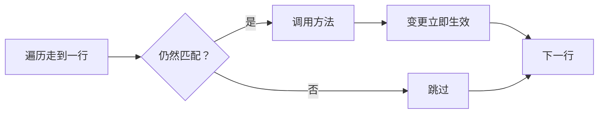

结构变更是指改变实体拥有哪些组件、或者改变有哪些实体的操作：创建（`CreateEntity`、`Instantiate`、`Clone`）、销毁、添加组件
（`Set`、对不存在的组件 `GetOrAdd`）、移除组件。EasyEcs 里这些变更**立即生效**，遍历到一半也一样：没有命令缓冲要先录制再回放，
死亡系统在做出判断的地方就给单位打上 `Dead`，紧接着的下一个系统就能看到这具尸体。

## 什么时候用 [#when-to-use-it]

<Callout type="idea" title="适合">
  在做出决定的地方直接改实体：死亡系统里打上 `Dead`，过期的子弹在它自己的循环里销毁，开火的系统里生成子弹，造成眩晕的那次命中里
  加上 `Stunned`。来来去去的状态用标签：移除组件再加回来不会搬动任何数据。
</Callout>

<Callout type="warn" title="不适合">
  跨过结构变更继续拿着 `ref`（方法自己的 `ref` 参数除外）。在批处理方法、并行方法、实现了 `INoStructuralChanges` 的 job 里改结构：
  它们的结构是冻结的，一改就抛异常。每个 tick 都在变的值：用字段比每个 tick 加一次、删一次组件便宜。
</Callout>

## 怎么用 [#how-to-use-it]

<Steps>
<Step>

### 拿到 `Entity`（或 `World`） [#take-the-entity]

`[ForEach]` 方法通过 `Entity` 参数改结构，通过 `World` 参数创建实体。生成器看到这些参数，会给方法配一个能察觉变更的遍历。

```csharp
public record struct Lifetime(int Ticks) : IComponent;
public record struct Projectile(EntityId Owner) : IComponent;
public record struct Weapon(int Cooldown) : IComponent;

public class ExpireSystem : EcsSystem
{
    [ForEach]
    static void Expire(Entity shot, ref Lifetime life)
    {
        if (--life.Ticks <= 0) shot.Destroy();         // 立即销毁，就在遍历途中
    }
}

public class FireSystem : EcsSystem
{
    [ForEach, Without<Dead>]
    static void Fire(Entity shooter, ref Weapon weapon, in Position at, World world)
    {
        if (weapon.Cooldown-- > 0) return;
        weapon.Cooldown = 10;
        world.CreateEntity(at, new Lifetime(30), new Projectile(shooter.Id));   // 正在进行的遍历不会访问它
    }
}
```

</Step>
<Step>

### 在一次更新里运行 [#run-them]

```csharp
var world = new World();
world.AddSystem<FireSystem>();
world.AddSystem<ExpireSystem>();                     // 能看到这次更新里新生成的子弹
world.CreateEntity(new Position(0, 0), new Weapon(0));
world.Update();
int shots = world.Count<Projectile>();               // 1
```

</Step>
</Steps>

### 遍历时增删实体和组件 [#during-a-pass]

在 `[ForEach]` 方法、`ForEach` job 和 `Query` 循环里，都可以创建、销毁实体，给当前实体或其他任何实体添加、移除组件。规则如下：

- **一次遍历里，每个实体最多被访问一次。**
- **轮到它之前就不再匹配的实体会被跳过**：被销毁了、被查询的组件被移除了、或者加上了被排除的组件。
- **遍历途中进入匹配表的实体，这次遍历不会访问**：新创建的，或者搬进了匹配的表。下一次遍历会看到它们。
- **不用搬行就重新拿回被查询组件的实体**（它的行只是置上一个存在位），如果遍历还没走到它那一行，就会被访问。



### 跨过变更的 ref [#refs-across-a-change]

- **方法自己的 `ref` 参数仍然可写**：方法体改变了当前实体所在的表时，遍历会在方法返回后把这些写入复制到实体的新行。`in` 参数看到的仍是变更前的值。
- **其他任何 `ref`**（来自 `entity.Get<T>()`、`Query` 元素或别的实体）只保证在下一次结构变更之前有效：要么在变更之前写完，要么变更之后重新获取。
- **处理单个实体的代码**（一个请求、一条消息）用 [`entity.Run`](/zh/docs/guide/queries#run-on-one-entity) 得到和方法自己的 `ref` 参数同样的保证：job 的 ref 跨过它自己做的结构变更仍指向这个实体的值，job 返回时，`Writes` 里的组件会被带到新行。

```csharp
public class HitSystem : EcsSystem
{
    [ForEach, Without<Dead>]
    static void Hit(Entity unit, ref Health hp)
    {
        hp.Value -= 10;
        if (hp.Value <= 0) unit.SetDead();   // 这一行搬到带 Dead 的表
        hp.Value = Math.Max(hp.Value, 0);    // 仍然是这个实体的 Health：会被带到新行
    }
}
```

细节，以及为什么 `ref` 永远不能跨过 `await`，见 [`ref` 与 `await`](/zh/docs/guide/refs-and-await)。

### 冻结结构的遍历 [#frozen-passes]

有些遍历会跨多次调用持有指向表的 ref 或 span，所以运行期间会冻结 World 的结构，此时做变更会抛 `InvalidOperationException`，而不是把行写坏：

- **批处理方法**（`Span<T>` 参数）和 `ForEachBatch` job；
- **实现了 `INoStructuralChanges` 的 job**，包括生成器为不带 `Entity`、`World` 的方法写的 job；
- **并行方法**、`ForEachParallel` / `ForEachEntityParallel`，以及[并行阶段](/zh/docs/guide/threading#parallel-systems)。

分析器会报告承诺不改结构却改了的方法（[EECS013](/zh/docs/guide/analyzer#eecs013)），以及从其他线程做的结构变更（[EECS014](/zh/docs/guide/analyzer#eecs014)）。

### 表保持紧凑 [#keeping-tables-dense]

表会自己保持紧凑。不在遍历中时，表的最后一行立刻补上被销毁实体的空位。在遍历中，离开的行变成墓碑，遍历会跳过它们；最后一个遍历
结束时墓碑被清理，job 抛异常时也一样。没有 `Dispose` 就被丢掉的查询枚举器（`foreach` 总会 `Dispose`）会让它的遍历一直开着，
直到下一次 `Update()` 把它关掉。不需要调用任何东西，也不需要监控。

### 一次改很多实体 [#bulk]

要整批修改实体，用批量操作，只过一次结构闸门：

```csharp
var wave = new Entity[1_000];
world.CreateEntities(wave, new Position(0, 0), new Lifetime(60));
int expired = world.DestroyEntities<Lifetime>(QueryFilter.Create().With<Dead>());
```

`SetAll`、`RemoveAll`、`DisableAll`、`EnableAll` 对每个匹配的实体修改一个组件，每次处理一整个 64 行的字：见[批量操作](/zh/docs/guide/bulk)。

一个一个创建的实体（启动时加载、按数据逐个构造）会让表成倍扩容。先预留：`EnsureCapacity<T1, …, Tn>(count)` 把正好有这些组件的表和实体存储一次扩到循环要用的大小，
接下来 `count` 次带这些组件的创建都不再扩容：

```csharp
world.EnsureCapacity<Position, Lifetime>(100_000);
for (int i = 0; i < 100_000; i++) world.CreateEntity(new Position(i, 0), new Lifetime(60));
```

`CreateEntities` 自己会预留。预制体的实例用 `EnsureCapacity(prefab, count)`（见[预制体](/zh/docs/guide/prefabs)）；实体分散在很多张表里时，
用 `EnsureEntityCapacity(n)` 只扩实体存储。被[分组](/zh/docs/guide/groups)放进别的表的实体，扩的是那张表。

### 什么会搬动行 [#row-moves]

行移动要把实体的每个组件都复制到另一张表，结构变更真正花钱的就是这一步。大多数变更用不着它：

| 变更 | 行移动 |
| --- | --- |
| `Set` 实体已有的组件 | 没有：只是一次写入（[分组](/zh/docs/guide/groups)组件换了新值时，会搬到对应分组的表） |
| `SetIfChanged` 传入实体现有的值 | 没有，也不写入：不打戳，不重新索引 |
| `SetIfChanged` 传入不同的值 | 和 `Set` 一样 |
| 添加表里已有列的组件（之前移除过的，或时有时无的标签） | 没有：一个存在位 |
| 添加表里没有列的组件 | 一次，搬到有这一列的表 |
| `Set(a, b, …)` 一次加多个表里没有的组件 | 最多一次，不管有几个 |
| `Instantiate(prefab)`、`Instantiate(prefab, in c1, …, in cn)` | 没有：一次行复制，直接进最终的表 |
| 先 `Instantiate(prefab)`，再 `Set` 预制体没有的组件 | 一次复制，再加一次移动 |

所以从预制体生成时，把每个实例需要的值（位置、`ChildOf`）一起交给 `Instantiate`，代价就只有那次复制（见[预制体](/zh/docs/guide/prefabs#instantiate-with-values)）。

`SetIfChanged` 只有在添加组件时（或者像 `Set` 那样处理分组组件、已禁用的组件时）才是结构变更。分析器无法预知是哪种情况，所以和 `Set`
一样把 `SetIfChanged` 算作可能改结构的调用：在 `[ForEach]` 方法里对实体调用它，方法要带 `Entity` 或 `World` 参数
（[EECS013](/zh/docs/guide/analyzer#eecs013)）。只想在值变了的时候才写当前实体的追踪组件，改用 `Mut<T>` 参数
（见[变更追踪](/zh/docs/guide/change-tracking)）。

## 完整例子 [#full-example]

一座炮塔每隔一个 tick 开一次火，血量不断下降直到死亡：子弹在遍历途中创建、销毁，`Dead` 标签在判定死亡的地方打上。把这几个
文件放进一个引用了 EasyEcs 的控制台项目（`dotnet add package EasyEcs`），用 `dotnet run` 运行。

<Accordions>
<Accordion title="Components.cs">

```csharp title="Components.cs" doccheck=example
using EasyEcs;

// 炮塔：一把有冷却的武器，和每个 tick 都在下降的血量。
public record struct Weapon(int Cooldown) : IComponent;
public record struct Health(int Value) : IComponent;

// 子弹：谁打出的，还能飞几个 tick。
public record struct Projectile(EntityId Owner) : IComponent;
public record struct Lifetime(int Ticks) : IComponent;

// 标签：炮塔没血了。
public struct Dead : IComponent;
```

</Accordion>
<Accordion title="Systems.cs">

```csharp title="Systems.cs" doccheck=example
using EasyEcs;

// 炮塔每个 tick 掉 30 点血，在做出判断的地方打上 Dead。
public class WearSystem : EcsSystem
{
    [ForEach, Without<Dead>]
    static void Wear(Entity turret, ref Health hp)
    {
        hp.Value -= 30;
        if (hp.Value <= 0)
        {
            // 这一行立刻搬到带 Dead 的表。
            turret.SetDead();
            // hp 仍然是这座炮塔的 Health：这次写入会被带到新行。
            hp.Value = 0;
            Console.WriteLine($"  {turret} is dead");
        }
    }
}

// 每隔一个 tick 开一次火。本次更新里早先打上 Dead 的炮塔不再匹配。
[UpdateAfter<WearSystem>]
public class FireSystem : EcsSystem
{
    [ForEach, Without<Dead>]
    static void Fire(Entity turret, ref Weapon weapon, World world)
    {
        if (weapon.Cooldown > 0)
        {
            weapon.Cooldown--;
            return;
        }

        weapon.Cooldown = 1;
        var shot = world.CreateEntity(new Projectile(turret.Id), new Lifetime(3));
        Console.WriteLine($"  {turret} fires {shot}");
    }
}

// 给每颗子弹倒计时，包括本次更新里刚打出的，
// 并在子弹自己的遍历途中销毁它。
[UpdateAfter<FireSystem>]
public class ExpireSystem : EcsSystem
{
    [ForEach]
    static void Expire(Entity shot, ref Lifetime life)
    {
        life.Ticks--;
        if (life.Ticks == 0)
        {
            Console.WriteLine($"  {shot} expires");
            shot.Destroy();
        }
    }
}
```

</Accordion>
<Accordion title="Program.cs">

```csharp title="Program.cs" doccheck=example
using EasyEcs;

using var world = new World();
world.AddSystem<WearSystem>();
world.AddSystem<FireSystem>();
world.AddSystem<ExpireSystem>();

var turret = world.CreateEntity(new Weapon(0), new Health(100));

for (int tick = 1; tick <= 5; tick++)
{
    Console.WriteLine($"tick {tick}");
    world.Update();
    int shots = world.Count<Projectile>();
    Console.WriteLine($"  hp {turret.Health.Value}, shots in flight {shots}");
}
```

</Accordion>
</Accordions>

输出：

```text
tick 1
  Entity 0v1 fires Entity 1v1
  hp 70, shots in flight 1
tick 2
  hp 40, shots in flight 1
tick 3
  Entity 0v1 fires Entity 2v1
  Entity 1v1 expires
  hp 10, shots in flight 1
tick 4
  Entity 0v1 is dead
  hp 0, shots in flight 1
tick 5
  Entity 2v1 expires
  hp 0, shots in flight 0
```

第 1 个 tick 打出的子弹，同一次更新里就被 `ExpireSystem` 倒计时了一次，所以在第 3 个 tick 而不是第 4 个 tick 消失。第 4 个
tick，`WearSystem` 给炮塔打上 `Dead`，紧接着运行的 `FireSystem` 就不再访问它。

## 怎么用得快 [#how-to-use-it-fast]

| 别这样 | 这样做 | 原因 |
| --- | --- | --- |
| 录进命令缓冲，之后回放 | 在做决定的地方直接改 | 不用录制、不用回放、不分配 |
| 每个 tick 加一次、删一次组件 | 用字段；持续几个 tick 的状态用标签 | 表的掩码里已有的标签只翻转一个存在位 |
| `Set(a)` 后再 `Set(b)` | `Set(a, b)` | 写法更简洁，性能相同 |
| 先 `Instantiate(prefab)`，再 `Set` 预制体没有的组件 | `Instantiate(prefab, in c1, …, in cn)` | 一次行复制直接进最终的表，不移动 |
| 逐个创建已知数量的实体 | `CreateEntities`，或循环前调用 `EnsureCapacity<T1, …, Tn>(count)` | 只扩容一次，不用表满一次翻一倍（[EECS031](/zh/docs/guide/analyzer#eecs031)） |
| 按过滤条件逐个修改 | [批量操作](/zh/docs/guide/bulk)、`DestroyEntities<T>(filter)` | 只过一次闸门，按整字（64 行）处理（[EECS030](/zh/docs/guide/analyzer#eecs030)） |
| 方法只读 `Entity` 参数 | 保持只读（`Id`、`Has`、`Get`） | 遍历跳过结构变更簿记 |

在查询循环里对 1 万个实体移除再加回 `Health`（`ToggleComponent`），对比一次调用移出三个组件、再一次调用加回（`RemoveMany`，1,000 个实体）：

<BenchTable bench="MicroBenchmarks" methods="ToggleComponent,RemoveMany" />

遍历中发现的结构变更，10 万个单位：每次操作有一部分单位掉血，一次遍历把血量归零的标记为倒下（加标签），第二次遍历把它们复活
（去标签）。EasyEcs 直接改结构；Friflo、Arch、DefaultEcs 录进各自的命令缓冲，每次遍历后回放：

<BenchChart bench="StructuralChangeComparison" params="Killed=1000" title="遍历中标记并复活 10 万个单位中的 1,000 个" />

每次遍历只有 10 个变更时的对比见[对比](/zh/docs/comparison)。

## 开销 [#what-it-costs]

- **可能改结构的遍历**每个实体检查一次存储版本，以便察觉变更；不可能改结构的方法连这一步都省了。
- **移除组件再加回：** 一个存在位。**获得表里没有对应列的组件：** 复制一次行，每种新组合只发生一次（搬运方案会缓存）。
- **带给定组件的 `Instantiate`：** 一次行复制，目标表按“预制体的表 + 给定的组件”缓存。**传入相同值的 `SetIfChanged`：** 一次比较，什么也不改。
- **销毁：** O(组件数)；不在遍历中时立即补洞，否则在最后一个遍历结束时清理。
- **扩容：** 表满了就翻倍，复制一遍已有的行；预留（`EnsureCapacity`、`CreateEntities`）只扩一次，正好扩到需要的行数。
- **预热之后不分配内存**：没有需要扩容的缓冲。

## 常见陷阱 [#pitfalls]

| 错误 | 后果 | 谁能发现 |
| --- | --- | --- |
| 不带 `Entity` 或 `World` 的方法通过组件里的链接改结构 | 遍历拿着指向已搬走行的 ref | [EECS013](/zh/docs/guide/analyzer#eecs013) |
| 批处理方法里改结构 | 抛 `InvalidOperationException`：span 指向表 | [EECS013](/zh/docs/guide/analyzer#eecs013)，运行时也会抛 |
| 并行方法里改结构 | 抛 `InvalidOperationException`：各块运行期间结构是冻结的 | [EECS010](/zh/docs/guide/analyzer#eecs010)，运行时也会抛 |
| 从其他线程改结构 | 和所有者线程发生竞争 | [EECS014](/zh/docs/guide/analyzer#eecs014) |
| 会改结构的 job 却实现了 `INoStructuralChanges` | 变更处抛 `InvalidOperationException` | 运行时 |
| 变更之后还在用 `Get<T>()` 拿到的 `ref` | 可能指向过期的副本或别的实体的行 | 代码审查：重新获取 |
| 指望创建实体的那次遍历访问到它 | 下一次遍历才会访问 | 设计如此 |
| 在系统里调用 `World.Update()` | 系统在自己的运行里再跑一遍，直到栈溢出 | [EECS034](/zh/docs/guide/analyzer#eecs034) |
| 同一个 World 的查询还在遍历时调用 `Update()` | 遍历顺序不确定 | 代码审查 |

## 相关页面 [#related]

<Cards>
  <Card title="ref 与 await" href="/zh/docs/guide/refs-and-await">
    哪些 ref 能跨过变更，为什么没有 ref 能跨过 `await`。
  </Card>
  <Card title="系统与 [ForEach]" href="/zh/docs/guide/systems">
    哪些方法能改结构，哪些在冻结状态下运行。
  </Card>
  <Card title="批量操作" href="/zh/docs/guide/bulk">
    一次修改所有匹配实体的某个组件。
  </Card>
  <Card title="架构" href="/zh/docs/architecture">
    遍历、墓碑和存储版本的内部原理。
  </Card>
</Cards>
