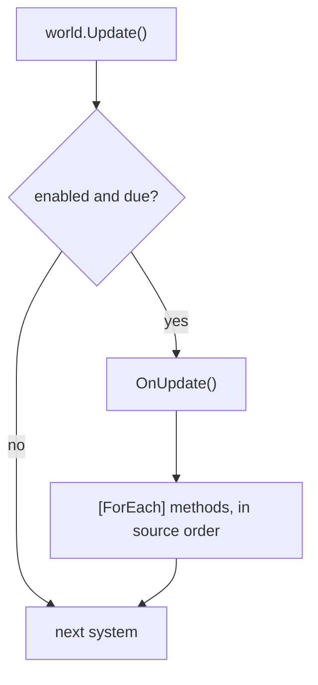

A system is one job of the server's tick: move units, apply burning damage, kill the dead, send state to clients.
It derives from `EcsSystem`, keeps no state of its own (state is in components and singletons) and never references
another system. Its loops are `[ForEach]` methods: a static method whose parameters name the components it reads and
writes, which the source generator compiles into a struct job as fast as a hand-written loop.

## When to use it [#when-to-use-it]

<Callout type="idea" title="Use it for">
  All per-tick behavior: one responsibility per system, one `[ForEach]` method per loop, ordering with
  `[UpdateAfter<T>]`, groups for different cadences (input whenever it arrives, simulation at a fixed tick),
  `UpdateInterval` for work that runs every N-th tick, [`Slices`](#slices) for work spread over several ticks.
  [Group filters](#group-filters) keep a whole group to one kind
  of entity, and a generic group interface gives each type its own group (one group per actor type).
</Callout>

<Callout type="warn" title="Skip it for">
  A one-off pass that a request or a tool runs between ticks: write a [`[ForEach]` runner](#foreach-outside-systems)
  or a [query](/en/docs/guide/queries). State that must survive between ticks: put it in a component or a
  [singleton](/en/docs/guide/singletons), never in a system field ([EECS007](/en/docs/guide/analyzer#eecs007)).
</Callout>

## How to use it [#how-to-use-it]

<Steps>
<Step>

### Write the system [#write-the-system]

Each `[ForEach]` method runs once per matching entity, every update. `ref` parameters are written, `in` parameters
read; attributes filter the entities.

```csharp title="Combat.cs"
public record struct Burning(int Ticks, int Damage) : IComponent;
public struct Player : IComponent;                                         // a tag
public record struct BurnTotals(int Damage) : ISingletonComponent;

public class BurnSystem : EcsSystem
{
    [ForEach, Without<Dead>]                                               // living entities only
    static void Burn(ref Health hp, in Burning burning, ref BurnTotals totals)
    {
        hp.Value -= burning.Damage;
        totals.Damage += burning.Damage;
    }
}

[UpdateAfter<BurnSystem>]                                                  // damage first, then death
public class DeathSystem : EcsSystem
{
    [ForEach, Without<Dead>]
    static void Die(Entity unit, in Health hp)
    {
        if (hp.Value <= 0) unit.SetDead();                                 // a structural change, applied now
    }
}
```

</Step>
<Step>

### Add it and update [#add-and-update]

```csharp
var world = new World();
world.AddSingleton<BurnTotals>();                  // BurnSystem reads it: add it before the first update
world.AddSystem<DeathSystem>();                    // added first, runs second: [UpdateAfter] orders it
world.AddSystem<BurnSystem>();
world.CreateEntity(new Health(5), new Burning(3, 10), new Player());

world.Update();                                    // one tick
int dealt = world.BurnTotals.Damage;               // 10
```

</Step>
</Steps>

### Lifecycle [#lifecycle]

| Hook or member | When |
| --- | --- |
| `OnCreate()` | once, when the system is added (`world.AddSystem<T>()` / `AddSystem(system)`) |
| `OnUpdate()` | every update of its group, before its `[ForEach]` methods |
| `[ForEach]` methods | every update, after `OnUpdate`, in source order (a base class's first) |
| `OnDestroy()` | once, on `world.RemoveSystem<T>()` or `world.Dispose()` (reverse order) |
| `World` | the owning world, set before `OnCreate` |
| `Enabled` | `false` skips the system in `Update()` and `Update<TGroup>()` |
| `LastRunTick` | the change tick of its last run ([change tracking](/en/docs/guide/change-tracking#ticks)) |
| `RunCount` | how many times it ran before the current run (0 during the first); a [sliced](#slices) method visits slice `RunCount % N` |
| `Stats`, `Error` | [measurements](#measuring-systems) and the [exception that switched it off](#errors) |

`AddSystem<T>()` returns the system; `GetSystem<T>()` finds one (for tools and tests, never from another system:
[EECS008](/en/docs/guide/analyzer#eecs008)); `world.Systems` lists every system without allocating; `UpdateCount`
counts the default group's updates. A system belongs to one world: adding it to a second throws.

```csharp
var burn = world.GetSystem<BurnSystem>();
foreach (var system in world.Systems) Console.WriteLine(system.GetType().Name);
world.RemoveSystem<BurnSystem>();                  // OnDestroy runs
long updates = world.UpdateCount;
```

### One update [#one-update]



Systems run in registration order unless ordered. Structural changes apply at once, so later methods and systems of
the same update see them. Everything runs on the thread that calls `Update()`, unless
`WorldOptions.ParallelSystems` runs systems with no order and no conflict between them at the same time
([Threading](/en/docs/guide/threading#parallel-systems)); the result is the same as running them in order. To see
the stages the world built, what each system reads and writes and why a system waits for another, print
`world.DescribeSchedule()` (text, or `ToMermaid()` for a diagram:
[Debugging and diagnostics](/en/docs/guide/diagnostics#schedule)).

### Ordering [#ordering]

`[UpdateBefore<T>]` and `[UpdateAfter<T>]` move a system just before or after system `T` (and its subclasses) of the
same group, whatever the order they were added in; the others keep their relative order. The order is resolved when
a system is added: a cycle throws there and the system stays out. The analyzer reports the cycles
([EECS019](/en/docs/guide/analyzer#eecs019)) and cross-group orderings ([EECS020](/en/docs/guide/analyzer#eecs020))
it can see.

### `UpdateInterval` and `UpdatePhase` [#update-interval]

A system that overrides `UpdateInterval` runs every N-th update of its group: on the updates whose count is a
multiple of N, so first on the N-th. `UpdatePhase` (0 to N - 1) shifts which of the N updates it takes, so systems
with the same interval spread their work instead of all running on the same tick. Both must be constants
([EECS018](/en/docs/guide/analyzer#eecs018)); to pause a system, set `Enabled`.

```csharp
public record struct Autosave(long Count) : ISingletonComponent;

public class SaveSystem : EcsSystem
{
    public override int UpdateInterval => 60;      // every 60th update
    public override int UpdatePhase => 30;         // half a cycle after the others with the same interval

    protected override void OnUpdate() => World.GetOrAddAutosave().Count++;
}
```

### Slices: part of the rows per run [#slices]

`UpdateInterval` runs a system over all its rows on every N-th update, so its work comes in spikes.
`[ForEach(Slices = N)]` runs the method on every run of its system over about 1 / N of the rows of every matching
table: each row is visited once per N runs, and the cost per update stays flat. It suits upkeep that every entity
needs now and then but not every tick: AI that re-plans, needs that decay, sessions swept for idleness.

```csharp
public record struct Hunger(float Value) : IComponent;

public class HungerSystem : EcsSystem
{
    // A quarter of the NPCs per update: each one once every four updates, with four updates' worth of hunger.
    [ForEach(Slices = 4)]
    static void Starve(ref Hunger hunger) => hunger.Value = MathF.Min(hunger.Value + 0.04f, 1f);
}
```

- **Which slice:** a run visits slice `RunCount % N`. `RunCount` counts the system's runs before the current one (0
  during the first); runs skipped by `UpdateInterval` or while the system is disabled do not count, a run that throws
  does. `OnUpdate` reads it to know which slice the run visits.
- **Where a table is cut:** at multiples of 64 rows (its presence words), from its row count when the pass starts:
  of a table's w words, slice k takes words w × k / N to w × (k + 1) / N, and the last slice ends at the last row. A
  table of fewer than 64 rows is one piece, visited by one run of the N.
- **Tables rotate:** table i of the match starts its cut at slice (k + i) mod N, so many small tables spread over
  the N runs instead of all landing in one.
- **Rows that move:** a row that moves between runs (a swap-remove fills a hole with the table's last row, a
  structural change moves the entity to another table, a table grows or shrinks across a cut) may be skipped or
  visited twice in one cycle of N runs; the next cycle sees it again. Slice work that tolerates this, not work that
  must happen exactly once per cycle.
- **With an interval:** `UpdateInterval => M` and `Slices = N` visit each row once per N × M updates.
- **Every form:** per-entity methods, [batch methods](#batch-methods) (runs of rows inside the slice) and
  [parallel methods](#parallel-methods) (the slice is cut into chunks).
- **Not with change filters:** `[Changed<T>]`, `[Removed<T>]`, `[ChangedAny<…>]` and `[RemovedAny<…>]` cannot be
  sliced, and `Slices` must be at least 1 ([EECS035](/en/docs/guide/analyzer#eecs035)): every run moves the system's
  `LastRunTick`, so the changes made in the rows of the other slices would be lost.

Outside systems, [`QueryFilter.Slice(index, count)`](/en/docs/guide/queries#filters) does the same for a `ForEach`
call; a [runner](#foreach-outside-systems) with `Slices = N` takes the slice to visit after the world.

### `[ForEach]` methods [#foreach-methods]

A `[ForEach]` method is declared in a class that derives from `EcsSystem` (no `partial` needed). It may be static or
an instance method. Its parameters say what it runs over:

| Parameter | Meaning |
| --- | --- |
| `ref T` / `in T` / `ref readonly T`, `T : IComponent` | 1 to 9 components: `ref` to write, `in` to read |
| [`Mut<T>`](/en/docs/guide/change-tracking#set-if-changed), `T : IComponent` | a component the method writes on some rows: `Value` reads, `Write()` and `SetIfChanged(value)` write, and only the rows written are stamped |
| `ref T` / `in T`, `T : ISingletonComponent` | the world's singleton, resolved once per pass; throws if it was not added |
| `Entity` | the current entity, for structural changes and lookups |
| `World` | the world (for creating entities, other singletons) |
| [`Maybe<T>`](#maybe) | a component the entity may lack |
| `Span<T>` / `ReadOnlySpan<T>`, `EntitySpan` | a [batch method](#batch-methods): runs of rows at once |

| Attribute | Meaning |
| --- | --- |
| `[ForEach]` | run the method for every matching entity; `Parallel = true` for [several threads](#parallel-methods), `Slices = N` for [part of the rows per run](#slices) |
| `[With<T>]` | the entity must have `T`, not passed in; repeatable |
| `[Without<T>]` | the entity must not have `T`; repeatable |
| `[WithAny<T>]` | the entity must have at least one of the method's `[WithAny<T>]` components |
| `[Changed<T>]` | `T` (`ITrackChanges`) was written since the system last ran ([change tracking](/en/docs/guide/change-tracking)) |
| `[Removed<T>]` | the entity lost `T` (`ITrackChanges`) since the system last ran ([removal detection](/en/docs/guide/change-tracking#removal-detection)) |
| `[ChangedAny<T1, …, Tn>]` | at least one of the components (2 to 9, `ITrackChanges`) was written since the system last ran ([any of several](/en/docs/guide/change-tracking#changed-any)) |
| `[RemovedAny<T1, …, Tn>]` | the entity lost at least one of the components since the system last ran |

With no component parameter, the first `[With<T>]` (else the first `[Changed<T>]`) names the queried component:

```csharp
public class CorpseCleanup : EcsSystem
{
    [ForEach, With<Dead>]
    static void Remove(Entity corpse) => corpse.Destroy();
}
```

A method that is static, takes no `World` and uses its `Entity` (if any) only to read (`Id`, `IsAlive`, `Has`,
`Get`, `Read`, `TryGet`, `TryGetRef`) cannot change structure: its job implements `INoStructuralChanges` and walks
each table with no per-entity check. A method that may change structure runs alone, and each entity is still visited
at most once per pass ([Structural changes](/en/docs/guide/structural-changes)).

An `Entity` used only as an identity (`Id`, `Version`, `IsAlive`, `==` / `!=`, converted to an `EntityId`) reaches no
component, so it adds nothing to the system's access: the system is scheduled by its other parameters and may share a
parallel stage. Any other use of the handle (`Has`, `Get`, another call, passing the `Entity` on) can reach any
component, and the system runs alone ([parallel systems](/en/docs/guide/threading#parallel-systems)).

Methods run in source order, and a derived system runs its base class's `[ForEach]` methods first. Keep a system's
methods in one file: across the files of a partial class the order is per file.

#### Optional components: `Maybe<T>` [#maybe]

`Maybe<T>` takes a component the entity may lack: the method visits every entity with its other components, and
`HasValue` says whether this one also has `T`. Writing through `Value` writes `T` (a tracked one is stamped);
reading only is a read.

```csharp
public record struct Shield(int Bonus) : IComponent;
public record struct Stamina(int Value) : IComponent;

public class Regeneration : EcsSystem
{
    [ForEach]
    static void Regenerate(ref Stamina stamina, Maybe<Shield> shield) =>
        stamina.Value += shield.HasValue ? 1 + shield.Value.Bonus : 1;
}
```

It saves writing two methods when the optional part is small. In the hottest loops, two methods split by
`[With<Shield>]` and `[Without<Shield>]` are faster: no test per row (see the numbers below). A method that changes
no structure finds the optional column once per run of rows; one that changes structure looks it up per entity.

### Batch methods [#batch-methods]

A method whose component parameters are spans receives runs of consecutive matching rows: element `i` of every span
belongs to the same entity, and a table where every row matches is one call. Its other parameters can be singletons
and an `EntitySpan` (`entities[i]` is built only when indexed), nothing else
([EECS009](/en/docs/guide/analyzer#eecs009)). The spans point into the tables, so the structure is frozen while it
runs: a change throws, and [EECS013](/en/docs/guide/analyzer#eecs013) reports it at compile time.

```csharp
using System.Numerics;
using System.Runtime.InteropServices;

public class DriftSystem : EcsSystem
{
    [ForEach, Without<Dead>]
    static void Drift(Span<Position> positions, ReadOnlySpan<Velocity> velocities)
    {
        // The JIT does not vectorize loops on its own. Two floats each: as Vector<float>, every lane is a coordinate
        var p = MemoryMarshal.Cast<Position, Vector<float>>(positions);
        var v = MemoryMarshal.Cast<Velocity, Vector<float>>(velocities);
        for (int i = 0; i < p.Length; i++) p[i] += v[i];
        var pf = MemoryMarshal.Cast<Position, float>(positions);
        var vf = MemoryMarshal.Cast<Velocity, float>(velocities);
        for (int i = p.Length * Vector<float>.Count; i < pf.Length; i++) pf[i] += vf[i];   // the rows left over
    }
}
```

A scalar loop over spans gains little over a per-entity method; write a batch method to vectorize.

### Parallel methods [#parallel-methods]

`[ForEach(Parallel = true)]` cuts the matching rows into chunks (about four per thread, a multiple of 64 rows,
between 1,024 and `World.ParallelChunkRows` = 16,384) and runs them on the calling thread plus up to
`WorldOptions.MaxDegreeOfParallelism - 1` thread-pool threads. It is for heavy per-entity work (path finding,
steering, AI scoring) over tens of thousands of entities; for light work the hand-off costs more than it saves.

```csharp
public record struct Clock(float Time) : ISingletonComponent;

public class SteeringSystem : EcsSystem
{
    [ForEach(Parallel = true), Without<Dead>]
    static void Steer(ref Velocity velocity, in Position position, in Clock clock) =>
        velocity = new Velocity(MathF.Cos(clock.Time + position.X), MathF.Sin(clock.Time + position.Y));
}
```

The method must be able to run on several threads at once ([EECS010](/en/docs/guide/analyzer#eecs010)): no
structural change, per entity (not a batch method), singletons only as `in`. It also must not write what another
row's run reads, such as another entity through `Get`. Fewer than two chunks run on the calling thread. It allocates
nothing after its first update.

A method that writes a tracked component (a `ref` or a [`Mut<T>`](/en/docs/guide/change-tracking#set-if-changed)
parameter) is cut at multiples of 4,096 rows, at least 4,096: each block of 4,096 rows shares one change-tick summary
per column, and two chunks of one block would race on it. A table of 4,096 rows or fewer is then one chunk, on one
thread.

### System groups [#system-groups]

`world.Update()` runs the default group. A system marked `[UpdateInGroup<TGroup>]` (`TGroup` a
`struct : ISystemGroup`) runs only when `world.Update<TGroup>()` is called. Use groups for different cadences: a
server can apply input whenever it arrives and simulate at a fixed tick.

```csharp
public struct InputGroup : ISystemGroup;

[UpdateInGroup<InputGroup>]
public class ApplyInputSystem : EcsSystem
{
    [ForEach, With<Player>]
    static void Apply(ref Velocity velocity) => velocity = new Velocity(velocity.X * 0.9f, velocity.Y * 0.9f);
}
```

```csharp
world.AddSystem<ApplyInputSystem>();
world.Update<InputGroup>();   // whenever input arrives
world.Update();               // fixed tick: the default group
```

Ordering, `UpdateInterval`, `UpdatePhase` and `Enabled` apply within each group, and the attribute is inherited.
Updating a group with no systems does nothing.

#### Group filters [#group-filters]

`[With<T>]`, `[Without<T>]` and `[WithAny<T>]` on the group struct join every `[ForEach]` method of its systems: a
whole group can leave frozen or inactive entities out without repeating the filter on each method. A group's
`[WithAny<T>]` joins the method's own `[WithAny<T>]` set, so it widens the "at least one of" test: a group with
`[WithAny<A>]` and a method with `[WithAny<B>]` select entities with `A` or `B`. Queries a system makes in `OnUpdate`
are its own, and [`[ForEach]` runners](#foreach-outside-systems) belong to no group, so no group filter applies to
them. A filter attribute on a struct that is not a group is a compile error
([EECS023](/en/docs/guide/analyzer#eecs023)).

```csharp
[Without<Frozen>]
public struct Gameplay : ISystemGroup;              // no method of the group sees a frozen entity

[UpdateInGroup<Gameplay>]
public class MoveSystem : EcsSystem
{
    [ForEach]
    static void Move(ref Position p, in Velocity v) => p = new Position(p.X + v.X, p.Y + v.Y);
}
```

A group that a generic interface describes cannot name its filter in an attribute: C# refuses a type parameter as the
type argument of an attribute (`[With<In<TActor>>]` on `IActor<TActor>` is CS8968). The group implements
`IGroupWith<T>` or `IGroupWithout<T>` instead, here or through an interface, and gets the same filter: one interface
then gives every actor type its group.

The actor pattern goes one step further: one type per kind of actor is at once its key component (indexed, so a
message finds its actor), its system group and, through the interface, the group's filter:

```csharp
public struct In<TActor> : IComponent;             // the tag of one kind of actor

public interface IActor<TSelf> : IComponent, IIndexed<TSelf>, ISystemGroup, IGroupWith<In<TSelf>>
    where TSelf : struct, IActor<TSelf>, IEquatable<TSelf>;   // IIndexed requires IEquatable

// Key component, index key and system group in one type. Key is implemented explicitly: a public
// Key property would be printed by the record's ToString(), which would print Key again, forever.
public readonly record struct Shop(long Id) : IActor<Shop>
{
    Shop IIndexed<Shop>.Key => this;
}

public record struct Stock(int Items) : IComponent;

[UpdateInGroup<Shop>]
public class RestockSystem : EcsSystem
{
    [ForEach]                                       // only entities tagged In<Shop>
    static void Restock(ref Stock stock) => stock.Items = Math.Max(stock.Items, 10);
}
```

```csharp
world.AddSystem<RestockSystem>();
world.CreateEntity(new Shop(7), new In<Shop>(), new Stock(0));
world.Update<Shop>();                               // the shop systems, over the shop actors only
bool open = world.ShopIndex.TryFind(new Shop(7), out var shop);   // a message finds its actor
```

The [Actors sample](https://github.com/JasonXuDeveloper/EasyEcs/tree/master/samples/Actors) is the whole program:
two kinds of actors, messages handled with [`entity.Run`](/en/docs/guide/queries#run-on-one-entity), activation and
saving.

### Generic systems [#generic-systems]

A system can be generic. Each closed type is a system of its own, with its own generated job and access set, so
`CountOf<Position>` and `CountOf<Health>` are added, ordered and scheduled independently. A closed generic system can
be a base class: its `[ForEach]` methods run before the subclass's. A closed type the code never names (built by
reflection) has its code closed on first use.

```csharp
public record struct Tally(int Count) : ISingletonComponent;

public class CountOf<T> : EcsSystem where T : struct, IComponent   // world.AddSystem<CountOf<Position>>()
{
    [ForEach] static void Count(in T component, ref Tally tally) => tally.Count++;
}
```

A system's `[ForEach]` method itself cannot be generic: nothing would supply its type arguments
([EECS004](/en/docs/guide/analyzer#eecs004)). Attribute type arguments cannot name type parameters (C# rule CS8968),
so filters such as `[With<T>]` name concrete types.

### `[ForEach]` outside systems [#foreach-outside-systems]

A `[ForEach]` method in a type that is not an `EcsSystem` is a runner: a pass the host runs itself, for example
between ticks to answer a request. The generator writes an entry point for it, a static method of the type with the
same name that takes the `World` and then the method's other values, and runs the job once over the world.

Besides components, singletons, `Entity` and `World`, a runner may take values of any other type; the entry point
takes them from the caller, `ref` ones included, so a runner can return results through them.

```csharp
public record struct Gold(int Amount) : IComponent, ITrackChanges;

public static class Reports
{
    [ForEach, Without<Dead>]
    static void SumHealth(in Health hp, ref long total) => total += hp.Value;

    [ForEach, Changed<Gold>]
    static void Rich(in Gold gold, ref int count, int threshold) { if (gold.Amount >= threshold) count++; }
}
```

A generic runner counts the living entities that have any component:

```csharp
public static class Census
{
    [ForEach, Without<Dead>]
    static void CountAlive<T>(in T component, ref int count) where T : struct, IComponent => count++;
}
```

```csharp
long total = 0;
Reports.SumHealth(world, ref total);              // the generated entry point
ulong mark = world.ChangeTick;
int rich = 0;
Reports.Rich(world, mark, ref rich, 1_000);       // [Changed<T>]: the tick comes after the world
int alive = 0;
Census.CountAlive<Health>(world, ref alive);      // a generic runner: the type arguments first
```

- The method must be static ([EECS005](/en/docs/guide/analyzer#eecs005)); it may be private, and the entry point is
  public when the types it names are public.
- With `[Changed<T>]`, `[Removed<T>]`, `[ChangedAny<…>]` or `[RemovedAny<…>]` the entry point takes the tick to
  look back from, since a runner has no last run of its own; with `Slices = N` it takes the slice (0 to N - 1).
- Runners may be generic, or members of a generic type: the entry point takes the type arguments.
- No [group filter](#group-filters) applies to a runner: it belongs to no group.
- Batch and parallel runners follow the rules of [batch methods](#batch-methods) and [parallel methods](#parallel-methods).
- The entry point must not collide with another method of the type ([EECS021](/en/docs/guide/analyzer#eecs021)), and
  a local function cannot be a runner ([EECS024](/en/docs/guide/analyzer#eecs024)).
- Call it on the world's owner thread, like any structural code.

### Measuring systems [#measuring-systems]

With `WorldOptions.MeasureSystems`, every run of a system (its `OnUpdate` plus its `[ForEach]` methods) is measured:
`system.Stats` holds `Runs`, `Last`, `Total` and `Average`, the bytes the run allocated (`LastAllocated`,
`TotalAllocated`) and the entities its `[ForEach]` methods matched (`LastEntities`, `TotalEntities`). Each run reads
the clock and the thread's allocation counter twice, and each `[ForEach]` pass counts its matches once; off, it costs
one field test per run. Read it between updates, for example from a diagnostics endpoint:

```csharp
var measured = new World(new WorldOptions { MeasureSystems = true });
measured.AddSingleton<BurnTotals>();
measured.AddSystem<BurnSystem>();
measured.Update();
var stats = measured.GetSystem<BurnSystem>().Stats;
Console.WriteLine($"burn: {stats.Last.TotalMicroseconds} μs, average {stats.Average.TotalMicroseconds} μs over {stats.Runs} runs");
```

### Errors [#errors]

By default an exception thrown by a system propagates out of `Update()` (and out of `Dispose()` for `OnDestroy`).
With `SystemErrors = SystemErrorPolicy.Disable`, the failing system is switched off, its exception is kept in
`system.Error`, and the update goes on with the next system. A failure is data: read it between updates. Setting
`Enabled = true` clears `Error` and retries the system. A system that failed still counts as run: its
`LastRunTick` moves on, so its `[Changed<T>]` methods do not visit again the rows written before the failed
run.

```csharp
var guarded = new World(new WorldOptions { SystemErrors = SystemErrorPolicy.Disable });
guarded.AddSingleton<BurnTotals>();
guarded.AddSystem<BurnSystem>();
guarded.Update();
foreach (var system in guarded.Systems)                   // a health check, between updates
    if (system.Error is { } error) Console.Error.WriteLine($"{system.GetType().Name} is off: {error.Message}");
```

`Update()` after `Dispose()` throws `ObjectDisposedException`.

What else a running world can tell you (its tables, an entity's components, memory):
[Debugging and diagnostics](/en/docs/guide/diagnostics).

## Full example [#full-example]

A group with a filter, two systems ordered inside it, and a method filter: three units move, one of them on the
ground and one frozen. Put the files in a console project that references EasyEcs (`dotnet add package EasyEcs`)
and run it with `dotnet run`.

<Accordions>
<Accordion title="Components.cs">

```csharp title="Components.cs" doccheck=example
using EasyEcs;

public record struct Position(float X, float Y) : IComponent;

public record struct Velocity(float X, float Y) : IComponent;

// A unit on the ground slows down; a frozen unit does not move at all.
public struct Grounded : IComponent;

public struct Frozen : IComponent;

// The simulation group: none of its methods sees a frozen unit.
[Without<Frozen>]
public struct Simulation : ISystemGroup;
```

</Accordion>
<Accordion title="Systems.cs">

```csharp title="Systems.cs" doccheck=example
using EasyEcs;

// Moves every unit by its velocity.
[UpdateInGroup<Simulation>]
public class MoveSystem : EcsSystem
{
    [ForEach]
    static void Move(ref Position position, in Velocity velocity)
    {
        position = new Position(position.X + velocity.X, position.Y + velocity.Y);
    }
}

// Halves the velocity of grounded units, before they move.
[UpdateInGroup<Simulation>, UpdateBefore<MoveSystem>]
public class FrictionSystem : EcsSystem
{
    [ForEach, With<Grounded>]
    static void Slow(ref Velocity velocity)
    {
        velocity = new Velocity(velocity.X / 2, velocity.Y / 2);
    }
}
```

</Accordion>
<Accordion title="Program.cs">

```csharp title="Program.cs" doccheck=example
using EasyEcs;

using var world = new World();
// Added in the wrong order on purpose: [UpdateBefore] still runs friction first.
world.AddSystem<MoveSystem>();
world.AddSystem<FrictionSystem>();

var flying = world.CreateEntity(new Position(0, 0), new Velocity(8, 0));
var walking = world.CreateEntity(new Position(0, 0), new Velocity(8, 0), new Grounded());
var frozen = world.CreateEntity(new Position(0, 0), new Velocity(8, 0), new Frozen());

for (int tick = 1; tick <= 2; tick++)
{
    // Runs the systems of the Simulation group only.
    world.Update<Simulation>();
    float x1 = flying.Position.X;
    float x2 = walking.Position.X;
    float x3 = frozen.Position.X;
    Console.WriteLine($"tick {tick}: flying at {x1}, walking at {x2}, frozen at {x3}");
}

// World.Systems lists the systems in the order they run.
foreach (var system in world.Systems)
{
    Console.WriteLine($"run order: {system.GetType().Name}");
}
```

</Accordion>
</Accordions>

It prints:

```text
tick 1: flying at 8, walking at 4, frozen at 0
tick 2: flying at 16, walking at 6, frozen at 0
run order: FrictionSystem
run order: MoveSystem
```

The frozen unit never moves: the group's `[Without<Frozen>]` keeps it out of every method. Friction runs before the
move although it was added second, so the grounded unit loses half its speed before each step.

## How to use it fast [#how-to-use-it-fast]

| Instead of | Do | Why |
| --- | --- | --- |
| `ref` on a component the method only reads | `in` ([EECS025](/en/docs/guide/analyzer#eecs025)) | The system can share a stage; a tracked component is not stamped |
| An `Entity` or `World` parameter the method does not need | Drop it ([EECS026](/en/docs/guide/analyzer#eecs026)) | The job skips structural bookkeeping and may run in parallel |
| An instance `[ForEach]` method | A static one ([EECS029](/en/docs/guide/analyzer#eecs029)) | Proven not to change structure: may share a stage, no per-row checks |
| A scalar loop over many rows | A batch method with `Vector<T>` | SIMD over whole runs of rows |
| `Maybe<T>` in the hottest loop | Two methods with `[With<T>]` / `[Without<T>]` | No presence test per row |
| `Parallel = true` on light work | A plain `[ForEach]` | The hand-off costs more than it saves |
| A filter repeated on every method of a cadence | A [group filter](#group-filters) | Written once |
| Work every tick that could wait | `UpdateInterval` and `UpdatePhase` | Spread over ticks |
| Upkeep over every entity on every N-th tick | [`Slices = N`](#slices) | A flat cost per update instead of a spike |
| A `ref` on a tracked value recomputed every tick that rarely changes | [`Mut<T>`](/en/docs/guide/change-tracking#set-if-changed) with `SetIfChanged` | Only real changes are stamped: `[Changed<T>]` readers visit fewer rows |

A `[ForEach]` system against two plain arrays, `Position += Velocity` over 10,000 entities (`MicroBenchmarks`):

<BenchTable bench="MicroBenchmarks" methods="RawArrayWrite,ForEachSystemWrite" />

An optional component, 100,000 units of which half have a shield: one method with `Maybe<Shield>` against two
methods split by `With` / `Without` (`MaybeBenchmark`):

<BenchTable bench="MaybeBenchmark" />

Heavy steering over 100,000 entities, `[ForEach]` and `[ForEach(Parallel = true)]`, and the same work as an ad-hoc
entity job (`ParallelForEachBenchmark`):

<BenchTable bench="ParallelForEachBenchmark" />

Four systems registered in run order, against the same four registered backwards and ordered by `[UpdateAfter<T>]`:
the order is resolved when they are added (`OrderingBenchmark`):

<BenchTable bench="OrderingBenchmark" />

Against Friflo.Engine.ECS: a method that takes the `Entity` per row, a batch method that builds handles only where
needed, and a method that writes a singleton:

<BenchChart bench="OperationBenchmark" methods="EasyEcs_Entity,Friflo_Entity,EasyEcs_EntityBatch,Friflo_EntityBatch,EasyEcs_Singleton,Friflo_Singleton" title="Per pass, 100,000 entities" />

## What it costs [#what-it-costs]

- **A `[ForEach]` method** is a struct job the JIT inlines into the row loop: no delegate, no allocation.
- **Per system and update:** the `OnUpdate` call, one call per generated job, and one query-cache lookup per method.
- **A group's filters** (`[With<T>]`, `[Without<T>]`, `[WithAny<T>]` on the group type, `IGroupWith<T>`,
  `IGroupWithout<T>`) are read by the generator, so they cost nothing at run time. The tables they exclude cost
  nothing per update: a query's cache holds only the tables that match, so the tables of other kinds of entities in
  the world (other actor types) are never walked by the group's systems.
- **Singleton parameters** are resolved once per pass, not per entity.
- **Ordering** is resolved when systems are added: an update pays nothing for it.
- **`MeasureSystems`** costs, per system run, two clock reads, two allocation counter reads and one `Count` per
  `[ForEach]` pass ([diagnostics](/en/docs/guide/diagnostics#what-it-costs)); one field test per run when off.
- **Parallel methods** allocate nothing after their first update; the runner's work items are reused.
- **Generated code** is registered by a module initializer: systems need no `partial`, no registration call and no
  reflection at update time.

## Pitfalls [#pitfalls]

| Mistake | What happens | Caught by |
| --- | --- | --- |
| A mutable field in a system | State nothing else can see, save or restore | [EECS007](/en/docs/guide/analyzer#eecs007) |
| A system referencing another system | The two can no longer change apart | [EECS008](/en/docs/guide/analyzer#eecs008) |
| A parameter of another type in a system's method | Nothing can supply it | [EECS002](/en/docs/guide/analyzer#eecs002) |
| No component and no `[With<T>]` | Nothing names what to iterate | [EECS003](/en/docs/guide/analyzer#eecs003) |
| A generic `[ForEach]` method in a system | No type arguments | [EECS004](/en/docs/guide/analyzer#eecs004); make the system generic |
| Spans mixed with per-entity parameters | No single value per run | [EECS009](/en/docs/guide/analyzer#eecs009) |
| A parallel method that changes structure or writes a singleton | Races between chunks | [EECS010](/en/docs/guide/analyzer#eecs010) |
| Writing a collection through an `in` parameter | Scheduled as a read, never stamped | [EECS011](/en/docs/guide/analyzer#eecs011) |
| A structural change through a component's link in a method without `Entity` / `World` | The pass keeps refs into moved rows | [EECS013](/en/docs/guide/analyzer#eecs013) |
| `UpdateInterval` that changes | Skipped or repeated runs | [EECS018](/en/docs/guide/analyzer#eecs018) |
| `Slices` below 1, or with `[Changed<T>]`, `[Removed<T>]`, `[ChangedAny<…>]`, `[RemovedAny<…>]` | The changes in the other slices' rows are lost | [EECS035](/en/docs/guide/analyzer#eecs035) |
| A sliced method relied on to visit each row exactly once per cycle | Rows that move between runs can be skipped or visited twice | Code review: slice only work that tolerates it |
| A `Mut<T>` parameter in a batch method | Batch methods take spans | [EECS009](/en/docs/guide/analyzer#eecs009) |
| Orderings in a cycle, or across groups | Throws on `AddSystem`; never applies | [EECS019](/en/docs/guide/analyzer#eecs019), [EECS020](/en/docs/guide/analyzer#eecs020) |
| A private type in a method's parameters | The generated job cannot name it | [EECS022](/en/docs/guide/analyzer#eecs022) |
| `[With<T>]`, `[Without<T>]` or `[WithAny<T>]` on a struct that is not a group | Compile error: the filter would do nothing | [EECS023](/en/docs/guide/analyzer#eecs023) |
| A group's `[With<T>]` or `IGroupWith<T>` with a method's `[Removed<T>]` | Asks for rows that have and lack `T`: the method never runs | [EECS016](/en/docs/guide/analyzer#eecs016) |
| A group's `[With<X>]` with a method's `[Without<X>]` | No entity matches: the method never runs | [EECS049](/en/docs/guide/analyzer#eecs049) |
| A group's `[WithAny<A>]` with a method's `[WithAny<B>]`, read as "A and B" | The sets merge: entities with `A` or `B` | Code review |
| A public `Key => this` on a record struct actor key | `ToString()` prints `Key` forever: stack overflow | [EECS043](/en/docs/guide/analyzer#eecs043) (with a code fix): implement `IIndexed<T>.Key` explicitly |
| `ref` on a component the method only reads | Stamps a tracked component, keeps the system out of shared stages | [EECS025](/en/docs/guide/analyzer#eecs025) |
| An `Entity` or `World` parameter the method never uses | The job keeps its structural bookkeeping | [EECS026](/en/docs/guide/analyzer#eecs026) |
| An allocation in `OnUpdate` or a `[ForEach]` method | Garbage every update | [EECS028](/en/docs/guide/analyzer#eecs028) |
| An instance `[ForEach]` method that uses nothing of its system | Treated as one that may change structure: runs alone, with per-row checks | [EECS029](/en/docs/guide/analyzer#eecs029) |
| `World.Update()` called from a system | The system runs again inside its own run | [EECS034](/en/docs/guide/analyzer#eecs034) |

## Related [#related]

<Cards>
  <Card title="Queries and filters" href="/en/docs/guide/queries">
    The same filters, and struct jobs for ad-hoc passes.
  </Card>
  <Card title="Structural changes" href="/en/docs/guide/structural-changes">
    Creating, destroying, adding and removing inside a `[ForEach]` method.
  </Card>
  <Card title="Threading" href="/en/docs/guide/threading">
    Parallel stages, one world per thread, input from other threads.
  </Card>
  <Card title="Analyzer rules" href="/en/docs/guide/analyzer">
    Every rule a system has to follow, with its fix.
  </Card>
</Cards>
