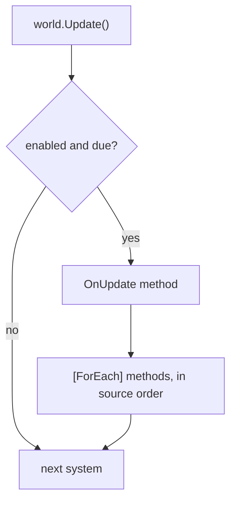

A system is one job of the server's tick: move units, apply burning damage, kill the dead, send state to clients.
It is an `[EcsSystem] ref struct` of static methods, never an object: it keeps no state of its own (state is in
components and singletons) and never references another system. Its loops are `[ForEach]` methods: a static method
whose parameters name the components it reads and writes, which the source generator compiles into a struct job as
fast as a hand-written loop.

## When to use it [#when-to-use-it]

<Callout type="idea" title="Use it for">
  All per-tick behavior: one responsibility per system, one `[ForEach]` method per loop, ordering with
  `[UpdateAfter<T>]`, groups for different cadences (input whenever it arrives, simulation at a fixed tick),
  [`[UpdateInterval(N)]`](#update-interval) for work that runs every N-th tick, [`Slices`](#slices) for work spread
  over several ticks, [`[Consume]`](#consume) for event entities handled once. [Group filters](#group-filters) keep a
  whole group to one kind of entity, and a generic group interface gives each type its own group (one group per actor type).
</Callout>

<Callout type="warn" title="Skip it for">
  A one-off pass that a request or a tool runs between ticks: write a [`[ForEach]`](#foreach-outside-systems) runner
  or a [query](/en/docs/guide/queries). State that must survive between ticks: put it in a component or a
  [singleton](/en/docs/guide/singletons), never in a static field of the system ([EECS007](/en/docs/guide/analyzer#eecs007)).
</Callout>

## How to use it [#how-to-use-it]

<Steps>
<Step>

### Write the system [#write-the-system]

A system is a `ref struct` marked `[EcsSystem]` that declares static members only. Each `[ForEach]` method runs once
per matching entity, every update. `ref` parameters are written, `in` parameters read; attributes filter the entities.

```csharp title="Combat.cs"
public record struct Burning(int Ticks, int Damage) : IComponent;
public struct Player : IComponent;                                         // a tag
public record struct BurnTotals(int Damage) : ISingletonComponent;

[EcsSystem]
public ref struct BurnSystem
{
    [ForEach, Without<Dead>]                                               // living entities only
    static void Burn(ref Health hp, in Burning burning, ref BurnTotals totals)
    {
        hp.Value -= burning.Damage;
        totals.Damage += burning.Damage;
    }
}

[EcsSystem, UpdateAfter<BurnSystem>]                                       // damage first, then death
public ref struct DeathSystem
{
    [ForEach, Without<Dead>]
    static void Die(Entity unit, in Health hp)
    {
        if (hp.Value <= 0) unit.SetDead();                                 // a structural change, applied now
    }
}
```

</Step>
<Step>

### Add it and update [#add-and-update]

```csharp
var world = new World();
world.AddSingleton<BurnTotals>();                  // BurnSystem reads it: add it before the first update
world.AddSystem<DeathSystem>();                    // added first, runs second: [UpdateAfter] orders it
world.AddSystem<BurnSystem>();
world.CreateEntity(new Health(5), new Burning(3, 10), new Player());

world.Update();                                    // one tick
int dealt = world.BurnTotals.Damage;               // 10
```

</Step>
</Steps>

### Lifecycle [#lifecycle]

A system's hooks are static methods marked with an attribute. Each takes the `World`, the `SystemHandle`, both (in
either order) or neither, returns void, and a system has at most one of each
([EECS076](/en/docs/guide/analyzer#eecs076)):

| Hook | When |
| --- | --- |
| `OnCreate` | once, when the system is added (`world.AddSystem<T>()`) |
| `OnUpdate` | every run of the system, before its `[ForEach]` methods |
| `[ForEach]` methods | every run, after the `OnUpdate` method, in declaration order |
| `OnDestroy` | once, on `world.RemoveSystem<T>()` or `world.Dispose()` (reverse order) |

```csharp
public record struct Wave(int Number) : ISingletonComponent;

[EcsSystem]
public ref struct WaveSystem
{
    static void OnCreate(World world) => world.SetWave(0);             // the data it works on

    static void OnUpdate(World world, SystemHandle system)
    {
        if (system.RunCount % 600 == 0) world.Wave.Number++;              // every 600th run
    }

    static void OnDestroy(World world) => world.RemoveWave();
}
```

The world keeps what it knows about a system as data, and a `SystemHandle` points at it, as an `Entity` points at a
row:

| `SystemHandle` member | What it is |
| --- | --- |
| `Enabled` | `false` skips the system in `Update()` and `Update<TGroup>()`; `true` clears `Error` |
| `LastRunTick` | the change tick of its last run ([change tracking](/en/docs/guide/change-tracking#ticks)) |
| `RunCount` | how many times it ran before the current run (0 during the first); a [sliced](#slices) method visits slice `RunCount % N` |
| `Stats`, `Error` | [measurements](#measuring-systems) and the [exception that switched it off](#errors) |
| `Name`, `Type`, `World` | its type's name (`Regen<Health>`), the type, the world it was added to |
| `IsAlive` | false once the system is removed or the world disposed; the other members then throw |

`AddSystem<T>()` returns the handle, and adding a system the world already has throws; `System<T>()` and
`TryGetSystem<T>(out handle)` find one (for tools and tests, never from another system:
[EECS008](/en/docs/guide/analyzer#eecs008)), `HasSystem<T>()` asks; `world.Systems` lists every handle without
allocating; `DefaultUpdateCount` counts the default group's updates. A type that is no `[EcsSystem]` given to any of
them is [EECS077](/en/docs/guide/analyzer#eecs077).

```csharp
if (world.TryGetSystem<BurnSystem>(out var burn)) burn.Enabled = false;
foreach (var system in world.Systems) Console.WriteLine(system.Name);
world.RemoveSystem<BurnSystem>();                  // its OnDestroy runs, its handles turn stale
long updates = world.DefaultUpdateCount;
```

### One update [#one-update]



Systems run in registration order unless ordered. Structural changes apply at once, so later methods and systems of
the same update see them. Everything runs on the thread that calls `Update()`, unless
`WorldOptions.ParallelSystems` runs systems with no order and no conflict between them at the same time
([Threading](/en/docs/guide/threading#parallel-systems)); the result is the same as running them in order. To see
the stages the world built, what each system reads and writes and why a system waits for another, print
`world.DescribeSchedule()` (text, or `ToMermaid()` for a diagram:
[Debugging and diagnostics](/en/docs/guide/diagnostics#schedule)).

### Ordering [#ordering]

`[UpdateBefore<T>]` and `[UpdateAfter<T>]` move a system just before or after system `T` of the same group, whatever the order they were added in; the others keep their relative order. The order is resolved when
a system is added: a cycle throws there and the system stays out. The analyzer reports the cycles
([EECS019](/en/docs/guide/analyzer#eecs019)) and cross-group orderings ([EECS020](/en/docs/guide/analyzer#eecs020))
it can see.

### `[UpdateInterval(N, Phase = P)]` [#update-interval]

A system marked `[UpdateInterval(N)]` runs every N-th update of its group: on the updates whose count is a
multiple of N, so first on the N-th. `Phase` (0 to N - 1) shifts which of the N updates it takes, so systems
with the same interval spread their work instead of all running on the same tick. The attribute takes constants, so
the cadence is fixed when the system is compiled; the generator writes it into the system's code
([EECS083](/en/docs/guide/analyzer#eecs083) reports an interval below 1 or a phase outside 0 to N - 1). To pause a
system, set `Enabled` on its handle.

```csharp
public record struct Autosave(long Count) : ISingletonComponent;

[EcsSystem, UpdateInterval(60, Phase = 30)]        // every 60th update, half a cycle after the others
public ref struct SaveSystem
{
    static void OnUpdate(World world) => world.GetOrAddAutosave().Count++;
}
```

The attribute is all there is to write: the generator puts the cadence into the code it registers for the system, and
the world reads it once, when the system is added.

<Tabs items={['You write', 'The generator writes']}>
<Tab value="You write">

```csharp doccheck=skip
[EcsSystem, UpdateInterval(60, Phase = 30)]
public ref struct SaveSystem
{
    static void OnUpdate(World world) => world.GetOrAddAutosave().Count++;
}
```

</Tab>
<Tab value="The generator writes">

```csharp doccheck=skip
internal readonly struct __SaveSystem_SystemCode : ISystemCode
{
    public static int Interval => 60;                          // [UpdateInterval(60, Phase = 30)]

    public static int Phase => 30;

    public static void Update(World world, SystemHandle system)
    {
        __ForEach.OnUpdate_Update(default, world);             // the OnUpdate method, through UnsafeAccessor
    }

    public static void Access(ref SystemAccess access)
    {
        access.RunAlone();                                     // an OnUpdate method may touch anything
    }

    // Create and Destroy: empty (no OnCreate or OnDestroy method); Loops: none (no [ForEach] method)
}
```

</Tab>
</Tabs>

A cadence computed at run time has no attribute form: put the system in a [system group](#system-groups) and update
the group when it is due.

### Slices: part of the rows per run [#slices]

`UpdateInterval` runs a system over all its rows on every N-th update, so its work comes in spikes.
`[ForEach(Slices = N)]` runs the method on every run of its system over about 1 / N of the rows of every matching
table: each row is visited once per N runs, and the cost per update stays flat. It suits upkeep that every entity
needs now and then but not every tick: AI that re-plans, needs that decay, sessions swept for idleness.

```csharp
public record struct Hunger(float Value) : IComponent;

[EcsSystem]
public ref struct HungerSystem
{
    // A quarter of the NPCs per update: each one once every four updates, with four updates' worth of hunger.
    [ForEach(Slices = 4)]
    static void Starve(ref Hunger hunger) => hunger.Value = MathF.Min(hunger.Value + 0.04f, 1f);
}
```

- **Which slice:** a run visits slice `RunCount % N`. `RunCount` counts the system's runs before the current one (0
  during the first); runs skipped by `UpdateInterval` or while the system is disabled do not count, a run that throws
  does. An `OnUpdate` method that takes the `SystemHandle` reads it to know which slice the run visits.
- **Where a table is cut:** at multiples of 64 rows (its presence words), from its row count when the pass starts:
  of a table's w words, slice k takes words w × k / N to w × (k + 1) / N, and the last slice ends at the last row. A
  table of fewer than 64 rows is one piece, visited by one run of the N.
- **Tables rotate:** table i of the match starts its cut at slice (k + i) mod N, so many small tables spread over
  the N runs instead of all landing in one.
- **Rows that move:** a row that moves between runs (a swap-remove fills a hole with the table's last row, a
  structural change moves the entity to another table, a table grows or shrinks across a cut) may be skipped or
  visited twice in one cycle of N runs; the next cycle sees it again. Slice work that tolerates this, not work that
  must happen exactly once per cycle.
- **With an interval:** `[UpdateInterval(M)]` and `Slices = N` visit each row once per N × M updates.
- **Every form:** per-entity methods, [batch methods](#batch-methods) (runs of rows inside the slice) and
  [parallel methods](#parallel-methods) (the slice is cut into chunks).
- **Not with change filters:** `[Changed<T>]`, `[Removed<T>]`, `[ChangedAny<…>]` and `[RemovedAny<…>]` cannot be
  sliced, and `Slices` must be at least 1 ([EECS035](/en/docs/guide/analyzer#eecs035)): every run moves the system's
  `LastRunTick`, so the changes made in the rows of the other slices would be lost.

Outside systems, [`QueryFilter.Slice(index, of)`](/en/docs/guide/queries#filters) does the same for a `ForEach`
call; a [runner](#foreach-outside-systems) with `Slices = N` takes the slice to visit after the world.

### `[ForEach]` methods [#foreach-methods]

A `[ForEach]` method is a static method of an `[EcsSystem]` (no `partial` needed). Its parameters say what it runs
over:

| Parameter | Meaning |
| --- | --- |
| `ref T` / `in T` / `ref readonly T`, `T : IComponent` | 1 to 9 components: `ref` to write, `in` to read |
| [`Mut<T>`](/en/docs/guide/change-tracking#set-if-changed), `T : IComponent` | a component the method writes on some rows: `Value` reads, `Write()` and `SetIfChanged(value)` write, and only the rows written are stamped |
| `ref T` / `in T`, `T : ISingletonComponent` | the world's singleton, resolved once per pass; throws if it was not added |
| `Entity` | the current entity, for structural changes and lookups |
| `World` | the world (for creating entities, other singletons) |
| [`Maybe<T>`](#maybe) | a component the entity may lack |
| [`ReadOnlyMaybe<T>`](#read-only-maybe) | a component the entity may lack, read only (indexed components too) |
| [`ref Reduce<T>`](/en/docs/guide/threading#reductions), `T : ISingletonComponent, IReduction<T>` | a total over the rows: each chunk (or the pass on one thread) adds into its own partial result, and the combined result replaces singleton `T` |
| [`Scratch<T>`](/en/docs/guide/threading#scratch) | the method's working memory on the running thread (a list, a buffer), kept between rows; adds no access |
| [`Lookup<T>`](/en/docs/guide/threading#lookups), `T : IComponent` | read-only `T` of any entity (`lookup[id]`, `Read`, `Has`; `TryFind`, `Find`, `Count` by key), as it was before the pass; the system reads `T`, in parallel too |
| `Span<T>` / `ReadOnlySpan<T>`, `EntitySpan` | a [batch method](#batch-methods): runs of rows at once |

| Attribute | Meaning |
| --- | --- |
| `[ForEach]` | run the method for every matching entity; `Parallel = true` for [several threads](#parallel-methods) (with `ChunkSize = n`, [the rows a thread takes at a time](/en/docs/guide/threading#chunk-rows)), `Slices = N` for [part of the rows per run](#slices) |
| `[With<T>]` | the entity must have `T`, not passed in; repeatable |
| `[Without<T>]` | the entity must not have `T`; repeatable |
| `[WithAny<T1, T2>]` | the entity must have at least one of the method's `[WithAny<T1, T2>]` components |
| `[Changed<T>]` | `T` (`ITracked`) was written since the system last ran ([change tracking](/en/docs/guide/change-tracking)) |
| `[Removed<T>]` | the entity lost `T` (`ITracked`) since the system last ran ([removal detection](/en/docs/guide/change-tracking#removal-detection)) |
| `[ChangedAny<T1, …, Tn>]` | at least one of the components (2 to 9, `ITracked`) was written since the system last ran ([any of several](/en/docs/guide/change-tracking#changed-any)) |
| `[RemovedAny<T1, …, Tn>]` | the entity lost at least one of the components since the system last ran |

The properties of `[ForEach]`:

<TypeTable
  type={{
    Parallel: {
      type: 'bool',
      description: 'Cut the rows into chunks that several threads claim at once (parallel methods, below).',
      default: 'false',
    },
    ChunkSize: {
      type: 'int',
      description: 'With Parallel: the rows a thread claims at a time, rounded up to 64 (OpenMP schedule(dynamic, n)); 0 chooses from the row count. EECS054.',
      default: '0',
    },
    Slices: {
      type: 'int',
      description: 'Visit about 1 / N of the rows on each run, every row once per N runs (slices, above). Not with change filters: EECS035.',
      default: '1',
    },
    Simd: {
      type: 'SimdMode',
      description: 'Auto: a vector loop when the method qualifies (EECS055 names why not). Require: an error when it does not (EECS056). Off: one row at a time, no message.',
      default: 'SimdMode.Auto',
    },
  }}
/>

With no component parameter, the first `[With<T>]` (else the first `[Changed<T>]`) names the queried component:

```csharp doccheck=expect-EECS030
[EcsSystem]
public ref struct CorpseCleanup
{
    [ForEach, With<Dead>]
    static void Remove(Entity corpse) => corpse.Destroy();
}
```

A method whose whole body is one structural change, the same for every row, is a loop the world runs faster itself: one
[bulk call](/en/docs/guide/bulk) in the `OnUpdate` method changes each table at once
([EECS030](/en/docs/guide/analyzer#eecs030) says so):

```csharp
[EcsSystem]
public ref struct CorpseCleanup
{
    static void OnUpdate(World world) => world.DestroyAll<Dead>();
}
```

A method that takes no `World` and uses its `Entity` (if any) only to read (`Id`, `IsAlive`, `Has`,
`Get`, `Read`, `TryGet`, `TryGetRef`) cannot change structure: its job implements `INoStructuralChanges` and walks
each table with no per-entity check. A method that may change structure runs alone, and each entity is still visited
at most once per pass ([Structural changes](/en/docs/guide/structural-changes)).

An `Entity` used only as an identity (`Id`, `Version`, `IsAlive`, `==` / `!=`, converted to an `EntityId`) reaches no
component, so it adds nothing to the system's access: the system is scheduled by its other parameters and may share a
parallel stage. Any other use of the handle (`Has`, `Get`, another call, passing the `Entity` on) can reach any
component, and the system runs alone ([parallel systems](/en/docs/guide/threading#parallel-systems)).

Methods run in declaration order. Keep a system's methods in one file: across the files of a partial struct the
order is per file.

#### Optional components: `Maybe<T>` [#maybe]

`Maybe<T>` takes a component the entity may lack: the method visits every entity with its other components, and
`HasValue` says whether this one also has `T`. Writing through `Value` writes `T` (a tracked one is stamped);
reading only is a read.

```csharp
public record struct Shield(int Bonus) : IComponent;
public record struct Stamina(int Value) : IComponent;

[EcsSystem]
public ref struct Regeneration
{
    [ForEach]
    static void Regenerate(ref Stamina stamina, Maybe<Shield> shield)
    {
        stamina.Value += shield.HasValue ? 1 + shield.Value.Bonus : 1;
        if (shield.HasValue && shield.Value.Bonus > 0) shield.Value.Bonus--;   // a shield wears down as stamina returns
    }
}
```

It saves writing two methods when the optional part is small. In the hottest loops, two methods split by
`[With<Shield>]` and `[Without<Shield>]` are faster: no test per row (see the numbers below). A method that changes
no structure finds the optional column once per run of rows; one that changes structure looks it up per entity.

#### Read only: `ReadOnlyMaybe<T>` [#read-only-maybe]

`ReadOnlyMaybe<T>` is the same optional parameter with a `ref readonly` `Value`: the method reads `T` and the compiler
holds it to that, so a tracked `T` is never stamped. It is the one optional parameter an
[indexed component](/en/docs/guide/indexes-and-relations#value-indexes) accepts: the `ref` of a `Maybe<T>` could change
the key behind the index's back ([EECS015](/en/docs/guide/analyzer#eecs015)), and reading it through the `Entity`
instead is a lookup per row ([EECS027](/en/docs/guide/analyzer#eecs027)).

| The method, for a component some entities lack | Take |
| --- | --- |
| writes it on the entities that have it | `Maybe<T>` |
| only reads it | `ReadOnlyMaybe<T>` |
| only reads it, and it is indexed (`IIndexed<TKey>`, `IGroup`) | `ReadOnlyMaybe<T>` (a `Maybe<T>` is EECS015) |
| runs in the hottest loop, over many rows | two methods, `[With<T>]` and `[Without<T>]`: no test per row |

```csharp
public partial record struct Guild([LookupKey] int Id, int Level) : IComponent;
public record struct Morale(int Value) : IComponent;
```

```csharp tab="Lookup per row" doccheck=expect-EECS027,expect-EECS055
[EcsSystem]
public ref struct Rally
{
    [ForEach]
    static void Raise(Entity member, ref Morale morale) =>
        morale.Value += member.HasGuild ? 1 + member.Guild.Level : 1;   // the entity searched on every row
}
```

```csharp tab="ReadOnlyMaybe<T>"
[EcsSystem]
public ref struct Rally
{
    [ForEach]
    static void Raise(ref Morale morale, ReadOnlyMaybe<Guild> guild) =>
        morale.Value += guild.HasValue ? 1 + guild.Value.Level : 1;
}
```

The lookups are those of `Maybe<T>`, and so is the cost: the `MaybeBenchmark` table [below](#how-to-use-it-fast). A `Maybe<T>` converts to a `ReadOnlyMaybe<T>`, so a helper that only reads can
take the read-only one from either.

### `[Consume]`: events destroyed after the pass [#consume]

`[ForEach, Consume]` destroys exactly the rows the pass visited: a method over event or command entities (a hit, a
sale, a request from a client) does its work and leaves the destroying to the pass, so no event is handled twice and
none is left behind.

<Callout type="idea" title="Use it for">
  Entities that exist to be handled once, by one system: hits and heals another system spawned, commands a network
  thread queued as entities, messages to an actor, one-shot timers that fired.
</Callout>

<Callout type="warn" title="Skip it for">
  Entities that live on after the method (a buff that lasts, a projectile in flight): `[Consume]` destroys every row
  it visits, so destroy those with `entity.Destroy()` where the method decides. Events that several systems read:
  consume them in the last one, ordered with `[UpdateAfter<T>]`. Sliced methods: a slice's destroys move the rows of
  the other slices ([EECS085](/en/docs/guide/analyzer#eecs085)).
</Callout>

How the rows go depends on the method:

- **A method without structural changes** (no `World`, its `Entity` used only to read) has its rows destroyed
  in bulk once the pass ends: one `DestroyAll` of the method's filter, which frees each table at once. Nothing makes a
  row start or stop matching during such a pass, so the rows that match at its end are the rows it visited. A pass
  that throws destroys nothing, and its rows are visited again.
- **A method that may change structure** (it takes the `World`, or changes something through its `Entity`) destroys
  each row right after the method ran on it. An entity that starts to match during the pass is not destroyed: the
  next run visits it.

<Tabs items={['You write', 'The generator writes']}>
<Tab value="You write">

```csharp
public record struct Sale(int Price) : IComponent;                     // an event entity
public record struct Takings(long Gold) : ISingletonComponent;

[EcsSystem]
public ref struct BankSales
{
    [ForEach, Consume]
    static void Bank(in Sale sale, ref Takings takings) => takings.Gold += sale.Price;
}

public record struct Heal(int Amount, EntityId Target) : IComponent;   // an event entity

[EcsSystem]
public ref struct ApplyHeals
{
    [ForEach, Consume]
    static void Apply(in Heal heal, World world)
    {
        if (world.TryGetEntity(heal.Target, out var target)) target.Health.Value += heal.Amount;
    }
}
```

</Tab>
<Tab value="The generator writes">

```csharp doccheck=skip
// BankSales makes no structural change: one DestroyAll after the pass.
internal readonly struct __BankSales_SystemCode : ISystemCode
{
    public static void Update(World world, SystemHandle system)
    {
        var job0 = new __ForEach.BankJob0 { s1 = ref world.SingletonRef<Takings>().Value };
        if (SystemCode.Measuring(world)) SystemCode.Visit(system, world.Count<Sale>());
        world.ForEach<Sale, __ForEach.BankJob0>(ref job0);
        world.DestroyAll<Sale>(); // [Consume]: the rows the pass visited
    }
}

// ApplyHeals takes the World: each row is destroyed after the method ran on it.
internal ref struct ApplyJob0 : IForEachEntity<Heal>
{
    public World World;

    public void Execute(Entity entity, ref Heal c1)
    {
        __ForEach.Apply_0(default, in c1, World);
        entity.Destroy();
    }
}
```

</Tab>
</Tabs>

```csharp
world.AddSingleton<Takings>();
world.AddSystem<BankSales>();
world.CreateEntity(new Sale(30));
world.CreateEntity(new Sale(12));
world.Update();
long banked = world.Takings.Gold;              // 42
int pending = world.Count<Sale>();             // 0: both sales were consumed
```

Cleanup components retire a consumed entity as they do any destroyed one, and the
[destroy log](/en/docs/guide/change-tracking#destroy-log) records it. A [runner](#foreach-outside-systems) with
`[Consume]` consumes through its entry point the same way. A system with a `[Consume]` method runs alone, as a
system that destroys entities must ([parallel systems](/en/docs/guide/threading#parallel-systems)). A method that
ends with `entity.Destroy()` on every path is [EECS084](/en/docs/guide/analyzer#eecs084), whose code fix writes
`[Consume]`.

### Batch methods [#batch-methods]

A method whose component parameters are spans receives runs of consecutive matching rows: element `i` of every span
belongs to the same entity, and a table where every row matches is one call. Its other parameters can be singletons
and an `EntitySpan` (`entities[i]` is built only when indexed), nothing else
([EECS009](/en/docs/guide/analyzer#eecs009)). The spans point into the tables, so the structure is frozen while it
runs: a change throws, and [EECS013](/en/docs/guide/analyzer#eecs013) reports it at compile time.

```csharp
using System.Buffers;
using System.Runtime.InteropServices;

// The bytes the next packet sends; set by the host, never saved.
[NotSaved]
public record struct Outbox(ArrayBufferWriter<byte> Bytes) : ISingletonComponent;

[EcsSystem]
public ref struct SendPositionsSystem
{
    [ForEach, Without<Dead>]
    static void Send(ReadOnlySpan<Position> positions, ref Outbox outbox) =>
        outbox.Bytes.Write(MemoryMarshal.AsBytes(positions));   // a run of rows in one copy
}
```

Arithmetic per row belongs in a per-entity method, which the generator turns into a vector loop
([EECS103](/en/docs/decisions#d134-eecs103) reports one written by hand over spans); a batch method is for calls that
take a run of rows at once: a copy, a span API, a native call.

### Parallel methods [#parallel-methods]

`[ForEach(Parallel = true)]` cuts the matching rows into chunks (by default about four per thread, a multiple of 64
rows, between 1,024 and `World.MaxChunkRows` = 16,384) that the calling thread plus up to
`WorldOptions.MaxDegreeOfParallelism - 1` thread-pool threads claim one at a time as they finish, like OpenMP's
`schedule(dynamic, n)`. It is for heavy per-entity work (path finding, steering, AI scoring) over tens of thousands
of entities, or over a few hundred rows that cost microseconds each with `ChunkSize`; for light work the hand-off
costs more than it saves.

```csharp
public record struct Clock(float Time) : ISingletonComponent;

[EcsSystem]
public ref struct SteeringSystem
{
    [ForEach(Parallel = true), Without<Dead>]
    static void Steer(ref Velocity velocity, in Position position, in Clock clock)
    {
        velocity.X = MathF.Cos(clock.Time + position.X);
        velocity.Y = MathF.Sin(clock.Time + position.Y);
    }
}
```

The method must be able to run on several threads at once ([EECS010](/en/docs/guide/analyzer#eecs010)): no
structural change, per entity (not a batch method), singletons only as `in`. It also must not write what another
row's run reads, such as another entity through `Get`. Fewer than two chunks run on the calling thread. It allocates
nothing after its first update.

A method that writes a tracked component (a `ref` or a [`Mut<T>`](/en/docs/guide/change-tracking#set-if-changed)
parameter) is cut by default at multiples of 4,096 rows, so a table of 4,096 rows or fewer runs on one thread
([why](/en/docs/guide/threading#parallel-foreach-methods)). `ChunkSize = n` sets the rows a thread takes at a time,
the `n` of `schedule(dynamic, n)`, rounded up to 64, for a few hundred heavy rows:

```csharp
public record struct Route(int Length) : IComponent;
public record struct Goal(int X, int Y) : IComponent;

[EcsSystem]
public ref struct RouteSystem
{
    const int Steps = 4_096;   // a path search per agent: microseconds each

    [ForEach(Parallel = true, ChunkSize = 64)]
    static void Search(in Position from, in Goal goal, ref Route route)
    {
        int length = 0;
        float x = from.X, y = from.Y;
        for (int i = 0; i < Steps && (MathF.Abs(goal.X - x) > 1 || MathF.Abs(goal.Y - y) > 1); i++)
        {
            x += MathF.Sign(goal.X - x);
            y += MathF.Sign(goal.Y - y);
            length++;
        }
        route = new Route(length);
    }
}
```

How the chunks are claimed, how to choose `n` and what it costs: [chunk size](/en/docs/guide/threading#chunk-rows).

### Vector loop (SIMD) [#vector-loops]

You write a `[ForEach]` method for one row; when its components are plain numbers, the generator also writes its
SIMD loop: the method's body becomes a vector loop over each run of matching rows, as many rows per instruction as a
vector holds: a `Vector512<T>` loop first where the CPU runs AVX-512 (16 floats), then a `System.Numerics.Vector<T>`
loop for the rows left (8 floats on x64 with AVX2, 4 on Arm). Unity's Burst and ISPC work this way: the
method is the kernel of one lane. The .NET JIT does not vectorize loops on its own, so without this a per-row method
runs one row at a time ([D68](/en/docs/decisions#d68-vector-loops-without-opting-in)). There is nothing to opt into:
`[ForEach(SimdMode = SimdMode.Require)]` makes a method that loses its loop a build error, `SimdMode.Off` keeps one
scalar.

<Callout type="idea" title="Use it for">
  Hot per-row arithmetic over many rows: movement, heat, decay, timers, clamps, counters. Write the method for one row
  in the shape below and the loop comes with it.
</Callout>

<Callout type="warn" title="Skip it when">
  The work is not arithmetic on numbers: lookups, calls, buffers, structural changes. Those methods stay row by row,
  which is right for them. For data the rule does not cover (mixed lane types, a lookup table, a component of more
  fields than the method can use) write a [batch method](#batch-methods) with `Vector128<T>` or `Vector<T>` by hand.
</Callout>

The method below qualifies. The second tab is the job the generator wrote for it (from the system's
`CoolingSystem.….System.g.cs`, trimmed to the loop and with the `global::` prefixes dropped):

```csharp tab="You write"
public struct Heat : IComponent { public float Value; }
public struct Speed : IComponent { public float Value; }
public record struct Pull(float Value) : ISingletonComponent;

[EcsSystem]
public ref struct CoolingSystem
{
    [ForEach]
    static void Cool(ref Heat heat, ref Speed speed, in Pull pull)
    {
        speed.Value = MathF.Max(MathF.Min(speed.Value - heat.Value * pull.Value, 10f), -10f);
        if (heat.Value > 100f) heat.Value = 100f;   // a mask over the lanes, not a branch
        else heat.Value += speed.Value * 0.125f;
    }
}
```

```csharp tab="The generator writes" doccheck=skip
// Generated: an IForEachBatch job over each run of matching rows. Do not copy it: it calls your private
// method through an [UnsafeAccessor] (Cool_0) and reinterprets the columns with Unsafe.As. Trimmed to the
// Vector<T> loop: the same loop with Vector512 runs before it where the CPU has AVX-512.
public void Execute(EntitySpan entities, Span<Heat> c1, Span<Speed> c2)
{
    ref Heat r1 = ref MemoryMarshal.GetReference(c1);
    ref Speed r2 = ref MemoryMarshal.GetReference(c2);
    nint rows = c1.Length;
    ref float e1 = ref Unsafe.As<Heat, float>(ref r1);            // the columns as floats
    ref float e2 = ref Unsafe.As<Speed, float>(ref r2);
    nint i = 0;
    if (Vector.IsHardwareAccelerated && rows - i >= Vector<float>.Count)
    {
        // 1. Uniform values, broadcast once per run: the singleton and the constants
        var __u0 = new Vector<float>(s2.Value);                   // pull.Value
        var __u1 = new Vector<float>(10f);
        var __u2 = new Vector<float>(-10f);
        var __u4 = new Vector<float>(100f);
        var __u5 = new Vector<float>(0.125f);
        for (nint last = rows - Vector<float>.Count; i <= last; i += Vector<float>.Count)
        {
            // 2. Loads: one vector of rows from each column the loop reads or stores
            var __c1 = Vector.LoadUnsafe(ref e1, (nuint)i);           // heat
            var __c2 = Vector.LoadUnsafe(ref e2, (nuint)i);           // speed
            // 3. The body, lane by lane, in the order you wrote it
            __c2 = Vector.Max(Vector.Min((__c2 - (__c1 * __u0)), __u1), __u2);
            // 4. if / else: a mask, and a select for each branch
            var __m3 = Vector.GreaterThan<float>(__c1, __u4);
            __c1 = Vector.ConditionalSelect<float>(__m3, __u4, __c1);
            __c1 = Vector.ConditionalSelect<float>(~__m3, (__c1 + (__c2 * __u5)), __c1);
            // 5. Stores: back into the columns
            Vector.StoreUnsafe(__c1, ref e1, (nuint)i);
            Vector.StoreUnsafe(__c2, ref e2, (nuint)i);
        }
    }
    // 6. The tail: the rows after the last whole vector run your method itself
    for (; i < rows; i++)
        __ForEach.Cool_0(default, ref Unsafe.Add(ref r1, i), ref Unsafe.Add(ref r2, i), in s2);
}
```

- **Uniform values** (singletons, constants, `static readonly` fields) are read once per run of rows and copied to
  every lane.
- **Loads and stores** move one `Vector<float>` of rows at a time between the column and a register.
- **`if` / `else` and `?:`** become a comparison mask and a `ConditionalSelect` per branch: every lane computes both
  sides, and the mask keeps the one its condition picked. A `return` under a condition turns its lanes off for the rest
  of the method.
- **The tail** runs the method itself on the rows after the last whole vector, and on every row when the hardware has
  no vector unit, so the results never depend on the lane count.

**Components of several fields.** A component of 2 to 4 fields of one lane type (`Position { X, Y, Z }`) is split into
one vector per field: a deinterleaving load reads `Vector<float>.Count` rows of the column and gives the X lanes, the Y
lanes and the Z lanes, and an interleaving store puts them back. The generator calls `EasyEcs.Interleaved` for both:
AVX2 shuffles and blends at 256 bits, two-source permutes at 512, for lanes of 4 and 8 bytes. Where the CPU has
neither (Arm, older x64), `Interleaved.IsAccelerated` is false and every row runs the method one at a time, with the
same results.

```csharp tab="You write"
public struct Position3 : IComponent { public float X, Y, Z; }
public struct Velocity3 : IComponent { public float X, Y, Z; }
public record struct Gravity(float Pull) : ISingletonComponent;

[EcsSystem]
public ref struct FallSystem
{
    [ForEach]
    static void Fall(ref Position3 position, ref Velocity3 velocity, in Gravity gravity)
    {
        velocity.Y -= gravity.Pull;
        if (position.Y < 0f) velocity.Y = 0f;   // on the ground: a mask over the Y lanes
        position.X += velocity.X;
        position.Y += velocity.Y;
        position.Z += velocity.Z;
    }
}
```

```csharp tab="The generator writes" doccheck=skip
// Generated (FallSystem.….System.g.cs, trimmed, global:: dropped). Do not copy it: Interleaved is the generator's
// helper, and Fall_0 is an [UnsafeAccessor] to your private method.
ref float e1 = ref Unsafe.As<Position3, float>(ref r1);   // the columns as runs of floats: X, Y, Z, X, Y, Z, ...
ref float e2 = ref Unsafe.As<Velocity3, float>(ref r2);
nint i = 0;
if (Vector.IsHardwareAccelerated && Interleaved.IsAccelerated && rows - i >= Vector<float>.Count)
{
    var __u0 = new Vector<float>(s2.Pull);   // the singleton, broadcast once per run
    var __u2 = new Vector<float>(0f);
    for (nint last = rows - Vector<float>.Count; i <= last; i += Vector<float>.Count)
    {
        // 1. Deinterleaving loads: Count rows of X, Y, Z become three vectors per component
        Interleaved.Load3(ref e1, (nuint)i, out Vector<float> __c1_0, out Vector<float> __c1_1, out Vector<float> __c1_2);
        Interleaved.Load3(ref e2, (nuint)i, out Vector<float> __c2_0, out Vector<float> __c2_1, out Vector<float> __c2_2);
        // 2. The body, one vector per field
        __c2_1 = (__c2_1 - __u0);
        var __m1 = Vector.LessThan<float>(__c1_1, __u2);
        __c2_1 = Vector.ConditionalSelect<float>(__m1, __u2, __c2_1);
        __c1_0 = (__c1_0 + __c2_0);
        __c1_1 = (__c1_1 + __c2_1);
        __c1_2 = (__c1_2 + __c2_2);
        // 3. Interleaving stores: the fields back into rows
        Interleaved.Store3(__c1_0, __c1_1, __c1_2, ref e1, (nuint)i);
        Interleaved.Store3(__c2_0, __c2_1, __c2_2, ref e2, (nuint)i);
    }
}
for (; i < rows; i++)   // 4. the tail, and every row without the shuffles: the method itself
    __ForEach.Fall_0(default, ref Unsafe.Add(ref r1, i), ref Unsafe.Add(ref r2, i), in s2);
```

A method gets a vector loop when all of this holds; otherwise it runs row by row, exactly as before:

- **The method:** `static`, per entity (on one thread or `Parallel`), returning nothing; no `Entity`, `World`,
  `Mut<T>`, span, `Scratch<T>`, `Lookup<T>`, `Emit<T>` or `Tile` parameter, and no value taken by `ref`. A
  `Maybe<T>` / `ReadOnlyMaybe<T>` of a component is a lane mask of the rows that have it (on one thread).
- **Totals:** a [`Reduce<T>`](/en/docs/guide/threading#reductions) keeps one accumulator per lane, folded into the
  run's partial result in lane order after the loop, when each field of `T` is a lane of the method's size and
  combines by a sum, a `Min` or a `Max`: declared with `[Sum]` / `[Min]` / `[Max]`, or a hand-written `T.Combine` that
  sets it to the sum, `Min` or `Max` of both sides' field. A float sum needs `FloatMode.Fast` ([below](#float-mode)).
  A field declared `[Product]`, `[All]` or `[Any]` keeps the method row by row, and EECS055 names it.
- **The components:** 1 to 4 lanes of one size: fields (or auto-properties) of `float`, `double`, `int`, `uint`,
  `long`, `ulong`, `byte`, `sbyte`, `short` or `ushort`, or of structs of them (`Vector2`, `Vector3`, `Vector4`,
  System.Numerics and Godot), declared in one part. `ref` and `in` both work; a whole component may be assigned
  (`p = new Position(p.Value + v.Value * dt)`, `p = p with { ... }`). On AVX-512 a wider component (up to 16 words,
  other fields of any plain type) also qualifies when the method uses only its 4-byte fields and the permutes that
  gather them cost less than the work.
- **Uniform values:** singletons, constants and `static readonly` fields.
- **The body:** locals, `=`, compound assignments, `++` / `--`, `+ - *`, `/` on floats, `& | ^ ~`, shifts,
  comparisons, `&& || !`, `?:`, `if` / `else`, `return`, conversions between lane types, the operators of the vector
  types, and the `Math` / `MathF` functions with an exact vector counterpart (`Min`, `Max`, `Abs`, `Clamp`, `Sqrt`,
  `Floor`, `Ceiling`, `Round`, `Truncate`, `CopySign`, `FusedMultiplyAdd`, `Lerp`); `Sin`, `Cos`, `Exp`, `Log`,
  `Log2` and `Hypot` under `FloatMode.Fast`. A call the loop cannot express under a condition the loop computes is a
  cold branch: the vectors where a lane takes it run the method.

**The same results, bit for bit.** Each lane runs the same IEEE operation as the scalar code, in the same order: no
reassociation, and no fused multiply-add the method did not write (`Vector.Min` / `Max` treat NaN and −0 as
`Math.Min` / `Max` do). Narrow lanes take an operation only where the result is proven to be the `int` result C#
computes. Change ticks and the system's read and write sets are those of the per-row method. Only `FloatMode.Fast`
changes results ([D90](/en/docs/decisions#d90-vector-loops-reach)).

#### `SimdMode` [#simd-mode]

A method that does not qualify stays a scalar loop: it is correct, only slower, and
[EECS055](/en/docs/guide/analyzer#eecs055) (a suggestion in the IDE) names the first reason, as Burst's inspector
would: a `bool` field, a component too wide for the work done on it (with the fields to split out), a vector sum such
as `Vector3.Dot` whose order the scalar code does not fix, a call outside a condition. A method whose speed depends
on its loop says so with `SimdMode = SimdMode.Require`, and the build fails
([EECS056](/en/docs/guide/analyzer#eecs056)) when an edit takes the loop away.

```csharp tab="Stays scalar" doccheck=expect-EECS055
public record struct Motion(System.Numerics.Vector3 Value) : IComponent;
public struct Speed : IComponent { public float Value; }

[EcsSystem]
public ref struct MeasureSpeed
{
    [ForEach]   // EECS055: Vector3.Dot adds the fields of a vector together, in an order not proven to be the scalar code's
    static void Measure(ref Speed speed, in Motion motion) =>
        speed.Value = MathF.Sqrt(System.Numerics.Vector3.Dot(motion.Value, motion.Value));
}
```

```csharp tab="Qualifies"
public record struct Motion(System.Numerics.Vector3 Value) : IComponent;
public struct Speed : IComponent { public float Value; }

[EcsSystem]
public ref struct MeasureSpeed
{
    [ForEach]   // the sum written out: its order is the method's, so each lane computes it the same way
    static void Measure(ref Speed speed, in Motion motion)
    {
        var v = motion.Value;
        speed.Value = MathF.Sqrt(v.X * v.X + v.Y * v.Y + v.Z * v.Z);
    }
}
```

#### Float results: `FloatMode` [#float-mode]

By default (`FloatMode.Exact`) a vector loop gives the method's results bit for bit, on every machine. Two things it
then leaves scalar: `Sin`, `Cos`, `Exp`, `Log`, `Log2` and `Hypot`, whose vector forms are approximations, and a float
sum into a [`Reduce<T>`](/en/docs/guide/threading#reductions), which a vector loop would add lane by lane, in another
order. `[ForEach(FloatMode = FloatMode.Fast)]` accepts both: .NET's vector approximations (within 1 or 2 ulp of the
scalar functions) and float sums rounded per lane, so results may differ from the scalar method's and between
machines (as Burst's `FloatMode.Fast`). Integer sums and the `Min` / `Max` of any lane type are exact either way.

```csharp tab="Exact" doccheck=expect-EECS055
public record struct Clock(float Time) : ISingletonComponent;

[EcsSystem]
public ref struct SteeringSystem
{
    [ForEach]   // EECS055: MathF.Cos is not bit-exact in vector form
    static void Steer(ref Velocity velocity, in Position position, in Clock clock)
    {
        velocity.X = MathF.Cos(clock.Time + position.X);
        velocity.Y = MathF.Sin(clock.Time + position.Y);
    }
}
```

```csharp tab="Fast"
public record struct Clock(float Time) : ISingletonComponent;

[EcsSystem]
public ref struct SteeringSystem
{
    [ForEach(FloatMode = FloatMode.Fast)]   // the vector approximations: a few ulp, faster
    static void Steer(ref Velocity velocity, in Position position, in Clock clock)
    {
        velocity.X = MathF.Cos(clock.Time + position.X);
        velocity.Y = MathF.Sin(clock.Time + position.Y);
    }
}
```

Keep `Exact` for state that replays, lockstep peers compare or tests check bit for bit; take `Fast` for effects whose
last bits nobody compares (steering noise, particles, visual decay).

`world.DescribeSchedule()` names the loop each method of a system got, one line per method (`SystemInfo.Loops`):

```text
      loop Move: vector (Vector512 or Vector<float>), flat, masked words vector
      loop Steer: vector (Vector512 only), wide component (permutes), masked words scalar
      loop Spawn: scalar (it takes the Entity)
```

The system's generated file (`<System>.….System.g.cs`, under the project's generated sources, or with
`<EmitCompilerGeneratedFiles>true</EmitCompilerGeneratedFiles>` under `obj/`) holds the loop itself. To see what the
JIT makes of it, `tools/jitdisasm.sh <project> 'EasyEcs.World:Masked'` builds the project in Release, runs it with
`DOTNET_JitDisasm` and prints the optimized code of every vector method on one thread (the job's `Execute` is inlined
into the world's loop that runs it; a parallel one is inside a `ForEachBatch*` runner). `FULLOPTS=1` compiles optimized
code at once, for a program that runs the method only a few times. In a good loop the body holds vector instructions
and no `call`.

`KernelBenchmark` runs the per-row job against the generated loop over 100,000 and 1,000 rows (a clamp with a branch,
`h += v * dt`, an int increment, and positions of 2 to 4 fields moved, sought and travelled); its numbers are in [D68](/en/docs/decisions#d68-vector-loops-without-opting-in):

<BenchTable bench="KernelBenchmark" />

Vector loops, parallel chunks, batch methods and grid kernels side by side, with what each borrows from Burst,
OpenMP and the GPU: [high-performance patterns](/en/docs/guide/high-performance).

### System groups [#system-groups]

`world.Update()` runs the default group. A system marked `[UpdateInGroup<TGroup>]` (`TGroup` a
`struct : ISystemGroup`) runs only when `world.Update<TGroup>()` is called. Use groups for different cadences: a
server can apply input whenever it arrives and simulate at a fixed tick.

```csharp
public struct InputGroup : ISystemGroup;

[EcsSystem, UpdateInGroup<InputGroup>]
public ref struct ApplyInputSystem
{
    [ForEach, With<Player>]
    static void Apply(ref Velocity velocity)
    {
        velocity.X *= 0.9f;
        velocity.Y *= 0.9f;
    }
}
```

```csharp
world.AddSystem<ApplyInputSystem>();
world.Update<InputGroup>();   // whenever input arrives
world.Update();               // fixed tick: the default group
long inputs = world.UpdateCount<InputGroup>();   // Update<InputGroup>() calls so far
```

Ordering, `[UpdateInterval]` and `Enabled` apply within each group. Updating a group with no systems does nothing. `world.UpdateCount<TGroup>()` counts a group's updates, the running
one included, as `DefaultUpdateCount` does for the default group: it is the count the group's `UpdateInterval`s are
taken from, so a tool or a test can tell which systems run on the next update. O(1); 0 for a group no system was
added to.

#### Group filters [#group-filters]

`[With<T>]`, `[Without<T>]` and `[WithAny<T1, T2>]` on the group struct join every `[ForEach]` method of its systems: a
whole group can leave frozen or inactive entities out without repeating the filter on each method. A group's
`[WithAny<T1, T2>]` joins the method's own `WithAny` set, so it widens the "at least one of" test: a group with
`[WithAny<A, B>]` and a method with `[WithAny<C, D>]` select entities with any of `A`, `B`, `C` and `D`. Queries a system makes in its
`OnUpdate` method are its own, and [`[ForEach]`](#foreach-outside-systems) runners belong to no group, so no group filter applies to
them. A filter attribute on a struct that is not a group is a compile error
([EECS023](/en/docs/guide/analyzer#eecs023)).

```csharp
[Without<Frozen>]
public struct Gameplay : ISystemGroup;              // no method of the group sees a frozen entity

[EcsSystem, UpdateInGroup<Gameplay>]
public ref struct MoveSystem
{
    [ForEach]
    static void Move(ref Position p, in Velocity v)
    {
        p.X += v.X;
        p.Y += v.Y;
    }
}
```

A group that a generic interface describes cannot name its filter in an attribute: C# refuses a type parameter as the
type argument of an attribute (`[With<In<TActor>>]` on `IActor<TActor>` is CS8968). The group implements
`ISystemGroupWith<T>` or `ISystemGroupWithout<T>` instead, here or through an interface, and gets the same filter: one interface
then gives every actor type its group.

The actor pattern goes one step further: one type per kind of actor is at once its key component (indexed, so a
message finds its actor), its system group and, through the interface, the group's filter:

```csharp
public struct In<TActor> : IComponent;             // the tag of one kind of actor

public interface IActor<TSelf> : IComponent, IIndexed<TSelf>, ISystemGroup, ISystemGroupWith<In<TSelf>>
    where TSelf : struct, IActor<TSelf>, IEquatable<TSelf>;   // IIndexed requires IEquatable

// Key component, index key and system group in one type: [LookupKey] on the type makes the whole value
// the key, and the generator writes Key explicitly, so the record's ToString() never prints it.
[LookupKey]
public readonly partial record struct Shop(long Id) : IActor<Shop>;

public record struct Stock(int Items) : IComponent;

[EcsSystem, UpdateInGroup<Shop>]
public ref struct RestockSystem
{
    [ForEach]                                       // only entities tagged In<Shop>
    static void Restock(ref Stock stock) => stock.Items = Math.Max(stock.Items, 10);
}
```

```csharp
world.AddSystem<RestockSystem>();
world.CreateEntity(new Shop(7), new In<Shop>(), new Stock(0));
world.Update<Shop>();                               // the shop systems, over the shop actors only
bool open = world.ShopIndex.TryFind(new Shop(7), out var shop);   // a message finds its actor
```

The [Actors sample](https://github.com/JasonXuDeveloper/EasyEcs/tree/master/samples/Actors) is the whole program:
two kinds of actors, messages handled with [`entity.Run`](/en/docs/guide/queries#run-on-one-entity), activation and
saving.

### Generic systems [#generic-systems]

A system can be generic. Each closed type is a system of its own, with its own generated job and access set, so
`CountOf<Position>` and `CountOf<Health>` are added, ordered and scheduled independently. A generic system is how
systems share code: a ref struct has no base class, so what a base class held is a generic system or a static helper.

The code of a closed type is written into the assembly that names it (`AddSystem<CountOf<Position>>()`, `System<…>`,
`HasSystem<…>`, `TryGetSystem<…>`, `RemoveSystem<…>`, `[UpdateBefore<…>]`, `[UpdateAfter<…>]`), even when the
generic system comes from a library: nothing is made at run time, so JIT, Native AOT and WebAssembly run the same code
([D20](/en/docs/decisions#d20-generic-systems-register-the-closed-types-their-assembly-names)). A closed type that no code names (one
built by reflection) has no code: `AddSystem` throws `NotSupportedException` and says where to name it.

```csharp
public record struct Tally(int Count) : ISingletonComponent;

[EcsSystem]
public ref struct CountOf<T> where T : struct, IComponent   // world.AddSystem<CountOf<Position>>()
{
    [ForEach] static void Count(in T component, ref Tally tally) => tally.Count++;
}
```

A system's `[ForEach]` method itself cannot be generic: nothing would supply its type arguments
([EECS004](/en/docs/guide/analyzer#eecs004)). Attribute type arguments cannot name type parameters (C# rule CS8968),
so filters such as `[With<T>]` name concrete types.

### `[ForEach]` outside systems [#foreach-outside-systems]

A `[ForEach]` method in a type that is not an `[EcsSystem]` is a runner: a pass the host runs itself, for example
between ticks to answer a request. The generator writes an entry point for it, a static method of the type with the
same name that takes the `World` and then the method's other values, and runs the job once over the world.

Besides components, singletons, `Entity` and `World`, a runner may take values of any other type; the entry point
takes them from the caller, `ref` ones included, so a runner can return results through them.

```csharp
public record struct Gold(int Amount) : IComponent, ITracked;

public static class Reports
{
    [ForEach, Without<Dead>]
    static void SumHealth(in Health hp, ref long total) => total += hp.Value;

    [ForEach, Changed<Gold>]
    static void Rich(in Gold gold, ref int count, int threshold) { if (gold.Amount >= threshold) count++; }
}
```

A generic runner counts the living entities that have any component:

```csharp
public static class Census
{
    [ForEach, Without<Dead>]
    static void CountAlive<T>(in T component, ref int count) where T : struct, IComponent => count++;
}
```

```csharp
long total = 0;
Reports.SumHealth(world, ref total);              // the generated entry point
ulong mark = world.ChangeTick;
int rich = 0;
Reports.Rich(world, mark, ref rich, 1_000);       // [Changed<T>]: the tick comes after the world
int alive = 0;
Census.CountAlive<Health>(world, ref alive);      // a generic runner: the type arguments first
```

- The method must be static ([EECS005](/en/docs/guide/analyzer#eecs005)); it may be private, and the entry point is
  public when the types it names are public.
- With `[Changed<T>]`, `[Removed<T>]`, `[ChangedAny<…>]` or `[RemovedAny<…>]` the entry point takes the tick to
  look back from, since a runner has no last run of its own; with `Slices = N` it takes the slice (0 to N - 1).
- Runners may be generic, or members of a generic type: the entry point takes the type arguments.
- No [group filter](#group-filters) applies to a runner: it belongs to no group.
- Batch and parallel runners follow the rules of [batch methods](#batch-methods) and [parallel methods](#parallel-methods).
- The entry point must not collide with another method of the type ([EECS021](/en/docs/guide/analyzer#eecs021)), and
  a local function cannot be a runner ([EECS024](/en/docs/guide/analyzer#eecs024)).
- Call it on the world's owner thread, like any structural code.

### Measuring systems [#measuring-systems]

With `WorldOptions.MeasureSystems`, every run of a system (its `OnUpdate` method plus its `[ForEach]` methods) is measured:
`system.Stats` holds `Runs`, `LastTime`, `TotalTime` and `AverageTime`, the bytes the run allocated (`LastAllocated`,
`TotalAllocated`) and the entities its `[ForEach]` methods matched (`LastEntities`, `TotalEntities`). Each run reads
the clock and the thread's allocation counter twice, and each `[ForEach]` pass counts its matches once; off, it costs
one field test per run. Read it between updates, for example from a diagnostics endpoint:

```csharp
var measured = new World(new WorldOptions { MeasureSystems = true });
measured.AddSingleton<BurnTotals>();
var burn = measured.AddSystem<BurnSystem>();
measured.Update();
var stats = burn.Stats;
Console.WriteLine($"burn: {stats.LastTime.TotalMicroseconds} μs, average {stats.AverageTime.TotalMicroseconds} μs over {stats.Runs} runs");
```

### Errors [#errors]

By default an exception thrown by a system propagates out of `Update()` (and out of `Dispose()` for `OnDestroy`).
With `SystemErrors = SystemErrorPolicy.Disable`, the failing system is switched off, its exception is kept in
its handle's `Error`, and the update goes on with the next system. A failure is data: read it between updates.
Setting `Enabled = true` clears `Error` and retries the system. A system that failed still counts as run: its
`LastRunTick` moves on, so its `[Changed<T>]` methods do not visit again the rows written before the failed
run.

```csharp
var guarded = new World(new WorldOptions { SystemErrors = SystemErrorPolicy.Disable });
guarded.AddSingleton<BurnTotals>();
guarded.AddSystem<BurnSystem>();
guarded.Update();
foreach (var system in guarded.Systems)                   // a health check, between updates
    if (system.Error is { } error) Console.Error.WriteLine($"{system.Name} is off: {error.Message}");
```

`Update()` after `Dispose()` throws `ObjectDisposedException`.

What else a running world can tell you (its tables, an entity's components, memory):
[Debugging and diagnostics](/en/docs/guide/diagnostics).

## Full example [#full-example]

A group with a filter, two systems ordered inside it, and a method filter: three units move, one of them on the
ground and one frozen. Put the files in a console project that references EasyEcs (`dotnet add package EasyEcs`)
and run it with `dotnet run`.

<Accordions>
<Accordion title="Components.cs">

```csharp title="Components.cs" doccheck=example
using EasyEcs;

public record struct Position(float X, float Y) : IComponent;

public record struct Velocity(float X, float Y) : IComponent;

// A unit on the ground slows down; a frozen unit does not move at all.
public struct Grounded : IComponent;

public struct Frozen : IComponent;

// The simulation group: none of its methods sees a frozen unit.
[Without<Frozen>]
public struct Simulation : ISystemGroup;
```

</Accordion>
<Accordion title="Systems.cs">

```csharp title="Systems.cs" doccheck=example
using EasyEcs;

// Moves every unit by its velocity.
[EcsSystem, UpdateInGroup<Simulation>]
public ref struct MoveSystem
{
    [ForEach]
    static void Move(ref Position position, in Velocity velocity)
    {
        position.X += velocity.X;
        position.Y += velocity.Y;
    }
}

// Halves the velocity of grounded units, before they move.
[EcsSystem, UpdateInGroup<Simulation>, UpdateBefore<MoveSystem>]
public ref struct FrictionSystem
{
    [ForEach, With<Grounded>]
    static void Slow(ref Velocity velocity)
    {
        velocity.X /= 2;
        velocity.Y /= 2;
    }
}
```

</Accordion>
<Accordion title="Program.cs">

```csharp title="Program.cs" doccheck=example
using EasyEcs;

using var world = new World();
// Added in the wrong order on purpose: [UpdateBefore] still runs friction first.
world.AddSystem<MoveSystem>();
world.AddSystem<FrictionSystem>();

var flying = world.CreateEntity(new Position(0, 0), new Velocity(8, 0));
var walking = world.CreateEntity(new Position(0, 0), new Velocity(8, 0), new Grounded());
var frozen = world.CreateEntity(new Position(0, 0), new Velocity(8, 0), new Frozen());

for (int tick = 1; tick <= 2; tick++)
{
    // Runs the systems of the Simulation group only.
    world.Update<Simulation>();
    float x1 = flying.Position.X;
    float x2 = walking.Position.X;
    float x3 = frozen.Position.X;
    Console.WriteLine($"tick {tick}: flying at {x1}, walking at {x2}, frozen at {x3}");
}

// World.Systems lists the systems in the order they run.
foreach (var system in world.Systems)
{
    Console.WriteLine($"run order: {system.Name}");
}
```

</Accordion>
</Accordions>

It prints:

```text
tick 1: flying at 8, walking at 4, frozen at 0
tick 2: flying at 16, walking at 6, frozen at 0
run order: FrictionSystem
run order: MoveSystem
```

The frozen unit never moves: the group's `[Without<Frozen>]` keeps it out of every method. Friction runs before the
move although it was added second, so the grounded unit loses half its speed before each step.

## How to use it fast [#how-to-use-it-fast]

| Instead of | Do | Why |
| --- | --- | --- |
| `ref` on a component the method only reads | `in` ([EECS025](/en/docs/guide/analyzer#eecs025)) | The system can share a stage; a tracked component is not stamped |
| An `Entity` or `World` parameter the method does not need | Drop it ([EECS026](/en/docs/guide/analyzer#eecs026)) | The job skips structural bookkeeping and may run in parallel |
| A component of more than 4 numbers, or of two number types, in a hot method | Components of 1 to 4 fields of one number type | The method gets a [vector loop](#vector-loops) |
| Data a vector loop does not cover (mixed lane types, a lookup table) | A batch method with `Vector<T>` | SIMD over whole runs of rows |
| `Maybe<T>` in the hottest loop | Two methods with `[With<T>]` / `[Without<T>]` | No presence test per row |
| `Parallel = true` on light work | A plain `[ForEach]` | The hand-off costs more than it saves |
| `Parallel = true` over a few hundred heavy rows, one chunk by default | [`ChunkSize = 64`](/en/docs/guide/threading#chunk-rows) | Every thread claims chunks instead of one doing them all |
| `Maybe<T>` (or a lookup through the `Entity`) that only reads | [`ReadOnlyMaybe<T>`](#read-only-maybe) | A read for the scheduler, never stamped, no lookup per row ([EECS027](/en/docs/guide/analyzer#eecs027)) |
| A filter repeated on every method of a cadence | A [group filter](#group-filters) | Written once |
| Work every tick that could wait | `[UpdateInterval(N, Phase = P)]` | Spread over ticks |
| `entity.Destroy()` at the end of a method over event entities | [`[Consume]`](#consume) | One `DestroyAll` per table after the pass |
| `Sin` / `Cos` / `Exp` in a hot method whose last bits nobody compares | [`FloatMode = FloatMode.Fast`](#float-mode) | The method gets its vector loop |
| Upkeep over every entity on every N-th tick | [`Slices = N`](#slices) | A flat cost per update instead of a spike |
| A `ref` on a tracked value recomputed every tick that rarely changes | [`Mut<T>`](/en/docs/guide/change-tracking#set-if-changed) with `SetIfChanged` | Only real changes are stamped: `[Changed<T>]` readers visit fewer rows |

A `[ForEach]` system against two plain arrays, `Position += Velocity` over 10,000 entities (`MicroBenchmarks`):

<BenchTable bench="MicroBenchmarks" methods="RawArrayWrite,ForEachSystemWrite" />

An optional component, 100,000 units of which half have a shield: one method with `Maybe<Shield>` against two
methods split by `With` / `Without` (`MaybeBenchmark`):

<BenchTable bench="MaybeBenchmark" />

Heavy steering over 100,000 entities, `[ForEach]` and `[ForEach(Parallel = true)]`, and the same work as an ad-hoc
entity job (`ParallelForEachBenchmark`):

<BenchTable bench="ParallelForEachBenchmark" />

Four systems registered in run order, against the same four registered backwards and ordered by `[UpdateAfter<T>]`:
the order is resolved when they are added (`OrderingBenchmark`):

<BenchTable bench="OrderingBenchmark" />

Against Friflo.Engine.ECS: a method that takes the `Entity` per row, a batch method that builds handles only where
needed, and a method that writes a singleton:

<BenchChart bench="OperationBenchmark" methods="EasyEcs_Entity,Friflo_Entity,EasyEcs_EntityBatch,Friflo_EntityBatch,EasyEcs_Singleton,Friflo_Singleton" title="Per pass, 100,000 entities" />

## What it costs [#what-it-costs]

- **A `[ForEach]` method** is a struct job the JIT inlines into the row loop: no delegate, no allocation.
- **Per system and update:** a direct call from its assembly's system set (a `switch` case, no virtual call), the
  `OnUpdate` call, and one call per generated job, whose pass reads the query kept for its job type (no filter
  comparison).
- **Per system in memory:** one record in the world (enabled, error, ticks, counts, stats); no object.
- **A group's filters** (`[With<T>]`, `[Without<T>]`, `[WithAny<T1, T2>]` on the group type, `ISystemGroupWith<T>`,
  `ISystemGroupWithout<T>`) are read by the generator, so they cost nothing at run time. The tables they exclude cost
  nothing per update: a query's cache holds only the tables that match, so the tables of other kinds of entities in
  the world (other actor types) are never walked by the group's systems.
- **Singleton parameters** are resolved once per pass, not per entity.
- **Ordering** is resolved when systems are added: an update pays nothing for it.
- **`MeasureSystems`** costs, per system run, two clock reads, two allocation counter reads and one `Count` per
  `[ForEach]` pass ([diagnostics](/en/docs/guide/diagnostics#what-it-costs)); one field test per run when off.
- **Parallel methods** allocate nothing after their first update; the runner's work items are reused.
- **Vector loops** cost nothing to qualify for: they are written at compile time, run per run of rows, and allocate
  nothing.
- **`[UpdateInterval]`** is read once, when the system is added; each update tests one count per system.
- **`[Consume]`** costs the destroys: one `DestroyAll` per pass for a method without structural changes, one `Destroy`
  per row otherwise. Its system runs alone.
- **Generated code** is registered by a module initializer, one system set per assembly: systems need no `partial`,
  no registration call and no reflection or runtime code generation.

## Pitfalls [#pitfalls]

| Mistake | What happens | Caught by |
| --- | --- | --- |
| `[EcsSystem]` on a class or a plain struct | No code is generated for it | [EECS074](/en/docs/guide/analyzer#eecs074) (with a code fix): `ref struct` |
| An instance member in a system | The world never creates a system: it could never be reached | [EECS075](/en/docs/guide/analyzer#eecs075) (with a code fix): `static` |
| A hook with parameters other than `World` / `SystemHandle`, or two methods for one hook | Nothing calls it | [EECS076](/en/docs/guide/analyzer#eecs076) |
| `AddSystem<T>`, `[UpdateAfter<T>]` and the like with a `T` that is no `[EcsSystem]` | `AddSystem` throws, the others never find it | [EECS077](/en/docs/guide/analyzer#eecs077) |
| A mutable static field in a system | State nothing else can see, shared by every world, kept when the system is removed | [EECS007](/en/docs/guide/analyzer#eecs007) |
| A system referencing another system | The two can no longer change apart | [EECS008](/en/docs/guide/analyzer#eecs008) |
| A parameter of another type in a system's method | Nothing can supply it | [EECS002](/en/docs/guide/analyzer#eecs002) |
| No component and no `[With<T>]` | Nothing names what to iterate | [EECS003](/en/docs/guide/analyzer#eecs003) |
| A generic `[ForEach]` method in a system | No type arguments | [EECS004](/en/docs/guide/analyzer#eecs004); make the system generic |
| Spans mixed with per-entity parameters | No single value per run | [EECS009](/en/docs/guide/analyzer#eecs009) |
| A parallel method that changes structure or writes a singleton | Races between chunks | [EECS010](/en/docs/guide/analyzer#eecs010) |
| `ChunkSize` without `Parallel = true`, or below 0 | A method on one thread has no chunks | [EECS054](/en/docs/guide/analyzer#eecs054) |
| A `Maybe<T>` of an indexed component | Its `ref` could change the key behind the index's back | [EECS015](/en/docs/guide/analyzer#eecs015): a `ReadOnlyMaybe<T>` |
| `ReadOnlyMaybe<T>.Value` read when the entity lacks `T` | `InvalidOperationException` | Test `HasValue` first |
| Writing a collection through an `in` parameter | Scheduled as a read, never stamped | [EECS011](/en/docs/guide/analyzer#eecs011) |
| A structural change through a component's link in a method without `Entity` / `World` | The pass keeps refs into moved rows | [EECS013](/en/docs/guide/analyzer#eecs013) |
| An interval below 1, a phase outside 0 to N - 1 | No valid cadence | [EECS083](/en/docs/guide/analyzer#eecs083) |
| `Slices` below 1, or with `[Changed<T>]`, `[Removed<T>]`, `[ChangedAny<…>]`, `[RemovedAny<…>]` | The changes in the other slices' rows are lost | [EECS035](/en/docs/guide/analyzer#eecs035) |
| A sliced method relied on to visit each row exactly once per cycle | Rows that move between runs can be skipped or visited twice | Code review: slice only work that tolerates it |
| A `Mut<T>` parameter in a batch method | Batch methods take spans | [EECS009](/en/docs/guide/analyzer#eecs009) |
| Orderings in a cycle, or across groups | Throws on `AddSystem`; never applies | [EECS019](/en/docs/guide/analyzer#eecs019), [EECS020](/en/docs/guide/analyzer#eecs020) |
| A private type in a method's parameters | The generated job cannot name it | [EECS022](/en/docs/guide/analyzer#eecs022) |
| `[With<T>]`, `[Without<T>]` or `[WithAny<T1, T2>]` on a struct that is not a group | Compile error: the filter would do nothing | [EECS023](/en/docs/guide/analyzer#eecs023) |
| A group's `[With<T>]` or `ISystemGroupWith<T>` with a method's `[Removed<T>]` | Asks for rows that have and lack `T`: the method never runs | [EECS016](/en/docs/guide/analyzer#eecs016) |
| A group's `[With<X>]` with a method's `[Without<X>]` | No entity matches: the method never runs | [EECS049](/en/docs/guide/analyzer#eecs049) |
| A group's `[WithAny<A, B>]` with a method's `[WithAny<C, D>]`, read as "(A or B) and (C or D)" | The sets merge: entities with any of `A`, `B`, `C` and `D` | Code review |
| A public `Key => this` on a record struct actor key | `ToString()` prints `Key` forever: stack overflow | [EECS043](/en/docs/guide/analyzer#eecs043) (with a code fix): `[LookupKey]` on the type, which implements `IIndexed<T>.Key` explicitly |
| `ref` on a component the method only reads | Stamps a tracked component, keeps the system out of shared stages | [EECS025](/en/docs/guide/analyzer#eecs025) |
| An `Entity` or `World` parameter the method never uses | The job keeps its structural bookkeeping | [EECS026](/en/docs/guide/analyzer#eecs026) |
| An allocation in an `OnUpdate` or `[ForEach]` method | Garbage every update | [EECS028](/en/docs/guide/analyzer#eecs028) |
| `World.Update()` called from a system | The system runs again inside its own run | [EECS034](/en/docs/guide/analyzer#eecs034) |
| An edit that takes a hot method's [vector loop](#vector-loops) away (a `bool` field, a call outside a condition) | One row at a time, with the same results | [EECS055](/en/docs/guide/analyzer#eecs055); `SimdMode = SimdMode.Require` makes it [EECS056](/en/docs/guide/analyzer#eecs056) |
| `FloatMode.Fast` on state that replays or that peers compare | Results differ in the last bits between machines | Code review: keep `FloatMode.Exact` ([float results](#float-mode)) |
| A `[ForEach]` method that ends with `entity.Destroy()` on every path | A destroy per row instead of one per table | [EECS084](/en/docs/guide/analyzer#eecs084) (with a code fix): `[Consume]` |
| `[Consume]` without `[ForEach]`, or with `Slices` | Compile error: destroying a slice moves the rows of the other slices, so an event could wait many runs | [EECS085](/en/docs/guide/analyzer#eecs085) |

## Related [#related]

<Cards>
  <Card title="Queries and filters" href="/en/docs/guide/queries">
    The same filters, and struct jobs for ad-hoc passes.
  </Card>
  <Card title="Structural changes" href="/en/docs/guide/structural-changes">
    Creating, destroying, adding and removing inside a `[ForEach]` method.
  </Card>
  <Card title="Threading" href="/en/docs/guide/threading">
    Parallel stages, one world per thread, input from other threads.
  </Card>
  <Card title="Analyzer rules" href="/en/docs/guide/analyzer">
    Every rule a system has to follow, with its fix.
  </Card>
</Cards>
