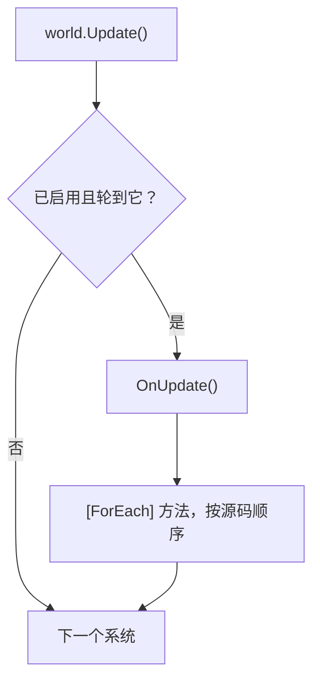

系统是服务器 tick 里的一项工作：移动单位、结算燃烧伤害、处理死亡、把状态发给客户端。系统继承 `EcsSystem`，自己不保存状态
（状态都在组件和单例组件里），也从不引用别的系统。它的循环写成 `[ForEach]` 方法：一个静态方法，参数列出它要读写的组件，
源生成器把它编译成结构体 job，速度和手写循环一样。

## 什么时候用 [#when-to-use-it]

<Callout type="idea" title="适合">
  所有每个 tick 都要跑的行为：一个系统负责一件事，一个 `[ForEach]` 方法对应一个循环，用 `[UpdateAfter<T>]` 排顺序，用分组区分节奏
  （输入随到随处理，模拟按固定 tick 跑），用 `UpdateInterval` 处理每 N 个 tick 才做一次的工作。
</Callout>

<Callout type="warn" title="不适合">
  请求或工具在两个 tick 之间跑的一次性遍历：写成 [`[ForEach]` runner](#foreach-outside-systems) 或者[查询](/zh/docs/guide/queries)。
  需要跨 tick 保留的状态：放进组件或[单例组件](/zh/docs/guide/singletons)，绝不放在系统字段里（[EECS007](/zh/docs/guide/analyzer#eecs007)）。
</Callout>

## 怎么用 [#how-to-use-it]

<Steps>
<Step>

### 写系统 [#write-the-system]

每个 `[ForEach]` 方法在每次更新时，对每个匹配的实体执行一次。`ref` 参数是写，`in` 参数是读，特性负责过滤实体。

```csharp title="Combat.cs"
public record struct Burning(int Ticks, int Damage) : IComponent;
public struct Player : IComponent;                                         // 标签
public record struct BurnTotals(int Damage) : ISingletonComponent;

public class BurnSystem : EcsSystem
{
    [ForEach, Without<Dead>]                                               // 只处理活着的实体
    static void Burn(ref Health hp, in Burning burning, ref BurnTotals totals)
    {
        hp.Value -= burning.Damage;
        totals.Damage += burning.Damage;
    }
}

[UpdateAfter<BurnSystem>]                                                  // 先扣血，再判死亡
public class DeathSystem : EcsSystem
{
    [ForEach, Without<Dead>]
    static void Die(Entity unit, in Health hp)
    {
        if (hp.Value <= 0) unit.SetDead();                                 // 结构变更，立即生效
    }
}
```

</Step>
<Step>

### 添加并更新 [#add-and-update]

```csharp
var world = new World();
world.AddSingleton<BurnTotals>();                  // BurnSystem 要读它：第一次更新之前加上
world.AddSystem<DeathSystem>();                    // 先加，后跑：[UpdateAfter] 决定了顺序
world.AddSystem<BurnSystem>();
world.CreateEntity(new Health(5), new Burning(3, 10), new Player());

world.Update();                                    // 一个 tick
int dealt = world.BurnTotals.Damage;               // 10
```

</Step>
</Steps>

### 生命周期 [#lifecycle]

| 钩子或成员 | 时机 |
| --- | --- |
| `OnCreate()` | 系统被添加时调用一次（`world.AddSystem<T>()` / `AddSystem(system)`） |
| `OnUpdate()` | 所在分组每次更新时调用，在它的 `[ForEach]` 方法之前 |
| `[ForEach]` 方法 | 每次更新，在 `OnUpdate` 之后，按源码顺序执行（基类的先跑） |
| `OnDestroy()` | `world.RemoveSystem<T>()` 或 `world.Dispose()` 时调用一次（逆序） |
| `World` | 所属的 World，在 `OnCreate` 之前设置好 |
| `Enabled` | 设为 `false` 后，`Update()` 和 `Update<TGroup>()` 都会跳过它 |
| `LastRunTick` | 上次运行时的变更 tick（见[变更追踪](/zh/docs/guide/change-tracking#ticks)） |
| `Stats`、`Error` | [运行统计](#measuring-systems)和[让它停用的异常](#errors) |

`AddSystem<T>()` 返回系统实例；`GetSystem<T>()` 查找系统（给工具和测试用，不能在别的系统里用：[EECS008](/zh/docs/guide/analyzer#eecs008)）；
`world.Systems` 列出所有系统，不分配内存；`UpdateCount` 统计默认分组的更新次数。一个系统只属于一个 World，加到第二个 World 会抛异常。

```csharp
var burn = world.GetSystem<BurnSystem>();
foreach (var system in world.Systems) Console.WriteLine(system.GetType().Name);
world.RemoveSystem<BurnSystem>();                  // 会调用 OnDestroy
long updates = world.UpdateCount;
```

### 一次更新 [#one-update]



没有排序约束时，系统按注册顺序运行。结构变更立即生效，同一次更新里后面的方法和系统都能看到。所有工作都在调用 `Update()`
的线程上执行；开启 `WorldOptions.ParallelSystems` 后，彼此没有顺序约束、也没有访问冲突的系统会同时运行
（见[线程](/zh/docs/guide/threading#parallel-systems)），结果和按顺序运行完全一样。

### 执行顺序 [#ordering]

`[UpdateBefore<T>]` 和 `[UpdateAfter<T>]` 把系统挪到同一分组里系统 `T`（及其子类）的紧前或紧后，不管它们是按什么顺序添加的；
其他系统的相对顺序不变。顺序在添加系统时就确定了：出现环会当场抛异常，这个系统不会被加进去。分析器能发现它看得到的环
（[EECS019](/zh/docs/guide/analyzer#eecs019)）和跨分组的排序（[EECS020](/zh/docs/guide/analyzer#eecs020)）。

### `UpdateInterval` 和 `UpdatePhase` [#update-interval]

重写了 `UpdateInterval` 的系统，每 N 次分组更新才跑一次：更新计数是 N 的倍数时运行，所以第一次是第 N 次更新。`UpdatePhase`
（0 到 N - 1）决定它占 N 次里的哪一次，同样间隔的系统可以错开，不必挤在同一个 tick。两者都必须是常量
（[EECS018](/zh/docs/guide/analyzer#eecs018)）；要暂停系统，设置 `Enabled`。

```csharp
public record struct Autosave(long Count) : ISingletonComponent;

public class SaveSystem : EcsSystem
{
    public override int UpdateInterval => 60;      // 每 60 次更新一次
    public override int UpdatePhase => 30;         // 和同间隔的其他系统错开半个周期

    protected override void OnUpdate() => World.GetOrAddSingleton<Autosave>().Count++;
}
```

### `[ForEach]` 方法 [#foreach-methods]

`[ForEach]` 方法声明在继承 `EcsSystem` 的类里（不需要 `partial`），可以是静态方法，也可以是实例方法。参数决定它遍历什么：

| 参数 | 含义 |
| --- | --- |
| `ref T` / `in T` / `ref readonly T`，`T : IComponent` | 1 到 9 个组件：`ref` 写，`in` 读 |
| `ref T` / `in T`，`T : ISingletonComponent` | World 的单例组件，每次遍历只解析一次；没添加时抛异常 |
| `Entity` | 当前实体，用来做结构变更和查找 |
| `World` | World 本身（创建实体、访问其他单例） |
| [`Maybe<T>`](#maybe) | 实体可能没有的组件 |
| `Span<T>` / `ReadOnlySpan<T>`、`EntitySpan` | [批处理方法](#batch-methods)：一次处理成段的行 |

| 特性 | 含义 |
| --- | --- |
| `[ForEach]` | 对每个匹配的实体执行方法；`Parallel = true` 表示[多线程](#parallel-methods) |
| `[With<T>]` | 实体必须有 `T`，`T` 不作为参数传入；可重复 |
| `[Without<T>]` | 实体不能有 `T`；可重复 |
| `[WithAny<T>]` | 实体至少要有方法上某个 `[WithAny<T>]` 的组件 |
| `[Changed<T>]` | `T`（`ITrackChanges`）在系统上次运行之后被写过（[变更追踪](/zh/docs/guide/change-tracking)） |
| `[Removed<T>]` | 实体在系统上次运行之后失去了 `T`（`ITrackChanges`）（[移除检测](/zh/docs/guide/change-tracking#removal-detection)） |

没有组件参数时，由第一个 `[With<T>]`（没有的话就是第一个 `[Changed<T>]`）指定要查询的组件：

```csharp
public class CorpseCleanup : EcsSystem
{
    [ForEach, With<Dead>]
    static void Remove(Entity corpse) => corpse.Destroy();
}
```

静态、不带 `World`、`Entity` 参数（如果有）只用来读（`Id`、`IsAlive`、`Has`、`Get`、`Read`、`TryGet`、`TryGetRef`）的方法，
不可能改变结构：它的 job 实现 `INoStructuralChanges`，遍历每张表时不做逐实体检查，还能和其他系统排进同一个并行阶段。
可能改变结构的方法单独运行，每个实体在一次遍历里仍然最多被访问一次（见[结构变更](/zh/docs/guide/structural-changes)）。

方法按源码顺序执行，派生系统先跑基类的 `[ForEach]` 方法。一个系统的方法放在同一个文件里：partial 类分散在多个文件时，顺序只在每个文件内有效。

#### 可选组件：`Maybe<T>` [#maybe]

`Maybe<T>` 接收实体可能没有的组件：方法会访问所有拥有其他组件的实体，`HasValue` 告诉你这个实体有没有 `T`。通过 `Value`
写入就算写 `T`（被追踪的组件会记 tick），只读则算读。

```csharp
public record struct Shield(int Bonus) : IComponent;
public record struct Stamina(int Value) : IComponent;

public class Regeneration : EcsSystem
{
    [ForEach]
    static void Regenerate(ref Stamina stamina, Maybe<Shield> shield) =>
        stamina.Value += shield.HasValue ? 1 + shield.Value.Bonus : 1;
}
```

可选部分很小时，它能省掉一个方法。最热的循环里，用 `[With<Shield>]` 和 `[Without<Shield>]` 拆成两个方法更快：每行不用再判断
（数字见下文）。不改变结构的方法每段行只找一次可选列；可能改变结构的方法则按实体逐个查找。

### 批处理方法 [#batch-methods]

组件参数是 span 的方法会拿到成段的连续匹配行：每个 span 的第 `i` 个元素属于同一个实体，所有行都匹配的表只调用一次。
其他参数只能是单例组件和 `EntitySpan`（`entities[i]` 只在取下标时构造），别的都不行（[EECS009](/zh/docs/guide/analyzer#eecs009)）。
span 直接指向表，所以方法运行期间结构是冻结的：做结构变更会抛异常，[EECS013](/zh/docs/guide/analyzer#eecs013) 在编译期就会报出来。

```csharp
using System.Numerics;
using System.Runtime.InteropServices;

public class DriftSystem : EcsSystem
{
    [ForEach, Without<Dead>]
    static void Drift(Span<Position> positions, ReadOnlySpan<Velocity> velocities)
    {
        // JIT 不会自己向量化循环。每个组件两个 float：转成 Vector<float> 后，每条 lane 就是一个坐标
        var p = MemoryMarshal.Cast<Position, Vector<float>>(positions);
        var v = MemoryMarshal.Cast<Velocity, Vector<float>>(velocities);
        for (int i = 0; i < p.Length; i++) p[i] += v[i];
        var pf = MemoryMarshal.Cast<Position, float>(positions);
        var vf = MemoryMarshal.Cast<Velocity, float>(velocities);
        for (int i = p.Length * Vector<float>.Count; i < pf.Length; i++) pf[i] += vf[i];   // 剩下的行
    }
}
```

对 span 写标量循环，比逐实体方法快不了多少；要向量化才值得写批处理方法。

### 并行方法 [#parallel-methods]

`[ForEach(Parallel = true)]` 把匹配的行切成块（每个线程大约四块，块大小是 64 行的倍数，介于 1,024 和
`World.ParallelChunkRows` = 16,384 之间），由调用线程加上最多 `WorldOptions.MaxDegreeOfParallelism - 1` 个线程池线程执行。
它适合几万个实体、每个实体计算量都很重的工作（寻路、转向、AI 评分）；计算很轻时，分发的开销比省下的还多。

```csharp
public record struct Clock(float Time) : ISingletonComponent;

public class SteeringSystem : EcsSystem
{
    [ForEach(Parallel = true), Without<Dead>]
    static void Steer(ref Velocity velocity, in Position position, in Clock clock) =>
        velocity = new Velocity(MathF.Cos(clock.Time + position.X), MathF.Sin(clock.Time + position.Y));
}
```

方法必须能同时在多个线程上跑（[EECS010](/zh/docs/guide/analyzer#eecs010)）：不做结构变更，逐实体执行（不能是批处理方法），
单例组件只能用 `in`。它也不能写别的行会读的东西，比如通过 `Get` 写另一个实体。不足两块时在调用线程上执行。第一次更新之后不再分配内存。

### 系统分组 [#system-groups]

`world.Update()` 运行默认分组。标了 `[UpdateInGroup<TGroup>]`（`TGroup` 是 `struct : ISystemGroup`）的系统，只有调用
`world.Update<TGroup>()` 时才运行。分组用来区分节奏：服务器可以输入一到就处理，模拟则按固定 tick 跑。

```csharp
public struct InputGroup : ISystemGroup;

[UpdateInGroup<InputGroup>]
public class ApplyInputSystem : EcsSystem
{
    [ForEach, With<Player>]
    static void Apply(ref Velocity velocity) => velocity = new Velocity(velocity.X * 0.9f, velocity.Y * 0.9f);
}
```

```csharp
world.AddSystem<ApplyInputSystem>();
world.Update<InputGroup>();   // 输入到达时
world.Update();               // 固定 tick：默认分组
```

顺序、`UpdateInterval`、`UpdatePhase` 和 `Enabled` 都在各自分组内生效，分组特性会被继承。更新一个没有系统的分组什么也不做。

#### 分组过滤 [#group-filters]

写在分组结构体上的 `[With<T>]`、`[Without<T>]`、`[WithAny<T>]` 会加到分组里所有系统的每个 `[ForEach]` 方法上：整个节奏都能排除
被冻结或未激活的实体，不用在每个方法上重复写。系统在 `OnUpdate` 里自己做的查询不受影响。写在其他结构体上的过滤没有任何作用
（[EECS023](/zh/docs/guide/analyzer#eecs023)）。

```csharp
[Without<Frozen>]
public struct Gameplay : ISystemGroup;              // 分组里的方法都看不到被冻结的实体

[UpdateInGroup<Gameplay>]
public class MoveSystem : EcsSystem
{
    [ForEach]
    static void Move(ref Position p, in Velocity v) => p = new Position(p.X + v.X, p.Y + v.Y);
}
```

### 泛型系统 [#generic-systems]

系统可以是泛型的。每个封闭类型都是一个独立的系统，有自己生成的 job 和访问集合，所以 `CountOf<Position>` 和 `CountOf<Health>`
各自添加、各自排序、各自调度。封闭的泛型系统也可以当基类：它的 `[ForEach]` 方法先于子类的运行。代码里从没写到的封闭类型
（通过反射构造），会在第一次使用时补全代码。

```csharp
public record struct Tally(int Count) : ISingletonComponent;

public class CountOf<T> : EcsSystem where T : struct, IComponent   // world.AddSystem<CountOf<Position>>()
{
    [ForEach] static void Count(in T component, ref Tally tally) => tally.Count++;
}
```

系统里的 `[ForEach]` 方法本身不能是泛型的：没有人能给它提供类型参数（[EECS004](/zh/docs/guide/analyzer#eecs004)）。特性的类型参数
不能引用类型形参（C# 规则 CS8968），所以 `[With<T>]` 这类过滤只能写具体类型。

### 系统之外的 `[ForEach]` [#foreach-outside-systems]

不继承 `EcsSystem` 的类型里的 `[ForEach]` 方法叫 runner：由宿主自己调用的一次遍历，比如两个 tick 之间响应一个请求。生成器会
给它写一个入口：类型上的同名静态方法，参数是 `World` 加上方法的其余参数，调用一次就对整个 World 跑一遍 job。

除了组件、单例组件、`Entity` 和 `World`，runner 还可以接收任意其他类型的值；入口从调用方拿这些值，`ref` 也可以，所以 runner
能通过它们返回结果。

```csharp
public record struct Gold(int Amount) : IComponent, ITrackChanges;

public static class Reports
{
    [ForEach, Without<Dead>]
    static void SumHealth(in Health hp, ref long total) => total += hp.Value;

    [ForEach, Changed<Gold>]
    static void Rich(in Gold gold, ref int count, int threshold) { if (gold.Amount >= threshold) count++; }
}
```

```csharp
long total = 0;
Reports.SumHealth(world, ref total);              // 生成的入口
ulong mark = world.ChangeTick;
int rich = 0;
Reports.Rich(world, mark, ref rich, 1_000);       // [Changed<T>]：tick 紧跟在 world 后面
```

- 方法必须是静态的（[EECS005](/zh/docs/guide/analyzer#eecs005)）；它可以是 private，入口在它引用的类型都公开时也是公开的。
- 带 `[Changed<T>]` 或 `[Removed<T>]` 时，入口要接收一个回看的起点 tick，因为 runner 没有自己的"上次运行"。
- runner 可以是泛型方法，也可以是泛型类型的成员：入口会接收类型参数（`Census.CountAlive<Health>(world, ref count)`）。
- 批处理和并行 runner 遵循[批处理方法](#batch-methods)和[并行方法](#parallel-methods)的规则。
- 入口不能和类型里已有的方法冲突（[EECS021](/zh/docs/guide/analyzer#eecs021)），局部函数也不能当 runner（[EECS024](/zh/docs/guide/analyzer#eecs024)）。
- 和其他结构变更代码一样，要在 World 的所有者线程上调用。

### 统计系统耗时 [#measuring-systems]

开启 `WorldOptions.MeasureSystems` 后，系统的每次运行（`OnUpdate` 加它的 `[ForEach]` 方法）都会计时，`system.Stats` 里有 `Runs`、
`Last`、`Total` 和 `Average`。每次系统运行多读两次时间戳，关闭时零开销。在两次更新之间读取，比如放在诊断接口里：

```csharp
var measured = new World(new WorldOptions { MeasureSystems = true });
measured.AddSingleton<BurnTotals>();
measured.AddSystem<BurnSystem>();
measured.Update();
var stats = measured.GetSystem<BurnSystem>().Stats;
Console.WriteLine($"burn: {stats.Last.TotalMicroseconds} μs, average {stats.Average.TotalMicroseconds} μs over {stats.Runs} runs");
```

### 错误处理 [#errors]

默认情况下，系统抛出的异常会从 `Update()` 传出去（`OnDestroy` 的异常从 `Dispose()` 传出）。设置
`SystemErrors = SystemErrorPolicy.Disable` 后，出错的系统会被停用，异常保存在 `system.Error` 里，这次更新接着跑下一个系统。
失败也是数据：在两次更新之间读取。把 `Enabled` 设回 `true` 会清掉 `Error` 并重试。失败的系统仍算运行过：它的 `LastRunTick`
照常前进，失败那次之前写入的行不会被再次投递。

```csharp
var guarded = new World(new WorldOptions { SystemErrors = SystemErrorPolicy.Disable });
guarded.AddSingleton<BurnTotals>();
guarded.AddSystem<BurnSystem>();
guarded.Update();
foreach (var system in guarded.Systems)                   // 健康检查，在两次更新之间
    if (system.Error is { } error) Console.Error.WriteLine($"{system.GetType().Name} is off: {error.Message}");
```

`Dispose()` 之后再调用 `Update()` 会抛 `ObjectDisposedException`。

## 怎么用得快 [#how-to-use-it-fast]

| 别这样 | 这样做 | 原因 |
| --- | --- | --- |
| 只读的组件写成 `ref` | 改成 `in` | 系统能共享并行阶段；被追踪的组件不会被记 tick |
| 方法用不到却带了 `Entity` 或 `World` 参数 | 去掉 | job 跳过结构变更簿记，还能并行 |
| 对大量行写标量循环 | 用 `Vector<T>` 的批处理方法 | 对整段行做 SIMD |
| 最热的循环里用 `Maybe<T>` | 用 `[With<T>]` / `[Without<T>]` 拆成两个方法 | 每行不用判断存在位 |
| 很轻的计算也 `Parallel = true` | 普通 `[ForEach]` | 分发的开销比省下的多 |
| 同一个节奏的每个方法都重复写一个过滤 | [分组过滤](#group-filters) | 只写一次 |
| 可以等的工作每个 tick 都做 | `UpdateInterval` 加 `UpdatePhase` | 分摊到多个 tick |

`[ForEach]` 系统对比两个普通数组，对 1 万个实体做 `Position += Velocity`（`MicroBenchmarks`）：

<BenchTable bench="MicroBenchmarks" methods="RawArrayWrite,ForEachSystemWrite" />

可选组件：10 万个单位，一半有护盾。一个带 `Maybe<Shield>` 的方法，对比用 `With` / `Without` 拆开的两个方法（`MaybeBenchmark`）：

<BenchTable bench="MaybeBenchmark" />

对 10 万个实体做较重的转向计算：`[ForEach]` 和 `[ForEach(Parallel = true)]`，以及同样工作的临时实体 job（`ParallelForEachBenchmark`）：

<BenchTable bench="ParallelForEachBenchmark" />

四个系统按运行顺序注册，对比倒序注册、再用 `[UpdateAfter<T>]` 排好顺序：顺序在添加时就确定了（`OrderingBenchmark`）：

<BenchTable bench="OrderingBenchmark" />

和 Friflo.Engine.ECS 对比：每行都接收 `Entity` 的方法、只在需要时构造句柄的批处理方法、写单例组件的方法：

<BenchChart bench="OperationBenchmark" methods="EasyEcs_Entity,Friflo_Entity,EasyEcs_EntityBatch,Friflo_EntityBatch,EasyEcs_Singleton,Friflo_Singleton" title="每次遍历耗时，10 万实体" />

## 开销 [#what-it-costs]

- **`[ForEach]` 方法**是一个结构体 job，JIT 把它内联进行循环：没有委托，不分配内存。
- **每个系统每次更新：** 一次 `OnUpdate` 调用，每个生成的 job 一次调用，每个方法一次查询缓存查找。
- **单例组件参数**每次遍历只解析一次，不是每个实体一次。
- **执行顺序**在添加系统时确定：更新时不付任何代价。
- **`MeasureSystems`** 每次系统运行多读两次时间戳；关闭时零开销。
- **并行方法**第一次更新之后不再分配内存，执行器的工作项会复用。
- **生成的代码**由模块初始化器注册：系统不需要 `partial`、不需要注册调用，更新时也不用反射。

## 常见陷阱 [#pitfalls]

| 错误 | 后果 | 谁能发现 |
| --- | --- | --- |
| 系统里有可变字段 | 别人看不到、存不了、也恢复不了的状态 | [EECS007](/zh/docs/guide/analyzer#eecs007) |
| 系统引用另一个系统 | 两者再也不能独立修改 | [EECS008](/zh/docs/guide/analyzer#eecs008) |
| 系统方法里有其他类型的参数 | 没有人能提供它 | [EECS002](/zh/docs/guide/analyzer#eecs002) |
| 没有组件参数，也没有 `[With<T>]` | 不知道要遍历什么 | [EECS003](/zh/docs/guide/analyzer#eecs003) |
| 系统里的泛型 `[ForEach]` 方法 | 没有类型参数 | [EECS004](/zh/docs/guide/analyzer#eecs004)；改成泛型系统 |
| span 和逐实体参数混用 | 一段行对应不到单个值 | [EECS009](/zh/docs/guide/analyzer#eecs009) |
| 并行方法改结构或写单例组件 | 块之间发生竞争 | [EECS010](/zh/docs/guide/analyzer#eecs010) |
| 通过 `in` 参数修改集合 | 被当成读来调度，也不会记 tick | [EECS011](/zh/docs/guide/analyzer#eecs011) |
| 不带 `Entity` / `World` 的方法通过组件里的链接做结构变更 | 遍历拿着指向已搬走行的 ref | [EECS013](/zh/docs/guide/analyzer#eecs013) |
| `UpdateInterval` 的值会变 | 跳过或重复运行 | [EECS018](/zh/docs/guide/analyzer#eecs018) |
| 排序形成环，或跨分组排序 | `AddSystem` 时抛异常；排序不生效 | [EECS019](/zh/docs/guide/analyzer#eecs019)、[EECS020](/zh/docs/guide/analyzer#eecs020) |
| 方法参数用了 private 类型 | 生成的 job 引用不到它 | [EECS022](/zh/docs/guide/analyzer#eecs022) |

## 相关页面 [#related]

<Cards>
  <Card title="查询与过滤" href="/zh/docs/guide/queries">
    同样的过滤，以及临时遍历用的结构体 job。
  </Card>
  <Card title="结构变更" href="/zh/docs/guide/structural-changes">
    在 `[ForEach]` 方法里创建、销毁、添加和移除。
  </Card>
  <Card title="线程" href="/zh/docs/guide/threading">
    并行阶段、每线程一个 World、来自其他线程的输入。
  </Card>
  <Card title="分析器规则" href="/zh/docs/guide/analyzer">
    系统要遵守的每条规则，以及修复方法。
  </Card>
</Cards>
