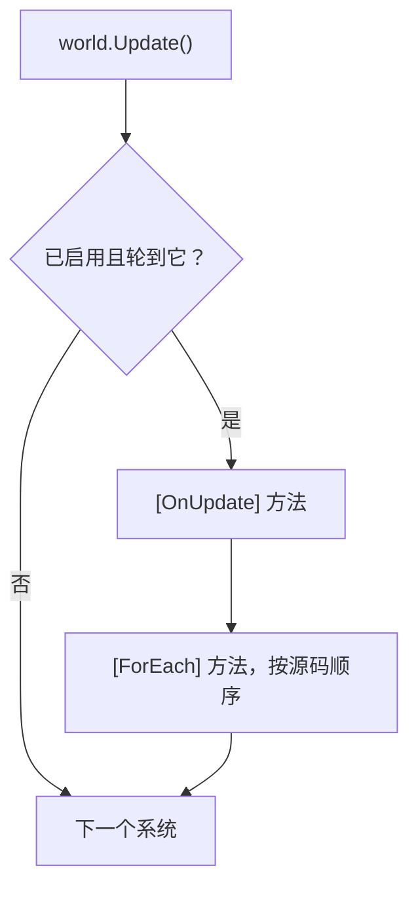

系统是服务器 tick 里的一项工作：移动单位、结算燃烧伤害、处理死亡、把状态发给客户端。系统是一个只有静态方法的
`[EcsSystem] ref struct`，从来不是对象：自己不保存状态（状态都在组件和单例组件里），也从不引用别的系统。它的循环写成 `[ForEach]` 方法：一个静态方法，参数列出它要读写的组件，
源生成器把它编译成结构体 job，速度和手写循环一样。

## 什么时候用 [#when-to-use-it]

<Callout type="idea" title="适合">
  所有每个 tick 都要跑的行为：一个系统负责一件事，一个 `[ForEach]` 方法对应一个循环，用 `[UpdateAfter<T>]` 排顺序，用分组区分节奏
  （输入随到随处理，模拟按固定 tick 跑），用 [`[UpdateInterval(N)]`](#update-interval) 处理每 N 个 tick 才做一次的工作，用 [`Slices`](#slices) 把工作摊到几个 tick 上，
  用 [`[Consume]`](#consume) 处理只需处理一次的事件实体。用[分组过滤](#group-filters)
  把整组系统限定在一种实体上；用泛型分组接口给每个类型各配一个分组（每种 actor 一个分组）。
</Callout>

<Callout type="warn" title="不适合">
  请求或工具在两个 tick 之间跑的一次性遍历：写成 [`[ForEach]`](#foreach-outside-systems) runner 或者[查询](/zh/docs/guide/queries)。
  需要跨 tick 保留的状态：放进组件或[单例组件](/zh/docs/guide/singletons)，绝不放在系统的静态字段里（[EECS007](/zh/docs/guide/analyzer#eecs007)）。
</Callout>

## 怎么用 [#how-to-use-it]

<Steps>
<Step>

### 写系统 [#write-the-system]

系统是一个标了 `[EcsSystem]`、只声明静态成员的 `ref struct`。每个 `[ForEach]` 方法在每次更新时，对每个匹配的实体执行一次。`ref` 参数是写，`in` 参数是读，特性负责过滤实体。

```csharp title="Combat.cs"
public record struct Burning(int Ticks, int Damage) : IComponent;
public struct Player : IComponent;                                         // 标签
public record struct BurnTotals(int Damage) : ISingletonComponent;

[EcsSystem]
public ref struct BurnSystem
{
    [ForEach, Without<Dead>]                                               // 只处理活着的实体
    static void Burn(ref Health hp, in Burning burning, ref BurnTotals totals)
    {
        hp.Value -= burning.Damage;
        totals.Damage += burning.Damage;
    }
}

[EcsSystem, UpdateAfter<BurnSystem>]                                       // 先扣血，再判死亡
public ref struct DeathSystem
{
    [ForEach, Without<Dead>]
    static void Die(Entity unit, in Health hp)
    {
        if (hp.Value <= 0) unit.SetDead();                                 // 结构变更，立即生效
    }
}
```

</Step>
<Step>

### 添加并更新 [#add-and-update]

```csharp
var world = new World();
world.AddSingleton<BurnTotals>();                  // BurnSystem 要读它：第一次更新之前加上
world.AddSystem<DeathSystem>();                    // 先加，后跑：[UpdateAfter] 决定了顺序
world.AddSystem<BurnSystem>();
world.CreateEntity(new Health(5), new Burning(3, 10), new Player());

world.Update();                                    // 一个 tick
int dealt = world.BurnTotals.Damage;               // 10
```

</Step>
</Steps>

### 生命周期 [#lifecycle]

系统的钩子是标了特性的静态方法。参数取 `World`、`SystemHandle`、两者（顺序随意）或都不取，返回 void，每种钩子一个系统最多一个
（[EECS076](/zh/docs/guide/analyzer#eecs076)）：

| 钩子 | 时机 |
| --- | --- |
| `[OnCreate]` | 系统被添加时调用一次（`world.AddSystem<T>()`） |
| `[OnUpdate]` | 系统每次运行时调用，在它的 `[ForEach]` 方法之前 |
| `[ForEach]` 方法 | 每次运行，在 `[OnUpdate]` 方法之后，按声明顺序执行 |
| `[OnDestroy]` | `world.RemoveSystem<T>()` 或 `world.Dispose()` 时调用一次（逆序） |

```csharp
public record struct Wave(int Number) : ISingletonComponent;

[EcsSystem]
public ref struct WaveSystem
{
    [OnCreate]
    static void OnCreate(World world) => world.SetWave(0);             // 它要处理的数据

    [OnUpdate]
    static void OnUpdate(World world, SystemHandle system)
    {
        if (system.RunCount % 600 == 0) world.Wave.Number++;              // 每 600 次运行一次
    }

    [OnDestroy]
    static void OnDestroy(World world) => world.RemoveWave();
}
```

World 把它对一个系统的了解存成数据，`SystemHandle` 指向这份数据，就像 `Entity` 指向一行：

| `SystemHandle` 成员 | 含义 |
| --- | --- |
| `Enabled` | 设为 `false` 后，`Update()` 和 `Update<TGroup>()` 都会跳过它；设为 `true` 清掉 `Error` |
| `LastRunTick` | 上次运行时的变更 tick（见[变更追踪](/zh/docs/guide/change-tracking#ticks)） |
| `RunCount` | 在本次运行之前已经运行过的次数（第一次运行时为 0）；[分片](#slices)方法访问第 `RunCount % N` 片 |
| `Stats`、`Error` | [运行统计](#measuring-systems)和[让它停用的异常](#errors) |
| `Name`、`Type`、`World` | 类型名（`Regen<Health>`）、类型本身、所在的 World |
| `IsAlive` | 系统被移除或 World 释放后为 false，这时其他成员都会抛异常 |

`AddSystem<T>()` 返回句柄，World 已经有这个系统时再加会抛异常；`System<T>()` 和 `TryGetSystem<T>(out handle)` 查找系统（给工具和测试用，
不能在别的系统里用：[EECS008](/zh/docs/guide/analyzer#eecs008)），`HasSystem<T>()` 判断有没有；`world.Systems` 列出所有句柄，不分配内存；
`DefaultUpdateCount` 统计默认分组的更新次数。传给这些 API 的类型不是 `[EcsSystem]` 时报 [EECS077](/zh/docs/guide/analyzer#eecs077)。

```csharp
if (world.TryGetSystem<BurnSystem>(out var burn)) burn.Enabled = false;
foreach (var system in world.Systems) Console.WriteLine(system.Name);
world.RemoveSystem<BurnSystem>();                  // 调用它的 [OnDestroy]，它的句柄随之失效
long updates = world.DefaultUpdateCount;
```

### 一次更新 [#one-update]



没有排序约束时，系统按注册顺序运行。结构变更立即生效，同一次更新里后面的方法和系统都能看到。所有工作都在调用 `Update()`
的线程上执行；开启 `WorldOptions.ParallelSystems` 后，彼此没有顺序约束、也没有访问冲突的系统会同时运行
（见[多线程与并行](/zh/docs/guide/threading#parallel-systems)），结果和按顺序运行完全一样。想看 World 排出了哪些阶段、每个系统
读写了什么、某个系统为什么要等另一个，打印 `world.DescribeSchedule()` 即可（文本，或者用 `ToMermaid()` 画成图：
[调试与诊断](/zh/docs/guide/diagnostics#schedule)）。

### 执行顺序 [#ordering]

`[UpdateBefore<T>]` 和 `[UpdateAfter<T>]` 把系统挪到同一分组里系统 `T` 的紧前或紧后，不管它们是按什么顺序添加的；
其他系统的相对顺序不变。顺序在添加系统时就确定了：出现环会当场抛异常，这个系统不会被加进去。分析器能发现它看得到的环
（[EECS019](/zh/docs/guide/analyzer#eecs019)）和跨分组的排序（[EECS020](/zh/docs/guide/analyzer#eecs020)）。

### `[UpdateInterval(N, Phase = P)]` [#update-interval]

标了 `[UpdateInterval(N)]` 的系统，每 N 次分组更新才跑一次：更新计数是 N 的倍数时运行，所以第一次是第 N 次更新。`Phase`
（0 到 N - 1）决定它占 N 次里的哪一次，同样间隔的系统可以错开，不必挤在同一个 tick。特性只接受常量，节奏在编译时就定了；
生成器把它写进系统的代码（间隔小于 1 或相位不在 0 到 N - 1 之间时报 [EECS083](/zh/docs/guide/analyzer#eecs083)）。要暂停系统，
设置它的句柄的 `Enabled`。

```csharp
public record struct Autosave(long Count) : ISingletonComponent;

[EcsSystem, UpdateInterval(60, Phase = 30)]        // 每 60 次更新一次，和同间隔的其他系统错开半个周期
public ref struct SaveSystem
{
    [OnUpdate]
    static void OnUpdate(World world) => world.GetOrAddAutosave().Count++;
}
```

要写的只有这个特性：生成器把节奏写进它为系统注册的代码，World 在添加系统时读一次。

<Tabs items={['你写的', '生成器写的']}>
<Tab value="你写的">

```csharp doccheck=skip
[EcsSystem, UpdateInterval(60, Phase = 30)]
public ref struct SaveSystem
{
    [OnUpdate]
    static void OnUpdate(World world) => world.GetOrAddAutosave().Count++;
}
```

</Tab>
<Tab value="生成器写的">

```csharp doccheck=skip
internal readonly struct __SaveSystem_SystemCode : ISystemCode
{
    public static int Interval => 60;                          // [UpdateInterval(60, Phase = 30)]

    public static int Phase => 30;

    public static void Update(World world, SystemHandle system)
    {
        __ForEach.OnUpdate_Update(default, world);             // [OnUpdate] 方法，经 UnsafeAccessor 调用
    }

    public static void Access(ref SystemAccess access)
    {
        access.RunAlone();                                     // [OnUpdate] 方法什么都可能碰
    }

    // Create 和 Destroy：空的（没有 [OnCreate]、[OnDestroy] 方法）；Loops：没有（没有 [ForEach] 方法）
}
```

</Tab>
</Tabs>

运行时才算出来的节奏写不成特性：把系统放进一个[系统分组](#system-groups)，到时候再更新这个分组。

### 分片：每次运行只处理一部分行 [#slices]

`UpdateInterval` 是每 N 次更新把所有行处理一遍，开销集中在那一次，形成尖峰。`[ForEach(Slices = N)]` 则是系统每次运行都
执行这个方法，但每张匹配的表只处理大约 1 / N 的行：N 次运行里每一行各访问一次，每次更新的开销是平的。适合每个实体隔一阵
才需要、又不必每个 tick 都做的维护工作：AI 重新规划、需求值衰减、扫描空闲会话。

```csharp
public record struct Hunger(float Value) : IComponent;

[EcsSystem]
public ref struct HungerSystem
{
    // 每次更新处理四分之一的 NPC：每个 NPC 四次更新轮到一次，一次加四次更新的饥饿值。
    [ForEach(Slices = 4)]
    static void Starve(ref Hunger hunger) => hunger.Value = MathF.Min(hunger.Value + 0.04f, 1f);
}
```

- **这次是哪一片：** 访问第 `RunCount % N` 片。`RunCount` 是系统在本次运行之前已经运行过的次数（第一次运行时为 0）；被
  `UpdateInterval` 跳过的、停用期间的不算，抛了异常的算。接收 `SystemHandle` 的 `[OnUpdate]` 方法可以读它，知道这次运行访问哪一片。
- **表在哪里切：** 按 64 行的倍数切（也就是存在位的字），以遍历开始时表的行数为准：一张有 w 个字的表，第 k 片取第
  w × k / N 到 w × (k + 1) / N 个字，最后一片一直到最后一行。不足 64 行的表只有一片，N 次运行里只有一次会访问它。
- **表之间错开：** 匹配到的第 i 张表从第 (k + i) mod N 片开始切，所以很多小表会分散到 N 次运行里，不会都挤在同一次。
- **会移动的行：** 两次运行之间移动过的行（交换删除时用表的最后一行填洞、结构变更把实体搬到另一张表、表的行数跨过切点
  增减）在一轮 N 次运行里可能被跳过，也可能被访问两次；下一轮还会看到它。只对容忍这一点的工作分片，每轮必须恰好处理一次
  的工作不要分片。
- **和间隔一起用：** `[UpdateInterval(M)]` 加上 `Slices = N`，每一行每 N × M 次更新访问一次。
- **各种写法都支持：** 逐实体方法、[批处理方法](#batch-methods)（片内成段的行）和[并行方法](#parallel-methods)（把这一片
  再切成块）。
- **不能和变化过滤一起用：** `[Changed<T>]`、`[Removed<T>]`、`[ChangedAny<…>]`、`[RemovedAny<…>]` 都不能分片，`Slices`
  也不能小于 1（[EECS035](/zh/docs/guide/analyzer#eecs035)）：系统每次运行都会推进自己的 `LastRunTick`，其他片里的行
  发生的变化就丢了。

在系统之外，[`QueryFilter.Slice(index, of)`](/zh/docs/guide/queries#filters) 给 `ForEach` 调用做同样的事；带
`Slices = N` 的 [runner](#foreach-outside-systems)，入口在 World 之后接收要访问的分片。

### `[ForEach]` 方法 [#foreach-methods]

`[ForEach]` 方法是 `[EcsSystem]` 的静态方法（不需要 `partial`）。参数决定它遍历什么：

| 参数 | 含义 |
| --- | --- |
| `ref T` / `in T` / `ref readonly T`，`T : IComponent` | 1 到 9 个组件：`ref` 写，`in` 读 |
| [`Mut<T>`](/zh/docs/guide/change-tracking#set-if-changed)，`T : IComponent` | 方法只在部分行上写的组件：`Value` 读，`Write()` 和 `SetIfChanged(value)` 写，只有写过的行才打 tick |
| `ref T` / `in T`，`T : ISingletonComponent` | World 的单例组件，每次遍历只解析一次；没添加时抛异常 |
| `Entity` | 当前实体，用来做结构变更和查找 |
| `World` | World 本身（创建实体、访问其他单例） |
| [`Maybe<T>`](#maybe) | 实体可能没有的组件 |
| [`ReadOnlyMaybe<T>`](#read-only-maybe) | 实体可能没有、只读的组件（带索引的组件也行） |
| [`ref Reduce<T>`](/zh/docs/guide/threading#reductions)，`T : ISingletonComponent, IReduction<T>` | 对所有行求的一个总结果：每一块（单线程时是整遍）累加进自己的部分结果，合并后的结果替换单例 `T` |
| [`Scratch<T>`](/zh/docs/guide/threading#scratch) | 方法在当前线程上的工作内存（列表、缓冲），在行之间保留；不增加读写 |
| [`Lookup<T>`](/zh/docs/guide/threading#lookups)，`T : IComponent` | 只读地读取任意实体在这一遍之前的 `T`（`lookup[id]`、`Read`、`Has`；按键 `TryFind`、`Find`、`Count`）；系统算作读 `T`，并行也能用 |
| `Span<T>` / `ReadOnlySpan<T>`、`EntitySpan` | [批处理方法](#batch-methods)：一次处理成段的行 |

| 特性 | 含义 |
| --- | --- |
| `[ForEach]` | 对每个匹配的实体执行方法；`Parallel = true` 表示[多线程](#parallel-methods)（加上 `ChunkRows = n` 指定[一个线程每次领多少行](/zh/docs/guide/threading#chunk-rows)），`Slices = N` 表示[每次运行只处理一部分行](#slices) |
| `[With<T>]` | 实体必须有 `T`，`T` 不作为参数传入；可重复 |
| `[Without<T>]` | 实体不能有 `T`；可重复 |
| `[WithAny<T>]` | 实体至少要有方法上某个 `[WithAny<T>]` 的组件 |
| `[Changed<T>]` | `T`（`ITracked`）在系统上次运行之后被写过（[变更追踪](/zh/docs/guide/change-tracking)） |
| `[Removed<T>]` | 实体在系统上次运行之后失去了 `T`（`ITracked`）（[移除检测](/zh/docs/guide/change-tracking#removal-detection)） |
| `[ChangedAny<T1, …, Tn>]` | 这些组件（2 到 9 个，`ITracked`）中至少一个在系统上次运行之后被写过（[任意一个](/zh/docs/guide/change-tracking#changed-any)） |
| `[RemovedAny<T1, …, Tn>]` | 实体在系统上次运行之后至少失去了其中一个组件 |

`[ForEach]` 的属性：

<TypeTable
  type={{
    Parallel: {
      type: 'bool',
      description: '把行切成块，多个线程同时领取（见下文的并行方法）。',
      default: 'false',
    },
    ChunkRows: {
      type: 'int',
      description: '配合 Parallel：一个线程每次领多少行，向上取整到 64（OpenMP 的 schedule(dynamic, n)）；0 表示按行数决定。EECS054。',
      default: '0',
    },
    Slices: {
      type: 'int',
      description: '每次运行访问约 1 / N 的行，每行每 N 次运行访问一次（见上文的分片）。不能和变更过滤一起用：EECS035。',
      default: '1',
    },
    Simd: {
      type: 'SimdMode',
      description: 'Auto：方法符合条件时生成向量循环（不符合时 EECS055 说明原因）。Require：不符合条件就报错（EECS056）。Off：一行一行地跑，不提示。',
      default: 'SimdMode.Auto',
    },
  }}
/>

没有组件参数时，由第一个 `[With<T>]`（没有的话就是第一个 `[Changed<T>]`）指定要查询的组件：

```csharp doccheck=expect-EECS030
[EcsSystem]
public ref struct CorpseCleanup
{
    [ForEach, With<Dead>]
    static void Remove(Entity corpse) => corpse.Destroy();
}
```

整个方法体只是一次结构变化、每一行都一样的方法，是一个 world 自己能跑得更快的循环：在 `[OnUpdate]` 方法里一次
[批量调用](/zh/docs/guide/bulk)，一次改完整张表（[EECS030](/zh/docs/guide/analyzer#eecs030) 会指出这一点）：

```csharp
[EcsSystem]
public ref struct CorpseCleanup
{
    [OnUpdate]
    static void OnUpdate(World world) => world.DestroyAll<Dead>();
}
```

不带 `World`、`Entity` 参数（如果有）只用来读（`Id`、`IsAlive`、`Has`、`Get`、`Read`、`TryGet`、`TryGetRef`）的方法，
不可能改变结构：它的 job 实现 `INoStructuralChanges`，遍历每张表时不做逐实体检查。
可能改变结构的方法单独运行，每个实体在一次遍历里仍然最多被访问一次（见[结构变更](/zh/docs/guide/structural-changes)）。

只把 `Entity` 当身份用（`Id`、`Version`、`IsAlive`、`==` / `!=`、转换成 `EntityId`）的方法碰不到任何组件，`Entity` 不给系统增加读写：
系统按其他参数调度，可以和别的系统排进同一个并行阶段。句柄的其他用法（`Has`、`Get`、别的调用、把 `Entity` 传出去）可能碰到任何组件，
系统就单独运行（见[并行系统](/zh/docs/guide/threading#parallel-systems)）。

方法按声明顺序执行。一个系统的方法放在同一个文件里：partial 结构体分散在多个文件时，顺序只在每个文件内有效。

#### 可选组件：`Maybe<T>` [#maybe]

`Maybe<T>` 接收实体可能没有的组件：方法会访问所有拥有其他组件的实体，`HasValue` 告诉你这个实体有没有 `T`。通过 `Value`
写入就算写 `T`（被追踪的组件会打 tick），只读则算读。

```csharp
public record struct Shield(int Bonus) : IComponent;
public record struct Stamina(int Value) : IComponent;

[EcsSystem]
public ref struct Regeneration
{
    [ForEach]
    static void Regenerate(ref Stamina stamina, Maybe<Shield> shield) =>
        stamina.Value += shield.HasValue ? 1 + shield.Value.Bonus : 1;
}
```

可选部分很小时，它能省掉一个方法。最热的循环里，用 `[With<Shield>]` 和 `[Without<Shield>]` 拆成两个方法更快：每行不用再判断
（数字见下文）。不改变结构的方法每段行只找一次可选列；可能改变结构的方法则按实体逐个查找。

#### 只读：`ReadOnlyMaybe<T>` [#read-only-maybe]

`ReadOnlyMaybe<T>` 也是可选参数，只是 `Value` 返回 `ref readonly`：方法只读 `T`，编译器会把住这一点，被追踪的 `T` 永远不会被打 tick。
[带索引的组件](/zh/docs/guide/indexes-and-relations#value-indexes)只能用它当可选参数：`Maybe<T>` 给出的 `ref` 可能背着索引改掉键
（[EECS015](/zh/docs/guide/analyzer#eecs015)），改从 `Entity` 上读又是每行查一次（[EECS027](/zh/docs/guide/analyzer#eecs027)）。

| 方法对一个有些实体没有的组件 | 用 |
| --- | --- |
| 在有它的实体上写它 | `Maybe<T>` |
| 只读它 | `ReadOnlyMaybe<T>` |
| 只读它，而且它带索引（`IIndexed<TKey>`、`IGroup`） | `ReadOnlyMaybe<T>`（`Maybe<T>` 会报 EECS015） |
| 在最热的循环里、跑很多行 | 拆成 `[With<T>]` 和 `[Without<T>]` 两个方法：每行不用判断 |

```csharp
public partial record struct Guild([IndexKey] int Id, int Level) : IComponent;
public record struct Morale(int Value) : IComponent;
```

```csharp tab="每行查找" doccheck=expect-EECS027
[EcsSystem]
public ref struct Rally
{
    [ForEach]
    static void Raise(Entity member, ref Morale morale) =>
        morale.Value += member.HasGuild ? 1 + member.Guild.Level : 1;   // 每一行都要查一遍实体
}
```

```csharp tab="ReadOnlyMaybe<T>"
[EcsSystem]
public ref struct Rally
{
    [ForEach]
    static void Raise(ref Morale morale, ReadOnlyMaybe<Guild> guild) =>
        morale.Value += guild.HasValue ? 1 + guild.Value.Level : 1;
}
```

查找方式和 `Maybe<T>` 一样，开销也一样：见[下文](#how-to-use-it-fast)的 `MaybeBenchmark` 表。`Maybe<T>` 可以隐式转换成 `ReadOnlyMaybe<T>`，所以只读的辅助方法接收只读版本，两种参数都能传进去。

### `[Consume]`：遍历之后销毁事件 [#consume]

`[ForEach, Consume]` 销毁这次遍历访问过的行，不多也不少：处理事件或命令实体（一次命中、一笔交易、一个客户端请求）的方法只管处理，
销毁交给遍历。这样每个事件只处理一次，也不会有漏掉的。

<Callout type="idea" title="适合">
  生来只被一个系统处理一次的实体：别的系统生成的命中和治疗、网络线程排进来的命令实体、发给 actor 的消息、到点的一次性计时器。
</Callout>

<Callout type="warn" title="不适合">
  方法处理完还要继续存在的实体（持续的 buff、飞行中的投射物）：`[Consume]` 会销毁它访问的每一行，这种实体在方法里按条件
  `entity.Destroy()`。好几个系统都要读的事件：在最后一个系统里消费，用 `[UpdateAfter<T>]` 排好顺序。分片的方法：一个分片的销毁会挪动
  其他分片的行（[EECS085](/zh/docs/guide/analyzer#eecs085)）。
</Callout>

行怎么销毁取决于方法：

- **不做结构变更的方法**（静态，不接收 `World`，`Entity` 只用来读）：遍历结束后批量销毁，按方法的过滤条件做一次 `DestroyAll`，
  整张表一起释放。这种遍历里没有行会开始或停止匹配，所以结束时匹配的行就是它访问过的行。遍历抛异常时什么也不销毁，这些行下次还会被访问。
- **可能做结构变更的方法**（接收 `World`，或通过 `Entity` 改了什么）：方法处理完一行就销毁那一行。遍历期间才开始匹配的实体不会被销毁，
  下一次运行会访问它。

<Tabs items={['你写的', '生成器写的']}>
<Tab value="你写的">

```csharp
public record struct Sale(int Price) : IComponent;                     // 一个事件实体
public record struct Takings(long Gold) : ISingletonComponent;

[EcsSystem]
public ref struct BankSales
{
    [ForEach, Consume]
    static void Bank(in Sale sale, ref Takings takings) => takings.Gold += sale.Price;
}

public record struct Heal(int Amount, EntityId Target) : IComponent;   // 一个事件实体

[EcsSystem]
public ref struct ApplyHeals
{
    [ForEach, Consume]
    static void Apply(in Heal heal, World world)
    {
        if (world.TryGetEntity(heal.Target, out var target)) target.Health.Value += heal.Amount;
    }
}
```

</Tab>
<Tab value="生成器写的">

```csharp doccheck=skip
// BankSales 不做结构变更：遍历后一次 DestroyAll。
internal readonly struct __BankSales_SystemCode : ISystemCode
{
    public static void Update(World world, SystemHandle system)
    {
        var job0 = new __ForEach.BankJob0 { s1 = ref world.SingletonRef<Takings>().Value };
        if (SystemCode.Measuring(world)) SystemCode.Visit(system, world.Count<Sale>());
        world.ForEach<Sale, __ForEach.BankJob0>(ref job0);
        world.DestroyAll<Sale>(); // [Consume]: the rows the pass visited
    }
}

// ApplyHeals 接收 World：方法处理完一行就销毁那一行。
internal ref struct ApplyJob0 : IForEachEntity<Heal>
{
    public World World;

    public void Execute(Entity entity, ref Heal c1)
    {
        __ForEach.Apply_0(default, in c1, World);
        entity.Destroy();
    }
}
```

</Tab>
</Tabs>

```csharp
world.AddSingleton<Takings>();
world.AddSystem<BankSales>();
world.CreateEntity(new Sale(30));
world.CreateEntity(new Sale(12));
world.Update();
long banked = world.Takings.Gold;              // 42
int pending = world.Count<Sale>();             // 0：两笔交易都被消费了
```

清理组件让被消费的实体退休，和其他被销毁的实体一样，[销毁日志](/zh/docs/guide/change-tracking#destroy-log)也会记下它。带
`[Consume]` 的 [runner](#foreach-outside-systems) 通过入口方法以同样的方式消费。有 `[Consume]` 方法的系统独自运行，销毁实体的系统都得这样
（[并行系统](/zh/docs/guide/threading#parallel-systems)）。每条路径都以 `entity.Destroy()` 结尾的方法报
[EECS084](/zh/docs/guide/analyzer#eecs084)，它的代码修复会改写成 `[Consume]`。

### 批处理方法 [#batch-methods]

组件参数是 span 的方法会拿到成段的连续匹配行：每个 span 的第 `i` 个元素属于同一个实体，所有行都匹配的表只调用一次。
其他参数只能是单例组件和 `EntitySpan`（`entities[i]` 只在取下标时构造），别的都不行（[EECS009](/zh/docs/guide/analyzer#eecs009)）。
span 直接指向表，所以方法运行期间结构是冻结的：做结构变更会抛异常，[EECS013](/zh/docs/guide/analyzer#eecs013) 在编译期就会报出来。

```csharp
using System.Numerics;
using System.Runtime.InteropServices;

[EcsSystem]
public ref struct DriftSystem
{
    [ForEach, Without<Dead>]
    static void Drift(Span<Position> positions, ReadOnlySpan<Velocity> velocities)
    {
        // JIT 不会自己向量化循环。每个组件两个 float：转成 Vector<float> 后，每条 lane 就是一个坐标
        var p = MemoryMarshal.Cast<Position, Vector<float>>(positions);
        var v = MemoryMarshal.Cast<Velocity, Vector<float>>(velocities);
        for (int i = 0; i < p.Length; i++) p[i] += v[i];
        var pf = MemoryMarshal.Cast<Position, float>(positions);
        var vf = MemoryMarshal.Cast<Velocity, float>(velocities);
        for (int i = p.Length * Vector<float>.Count; i < pf.Length; i++) pf[i] += vf[i];   // 剩下的行
    }
}
```

对 span 写标量循环，比逐实体方法快不了多少；要向量化才值得写批处理方法。

### 并行方法 [#parallel-methods]

`[ForEach(Parallel = true)]` 把匹配的行切成块（默认每个线程大约四块，块大小是 64 行的倍数，介于 1,024 和
`World.ParallelChunkRows` = 16,384 之间），调用线程加上最多 `WorldOptions.MaxDegreeOfParallelism - 1` 个线程池线程做完一块就领下一块，
和 OpenMP 的 `schedule(dynamic, n)` 一样。它适合几万个实体、每个实体计算量都很重的工作（寻路、转向、AI 评分），或者配上 `ChunkRows`
处理只有几百行、每行几微秒的活；计算很轻时，分发的开销比省下的还多。

```csharp
public record struct Clock(float Time) : ISingletonComponent;

[EcsSystem]
public ref struct SteeringSystem
{
    [ForEach(Parallel = true), Without<Dead>]
    static void Steer(ref Velocity velocity, in Position position, in Clock clock)
    {
        velocity.X = MathF.Cos(clock.Time + position.X);
        velocity.Y = MathF.Sin(clock.Time + position.Y);
    }
}
```

方法必须能同时在多个线程上跑（[EECS010](/zh/docs/guide/analyzer#eecs010)）：不做结构变更，逐实体执行（不能是批处理方法），
单例组件只能用 `in`。它也不能写别的行会读的东西，比如通过 `Get` 写另一个实体。不足两块时在调用线程上执行。第一次更新之后不再分配内存。

写被追踪组件的方法（`ref` 或 [`Mut<T>`](/zh/docs/guide/change-tracking#set-if-changed) 参数）默认按 4,096 行的倍数切块，
所以不超过 4,096 行的表只在一个线程上跑（[原因](/zh/docs/guide/threading#parallel-foreach-methods)）。`ChunkRows = n` 指定一个线程每次领多少行，
也就是 `schedule(dynamic, n)` 里的 `n`，向上取整到 64，适合只有几百行、每行很重的情况：

```csharp
public record struct Route(int Length) : IComponent;
public record struct Goal(int X, int Y) : IComponent;

[EcsSystem]
public ref struct RouteSystem
{
    const int Steps = 4_096;   // 每个代理一次寻路：每个几微秒

    [ForEach(Parallel = true, ChunkRows = 64)]
    static void Search(in Position from, in Goal goal, ref Route route)
    {
        int length = 0;
        float x = from.X, y = from.Y;
        for (int i = 0; i < Steps && (MathF.Abs(goal.X - x) > 1 || MathF.Abs(goal.Y - y) > 1); i++)
        {
            x += MathF.Sign(goal.X - x);
            y += MathF.Sign(goal.Y - y);
            length++;
        }
        route = new Route(length);
    }
}
```

块怎么领、`n` 怎么选、开销多少，见[`ChunkRows`](/zh/docs/guide/threading#chunk-rows)。

### 向量循环：生成器写的 SIMD [#vector-loops]

`[ForEach]` 方法照常按一行来写；组件都是普通数值时，生成器还会顺手写出它的 SIMD 循环：方法体变成在每段匹配行上跑的向量循环，
一条指令处理一个向量装得下的行数：CPU 支持 AVX-512 时先跑 `Vector512<T>` 循环（16 个 float），剩下的行再跑
`System.Numerics.Vector<T>` 循环（x64 上用 AVX2 是 8 个 float，Arm 上 4 个）。Unity 的
Burst 和 ISPC 也是这样做的：方法就是一条通道（lane）的内核。.NET 的 JIT 自己不会把循环向量化，没有这一步的话，逐行方法就一次只算一行
（[D68](/zh/docs/decisions#d68-vector-loops-without-opting-in)）。不用开启什么：`[ForEach(SimdMode = SimdMode.Require)]`
让失去向量循环的方法构建失败，`SimdMode.Off` 让方法保持标量。

<Callout type="idea" title="适合">
  大量行上的热点逐行算术：移动、热量、衰减、计时器、钳制、计数器。按下面的形状写好一行的方法，循环自然就有了。
</Callout>

<Callout type="warn" title="不适合">
  不是数值算术的活：查找、函数调用、缓冲、结构变更。这些方法照旧逐行跑，本来就该这样。规则覆盖不到的数据（混合的 lane 类型、查找表、
  字段多到方法用不完的组件），手写一个用 `Vector128<T>` 或 `Vector<T>` 的[批处理方法](#batch-methods)。
</Callout>

下面的方法符合条件。第二个标签页是生成器为它写的 job（取自系统的 `CoolingSystem.….System.g.cs`，只保留循环，去掉了 `global::` 前缀）：

```csharp tab="你写的"
public struct Heat : IComponent { public float Value; }
public struct Speed : IComponent { public float Value; }
public record struct Pull(float Value) : ISingletonComponent;

[EcsSystem]
public ref struct CoolingSystem
{
    [ForEach]
    static void Cool(ref Heat heat, ref Speed speed, in Pull pull)
    {
        speed.Value = MathF.Max(MathF.Min(speed.Value - heat.Value * pull.Value, 10f), -10f);
        if (heat.Value > 100f) heat.Value = 100f;   // 变成各通道上的掩码，不是分支
        else heat.Value += speed.Value * 0.125f;
    }
}
```

```csharp tab="生成器写的" doccheck=skip
// 生成的代码：在每段匹配行上跑的 IForEachBatch job。别照抄：它通过 [UnsafeAccessor]（Cool_0）调用你的私有方法，
// 还用 Unsafe.As 重新解释列。这里只保留 Vector<T> 循环：CPU 支持 AVX-512 时，同样的 Vector512 循环先跑。
public void Execute(EntitySpan entities, Span<Heat> c1, Span<Speed> c2)
{
    ref Heat r1 = ref MemoryMarshal.GetReference(c1);
    ref Speed r2 = ref MemoryMarshal.GetReference(c2);
    nint rows = c1.Length;
    ref float e1 = ref Unsafe.As<Heat, float>(ref r1);            // 把列当 float 看
    ref float e2 = ref Unsafe.As<Speed, float>(ref r2);
    nint i = 0;
    if (Vector.IsHardwareAccelerated && rows - i >= Vector<float>.Count)
    {
        // 1. 统一值，每段行广播一次：单例和常量
        var __u0 = new Vector<float>(s2.Value);                   // pull.Value
        var __u1 = new Vector<float>(10f);
        var __u2 = new Vector<float>(-10f);
        var __u4 = new Vector<float>(100f);
        var __u5 = new Vector<float>(0.125f);
        for (nint last = rows - Vector<float>.Count; i <= last; i += Vector<float>.Count)
        {
            // 2. 加载：从每列读一个向量的行
            var __c1 = Vector.LoadUnsafe(ref e1, (nuint)i);           // heat
            var __c2 = Vector.LoadUnsafe(ref e2, (nuint)i);           // speed
            // 3. 方法体，逐通道执行，顺序和你写的一样
            __c2 = Vector.Max(Vector.Min((__c2 - (__c1 * __u0)), __u1), __u2);
            // 4. if / else：一个掩码，每个分支一次选择
            var __m3 = Vector.GreaterThan<float>(__c1, __u4);
            __c1 = Vector.ConditionalSelect<float>(__m3, __u4, __c1);
            __c1 = Vector.ConditionalSelect<float>(~__m3, (__c1 + (__c2 * __u5)), __c1);
            // 5. 存储：写回列
            Vector.StoreUnsafe(__c1, ref e1, (nuint)i);
            Vector.StoreUnsafe(__c2, ref e2, (nuint)i);
        }
    }
    // 6. 尾部：最后一个完整向量之后剩下的行，直接调用你的方法
    for (; i < rows; i++)
        __ForEach.Cool_0(default, ref Unsafe.Add(ref r1, i), ref Unsafe.Add(ref r2, i), in s2);
}
```

- **统一值**（单例、常量、`static readonly` 字段）每段行只读一次，复制到每条通道。
- **加载和存储** 每次在列和寄存器之间搬一个 `Vector<float>` 的行。
- **`if` / `else` 和 `?:`** 变成比较掩码，每个分支一次 `ConditionalSelect`：每条通道两边都算，掩码留下条件选中的那一边。条件下的
  `return` 让对应的通道在方法剩下的部分不再生效。
- **尾部** 对最后一个完整向量之后的行、以及硬件没有向量单元时的所有行，直接调用方法本身，所以结果从不取决于通道数。

**多字段的组件。** 有 2 到 4 个同一种 lane 类型字段的组件（`Position { X, Y, Z }`）会被拆成每个字段一个向量：解交错加载一次读出这一列的
`Vector<float>.Count` 行，得到 X 的各条通道、Y 的各条通道和 Z 的各条通道，交错存储再把它们放回去。两者都由生成器调用 `EasyEcs.Interleaved`
完成：256 位用 AVX2 的 shuffle 和 blend，512 位用双源 permute，适用于 4 字节和 8 字节的通道。CPU 两者都没有时（Arm、较老的 x64），
`Interleaved.IsAccelerated` 为 false，每一行都直接调用方法本身，结果相同。

```csharp tab="你写的"
public struct Position3 : IComponent { public float X, Y, Z; }
public struct Velocity3 : IComponent { public float X, Y, Z; }
public record struct Gravity(float Pull) : ISingletonComponent;

[EcsSystem]
public ref struct FallSystem
{
    [ForEach]
    static void Fall(ref Position3 position, ref Velocity3 velocity, in Gravity gravity)
    {
        velocity.Y -= gravity.Pull;
        if (position.Y < 0f) velocity.Y = 0f;   // 落地：作用在 Y 各条通道上的掩码
        position.X += velocity.X;
        position.Y += velocity.Y;
        position.Z += velocity.Z;
    }
}
```

```csharp tab="生成器写的" doccheck=skip
// 生成的代码（FallSystem.….System.g.cs，有删减，去掉了 global::）。不要照抄：Interleaved 是生成器的辅助类，
// Fall_0 是指向你的私有方法的 [UnsafeAccessor]。
ref float e1 = ref Unsafe.As<Position3, float>(ref r1);   // 把列看成一串 float：X, Y, Z, X, Y, Z, ...
ref float e2 = ref Unsafe.As<Velocity3, float>(ref r2);
nint i = 0;
if (Vector.IsHardwareAccelerated && Interleaved.IsAccelerated && rows - i >= Vector<float>.Count)
{
    var __u0 = new Vector<float>(s2.Pull);   // 单例，每段行广播一次
    var __u2 = new Vector<float>(0f);
    for (nint last = rows - Vector<float>.Count; i <= last; i += Vector<float>.Count)
    {
        // 1. 解交错加载：Count 行的 X、Y、Z 变成每个组件三个向量
        Interleaved.Load3(ref e1, (nuint)i, out Vector<float> __c1_0, out Vector<float> __c1_1, out Vector<float> __c1_2);
        Interleaved.Load3(ref e2, (nuint)i, out Vector<float> __c2_0, out Vector<float> __c2_1, out Vector<float> __c2_2);
        // 2. 方法体，每个字段一个向量
        __c2_1 = (__c2_1 - __u0);
        var __m1 = Vector.LessThan<float>(__c1_1, __u2);
        __c2_1 = Vector.ConditionalSelect<float>(__m1, __u2, __c2_1);
        __c1_0 = (__c1_0 + __c2_0);
        __c1_1 = (__c1_1 + __c2_1);
        __c1_2 = (__c1_2 + __c2_2);
        // 3. 交错存储：各字段放回到行里
        Interleaved.Store3(__c1_0, __c1_1, __c1_2, ref e1, (nuint)i);
        Interleaved.Store3(__c2_0, __c2_1, __c2_2, ref e2, (nuint)i);
    }
}
for (; i < rows; i++)   // 4. 尾部，以及没有 shuffle 指令时的每一行：方法本身
    __ForEach.Fall_0(default, ref Unsafe.Add(ref r1, i), ref Unsafe.Add(ref r2, i), in s2);
```

下面这些条件都满足时，方法才会得到向量循环；否则它照旧逐行运行，和以前完全一样：

- **方法：** `static`、逐实体（单线程或 `Parallel` 都行）、没有返回值；没有 `Entity`、`World`、`Mut<T>`、span、`Scratch<T>`、
  `Lookup<T>`、`Emit<T>` 或 `Tile` 参数，也没有按 `ref` 传的值。组件的 `Maybe<T>` / `ReadOnlyMaybe<T>` 是有这个组件的行组成的通道掩码（单线程时）。
- **汇总：** [`Reduce<T>`](/zh/docs/guide/threading#reductions) 每条通道一个累加器，循环结束后按通道顺序合进这段行的部分结果。条件是 `T`
  的每个字段都是方法那么大的通道，并且 `T.Combine` 把每个字段设成两边该字段的和、`Min` 或 `Max`。浮点求和要 `FloatMode.Fast`
  （[见下](#float-mode)）。生成器在你的源码里读 `Combine`：用 `[Sum]` / `[Min]` / `[Max]` 声明的归约，`Combine` 是另一个生成器写的，
  它看不到，所以这样的方法逐行运行（`SystemInfo.Loops` 会说明原因）。
- **组件：** 1 到 4 个同样大小的通道：`float`、`double`、`int`、`uint`、`long`、`ulong`、`byte`、`sbyte`、`short` 或 `ushort` 的字段
  （或自动属性），或由它们组成的结构体（`Vector2`、`Vector3`、`Vector4`，System.Numerics 和 Godot 的都行），只在一处声明。`ref` 和 `in`
  都可以；可以给整个组件赋值（`p = new Position(p.Value + v.Value * dt)`、`p = p with { ... }`）。在 AVX-512 上，更宽的组件（最多 16 个字，
  其他字段可以是任何普通类型）在方法只用它的 4 字节字段、并且收集这些字段的置换比工作量便宜时，也符合条件。
- **统一值：** 单例、常量和 `static readonly` 字段。
- **方法体：** 局部变量、`=`、复合赋值、`++` / `--`、`+ - *`、浮点的 `/`、`& | ^ ~`、移位、比较、`&& || !`、`?:`、`if` / `else`、`return`、
  通道类型之间的转换、向量类型的运算符，以及有精确向量对应的 `Math` / `MathF` 函数（`Min`、`Max`、`Abs`、`Clamp`、`Sqrt`、`Floor`、`Ceiling`、
  `Round`、`Truncate`、`CopySign`、`FusedMultiplyAdd`、`Lerp`）；`FloatMode.Fast` 下还有 `Sin`、`Cos`、`Exp`、`Log`、`Log2` 和 `Hypot`。
  在循环能计算的条件下、循环表达不了的调用是冷分支：有通道走进它的向量由方法本身运行。

**结果逐位相同。** 每条通道按同样的顺序执行和标量代码相同的 IEEE 运算：不重排结合顺序，方法没写的融合乘加也不会加（`Vector.Min` /
`Max` 对 NaN 和 −0 的处理与 `Math.Min` / `Max` 一致）。窄通道只在证明结果就是 C# 算出的 `int` 结果时才接受一个运算。变更 tick 和系统的读写集合都和逐行方法相同。
只有 `FloatMode.Fast` 会改变结果（[D90](/zh/docs/decisions#d90-vector-loops-reach)）。

#### `SimdMode` [#simd-mode]

不符合条件的方法保持标量循环：结果是对的，只是慢，[EECS055](/zh/docs/guide/analyzer#eecs055)（IDE 里的建议）会像 Burst 的
Inspector 一样说出第一个原因：`bool` 字段、组件对它上面的工作来说太宽（并列出该拆出的字段）、`Vector3.Dot` 这种标量代码没有固定顺序的向量求和、
条件之外的调用。速度取决于向量循环的方法用 `SimdMode = SimdMode.Require` 写明，之后哪次改动让它失去循环，构建就会失败（[EECS056](/zh/docs/guide/analyzer#eecs056)）。

```csharp tab="保持标量" doccheck=expect-EECS055
public record struct Motion(System.Numerics.Vector3 Value) : IComponent;
public struct Speed : IComponent { public float Value; }

[EcsSystem]
public ref struct MeasureSpeed
{
    [ForEach]   // EECS055：Vector3.Dot adds the fields of a vector together, in an order not proven to be the scalar code's
    static void Measure(ref Speed speed, in Motion motion) =>
        speed.Value = MathF.Sqrt(System.Numerics.Vector3.Dot(motion.Value, motion.Value));
}
```

```csharp tab="符合条件"
public record struct Motion(System.Numerics.Vector3 Value) : IComponent;
public struct Speed : IComponent { public float Value; }

[EcsSystem]
public ref struct MeasureSpeed
{
    [ForEach]   // 把求和写出来：顺序就是方法的顺序，每条通道都按它计算
    static void Measure(ref Speed speed, in Motion motion)
    {
        var v = motion.Value;
        speed.Value = MathF.Sqrt(v.X * v.X + v.Y * v.Y + v.Z * v.Z);
    }
}
```

#### 浮点结果：`FloatMode` [#float-mode]

默认（`FloatMode.Exact`）下，向量循环在每台机器上都给出和方法逐位相同的结果。这时有两样它保持标量：`Sin`、`Cos`、`Exp`、`Log`、`Log2`
和 `Hypot`，它们的向量形式是近似；以及累加进 [`Reduce<T>`](/zh/docs/guide/threading#reductions) 的浮点总和，向量循环会按 lane 各自相加，
顺序不同。`[ForEach(FloatMode = FloatMode.Fast)]` 两样都接受：.NET 的向量近似（和标量函数相差 1 到 2 ulp），以及按 lane 舍入的浮点总和，
所以结果可能和标量方法不同，不同机器之间也可能不同（同 Burst 的 `FloatMode.Fast`）。整数总和以及任何 lane 类型的 `Min` / `Max` 怎样都精确。

```csharp tab="Exact" doccheck=expect-EECS055
public record struct Clock(float Time) : ISingletonComponent;

[EcsSystem]
public ref struct SteeringSystem
{
    [ForEach]   // EECS055：MathF.Cos 的向量形式不是逐位精确的
    static void Steer(ref Velocity velocity, in Position position, in Clock clock)
    {
        velocity.X = MathF.Cos(clock.Time + position.X);
        velocity.Y = MathF.Sin(clock.Time + position.Y);
    }
}
```

```csharp tab="Fast"
public record struct Clock(float Time) : ISingletonComponent;

[EcsSystem]
public ref struct SteeringSystem
{
    [ForEach(FloatMode = FloatMode.Fast)]   // 向量近似：差几个 ulp，更快
    static void Steer(ref Velocity velocity, in Position position, in Clock clock)
    {
        velocity.X = MathF.Cos(clock.Time + position.X);
        velocity.Y = MathF.Sin(clock.Time + position.Y);
    }
}
```

要回放、帧同步对端要比较、测试要逐位检查的状态保持 `Exact`；最后几位没人比较的效果（转向噪声、粒子、视觉上的衰减）用 `Fast`。

`world.DescribeSchedule()` 列出系统每个方法得到的循环，每个方法一行（`SystemInfo.Loops`）：

```text
      loop Move: vector (Vector512 or Vector<float>), flat, masked words vector
      loop Steer: vector (Vector512 only), wide component (permutes), masked words scalar
      loop Spawn: scalar (it takes the Entity)
```

系统的生成文件（`<System>.….System.g.cs`，在项目的生成源码下；开启 `<EmitCompilerGeneratedFiles>true</EmitCompilerGeneratedFiles>`
后在 `obj/` 下）里就是循环本身。想看 JIT 把它编成了什么，`tools/jitdisasm.sh <project> 'EasyEcs.World:Masked'` 会用 Release 构建项目、
带上 `DOTNET_JitDisasm` 运行，打印每个单线程向量方法优化后的代码（job 的 `Execute` 内联进了运行它的 World 循环；并行方法在
`ForEachBatch*` 运行器里）。程序只跑这个方法几次时加 `FULLOPTS=1`，直接编译优化代码。好的循环体里是向量指令，没有 `call`。

`KernelBenchmark` 在 10 万行和 1,000 行上对比逐行 job 和生成的循环（带分支的钳制、`h += v * dt`、整数自增，以及 2 到 4 个字段的位置的移动、寻向和行进）；数字见
[D68](/zh/docs/decisions#d68-vector-loops-without-opting-in)：

<BenchTable bench="KernelBenchmark" />

向量循环、并行块、批处理方法和网格内核放在一起对照，以及每种借自 Burst、OpenMP 和 GPU 的什么：
[高性能写法](/zh/docs/guide/high-performance)。

### 系统分组 [#system-groups]

`world.Update()` 运行默认分组。标了 `[UpdateInGroup<TGroup>]`（`TGroup` 是 `struct : ISystemGroup`）的系统，只有调用
`world.Update<TGroup>()` 时才运行。分组用来区分节奏：服务器可以输入一到就处理，模拟则按固定 tick 跑。

```csharp
public struct InputGroup : ISystemGroup;

[EcsSystem, UpdateInGroup<InputGroup>]
public ref struct ApplyInputSystem
{
    [ForEach, With<Player>]
    static void Apply(ref Velocity velocity)
    {
        velocity.X *= 0.9f;
        velocity.Y *= 0.9f;
    }
}
```

```csharp
world.AddSystem<ApplyInputSystem>();
world.Update<InputGroup>();   // 输入到达时
world.Update();               // 固定 tick：默认分组
long inputs = world.UpdateCount<InputGroup>();   // 到目前为止 Update<InputGroup>() 的次数
```

顺序、`[UpdateInterval]` 和 `Enabled` 都在各自分组内生效。更新一个没有系统的分组什么也不做。
`world.UpdateCount<TGroup>()` 统计一个分组的更新次数（包括正在进行的这一次），就像 `DefaultUpdateCount` 统计默认分组：分组里各系统的
`UpdateInterval` 就按这个次数算，所以工具或测试能知道下一次更新哪些系统会跑。O(1)；从没加过系统的分组是 0。

#### 分组过滤 [#group-filters]

写在分组结构体上的 `[With<T>]`、`[Without<T>]`、`[WithAny<T>]` 会加到分组里所有系统的每个 `[ForEach]` 方法上：整组系统都能排除
被冻结或未激活的实体，不用在每个方法上重复写。分组的 `[WithAny<T>]` 并入方法自己的 `[WithAny<T>]` 集合，放宽的是“至少有一个”
这个条件：分组写 `[WithAny<A>]`、方法写 `[WithAny<B>]`，选出的是有 `A` 或有 `B` 的实体。系统在 `[OnUpdate]` 方法里自己做的查询不受影响；
[`[ForEach]`](#foreach-outside-systems) runner 不属于任何分组，分组过滤也管不到它。过滤特性写在不是分组的结构体上会编译报错
（[EECS023](/zh/docs/guide/analyzer#eecs023)）。

```csharp
[Without<Frozen>]
public struct Gameplay : ISystemGroup;              // 分组里的方法都看不到被冻结的实体

[EcsSystem, UpdateInGroup<Gameplay>]
public ref struct MoveSystem
{
    [ForEach]
    static void Move(ref Position p, in Velocity v)
    {
        p.X += v.X;
        p.Y += v.Y;
    }
}
```

用泛型接口描述的分组没法用特性写出过滤条件：C# 不允许类型参数做特性的类型实参（在 `IActor<TActor>` 上写
`[With<In<TActor>>]` 会报 CS8968）。这时让分组实现 `ISystemGroupWith<T>` 或 `ISystemGroupWithout<T>`，直接实现或通过接口继承都行，
效果和特性一样：一个接口就能给每种 actor 类型各配一个分组。

actor 模式再往前走一步：每种 actor 用一个类型，它同时是 actor 的键组件（建了索引，消息能找到自己的 actor）、actor 的系统分组，
并通过接口带上分组的过滤：

```csharp
public struct In<TActor> : IComponent;             // 某一种 actor 的标签

public interface IActor<TSelf> : IComponent, IIndexed<TSelf>, ISystemGroup, ISystemGroupWith<In<TSelf>>
    where TSelf : struct, IActor<TSelf>, IEquatable<TSelf>;   // IIndexed 要求 IEquatable

// 键组件、索引键、系统分组都是这一个类型：类型上的 [IndexKey] 让整个值作为键，
// 生成器显式实现 Key，所以 record 的 ToString() 不会打印它。
[IndexKey]
public readonly partial record struct Shop(long Id) : IActor<Shop>;

public record struct Stock(int Items) : IComponent;

[EcsSystem, UpdateInGroup<Shop>]
public ref struct RestockSystem
{
    [ForEach]                                       // 只有带 In<Shop> 标签的实体
    static void Restock(ref Stock stock) => stock.Items = Math.Max(stock.Items, 10);
}
```

```csharp
world.AddSystem<RestockSystem>();
world.CreateEntity(new Shop(7), new In<Shop>(), new Stock(0));
world.Update<Shop>();                               // 商店的系统，只遍历商店 actor
bool open = world.ShopIndex.TryFind(new Shop(7), out var shop);   // 消息找到它的 actor
```

完整程序见 [Actors 示例](https://github.com/JasonXuDeveloper/EasyEcs/tree/master/samples/Actors)：两种 actor、
用 [`entity.Run`](/zh/docs/guide/queries#run-on-one-entity) 处理消息、激活和保存。

### 泛型系统 [#generic-systems]

系统可以是泛型的。每个封闭类型都是一个独立的系统，有自己生成的 job 和访问集合，所以 `CountOf<Position>` 和 `CountOf<Health>`
各自添加、各自排序、各自调度。系统之间共享代码就靠泛型系统：ref struct 没有基类，原来放在基类里的东西改成泛型系统或静态辅助方法。

封闭类型的代码写进点名它的程序集（`AddSystem<CountOf<Position>>()`、`System<…>`、`HasSystem<…>`、`TryGetSystem<…>`、
`RemoveSystem<…>`、`[UpdateBefore<…>]`、`[UpdateAfter<…>]`），泛型系统来自别的库也一样：运行时什么都不用生成，JIT、Native AOT 和
WebAssembly 跑的是同一份代码（[D20](/zh/docs/decisions#d20-generic-systems-register-the-closed-types-their-assembly-names)）。
代码里从没点名的封闭类型（通过反射构造）没有代码：`AddSystem` 抛 `NotSupportedException`，并说明该在哪里点名它。

```csharp
public record struct Tally(int Count) : ISingletonComponent;

[EcsSystem]
public ref struct CountOf<T> where T : struct, IComponent   // world.AddSystem<CountOf<Position>>()
{
    [ForEach] static void Count(in T component, ref Tally tally) => tally.Count++;
}
```

系统里的 `[ForEach]` 方法本身不能是泛型的：没有人能给它提供类型参数（[EECS004](/zh/docs/guide/analyzer#eecs004)）。特性的类型参数
不能引用类型形参（C# 规则 CS8968），所以 `[With<T>]` 这类过滤只能写具体类型。

### 系统之外的 `[ForEach]` [#foreach-outside-systems]

不是 `[EcsSystem]` 的类型里的 `[ForEach]` 方法叫 runner：由宿主自己调用的一次遍历，比如两个 tick 之间响应一个请求。生成器会
给它写一个入口：类型上的同名静态方法，参数是 `World` 加上方法的其余参数，调用一次就对整个 World 跑一遍 job。

除了组件、单例组件、`Entity` 和 `World`，runner 还可以接收任意其他类型的值；入口从调用方拿这些值，`ref` 也可以，所以 runner
能通过它们返回结果。

```csharp
public record struct Gold(int Amount) : IComponent, ITracked;

public static class Reports
{
    [ForEach, Without<Dead>]
    static void SumHealth(in Health hp, ref long total) => total += hp.Value;

    [ForEach, Changed<Gold>]
    static void Rich(in Gold gold, ref int count, int threshold) { if (gold.Amount >= threshold) count++; }
}
```

泛型 runner 可以统计拥有任意组件的存活实体：

```csharp
public static class Census
{
    [ForEach, Without<Dead>]
    static void CountAlive<T>(in T component, ref int count) where T : struct, IComponent => count++;
}
```

```csharp
long total = 0;
Reports.SumHealth(world, ref total);              // 生成的入口
ulong mark = world.ChangeTick;
int rich = 0;
Reports.Rich(world, mark, ref rich, 1_000);       // [Changed<T>]：tick 紧跟在 world 后面
int alive = 0;
Census.CountAlive<Health>(world, ref alive);      // 泛型 runner：先写类型参数
```

- 方法必须是静态的（[EECS005](/zh/docs/guide/analyzer#eecs005)）；它可以是 private，入口在它引用的类型都公开时也是公开的。
- 带 `[Changed<T>]`、`[Removed<T>]`、`[ChangedAny<…>]` 或 `[RemovedAny<…>]` 时，入口要接收一个回看的起点 tick，因为
  runner 没有自己的“上次运行”；带 `Slices = N` 时，入口接收要访问的分片（0 到 N - 1）。
- runner 可以是泛型方法，也可以是泛型类型的成员：入口会接收类型参数。
- [分组过滤](#group-filters)对 runner 不起作用：它不属于任何分组。
- 批处理和并行 runner 遵循[批处理方法](#batch-methods)和[并行方法](#parallel-methods)的规则。
- 入口不能和类型里已有的方法冲突（[EECS021](/zh/docs/guide/analyzer#eecs021)），局部函数也不能当 runner（[EECS024](/zh/docs/guide/analyzer#eecs024)）。
- 和其他结构变更代码一样，要在 World 的所有者线程上调用。

### 统计系统耗时 [#measuring-systems]

开启 `WorldOptions.MeasureSystems` 后，系统的每次运行（`[OnUpdate]` 方法加它的 `[ForEach]` 方法）都会被统计：`system.Stats` 里有 `Runs`、
`LastTime`、`TotalTime`、`AverageTime`，这次运行分配的字节数（`LastAllocated`、`TotalAllocated`），以及 `[ForEach]` 方法匹配到的实体数
（`LastEntities`、`TotalEntities`）。每次运行读两次时钟、两次线程的分配计数器，每次 `[ForEach]` 遍历数一次匹配数；
关闭时每次运行只多一次字段判断。在两次更新之间读取，比如放在诊断接口里：

```csharp
var measured = new World(new WorldOptions { MeasureSystems = true });
measured.AddSingleton<BurnTotals>();
var burn = measured.AddSystem<BurnSystem>();
measured.Update();
var stats = burn.Stats;
Console.WriteLine($"burn: {stats.LastTime.TotalMicroseconds} μs, average {stats.AverageTime.TotalMicroseconds} μs over {stats.Runs} runs");
```

### 错误处理 [#errors]

默认情况下，系统抛出的异常会从 `Update()` 传出去（`[OnDestroy]` 的异常从 `Dispose()` 传出）。设置
`SystemErrors = SystemErrorPolicy.Disable` 后，出错的系统会被停用，异常保存在它的句柄的 `Error` 里，这次更新接着跑下一个系统。
失败也是数据：在两次更新之间读取。把 `Enabled` 设回 `true` 会清掉 `Error` 并重试。失败的系统仍算运行过：它的 `LastRunTick`
照常前进，它的 `[Changed<T>]` 方法不会再访问失败那次之前写入的行。

```csharp
var guarded = new World(new WorldOptions { SystemErrors = SystemErrorPolicy.Disable });
guarded.AddSingleton<BurnTotals>();
guarded.AddSystem<BurnSystem>();
guarded.Update();
foreach (var system in guarded.Systems)                   // 健康检查，在两次更新之间
    if (system.Error is { } error) Console.Error.WriteLine($"{system.Name} is off: {error.Message}");
```

`Dispose()` 之后再调用 `Update()` 会抛 `ObjectDisposedException`。

运行中的 World 还能告诉你什么（表、实体的组件、内存）：见[调试与诊断](/zh/docs/guide/diagnostics)。

## 完整例子 [#full-example]

一个带过滤的分组，组里两个排好顺序的系统，外加一个方法上的过滤：三个单位在移动，其中一个在地面上，一个被冻住。把这几个文件
放进一个引用了 EasyEcs 的控制台项目（`dotnet add package EasyEcs`），用 `dotnet run` 运行。

<Accordions>
<Accordion title="Components.cs">

```csharp title="Components.cs" doccheck=example
using EasyEcs;

public record struct Position(float X, float Y) : IComponent;

public record struct Velocity(float X, float Y) : IComponent;

// 地面上的单位会减速；被冻住的单位完全不动。
public struct Grounded : IComponent;

public struct Frozen : IComponent;

// 模拟分组：组里的方法都看不到被冻住的单位。
[Without<Frozen>]
public struct Simulation : ISystemGroup;
```

</Accordion>
<Accordion title="Systems.cs">

```csharp title="Systems.cs" doccheck=example
using EasyEcs;

// 按速度移动每个单位。
[EcsSystem, UpdateInGroup<Simulation>]
public ref struct MoveSystem
{
    [ForEach]
    static void Move(ref Position position, in Velocity velocity)
    {
        position.X += velocity.X;
        position.Y += velocity.Y;
    }
}

// 移动之前，把地面单位的速度减半。
[EcsSystem, UpdateInGroup<Simulation>, UpdateBefore<MoveSystem>]
public ref struct FrictionSystem
{
    [ForEach, With<Grounded>]
    static void Slow(ref Velocity velocity)
    {
        velocity.X /= 2;
        velocity.Y /= 2;
    }
}
```

</Accordion>
<Accordion title="Program.cs">

```csharp title="Program.cs" doccheck=example
using EasyEcs;

using var world = new World();
// 故意按错误的顺序添加：[UpdateBefore] 仍然让摩擦先跑。
world.AddSystem<MoveSystem>();
world.AddSystem<FrictionSystem>();

var flying = world.CreateEntity(new Position(0, 0), new Velocity(8, 0));
var walking = world.CreateEntity(new Position(0, 0), new Velocity(8, 0), new Grounded());
var frozen = world.CreateEntity(new Position(0, 0), new Velocity(8, 0), new Frozen());

for (int tick = 1; tick <= 2; tick++)
{
    // 只运行 Simulation 分组里的系统。
    world.Update<Simulation>();
    float x1 = flying.Position.X;
    float x2 = walking.Position.X;
    float x3 = frozen.Position.X;
    Console.WriteLine($"tick {tick}: flying at {x1}, walking at {x2}, frozen at {x3}");
}

// World.Systems 按运行顺序列出系统。
foreach (var system in world.Systems)
{
    Console.WriteLine($"run order: {system.Name}");
}
```

</Accordion>
</Accordions>

它会打印：

```text
tick 1: flying at 8, walking at 4, frozen at 0
tick 2: flying at 16, walking at 6, frozen at 0
run order: FrictionSystem
run order: MoveSystem
```

被冻住的单位一直没动：分组上的 `[Without<Frozen>]` 把它挡在每个方法之外。摩擦系统虽然后添加，却在移动之前运行，所以地面上的单位
每走一步之前速度都先减半。

## 怎么用得快 [#how-to-use-it-fast]

| 别这样 | 这样做 | 原因 |
| --- | --- | --- |
| 只读的组件写成 `ref` | 改成 `in`（[EECS025](/zh/docs/guide/analyzer#eecs025)） | 系统能共享并行阶段；被追踪的组件不会被打 tick |
| 方法用不到却带了 `Entity` 或 `World` 参数 | 去掉（[EECS026](/zh/docs/guide/analyzer#eecs026)） | job 跳过结构变更簿记，还能并行 |
| 热点方法里一个组件装了 4 个以上的数，或两种数值类型 | 拆成每个 1 到 4 个同类型字段的组件 | 方法得到[向量循环](#vector-loops) |
| 向量循环覆盖不到的数据（混合的 lane 类型、查找表） | 用 `Vector<T>` 的批处理方法 | 对整段行做 SIMD |
| 最热的循环里用 `Maybe<T>` | 用 `[With<T>]` / `[Without<T>]` 拆成两个方法 | 每行不用判断存在位 |
| 很轻的计算也 `Parallel = true` | 普通 `[ForEach]` | 分发的开销比省下的多 |
| 只有几百行重活的 `Parallel = true`，默认只成一块 | [`ChunkRows = 64`](/zh/docs/guide/threading#chunk-rows) | 每个线程都领块，而不是一个线程包圆 |
| 只读的 `Maybe<T>`（或通过 `Entity` 逐行查找） | [`ReadOnlyMaybe<T>`](#read-only-maybe) | 调度时算读，从不打 tick，也不用每行查找（[EECS027](/zh/docs/guide/analyzer#eecs027)） |
| 同一个节奏的每个方法都重复写一个过滤 | [分组过滤](#group-filters) | 只写一次 |
| 可以等的工作每个 tick 都做 | `[UpdateInterval(N, Phase = P)]` | 分摊到多个 tick |
| 处理事件实体的方法最后 `entity.Destroy()` | [`[Consume]`](#consume) | 这一遍之后每张表一次 `DestroyAll` |
| 最后几位没人比较的热点方法里用 `Sin` / `Cos` / `Exp` | [`FloatMode = FloatMode.Fast`](#float-mode) | 方法得到向量循环 |
| 每 N 个 tick 把所有实体维护一遍 | [`Slices = N`](#slices) | 每次更新开销平稳，没有尖峰 |
| 每个 tick 都重算、但很少变的被追踪值用 `ref` 写 | [`Mut<T>`](/zh/docs/guide/change-tracking#set-if-changed) 加 `SetIfChanged` | 只有真正的变化打 tick：`[Changed<T>]` 读取方访问的行更少 |

`[ForEach]` 系统对比两个普通数组，对 1 万个实体做 `Position += Velocity`（`MicroBenchmarks`）：

<BenchTable bench="MicroBenchmarks" methods="RawArrayWrite,ForEachSystemWrite" />

可选组件：10 万个单位，一半有护盾。一个带 `Maybe<Shield>` 的方法，对比用 `With` / `Without` 拆开的两个方法（`MaybeBenchmark`）：

<BenchTable bench="MaybeBenchmark" />

对 10 万个实体做较重的转向计算：`[ForEach]` 和 `[ForEach(Parallel = true)]`，以及同样工作的临时实体 job（`ParallelForEachBenchmark`）：

<BenchTable bench="ParallelForEachBenchmark" />

四个系统按运行顺序注册，对比倒序注册、再用 `[UpdateAfter<T>]` 排好顺序：顺序在添加时就确定了（`OrderingBenchmark`）：

<BenchTable bench="OrderingBenchmark" />

和 Friflo.Engine.ECS 对比：每行都接收 `Entity` 的方法、只在需要时构造句柄的批处理方法、写单例组件的方法：

<BenchChart bench="OperationBenchmark" methods="EasyEcs_Entity,Friflo_Entity,EasyEcs_EntityBatch,Friflo_EntityBatch,EasyEcs_Singleton,Friflo_Singleton" title="每次遍历耗时，10 万实体" />

## 开销 [#what-it-costs]

- **`[ForEach]` 方法**是一个结构体 job，JIT 把它内联进行循环：没有委托，不分配内存。
- **每个系统每次更新：** 所在程序集的系统集合直接调用一次（一个 `switch` 分支，没有虚调用），一次 `[OnUpdate]` 调用，每个生成的 job
  一次调用；job 的遍历直接读按 job 类型保存的查询，不比较过滤条件。
- **每个系统占的内存：** World 里一条记录（启用、错误、tick、计数、统计）；没有对象。
- **分组上的过滤条件**（分组类型上的 `[With<T>]`、`[Without<T>]`、`[WithAny<T>]`，以及 `ISystemGroupWith<T>`、`ISystemGroupWithout<T>`）
  由生成器读取，运行时没有开销。被它排除的表每次更新也不花任何代价：查询缓存里只有匹配的表，World 里其他种类实体的表
  （其他类型的 actor）不会被这个分组的系统遍历。
- **单例组件参数**每次遍历只解析一次，不是每个实体一次。
- **执行顺序**在添加系统时确定：更新时不付任何代价。
- **`MeasureSystems`** 每次系统运行读两次时钟、两次分配计数器，每次 `[ForEach]` 遍历一次 `Count`
  （[调试与诊断](/zh/docs/guide/diagnostics#what-it-costs)）；关闭时每次运行一次字段判断。
- **并行方法**第一次更新之后不再分配内存，执行器的工作项会复用。
- **向量循环**本身没有额外开销：它在编译时写好，按段运行，不分配内存。
- **`[UpdateInterval]`** 只在添加系统时读一次；每次更新对每个系统判断一次计数。
- **`[Consume]`** 的开销就是销毁本身：不做结构变更的方法每次遍历一次 `DestroyAll`，否则每行一次 `Destroy`。它所在的系统独自运行。
- **生成的代码**由模块初始化器注册，每个程序集一个系统集合：系统不需要 `partial`、不需要注册调用，也不用反射或运行时生成代码。

## 常见陷阱 [#pitfalls]

| 错误 | 后果 | 谁能发现 |
| --- | --- | --- |
| `[EcsSystem]` 标在 class 或普通 struct 上 | 不会为它生成代码 | [EECS074](/zh/docs/guide/analyzer#eecs074)（带代码修复）：改成 `ref struct` |
| 系统里有实例成员 | World 从不创建系统：这个成员永远访问不到 | [EECS075](/zh/docs/guide/analyzer#eecs075)（带代码修复）：改成 `static` |
| 钩子的参数不是 `World` / `SystemHandle`，或同一种钩子写了两个 | 没人会调用它 | [EECS076](/zh/docs/guide/analyzer#eecs076) |
| `AddSystem<T>`、`[UpdateAfter<T>]` 等用了不是 `[EcsSystem]` 的 `T` | `AddSystem` 抛异常，其他的永远找不到它 | [EECS077](/zh/docs/guide/analyzer#eecs077) |
| 系统里有可变的静态字段 | 别人看不到的状态，所有 World 共用，系统移除后还在 | [EECS007](/zh/docs/guide/analyzer#eecs007) |
| 系统引用另一个系统 | 两者再也不能独立修改 | [EECS008](/zh/docs/guide/analyzer#eecs008) |
| 系统方法里有其他类型的参数 | 没有人能提供它 | [EECS002](/zh/docs/guide/analyzer#eecs002) |
| 没有组件参数，也没有 `[With<T>]` | 不知道要遍历什么 | [EECS003](/zh/docs/guide/analyzer#eecs003) |
| 系统里的泛型 `[ForEach]` 方法 | 没有类型参数 | [EECS004](/zh/docs/guide/analyzer#eecs004)；改成泛型系统 |
| span 和逐实体参数混用 | 一段行对应不到单个值 | [EECS009](/zh/docs/guide/analyzer#eecs009) |
| 并行方法改结构或写单例组件 | 块之间发生竞争 | [EECS010](/zh/docs/guide/analyzer#eecs010) |
| 没有 `Parallel = true` 却设 `ChunkRows`，或小于 0 | 单线程的方法没有块 | [EECS054](/zh/docs/guide/analyzer#eecs054) |
| 被索引组件用 `Maybe<T>` | 它的 `ref` 可能绕过索引改掉键 | [EECS015](/zh/docs/guide/analyzer#eecs015)：改用 `ReadOnlyMaybe<T>` |
| 实体没有 `T` 时读 `ReadOnlyMaybe<T>.Value` | 抛 `InvalidOperationException` | 先判断 `HasValue` |
| 通过 `in` 参数修改集合 | 被当成读来调度，也不会打 tick | [EECS011](/zh/docs/guide/analyzer#eecs011) |
| 不带 `Entity` / `World` 的方法通过组件里的链接做结构变更 | 遍历拿着指向已搬走行的 ref | [EECS013](/zh/docs/guide/analyzer#eecs013) |
| 间隔小于 1、相位不在 0 到 N - 1 之间 | 节奏无效 | [EECS083](/zh/docs/guide/analyzer#eecs083) |
| `Slices` 小于 1，或和 `[Changed<T>]`、`[Removed<T>]`、`[ChangedAny<…>]`、`[RemovedAny<…>]` 一起用 | 其他分片里的行发生的变化会丢失 | [EECS035](/zh/docs/guide/analyzer#eecs035) |
| 指望分片方法每轮恰好访问每行一次 | 两次运行之间移动过的行可能被跳过或访问两次 | 代码审查：只对容忍这一点的工作分片 |
| 批处理方法里用 `Mut<T>` 参数 | 批处理方法拿的是 span | [EECS009](/zh/docs/guide/analyzer#eecs009) |
| 排序形成环，或跨分组排序 | `AddSystem` 时抛异常；排序不生效 | [EECS019](/zh/docs/guide/analyzer#eecs019)、[EECS020](/zh/docs/guide/analyzer#eecs020) |
| 方法参数用了 private 类型 | 生成的 job 引用不到它 | [EECS022](/zh/docs/guide/analyzer#eecs022) |
| `[With<T>]`、`[Without<T>]` 或 `[WithAny<T>]` 写在不是分组的结构体上 | 编译报错：这个过滤不会起任何作用 | [EECS023](/zh/docs/guide/analyzer#eecs023) |
| 分组的 `[With<T>]` 或 `ISystemGroupWith<T>` 碰上方法的 `[Removed<T>]` | 要求一行既有 `T` 又没有 `T`：方法永远不会运行 | [EECS016](/zh/docs/guide/analyzer#eecs016) |
| 分组的 `[With<X>]` 碰上方法的 `[Without<X>]` | 没有实体能满足：方法永远不会运行 | [EECS049](/zh/docs/guide/analyzer#eecs049) |
| 分组的 `[WithAny<A>]` 加方法的 `[WithAny<B>]`，当成“A 且 B” | 两个集合合并：选出有 `A` 或有 `B` 的实体 | 代码审查 |
| record struct 的 actor 键上写公开的 `Key => this` | `ToString()` 无限打印 `Key`：栈溢出 | [EECS043](/zh/docs/guide/analyzer#eecs043)（有代码修复）：类型上标 `[IndexKey]`，由它显式实现 `IIndexed<T>.Key` |
| 只读的组件写成 `ref` | 被追踪的组件被打 tick，系统也没法共享阶段 | [EECS025](/zh/docs/guide/analyzer#eecs025) |
| 方法从不使用的 `Entity` 或 `World` 参数 | job 保留结构变更簿记 | [EECS026](/zh/docs/guide/analyzer#eecs026) |
| `[OnUpdate]` 或 `[ForEach]` 方法里分配内存 | 每次更新都产生垃圾 | [EECS028](/zh/docs/guide/analyzer#eecs028) |
| 在系统里调用 `World.Update()` | 系统在自己的运行里再次运行 | [EECS034](/zh/docs/guide/analyzer#eecs034) |
| 一次修改让热点方法丢了[向量循环](#vector-loops)（一个 `bool` 字段、条件之外的一次调用） | 一次一行，结果不变 | [EECS055](/zh/docs/guide/analyzer#eecs055)；`SimdMode = SimdMode.Require` 让它报 [EECS056](/zh/docs/guide/analyzer#eecs056) |
| 要回放或对端要比较的状态用了 `FloatMode.Fast` | 不同机器之间末几位不同 | 代码审查：保持 `FloatMode.Exact`（[浮点结果](#float-mode)） |
| `[ForEach]` 方法每条路径最后都 `entity.Destroy()` | 每行销毁一次，而不是每张表一次 | [EECS084](/zh/docs/guide/analyzer#eecs084)（带代码修复）：`[Consume]` |
| `[Consume]` 没有配 `[ForEach]`，或配了 `Slices` | 编译错误：销毁一个分片会挪动其他分片的行，事件可能要等很多次运行 | [EECS085](/zh/docs/guide/analyzer#eecs085) |

## 相关页面 [#related]

<Cards>
  <Card title="查询与过滤" href="/zh/docs/guide/queries">
    同样的过滤，以及临时遍历用的结构体 job。
  </Card>
  <Card title="结构变更" href="/zh/docs/guide/structural-changes">
    在 `[ForEach]` 方法里创建、销毁、添加和移除。
  </Card>
  <Card title="多线程与并行" href="/zh/docs/guide/threading">
    并行阶段、每线程一个 World、来自其他线程的输入。
  </Card>
  <Card title="分析器规则" href="/zh/docs/guide/analyzer">
    系统要遵守的每条规则，以及修复方法。
  </Card>
</Cards>
