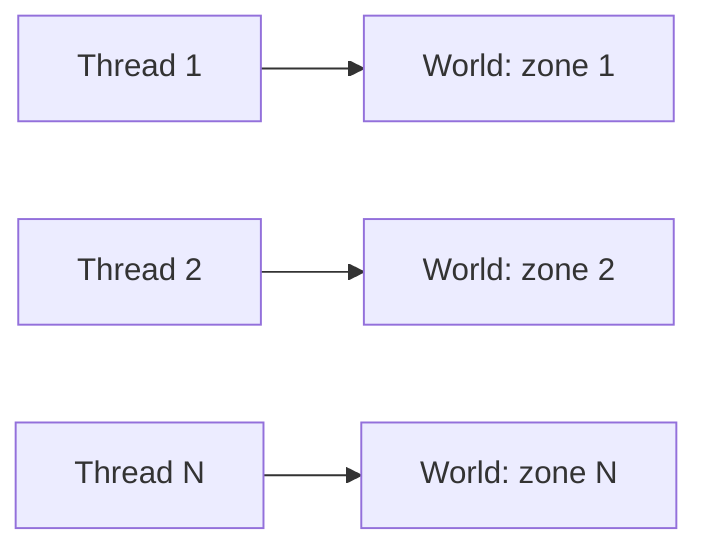
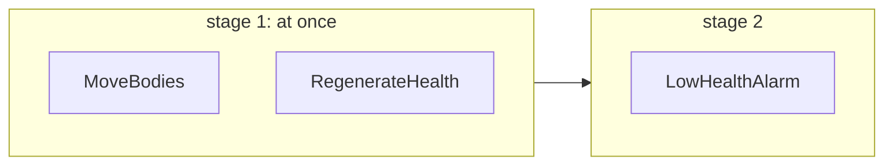

A server has many cores and a lot of entities. EasyEcs spreads the work three ways, none of which needs a lock on a hot
path: **one world per thread** (a world per zone or map, each owned by its thread), **parallel systems** (inside one
update, systems whose access does not conflict run at once) and **parallel `[ForEach]`** (one heavy method split into
chunks of rows). The generator writes each system's read and write sets from its parameters, so the scheduler, not
discipline, decides what may run together, and the analyzer rejects what could race.

## When to use it [#when-to-use-it]

<Callout type="idea" title="Use it for">
  One world per thread for a server with several zones, maps or matches. `ParallelSystems` for several heavy,
  independent systems in one world. `[ForEach(Parallel = true)]` for one method over tens of thousands of rows.
</Callout>

<Callout type="warn" title="Skip it for">
  Several threads of your own changing one world: structural changes belong to its owner thread (EECS014 reports the
  ones it sees). Parallel systems or methods over a few hundred light rows: the hand-off to the thread pool costs more
  than the work. A few hundred heavy rows (microseconds each) are the exception: see [chunk size](#chunk-rows).
</Callout>

## How to use it [#how-to-use-it]

### Terms: process, world, owner thread [#terms-process-world-owner-thread]

| Term | Meaning |
| --- | --- |
| **Process** | Your server. It holds any number of worlds; they share nothing but type indices. |
| **World** | One isolated set of entities, components, singletons and systems (`new World()`). |
| **Owner thread** | The thread that calls `world.Update()` and touches the world's data. One at a time per world. |
| **Parallel stage** | Inside one `Update()`, systems with no order and no conflict between them, run on thread-pool threads with the owner taking part. Ownership does not change. |

### Recommended: one world per thread [#recommended-one-world-per-thread]

Worlds share nothing, so a server that splits its entities over several worlds, each owned by one thread, needs no
synchronization at all.



```csharp
public static class Zones
{
    // A world per thread: each thread owns its world, nothing is shared.
    public static Thread[] Start(World[] worlds)
    {
        var threads = new Thread[worlds.Length];
        for (int i = 0; i < worlds.Length; i++)
        {
            var zone = worlds[i];                                   // one variable per iteration
            threads[i] = new Thread(() => { for (int t = 0; t < 1_000; t++) zone.Update(); });
            threads[i].Start();
        }

        return threads;
    }
}
```

The [MultiWorld sample](https://github.com/JasonXuDeveloper/EasyEcs/tree/master/samples/MultiWorld) runs this layout
and prints entity-updates per second. To move a player to a zone of another thread, hand it across as bytes: the
source's owner writes the group with [`SaveEntities`](/en/docs/guide/migration-and-unload#save-entities) and posts the
bytes to a queue the target's owner drains, which calls `LoadEntities`. `MoveEntities` is only for two worlds owned by
the same thread.

### Order of systems [#order-of-systems]

`Update()` runs systems in registration order, with each system that carries `[UpdateBefore<T>]` /
`[UpdateAfter<T>]` moved just before or after `T`. Systems never call each other: a system that consumes what another
produces is registered after it or says `[UpdateAfter<Producer>]`. Structural changes apply at once, so a later system
of the same update already sees an entity an earlier one created, destroyed or tagged: there are no command buffers to
play back. Whatever runs in parallel, the result of an update equals running the systems one by one in that order.

### Parallel systems [#parallel-systems]

With `WorldOptions.ParallelSystems = true`, systems with no order and no conflict between them run at the same time.
Each system's access comes from its `[ForEach]` parameters:

| `[ForEach]` parameter | Declares |
| --- | --- |
| `ref T` component or singleton | writes `T` |
| `Mut<T>` component | writes `T` (even on the rows it leaves alone) |
| `in T` component or singleton | reads `T` |
| `[With<T>]`, `[Without<T>]`, `[WithAny<T>]` | nothing (filters read presence, which no parallel system changes) |
| `[Changed<T>]`, `[Removed<T>]` | reads `T` (its change ticks) |
| `[ChangedAny<T1, …, Tn>]`, `[RemovedAny<T1, …, Tn>]` | reads each of `T1` to `Tn` |
| `Entity` used only as an identity (`Id`, `Version`, `IsAlive`, `==`, an `EntityId`) | nothing |
| `Entity` used otherwise, `World`, an instance method, an `OnUpdate` override | runs alone |
| no `[ForEach]` method at all | runs alone |

Two systems conflict when one writes something the other reads or writes, or when either runs alone. A system goes to
the stage after the latest one holding a system it must follow (by an ordering, or by an earlier system it conflicts
with). Stages run one after another; the systems of a stage run at once. `world.DescribeSchedule()` shows the stages
the world built, each system's reads and writes, and why a system waits for the stage before its own; it reads the
schedule published by the last `AddSystem` / `RemoveSystem`, so a diagnostics endpoint may call it from any thread
([Debugging and diagnostics](/en/docs/guide/diagnostics#schedule)).

```csharp
public record struct Body(float X, float Y, float Vx, float Vy) : IComponent;
public record struct Vitals(int Health, int Max) : IComponent;
public record struct Alarms(int Count) : ISingletonComponent;

public class MoveBodies : EcsSystem        // writes Body
{
    [ForEach] static void Move(ref Body b) { b.X += b.Vx; b.Y += b.Vy; }
}

public class RegenerateHealth : EcsSystem  // writes Vitals
{
    [ForEach] static void Regenerate(ref Vitals v) => v.Health = Math.Min(v.Health + 1, v.Max);
}

public class LowHealthAlarm : EcsSystem    // reads Vitals: conflicts with RegenerateHealth
{
    [ForEach] static void Count(in Vitals v, ref Alarms alarms) { if (v.Health < 10) alarms.Count++; }
}
```



```csharp
using var parallel = new World(new WorldOptions { ParallelSystems = true });
parallel.AddSingleton<Alarms>();
parallel.AddSystem<MoveBodies>();
parallel.AddSystem<RegenerateHealth>();
parallel.AddSystem<LowHealthAlarm>();
parallel.Update();                          // stage 1 on two threads, then stage 2
```

The runner allocates nothing: the calling thread works through a stage with up to `MaxDegreeOfParallelism - 1`
reusable thread-pool work items. Lower `MaxDegreeOfParallelism` when several worlds or IO threads share the cores:

```csharp
using var zone = new World(new WorldOptions { ParallelSystems = true, MaxDegreeOfParallelism = 4 });
```

The
first exception of a stage is rethrown on the calling thread after the stage; with
`WorldOptions.SystemErrors = SystemErrorPolicy.Disable`, a failing system is switched off with its exception in
`system.Error` instead.

### Parallel `[ForEach]` methods [#parallel-foreach-methods]

`[ForEach(Parallel = true)]` splits one method's rows into chunks across threads. It must make no structural change,
run per entity and write no singleton ([EECS010](/en/docs/guide/analyzer#eecs010)); a total over the rows is a
[`Reduce<T>`](#reductions), a row's working list a [`Scratch<T>`](#scratch), a read of another entity a
[`Lookup<T>`](#lookups):

```csharp
public record struct Regen(int PerTick) : ISingletonComponent;

public class RegenerateAll : EcsSystem
{
    [ForEach(Parallel = true), Without<Dead>]
    static void Regenerate(ref Health hp, in Regen regen) => hp.Value += regen.PerTick;   // reads the singleton only
}
```

Parallel systems and parallel methods compose: inside a parallel stage, a parallel method whose runner is busy with
another system's method runs on its own thread instead of waiting.

A parallel method may write a tracked component, through a `ref` or a
[`Mut<T>`](/en/docs/guide/change-tracking#set-if-changed) parameter: each chunk stamps only its own rows, and by
default the chunks of such a method are cut at multiples of 4,096 rows (at least 4,096), the blocks whose change-tick
summary their rows share, so no two threads update one summary. `Mut<T>.Write()` and `SetIfChanged` are as safe in a
chunk as a `ref`. A table of 4,096 rows or fewer is then a single chunk.

#### Chunk size: few heavy rows, `ChunkRows` [#chunk-rows]

A parallel pass cuts its rows into chunks, and the threads claim them one at a time through a shared counter as they
finish their last one, like OpenMP's `schedule(dynamic, n)`: a thread that drew cheap rows takes the next chunk while
another is still busy, so uneven rows even out. By default a chunk is about a quarter of each thread's share of the
matching rows, at least 1,024 (4,096 when the method writes a tracked component) and at most
`World.ParallelChunkRows` (16,384). That suits many light rows. A few hundred rows that cost microseconds each (a
chunk of terrain, a path search, a crowd cell) are then one chunk, run by one thread while the others wait.

`ChunkRows = n` is the `n` of `schedule(dynamic, n)`: the rows a thread takes at a time.

<Callout type="idea" title="Use it for">
  A parallel method over a few hundred to a few thousand rows that cost microseconds each: terrain chunks, path
  searches, crowd cells, simulation islands.
</Callout>

<Callout type="warn" title="Skip it when">
  The rows are light (a few arithmetic operations each), however many there are: the default chunks already fill
  every thread, and smaller ones only add claims. Also when the method is not parallel: `ChunkRows` needs
  `Parallel = true`.
</Callout>

```csharp
public record struct Cell(int Agents) : IComponent;
public record struct Crowd(float Pressure) : IComponent;
```

```csharp tab="Default chunks"
public class CrowdPressure : EcsSystem
{
    const int Iterations = 2_000;   // a few microseconds of work per cell

    // 500 cells: one chunk of at least 1,024 rows, so one thread runs them all
    [ForEach(Parallel = true)]
    static void Relax(in Cell cell, ref Crowd crowd)
    {
        float pressure = crowd.Pressure;
        for (int i = 0; i < Iterations; i++)
            pressure += (cell.Agents - pressure) * 0.001f;
        crowd = new Crowd(pressure);
    }
}
```

```csharp tab="ChunkRows = 64"
public class CrowdPressure : EcsSystem
{
    const int Iterations = 2_000;   // a few microseconds of work per cell

    // 500 cells: eight chunks of up to 64 rows, claimed by the threads as they finish
    [ForEach(Parallel = true, ChunkRows = 64)]
    static void Relax(in Cell cell, ref Crowd crowd)
    {
        float pressure = crowd.Pressure;
        for (int i = 0; i < Iterations; i++)
            pressure += (cell.Agents - pressure) * 0.001f;
        crowd = new Crowd(pressure);
    }
}
```

- **Rounded up to 64.** A word of presence bits and change ticks stays with one thread, so `ChunkRows = 10` takes 64.
- **Per table.** Each matching table is cut on its own, at multiples of `n` from its first row; a chunk never spans two
  tables, and a table's last chunk holds what is left. A sliced method ([`Slices`](/en/docs/guide/systems#slices)) cuts
  the slice it visits.
- **Tracked writes.** Chunks of a method that writes a tracked component may split a 4,096-row block of change ticks:
  before the pass, the blocks it covers are opened at the pass's tick, and the threads that share one set their words
  of its summary with an atomic OR, once per 64 written rows (the same OR every pass pays). Without `ChunkRows` such a
  method keeps whole blocks per chunk, so no two threads share one
  ([D67](/en/docs/decisions#d67-chunk-rows)).
- **Choosing `n`.** Each chunk is one claim, a compare-and-swap on the counter. Aim for several chunks per thread
  (rows ÷ threads ÷ 4 is a good start, never below 64), and keep `ChunkRows` for rows whose work dwarfs a claim:
  light rows keep the default. Fewer than two chunks run on the calling thread, and a pass whose helpers do not make
  it faster runs there too ([what it costs](#what-it-costs)).
- **Where it goes.** `ChunkRows` needs `Parallel = true` and is 0 (the default: chosen from the row count) or more
  ([EECS054](/en/docs/guide/analyzer#eecs054)). Ad hoc, the parallel calls take it as their last argument:
  `world.ForEachParallel(ref job, filter, chunkRows: 64)` and `ForEachEntityParallel`
  ([queries](/en/docs/guide/queries#on-several-threads-foreachparallel-and-foreachentityparallel)).

Why the default stays chosen from the row count, how a split block keeps its change ticks exact and what else was
weighed (guided scheduling, per-thread summaries): [D67](/en/docs/decisions#d67-chunk-rows). The
[VoxelServer](/en/docs/samples/voxel-server) water flow runs its few hundred flowing chunks with `ChunkRows = 64`.

With `WorldOptions.MeasureSystems`, `system.Stats` covers the threads that helped: `LastAllocated` and
`TotalAllocated` sum the bytes allocated on the thread that ran the system and on every thread that ran a chunk of its
parallel methods, and the time is that of the whole run. With `ParallelSystems`, each system of a stage records its
own runs.

How chunk size fits with vector loops, batch methods and grid kernels, and the OpenMP / MPI terms for each:
[high-performance patterns](/en/docs/guide/high-performance).

#### Totals over the rows: `Reduce<T>` [#reductions]

A parallel method writes its own rows only: it may not write a singleton ([EECS010](/en/docs/guide/analyzer#eecs010)),
and a shared counter would race ([EECS060](/en/docs/guide/analyzer#eecs060)). A total over every row (a count, a sum, a
minimum, a bounding box) is a `ref Reduce<T>` parameter: OpenMP's `reduction(+: x)`, MPI's `Allreduce`. Each chunk adds into
a partial result of its own, with no lock and no atomic per row, and when the pass ends the partial results are
combined and replace singleton `T`.

<Callout type="idea" title="Use it for">
  One result per pass over many rows: the units alive, the gold in the world, the mass of a crowd, its extent, the
  busiest cell. On several threads, or on one: the same method works with and without `Parallel = true`.
</Callout>

<Callout type="warn" title="Skip it for">
  A result per entity: write it into a component of the row. A total that a few rows change per tick: keep it up to
  date in the systems that change those rows (or read a [`[Changed<T>]`](/en/docs/guide/change-tracking) pass) instead
  of visiting every row. A value the method needs while it runs: `Value` holds this chunk's partial result, not the
  total.
</Callout>

<Steps>
<Step>

**Declare the result** as a singleton that implements `IReduction<T>` for itself: `Identity`, the value that changes
nothing it is combined with (0 for a sum, `float.MaxValue` for a minimum), and `Combine`, which must be associative.
It need not be commutative: partial results are combined in row order.

</Step>
<Step>

**Take a `ref Reduce<T>` parameter** and write the fields of `Value` (a field: this chunk's partial result), or call
`Combine(value)` with one row's contribution. It is taken by `ref` so the partial result stays in a register; a
`Reduce<T>` without `ref` is [EECS002](/en/docs/guide/analyzer#eecs002).

</Step>
<Step>

**Read the result** after the pass: `world.T`, or `in T` in a later system. Each pass replaces `T` (added when
missing; a pass over no rows writes `Identity`), and the system is scheduled as a writer of `T`, so a reader waits for
it.

</Step>
</Steps>

```csharp
public struct Extent : ISingletonComponent, IReduction<Extent>
{
    public int Count;
    public float MinX, MaxX;

    public static Extent Identity => new() { MinX = float.MaxValue, MaxX = float.MinValue };

    public static Extent Combine(Extent left, Extent right) => new()
    {
        Count = left.Count + right.Count,
        MinX = MathF.Min(left.MinX, right.MinX),
        MaxX = MathF.Max(left.MaxX, right.MaxX),
    };
}

public class MeasureCrowd : EcsSystem
{
    [ForEach(Parallel = true)]
    static void Measure(in Position position, ref Reduce<Extent> extent)
    {
        ref var e = ref extent.Value;   // this chunk's partial result
        e.Count++;
        e.MinX = MathF.Min(e.MinX, position.X);
        e.MaxX = MathF.Max(e.MaxX, position.X);
    }
}
```

```csharp
world.AddSystem<MeasureCrowd>();
world.Update();
var crowd = world.Extent;   // the combined result of every chunk
Console.WriteLine($"{crowd.Count} units between x = {crowd.MinX} and x = {crowd.MaxX}");
```

- **Exact or reproducible.** Integer results are exact on every run and thread count. A floating-point sum is rounded
  per chunk, so it depends on where chunks begin: with a fixed [`ChunkRows`](#chunk-rows) it is the same on every run
  and for any thread count (the tests check 1, 2, 3, 4 and 8 threads), but not bit for bit the result of the same
  method with `Parallel = false`. The default chunk size follows the thread count: set `ChunkRows` when a float total
  must reproduce across machines. Minimum, maximum and bounding boxes do not round, so they are exact either way.
- **On one thread** the partial result is a local of the job, one per run of rows; the method, the result and its
  scheduling are the same. A `[ForEach]` method outside a system reduces into the world it is called with.
- **What it costs:** per row, an add into a local: a reducing method runs over each chunk's runs of rows, and the JIT
  keeps the run's partial result, passed by `ref` to the inlined method, in a register. Per chunk, its job copy, kept
  until the pass ends and then combined in chunk order; 0 bytes after the first pass. No lock, no `Interlocked`, no
  false sharing: each chunk's partial result is stored once.
- **What the analyzer checks:** a second `Reduce<T>` of the same `T` in the method or system, or a `ref T` next to it,
  would replace one result with another ([EECS057](/en/docs/guide/analyzer#eecs057)). The generated job of a reducing
  method merges its chunks' copies, so [EECS061](/en/docs/guide/analyzer#eecs061) (a job field read after a parallel
  pass) leaves it alone.

`ReduceBenchmark` measures an integer sum, a float sum and a bounding box over 1,000 and 1,000,000 rows with
`Reduce<T>` on several threads and on one, against a serial `ref` context value, an `Interlocked` add per row, a lock
per row, `Parallel.For` over the chunks a pass cuts and the per-row `Parallel.For<TLocal>(from, to, localInit, body,
localFinally)`. The numbers, with the distinct float results of 200 runs of each, are in the
[decision record](/en/docs/decisions#d69-reductions).

{/* TODO(bench): <BenchTable bench="ReduceBenchmark" /> here once bench.json holds it. */}

**Why not `Parallel.For` with `localInit` / `localFinally`:** it is .NET's thread-local pattern and the nearest thing to
`Reduce<T>`, and it lost on every count. It has no overload that passes state, so a `static` lambda needs static state
(the column, the result), which is not reentrant: two worlds cannot reduce at once. It allocates on every call (its
delegates, its partition state), so it never runs at 0 B. Its per-row form calls a delegate per row and runs several
times slower than `Reduce<T>`; over a small pass its hand-off alone costs more than the pass. And its partitions follow
the thread pool's work stealing, so a float total changes from run to run. `Parallel.For` over the pass's own chunks,
with the partial results summed in order, keeps up in time and is deterministic, but it still allocates per call and
still needs the static state. The world's runner passes the job by `ref`, allocates nothing, and combines the partial
results in chunk order ([D69](/en/docs/decisions#d69-reductions)).

A reducing method runs as a batch job: each chunk hands it the runs of consecutive rows it holds
([`ForEachBatchParallel`](/en/docs/guide/queries#on-several-threads-foreachparallel-and-foreachentityparallel)), and
the run's partial result is a local the JIT keeps in a register. Run per row, the partial result would live in the
chunk's copy of the job, a load and a store on every row.

#### Working memory per thread: `Scratch<T>` [#scratch]

A row that needs a list for its own work (the candidates of a neighbor search, the open set of a path search, a
buffer to fill) should not allocate one per row, and may not share one between threads. A `Scratch<T>` parameter is
the method's working memory on the thread running it: one `T` per method and thread, OpenMP's `threadprivate`. It
starts as `default`, the first allocation (`scratch.Value ??= new()`) happens once per thread, and every later row on
that thread finds what the last one left.

<Callout type="idea" title="Use it for">
  A list, a set or a buffer each row fills and reads within its call, whose size varies or is too big for the stack:
  candidates, a frontier, a sorted window. In parallel and serial methods alike.
</Callout>

<Callout type="warn" title="Skip it for">
  A small buffer with a bound known up front: `stackalloc` (`Span<int> kept = stackalloc int[24];`) is fastest and
  needs nothing else. Anything that must outlive the row: that belongs in a component, a
  [dynamic buffer](/en/docs/guide/dynamic-buffers) or a singleton.
</Callout>

```csharp
public record struct Neighbors(int Count, int Spread) : IComponent;

public class CountNeighbors : EcsSystem
{
    [ForEach(Parallel = true)]
    static void Count(in Position position, ref Neighbors neighbors, Scratch<List<int>> scratch)
    {
        var near = scratch.Value ??= new List<int>(32);   // once per thread // [!code highlight]
        near.Clear();                                      // what the last row on this thread left
        int cell = (int)position.X * 64 + (int)position.Y;
        for (int i = 0; i < 24; i++)
            if (((cell ^ (i * 40_503)) & 3) != 0) near.Add(i);
        int spread = near.Count == 0 ? 0 : near[^1] - near[0];
        neighbors = new Neighbors(near.Count, spread);
    }
}
```

- **Never reset.** A row finds what the last row on its thread left, of this pass or an earlier one, of this world or
  another: clear what you use at the start of the row.
- **Not data of the world.** It adds nothing to the system's reads or writes, so it changes no schedule; and storing
  what it holds by reference into a component, a singleton, a `Maybe`, a `Mut` or a `Reduce` hands one thread's
  memory to the next row that reuses it ([EECS058](/en/docs/guide/analyzer#eecs058)).
- **Its memory is the thread's**, released when the thread ends, not when the world is disposed; thread-pool threads
  live long, so a buffer that grew large stays large.
- **What it costs:** one lookup of the thread's value per chunk (per pass on one thread), then a field read per row;
  0 bytes after each thread's first use. [EECS028](/en/docs/guide/analyzer#eecs028) does not report the one-time
  `??= new()`.

`ScratchBenchmark` gathers 24 candidates per row over 10,000 and 100,000 rows in parallel, the list kept in a
`Scratch<T>`, created per row, rented from `ArrayPool<int>.Shared` per row, kept in a hand-written `[ThreadStatic]`
field, or a `stackalloc` span ([D74](/en/docs/decisions#d74-scratch)).

{/* TODO(scratch): Scratch<T> is still behind a hand-written [ThreadStatic] list in ScratchBenchmark; a fix is being
tried. Update this paragraph and D74 when it lands, and add <BenchTable bench="ScratchBenchmark" /> once bench.json
holds it. */}

#### Reading other entities: `Lookup<T>` [#lookups]

A method that needs another entity's component (a chaser's target, a unit's leader, the account a request names)
would take the `World` and call `TryGetEntity`, which keeps it on one thread. A `Lookup<T>` parameter reads component `T` of any entity instead: Unity's `ComponentLookup` with
`[ReadOnly]`, MPI's one-sided `Get`. The method stays free of the world, so it may run in parallel.

<Callout type="idea" title="Use it for">
  Reads of entities other than the row's own: targets, leaders, parents, the holder of a key. Serial methods too: a
  lookup is faster than the `World` parameter with `TryGetEntity` and `TryGet`.
</Callout>

<Callout type="warn" title="Skip it for">
  The row's own components: take them as parameters. A component the same method writes: a lookup would read rows
  before or after their write ([EECS059](/en/docs/guide/analyzer#eecs059)).
</Callout>

| Member | Returns |
| --- | --- |
| `lookup[id]` | `ReadOnlyMaybe<T>`: the entity's `T`, or no value when it lacks it or is not alive |
| `lookup.Read(id)` | `ref readonly T`; throws when the entity lacks it or is not alive |
| `lookup.Has(id)` | whether the entity is alive and has `T` |
| `lookup.TryFind(key, out id)`, `Find(key)`, `Count(key)` | for an indexed `T` (`IIndexed<TKey>`, `IUniqueIndexed<TKey>`): an entity of a key, all of them, how many |

```csharp
public record struct Quarry(EntityId Id) : IComponent;
public record struct Heading(float X, float Y) : IComponent;

public class ChaseSystem : EcsSystem
{
    [ForEach(Parallel = true)]
    static void Chase(in Position position, in Quarry quarry, ref Heading heading, Lookup<Position> positions)
    {
        var at = positions[quarry.Id];                 // the quarry's position from before the pass // [!code highlight]
        heading = at.HasValue ? new Heading(at.Value.X - position.X, at.Value.Y - position.Y) : default;
    }
}
```

```csharp
public record struct Login(int Number) : IComponent, IUniqueIndexed<int>
{
    public int Key => Number;
}

public record struct Asks(int Number) : IComponent;
public record struct Answer(EntityId Login) : IComponent;

public class MatchLogins : EcsSystem
{
    [ForEach(Parallel = true)]
    static void Match(in Asks asks, ref Answer answer, Lookup<Login> logins) =>
        answer = new Answer(logins.TryFind(asks.Number, out var id) ? id : default);   // the index is built before the pass
}
```

- **Every read sees the value from before the pass.** The system is scheduled as a reader of `T`, so no system that
  writes `T` shares its stage, and the method itself may not write `T` (EECS059). The pass makes no structural change,
  so ids keep their rows.
- **Key lookups on the parameter build the index first.** A method that calls `TryFind`, `Find` or `Count` on its
  `Lookup<T>` gets `T`'s value index created and built before the pass (on the owner thread, before the parallel stage
  of its system). An index reached any other way inside a parallel region that is not built yet throws instead of
  building; serial passes still build it on the first lookup.
- **[EECS010](/en/docs/guide/analyzer#eecs010) accepts it** in a parallel method, where a `World` parameter is
  rejected.
- **What it costs:** one entity lookup per read (`TryGetEntity`, then the row's column), a hash probe per key lookup.
  On one thread it is faster than the `World` parameter with `TryGetEntity` and `TryGet`
  ([D75](/en/docs/decisions#d75-lookup)); in parallel, lookups spread like any rows.

`LookupBenchmark` chases 1,000 targets from 10,000 and 100,000 rows and finds accounts by a unique key, through a
`Lookup<T>` in parallel and on one thread and through a `World` parameter.

{/* TODO(bench): <BenchTable bench="LookupBenchmark" /> once bench.json holds it. */}

#### How the runner synchronizes [#runner-contract]

What a parallel pass costs in synchronization, and what orders a chunk's writes before the code after the pass:

| When | Synchronization |
| --- | --- |
| Per row | None. The one exception is a method with [`ChunkRows`](#chunk-rows) that writes a tracked component: chunks that split a 4,096-row block set its change-tick summary with an atomic OR, once per 64 written rows ([D67](/en/docs/decisions#d67-chunk-rows)). |
| Per chunk | One compare-and-swap on the run's cursor (tagged with the run's epoch, so a helper that starts late never claims a chunk of the next run) claims it; when it is done, one `Interlocked.Decrement` of the chunks remaining and one `Interlocked.Add` of the time it took. |
| Per run | Two `Interlocked.Exchange` on the cursor (open and close), and per helper woken a compare-and-swap and one queued thread-pool work item. |
| End of the run | The caller spins on `Volatile.Read` of the chunks remaining until it reads 0. The full fence of each chunk's `Decrement` orders its writes (its rows, its job copy and partial result) before the caller's merge and before the code after the pass. |

`ParallelRunnerBenchmark` runs the steering pass of `ParallelForEachBenchmark` through the runner and through
`Parallel.For` with static delegates: on a small pass the runner is faster and allocates nothing, at 10,000 rows the
two are level, and at 100,000 rows `Parallel.For` measured faster on a loaded machine, within that machine's noise
([D22](/en/docs/decisions#d22-parallel-runs-use-the-thread-pool-and-wake-helpers-only-when-they-pay)).

{/* TODO(bench): rerun ParallelRunnerBenchmark on a quiet machine; update this paragraph and D22, and add
<BenchTable bench="ParallelRunnerBenchmark" /> once bench.json holds it. */}

### Input from other threads [#input-from-other-threads]

A world has one owner thread, and EasyEcs adds no cross-thread queue of its own: structural changes are immediate on
that thread, so there is nothing to defer. Input from other threads (network, timers, a database) goes through a
queue you own, and a system on the owner thread turns it into data:

```csharp
using System.Collections.Concurrent;

public record struct MoveRequest(int PlayerId, float X, float Y);           // a message, not a component
public record struct MoveIntent(int PlayerId, float X, float Y) : IComponent;

public sealed class ReceiveMoves(ConcurrentQueue<MoveRequest> inbox) : EcsSystem
{
    private readonly ConcurrentQueue<MoveRequest> _inbox = inbox;          // filled by the network threads

    protected override void OnUpdate()
    {
        while (_inbox.TryDequeue(out var move))
            World.CreateEntity(new MoveIntent(move.PlayerId, move.X, move.Y));   // input becomes data
    }
}
```

Register it with `world.AddSystem(new ReceiveMoves(inbox))` before the systems that consume `MoveIntent`. The queue's
type, bound and back-pressure are your choice. Keep the queue in a `readonly` field of the system that drains it
([EECS007](/en/docs/guide/analyzer#eecs007) allows it), not in a singleton: `World.Save` writes every singleton, and a
managed queue would need a formatter. The [GameLoop sample](https://github.com/JasonXuDeveloper/EasyEcs/tree/master/samples/GameLoop)
drains a mailbox from a network thread this way.

### What the world synchronizes [#what-the-world-synchronizes]

| Operation | Safety |
| --- | --- |
| Structural changes, systems and singletons added or removed, `Capture` / `Restore`, `Save` / `Load` | Owner thread only, one at a time. A plain owner flag (no atomic instruction): one started while another runs, or while the structure is frozen (a parallel stage, a parallel `[ForEach]`, a batch job, an `INoStructuralChanges` pass), throws `InvalidOperationException` instead of tearing the tables. |
| Query matching, `Has`, `Get` lookups | Lock-free over immutable, copy-on-write table lists. The first use of a query shape takes a compare-and-swap gate once. |
| A singleton a system adds with `GetOrAddSingleton<T>()` / `GetOrAddX()` | The same gate: systems of one stage may add it at once. |
| Component and singleton values | Not synchronized, by design: the owner thread or the scheduler decides who touches them. |
| Value indexes, and the unlinking done by destroys and removals | Owner thread only while the world has an index. |

What catches a change made off the owner thread:

| Where the change comes from | Caught by |
| --- | --- |
| A `[ForEach]` method without `Entity` or `World` changing structure through a handle it holds | [EECS013](/en/docs/guide/analyzer#eecs013) at compile time; the runtime throws in a parallel stage |
| A system of a parallel stage, or a parallel job, changing structure through a helper | The runtime: the structure is frozen, every structural change throws |
| A lambda handed to `Task.Run`, `Parallel.*`, `ThreadPool`, `new Thread` or `new Timer` changing a world the code around it also changes | [EECS014](/en/docs/guide/analyzer#eecs014) at compile time |
| Your own threads in any other way | Nothing reliable: hand the change to the owner as data |

Every structural call counts here, including the less obvious ones: `entity.Run<…>(ref job)` (a job may change
structure) and `LoadEntitiesInto` belong to the owner thread too, and the analyzer treats them as structural
([EECS010](/en/docs/guide/analyzer#eecs010), [EECS014](/en/docs/guide/analyzer#eecs014)).

## Full example [#full-example]

A hundred thousand units steer towards a target, move and regenerate: the steering method splits its rows over
several threads, and the regeneration system shares a stage with it because the two touch different components.
Put the files in a console project that references EasyEcs (`dotnet add package EasyEcs`) and run it with
`dotnet run`.

<Accordions>
<Accordion title="Components.cs">

```csharp title="Components.cs" doccheck=example
using EasyEcs;

public record struct Position(float X, float Y) : IComponent;

public record struct Velocity(float X, float Y) : IComponent;

public record struct Health(int Value) : IComponent;

// Where every unit heads.
public record struct Target(float X, float Y) : ISingletonComponent;
```

</Accordion>
<Accordion title="Systems.cs">

```csharp title="Systems.cs" doccheck=example
using EasyEcs;

// Points every velocity at the target.
// Parallel = true splits the rows into chunks on several threads: each call reads
// its own row and the singleton, and writes only its own row.
public class SteeringSystem : EcsSystem
{
    [ForEach(Parallel = true)]
    static void Steer(in Position position, ref Velocity velocity, in Target target)
    {
        float dx = target.X - position.X;
        float dy = target.Y - position.Y;
        // The + 1 keeps the length above zero when a unit stands on the target.
        float length = MathF.Sqrt(dx * dx + dy * dy) + 1;
        velocity = new Velocity(dx / length, dy / length);
    }
}

// Writes only Health, which SteeringSystem does not touch: the two can run in the same stage.
public class RegenerateSystem : EcsSystem
{
    [ForEach]
    static void Regenerate(ref Health health)
    {
        health.Value = Math.Min(health.Value + 1, 100);
    }
}

// Writes Position, which SteeringSystem reads: it waits for SteeringSystem to finish.
public class MoveSystem : EcsSystem
{
    [ForEach]
    static void Move(ref Position position, in Velocity velocity)
    {
        position = new Position(position.X + velocity.X, position.Y + velocity.Y);
    }
}
```

</Accordion>
<Accordion title="Program.cs">

```csharp title="Program.cs" doccheck=example
using EasyEcs;

// ParallelSystems lets systems with no conflict between them share a stage.
using var world = new World(new WorldOptions { ParallelSystems = true });
world.SetTarget(X: 500, Y: 500);
world.AddSystem<SteeringSystem>();
world.AddSystem<RegenerateSystem>();
world.AddSystem<MoveSystem>();

var units = new Entity[100_000];
world.CreateEntities(units, new Position(0, 0), new Velocity(0, 0), new Health(50));

// Update is still one call on this thread: the threads it uses are done when it returns.
for (int i = 0; i < 10; i++)
{
    world.Update();
}

Position at = units[0].Position;
Console.WriteLine($"unit 0 at ({at.X:F2}, {at.Y:F2}) with {units[0].Health.Value} hp");
```

</Accordion>
</Accordions>

It prints:

```text
unit 0 at (7.06, 7.06) with 60 hp
```

The result is the same as running the three systems one by one in registration order: a parallel stage never
changes what an update computes, only how many threads compute it.

## How to use it fast [#how-to-use-it-fast]

- **Prefer worlds to parallel stages.** Worlds on their own threads scale with no hand-off at all; a stage pays a
  thread-pool hand-off per update.
- **Turn `ParallelSystems` on for heavy systems only**, ones that iterate thousands of entities.
- **Split by data, not by method.** Two systems that write different components run together; one that writes
  everything runs alone.
- **Read with `in`.** A `ref` that only reads declares a write, and a write conflicts
  ([EECS025](/en/docs/guide/analyzer#eecs025) reports it).
- **Size the chunks of few heavy rows.** A parallel method over a few hundred rows of microseconds each sets
  [`ChunkRows`](#chunk-rows), so every thread gets some; one over many light rows keeps the default.
- **Reduce, do not share.** A count or a sum over a parallel pass is a [`Reduce<T>`](#reductions) parameter: a
  partial result per chunk, no atomic per row.
- **Scratch per thread, not per row.** A list each row fills is a [`Scratch<T>`](#scratch) (or `stackalloc` for a
  small fixed bound), not a `new` per row.
- **Look up, do not take the world.** Reads of other entities go through a [`Lookup<T>`](#lookups), which keeps the
  method parallel and is faster on one thread too.

One world of 100,000 entities, and the same entities in four worlds on four threads (`WorldSimulationBenchmark`,
`MultiWorldBenchmark`): <BenchValue k="tick.oneWorld" /> per tick in one world, <BenchValue k="tick.fourWorlds" /> for
the four worlds together.

<BenchSource />

Four independent systems over 100,000 entities, sequential and parallel (`ParallelSystemsBenchmark`), and one method
over 100,000 rows, sequential and parallel (`ParallelForEachBenchmark`):

<BenchTable bench="ParallelSystemsBenchmark" />

<BenchTable bench="ParallelForEachBenchmark" />

## What it costs [#what-it-costs]

- **One world, one thread:** no locks, no atomics on hot paths; a structural change checks and sets a plain flag.
- **A parallel stage:** a hand-off to reusable thread-pool work items, nothing allocated; the
  `ParallelSystemsBenchmark` table above shows what it saves on heavy systems.
- **A parallel method:** the same runner, over chunks of rows; the calling thread always takes part, and helpers
  are woken only while measured runs show they make the pass at least a fifth faster than its work alone (so a small
  pass between ticks runs on the caller). Each chunk costs one claim and a copy of the job; with
  [`ChunkRows`](#chunk-rows) on a method that writes a tracked component, also one block opening per 4,096 rows before
  the pass and one atomic OR per 64 written rows. A [`Reduce<T>`](#reductions) adds a job copy per chunk, combined
  once when the pass ends; a [`Scratch<T>`](#scratch) one lookup of the thread's value per chunk; a
  [`Lookup<T>`](#lookups) one entity lookup per read. The atomics of a pass: [how the runner
  synchronizes](#runner-contract).
- **Off:** `ParallelSystems` is off by default, and a world that never uses it pays nothing for it.

## Pitfalls [#pitfalls]

| Mistake | What happens | Caught by |
| --- | --- | --- |
| A structural change inside a parallel method | Chunks on other threads would tear the tables | [EECS010](/en/docs/guide/analyzer#eecs010) |
| A `ref` singleton in a parallel method | Chunks race on one value | [EECS010](/en/docs/guide/analyzer#eecs010) |
| Changing a collection through an `in` parameter | Scheduled as a read: races with parallel readers | [EECS011](/en/docs/guide/analyzer#eecs011) |
| A structural change through a held handle in a method that takes no `Entity` | The system shares a stage it should not | [EECS013](/en/docs/guide/analyzer#eecs013) |
| `Task.Run(() => world.CreateEntity(...))` beside the owner | Two threads change one world | [EECS014](/en/docs/guide/analyzer#eecs014) |
| A `ref` parameter that only reads | Declares a write: fewer systems run together | [EECS025](/en/docs/guide/analyzer#eecs025) |
| A few hundred heavy rows in a parallel method without `ChunkRows` | One chunk: one thread works, the others wait | Code review: [`ChunkRows`](#chunk-rows) |
| `ChunkRows` on many light rows | A claim per small chunk: more overhead, no gain | Code review: keep the default |
| `ChunkRows` without `Parallel = true`, or below 0 | Compile error: a method on one thread has no chunks | [EECS054](/en/docs/guide/analyzer#eecs054) |
| Code that expects chunks in row order, or one per thread | Chunks are claimed as threads finish, in any order and on any thread | Code review: write each row's result to its own row |
| A static counter or a shared list written by a parallel method | Lost updates, a corrupted list | [EECS060](/en/docs/guide/analyzer#eecs060); use [`Reduce<T>`](#reductions) |
| A sum kept in a job field, read after `ForEachParallel` | Still the old value: each chunk ran a copy | [EECS061](/en/docs/guide/analyzer#eecs061) |
| A `Reduce<T>` parameter without `ref` | Compile error: a copy would lose the result | [EECS002](/en/docs/guide/analyzer#eecs002) |
| Reading `Reduce<T>.Value` as the total inside the method | It is this chunk's partial result | Code review: read `T` after the pass |
| Two `Reduce<T>` of one `T`, or a `ref T` beside it | One result replaces the other | [EECS057](/en/docs/guide/analyzer#eecs057) |
| A `Combine` that is not associative (an average of averages) | The result depends on where chunks begin | Code review: reduce the sum and the count, divide after |
| A float total compared across machines with the default chunks | It differs in the last bits | Set [`ChunkRows`](#chunk-rows) |
| A `Scratch<T>` list used without clearing it | The row sees the last row's items | Code review: `Clear()` at the start of the row |
| A reference a `Scratch<T>` holds stored into a component | The next row on that thread changes this entity's data | [EECS058](/en/docs/guide/analyzer#eecs058) |
| A `Lookup<T>` of a component the same method writes | Rows read before or after their write, torn on another thread | [EECS059](/en/docs/guide/analyzer#eecs059): write another component (double buffering) |
| A `World` parameter in a parallel method to read other entities | Compile error | [EECS010](/en/docs/guide/analyzer#eecs010): a `Lookup<T>` |
| A value index reached through a helper inside a parallel pass, before anything built it | `InvalidOperationException` | Call `TryFind` / `Find` / `Count` on the `Lookup<T>` parameter itself |

## Compared with other ECS libraries [#compared-with-other-ecs-libraries]

| Library | Order of systems | Systems in parallel | How conflicts are avoided |
| --- | --- | --- | --- |
| **EasyEcs** | Registration order, `[UpdateBefore<T>]` / `[UpdateAfter<T>]` | Systems with no order and no conflict; one method's rows in chunks | Access generated from `ref` / `in`; the analyzer rejects parallel methods that could race |
| Arch | Your call order (Arch.System: group order) | Within one query (`ParallelQuery`) | You keep query bodies independent |
| Friflo.Engine.ECS | `SystemRoot` / `SystemGroup` order | Within one query (`RunParallel`) | You keep query bodies independent |
| DefaultEcs | `SequentialSystem` order | `ParallelSystem` (all children at once), per-set runners | You put only independent systems in a `ParallelSystem` |
| Bevy (Rust) | Ambiguous unless ordered | Any systems whose access does not conflict | Access read from parameter types |
| Unity DOTS | `UpdateBefore` / `UpdateAfter` in groups | Jobs | Read/write handles and the job safety system |

EasyEcs takes the access-based model of Bevy and Unity DOTS, and keeps the order total and deterministic. Measured
against the parallel runners of the others:

<BenchChart bench="ParallelSystemsComparison" title="Four independent systems over 100,000 entities, sequential and parallel" />

<BenchChart bench="ParallelQueryComparison" title="100,000 agents steering on all cores" />

## Related [#related]

<Cards>
  <Card title="Systems and [ForEach]" href="/en/docs/guide/systems">
    Parameters, ordering, groups and parallel methods.
  </Card>
  <Card title="Analyzer rules" href="/en/docs/guide/analyzer">
    EECS010, EECS011, EECS013 and EECS014 in detail.
  </Card>
  <Card title="Migration and unload" href="/en/docs/guide/migration-and-unload">
    Moving entities between worlds.
  </Card>
  <Card title="Sample: MultiWorld" href="https://github.com/JasonXuDeveloper/EasyEcs/tree/master/samples/MultiWorld">
    One world per thread, no locks.
  </Card>
</Cards>
