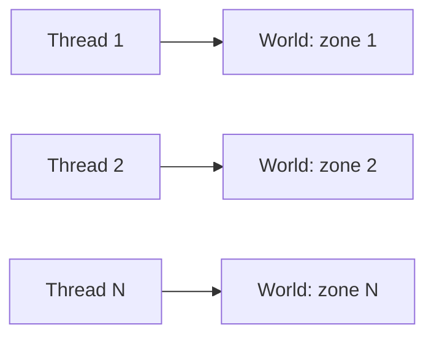
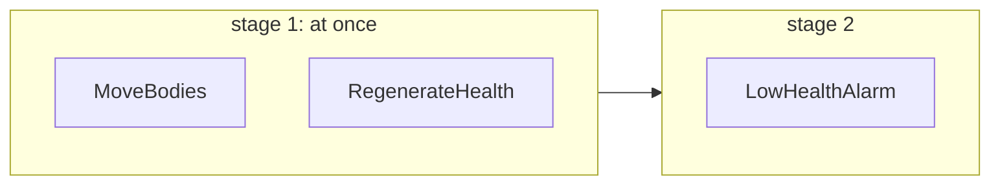

A server has many cores and a lot of entities. EasyEcs spreads the work three ways, none of which needs a lock on a hot
path: **one world per thread** (a world per zone or map, each owned by its thread), **parallel systems** (inside one
update, systems whose access does not conflict run at once) and **parallel `[ForEach]`** (one heavy method split into
chunks of rows). The generator writes each system's read and write sets from its parameters, so the scheduler, not
discipline, decides what may run together, and the analyzer rejects what could race.

## When to use it [#when-to-use-it]

<Callout type="idea" title="Use it for">
  One world per thread for a server with several zones, maps or matches. `ParallelSystems` for several heavy,
  independent systems in one world. `[ForEach(Parallel = true)]` for one method over tens of thousands of rows.
</Callout>

<Callout type="warn" title="Skip it for">
  Several threads of your own changing one world: structural changes belong to its owner thread (EECS014 reports the
  ones it sees). Parallel systems or methods over a few hundred rows: the hand-off to the thread pool costs
  microseconds, more than the work.
</Callout>

## How to use it [#how-to-use-it]

### Terms: process, world, owner thread [#terms-process-world-owner-thread]

| Term | Meaning |
| --- | --- |
| **Process** | Your server. It holds any number of worlds; they share nothing but type indices. |
| **World** | One isolated set of entities, components, singletons and systems (`new World()`). |
| **Owner thread** | The thread that calls `world.Update()` and touches the world's data. One at a time per world. |
| **Parallel stage** | Inside one `Update()`, systems with no order and no conflict between them, run on thread-pool threads with the owner taking part. Ownership does not change. |

### Recommended: one world per thread [#recommended-one-world-per-thread]

Worlds share nothing, so a server that splits its entities over several worlds, each owned by one thread, needs no
synchronization at all.



```csharp
public static class Zones
{
    // A world per thread: each thread owns its world, nothing is shared.
    public static Thread[] Start(World[] worlds)
    {
        var threads = new Thread[worlds.Length];
        for (int i = 0; i < worlds.Length; i++)
        {
            var zone = worlds[i];                                   // one variable per iteration
            threads[i] = new Thread(() => { for (int t = 0; t < 1_000; t++) zone.Update(); });
            threads[i].Start();
        }

        return threads;
    }
}
```

The [MultiWorld sample](https://github.com/JasonXuDeveloper/EasyEcs/tree/master/samples/MultiWorld) runs this layout
and prints entity-updates per second. Moving a player between zones is a
[migration](/en/docs/guide/migration-and-unload#move-entities) on the threads that own both worlds, or bytes through
`SaveEntities`.

### Order of systems [#order-of-systems]

`Update()` runs systems in registration order, with each system that carries `[UpdateBefore<T>]` /
`[UpdateAfter<T>]` moved just before or after `T`. Systems never call each other: a system that consumes what another
produces is registered after it or says `[UpdateAfter<Producer>]`. Structural changes apply at once, so a later system
of the same update already sees an entity an earlier one created, destroyed or tagged: there are no command buffers to
play back. Whatever runs in parallel, the result of an update equals running the systems one by one in that order.

### Parallel systems [#parallel-systems]

With `WorldOptions.ParallelSystems = true`, systems with no order and no conflict between them run at the same time.
Each system's access comes from its `[ForEach]` parameters:

| `[ForEach]` parameter | Declares |
| --- | --- |
| `ref T` component or singleton | writes `T` |
| `in T` component or singleton | reads `T` |
| `[With<T>]`, `[Without<T>]`, `[WithAny<T>]` | nothing (filters read presence, which no parallel system changes) |
| `[Changed<T>]`, `[Removed<T>]` | reads `T` (its change ticks) |
| `Entity` or `World`, an instance method, an `OnUpdate` override | runs alone |

Two systems conflict when one writes something the other reads or writes, or when either runs alone. A system goes to
the stage after the latest one holding a system it must follow (by an ordering, or by an earlier system it conflicts
with). Stages run one after another; the systems of a stage run at once.

```csharp
public record struct Body(float X, float Y, float Vx, float Vy) : IComponent;
public record struct Vitals(int Health, int Max) : IComponent;
public record struct Alarms(int Count) : ISingletonComponent;

public class MoveBodies : EcsSystem        // writes Body
{
    [ForEach] static void Move(ref Body b) { b.X += b.Vx; b.Y += b.Vy; }
}

public class RegenerateHealth : EcsSystem  // writes Vitals
{
    [ForEach] static void Regenerate(ref Vitals v) => v.Health = Math.Min(v.Health + 1, v.Max);
}

public class LowHealthAlarm : EcsSystem    // reads Vitals: conflicts with RegenerateHealth
{
    [ForEach] static void Count(in Vitals v, ref Alarms alarms) { if (v.Health < 10) alarms.Count++; }
}
```



```csharp
using var parallel = new World(new WorldOptions { ParallelSystems = true });
parallel.AddSingleton<Alarms>();
parallel.AddSystem<MoveBodies>();
parallel.AddSystem<RegenerateHealth>();
parallel.AddSystem<LowHealthAlarm>();
parallel.Update();                          // stage 1 on two threads, then stage 2
```

The runner allocates nothing: the calling thread works through a stage with up to `MaxDegreeOfParallelism - 1`
reusable thread-pool work items. Lower `MaxDegreeOfParallelism` when several worlds or IO threads share the cores. The
first exception of a stage is rethrown on the calling thread after the stage; with
`WorldOptions.SystemErrors = SystemErrorPolicy.Disable`, a failing system is switched off with its exception in
`system.Error` instead.

### Parallel `[ForEach]` methods [#parallel-foreach-methods]

`[ForEach(Parallel = true)]` splits one method's rows into chunks across threads. It must make no structural change,
run per entity and write no singleton ([EECS010](/en/docs/guide/analyzer#eecs010)):

```csharp
public record struct Regen(int PerTick) : ISingletonComponent;

public class RegenerateAll : EcsSystem
{
    [ForEach(Parallel = true), Without<Dead>]
    static void Regenerate(ref Health hp, in Regen regen) => hp.Value += regen.PerTick;   // reads the singleton only
}
```

Parallel systems and parallel methods compose: inside a parallel stage, a parallel method whose runner is busy with
another system's method runs on its own thread instead of waiting.

### Input from other threads [#input-from-other-threads]

A world has one owner thread, and EasyEcs adds no cross-thread queue of its own: structural changes are immediate on
that thread, so there is nothing to defer. Input from other threads (network, timers, a database) goes through a
queue you own, and a system on the owner thread turns it into data:

```csharp
using System.Collections.Concurrent;

public record struct MoveRequest(int PlayerId, float X, float Y);           // a message, not a component
public record struct MoveIntent(int PlayerId, float X, float Y) : IComponent;

public sealed class ReceiveMoves(ConcurrentQueue<MoveRequest> inbox) : EcsSystem
{
    private readonly ConcurrentQueue<MoveRequest> _inbox = inbox;          // filled by the network threads

    protected override void OnUpdate()
    {
        while (_inbox.TryDequeue(out var move))
            World.CreateEntity(new MoveIntent(move.PlayerId, move.X, move.Y));   // input becomes data
    }
}
```

Register it with `world.AddSystem(new ReceiveMoves(inbox))` before the systems that consume `MoveIntent`. The queue's
type, bound and back-pressure are your choice. The [GameLoop sample](https://github.com/JasonXuDeveloper/EasyEcs/tree/master/samples/GameLoop)
drains a mailbox from a network thread this way.

### What the world synchronizes [#what-the-world-synchronizes]

| Operation | Safety |
| --- | --- |
| Structural changes, systems and singletons added or removed, `Capture` / `Restore`, `Save` / `Load` | Owner thread only, one at a time. A plain owner flag (no atomic instruction): one started while another runs, or while the structure is frozen (a parallel stage, a parallel `[ForEach]`, a batch job, an `INoStructuralChanges` pass), throws `InvalidOperationException` instead of tearing the tables. |
| Query matching, `Has`, `Get` lookups | Lock-free over immutable, copy-on-write table lists. The first use of a query shape takes a compare-and-swap gate once. |
| A singleton a system resolves first | The same gate: systems of one stage may add it at once. |
| Component and singleton values | Not synchronized, by design: the owner thread or the scheduler decides who touches them. |
| Value indexes, and the unlinking done by destroys and removals | Owner thread only while the world has an index. |

What catches a change made off the owner thread:

| Where the change comes from | Caught by |
| --- | --- |
| A `[ForEach]` method without `Entity` or `World` changing structure through a handle it holds | [EECS013](/en/docs/guide/analyzer#eecs013) at compile time; the runtime throws in a parallel stage |
| A system of a parallel stage, or a parallel job, changing structure through a helper | The runtime: the structure is frozen, every structural change throws |
| A lambda handed to `Task.Run`, `Parallel.*`, `ThreadPool`, `new Thread` or `new Timer` changing a world the code around it also changes | [EECS014](/en/docs/guide/analyzer#eecs014) at compile time |
| Your own threads in any other way | Nothing reliable: hand the change to the owner as data |

## Full example [#full-example]

A hundred thousand units steer towards a target, move and regenerate: the steering method splits its rows over
several threads, and the regeneration system shares a stage with it because the two touch different components.
Put the files in a console project that references EasyEcs (`dotnet add package EasyEcs`) and run it with
`dotnet run`.

<Accordions>
<Accordion title="Components.cs">

```csharp title="Components.cs" doccheck=example
using EasyEcs;

public record struct Position(float X, float Y) : IComponent;

public record struct Velocity(float X, float Y) : IComponent;

public record struct Health(int Value) : IComponent;

// Where every unit heads.
public record struct Target(float X, float Y) : ISingletonComponent;
```

</Accordion>
<Accordion title="Systems.cs">

```csharp title="Systems.cs" doccheck=example
using EasyEcs;

// Points every velocity at the target.
// Parallel = true splits the rows into chunks on several threads: each call reads
// its own row and the singleton, and writes only its own row.
public class SteeringSystem : EcsSystem
{
    [ForEach(Parallel = true)]
    static void Steer(in Position position, ref Velocity velocity, in Target target)
    {
        float dx = target.X - position.X;
        float dy = target.Y - position.Y;
        // The + 1 keeps the length above zero when a unit stands on the target.
        float length = MathF.Sqrt(dx * dx + dy * dy) + 1;
        velocity = new Velocity(dx / length, dy / length);
    }
}

// Writes only Health, which SteeringSystem does not touch: the two can run in the same stage.
public class RegenerateSystem : EcsSystem
{
    [ForEach]
    static void Regenerate(ref Health health)
    {
        health.Value = Math.Min(health.Value + 1, 100);
    }
}

// Writes Position, which SteeringSystem reads: it waits for SteeringSystem to finish.
public class MoveSystem : EcsSystem
{
    [ForEach]
    static void Move(ref Position position, in Velocity velocity)
    {
        position = new Position(position.X + velocity.X, position.Y + velocity.Y);
    }
}
```

</Accordion>
<Accordion title="Program.cs">

```csharp title="Program.cs" doccheck=example
using EasyEcs;

// ParallelSystems lets systems with no conflict between them share a stage.
using var world = new World(new WorldOptions { ParallelSystems = true });
world.SetTarget(X: 500, Y: 500);
world.AddSystem<SteeringSystem>();
world.AddSystem<RegenerateSystem>();
world.AddSystem<MoveSystem>();

var units = new Entity[100_000];
world.CreateEntities(units, new Position(0, 0), new Velocity(0, 0), new Health(50));

// Update is still one call on this thread: the threads it uses are done when it returns.
for (int i = 0; i < 10; i++)
{
    world.Update();
}

Position at = units[0].Position;
Console.WriteLine($"unit 0 at ({at.X:F2}, {at.Y:F2}) with {units[0].Health.Value} hp");
```

</Accordion>
</Accordions>

It prints:

```text
unit 0 at (7.06, 7.06) with 60 hp
```

The result is the same as running the three systems one by one in registration order: a parallel stage never
changes what an update computes, only how many threads compute it.

## How to use it fast [#how-to-use-it-fast]

- **Prefer worlds to parallel stages.** Worlds on their own threads scale with no hand-off at all; a stage pays a
  thread-pool hand-off per update.
- **Turn `ParallelSystems` on for heavy systems only**, ones that iterate thousands of entities.
- **Split by data, not by method.** Two systems that write different components run together; one that writes
  everything runs alone.
- **Read with `in`.** A `ref` that only reads declares a write, and a write conflicts.

One world of 100,000 entities, and the same entities in four worlds on four threads (`WorldSimulationBenchmark`,
`MultiWorldBenchmark`): <BenchValue k="tick.oneWorld" /> per tick in one world, <BenchValue k="tick.fourWorlds" /> for
the four worlds together.

<BenchSource />

Four independent systems over 100,000 entities, sequential and parallel (`ParallelSystemsBenchmark`), and one method
over 100,000 rows, sequential and parallel (`ParallelForEachBenchmark`):

<BenchTable bench="ParallelSystemsBenchmark" />

<BenchTable bench="ParallelForEachBenchmark" />

## What it costs [#what-it-costs]

- **One world, one thread:** no locks, no atomics on hot paths; a structural change checks and sets a plain flag.
- **A parallel stage:** a hand-off to reusable thread-pool work items (microseconds), 0 B allocated.
- **A parallel method:** the same runner, over chunks of rows; the calling thread always takes part.
- **Off:** `ParallelSystems` is off by default, and a world that never uses it pays nothing for it.

## Pitfalls [#pitfalls]

| Mistake | What happens | Caught by |
| --- | --- | --- |
| A structural change inside a parallel method | Chunks on other threads would tear the tables | [EECS010](/en/docs/guide/analyzer#eecs010) |
| A `ref` singleton in a parallel method | Chunks race on one value | [EECS010](/en/docs/guide/analyzer#eecs010) |
| Changing a collection through an `in` parameter | Scheduled as a read: races with parallel readers | [EECS011](/en/docs/guide/analyzer#eecs011) |
| A structural change through a held handle in a method that takes no `Entity` | The system shares a stage it should not | [EECS013](/en/docs/guide/analyzer#eecs013) |
| `Task.Run(() => world.CreateEntity(...))` beside the owner | Two threads change one world | [EECS014](/en/docs/guide/analyzer#eecs014) |
| A `ref` parameter that only reads | Declares a write: fewer systems run together | Code review: use `in` |

## Compared with other ECS libraries [#compared-with-other-ecs-libraries]

| Library | Order of systems | Systems in parallel | How conflicts are avoided |
| --- | --- | --- | --- |
| **EasyEcs** | Registration order, `[UpdateBefore<T>]` / `[UpdateAfter<T>]` | Systems with no order and no conflict; one method's rows in chunks | Access generated from `ref` / `in`; the analyzer rejects parallel methods that could race |
| Arch | Your call order (Arch.System: group order) | Within one query (`ParallelQuery`) | You keep query bodies independent |
| Friflo.Engine.ECS | `SystemRoot` / `SystemGroup` order | Within one query (`RunParallel`) | You keep query bodies independent |
| DefaultEcs | `SequentialSystem` order | `ParallelSystem` (all children at once), per-set runners | You put only independent systems in a `ParallelSystem` |
| Bevy (Rust) | Ambiguous unless ordered | Any systems whose access does not conflict | Access read from parameter types |
| Unity DOTS | `UpdateBefore` / `UpdateAfter` in groups | Jobs | Read/write handles and the job safety system |

EasyEcs takes the access-based model of Bevy and Unity DOTS, and keeps the order total and deterministic. Measured
against the parallel runners of the others:

<BenchChart bench="ParallelSystemsComparison" title="Four independent systems over 100,000 entities, sequential and parallel" />

<BenchChart bench="ParallelQueryComparison" title="100,000 agents steering on all cores" />

## Related [#related]

<Cards>
  <Card title="Systems and [ForEach]" href="/en/docs/guide/systems">
    Parameters, ordering, groups and parallel methods.
  </Card>
  <Card title="Analyzer rules" href="/en/docs/guide/analyzer">
    EECS010, EECS011, EECS013 and EECS014 in detail.
  </Card>
  <Card title="Migration and unload" href="/en/docs/guide/migration-and-unload">
    Moving entities between worlds.
  </Card>
  <Card title="Sample: MultiWorld" href="https://github.com/JasonXuDeveloper/EasyEcs/tree/master/samples/MultiWorld">
    One world per thread, no locks.
  </Card>
</Cards>
