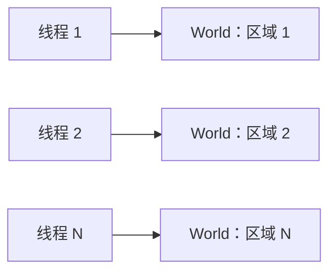
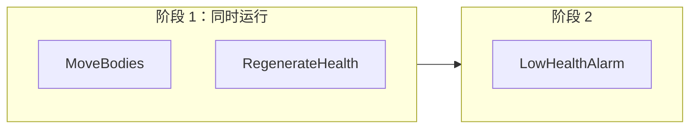

服务器核多，实体也多。EasyEcs 用三种方式分摊工作，热路径上都不需要锁：**每线程一个 World**（每个区域或地图一个 World，由各自的线程
拥有）、**并行系统**（同一次更新里，访问互不冲突的系统同时运行）、**并行 `[ForEach]`**（把一个重方法的行切成块分给多个线程）。生成器
根据参数写出每个系统的读写集，所以哪些系统能一起跑由调度器决定，而不是靠自觉；可能产生竞争的写法会被分析器拒绝。

## 什么时候用 [#when-to-use-it]

<Callout type="idea" title="适合">
  有多个区域、地图或对局的服务器：每线程一个 World。同一个 World 里有几个互不相关的重系统：`ParallelSystems`。一个方法要跑几万行：
  `[ForEach(Parallel = true)]`。
</Callout>

<Callout type="warn" title="不适合">
  用自己开的多个线程同时改一个 World：结构变更只属于所有者线程（EECS014 会报出它能看到的情况）。只有几百行轻量行的并行系统或并行方法：
  交给线程池的开销比活本身还大。几百行重活（每行几微秒）是例外，见[块大小](#chunk-rows)。
</Callout>

## 怎么用 [#how-to-use-it]

### 术语：进程、World、所有者线程 [#terms-process-world-owner-thread]

| 术语 | 含义 |
| --- | --- |
| **进程** | 你的服务器。可以有任意多个 World，它们之间除了类型索引什么都不共享。 |
| **World** | 一套独立的实体、组件、单例和系统（`new World()`）。 |
| **所有者线程** | 调用 `world.Update()`、读写这个 World 数据的线程。同一时刻每个 World 只有一个。 |
| **并行阶段** | 同一次 `Update()` 里，彼此没有顺序约束也没有冲突的一批系统，在线程池线程上运行，所有者线程也参与。所有权不变。 |

### 推荐：每线程一个 World [#recommended-one-world-per-thread]

World 之间什么都不共享，所以把实体分到多个 World、每个 World 由一个线程拥有的服务器，完全不需要同步。



```csharp
public static class Zones
{
    // 每线程一个 World：各线程拥有自己的 World，什么都不共享
    public static Thread[] Start(World[] worlds)
    {
        var threads = new Thread[worlds.Length];
        for (int i = 0; i < worlds.Length; i++)
        {
            var zone = worlds[i];                                   // 每次迭代一个变量
            threads[i] = new Thread(() => { for (int t = 0; t < 1_000; t++) zone.Update(); });
            threads[i].Start();
        }

        return threads;
    }
}
```

[MultiWorld 示例](https://github.com/JasonXuDeveloper/EasyEcs/tree/master/samples/MultiWorld)就是这种布局，并打印每秒的实体更新数。
要把玩家移到另一个线程的区域，就把他转成字节交过去：源 World 的所有者用 [`SaveEntities`](/zh/docs/guide/migration-and-unload#save-entities)
写出这一组，把字节放进目标所有者收取的队列，目标所有者再调用 `LoadEntities`。`MoveEntities` 只用于同一个线程拥有的两个 World。

### 系统的顺序 [#order-of-systems]

`Update()` 按注册顺序运行系统，带 `[UpdateBefore<T>]` / `[UpdateAfter<T>]` 的系统会被挪到 `T` 的紧前或紧后。系统之间从不互相调用：
要消费另一个系统产出的系统，注册在它后面，或者标上 `[UpdateAfter<Producer>]`。结构变更立即生效，所以同一次更新里靠后的系统已经能看到
前面的系统创建、销毁或打标签的实体，没有需要回放的命令缓冲。不管并行了什么，一次更新的结果都和按这个顺序逐个运行系统一样。

### 并行系统 [#parallel-systems]

设置 `WorldOptions.ParallelSystems = true` 后，彼此没有顺序约束也没有冲突的系统会同时运行。每个系统的访问来自它的 `[ForEach]` 参数：

| `[ForEach]` 参数 | 声明的访问 |
| --- | --- |
| `ref T` 组件或单例 | 写 `T` |
| `Mut<T>` 组件 | 写 `T`（没写的行也算） |
| `in T` 组件或单例 | 读 `T` |
| `[With<T>]`、`[Without<T>]`、`[WithAny<T>]` | 无（过滤条件读的是存在性，没有哪个并行系统会改它） |
| `[Changed<T>]`、`[Removed<T>]` | 读 `T`（它的变更 tick） |
| `[ChangedAny<T1, …, Tn>]`、`[RemovedAny<T1, …, Tn>]` | 读 `T1` 到 `Tn` 中的每一个 |
| 只当身份用的 `Entity`（`Id`、`Version`、`IsAlive`、`==`、`EntityId`） | 无 |
| 其他用法的 `Entity`、`World`、`[OnUpdate]` 方法、`[Consume]` 方法 | 单独运行 |
| 没有任何 `[ForEach]` 方法 | 单独运行 |

一个系统写了另一个系统读或写的东西，或者其中一个要单独运行，两者就冲突。系统放在哪个阶段：先找出它必须排在后面的系统（有顺序约束的，
或与它冲突、注册更早的），再放进其中最晚那个阶段的下一个阶段。阶段依次运行，同一阶段的系统同时运行。系统要等前一个阶段全部结束，而不只是等和它冲突的系统：
在实测的 World 里，依赖图并没有更早跑完，而且保证 `[Changed<T>]` 准确的“每阶段一个变更 tick”会变成每个系统一个
（[D76](/zh/docs/decisions#d76-stages-not-a-dependency-graph)）。一串轻量系统在重系统旁边干等时，把它们合成一个带多个 `[ForEach]`
方法的系统会更早跑完。`world.DescribeSchedule()` 能列出 World 排出的阶段、每个系统读写了什么、
某个系统为什么要等上一个阶段；它读的是最近一次 `AddSystem` / `RemoveSystem` 发布的调度，所以诊断接口可以在任何线程上调用
（[调试与诊断](/zh/docs/guide/diagnostics#schedule)）。

```csharp
public record struct Body(float X, float Y, float Vx, float Vy) : IComponent;
public record struct Vitals(int Health, int Max) : IComponent;
public record struct Alarms(int Count) : ISingletonComponent;

[EcsSystem]
public ref struct MoveBodies // 写 Body
{
    [ForEach] static void Move(ref Body b) { b.X += b.Vx; b.Y += b.Vy; }
}

[EcsSystem]
public ref struct RegenerateHealth // 写 Vitals
{
    [ForEach] static void Regenerate(ref Vitals v) => v.Health = Math.Min(v.Health + 1, v.Max);
}

[EcsSystem]
public ref struct LowHealthAlarm // 读 Vitals：和 RegenerateHealth 冲突
{
    [ForEach] static void Count(in Vitals v, ref Alarms alarms) { if (v.Health < 10) alarms.Count++; }
}
```



```csharp
using var parallel = new World(new WorldOptions { ParallelSystems = true });
parallel.AddSingleton<Alarms>();
parallel.AddSystem<MoveBodies>();
parallel.AddSystem<RegenerateHealth>();
parallel.AddSystem<LowHealthAlarm>();
parallel.Update();                          // 阶段 1 用两个线程，然后阶段 2
```

调度器不分配内存：调用线程和最多 `MaxDegreeOfParallelism - 1` 个可复用的线程池工作项一起跑完一个阶段。多个 World 或 IO 线程共用这些核
的时候，调小 `MaxDegreeOfParallelism`：

```csharp
using var zone = new World(new WorldOptions { ParallelSystems = true, MaxDegreeOfParallelism = 4 });
```

一个阶段里抛出的第一个异常，会在阶段结束后在调用线程上重新抛出；设置
`WorldOptions.SystemErrors = SystemErrorPolicy.Disable` 后，出错的系统会被关掉，异常记在 `system.Error` 里。

### 并行 `[ForEach]` 方法 [#parallel-foreach-methods]

`[ForEach(Parallel = true)]` 把一个方法的行切成块分给多个线程。它不能做结构变更，必须逐实体运行，也不能写单例
（[EECS010](/zh/docs/guide/analyzer#eecs010)）；对所有行求总数用 [`Reduce<T>`](#reductions)，每行的工作列表用 [`Scratch<T>`](#scratch)，读其他实体用 [`Lookup<T>`](#lookups)，
留给后面系统的记录用 [`Emit<T>`](#emit)，随机数用 [`EntityRandom`](#entity-random)：

```csharp
public record struct Regen(int PerTick) : ISingletonComponent;

[EcsSystem]
public ref struct RegenerateAll
{
    [ForEach(Parallel = true), Without<Dead>]
    static void Regenerate(ref Health hp, in Regen regen) => hp.Value += regen.PerTick;   // 单例只读
}
```

并行系统和并行方法可以叠加：在并行阶段里，如果调度器正忙着跑另一个系统的方法，这个并行方法就在自己的线程上运行，不会干等。

并行方法可以通过 `ref` 或 [`Mut<T>`](/zh/docs/guide/change-tracking#set-if-changed) 参数写被追踪组件：每块只给自己的行
打 tick，而且默认情况下这类方法按 4,096 行的倍数切块（每块至少 4,096 行），正好对齐共用一份变更 tick 摘要的区块，不会有
两个线程更新同一份摘要。在块里调 `Mut<T>.Write()` 和 `SetIfChanged`，和用 `ref` 一样安全。这样一来，不超过 4,096 行的表只有一块。

#### 块大小：行少而重时用 `ChunkRows` [#chunk-rows]

并行遍历把行切成块，线程做完手上的一块，就通过一个共享计数器再领下一块，和 OpenMP 的 `schedule(dynamic, n)` 一样：分到便宜行的线程
接着领下一块，别的线程还在忙，不均匀的行就这样摊平了。默认一块约为每个线程份额的四分之一，至少 1,024 行（方法写被追踪组件时
至少 4,096 行），至多 `World.ParallelChunkRows`（16,384）行。这适合大量轻量的行。如果只有几百行、每行要花几微秒（一块地形、一次寻路、
一个人群格子），它们就只成一块，一个线程在跑，其他线程干等。

`ChunkRows = n` 就是 `schedule(dynamic, n)` 里的 `n`：一个线程每次领多少行。

<Callout type="idea" title="适合">
  只有几百到几千行、每行几微秒的并行方法：地形区块、寻路、人群格子、模拟岛。
</Callout>

<Callout type="warn" title="不适合">
  行很轻（每行几次算术），不管有多少行：默认的块已经能喂饱每个线程，块再小只会多领几次。方法不是并行的也不行：`ChunkRows`
  要求 `Parallel = true`。
</Callout>

```csharp
public record struct Cell(int Agents) : IComponent;
public record struct Crowd(float Pressure) : IComponent;
```

```csharp tab="默认块大小"
[EcsSystem]
public ref struct CrowdPressure
{
    const int Iterations = 2_000;   // 每个格子几微秒的活

    // 500 个格子：一块至少 1,024 行，所以一个线程包圆
    [ForEach(Parallel = true)]
    static void Relax(in Cell cell, ref Crowd crowd)
    {
        float pressure = crowd.Pressure;
        for (int i = 0; i < Iterations; i++)
            pressure += (cell.Agents - pressure) * 0.001f;
        crowd = new Crowd(pressure);
    }
}
```

```csharp tab="ChunkRows = 64"
[EcsSystem]
public ref struct CrowdPressure
{
    const int Iterations = 2_000;   // 每个格子几微秒的活

    // 500 个格子：8 块、每块至多 64 行，线程做完一块就领下一块
    [ForEach(Parallel = true, ChunkRows = 64)]
    static void Relax(in Cell cell, ref Crowd crowd)
    {
        float pressure = crowd.Pressure;
        for (int i = 0; i < Iterations; i++)
            pressure += (cell.Agents - pressure) * 0.001f;
        crowd = new Crowd(pressure);
    }
}
```

- **向上取整到 64。** 一个存在位字和变更 tick 字只归一个线程，所以 `ChunkRows = 10` 实际是 64。
- **按表切。** 每张匹配的表各切各的，从第一行起按 `n` 的倍数切；一块不会跨两张表，表的最后一块装剩下的行。分片方法
  （[`Slices`](/zh/docs/guide/systems#slices)）切的是它这次访问的那一片。
- **被追踪的写入。** 写被追踪组件的方法，块可以切开一个 4,096 行的 tick 块：遍历开始前，它覆盖的 tick 块先按这次遍历的 tick 打开，
  共用一个 tick 块的线程用原子 OR 在摘要里置自己的位，每写 64 行一次（每次遍历本来就要付这次 OR）。不设 `ChunkRows` 时，这种方法每块都是整的 tick 块，不会有两个线程共用一个
  （[D67](/zh/docs/decisions#d67-chunk-rows)）。
- **`n` 怎么选。** 每块要领一次，也就是对计数器做一次 compare-and-swap。让每个线程分到好几块（行数 ÷ 线程数 ÷ 4 是个不错的起点，不低于 64），
  只有每行的活远大于领一次的开销时才设 `ChunkRows`，轻量的行保持默认。不到两块时在调用线程上跑；辅助线程帮不上忙的遍历也在调用线程上跑
  （[开销](#what-it-costs)）。
- **写在哪里。** `ChunkRows` 要求 `Parallel = true`，取 0（默认：按行数决定）或更大（[EECS054](/zh/docs/guide/analyzer#eecs054)）。
  临时调用时，并行调用的最后一个参数就是它：`world.ForEachParallel(ref job, filter, chunkRows: 64)` 和 `ForEachEntityParallel`
  （[查询](/zh/docs/guide/queries#on-several-threads-foreachparallel-and-foreachentityparallel)）。

默认为什么仍按行数决定、被切开的块怎么保持变更 tick 准确、还考虑过什么（guided 调度、每线程一份摘要）：见
[D67](/zh/docs/decisions#d67-chunk-rows)。[VoxelServer](/zh/docs/samples/voxel-server) 的水流就用 `ChunkRows = 64` 跑那几百个有水流动的区块。

开启 `WorldOptions.MeasureSystems` 后，`system.Stats` 会把帮忙的线程也算进去：`LastAllocated` 和 `TotalAllocated` 是
运行这个系统的线程，加上跑过它并行方法分块的每个线程上分配的字节数之和；时间是整次运行的耗时。开启 `ParallelSystems`
时，同一阶段的每个系统各自记录自己的运行。

块大小与向量循环、批处理方法和网格内核如何配合，以及各自对应的 OpenMP / MPI 术语：
[高性能写法](/zh/docs/guide/high-performance)。

#### 归约：`Reduce<T>` [#reductions]

并行方法只写它自己的行：不能写单例（[EECS010](/zh/docs/guide/analyzer#eecs010)），共享的计数器会竞争
（[EECS060](/zh/docs/guide/analyzer#eecs060)）。对所有行求一个结果（计数、总和、最小值、包围盒），用 `ref Reduce<T>` 参数：就是 OpenMP 的
`reduction(+: x)`、MPI 的 `Allreduce`。每一块累加进自己的部分结果，每行没有锁也没有原子操作；这一遍结束时，部分结果合并起来替换单例 `T`。

<Callout type="idea" title="适合">
  每遍对大量行求一个结果：存活的单位数、世界里的金币总数、人群的总质量和范围、最拥挤的格子。多线程或单线程都行：同一个方法加不加
  `Parallel = true` 都能用。
</Callout>

<Callout type="warn" title="不适合">
  每个实体各自的结果：写进这一行的组件。每个 tick 只有几行会改变的总数：在改这些行的系统里随手更新（或者读一遍
  [`[Changed<T>]`](/zh/docs/guide/change-tracking)），不必遍历所有行。方法运行中就要用的值：`Value` 是这一块的部分结果，不是总数。
</Callout>

<Steps>
<Step>

**声明结果**：一个 `partial` 单例，每个字段加一个说明怎样合并的特性：`[Sum]`、`[Product]`、`[Min]`、`[Max]`（数值）、`[All]`、`[Any]`
（`bool`）。生成器写出它的 `IReduction<T>`：`Identity` 是和谁合并都不改变对方的值（求和是 0，求最小值是 +∞），`Combine` 逐字段合并。

</Step>
<Step>

**接收一个 `ref Reduce<T>` 参数**，写 `Value` 的字段（一个字段：这一块的部分结果），或者用一行的贡献调用 `Combine(value)`。
按 `ref` 传入，部分结果才能留在寄存器里；不带 `ref` 的 `Reduce<T>` 报 [EECS002](/zh/docs/guide/analyzer#eecs002)。

</Step>
<Step>

**读取结果**：这一遍之后读 `world.T`，或者在之后的系统里用 `in T`。每一遍都会替换 `T`（没有就添加；一行都没有的遍写入 `Identity`），
系统按 `T` 的写者调度，所以读 `T` 的系统会等它。

</Step>
</Steps>

```csharp tab="你写的"
public partial struct Extent : ISingletonComponent
{
    [Sum] public int Count;
    [Min] public float MinX;
    [Max] public float MaxX;
}
```

```csharp tab="生成器写的" doccheck=skip
// 生成的代码（Extent.….Part.g.cs，去掉了 global::）：逐字段的归约。
public partial struct Extent : IReduction<Extent>
{
    public static Extent Identity => new Extent
    {
        Count = 0, MinX = float.PositiveInfinity, MaxX = float.NegativeInfinity,
    };

    public static Extent Combine(Extent left, Extent right) => new Extent
    {
        Count = left.Count + right.Count,
        MinX = Math.Min(left.MinX, right.MinX),
        MaxX = Math.Max(left.MaxX, right.MaxX),
    };
}
```

```csharp
[EcsSystem]
public ref struct MeasureCrowd
{
    [ForEach(Parallel = true)]
    static void Measure(in Position position, ref Reduce<Extent> extent)
    {
        extent.Value.Count++;                                        // 这一块的部分结果
        extent.Value.MinX = MathF.Min(extent.Value.MinX, position.X);
        extent.Value.MaxX = MathF.Max(extent.Value.MaxX, position.X);
    }
}
```

```csharp
world.AddSystem<MeasureCrowd>();
world.Update();
var crowd = world.Extent;   // 所有块合并后的结果
Console.WriteLine($"{crowd.Count} 个单位，x 从 {crowd.MinX} 到 {crowd.MaxX}");
```

- **不是逐字段合并时手写。** 字段要一起合并的结果（最拥挤的格子和它的人数、前三名）自己实现 `IReduction<T>`：`Identity` 和满足结合律的
  `Combine`，不要求交换律（部分结果按行的顺序合并）。用特性声明的归约每个字段都要有特性（[EECS064](/zh/docs/guide/analyzer#eecs064)），
  类型要是 `partial`（[EECS062](/zh/docs/guide/analyzer#eecs062)）；特性能声明却手写的归约报 [EECS065](/zh/docs/guide/analyzer#eecs065)，
  会改变合并对象的 `Identity`（求最小值用 0）报 [EECS066](/zh/docs/guide/analyzer#eecs066)。
- **精确，或可复现。** 整数结果在每次运行、任何线程数下都精确。浮点求和按块舍入，所以取决于块从哪里开始：[`ChunkRows`](#chunk-rows)
  固定时，每次运行、任何线程数下结果都相同（测试检查了 1、2、3、4 和 8 个线程），但和同一个方法 `Parallel = false` 的结果不逐位相同。
  默认块大小随线程数变化：浮点总数要在不同机器上复现时，设定 `ChunkRows`。最小值、最大值和包围盒不涉及舍入，怎样都精确。
- **单线程时**，部分结果是 job 的局部变量，每段连续的行一个；方法、结果和调度都一样。系统之外的 `[ForEach]` 方法归约进调用它时传入的 World。
- **在向量循环里**，每条通道有自己的累加器，按通道顺序合进这段行的部分结果。条件是 `Combine` 把每个字段设成两边该字段的和、`Min` 或 `Max`，
  并且字段是方法那么大的通道（[向量循环](/zh/docs/guide/systems#vector-loops)）。浮点求和只有在 `FloatMode.Fast` 下才进向量循环，
  因为各通道的相加顺序不同；整数求和、最小值和最大值都保持精确。
- **开销：** 每行一次累加到局部变量：归约方法按每块里连续的行运行，这段行的部分结果按 `ref` 传给内联的方法，JIT 把它留在寄存器里。
  每块一个 job 副本，留到这一遍结束再按块的顺序合并；第一遍之后零分配。没有锁、没有 `Interlocked`、没有伪共享：每块的部分结果只存一次。
- **分析器检查什么：** 方法或系统里同一个 `T` 的第二个 `Reduce<T>`，或旁边的 `ref T`，会让一个结果覆盖另一个
  （[EECS057](/zh/docs/guide/analyzer#eecs057)）。归约方法生成的 job 会合并各块的副本，所以 [EECS061](/zh/docs/guide/analyzer#eecs061)
  （并行遍历之后读 job 的字段）不报它。

`ReduceBenchmark` 在 1,000 行和 1,000,000 行上测量整数求和、浮点求和和包围盒：`Reduce<T>` 多线程和单线程两种，对比单线程的 `ref`
上下文值、每行一次 `Interlocked` 加法、每行一把锁、按遍历自己的块运行的 `Parallel.For`，以及逐行的
`Parallel.For<TLocal>(from, to, localInit, body, localFinally)`。数字，以及每种写法 200 次运行得到的不同浮点结果个数，见
[决策记录](/zh/docs/decisions#d69-reductions)。

<BenchTable bench="ReduceBenchmark" />

**为什么不用带 `localInit` / `localFinally` 的 `Parallel.For`：** 它是 .NET 的线程局部模式，也是和 `Reduce<T>` 最接近的写法，但每一项都输了。
它没有传状态的重载，所以 `static` lambda 只能用静态状态（这一列、结果），而静态状态不可重入：两个 World 不能同时归约。它每次调用都分配
（委托、分区状态），所以从不能做到 0 B。逐行的写法每行调用一次委托，比 `Reduce<T>` 慢好几倍；遍历很小时，光是交给线程池的开销就比遍历本身还大。
它的分区跟着线程池的工作窃取走，所以浮点总数每次运行都会变。按遍历自己的块运行、按顺序累加部分结果的 `Parallel.For` 在时间上跟得上，结果也确定，
但它照样每次调用都分配，照样需要静态状态。World 的运行器按 `ref` 传 job，不分配，并按块的顺序合并部分结果（[D69](/zh/docs/decisions#d69-reductions)）。

归约方法以批处理 job 运行：每块把它持有的连续行段交给方法（[`ForEachBatchParallel`](/zh/docs/guide/queries#on-several-threads-foreachparallel-and-foreachentityparallel)），
这段行的部分结果是一个局部变量，JIT 把它留在寄存器里。如果逐行运行，部分结果就在这块的 job 副本里，每行都要加载、存储一次。

#### 每个线程的工作内存：`Scratch<T>` [#scratch]

一行为自己的计算需要一个列表（邻居搜索的候选、寻路的开放集、要填的缓冲），不应该每行分配一个，也不能在线程之间共用一个。`Scratch<T>`
参数就是方法在当前线程上的工作内存：每个方法、每个线程一个 `T`，就是 OpenMP 的 `threadprivate`。它从 `default` 开始，第一次分配
（`scratch.Value ??= new()`）每个线程只发生一次，之后这个线程上的每一行都会看到上一行留下的东西。

<Callout type="idea" title="适合">
  每行在调用里填充、读取的列表、集合或缓冲，大小会变或者大到放不进栈：候选、边界、排好序的窗口。并行和单线程的方法都能用。
</Callout>

<Callout type="warn" title="别用于">
  上限事先就知道的小缓冲：`stackalloc`（`Span<int> kept = stackalloc int[24];`）最快，也不需要别的东西。必须活过这一行的东西：它属于组件、
  [动态缓冲](/zh/docs/guide/dynamic-buffers)或单例。
</Callout>

```csharp
public record struct Neighbors(int Count, int Spread) : IComponent;

[EcsSystem]
public ref struct CountNeighbors
{
    [ForEach(Parallel = true)]
    static void Count(in Position position, ref Neighbors neighbors, Scratch<List<int>> scratch)
    {
        var near = scratch.Value ??= new List<int>(32);   // 每个线程一次 // [!code highlight]
        near.Clear();                                      // 这个线程上一行留下的东西
        int cell = (int)position.X * 64 + (int)position.Y;
        for (int i = 0; i < 24; i++)
            if (((cell ^ (i * 40_503)) & 3) != 0) near.Add(i);
        int spread = near.Count == 0 ? 0 : near[^1] - near[0];
        neighbors = new Neighbors(near.Count, spread);
    }
}
```

- **从不重置。** 一行看到的是这个线程上一行留下的东西，可能来自这一遍或更早的一遍、这个 World 或别的 World：在行开始时清掉要用的东西。
- **不是 World 的数据。** 它不给系统增加任何读写，所以不改变调度；把它持有的引用存进组件、单例、`Maybe`、`Mut` 或 `Reduce`，就把一个线程的内存
  交给了下一个复用它的行（[EECS058](/zh/docs/guide/analyzer#eecs058)）。
- **它的内存属于线程**，线程结束时才释放，不随 World 释放；线程池的线程活得很久，所以长大的缓冲会一直那么大。
- **开销：** 每块查一次这个线程的值（单线程时每遍一次），之后每行读一个字段；每个线程第一次用过之后零分配。
  [EECS028](/zh/docs/guide/analyzer#eecs028) 不报一次性的 `??= new()`。方法体里有循环或调用时，每行调用一次方法，而不是内联进行循环：
  内联的话，它自己的循环和行循环抢寄存器，计数器只能放到栈上。

`ScratchBenchmark` 在 10,000 和 100,000 行上并行地每行收集 24 个候选，列表分别放在 `Scratch<T>` 里、每行新建、每行从 `ArrayPool<int>.Shared`
租用、放在手写的 `[ThreadStatic]` 字段里，或者用 `stackalloc` 的 span（[D74](/zh/docs/decisions#d74-scratch)）。

<BenchTable bench="ScratchBenchmark" />

#### 读取其他实体：`Lookup<T>` [#lookups]

需要另一个实体的组件的方法（追击者的目标、单位的首领、请求里指明的账号），原本要接收 `World` 再调用 `TryGetEntity`，这让它只能在一个线程上跑。`Lookup<T>` 参数改为读取任意实体的组件 `T`：就是 Unity 带 `[ReadOnly]` 的 `ComponentLookup`、MPI 的单边 `Get`。
方法不接触 World，所以可以并行。

<Callout type="idea" title="适合">
  读取当前行以外的实体：目标、首领、父实体、某个键的持有者。单线程的方法也适合：查找比 `World` 参数加 `TryGetEntity` 和 `TryGet` 更快。
</Callout>

<Callout type="warn" title="别用于">
  当前行自己的组件：直接作为参数接收。同一个方法会写的组件：查找会读到写入之前或之后的行（[EECS059](/zh/docs/guide/analyzer#eecs059)）。
</Callout>

| 成员 | 返回 |
| --- | --- |
| `lookup[id]` | `ReadOnlyMaybe<T>`：实体的 `T`；实体没有它或已不存活时没有值 |
| `lookup.Read(id)` | `ref readonly T`；实体没有它或已不存活时抛异常 |
| `lookup.Has(id)` | 实体是否存活且有 `T` |
| `lookup.TryFind(key, out entity)`、`Find(key)`、`Count(key)` | 带索引的 `T`（`IIndexed<TKey>`、`IUniqueIndexed<TKey>`）：某个键的一个实体、全部实体、数量 |

```csharp
public record struct Quarry(EntityId Id) : IComponent;
public record struct Heading(float X, float Y) : IComponent;

[EcsSystem]
public ref struct ChaseSystem
{
    [ForEach(Parallel = true)]
    static void Chase(in Position position, in Quarry quarry, ref Heading heading, Lookup<Position> positions)
    {
        var at = positions[quarry.Id];                 // 目标在这一遍之前的位置 // [!code highlight]
        heading = at.HasValue ? new Heading(at.Value.X - position.X, at.Value.Y - position.Y) : default;
    }
}
```

```csharp
public partial record struct Login([UniqueKey] int Number) : IComponent;

public record struct Asks(int Number) : IComponent;
public record struct Answer(EntityId Login) : IComponent;

[EcsSystem]
public ref struct MatchLogins
{
    [ForEach(Parallel = true)]
    static void Match(in Asks asks, ref Answer answer, Lookup<Login> logins) =>
        answer = new Answer(logins.TryFind(asks.Number, out var found) ? found : default);   // 索引在这一遍之前建好
}
```

- **每次读取看到的都是这一遍之前的值。** 系统按 `T` 的读者调度，所以写 `T` 的系统不会和它同一个阶段，方法自己也不能写 `T`（EECS059）。
  这一遍不做结构变更，所以 id 一直对应原来的行。
- **在参数上按键查找会先建好索引。** 在自己的 `Lookup<T>` 上调用 `TryFind`、`Find` 或 `Count` 的方法，`T` 的值索引会在这一遍之前（在所有者线程上、
  它的系统所在的并行阶段之前）创建并建好。通过别的方式在并行区域里碰到还没建好的索引，会抛异常而不是去建；单线程的遍历仍在第一次查找时建立。
- **[EECS010](/zh/docs/guide/analyzer#eecs010) 接受它**出现在并行方法里，而 `World` 参数会被拒绝。
- **开销：** 每次读取一次实体查找（`TryGetEntity`，再读这一行的列），按键查找一次哈希探测。单线程时它比 `World` 参数加 `TryGetEntity` 和 `TryGet`
  更快（[D75](/zh/docs/decisions#d75-lookup)）；并行时，查找和普通的行一样分摊到各个线程。

`LookupBenchmark` 从 10,000 和 100,000 行追击 1,000 个目标，并按唯一键查找账号，分别用并行和单线程的 `Lookup<T>`，以及 `World` 参数。

<BenchTable bench="LookupBenchmark" />

#### 一遍产出的记录：`Emit<T>` [#emit]

一遍常常要给后面的系统留下记录：攻击系统找到的命中交给结算伤害的系统，视野（AOI）的数据包，规则要求的生成请求。并行方法不能往共享列表里追加
（[EECS060](/zh/docs/guide/analyzer#eecs060)），也不能创建实体（[EECS010](/zh/docs/guide/analyzer#eecs010)）。按值传入的 `Emit<T>`
参数追加到这一块自己的列表里，没有锁也没有原子操作；这一遍结束时，各块的列表按块的顺序（也就是行的顺序）追加进单例 `Emitted<T>`：
相当于 Unity 的 `NativeStream`、GPU 的流压缩。

<Callout type="idea" title="适合">
  后面的系统要结算或发送的记录：命中和伤害、视野数据包、日志行、交给所有者线程变成实体的请求。每行几条都行，零条也行，并行和单线程的方法都能用。
</Callout>

<Callout type="warn" title="不适合">
  每个实体各自的结果：写进这一行的组件。对所有行求总数：用 [`Reduce<T>`](#reductions)。同一遍里就要读的记录：它们这一遍结束时才进
  `Emitted<T>`（[EECS070](/zh/docs/guide/analyzer#eecs070)）。
</Callout>

<Steps>
<Step>

**声明记录**：一个普通 struct。它是列表里的数据，不是组件。

</Step>
<Step>

**接收一个 `Emit<T>` 参数**，在产生记录的行上调用 `Add(record)`（或 `AddRange(records)`）。

</Step>
<Step>

**结算并清空**：后面的系统读 `Emitted<T>.Items`（一个[动态缓冲](/zh/docs/guide/dynamic-buffers)），结算这些记录，然后清空，这样不会结算两次。

</Step>
</Steps>

```csharp
public record struct Hit(EntityId Target, int Amount);   // 一条记录，不是组件
public record struct Attack(int Power) : IComponent;
public record struct Aim(EntityId Target) : IComponent;

[EcsSystem]
public ref struct StrikeSystem
{
    [ForEach(Parallel = true)]
    static void Strike(in Attack attack, in Aim aim, Emit<Hit> hits) =>
        hits.Add(new Hit(aim.Target, attack.Power));   // 这一块的列表 // [!code highlight]
}

[EcsSystem]
public ref struct ApplyHitsSystem
{
    [OnUpdate]
    static void OnUpdate(World world)
    {
        ref var hits = ref world.GetSingleton<Emitted<Hit>>().Items;
        foreach (ref readonly var hit in hits.AsReadOnlySpan())
            if (world.TryGetEntity(hit.Target, out var target)) target.Health.Value -= hit.Amount;
        hits.Clear();   // 只结算一次
    }
}
```

生成器给每块一个自己的列表，遍历结束时把列表接起来。它为 `Strike` 写的是：

```csharp tab="你写的" doccheck=skip
[ForEach(Parallel = true)]
static void Strike(in Attack attack, in Aim aim, Emit<Hit> hits)
```

```csharp tab="生成器写的" doccheck=skip
// 生成的代码（StrikeSystem.….ForEach.g.cs，有删节，去掉了 global::）。不要照抄：Strike_0 是指向你的私有方法的
// [UnsafeAccessor]。
internal struct StrikeJob0 : IForEach<Attack, Aim>, INoStructuralChanges
{
    public SingletonRef<Emitted<Hit>> o2;   // 列表要接进的单例
    public DynamicBuffer<Hit> e2;           // 这一块的列表：每块跑自己的一份 job

    public void Execute(ref Attack c1, ref Aim c2) => __ForEach.Strike_0(null, in c1, in c2, new Emit<Hit>(ref e2));

    static int IForEach<Attack, Aim>.WriteMask => 0;
    static bool IForEach<Attack, Aim>.Merges => true;

    // 每块调用一次，按块的顺序，在发起这一遍的线程上。
    static void IForEach<Attack, Aim>.Merge<TSelf>(ref TSelf job, in TSelf chunk)
    {
        ref var into = ref Unsafe.As<TSelf, StrikeJob0>(ref job);
        ref var part = ref Unsafe.As<TSelf, StrikeJob0>(ref Unsafe.AsRef(in chunk));
        Emit<Hit>.Join(into.o2, ref part.e2);   // 追加这一块的记录，把列表还给池
    }
}

// 系统的 Update 和 Access：
var job0 = new StrikeJob0 { o2 = Emitted<Hit>.Joined(world) };   // 没有 Emitted<Hit> 时添加
world.ForEachParallel<Attack, Aim, StrikeJob0>(ref job0);

access.Read<Attack>();
access.Read<Aim>();
access.WriteSingleton<Emitted<Hit>>();   // 读记录的系统等它跑完
```

`Reduce<T>` 参数也这样合并：job 的 `Merge` 按块的顺序用每块的部分结果调用 `T.Combine`，遍历结束后系统的代码把合并结果写进单例 `T`
（没有时添加）。

- **任何线程数下都是行的顺序。** 记录的顺序和同一个方法 `Parallel = false` 时一样，每次运行都一样，所以回放或帧同步的对端按同样的顺序结算。
- **每一遍都是追加。** 一次更新里可以有几个系统发出同一种 `T`（近战和法术都发出伤害），各在自己的位置；结算的系统负责清空。发出记录的系统按
  `Emitted<T>` 的写者调度，读的系统会等它；一个方法既发出又接收 `Emitted<T>`，或用两个参数发出同一种类型，报
  [EECS070](/zh/docs/guide/analyzer#eecs070)。
- **并行结算。** 记录是一个列表：[`world.ForParallel`](#for-parallel) 按块对它的元素运行一个 job，适合每条记录只写记录本身的活（掷骰、编码）。
- **像缓冲一样存档。** 快照和存档会拷贝 `Emitted<T>` 里剩下的记录。
- **开销：** 每条记录追加一次到这一块的列表。列表来自它们自己的池，保持在一块用到过的最大尺寸，所以稳定的遍历零分配；每遍把每块的列表拷进
  `Emitted<T>` 一次。

逐行手动追加到单例列表里的记录会让方法只能单线程运行：[EECS089](/zh/docs/guide/analyzer#eecs089) 会建议改用 `Emit<T>`。`EmitBenchmark`
对比并行和单线程的 `Emit<T>`、每行写一个组件再扫描、`ConcurrentQueue`，以及往共享数组里 `Interlocked` 推进游标
（[D78](/zh/docs/decisions#d78-emit)）。

<BenchTable bench="EmitBenchmark" />

#### 遍历里的随机数：`EntityRandom` [#entity-random]

`Random.Shared` 在任何线程上都安全，但哪一行抽到哪个数取决于行的运行顺序，所以并行的一遍每次运行抽到的都不一样；带种子的
`new Random(seed)` 干脆不能在多个线程上用。`EntityRandom` 是一个保存种子和 tick 的单例，每个数都是（种子、实体、tick、流）的纯函数，
没有要推进的状态（cuRAND 的 Philox，基于计数器的生成器）：每次运行、任何线程数、行按任何顺序运行，结果都一样。

<Callout type="idea" title="适合">
  模拟代码里需要重现的随机：游荡、刷怪掷骰、掉落、暴击、AI 的选择。回放、帧同步的对端、必须和测试一致的服务器，以及必须给出单线程结果的并行方法。
</Callout>

<Callout type="warn" title="不适合">
  机密：令牌、密钥、不能让玩家猜到的洗牌。它是哈希，不是密码学生成器：用 `RandomNumberGenerator`。遍历之外没人需要重现的随机（带抖动的重试延迟）：
  那里用 `Random.Shared` 就行。
</Callout>

```csharp
public record struct Wander(float X, float Y) : IComponent;

[EcsSystem]
public ref struct WanderSystem
{
    [ForEach(Parallel = true)]
    static void Pick(ref Wander wander, Entity entity, in EntityRandom random)
    {
        // 每个调用点一个流：x 用 0，y 用 1。
        wander.X = random.Range(entity.Id, 0, -1f, 1f);
        wander.Y = random.Range(entity.Id, 1, -1f, 1f);
    }
}

// 推进模拟时钟的系统顺便推进随机数的 tick。
[EcsSystem, UpdateAfter<WanderSystem>]
public ref struct TickRandomSystem
{
    [OnUpdate]
    static void OnUpdate(World world) => world.EntityRandom.Tick++;
}
```

```csharp
world.SetEntityRandom(Seed: 42, Tick: 0);   // 换个种子，每个实体就是另一串数
world.AddSystem<WanderSystem>();
world.AddSystem<TickRandomSystem>();
```

| 成员 | 返回 |
| --- | --- |
| `random.Bits(entity, stream)` | 64 个随机位 |
| `random.Float(entity, stream)` | [0, 1) 之间的 `float`，是 2⁻²⁴ 的倍数 |
| `random.Range(entity, stream, min, max)` | [min, max) 之间的 `int` 或 `float` |
| `random.Chance(entity, stream, probability)` | 以这个概率为 `true`（0 从不，1 总是） |
| `EntityRandom.Bits(seed, entity, tick, stream)` 及其他静态成员 | 同上，四个输入显式给出：你自己的种子、你自己时钟的 tick |

- **每次抽取一个流。** 同样的四个输入给出同样的数，所以同一实体在同一 tick 用同一个流抽两次，结果相等：每个调用点给自己的流（0、1、2……），
  循环里要让流随循环变化（[EECS088](/zh/docs/guide/analyzer#eecs088)，代码修复会取下一个没用过的流）。
- **每一步推进一次 tick。** tick 不动，抽到的就还是同样的数；实体的数取决于它的 id（下标和版本号），所以回收的 id 抽到的是一串新的数。
- **纯函数、零分配。** 四轮 SplitMix64 的终结函数：一次抽取是几次乘法，不写任何状态，所以方法只读它（`in EntityRandom`），保持并行。
- **分析器检查什么：** `[ForEach]` 方法里的 `Random.Shared`、`new Random()` 和 `System.Random` 字段报
  [EECS071](/zh/docs/guide/analyzer#eecs071)（警告），代码修复改成 `EntityRandom`。

`EntityRandomBenchmark` 对比一次抽取和 SplitMix64、Philox、`Random.Shared`、带种子的 `Random`，以及用 `EntityRandom` 和 `Random.Shared`
遍历 10 万行（[D79](/zh/docs/decisions#d79-entity-random)）。

<BenchTable bench="EntityRandomBenchmark" />

#### 运行器怎样同步 [#runner-contract]

一次并行遍历在同步上要付出什么，以及是什么让一块的写入排在遍历之后的代码之前：

| 什么时候 | 同步 |
| --- | --- |
| 每行 | 没有。唯一的例外是设了 [`ChunkRows`](#chunk-rows)、又写被追踪组件的方法：把一个 4,096 行区块拆开的几块用原子 OR 置它的变更 tick 摘要，每写 64 行一次（[D67](/zh/docs/decisions#d67-chunk-rows)）。 |
| 每块 | 在这次运行的游标上做一次比较并交换来领取它（游标带着这次运行的纪元，所以晚启动的助手线程永远领不到下一次运行的块）；做完时，对剩余块数做一次 `Interlocked.Decrement`，对用时做一次 `Interlocked.Add`。 |
| 每次运行 | 游标上两次 `Interlocked.Exchange`（打开和关闭），每唤醒一个助手线程再加一次比较并交换和一个排队的线程池工作项。 |
| 运行结束 | 调用线程自旋，用 `Volatile.Read` 读剩余块数，直到读到 0。每块 `Decrement` 的完整内存屏障让它的写入（它的行、它的 job 副本和部分结果）排在调用线程的合并和遍历之后的代码之前。 |

`ParallelRunnerBenchmark` 把 `ParallelForEachBenchmark` 的转向遍历分别交给运行器和带静态委托的 `Parallel.For`：遍历很小时运行器留在调用线程上，
和串行循环一样快，而且不分配，`Parallel.For` 则比串行还慢；10,000 行时运行器是两者中更快的；100,000 行时两者持平
（[D22](/zh/docs/decisions#d22-parallel-runs-use-the-thread-pool-and-wake-helpers-only-when-they-pay)）。

<BenchTable bench="ParallelRunnerBenchmark" />

### 不是行的数据：`world.ForParallel` [#for-parallel]

有些并行的活面对的不是表里的行：`Emitted<T>` 的记录、数组的格子、一段下标。`world.ForParallel` 在 World 的运行器上对它运行一个结构体 job，
块、领块和辅助线程都和并行的 `[ForEach]` 一样（相当于 Kokkos 的 `RangePolicy`、Unity 的 `IJobParallelForBatch`）：

- `world.ForParallel(count, ref job)` 对下标 0 到 count - 1 运行 `IForRange` job，`Execute(start, end)`。
- `world.ForParallel(ref buffer, ref job)` 对一个 `DynamicBuffer<T>`（`Emitted<T>` 的 `Items`、单例的缓冲）的元素运行 `IForSpan<T>` job，
  `Execute(start, items)`，每块的元素是一个可写的 span。

```csharp
// 十次命中里翻倍一次：每块只写自己的记录。
public struct RollCriticals : IForSpan<Hit>
{
    public EntityRandom Random;

    public void Execute(int start, Span<Hit> items)
    {
        for (int i = 0; i < items.Length; i++)
        {
            ref var hit = ref items[i];
            if (Random.Chance(hit.Target, (uint)(start + i), 0.1f))
                hit = hit with { Amount = hit.Amount * 2 };
        }
    }
}

[EcsSystem]
public ref struct CriticalSystem
{
    [OnUpdate]
    static void OnUpdate(World world)
    {
        var job = new RollCriticals { Random = world.EntityRandom };
        world.ForParallel(ref world.GetSingleton<Emitted<Hit>>().Items, ref job);
    }
}
```

- **每块一个 job 副本。** `Execute` 写进 job 字段的东西不会合并回来：总数用 `[ForEach]` 方法的 [`Reduce<T>`](#reductions)，调用之后读字段报
  [EECS061](/zh/docs/guide/analyzer#eecs061)。写所有块共享的内存报 [EECS060](/zh/docs/guide/analyzer#eecs060)。
- **不做结构变更。** job 运行时 World 的结构是冻结的：结构变更会抛出异常。调用期间列表不能变，每块只写自己的元素或下标。
- **块。** 大约每个线程四块，是 64 的倍数，在 1,024 和 `World.ParallelChunkRows` 之间；最后一个参数 `chunkRows` 给少量重活设块大小，作用和
  [`ChunkRows`](#chunk-rows) 一样。少于两块，或者运行器正忙时，在调用线程上运行。
- **所有者线程，零分配**（每种 job 类型第一次调用之后）。

`ForParallelBenchmark` 对 10 万条记录做轻活和重活，对比单线程、`ForParallel` 和 `Parallel.For`（[D80](/zh/docs/decisions#d80-for-parallel)）。

<BenchTable bench="ForParallelBenchmark" />

### 来自其他线程的输入 [#input-from-other-threads]

一个 World 只有一个所有者线程，EasyEcs 自己也不提供跨线程队列：结构变更在这个线程上立即生效，没有什么需要推迟。来自其他线程的输入
（网络、定时器、数据库）走你自己的队列，由所有者线程上的一个系统把它变成数据：

```csharp
using System.Collections.Concurrent;

public record struct MoveRequest(int PlayerId, float X, float Y);           // 一条消息，不是组件
public record struct MoveIntent(int PlayerId, float X, float Y) : IComponent;

[NotSaved]
public record struct MoveInbox(ConcurrentQueue<MoveRequest> Moves) : ISingletonComponent;   // 由网络线程写入

[EcsSystem]
public ref struct ReceiveMoves
{
    [OnUpdate]
    static void OnUpdate(World world)
    {
        var moves = world.MoveInbox.Moves;
        while (moves.TryDequeue(out var move))
            world.CreateEntity(new MoveIntent(move.PlayerId, move.X, move.Y));   // 输入变成数据
    }
}
```

用 `world.SetMoveInbox(inbox)` 设置队列，用 `world.AddSystem<ReceiveMoves>()` 注册系统，放在消费 `MoveIntent` 的系统之前。
队列的类型、容量上限和背压策略由你决定。队列放进 [`[NotSaved]`](/zh/docs/guide/saves#not-saved) 单例：存档不会写它，
托管队列也就不需要格式化器，读档也保留宿主设置的那个。
[GameLoop 示例](https://github.com/JasonXuDeveloper/EasyEcs/tree/master/samples/GameLoop)就是这样从网络线程收取邮箱里的消息。

### World 同步了什么 [#what-the-world-synchronizes]

| 操作 | 安全性 |
| --- | --- |
| 结构变更、增删系统和单例、`Capture` / `Restore`、`Save` / `Load` | 只能在所有者线程上，一次一个。靠一个普通的所有者标志（没有原子指令）：另一个操作进行中，或者结构被冻结时（并行阶段、并行 `[ForEach]`、批处理 job、`INoStructuralChanges` 遍历）再开始一个，会抛 `InvalidOperationException`，而不是把表写坏。 |
| 查询匹配、`Has`、`Get` 查找 | 无锁，读的是不可变、写时复制的表列表。某种查询形状第一次使用时，走一次比较交换闸门。 |
| 系统用 `GetOrAddSingleton<T>()` / `GetOrAddX()` 添加的单例 | 同一个闸门：同一阶段的多个系统可以同时添加它。 |
| 组件和单例的值 | 有意不做同步：由所有者线程或调度器决定谁能碰它们。 |
| 值索引，以及销毁和移除时做的解链 | World 有索引时，只能在所有者线程上。 |

谁能发现不在所有者线程上做的变更：

| 变更从哪来 | 谁能发现 |
| --- | --- |
| 不带 `Entity` 或 `World` 的 `[ForEach]` 方法，通过手里的句柄改结构 | 编译期 [EECS013](/zh/docs/guide/analyzer#eecs013)；在并行阶段里运行时也会抛异常 |
| 并行阶段里的系统或并行 job，通过辅助方法改结构 | 运行时：结构已冻结，任何结构变更都会抛异常 |
| 交给 `Task.Run`、`Parallel.*`、`ThreadPool`、`new Thread` 或 `new Timer` 的 lambda，改的 World 外层代码也在改 | 编译期 [EECS014](/zh/docs/guide/analyzer#eecs014) |
| 你自己的线程，用其他任何方式 | 没有可靠的办法：把变更当作数据交给所有者线程 |

不那么显眼的结构调用也算在内：`entity.Run<…>(ref job)`（job 可能改结构）和 `LoadEntitiesInto` 同样只属于所有者线程，分析器把它们当作
结构变更处理（[EECS010](/zh/docs/guide/analyzer#eecs010)、[EECS014](/zh/docs/guide/analyzer#eecs014)）。

## 完整例子 [#full-example]

十万个单位朝目标转向、移动、回血：转向方法把它的行分给多个线程处理；回血系统和它碰的是不同的组件，所以两者在同一个阶段里
并行。把这几个文件放进一个引用了 EasyEcs 的控制台项目（`dotnet add package EasyEcs`），用 `dotnet run` 运行。

<Accordions>
<Accordion title="Components.cs">

```csharp title="Components.cs" doccheck=example
using EasyEcs;

public record struct Position(float X, float Y) : IComponent;

public record struct Velocity(float X, float Y) : IComponent;

public record struct Health(int Value) : IComponent;

// 所有单位前往的目标点。
public record struct Target(float X, float Y) : ISingletonComponent;
```

</Accordion>
<Accordion title="Systems.cs">

```csharp title="Systems.cs" doccheck=example
using EasyEcs;

// 让每个速度都指向目标。
// Parallel = true 把行切成块，分给多个线程：每次调用只读
// 自己这一行和单例，也只写自己这一行。
[EcsSystem]
public ref struct SteeringSystem
{
    [ForEach(Parallel = true)]
    static void Steer(in Position position, ref Velocity velocity, in Target target)
    {
        float dx = target.X - position.X;
        float dy = target.Y - position.Y;
        // + 1 保证单位站在目标点上时长度也大于零。
        float length = MathF.Sqrt(dx * dx + dy * dy) + 1;
        velocity.X = dx / length;
        velocity.Y = dy / length;
    }
}

// 只写 Health，SteeringSystem 不碰它：两个系统可以在同一个阶段运行。
[EcsSystem]
public ref struct RegenerateSystem
{
    [ForEach]
    static void Regenerate(ref Health health)
    {
        health.Value = Math.Min(health.Value + 1, 100);
    }
}

// 写 Position，而 SteeringSystem 要读它：所以要等 SteeringSystem 跑完。
[EcsSystem]
public ref struct MoveSystem
{
    [ForEach]
    static void Move(ref Position position, in Velocity velocity)
    {
        position.X += velocity.X;
        position.Y += velocity.Y;
    }
}
```

</Accordion>
<Accordion title="Program.cs">

```csharp title="Program.cs" doccheck=example
using EasyEcs;

// 开启 ParallelSystems 后，互不冲突的系统可以共享一个阶段。
using var world = new World(new WorldOptions { ParallelSystems = true });
world.SetTarget(X: 500, Y: 500);
world.AddSystem<SteeringSystem>();
world.AddSystem<RegenerateSystem>();
world.AddSystem<MoveSystem>();

var units = new Entity[100_000];
world.CreateEntities(units, new Position(0, 0), new Velocity(0, 0), new Health(50));

// Update 仍然是本线程上的一次调用：它返回时，用到的线程都已经干完了。
for (int i = 0; i < 10; i++)
{
    world.Update();
}

Position at = units[0].Position;
Console.WriteLine($"unit 0 at ({at.X:F2}, {at.Y:F2}) with {units[0].Health.Value} hp");
```

</Accordion>
</Accordions>

输出：

```text
unit 0 at (7.06, 7.06) with 60 hp
```

结果和按注册顺序逐个运行这三个系统完全一样：并行阶段不改变一次更新算出的结果，只改变用几个线程来算。

## 怎么用得快 [#how-to-use-it-fast]

- **优先多开 World，而不是并行阶段。** 各自线程上的 World 扩展时完全不用交接；并行阶段每次更新都要交给线程池一次。
- **只给重系统打开 `ParallelSystems`**，也就是要遍历成千上万个实体的系统。
- **按数据拆，不按方法拆。** 写不同组件的两个系统能一起跑；什么都写的系统只能单独跑。
- **只读就用 `in`。** 只读的 `ref` 也算写，而写会冲突（[EECS025](/zh/docs/guide/analyzer#eecs025) 会报出来）。
- **行少而重时设块大小。** 只有几百行、每行几微秒的并行方法设 [`ChunkRows`](#chunk-rows)，每个线程都能分到活；大量轻量行保持默认。
- **归约，不要共享。** 并行遍历上的计数或求和用 [`Reduce<T>`](#reductions) 参数：每块一个部分结果，每行没有原子操作。
- **每个线程一份临时空间，不是每行一份。** 每行要填的列表用 [`Scratch<T>`](#scratch)（上限固定的小缓冲用 `stackalloc`），不要每行 `new`。
- **查找，不要拿 World。** 读其他实体走 [`Lookup<T>`](#lookups)，方法能保持并行，单线程时也更快。
- **发出记录，不要加锁。** 一遍产出的记录走 [`Emit<T>`](#emit)：每块一个列表，每条记录没有锁也没有原子操作，还保持行的顺序。
- **从 `EntityRandom` 抽随机数。** 实体、tick 和流的纯函数不需要锁，每次运行都能重现（[随机数](#entity-random)）。

一个 World 里 10 万个实体，以及同样的实体分到四个线程上的四个 World（`WorldSimulationBenchmark`、`MultiWorldBenchmark`）：一个 World
每 tick <BenchValue k="tick.oneWorld" />，四个 World 合计 <BenchValue k="tick.fourWorlds" />。

<BenchSource />

四个互不相关的系统跑 10 万个实体，顺序和并行（`ParallelSystemsBenchmark`）；一个方法跑 10 万行，顺序和并行（`ParallelForEachBenchmark`）：

<BenchTable bench="ParallelSystemsBenchmark" />

<BenchTable bench="ParallelForEachBenchmark" />

## 开销 [#what-it-costs]

- **一个 World、一个线程：** 热路径没有锁也没有原子操作；结构变更只是检查并设置一个普通标志。
- **一个并行阶段：** 交给可复用的线程池工作项，不分配；它在重的系统上省下多少，见上面 `ParallelSystemsBenchmark` 的表。
- **一个并行方法：** 同一个调度器，按块分配；调用线程总是参与。只有实测表明辅助线程能让这次遍历比单线程快至少五分之一时才唤醒它们，
  所以 tick 之间的小遍历就在调用线程上跑。每块要领一次、复制一份 job；写被追踪组件的方法设了 [`ChunkRows`](#chunk-rows) 时，
  遍历前每 4,096 行还要打开一次 tick 块，每写 64 行做一次原子 OR。[`Reduce<T>`](#reductions) 每块多一个 job 副本，这一遍结束时合并一次；
  [`Scratch<T>`](#scratch) 每块查一次这个线程的值；[`Lookup<T>`](#lookups) 每次读取一次实体查找；[`Emit<T>`](#emit) 每条记录追加一次，这一遍结束时每块的列表拷贝一次。`world.ForParallel`
  的开销和并行遍历一样，只是没有行。一次遍历的原子操作：[运行器怎样同步](#runner-contract)。
- **不用时：** `ParallelSystems` 默认关闭，从不使用它的 World 不为它付出任何开销。

## 常见陷阱 [#pitfalls]

| 错误 | 后果 | 谁能发现 |
| --- | --- | --- |
| 在并行方法里做结构变更 | 其他线程上的块会把表写坏 | [EECS010](/zh/docs/guide/analyzer#eecs010) |
| 并行方法里用 `ref` 单例 | 多个块争抢同一个值 | [EECS010](/zh/docs/guide/analyzer#eecs010) |
| 通过 `in` 参数修改集合 | 被当成读来调度：和并行的读者竞争 | [EECS011](/zh/docs/guide/analyzer#eecs011) |
| 不带 `Entity` 的方法通过手里的句柄改结构 | 系统进了它不该进的阶段 | [EECS013](/zh/docs/guide/analyzer#eecs013) |
| 在所有者线程之外 `Task.Run(() => world.CreateEntity(...))` | 两个线程同时改一个 World | [EECS014](/zh/docs/guide/analyzer#eecs014) |
| 只读却写成 `ref` 参数 | 声明了写：能一起跑的系统变少 | [EECS025](/zh/docs/guide/analyzer#eecs025) |
| 几百行重活的并行方法没设 `ChunkRows` | 只有一块：一个线程干活，其他线程干等 | 代码审查：[`ChunkRows`](#chunk-rows) |
| 大量轻量行也设 `ChunkRows` | 每个小块都要领一次：开销变大，没有收益 | 代码审查：保持默认 |
| 没有 `Parallel = true` 却设 `ChunkRows`，或小于 0 | 编译错误：单线程的方法没有块 | [EECS054](/zh/docs/guide/analyzer#eecs054) |
| 代码假定块按行的顺序执行，或每个线程一块 | 块是线程做完一块后再领的，顺序不定，线程也不定 | 代码审查：每行的结果写回它自己那一行 |
| 并行方法写静态计数器或共享列表 | 更新丢失，列表被写坏 | [EECS060](/zh/docs/guide/analyzer#eecs060)；改用 [`Reduce<T>`](#reductions) |
| 总和放在 job 字段里，`ForEachParallel` 之后再读 | 还是旧值：每一块跑的是副本 | [EECS061](/zh/docs/guide/analyzer#eecs061) |
| `Reduce<T>` 参数没写 `ref` | 编译错误：副本会丢掉结果 | [EECS002](/zh/docs/guide/analyzer#eecs002) |
| 在方法里把 `Reduce<T>.Value` 当总数读 | 它是这一块的部分结果 | 代码审查：这一遍之后再读 `T` |
| 同一个 `T` 两个 `Reduce<T>`，或旁边有 `ref T` | 一个结果覆盖另一个 | [EECS057](/zh/docs/guide/analyzer#eecs057) |
| `Combine` 不满足结合律（平均值的平均值） | 结果取决于块从哪里开始 | 代码审查：归约总和与计数，最后再除 |
| 用默认块大小在不同机器间比较浮点总数 | 末几位不同 | 设定 [`ChunkRows`](#chunk-rows) |
| `Scratch<T>` 里的列表用之前没清空 | 这一行看到上一行的元素 | 代码审查：行开始时 `Clear()` |
| 把 `Scratch<T>` 持有的引用存进组件 | 这个线程的下一行会改掉这个实体的数据 | [EECS058](/zh/docs/guide/analyzer#eecs058) |
| 用 `Lookup<T>` 查同一个方法会写的组件 | 读到写入之前或之后的行，在别的线程上还会读到写了一半的值 | [EECS059](/zh/docs/guide/analyzer#eecs059)：写到另一个组件（双缓冲） |
| 并行方法里用 `World` 参数读其他实体 | 编译错误 | [EECS010](/zh/docs/guide/analyzer#eecs010)：改用 `Lookup<T>` |
| 并行遍历里通过辅助方法碰到还没人建好的值索引 | `InvalidOperationException` | 在 `Lookup<T>` 参数本身上调用 `TryFind` / `Find` / `Count` |
| 归约类型不是 `partial`，或有字段没加特性 | 编译错误：生成器写不出 `Identity` 和 `Combine` | [EECS062](/zh/docs/guide/analyzer#eecs062)、[EECS064](/zh/docs/guide/analyzer#eecs064) |
| 手写的最小值 `Identity` 是 0 | 每块的最小值都变成 0 | [EECS066](/zh/docs/guide/analyzer#eecs066)：用 `[Min]` |
| 单例在 `[OnUpdate]` 里清零，再逐行累加 | 只能单线程，也没有向量循环 | [EECS086](/zh/docs/guide/analyzer#eecs086)：`ref Reduce<T>` |
| 发出 `T` 的方法同时读 `Emitted<T>` | 编译错误：记录在这一遍结束时才到 | [EECS070](/zh/docs/guide/analyzer#eecs070) |
| 结算 `Emitted<T>` 之后没清空 | 下一次更新又结算同样的记录 | 代码审查：结算的系统里 `Items.Clear()` |
| 逐行往单例的列表里追加记录 | 只能单线程 | [EECS089](/zh/docs/guide/analyzer#eecs089)：`Emit<T>` |
| `[ForEach]` 方法里用 `Random.Shared` 或 `new Random()` | 每次运行、每种线程数抽到的数都不同 | [EECS071](/zh/docs/guide/analyzer#eecs071)：`EntityRandom` |
| 同一实体用同一个流抽两次 | 两次是同一个数 | [EECS088](/zh/docs/guide/analyzer#eecs088)：每次抽取一个流 |
| `EntityRandom` 的 tick 从不推进 | 每次更新抽到的都是上一次的数 | 代码审查：随时钟推进 `Tick` |
| `ForParallel` 之后读 job 的字段 | 还是旧值：每一块跑的是副本 | [EECS061](/zh/docs/guide/analyzer#eecs061) |

## 和其他 ECS 库的对比 [#compared-with-other-ecs-libraries]

| 库 | 系统顺序 | 并行运行 | 怎样避免冲突 |
| --- | --- | --- | --- |
| **EasyEcs** | 注册顺序，`[UpdateBefore<T>]` / `[UpdateAfter<T>]` | 没有顺序约束也没有冲突的系统；一个方法的行按块切分 | 由 `ref` / `in` 生成访问集；分析器拒绝可能竞争的并行方法 |
| Arch | 你的调用顺序（Arch.System：分组顺序） | 单个查询内（`ParallelQuery`） | 由你保证查询体互不相关 |
| Friflo.Engine.ECS | `SystemRoot` / `SystemGroup` 顺序 | 单个查询内（`RunParallel`） | 由你保证查询体互不相关 |
| DefaultEcs | `SequentialSystem` 顺序 | `ParallelSystem`（所有子系统同时）、按集合的 runner | 由你只把互不相关的系统放进 `ParallelSystem` |
| Bevy（Rust） | 不排序就不确定 | 访问互不冲突的任意系统 | 从参数类型读出访问集 |
| Unity DOTS | 分组内 `UpdateBefore` / `UpdateAfter` | Job | 读写句柄和 Job 安全系统 |

EasyEcs 采用 Bevy 和 Unity DOTS 基于访问集的模型，同时保持顺序完全确定。和其他库的并行 runner 对比：

<BenchChart bench="ParallelSystemsComparison" title="四个互不相关的系统跑 10 万个实体，顺序与并行" />

<BenchChart bench="ParallelQueryComparison" title="10 万个智能体在所有核上做转向" />

## 相关页面 [#related]

<Cards>
  <Card title="系统与 [ForEach]" href="/zh/docs/guide/systems">
    参数、顺序、分组和并行方法。
  </Card>
  <Card title="分析器规则" href="/zh/docs/guide/analyzer">
    EECS010 到 EECS014、并行规则 EECS057 到 EECS061、EECS070 和 EECS071。
  </Card>
  <Card title="高性能写法" href="/zh/docs/guide/high-performance">
    向量循环、块、网格瓦片，以及它们在 OpenMP、MPI、Burst 里的名字。
  </Card>
  <Card title="示例：MultiWorld" href="https://github.com/JasonXuDeveloper/EasyEcs/tree/master/samples/MultiWorld">
    每线程一个 World，不加锁。
  </Card>
</Cards>
