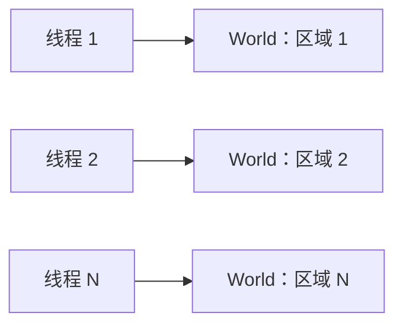
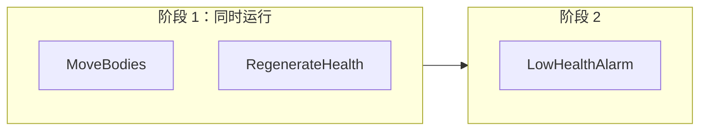

服务器核多，实体也多。EasyEcs 用三种方式分摊工作，热路径上都不需要锁：**每线程一个 World**（每个区域或地图一个 World，由各自的线程
拥有）、**并行系统**（同一次更新里，访问互不冲突的系统同时运行）、**并行 `[ForEach]`**（把一个重方法的行切成块分给多个线程）。生成器
根据参数写出每个系统的读写集，所以哪些系统能一起跑由调度器决定，而不是靠自觉；可能产生竞争的写法会被分析器拒绝。

## 什么时候用 [#when-to-use-it]

<Callout type="idea" title="适合">
  有多个区域、地图或对局的服务器：每线程一个 World。同一个 World 里有几个互不相关的重系统：`ParallelSystems`。一个方法要跑几万行：
  `[ForEach(Parallel = true)]`。
</Callout>

<Callout type="warn" title="不适合">
  用自己开的多个线程同时改一个 World：结构变更只属于所有者线程（EECS014 会报出它能看到的情况）。只有几百行的并行系统或并行方法：
  交给线程池要花几微秒，比活本身还贵。
</Callout>

## 怎么用 [#how-to-use-it]

### 术语：进程、World、所有者线程 [#terms-process-world-owner-thread]

| 术语 | 含义 |
| --- | --- |
| **进程** | 你的服务器。可以有任意多个 World，它们之间除了类型索引什么都不共享。 |
| **World** | 一套独立的实体、组件、单例和系统（`new World()`）。 |
| **所有者线程** | 调用 `world.Update()`、读写这个 World 数据的线程。同一时刻每个 World 只有一个。 |
| **并行阶段** | 同一次 `Update()` 里，彼此没有顺序约束也没有冲突的一批系统，在线程池线程上运行，所有者线程也参与。所有权不变。 |

### 推荐：每线程一个 World [#recommended-one-world-per-thread]

World 之间什么都不共享，所以把实体分到多个 World、每个 World 由一个线程拥有的服务器，完全不需要同步。



```csharp
public static class Zones
{
    // 每线程一个 World：各线程拥有自己的 World，什么都不共享
    public static Thread[] Start(World[] worlds)
    {
        var threads = new Thread[worlds.Length];
        for (int i = 0; i < worlds.Length; i++)
        {
            var zone = worlds[i];                                   // 每次迭代一个变量
            threads[i] = new Thread(() => { for (int t = 0; t < 1_000; t++) zone.Update(); });
            threads[i].Start();
        }

        return threads;
    }
}
```

[MultiWorld 示例](https://github.com/JasonXuDeveloper/EasyEcs/tree/master/samples/MultiWorld)就是这种布局，并打印每秒的实体更新数。
玩家在区域之间移动，就在同时拥有两个 World 的线程上做一次[迁移](/zh/docs/guide/migration-and-unload#move-entities)，或者通过
`SaveEntities` 走字节。

### 系统的顺序 [#order-of-systems]

`Update()` 按注册顺序运行系统，带 `[UpdateBefore<T>]` / `[UpdateAfter<T>]` 的系统会被挪到 `T` 的紧前或紧后。系统之间从不互相调用：
要消费另一个系统产出的系统，注册在它后面，或者标上 `[UpdateAfter<Producer>]`。结构变更立即生效，所以同一次更新里靠后的系统已经能看到
前面的系统创建、销毁或打标签的实体，没有需要回放的命令缓冲。不管并行了什么，一次更新的结果都和按这个顺序逐个运行系统一样。

### 并行系统 [#parallel-systems]

设置 `WorldOptions.ParallelSystems = true` 后，彼此没有顺序约束也没有冲突的系统会同时运行。每个系统的访问来自它的 `[ForEach]` 参数：

| `[ForEach]` 参数 | 声明的访问 |
| --- | --- |
| `ref T` 组件或单例 | 写 `T` |
| `in T` 组件或单例 | 读 `T` |
| `[With<T>]`、`[Without<T>]`、`[WithAny<T>]` | 无（过滤器读的是存在性，没有哪个并行系统会改它） |
| `[Changed<T>]`、`[Removed<T>]` | 读 `T`（它的变更 tick） |
| `Entity` 或 `World`、实例方法、重写 `OnUpdate` | 单独运行 |

一个系统写了另一个系统读或写的东西，或者其中一个要单独运行，两者就冲突。一个系统会被放进这样的阶段：它必须排在其后的系统（因为顺序
约束，或者因为它与之冲突的更早的系统）所在的最晚阶段之后。阶段依次运行，同一阶段的系统同时运行。

```csharp
public record struct Body(float X, float Y, float Vx, float Vy) : IComponent;
public record struct Vitals(int Health, int Max) : IComponent;
public record struct Alarms(int Count) : ISingletonComponent;

public class MoveBodies : EcsSystem        // 写 Body
{
    [ForEach] static void Move(ref Body b) { b.X += b.Vx; b.Y += b.Vy; }
}

public class RegenerateHealth : EcsSystem  // 写 Vitals
{
    [ForEach] static void Regenerate(ref Vitals v) => v.Health = Math.Min(v.Health + 1, v.Max);
}

public class LowHealthAlarm : EcsSystem    // 读 Vitals：和 RegenerateHealth 冲突
{
    [ForEach] static void Count(in Vitals v, ref Alarms alarms) { if (v.Health < 10) alarms.Count++; }
}
```



```csharp
using var parallel = new World(new WorldOptions { ParallelSystems = true });
parallel.AddSingleton<Alarms>();
parallel.AddSystem<MoveBodies>();
parallel.AddSystem<RegenerateHealth>();
parallel.AddSystem<LowHealthAlarm>();
parallel.Update();                          // 阶段 1 用两个线程，然后阶段 2
```

调度器不分配内存：调用线程和最多 `MaxDegreeOfParallelism - 1` 个可复用的线程池工作项一起跑完一个阶段。多个 World 或 IO 线程共用这些核
的时候，调小 `MaxDegreeOfParallelism`。一个阶段里抛出的第一个异常，会在阶段结束后在调用线程上重新抛出；设置
`WorldOptions.SystemErrors = SystemErrorPolicy.Disable` 后，出错的系统会被关掉，异常记在 `system.Error` 里。

### 并行 `[ForEach]` 方法 [#parallel-foreach-methods]

`[ForEach(Parallel = true)]` 把一个方法的行切成块分给多个线程。它不能做结构变更，必须逐实体运行，也不能写单例
（[EECS010](/zh/docs/guide/analyzer#eecs010)）：

```csharp
public record struct Regen(int PerTick) : ISingletonComponent;

public class RegenerateAll : EcsSystem
{
    [ForEach(Parallel = true), Without<Dead>]
    static void Regenerate(ref Health hp, in Regen regen) => hp.Value += regen.PerTick;   // 单例只读
}
```

并行系统和并行方法可以叠加：在并行阶段里，如果调度器正忙着跑另一个系统的方法，这个并行方法就在自己的线程上运行，不会干等。

### 来自其他线程的输入 [#input-from-other-threads]

一个 World 只有一个所有者线程，EasyEcs 自己也不提供跨线程队列：结构变更在这个线程上立即生效，没有什么需要推迟。来自其他线程的输入
（网络、定时器、数据库）走你自己的队列，由所有者线程上的一个系统把它变成数据：

```csharp
using System.Collections.Concurrent;

public record struct MoveRequest(int PlayerId, float X, float Y);           // 一条消息，不是组件
public record struct MoveIntent(int PlayerId, float X, float Y) : IComponent;

public sealed class ReceiveMoves(ConcurrentQueue<MoveRequest> inbox) : EcsSystem
{
    private readonly ConcurrentQueue<MoveRequest> _inbox = inbox;          // 由网络线程写入

    protected override void OnUpdate()
    {
        while (_inbox.TryDequeue(out var move))
            World.CreateEntity(new MoveIntent(move.PlayerId, move.X, move.Y));   // 输入变成数据
    }
}
```

用 `world.AddSystem(new ReceiveMoves(inbox))` 注册，放在消费 `MoveIntent` 的系统之前。队列的类型、容量上限和背压策略由你决定。
[GameLoop 示例](https://github.com/JasonXuDeveloper/EasyEcs/tree/master/samples/GameLoop)就是这样从网络线程收取邮箱里的消息。

### World 同步了什么 [#what-the-world-synchronizes]

| 操作 | 安全性 |
| --- | --- |
| 结构变更、增删系统和单例、`Capture` / `Restore`、`Save` / `Load` | 只能在所有者线程上，一次一个。靠一个普通的拥有者标志（没有原子指令）：另一个操作进行中，或者结构被冻结时（并行阶段、并行 `[ForEach]`、批量作业、`INoStructuralChanges` 遍历）再开始一个，会抛 `InvalidOperationException`，而不是把表写坏。 |
| 查询匹配、`Has`、`Get` 查找 | 无锁，读的是不可变、写时复制的表列表。某种查询形状第一次使用时，走一次比较交换闸门。 |
| 系统用 `GetOrAddSingleton<T>()` / `GetOrAddX()` 添加的单例 | 同一个闸门：同一阶段的多个系统可以同时添加它。 |
| 组件和单例的值 | 有意不做同步：由所有者线程或调度器决定谁能碰它们。 |
| 值索引，以及销毁和移除时做的解链 | World 有索引时，只能在所有者线程上。 |

谁能发现不在所有者线程上做的变更：

| 变更从哪来 | 谁能发现 |
| --- | --- |
| 不带 `Entity` 或 `World` 的 `[ForEach]` 方法，通过手里的句柄改结构 | 编译期 [EECS013](/zh/docs/guide/analyzer#eecs013)；在并行阶段里运行时也会抛异常 |
| 并行阶段里的系统或并行作业，通过辅助方法改结构 | 运行时：结构已冻结，任何结构变更都会抛异常 |
| 交给 `Task.Run`、`Parallel.*`、`ThreadPool`、`new Thread` 或 `new Timer` 的 lambda，改的 World 外层代码也在改 | 编译期 [EECS014](/zh/docs/guide/analyzer#eecs014) |
| 你自己的线程，用其他任何方式 | 没有可靠的办法：把变更当作数据交给所有者线程 |

## 完整例子 [#full-example]

十万个单位朝目标转向、移动、回血：转向方法把它的行分给多个线程处理；回血系统和它碰的是不同的组件，所以两者在同一个阶段里
并行。把这几个文件放进一个引用了 EasyEcs 的控制台项目（`dotnet add package EasyEcs`），用 `dotnet run` 运行。

<Accordions>
<Accordion title="Components.cs">

```csharp title="Components.cs" doccheck=example
using EasyEcs;

public record struct Position(float X, float Y) : IComponent;

public record struct Velocity(float X, float Y) : IComponent;

public record struct Health(int Value) : IComponent;

// 所有单位前往的目标点。
public record struct Target(float X, float Y) : ISingletonComponent;
```

</Accordion>
<Accordion title="Systems.cs">

```csharp title="Systems.cs" doccheck=example
using EasyEcs;

// 让每个速度都指向目标。
// Parallel = true 把行切成块，分给多个线程：每次调用只读
// 自己这一行和单例，也只写自己这一行。
public class SteeringSystem : EcsSystem
{
    [ForEach(Parallel = true)]
    static void Steer(in Position position, ref Velocity velocity, in Target target)
    {
        float dx = target.X - position.X;
        float dy = target.Y - position.Y;
        // + 1 保证单位站在目标点上时长度也大于零。
        float length = MathF.Sqrt(dx * dx + dy * dy) + 1;
        velocity = new Velocity(dx / length, dy / length);
    }
}

// 只写 Health，SteeringSystem 不碰它：两个系统可以在同一个阶段运行。
public class RegenerateSystem : EcsSystem
{
    [ForEach]
    static void Regenerate(ref Health health)
    {
        health.Value = Math.Min(health.Value + 1, 100);
    }
}

// 写 Position，而 SteeringSystem 要读它：所以要等 SteeringSystem 跑完。
public class MoveSystem : EcsSystem
{
    [ForEach]
    static void Move(ref Position position, in Velocity velocity)
    {
        position = new Position(position.X + velocity.X, position.Y + velocity.Y);
    }
}
```

</Accordion>
<Accordion title="Program.cs">

```csharp title="Program.cs" doccheck=example
using EasyEcs;

// 开启 ParallelSystems 后，互不冲突的系统可以共享一个阶段。
using var world = new World(new WorldOptions { ParallelSystems = true });
world.SetTarget(X: 500, Y: 500);
world.AddSystem<SteeringSystem>();
world.AddSystem<RegenerateSystem>();
world.AddSystem<MoveSystem>();

var units = new Entity[100_000];
world.CreateEntities(units, new Position(0, 0), new Velocity(0, 0), new Health(50));

// Update 仍然是本线程上的一次调用：它返回时，用到的线程都已经干完了。
for (int i = 0; i < 10; i++)
{
    world.Update();
}

Position at = units[0].Position;
Console.WriteLine($"unit 0 at ({at.X:F2}, {at.Y:F2}) with {units[0].Health.Value} hp");
```

</Accordion>
</Accordions>

输出：

```text
unit 0 at (7.06, 7.06) with 60 hp
```

结果和按注册顺序逐个运行这三个系统完全一样：并行阶段不改变一次更新算出的结果，只改变用几个线程来算。

## 怎么用得快 [#how-to-use-it-fast]

- **优先多开 World，而不是并行阶段。** 各自线程上的 World 扩展时完全不用交接；并行阶段每次更新都要交给线程池一次。
- **只给重系统打开 `ParallelSystems`**，也就是要遍历成千上万个实体的系统。
- **按数据拆，不按方法拆。** 写不同组件的两个系统能一起跑；什么都写的系统只能单独跑。
- **只读就用 `in`。** 只读的 `ref` 也算写，而写会冲突。

一个 World 里 10 万个实体，以及同样的实体分到四个线程上的四个 World（`WorldSimulationBenchmark`、`MultiWorldBenchmark`）：一个 World
每 tick <BenchValue k="tick.oneWorld" />，四个 World 合计 <BenchValue k="tick.fourWorlds" />。

<BenchSource />

四个互不相关的系统跑 10 万个实体，顺序和并行（`ParallelSystemsBenchmark`）；一个方法跑 10 万行，顺序和并行（`ParallelForEachBenchmark`）：

<BenchTable bench="ParallelSystemsBenchmark" />

<BenchTable bench="ParallelForEachBenchmark" />

## 开销 [#what-it-costs]

- **一个 World、一个线程：** 热路径没有锁也没有原子操作；结构变更只是检查并设置一个普通标志。
- **一个并行阶段：** 交给可复用的线程池工作项（几微秒），分配 0 B。
- **一个并行方法：** 同一个调度器，按行块分配；调用线程总是参与。
- **不用时：** `ParallelSystems` 默认关闭，从不使用它的 World 不为它付出任何开销。

## 常见陷阱 [#pitfalls]

| 错误 | 后果 | 谁能发现 |
| --- | --- | --- |
| 在并行方法里做结构变更 | 其他线程上的块会把表写坏 | [EECS010](/zh/docs/guide/analyzer#eecs010) |
| 并行方法里用 `ref` 单例 | 多个块争抢同一个值 | [EECS010](/zh/docs/guide/analyzer#eecs010) |
| 通过 `in` 参数修改集合 | 被当成读来调度：和并行的读者竞争 | [EECS011](/zh/docs/guide/analyzer#eecs011) |
| 不带 `Entity` 的方法通过手里的句柄改结构 | 系统进了它不该进的阶段 | [EECS013](/zh/docs/guide/analyzer#eecs013) |
| 在所有者线程之外 `Task.Run(() => world.CreateEntity(...))` | 两个线程同时改一个 World | [EECS014](/zh/docs/guide/analyzer#eecs014) |
| 只读却写成 `ref` 参数 | 声明了写：能一起跑的系统变少 | 代码审查：改用 `in` |

## 和其他 ECS 库的对比 [#compared-with-other-ecs-libraries]

| 库 | 系统顺序 | 并行运行 | 怎样避免冲突 |
| --- | --- | --- | --- |
| **EasyEcs** | 注册顺序，`[UpdateBefore<T>]` / `[UpdateAfter<T>]` | 没有顺序约束也没有冲突的系统；一个方法的行按块切分 | 由 `ref` / `in` 生成访问集；分析器拒绝可能竞争的并行方法 |
| Arch | 你的调用顺序（Arch.System：分组顺序） | 单个查询内（`ParallelQuery`） | 由你保证查询体互不相关 |
| Friflo.Engine.ECS | `SystemRoot` / `SystemGroup` 顺序 | 单个查询内（`RunParallel`） | 由你保证查询体互不相关 |
| DefaultEcs | `SequentialSystem` 顺序 | `ParallelSystem`（所有子系统同时）、按集合的 runner | 由你只把互不相关的系统放进 `ParallelSystem` |
| Bevy（Rust） | 不排序就不确定 | 访问互不冲突的任意系统 | 从参数类型读出访问集 |
| Unity DOTS | 分组内 `UpdateBefore` / `UpdateAfter` | Job | 读写句柄和 Job 安全系统 |

EasyEcs 采用 Bevy 和 Unity DOTS 基于访问集的模型，同时保持顺序完全确定。和其他库的并行 runner 对比：

<BenchChart bench="ParallelSystemsComparison" title="四个互不相关的系统跑 10 万个实体，顺序与并行" />

<BenchChart bench="ParallelQueryComparison" title="10 万个智能体在所有核上做转向" />

## 相关页面 [#related]

<Cards>
  <Card title="系统与 [ForEach]" href="/zh/docs/guide/systems">
    参数、顺序、分组和并行方法。
  </Card>
  <Card title="分析器规则" href="/zh/docs/guide/analyzer">
    EECS010、EECS011、EECS013 和 EECS014 详解。
  </Card>
  <Card title="迁移与卸载" href="/zh/docs/guide/migration-and-unload">
    在 World 之间迁移实体。
  </Card>
  <Card title="示例：MultiWorld" href="https://github.com/JasonXuDeveloper/EasyEcs/tree/master/samples/MultiWorld">
    每线程一个 World，不加锁。
  </Card>
</Cards>
