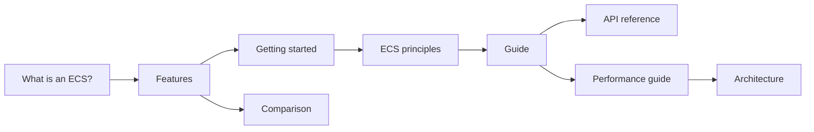

import { BookText, Cpu, Gauge, ListChecks, Rocket, Scale, Shapes, Swords } from 'lucide-react';

**EasyEcs is an open-source, allocation-free archetype Entity Component System (ECS) for C# and .NET 10 servers.**
You write plain data and `[ForEach]` methods. A source generator turns them into inlined struct jobs, an analyzer
catches design mistakes at compile time, and a full server tick of 100,000 entities takes
<BenchValue k="tick.oneWorld" /> and allocates <BenchValue k="tick.oneWorld.alloc" />.

New to the pattern itself? Read [What is an ECS?](/en/docs/what-is-ecs) first.

## Install [#install]

```bash
dotnet add package EasyEcs
```

The package targets `net10.0` and brings the source generator, the analyzer and its code fixes with it. There is
nothing to register.

## A first system [#first-system]

```csharp title="Program.cs"
using EasyEcs;

using var world = new World();
world.AddSystem<MovementSystem>();
world.CreateEntity(new Position(0, 0), new Velocity(1, 0));
world.Update(); // Position is now (1, 0)

public record struct Position(float X, float Y) : IComponent;
public record struct Velocity(float X, float Y) : IComponent;

public class MovementSystem : EcsSystem
{
    [ForEach] // [!code highlight]
    static void Move(ref Position p, in Velocity v) => p = new(p.X + v.X, p.Y + v.Y);
}
```

`ref` marks what the system writes and `in` what it only reads. The generator reads those two words to build the
loop, to decide which systems may run in parallel, and to tell [change tracking](/en/docs/guide/change-tracking)
which rows were written.

## Where to start [#where-to-start]

<Cards>
  <Card icon={<Shapes />} title="What is an ECS?" href="/en/docs/what-is-ecs">
    Entities, components and systems, archetype and sparse-set storage, and when an ECS fits.
  </Card>
  <Card icon={<ListChecks />} title="Features" href="/en/docs/features">
    Every feature on one page: what it does, when to use it, what it costs.
  </Card>
  <Card icon={<Rocket />} title="Getting started" href="/en/docs/getting-started">
    Build a small simulation step by step, from the world to the update loop.
  </Card>
  <Card icon={<Swords />} title="Example: a battle server" href="/en/docs/example">
    Every feature in one world: the code of the battle server benchmark.
  </Card>
</Cards>

## Reading order [#reading-order]



## Guide [#guide]

The [guide](/en/docs/guide/entities-and-components) has one page per concept, in the order you need them:
entities and components, prefabs, queries, systems, singletons, structural changes, `ref` and `await`, change
tracking, dynamic buffers, indexes and relations, snapshots, threading and the analyzer rules.

## Reference [#reference]

<Cards>
  <Card icon={<BookText />} title="API reference" href="/en/docs/api">
    Every public API with its complexity.
  </Card>
  <Card icon={<Gauge />} title="Performance guide" href="/en/docs/performance">
    Which API to use when, do's and don'ts, the benchmarks and how to measure.
  </Card>
  <Card icon={<Scale />} title="Comparison" href="/en/docs/comparison">
    EasyEcs against Friflo.Engine.ECS, Arch and DefaultEcs, feature by feature and measured.
  </Card>
  <Card icon={<Cpu />} title="Architecture" href="/en/docs/architecture">
    Storage and memory layout, archetype transitions, the query cache, the generators.
  </Card>
</Cards>

Upgrading from an earlier major version? The
[migration guide](https://github.com/JasonXuDeveloper/EasyEcs/blob/master/MIGRATION_GUIDE.md) covers 4.0 to 4.1,
v3 to v4 and v2 to v3.
