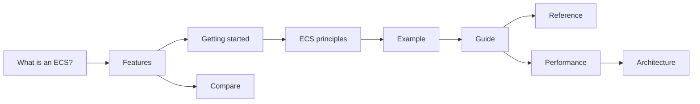

import {
  Bot,
  BookText,
  Boxes,
  CircleQuestionMark,
  FolderTree,
  Cpu,
  Gauge,
  Library,
  ListChecks,
  Network,
  RotateCcwClock,
  Rocket,
  Scale,
  Search,
  Shapes,
  Swords,
  TriangleAlert,
  Workflow,
  Zap,
} from 'lucide-react';

**EasyEcs is an open-source, allocation-free archetype Entity Component System (ECS) for C# and .NET 10 servers.**
You write plain data and `[ForEach]` methods. A source generator turns them into inlined struct jobs, an analyzer
catches design mistakes at compile time, and a full server tick of 100,000 entities takes
<BenchValue k="tick.oneWorld" /> and allocates <BenchValue k="tick.oneWorld.alloc" />.

New to the pattern itself? Read [What is an ECS?](/en/docs/what-is-ecs) first.

<Stats>
  <Stat hero lead />
  <Stat count="ahead" of="total" label="Head-to-head benchmarks it is faster in">against Friflo.Engine.ECS, Arch and DefaultEcs</Stat>
  <Stat k="tick.oneWorld" label="One server tick">100,000 entities in one world</Stat>
  <Stat k="tick.oneWorld.alloc" label="Allocated per tick">after warm-up</Stat>
</Stats>

<BenchSource />

## Install [#install]

```bash
dotnet add package EasyEcs
```

The package targets `net10.0` and brings the source generator, the analyzer and its code fixes with it. There is
nothing to register.

## A first system [#first-system]

```csharp title="Program.cs"
using EasyEcs;

using var world = new World();
world.AddSystem<MovementSystem>();
world.CreateEntity(new Position(0, 0), new Velocity(1, 0));
world.Update(); // Position is now (1, 0)

public record struct Position(float X, float Y) : IComponent;
public record struct Velocity(float X, float Y) : IComponent;

public class MovementSystem : EcsSystem
{
    [ForEach] // [!code highlight]
    static void Move(ref Position p, in Velocity v) => p = new(p.X + v.X, p.Y + v.Y);
}
```

`ref` marks what the system writes and `in` what it only reads. The generator reads those two words to build the
loop, to decide which systems may run in parallel, and to tell [change tracking](/en/docs/guide/change-tracking)
which rows were written.

## Where to start [#where-to-start]

<Cards>
  <Card icon={<Shapes />} title="What is an ECS?" href="/en/docs/what-is-ecs">
    Entities, components and systems, archetype and sparse-set storage, and when an ECS fits.
  </Card>
  <Card icon={<ListChecks />} title="Features" href="/en/docs/features">
    Every feature on one page: what it does, when to use it, what it costs.
  </Card>
  <Card icon={<Rocket />} title="Getting started" href="/en/docs/getting-started">
    Build a small simulation step by step, from the world to the update loop.
  </Card>
  <Card icon={<Swords />} title="Example: a battle server" href="/en/docs/example">
    Every feature in one world: the code of the battle server benchmark.
  </Card>
</Cards>

## Reading order [#reading-order]



## Guide [#guide]

The guide has one page per concept, in the order you need them.

<Cards>
  <Card icon={<FolderTree />} title="Structuring a real project" href="/en/docs/guide/project-structure">
    Where components, systems, the host loop and the tests go, as `dotnet new easyecs` lays them out.
  </Card>
  <Card icon={<Boxes />} title="Entities and components" href="/en/docs/guide/entities-and-components">
    Handles, ids, tags and the generated members.
  </Card>
  <Card icon={<Search />} title="Queries and filters" href="/en/docs/guide/queries">
    `Query`, `Count`, `Any`, `QueryFilter`, struct jobs and `entity.Run` on one entity.
  </Card>
  <Card icon={<Workflow />} title="Systems" href="/en/docs/guide/systems">
    `[ForEach]` methods, ordering, groups, cadence and errors.
  </Card>
  <Card icon={<Zap />} title="Change tracking" href="/en/docs/guide/change-tracking">
    Visit only the rows written or removed since a system last ran.
  </Card>
  <Card icon={<Network />} title="Threading" href="/en/docs/guide/threading">
    One owner thread per world, parallel systems and parallel `[ForEach]`.
  </Card>
  <Card icon={<TriangleAlert />} title="Common mistakes" href="/en/docs/guide/common-mistakes">
    What goes wrong first, and the rule or analyzer error that catches it.
  </Card>
</Cards>

The rest of the guide covers singletons, structural changes, `ref` and `await`, dynamic buffers, indexes and
relations, hierarchies, groups, cleanup and disable, [prefabs](/en/docs/guide/prefabs), bulk changes, snapshots, saves,
migration and unloading, [hosting](/en/docs/guide/hosting), [testing](/en/docs/guide/testing),
[debugging and diagnostics](/en/docs/guide/diagnostics), [troubleshooting](/en/docs/guide/troubleshooting), and every
[analyzer rule](/en/docs/guide/analyzer).

## Compare [#compare]

<Cards>
  <Card icon={<Gauge />} title="Performance" href="/en/docs/performance">
    Which API to use when, do's and don'ts, the benchmarks and how to measure.
  </Card>
  <Card icon={<Scale />} title="Comparison" href="/en/docs/comparison">
    EasyEcs against Friflo.Engine.ECS, Arch and DefaultEcs, feature by feature and measured.
  </Card>
</Cards>

Coming from another ECS? See EasyEcs against [Arch](/en/docs/vs-arch), [Friflo](/en/docs/vs-friflo),
[DefaultEcs](/en/docs/vs-defaultecs) and [Unity Entities](/en/docs/vs-unity-entities), and the migration pages for
[Arch](/en/docs/migrate-from-arch), [Friflo](/en/docs/migrate-from-friflo) and
[DefaultEcs](/en/docs/migrate-from-defaultecs).

## Reference [#reference]

<Cards>
  <Card icon={<Library />} title="API reference" href="/en/docs/reference">
    Every public type and member, generated from the source.
  </Card>
  <Card icon={<BookText />} title="API and complexity" href="/en/docs/api">
    Every public API with its complexity.
  </Card>
  <Card icon={<Cpu />} title="Architecture" href="/en/docs/architecture">
    Storage, entity lifecycle, the query cache, systems, generators and threads.
  </Card>
  <Card icon={<CircleQuestionMark />} title="FAQ" href="/en/docs/faq">
    Production use, allocations, threads, Unity, saves, hot reload, Native AOT.
  </Card>
  <Card icon={<Bot />} title="AI assistants" href="/en/docs/ai">
    `llms.txt`, Markdown copies and a rules file for your project.
  </Card>
  <Card icon={<RotateCcwClock />} title="Changelog" href="/en/docs/changelog">
    What changed in each release.
  </Card>
</Cards>

Why it is built this way: the [design decisions](/en/docs/decisions); what comes next: the
[roadmap](/en/docs/roadmap). Upgrading from an earlier version? The [migration guide](/en/docs/migration) covers
every step from v2 to v3, v3 to v4 and between the 4.x releases.
