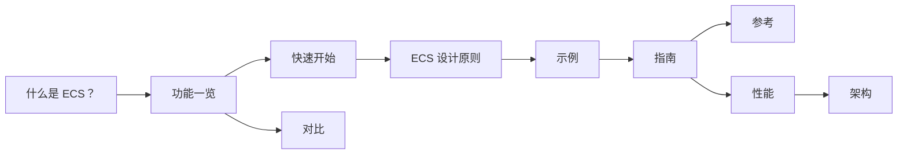

import {
  Bot,
  BookText,
  Boxes,
  CircleQuestionMark,
  FolderTree,
  Cpu,
  Gauge,
  Library,
  ListChecks,
  Network,
  RotateCcwClock,
  Rocket,
  Scale,
  Search,
  Shapes,
  Swords,
  TriangleAlert,
  Workflow,
  Zap,
} from 'lucide-react';

**EasyEcs 是开源、零 GC 分配的 archetype（原型）实体组件系统（ECS），面向 C# 与 .NET 10 服务端。**
你只写普通数据和 `[ForEach]` 方法：源生成器把它们编译成内联的结构体 job，分析器在编译期拦下设计错误。
10 万实体的完整服务器 tick 耗时 <BenchValue k="tick.oneWorld" />，分配 <BenchValue k="tick.oneWorld.alloc" />。

还不熟悉 ECS？先读[什么是 ECS？](/zh/docs/what-is-ecs)

<Stats>
  <Stat hero lead />
  <Stat count="ahead" of="total" label="更快的正面对比">对比 Friflo.Engine.ECS、Arch 和 DefaultEcs</Stat>
  <Stat k="tick.oneWorld" label="一个服务器 tick">一个 World，10 万实体</Stat>
  <Stat k="tick.oneWorld.alloc" label="每个 tick 的分配">预热之后</Stat>
</Stats>

<BenchSource />

## 安装 [#install]

```bash
dotnet add package EasyEcs
```

包面向 `net10.0`，源生成器、分析器和代码修复都已包含在内，不需要额外注册。

## 第一个系统 [#first-system]

```csharp title="Program.cs"
using EasyEcs;

using var world = new World();
world.AddSystem<MovementSystem>();
world.CreateEntity(new Position(0, 0), new Velocity(1, 0));
world.Update(); // Position 变成 (1, 0)

public record struct Position(float X, float Y) : IComponent;
public record struct Velocity(float X, float Y) : IComponent;

public class MovementSystem : EcsSystem
{
    [ForEach] // [!code highlight]
    static void Move(ref Position p, in Velocity v) => p = new(p.X + v.X, p.Y + v.Y);
}
```

`ref` 表示系统要写，`in` 表示只读。生成器靠这两个关键字生成循环、判断哪些系统可以并行，并告诉
[变更追踪](/zh/docs/guide/change-tracking)哪些行被写过。

## 从哪里开始 [#where-to-start]

<Cards>
  <Card icon={<Shapes />} title="什么是 ECS？" href="/zh/docs/what-is-ecs">
    实体、组件和系统，原型与稀疏集存储，以及什么时候适合用 ECS。
  </Card>
  <Card icon={<ListChecks />} title="功能一览" href="/zh/docs/features">
    所有功能放在一页：做什么、什么时候用、开销多少。
  </Card>
  <Card icon={<Rocket />} title="快速开始" href="/zh/docs/getting-started">
    从 World 到更新循环，一步一步搭一个小型模拟。
  </Card>
  <Card icon={<Swords />} title="示例：战斗服" href="/zh/docs/example">
    所有功能都在一个 World 里：战斗服基准测试的完整代码。
  </Card>
</Cards>

## 阅读顺序 [#reading-order]



## 指南 [#guide]

指南每页讲一个概念，按用到的先后排列。

<Cards>
  <Card icon={<FolderTree />} title="项目结构" href="/zh/docs/guide/project-structure">
    组件、系统、宿主循环和测试各放在哪，照 `dotnet new easyecs` 的布局。
  </Card>
  <Card icon={<Boxes />} title="实体与组件" href="/zh/docs/guide/entities-and-components">
    句柄、id、标签和生成的成员。
  </Card>
  <Card icon={<Search />} title="查询与过滤" href="/zh/docs/guide/queries">
    `Query`、`Count`、`Any`、`QueryFilter`、结构体 job，以及在单个实体上跑的 `entity.Run`。
  </Card>
  <Card icon={<Workflow />} title="系统" href="/zh/docs/guide/systems">
    `[ForEach]` 方法、排序、分组、执行频率和错误处理。
  </Card>
  <Card icon={<Zap />} title="变更追踪" href="/zh/docs/guide/change-tracking">
    只访问系统上次运行以来被写过或被移除的行。
  </Card>
  <Card icon={<Network />} title="多线程与并行" href="/zh/docs/guide/threading">
    每个 World 一个所有者线程，并行系统与并行 `[ForEach]`。
  </Card>
  <Card icon={<TriangleAlert />} title="常见错误" href="/zh/docs/guide/common-mistakes">
    最先出错的地方，以及拦下它的规则或分析器错误。
  </Card>
</Cards>

指南的其余页面讲单例组件、结构变更、`ref` 与 `await`、动态缓冲、索引与关系、层级、分组、清理与禁用、[预制体](/zh/docs/guide/prefabs)、批量操作、快照、存档、
迁移与卸载、[托管](/zh/docs/guide/hosting)、[测试](/zh/docs/guide/testing)、[调试与诊断](/zh/docs/guide/diagnostics)、
[问题排查](/zh/docs/guide/troubleshooting)，以及每条[分析器规则](/zh/docs/guide/analyzer)。

## 对比 [#compare]

<Cards>
  <Card icon={<Gauge />} title="性能" href="/zh/docs/performance">
    什么时候用哪个 API、该做与不该做的事、基准测试和测量方法。
  </Card>
  <Card icon={<Scale />} title="横向对比" href="/zh/docs/comparison">
    EasyEcs 与 Friflo.Engine.ECS、Arch、DefaultEcs 的逐项功能对比和实测数据。
  </Card>
</Cards>

从别的 ECS 迁过来？可以看 EasyEcs 与 [Arch](/zh/docs/vs-arch)、[Friflo](/zh/docs/vs-friflo)、
[DefaultEcs](/zh/docs/vs-defaultecs)、[Unity Entities](/zh/docs/vs-unity-entities) 的对比，以及从
[Arch](/zh/docs/migrate-from-arch)、[Friflo](/zh/docs/migrate-from-friflo)、[DefaultEcs](/zh/docs/migrate-from-defaultecs)
迁移的步骤。

## 参考 [#reference]

<Cards>
  <Card icon={<Library />} title="API 参考" href="/zh/docs/reference">
    每个公开类型和成员，由源码生成。
  </Card>
  <Card icon={<BookText />} title="API 与复杂度" href="/zh/docs/api">
    每个公开 API 及其复杂度。
  </Card>
  <Card icon={<Cpu />} title="架构" href="/zh/docs/architecture">
    存储、实体生命周期、查询缓存、系统、源生成器和线程。
  </Card>
  <Card icon={<CircleQuestionMark />} title="常见问题" href="/zh/docs/faq">
    生产可用性、分配、线程、Unity、存档、热重载、Native AOT。
  </Card>
  <Card icon={<Bot />} title="AI 助手" href="/zh/docs/ai">
    `llms.txt`、Markdown 版本，以及放进项目的规则文件。
  </Card>
  <Card icon={<RotateCcwClock />} title="更新日志" href="/zh/docs/changelog">
    每个版本改了什么。
  </Card>
</Cards>

为什么这样设计，见[设计决策](/zh/docs/decisions)；接下来做什么，见[路线图](/zh/docs/roadmap)。从旧版本升级？
[迁移指南](/zh/docs/migration)涵盖从 v2 到 v3、从 v3 到 v4，以及 4.x 各版本之间的每一步。
