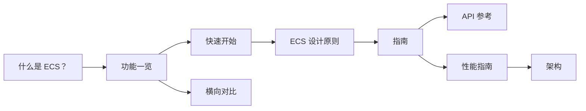

import { BookText, Cpu, Gauge, ListChecks, Rocket, Scale, Shapes, Swords } from 'lucide-react';

**EasyEcs 是开源、零 GC 分配的 archetype（原型）实体组件系统（ECS），面向 C# 与 .NET 10 服务端。**
你只写普通数据和 `[ForEach]` 方法：源生成器把它们编译成内联的结构体 job，分析器在编译期拦下设计错误。
10 万实体的完整服务器 tick 耗时 <BenchValue k="tick.oneWorld" />，分配 <BenchValue k="tick.oneWorld.alloc" />。

还不熟悉 ECS？先读[什么是 ECS？](/zh/docs/what-is-ecs)

## 安装 [#install]

```bash
dotnet add package EasyEcs
```

包面向 `net10.0`，源生成器、分析器和代码修复都已包含在内，不需要额外注册。

## 第一个系统 [#first-system]

```csharp title="Program.cs"
using EasyEcs;

using var world = new World();
world.AddSystem<MovementSystem>();
world.CreateEntity(new Position(0, 0), new Velocity(1, 0));
world.Update(); // Position 变成 (1, 0)

public record struct Position(float X, float Y) : IComponent;
public record struct Velocity(float X, float Y) : IComponent;

public class MovementSystem : EcsSystem
{
    [ForEach] // [!code highlight]
    static void Move(ref Position p, in Velocity v) => p = new(p.X + v.X, p.Y + v.Y);
}
```

`ref` 表示系统要写，`in` 表示只读。生成器靠这两个关键字生成循环、判断哪些系统可以并行，并告诉
[变更追踪](/zh/docs/guide/change-tracking)哪些行被写过。

## 从哪里开始 [#where-to-start]

<Cards>
  <Card icon={<Shapes />} title="什么是 ECS？" href="/zh/docs/what-is-ecs">
    实体、组件和系统，原型与稀疏集存储，以及什么时候适合用 ECS。
  </Card>
  <Card icon={<ListChecks />} title="功能一览" href="/zh/docs/features">
    所有功能放在一页：做什么、什么时候用、开销多少。
  </Card>
  <Card icon={<Rocket />} title="快速开始" href="/zh/docs/getting-started">
    从 World 到更新循环，一步一步搭一个小型模拟。
  </Card>
  <Card icon={<Swords />} title="示例：战斗服" href="/zh/docs/example">
    所有功能都在一个 World 里：战斗服基准测试的完整代码。
  </Card>
</Cards>

## 阅读顺序 [#reading-order]



## 指南 [#guide]

[指南](/zh/docs/guide/entities-and-components)每页讲一个概念，按用到的先后排列：实体与组件、预制体、查询、系统、单例、
结构变更、`ref` 与 `await`、变更追踪、动态缓冲、索引与关系、快照、线程模型，以及分析器规则。

## 参考 [#reference]

<Cards>
  <Card icon={<BookText />} title="API 参考" href="/zh/docs/api">
    每个公开 API 及其复杂度。
  </Card>
  <Card icon={<Gauge />} title="性能指南" href="/zh/docs/performance">
    什么时候用哪个 API、该做与不该做的事、基准测试和测量方法。
  </Card>
  <Card icon={<Scale />} title="横向对比" href="/zh/docs/comparison">
    EasyEcs 与 Friflo.Engine.ECS、Arch、DefaultEcs 的逐项功能对比和实测数据。
  </Card>
  <Card icon={<Cpu />} title="架构" href="/zh/docs/architecture">
    存储与内存布局、原型迁移、查询缓存、源生成器。
  </Card>
</Cards>

从旧的大版本升级？[迁移指南](https://github.com/JasonXuDeveloper/EasyEcs/blob/master/MIGRATION_GUIDE.md)（英文）
涵盖 4.0 到 4.1、v3 到 v4 以及 v2 到 v3。
