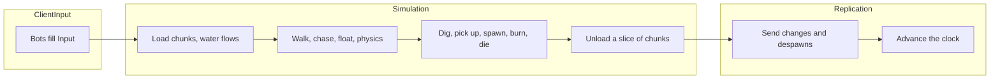

import { Boxes, FlaskConical, Network, Save } from 'lucide-react';

A block world in the manner of a Minecraft server: 20 ticks a second, chunks generated around the players and freed
behind them, springs whose water runs downhill and carries whoever stands in it, blocks dug into items, zombies that
rise at night and burn at sunrise, only what changed sent to the clients, and the world saved when the server stops.
Fifty bots play a minute of game time. Every code block on this page is included from
[`samples/VoxelServer`](https://github.com/JasonXuDeveloper/EasyEcs/tree/master/samples/VoxelServer), which CI builds
and runs, comparing its output with the one shown below.

The sample is a server, but nothing in it is: the same world serves a client. A client runs the same chunks, water
and bodies to predict what happens before the server's packets arrive, and a renderer reads the positions and blocks
after each tick. The server computes the world and sends what changed; the client draws it. See
[the client and the server](#client-and-server).

## What you learn [#what-you-learn]

Each technique below has its own section, with the code that uses it.

- **A tick in three groups**: [system groups](/en/docs/guide/systems#system-groups) for input, simulation and
  replication, each run by its own `world.Update<TGroup>()` ([one tick](#one-tick)).
- **A chunk is an entity, its blocks a buffer**: a [unique index](/en/docs/guide/indexes-and-relations#unique-keys)
  finds the chunk at a position, a [dynamic buffer](/en/docs/guide/dynamic-buffers) of an enum holds its 8,192 blocks
  ([chunks](#chunks)).
- **Cadence and slices**: chunks loaded twice a second ([`UpdateInterval`](/en/docs/guide/systems#update-interval)),
  unloaded and looked at a twentieth or a tenth at a time ([`Slices`](/en/docs/guide/systems#slices)), with
  [structural changes](/en/docs/guide/structural-changes) in the middle of the loop.
- **Areas of interest**: a `Vision` per [prefab](/en/docs/guide/prefabs), the viewers counted on each chunk, and a
  [value index](/en/docs/guide/indexes-and-relations#value-indexes) of the players by chunk as the grid
  ([areas of interest](#aoi)).
- **Water as data**: one entity per block of water, a child of its chunk ([hierarchy](/en/docs/guide/hierarchy)),
  with a `Flowing` component only while it still has to spread ([water](#water)).
- **Filters**: `[With<Humanoid>]` picks who floats, `[With<Zombie>]` who burns ([filters](/en/docs/guide/queries#filters)).
- **Threads where rows are independent**: [`[ForEach(Parallel = true)]`](/en/docs/guide/systems#parallel-methods) on
  the systems that touch only their own row ([movement](#movement)).
- **SIMD where the data is a column**: a [batch method](/en/docs/guide/systems#batch-methods) takes a point of health
  from 8 zombies per instruction ([SIMD](#simd)).
- **A sorted scoreboard**: an [ordered index](/en/docs/guide/indexes-and-relations#ordered-index) of the players by
  blocks dug ([leaderboard](#leaderboard)).
- **Send only what changed**: [`[Changed<T>]` and `Mut<T>`](/en/docs/guide/change-tracking),
  [`Maybe<T>`](/en/docs/guide/systems#maybe) for the health bar, the
  [destroy log](/en/docs/guide/change-tracking#destroy-log) for despawns ([replication](#replication)).
- **Save on stop**: [`SaveWithout` and `LoadKeeping`](/en/docs/guide/saves#restart), prefabs rebuilt by each start.
- **Measured**: [`MeasureSystems` and `DescribeSchedule`](/en/docs/guide/diagnostics).

## Run it [#run-it]

```bash
dotnet run -c Release --project samples/VoxelServer                      # 50 bots, one minute of game time
dotnet run -c Release --project samples/VoxelServer -- --players 5000    # a crowd
dotnet run -c Release --project samples/VoxelServer -- --realtime        # 20 ticks a second, like a vanilla server
dotnet run -c Release --project samples/VoxelServer -- --schedule        # the order the systems run in
```

## One tick: three groups [#one-tick]



A tick has three parts, and each is a system group: a struct that names it, and `[UpdateInGroup<T>]` on its systems.

<include lang="csharp" meta='title="Groups.cs"'>../../../samples/VoxelServer/Groups.cs</include>

The host runs the groups in order, each with its own update. A real server could run `ClientInput` as the packets
arrive and `Replication` at a lower rate for far players, without touching a system.

<include lang="csharp" meta='title="Host/Server.cs"'>../../../samples/VoxelServer/Host/Server.cs#tick</include>

Inside a group the systems run in the order they were added. No system calls another: each reads and writes
components, and the next one sees what the last one wrote.

<include lang="csharp" meta='title="Program.cs"'>../../../samples/VoxelServer/Program.cs#systems</include>

## The data [#data]

Blocks, chunks and water first, then what moves, then the singletons. Comments say what each value means and who
writes it.

<include lang="csharp" meta='title="Components.cs"'>../../../samples/VoxelServer/Components.cs</include>

The rules are constants and a few pure functions; the terrain is where a block lives and how a chunk is generated.
`BlockAt` is the one way systems read blocks, so an unloaded chunk reads as stone everywhere.

<include lang="csharp" meta='title="Rules.cs"'>../../../samples/VoxelServer/Rules.cs</include>

<include lang="csharp" meta='title="Terrain.cs"'>../../../samples/VoxelServer/Terrain.cs</include>

## Chunks around the players [#chunks]

`ChunkLoadSystem` walks the chunks in each player's view: it creates what is missing and counts, on each chunk, the
players that see it (`Viewers`). `world.ChunkIndex` is the unique index of `Chunk`, so the lookup is a hash probe, and
the blocks go into the chunk's buffer in one `AddRange`. Twice a second is enough (`UpdateInterval`): a player walks
four blocks a second and the view reaches two chunks ahead.

<include lang="csharp" meta='title="Systems/Chunks.cs"'>../../../samples/VoxelServer/Systems/Chunks.cs#load</include>

`ChunkUnloadSystem` destroys the chunks nobody saw for five seconds. With `Slices = 20` each tick visits a twentieth
of the chunks, so 1,300 chunks cost 65 checks a tick instead of 1,300 once a second. Destroying in the middle of the
loop is fine, and it takes the chunk's water along: each cell is its child.

<include lang="csharp" meta='title="Systems/Chunks.cs"'>../../../samples/VoxelServer/Systems/Chunks.cs#unload</include>

## Areas of interest [#aoi]

What a player sees decides what the server does for it, as on a Minecraft server: which chunks stay loaded around
it and which changes it is sent. What a zombie sees decides whom it hunts. The range is data, a `Vision` that each
prefab sets: 32 blocks for a player, 16 for a zombie. A boss with a longer view is one more prefab, not new code.

<include lang="csharp" meta='title="Program.cs"'>../../../samples/VoxelServer/Program.cs#prefabs</include>

The interest has two sides, and each is a piece of data that one system keeps and others read:

- **Who is sent what.** The load pass above leaves on each chunk the number of players that see it and the tick it
  counted them. `Rules.Watching` turns that into the number of players a change in the chunk goes to, none if nobody
  had it in view at the last pass. A dug block, a step, a flood is sent to that many players, so a crowd in one place
  costs nothing to a player far away (see [what is sent](#replication)).
- **Who sees whom.** A grid: `InChunk` is an indexed component, the chunk a player stands in, so
  `world.InChunkIndex.Find(chunk)` lists the players of a chunk. `GridSystem` keeps it current and writes only when a
  player crosses into another chunk (`SetInChunkIfChanged`), so the index changes a few times a second, not every tick.

<include lang="csharp" meta='title="Systems/Movement.cs"'>../../../samples/VoxelServer/Systems/Movement.cs#grid</include>

`ZombieSightSystem` reads the grid: for the chunks its `Vision` reaches it walks the players of each and keeps the
nearest in range, comparing squared distances. A zombie checks a few dozen players instead of all of them, and a
tenth of the zombies look each tick (`Slices`), so a horde costs the same every tick instead of a spike twice a second.

<include lang="csharp" meta='title="Systems/Zombies.cs"'>../../../samples/VoxelServer/Systems/Zombies.cs#sight</include>

The grid is the usual answer to "who is near whom" in an ECS: an index from a cell to the entities in it, kept by
the system that moves them, read by the systems that need neighbours. The cell here is a chunk because chunks are
already the unit of loading; a game with dense crowds would use smaller cells for the same code.

## Water [#water]

A cell spreads once, five ticks after it appeared: down if there is air below, else sideways one level further from
its spring, up to seven blocks on flat ground. Then its `Flowing` goes, and `WaterFlowSystem`, whose method takes
`in Flowing`, never visits it again: a settled lake costs nothing.

<include lang="csharp" meta='title="Systems/Water.cs"'>../../../samples/VoxelServer/Systems/Water.cs#flow</include>

`FloatSystem` is filtered with `[With<Humanoid>]`: players and zombies carry the tag, dropped items do not and sink.
The filter is part of the query, so items are not visited at all, and the method does not take a tag it never reads.
It finds the water at a humanoid's feet with the unique index `world.WaterIndex` and pushes it away from the spring,
harder the closer it is.

<include lang="csharp" meta='title="Systems/Water.cs"'>../../../samples/VoxelServer/Systems/Water.cs#float</include>

## Movement [#movement]

The walk turns input into a velocity. Each row depends only on itself and the method holds no `World`, so it is a
parallel method: its rows are split across threads, with the same result on every run.

<include lang="csharp" meta='title="Systems/Movement.cs"'>../../../samples/VoxelServer/Systems/Movement.cs#walk</include>

Physics moves every body through the blocks and writes the position through `Mut<Position>`: `SetIfChanged` stamps
the row only when the position changed, so a body standing still is not sent. It stays on one thread because it
reads the blocks through `World` (the chunk index), and a parallel method may not hold the world (EECS010). The same
goes for `FloatSystem` and `ZombieSightSystem`.

<include lang="csharp" meta='title="Systems/Movement.cs"'>../../../samples/VoxelServer/Systems/Movement.cs#physics</include>

## Digging and items [#items]

A dig turns a block into air and an item, and adds one to the digger's `Score` (the [leaderboard](#leaderboard));
water beside the hole flows again (it gets its `Flowing` back). The buffer is read through `chunk.Block[slot]` and
written through `chunk.WriteBlock()`, so only a dig stamps the chunk.

<include lang="csharp" meta='title="Systems/Items.cs"'>../../../samples/VoxelServer/Systems/Items.cs#dig</include>

The item names its owner by `EntityId`. When the owner is close, the stack of its kind in the inventory (a
`DynamicBuffer<ItemStack>`) grows or a new one starts; an item nobody picked up expires.

<include lang="csharp" meta='title="Systems/Items.cs"'>../../../samples/VoxelServer/Systems/Items.cs#pickup</include>

<include lang="csharp" meta='title="Systems/Items.cs"'>../../../samples/VoxelServer/Systems/Items.cs#expiry</include>

## Zombies and death [#zombies]

At night a zombie rises near each player every few seconds: an instance of the zombie prefab with its own
`Position`. A zombie chases the player it saw; a player who left is noticed because `TryGetEntity` fails on the stale
id.

<include lang="csharp" meta='title="Systems/Zombies.cs"'>../../../samples/VoxelServer/Systems/Zombies.cs#spawn</include>

<include lang="csharp" meta='title="Systems/Zombies.cs"'>../../../samples/VoxelServer/Systems/Zombies.cs#chase</include>

Dying is a `Health` of zero, handled by one system per kind: zombies go, players respawn with an empty inventory.

<include lang="csharp" meta='title="Systems/Health.cs"'>../../../samples/VoxelServer/Systems/Health.cs</include>

## SIMD where the data is a column [#simd]

Sunburn takes a point of health from every zombie, every tick of the day. A batch method gets a run of rows as spans,
so the health of a run of zombies is one `Span<Health>`, which is a span of `int`. `Vector<int>` takes a point from 8
of them per instruction on AVX2 (4 on Arm). The JIT does not vectorize the loop by itself, so the method does it;
integer lanes give the same result on every machine.

<include lang="csharp" meta='title="Systems/Zombies.cs"'>../../../samples/VoxelServer/Systems/Zombies.cs#sunburn</include>

SIMD pays when the same arithmetic runs over a column, and that is rare in this server. The other systems do
something different per entity: physics looks up the blocks around each body, the water and the sight look up an
index, the chase reads another entity's position. A vector does not help a loop of lookups and branches, and the
positions are `Vector3`s, three floats next to each other, not three columns. A batch method also runs on one thread
(EECS010), so the vector loop is the speed-up, not threads.

## A scoreboard that stays sorted [#leaderboard]

`Score` is the blocks a player dug, an `IIndexed<int>` (see [the data](#data)), so `world.ScoreIndex` is an index of
the players by score. Its key is comparable, so the index walks in order: `Descending()` starts at the best digger.
The index is kept sorted as `DigSystem` writes the scores, so the top of the board is a walk of three entries, never a
sort of every player.

<include lang="csharp" meta='title="Program.cs"'>../../../samples/VoxelServer/Program.cs#leaderboard</include>

`Range(from, to)` on the same index lists the players between two scores, for a page of the board.

## What is sent [#replication]

Changed chunks come from `[Changed<T>]` on the buffer: a chunk nobody dug or flooded is not visited. Each change goes
to the players that had the chunk in view (`Rules.Watching`).

<include lang="csharp" meta='title="Systems/Replication.cs"'>../../../samples/VoxelServer/Systems/Replication.cs#chunks</include>

Moved entities come from `[Changed<Position>]`, stamped by `Mut<Position>` above. An update carries the health bar
of the entities that have one: `Maybe<Health>` reads it where the entity has a `Health`, so players, zombies and
items are sent by one method, and the query does not require `Health`.

<include lang="csharp" meta='title="Systems/Replication.cs"'>../../../samples/VoxelServer/Systems/Replication.cs#entities</include>

A destroyed entity has no row left: the despawns come from the destroy log, since the tick the system last ran. The
clock advances last.

<include lang="csharp" meta='title="Systems/Replication.cs"'>../../../samples/VoxelServer/Systems/Replication.cs#despawns</include>

<include lang="csharp" meta='title="Systems/Replication.cs"'>../../../samples/VoxelServer/Systems/Replication.cs#clock</include>

## The program [#program]

The world with its options: the destroy log for the despawns, `MeasureSystems` for the timings, and a buffer pool
big enough for a chunk's blocks, so a loaded chunk reuses the list of one that was unloaded.

<include lang="csharp" meta='title="Program.cs"'>../../../samples/VoxelServer/Program.cs#options</include>

The players are instances of the player prefab with their own client, position and chunk. The tick loop and the bots
are in [`Host/`](https://github.com/JasonXuDeveloper/EasyEcs/tree/master/samples/VoxelServer/Host): plumbing, not the
lesson.

<include lang="csharp" meta='title="Program.cs"'>../../../samples/VoxelServer/Program.cs#players</include>

On stop the world is saved without its prefabs, which every start builds; a restarted world builds them, then loads
the save beside them.

<include lang="csharp" meta='title="Program.cs"'>../../../samples/VoxelServer/Program.cs#save</include>

## Output [#output]

```text
tick   200 (day  ): 50 players, 82 chunks, 1961 water, 0 zombies, 0 items
tick   400 (night): 50 players, 119 chunks, 3070 water, 50 zombies, 0 items
tick   600 (day  ): 50 players, 135 chunks, 4322 water, 150 zombies, 0 items
tick   800 (day  ): 50 players, 142 chunks, 4054 water, 0 zombies, 0 items
tick  1000 (night): 50 players, 171 chunks, 5311 water, 50 zombies, 0 items
tick  1200 (day  ): 50 players, 170 chunks, 4774 water, 150 zombies, 0 items
chunks: 232 loaded, 62 unloaded, 25227 sent
blocks dug: 638; items: 638 picked up, 0 expired
zombies: 300 spawned, 150 burned, 361 hits; player deaths: 39
water: 7625 cells poured, 5005 ticks of humanoids carried
sent: 2501294 entity updates (43967 KiB), 3701 despawns
top diggers: player 6 (22) player 24 (21) player 22 (21)
restarted from the save: 50 players, 170 chunks, 4774 water, 150 zombies
```

The world, the springs, the bots and the spawns come from integer hashes, so every run prints the same, on one thread
or many. The chunks grow as the bots walk out and shrink behind them, and the water with them; three zombies per
player rise each night and are gone a second after sunrise. The timings go to stderr: the average tick against the
50 ms budget and each system's time and allocations.

## What it does not use, and why [#not-used]

- **`GroupBy` by chunk.** Splitting the tables by chunk would make "the entities of a chunk" contiguous, but a player
  who crosses a chunk would move its row to another table, several times a second for every walker. The `InChunk`
  index costs one index update on the crossing and nothing else.
- **Cleanup components to save a chunk when it unloads.** A retired entity loses its other components, its block
  buffer among them, so there is nothing left to save by then. A server that keeps unloaded chunks would save them in
  `ChunkUnloadSystem`, before the `Destroy`.
- **`[ChangedAny<Position, Health>]`.** Sending health changes too would need `Health` tracked, and the sunburn writes
  every zombie's health as a span, which stamps the run each day tick: the whole horde would be sent every tick
  either way.
- **Parallel physics, water and sight.** They read the world through its indexes; see [movement](#movement).

## The client and the server [#client-and-server]

The split is the usual one for a networked game: the server owns the world and sends what changed, the client shows
it. Both sides can be this ECS:

- **On the server**, as here: the systems compute the world each tick, and the `Send` systems turn what changed
  (`[Changed<T>]`, the destroy log) into packets.
- **On the client**, the packets are written into a world of the same components. The same `PhysicsSystem` and
  `FloatSystem` predict the local player between two packets, and a render system reads `Position` and the chunks'
  blocks to draw them: in [Godot](/en/docs/samples/godot), the node draws right after `World.Update()` in `_PhysicsProcess`.

Components and systems that both sides need go into a shared project, like the contracts of the
[HotReload sample](/en/docs/samples/hot-reload).

## Related [#related]

<Cards>
  <Card icon={<Boxes />} title="Dynamic buffers" href="/en/docs/guide/dynamic-buffers">
    A list per entity, like a chunk's blocks, tracked like any component.
  </Card>
  <Card icon={<FlaskConical />} title="Change tracking" href="/en/docs/guide/change-tracking">
    What counts as a write, Mut&lt;T&gt;, the destroy log.
  </Card>
  <Card icon={<Network />} title="Example: a battle server" href="/en/docs/example">
    Every feature in one server, with clients that catch up.
  </Card>
  <Card icon={<Save />} title="Saves" href="/en/docs/guide/saves">
    Save a world, restart from it, leave out what each start sets.
  </Card>
</Cards>
