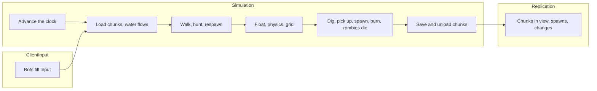

import { Boxes, FlaskConical, Network, Save } from 'lucide-react';

A block world in the manner of a Minecraft server: 20 ticks a second, chunks loaded around the players, saved to
region files behind them and read back when a player returns, water that spreads and recedes by Minecraft's rules and
carries whatever stands in it, blocks dug into items anyone can pick up, zombies that rise at night, hunt the players
near them and catch fire under the sky by day, only what changed sent to the clients, and the world saved when the
server stops. Fifty bots play a minute of game time. Every code block on this page is included from
[`samples/VoxelServer`](https://github.com/JasonXuDeveloper/EasyEcs/tree/master/samples/VoxelServer), which CI builds
and runs, comparing its output with the one shown below.

The sample is a server, but nothing in it is: the same world serves a client. A client runs the same chunks, water
and bodies to predict what happens before the server's packets arrive, and a renderer reads the positions and blocks
after each tick. See [the client and the server](#client-and-server).

## What you learn [#what-you-learn]

Each technique below has its own section, with the code that uses it.

- **A tick in three groups**: [system groups](/en/docs/guide/systems#system-groups) for input, simulation and
  replication, each run by its own `world.Update<TGroup>()` ([one tick](#one-tick)).
- **A chunk is an entity, its blocks and water two buffers**: a
  [unique index](/en/docs/guide/indexes-and-relations#unique-keys) finds the chunk at a position,
  [dynamic buffers](/en/docs/guide/dynamic-buffers) of bytes hold its 8,192 blocks and their water ([the data](#data)).
- **Chunks that follow the players and are kept**: loads asked for only by the players who crossed into another chunk
  ([`[Changed<T>]`](/en/docs/guide/change-tracking)), the chunk with the entities in it saved and loaded back with
  [`SaveEntities`](/en/docs/guide/migration-and-unload) and `LoadEntities` after the pass ([chunks](#chunks)).
- **An area of interest without polling**: a client sees the entities of its chunks, so the views change only when
  something crosses into another chunk, appears or goes; a [cleanup component](/en/docs/guide/cleanup-and-disable) keeps where a
  destroyed entity was seen until its despawn is sent ([areas of interest](#aoi)).
- **Water as a SIMD stencil**: the same rule for every block, stepped 16 blocks per instruction with
  `Vector128<byte>`, only on the chunks that may still move ([water](#water)).
- **SIMD batch methods**: cooldowns, ages, fire and its damage, 8 per instruction in
  [batch methods](/en/docs/guide/systems#batch-methods), the damage at its own
  [`UpdateInterval`](/en/docs/guide/systems#update-interval) ([SIMD](#simd)).
- **State changes are data**: digging, items, fire and death as components and entities ([items](#items),
  [zombies](#zombies)).
- **A sorted scoreboard**: an [ordered index](/en/docs/guide/indexes-and-relations#ordered-index) of the players by
  blocks dug ([leaderboard](#leaderboard)).
- **Send only what changed**: [`[Changed<T>]`, `[ChangedAny<..>]`](/en/docs/guide/change-tracking#changed-any) and
  [`Maybe<T>`](/en/docs/guide/systems#maybe) ([replication](#replication)).
- **Save on stop**: [`SaveWithout` and `LoadKeeping`](/en/docs/guide/saves#restart), prefabs rebuilt by each start.
- **Measured**: [`MeasureSystems` and `DescribeSchedule`](/en/docs/guide/diagnostics).

## Run it [#run-it]

```bash
dotnet run -c Release --project samples/VoxelServer                      # 50 bots, one minute of game time
dotnet run -c Release --project samples/VoxelServer -- --players 2000    # a crowd
dotnet run -c Release --project samples/VoxelServer -- --realtime        # 20 ticks a second, like a vanilla server
dotnet run -c Release --project samples/VoxelServer -- --schedule        # the order the systems run in
```

## One tick: three groups [#one-tick]



A tick has three parts, and each is a system group: a struct that names it, and `[UpdateInGroup<T>]` on its systems.

<include lang="csharp" meta='title="Groups.cs"'>../../../samples/VoxelServer/Groups.cs</include>

The host runs the groups in order, each with its own update. A real server could run `ClientInput` as the packets
arrive and `Replication` at a lower rate for far players, without touching a system.

<include lang="csharp" meta='title="Host/Server.cs"'>../../../samples/VoxelServer/Host/Server.cs#tick</include>

Inside a group the systems run in the order they were added. No system calls another: each reads and writes
components, and the next one sees what the last one wrote.

<include lang="csharp" meta='title="Program.cs"'>../../../samples/VoxelServer/Program.cs#systems</include>

## The data [#data]

Blocks and chunks, their water, what moves, players, zombies and items, then the singletons. Comments say what each
value means and who writes it.

<include lang="csharp" meta='title="Components.cs"'>../../../samples/VoxelServer/Components.cs</include>

The rules are constants and a few pure functions; the terrain is where a block lives, how a chunk is generated, and
the reads every system shares: `BlockAt` (an unloaded chunk reads as stone, so nothing falls out of the world),
`WaterAt`, `TopAt` and the chunks around a point.

<include lang="csharp" meta='tab="Rules.cs"'>../../../samples/VoxelServer/Rules.cs</include>

<include lang="csharp" meta='tab="Terrain.cs"'>../../../samples/VoxelServer/Terrain.cs</include>

## Chunks around the players [#chunks]

`ChunkLoadSystem` looks at a player's view only when it changes: `[Changed<InChunk>]` visits the players who crossed
into another chunk this tick (and the players just created), and it records the chunks missing around them as
`LoadRequest` entities, one per chunk: the request is `IUniqueIndexed`, so a second player asking finds it and asks
nothing more. A player who stays in its chunk asks for nothing, so nothing polls the views. It does not load them:
a pass may not load or save entities (EECS041), so `ChunkReadSystem` serves the requests in its `OnUpdate`, after the
pass, as many as `Rules.MaxRequests` a tick, destroying only those it served; the others wait a tick. A chunk that
was unloaded comes back from the region files with `LoadEntities`, and with it the zombies and
items that were in it; a chunk never seen is generated, its blocks and its water written into the buffers in one
`AddRange` each. Either way it is tagged `Fresh` for the tick: its clients get it whole (below), not as block changes.

<include lang="csharp" meta='title="Systems/Chunks.cs"'>../../../samples/VoxelServer/Systems/Chunks.cs#load</include>

Unloading is the same in reverse. A chunk's `Viewers` counts the players that have it in view, kept by
`ChunkViewSystem` below as the views change, with the tick it last went to zero. With `Slices = 20` each tick checks a
twentieth of the chunks and tags the ones nobody has had in view for five seconds `Unloading`; `ChunkSaveSystem` then writes each with the entities of its grid cell into
one record (`SaveEntities`) and destroys them, so nothing ticks where no player is. A chunk a player stands in (one
who just respawned there) stays loaded. The region files are a singleton
that holds a class; [`Host/RegionFiles.cs`](https://github.com/JasonXuDeveloper/EasyEcs/tree/master/samples/VoxelServer/Host/RegionFiles.cs)
stands in for the disk.

<include lang="csharp" meta='title="Systems/Chunks.cs"'>../../../samples/VoxelServer/Systems/Chunks.cs#unload</include>

A client keeps the chunks it was sent. `ChunkViewSystem` keeps the same set on the player, a `DynamicBuffer<InView>`:
a loaded chunk that comes into view is sent whole, one that leaves is forgotten. The set changes only when the player
crosses into another chunk or a chunk near it finishes loading, and both are already data: `GridSystem` writes
`InChunk` only on a crossing, and `InChunk` is `ITracked`, so `[Changed<InChunk>]` visits the players that crossed;
`[With<Fresh>]` visits the chunks loaded this tick, which join the sets of the players near them. Nothing polls: a
player who stays in its chunk costs nothing, and a crossing is seen the tick it happens. Each chunk that comes into a
set counts one more viewer and each that leaves one less, so a chunk's `Viewers` is exact at every tick, not a count
taken now and then.

<include lang="csharp" meta='title="Systems/Chunks.cs"'>../../../samples/VoxelServer/Systems/Chunks.cs#view</include>

## Areas of interest [#aoi]

What a player sees is the square of chunks its `Vision` reaches: the chunks loaded around it and sent to its client
(`InView`, above), and the entities in them. Nothing keeps a list of entities per player. A view of entities changes in
three ways, and each is already data:

| What happens | What the client gets | Where it is counted |
| --- | --- | --- |
| A chunk comes into or leaves a player's view | spawns or despawns for the entities in it | `ChunkViewSystem` (the grid counts them) |
| An entity crosses into another chunk, or is created | a spawn for the players that see its new chunk and not its old one, a despawn for the reverse | `SightSystem.Moved`, `[Changed<InChunk>]` |
| An entity is destroyed | a despawn for the players that see its chunk | `SightSystem.Gone`, `[With<Retired>]` |

The grid is `InChunk`, an indexed component on everything that moves, so `world.InChunkIndex.Find(chunk)` lists the
entities of a chunk. `GridSystem` keeps it current: `[Changed<Position>]` visits only what moved this tick, and
`SetInChunkIfChanged` writes only when an entity crosses into another chunk, so the index and every system that
reacts to `[Changed<InChunk>]` see a few crossings a second, not every tick.

<include lang="csharp" meta='title="Systems/Movement.cs"'>../../../samples/VoxelServer/Systems/Movement.cs#grid</include>

A crossing needs the chunk the clients knew the entity in, and a destroyed entity needs it too: by then its
components are gone. `Visible` holds it, and it is a [cleanup component](/en/docs/guide/cleanup-and-disable): destroying an entity
that has one retires it instead, keeping only its cleanup components, until a system removes the last of them.
`SightSystem` sends the despawns from it, then removes it, and the entity is freed. The players a crossing concerns
are the ones whose view reaches one chunk and not the other, a strip of chunks between the two squares; for a
creation or a destruction they are the chunk's `Viewers`, one lookup. An entity that stays in its chunk costs nothing,
however many ticks go by.

<include lang="csharp" meta='title="Systems/Sight.cs"'>../../../samples/VoxelServer/Systems/Sight.cs#sight</include>

A zombie hunts within its own `Vision`, 35 blocks (its follow range in Minecraft): each prefab sets its own, so a boss
with a longer view is one more prefab, not new code.

<include lang="csharp" meta='title="Program.cs"'>../../../samples/VoxelServer/Program.cs#prefabs</include>

`ZombieTargetSystem` finds the nearest player through the same grid and keeps it while it stays in reach, as a
vanilla mob keeps its target. It looks twice a second, a tenth of the zombies each tick (`Slices`), so a horde costs
the same every tick.

<include lang="csharp" meta='title="Systems/Zombies.cs"'>../../../samples/VoxelServer/Systems/Zombies.cs#target</include>

The grid is the usual answer to "who is near whom" in an ECS: an index from a cell to the entities in it, kept by
the system that moves them, read by the systems that need neighbours. The cell here is a chunk because chunks are
already the unit of loading and of what a client has.

## Water [#water]

Water is not a block but a second grid beside the blocks: a `DynamicBuffer<Fluid>` of one byte per block. A block
change wakes the water of the chunk and its four neighbours (`Flowing`), whatever changed it: `BlockUpdateSystem`
reacts to the change of the block buffer, so the dig knows nothing of water.

<include lang="csharp" meta='title="Systems/Water.cs"'>../../../samples/VoxelServer/Systems/Water.cs#wake</include>

The rule is a simplified version of Minecraft's (no new sources between two springs, and water spreads every way
rather than toward the nearest drop): an open block under water fills as falling water; an open block beside water that stands on
something solid fills one level below it; everything else empties, so water recedes when its spring goes. It is a
stencil: the same arithmetic for every block from its six neighbours, which is what a GPU runs over a grid. A row of
the chunk is 16 blocks, one `Vector128<byte>`, and its neighbours are the rows next to it in the same buffer. The
neighbours across the chunk's edges are copied into a halo around a padded copy first, so the vector loop has no edge
cases, and two vectorized searches (`IndexOfAnyExcept`) limit the step to the layers that hold water. Byte lanes are
integer arithmetic: the same water on every machine. The step is written into a second buffer, `NextFluid`, and
`WaterCommitSystem` copies it into the water once every chunk has stepped, as a GPU ping-pongs two buffers: each chunk
steps from its neighbours' water before the step, whatever order the chunks are visited in. A step that changed
nothing removes `Flowing`, and a settled lake is not visited again.

<include lang="csharp" meta='title="Systems/Water.cs"'>../../../samples/VoxelServer/Systems/Water.cs#flow</include>

`FloatSystem` lifts whatever stands in water, players, zombies and items, and pushes it toward the lower water
around it, as Minecraft's current does.

<include lang="csharp" meta='title="Systems/Water.cs"'>../../../samples/VoxelServer/Systems/Water.cs#float</include>

## Movement [#movement]

The walk turns input into a velocity. Each row depends only on itself and the method holds no `World`, so it is a
parallel method; the runner times the split and keeps it only while it makes the pass faster.

<include lang="csharp" meta='title="Systems/Movement.cs"'>../../../samples/VoxelServer/Systems/Movement.cs#walk</include>

Physics moves every body through the blocks and writes the position through `Mut<Position>`: `SetIfChanged` stamps
the row only when the position changed, so a body standing still is not sent. A body at rest, on the ground with no
velocity and the ground still under it, is left as it is after one block lookup. It stays on one thread because it
reads the blocks through `World` (the chunk index), and a parallel method may not hold the world (EECS010). The same
goes for the water and the float.

<include lang="csharp" meta='title="Systems/Movement.cs"'>../../../samples/VoxelServer/Systems/Movement.cs#physics</include>

## Digging and items [#items]

A dig turns a block into air and an item, grass into dirt as in Minecraft, and adds one to the digger's `Score` (the
[leaderboard](#leaderboard)). The buffer is read through `chunk.Block[slot]` and written through `chunk.WriteBlock()`,
so only a dig stamps the chunk, and the water around it wakes through that stamp.

<include lang="csharp" meta='title="Systems/Items.cs"'>../../../samples/VoxelServer/Systems/Items.cs#dig</include>

An item ages one tick per tick: a batch method adds one to 8 ages per instruction (see [SIMD](#simd)).

<include lang="csharp" meta='title="Systems/Items.cs"'>../../../samples/VoxelServer/Systems/Items.cs#age</include>

After the pickup delay an item goes to any player standing on it, found through the same grid. The stacks of its kind
grow, free slots take the rest, and what does not fit stays on the ground. The inventory is read before it is written,
so a full inventory is not stamped.

<include lang="csharp" meta='tab="Pickup"'>../../../samples/VoxelServer/Systems/Items.cs#pickup</include>

<include lang="csharp" meta='tab="Expiry"'>../../../samples/VoxelServer/Systems/Items.cs#expiry</include>

## Zombies and death [#zombies]

At night a zombie rises near each player every five seconds, 24 to 32 blocks away as in Minecraft, on top of the
column and out of the water: an instance of the zombie prefab with its own `Position`.

<include lang="csharp" meta='title="Systems/Zombies.cs"'>../../../samples/VoxelServer/Systems/Zombies.cs#spawn</include>

A zombie walks toward the player it hunts and hits it when close; a player who left is noticed because
`TryGetEntity` fails on the stale id. The chase, the attack and the cooldown are three systems, each one job.

<include lang="csharp" meta='tab="Chase"'>../../../samples/VoxelServer/Systems/Zombies.cs#chase</include>

<include lang="csharp" meta='tab="Attack"'>../../../samples/VoxelServer/Systems/Zombies.cs#attack</include>

Fire is data: `SunlightSystem` adds `Burning` to a zombie under the open sky by day and removes it in water;
`BurnSystem` burns it down, `FireDamageSystem` hurts every `Rules.BurnEvery` ticks (its `UpdateInterval`), and
`ExtinguishSystem` removes the fires that burned out. The hurt is its own system because `Health` is tracked and a
batch method stamps the whole run it writes: written only on the ticks that hurt, the death systems below find nothing
to do on the others.

<include lang="csharp" meta='tab="Sunlight"'>../../../samples/VoxelServer/Systems/Zombies.cs#sunlight</include>

<include lang="csharp" meta='tab="Burn"'>../../../samples/VoxelServer/Systems/Zombies.cs#burn</include>

Dying is a `Health` of zero, handled by one system per kind: zombies go, players drop their inventory where they
died and respawn. `Health` is `ITracked`, so both systems take `[Changed<Health>]` and visit only the healths written
since they last ran, the bodies just hit or burned, not every body each tick. `Mut<T>` writes the health, the position
and the inventory only for the players who respawn.

<include lang="csharp" meta='title="Systems/Health.cs"'>../../../samples/VoxelServer/Systems/Health.cs</include>

## SIMD where the data is a column [#simd]

Two shapes of data in this server suit SIMD:

- **A grid with a stencil**: the water, above. Each block's next level is the same function of its neighbours, and
  the grid is a byte buffer, so 16 blocks go through each instruction.
- **A column of counters**: cooldowns, item ages, fire and fire damage change the same way on every entity. A batch method gets
  a run of rows as spans, and `Vector<int>` changes 8 of them per instruction on AVX2 (4 on Arm). The JIT does not
  vectorize these loops by itself, so the methods do it; integer lanes give the same result on every machine.

The other systems do something different per entity: physics looks up the blocks around each body, the hunt walks
an index, the chase reads another entity's position. A vector does not help a loop of lookups and branches, and the
positions are `Vector3`s, three floats next to each other, not three columns. A batch method also runs on one thread
(EECS010), so the vector loop is the speed-up, not threads.

## A scoreboard that stays sorted [#leaderboard]

`Score` is the blocks a player dug, an `IIndexed<int>` (see [the data](#data)), so `world.ScoreIndex` is an index of
the players by score. Its key is comparable, so the index walks in order: `Descending()` starts at the best digger.
The index is kept sorted as `DigSystem` writes the scores, so the top of the board is a walk of three entries, never a
sort of every player.

<include lang="csharp" meta='title="Program.cs"'>../../../samples/VoxelServer/Program.cs#leaderboard</include>

`Range(from, to)` on the same index lists the players between two scores, for a page of the board.

## What is sent [#replication]

Changed chunks come from `[ChangedAny<DynamicBuffer<Block>, DynamicBuffer<Fluid>>]`: a chunk whose blocks or water
changed since the system last ran, and no other, goes to the players that have it in view (its `Viewers`).

<include lang="csharp" meta='title="Systems/Replication.cs"'>../../../samples/VoxelServer/Systems/Replication.cs#chunks</include>

Moved entities come from `[Changed<Position>]`, stamped by `Mut<Position>` above. An update carries the health bar
of the entities that have one: `Maybe<Health>` reads it where the entity has a `Health`, so players, zombies and
items are sent by one method, and the query does not require `Health`. The clock is the first system of the
simulation, not of the replication, so a server that replicates less often keeps game time.

<include lang="csharp" meta='tab="Entities"'>../../../samples/VoxelServer/Systems/Replication.cs#entities</include>

<include lang="csharp" meta='tab="Clock"'>../../../samples/VoxelServer/Systems/Replication.cs#clock</include>

## The program [#program]

The world with its options: `MeasureSystems` for the timings, and a buffer pool big enough for a chunk's blocks and
water, so a loaded chunk reuses the lists of one that was unloaded.

<include lang="csharp" meta='title="Program.cs"'>../../../samples/VoxelServer/Program.cs#options</include>

The players are instances of the player prefab with their own client, position and chunk. The tick loop, the bots
and the region files are in [`Host/`](https://github.com/JasonXuDeveloper/EasyEcs/tree/master/samples/VoxelServer/Host):
plumbing, not the lesson.

<include lang="csharp" meta='title="Program.cs"'>../../../samples/VoxelServer/Program.cs#players</include>

On stop the world is saved without its prefabs and region files, which every start sets up; a restarted world sets
them up, then loads the save beside them.

<include lang="csharp" meta='title="Program.cs"'>../../../samples/VoxelServer/Program.cs#save</include>

## Output [#output]

```text
tick   200 (day  ): 50 players, 84 chunks, 3481 water, 0 zombies, 59 items
tick   400 (night): 50 players, 118 chunks, 6481 water, 43 zombies, 103 items
tick   600 (day  ): 50 players, 146 chunks, 11142 water, 123 zombies, 103 items
tick   800 (day  ): 50 players, 159 chunks, 12865 water, 13 zombies, 100 items
tick  1000 (night): 50 players, 152 chunks, 12156 water, 50 zombies, 82 items
tick  1200 (day  ): 50 players, 154 chunks, 12145 water, 131 zombies, 79 items
chunks: 181 generated, 54 unloaded, 27 loaded back
blocks dug: 585; items: 376 picked up, 230 expired
zombies: 247 spawned, 116 burned, 411 hits; player deaths: 48
water: 15813 cells filled, 17994 ticks of bodies carried
view: 3928 chunks sent, 2678 forgotten; 43490 entities came into view, 11981 left it, 21249 despawned
sent: 34218 block updates, 2790081 entity updates (48523 KiB)
top diggers: player 8 (22) player 37 (21) player 35 (21)
restarted from the save: 50 players, 154 chunks, 12145 water, 131 zombies; 27 chunks in the region files
```

The world, the springs, the bots and the spawns come from integer hashes, so every run prints the same. The chunks
grow as the bots walk out; the ones left behind go to the region files and come back when a bot returns. The timings
go to stderr: the average tick against the 50 ms budget and each system's time and allocations.

## How it differs from a vanilla server [#vanilla]

- Days are 30 seconds, items last 15 seconds and fire hurts four times as often, so a one-minute run sees all of it.
- The server moves the players from their input; a vanilla server trusts the client's movement and checks it.
- One distance decides which chunks are loaded and simulated around a player and which entities it sees: those of
  its chunks. A vanilla server tracks each entity within a range of its kind, checked every tick.
- No mob cap, no light levels, no despawn of far mobs, no keep-alive and no players joining or leaving.

## What it does not use, and why [#not-used]

- **`GroupBy` by chunk.** Splitting the tables by chunk would make "the entities of a chunk" contiguous, but an entity
  that crosses a chunk would move its row to another table, several times a second for every walker. The `InChunk`
  index costs one index update on the crossing and nothing else.
- **Cleanup components to save a chunk when it unloads.** A retired entity loses its other components, its buffers
  among them, so there is nothing left to save by then. The chunk is saved before it is destroyed. (A cleanup
  component does carry the despawns, `Visible`: what it keeps is one chunk position.)
- **The destroy log for despawns.** The log holds the ids of destroyed entities and when, not where they were, and a
  despawn goes to the players that saw the entity's chunk. `Visible` keeps the chunk for exactly as long as needed.
- **A set of entities per player.** A client sees the entities of its chunks, so a set per player would repeat the
  grid and be written on every crossing near it: in a crowd of a thousand, a thousand sets per crossing.
- **Parallel physics, water and the hunt.** They read the world through its indexes; see [movement](#movement).

## The client and the server [#client-and-server]

The split is the usual one for a networked game: the server owns the world and sends what changed, the client shows
it. Both sides can be this ECS:

- **On the server**, as here: the systems compute the world each tick, and the `Send` systems turn what changed
  (`[Changed<T>]`, the `InView` diffs, crossings and retired entities) into packets.
- **On the client**, the packets are written into a world of the same components. The same `PhysicsSystem` and
  `FloatSystem` predict the local player between two packets, and a render system reads `Position` and the chunks'
  blocks to draw them: in [Godot](/en/docs/samples/godot), the node draws right after `World.Update()` in `_PhysicsProcess`.

Components and systems that both sides need go into a shared project, like the contracts of the
[HotReload sample](/en/docs/samples/hot-reload).

## Related [#related]

<Cards>
  <Card icon={<Boxes />} title="Dynamic buffers" href="/en/docs/guide/dynamic-buffers">
    A list per entity, like a chunk's blocks, tracked like any component.
  </Card>
  <Card icon={<FlaskConical />} title="Change tracking" href="/en/docs/guide/change-tracking">
    What counts as a write, Mut&lt;T&gt;, ChangedAny.
  </Card>
  <Card icon={<Network />} title="Migration and unload" href="/en/docs/guide/migration-and-unload">
    Save a group of entities and load it back, like a chunk and what is in it.
  </Card>
  <Card icon={<Save />} title="Saves" href="/en/docs/guide/saves">
    Save a world, restart from it, leave out what each start sets.
  </Card>
</Cards>
