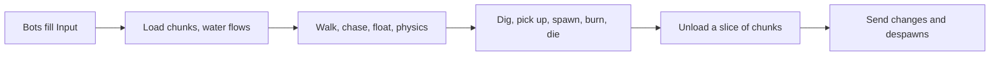

import { Boxes, FlaskConical, Network, Save } from 'lucide-react';

A block world in the manner of a Minecraft server: 20 ticks a second, chunks generated around the players and freed
behind them, springs whose water runs downhill and carries whoever stands in it, blocks dug into items, zombies that
rise at night and burn at sunrise, only what changed sent to the clients, and the world saved when the server stops.
Fifty bots play a minute of game time. Every code block on this page is included from
[`samples/VoxelServer`](https://github.com/JasonXuDeveloper/EasyEcs/tree/master/samples/VoxelServer), which CI builds
and runs, comparing its output with the one shown below.

The sample is a server, but nothing in it is: the same world serves a client. A client runs the same chunks, water
and bodies to predict what happens before the server's packets arrive, and a renderer reads the positions and blocks
after each tick. The server computes the world and sends what changed; the client draws it. See
[the client and the server](#client-and-server).

## What you learn [#what-you-learn]

- **A chunk is an entity, its blocks a buffer**: a [unique index](/en/docs/guide/indexes-and-relations) finds the chunk
  at a position, a [dynamic buffer](/en/docs/guide/dynamic-buffers) of an enum holds its 8,192 blocks.
- **The world follows the players**: chunks created twice a second (`UpdateInterval`) and unloaded a twentieth at a
  time (`[ForEach(Slices = 20)]`), with [structural changes](/en/docs/guide/structural-changes) in the middle of the
  loop.
- **Water as data**: one entity per block of water, a child of its chunk ([hierarchy](/en/docs/guide/hierarchy)), with
  a `Flowing` component only while it still has to spread.
- **A tag picks who floats**: `[With<Humanoid>]` on the system that lifts players and zombies in water.
- **Send only what changed**: [`[Changed<T>]` and `Mut<T>`](/en/docs/guide/change-tracking) for blocks and positions,
  the [destroy log](/en/docs/guide/change-tracking#destroy-log) for despawns.
- **Threads where rows are independent**: [`[ForEach(Parallel = true)]`](/en/docs/guide/threading).
- **Save on stop**: [`SaveWithout` and `LoadKeeping`](/en/docs/guide/saves#restart), prefabs rebuilt by each start.
- **Measured**: [`MeasureSystems` and `DescribeSchedule`](/en/docs/guide/diagnostics).

## Run it [#run-it]

```bash
dotnet run -c Release --project samples/VoxelServer                      # 50 bots, one minute of game time
dotnet run -c Release --project samples/VoxelServer -- --players 5000    # a crowd
dotnet run -c Release --project samples/VoxelServer -- --realtime        # 20 ticks a second, like a vanilla server
dotnet run -c Release --project samples/VoxelServer -- --schedule        # the order the systems run in
```

## One tick [#one-tick]



Each box is a few systems, one job each, added in this order in `Program.cs`. No system calls another: each reads
and writes components, and the next one sees what the last one wrote.

## The data [#data]

Blocks, chunks and water first, then what moves, then the singletons. Comments say what each value means and who
writes it.

<include lang="csharp" meta='title="Components.cs"'>../../../samples/VoxelServer/Components.cs</include>

The rules are constants and two pure functions; the terrain is where a block lives and how a chunk is generated.
`BlockAt` is the one way systems read blocks, so an unloaded chunk reads as stone everywhere.

<include lang="csharp" meta='title="Rules.cs"'>../../../samples/VoxelServer/Rules.cs</include>

<include lang="csharp" meta='title="Terrain.cs"'>../../../samples/VoxelServer/Terrain.cs</include>

## Chunks around the players [#chunks]

`ChunkLoadSystem` creates what is missing and stamps the rest as seen; `ChunkUnloadSystem` destroys the chunks nobody
saw for five seconds. With `Slices = 20` each tick visits a twentieth of the chunks, so 1,300 chunks cost 65 checks a
tick instead of 1,300 once a second. Destroying a chunk destroys its water: each cell is its child.

<include lang="csharp" meta='title="Systems/Chunks.cs"'>../../../samples/VoxelServer/Systems/Chunks.cs</include>

## Water [#water]

A cell spreads once, five ticks after it appeared: down if there is air below, else sideways one level further from
its spring, up to seven blocks on flat ground. Then its `Flowing` goes, and `WaterFlowSystem` never visits it again.
`FloatSystem` finds the water at a humanoid's feet with `world.WaterIndex` and pushes it away from the spring,
harder the closer it is.

<include lang="csharp" meta='title="Systems/Water.cs"'>../../../samples/VoxelServer/Systems/Water.cs</include>

## Movement [#movement]

The walk turns input into a velocity on several threads; physics moves every body through the blocks and writes the
position through `Mut<Position>`, so a body that did not move is not stamped and not sent.

<include lang="csharp" meta='title="Systems/Movement.cs"'>../../../samples/VoxelServer/Systems/Movement.cs</include>

## Digging, items, zombies, death [#rules]

A dig turns a block into air and an item; water beside the hole flows again. Zombies are prefab instances with a
`Target`; a player who left is noticed because `TryGetEntity` fails on the stale id.

<include lang="csharp" meta='title="Systems/Items.cs"'>../../../samples/VoxelServer/Systems/Items.cs</include>

<include lang="csharp" meta='title="Systems/Zombies.cs"'>../../../samples/VoxelServer/Systems/Zombies.cs</include>

<include lang="csharp" meta='title="Systems/Health.cs"'>../../../samples/VoxelServer/Systems/Health.cs</include>

## What is sent [#replication]

Changed chunks and positions come from `[Changed<T>]`; despawns from the destroy log, since the tick the system last
ran.

<include lang="csharp" meta='title="Systems/Replication.cs"'>../../../samples/VoxelServer/Systems/Replication.cs</include>

## The program [#program]

The world with its options, the singletons and prefabs, the systems in tick order, the players, then the save on
stop and a restart from it. The tick loop and the bots are in
[`Host/`](https://github.com/JasonXuDeveloper/EasyEcs/tree/master/samples/VoxelServer/Host): plumbing, not the
lesson.

<include lang="csharp" meta='title="Program.cs"'>../../../samples/VoxelServer/Program.cs</include>

## Output [#output]

```text
tick   200 (day  ): 50 players, 82 chunks, 1961 water, 0 zombies, 0 items
tick   400 (night): 50 players, 119 chunks, 3070 water, 50 zombies, 0 items
tick   600 (day  ): 50 players, 137 chunks, 4349 water, 150 zombies, 0 items
tick   800 (day  ): 50 players, 156 chunks, 4561 water, 0 zombies, 0 items
tick  1000 (night): 50 players, 172 chunks, 5329 water, 50 zombies, 0 items
tick  1200 (day  ): 50 players, 177 chunks, 4905 water, 150 zombies, 0 items
chunks: 232 loaded, 55 unloaded, 1463 sent
blocks dug: 650; items: 650 picked up, 0 expired
zombies: 300 spawned, 150 burned, 152 hits; player deaths: 8
water: 7493 cells poured, 6248 ticks of humanoids carried
sent: 89884 position updates, 3443 despawns
restarted from the save: 50 players, 177 chunks, 4905 water, 150 zombies
```

The world, the springs, the bots and the spawns come from integer hashes, so every run prints the same, on one thread
or many. The chunks grow as the bots walk out and shrink behind them, and the water with them; three zombies per
player rise each night and are gone a second after sunrise. The timings go to stderr: the average tick against the
50 ms budget and each system's time and allocations.

## The client and the server [#client-and-server]

The split is the usual one for a networked game: the server owns the world and sends what changed, the client shows
it. Both sides can be this ECS:

- **On the server**, as here: the systems compute the world each tick, and the `Send` systems turn what changed
  (`[Changed<T>]`, the destroy log) into packets.
- **On the client**, the packets are written into a world of the same components. The same `PhysicsSystem` and
  `FloatSystem` predict the local player between two packets, and a render system reads `Position` and the chunks'
  blocks to draw them: in [Godot](/en/docs/samples/godot), the node draws right after `World.Update()` in `_PhysicsProcess`.

Components and systems that both sides need go into a shared project, like the contracts of the
[HotReload sample](/en/docs/samples/hot-reload).

## Related [#related]

<Cards>
  <Card icon={<Boxes />} title="Dynamic buffers" href="/en/docs/guide/dynamic-buffers">
    A list per entity, like a chunk's blocks, tracked like any component.
  </Card>
  <Card icon={<FlaskConical />} title="Change tracking" href="/en/docs/guide/change-tracking">
    What counts as a write, Mut&lt;T&gt;, the destroy log.
  </Card>
  <Card icon={<Network />} title="Example: a battle server" href="/en/docs/example">
    Every feature in one server, with clients that catch up.
  </Card>
  <Card icon={<Save />} title="Saves" href="/en/docs/guide/saves">
    Save a world, restart from it, leave out what each start sets.
  </Card>
</Cards>
