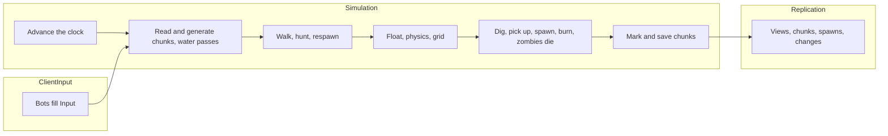
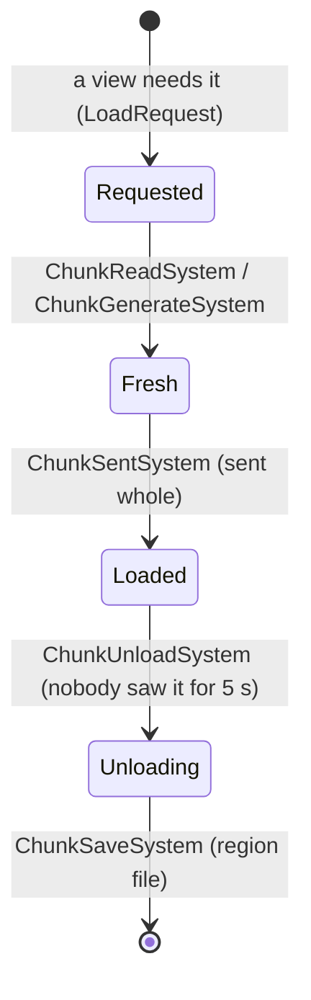
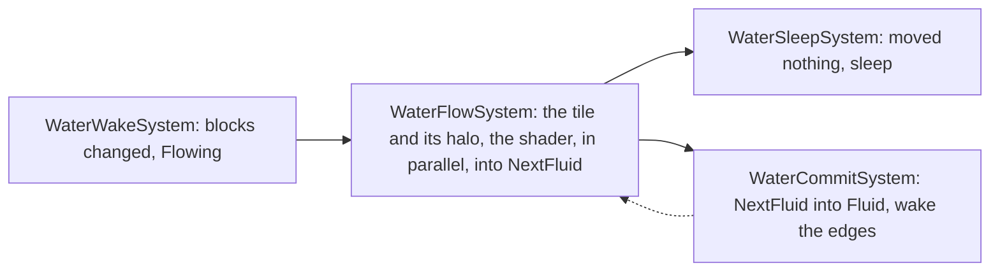

import { Boxes, FlaskConical, Network, Save } from 'lucide-react';

A block world in the manner of a Minecraft server: 20 ticks a second, chunks loaded around the players, saved to
region files behind them and read back when a player returns, water that spreads and recedes by Minecraft's rules and
carries whatever stands in it, blocks dug into items anyone can pick up, zombies that rise at night, hunt the players
near them and catch fire under the sky by day, only what changed sent to the clients, and the world saved when the
server stops. Fifty bots play a minute of game time. Every code block on this page is included from
[`samples/VoxelServer`](https://github.com/JasonXuDeveloper/EasyEcs/tree/master/samples/VoxelServer), which CI builds
and runs, comparing its output with the one shown below.

The sample is a server, but nothing in it is: the same world serves a client. A client runs the same chunks, water
and bodies to predict what happens before the server's packets arrive, and a renderer reads the positions and blocks
after each tick. See [the client and the server](#client-and-server).

## What you learn [#what-you-learn]

Each technique below has its own section, with the code that uses it.

- **A tick in three groups**: [system groups](/en/docs/guide/systems#system-groups) for input, simulation and
  replication, each run by its own `world.Update<TGroup>()` ([one tick](#one-tick)).
- **One system, one job**: 35 small systems, each reacting to one piece of data (a tag, a changed component, a
  request entity) and handing data to the next; none calls another.
- **A chunk is an entity, its state presence bits**: a [unique index](/en/docs/guide/indexes-and-relations#unique-keys)
  finds the chunk at a position, [dynamic buffers](/en/docs/guide/dynamic-buffers) hold its blocks and water, and every
  chunk comes from one [prefab](/en/docs/guide/prefabs) with all its tags, so a change of state never moves it to
  another table ([a chunk's life](#chunks)).
- **Chunks that follow the players and are kept**: a group of entities saved and loaded back with
  [`SaveEntities` and `LoadEntities`](/en/docs/guide/migration-and-unload), after the pass ([a chunk's life](#chunks)).
- **Areas of interest without polling**: four systems react to four changes; who sees a chunk is counted through an
  index, and a [cleanup component](/en/docs/guide/cleanup-and-disable) keeps where a destroyed entity was seen until
  its despawn is sent ([areas of interest](#aoi)).
- **Water as GPU passes**: a parallel SIMD shader over a tile of the grid that loads its own halo, then a commit, with a
  stencil that skips dry rows and buffers that are not cleared ([water](#water)).
- **SIMD where the data is a grid or a column**: the water, the height map, fire damage in a
  [batch method](/en/docs/guide/systems#batch-methods) ([SIMD](#simd)).
- **Time and state are data**: cooldowns, fires and an item's age are the tick they end; digging, death and respawn
  are components and entities ([items](#items), [zombies](#zombies)).
- **A sorted scoreboard**: an [ordered index](/en/docs/guide/indexes-and-relations#ordered-index) of the players by
  blocks dug ([leaderboard](#leaderboard)).
- **Send only what changed**: [`[Changed<T>]`, `[ChangedAny<..>]`](/en/docs/guide/change-tracking#changed-any),
  [`Maybe<T>` and `ReadOnlyMaybe<T>`](/en/docs/guide/systems#maybe) and a [bulk removal](/en/docs/guide/bulk)
  ([replication](#replication)).
- **Save on stop, allocation-free buffers**: [`SaveWithout` and `LoadKeeping`](/en/docs/guide/saves#restart) into a
  reused writer, and a buffer pool sized for chunks ([the program](#program)).
- **Measured**: [`MeasureSystems` and `DescribeSchedule`](/en/docs/guide/diagnostics).

## Where the ideas come from [#ideas]

The sample borrows from three places. You do not need to know them to read the code; this is what each one means here.

**A vanilla Minecraft server.** The game logic is modelled on it: 20 ticks a second (a tick is 50 ms), the world cut
into chunks of 16 x 16 columns that are loaded around the players and written to *region files* when nobody is near,
a *height map* per chunk (the highest solid block of each column, so "is the sky above this block" is one read),
water levels from a spring down to 1 at the edge of a run, zombies that spawn 24 blocks away at night and burn by day.
The differences are listed [below](#vanilla).

**The GPU.** The water borrows three ideas from how a graphics card draws:

- A *fragment shader* is a small function the GPU runs once per pixel, all pixels at once, reading the pixel's
  neighbours from a texture and writing only its own pixel. The water step is that function per block: the next level
  of a block from its own and its six neighbours', and nothing else, so 16 blocks go through one `Vector128<byte>`
  and chunks run on several threads.
- A *stencil* is a mask that decides which pixels the shader runs on at all. Here a dry row of 16 blocks with no
  water above or beside it is skipped: nothing can flow into it.
- *Ping-pong buffers*: a pass reads one buffer and writes another, then the two swap, so no pixel reads a neighbour
  already updated in the same pass. The step reads `Fluid` and writes `NextFluid`, and a commit copies it back once
  every chunk has stepped. Like a GPU's targets, neither is cleared between passes: the shader writes every texel
  it later reads.

**Data-oriented ECS.** "Who is near whom" is an index from a cell to the entities in it, kept by the system that
moves them, and every change of state is data another system reacts to, not a call.

## Run it [#run-it]

```bash
dotnet run -c Release --project samples/VoxelServer                      # 50 bots, one minute of game time
dotnet run -c Release --project samples/VoxelServer -- --players 2000    # a crowd
dotnet run -c Release --project samples/VoxelServer -- --realtime        # 20 ticks a second, like a vanilla server
dotnet run -c Release --project samples/VoxelServer -- --schedule        # the order the systems run in
```

## One tick: three groups [#one-tick]



A tick has three parts, and each is a [system group](/en/docs/guide/systems#system-groups): a struct that names it,
and `[UpdateInGroup<T>]` on its systems.

<include lang="csharp" meta='title="Groups.cs"'>../../../samples/VoxelServer/Groups.cs</include>

The host runs the groups in order, each with its own update. A real server could run `ClientInput` as the packets
arrive and `Replication` at a lower rate for far players, without touching a system.

<include lang="csharp" meta='title="Host/Server.cs"'>../../../samples/VoxelServer/Host/Server.cs#tick</include>

Inside a group the systems run in the order they were added. No system calls another: each reads and writes
components, and the next one sees what the last one wrote. Most are a few lines: a system that does two things is
two systems.

<include lang="csharp" meta='title="Program.cs"'>../../../samples/VoxelServer/Program.cs#systems</include>

## The data [#data]

The components, one file per part of the world. Comments say what each value means and who writes it. A chunk is an
entity: its `Chunk` key is a [direct-indexed](/en/docs/guide/indexes-and-relations#direct-index) unique key
(`world.ChunkIndex`, a chunk's slot its position modulo 64, so a lookup reads one array entry),
its 8,192 blocks and their water two byte buffers, and the water passes keep their own data on it (`NextFluid`,
`FluidStep`); `Chunk` is also the grid's tile shape (`ITile<ChunkPos>`).

<include lang="csharp" meta='tab="Chunks"'>../../../samples/VoxelServer/Components/Chunks.cs</include>

<include lang="csharp" meta='tab="Water"'>../../../samples/VoxelServer/Components/Water.cs</include>

<include lang="csharp" meta='tab="Bodies"'>../../../samples/VoxelServer/Components/Bodies.cs</include>

<include lang="csharp" meta='tab="Players"'>../../../samples/VoxelServer/Components/Players.cs</include>

<include lang="csharp" meta='tab="Mobs"'>../../../samples/VoxelServer/Components/Mobs.cs</include>

<include lang="csharp" meta='tab="Singletons"'>../../../samples/VoxelServer/Components/Singletons.cs</include>

Time is data too: a zombie's `Cooldown` and `Burning` hold the tick they end, an item's `Dropped` the tick it fell,
so nothing counts them down each tick. A value that changes by one every tick for every entity is work a system does
for nothing; the tick it ends is written once and compared when it matters.

The rules are constants and a few pure functions; the terrain is where a block lives, how a chunk is generated, and
the reads every system shares. `Nearby` reads the blocks, the water and the height map around one body: it looks up
the body's chunk in the unique index once and reads the next blocks of that chunk straight from its buffers, so
physics pays one lookup a body, not one per block. An unloaded chunk reads as stone, so nothing falls out of the world.

<include lang="csharp" meta='tab="Rules.cs"'>../../../samples/VoxelServer/Rules.cs</include>

<include lang="csharp" meta='tab="Terrain.cs"'>../../../samples/VoxelServer/Terrain.cs</include>

## A chunk's life [#chunks]



Each step is one system and each state is data. The chunks a player needs are asked for by
[`AoiViewSystem`](#aoi) as `LoadRequest` entities, one per chunk: the request is `IUniqueIndexed`, so a second player
asking finds it and asks nothing more. A request is created with the `Saved` tag, which it loses when the region
files lack its chunk: a presence bit, so all requests share one table and keep the order they came in. A pass may
not load or create entities (EECS041), so `ChunkReadSystem` (`With<Saved>`) and `ChunkGenerateSystem`
(`Without<Saved>`) serve the requests in their `OnUpdate`, after the pass: each takes up to `Rules.MaxRequests` a
tick with [`CollectIds`](/en/docs/guide/queries#collect-ids) and destroys only those; the others wait a tick. A chunk that was unloaded comes back from the region files
with `LoadEntities`, and with it the zombies and items that were in it. A chunk never seen is an instance of the chunk
prefab, its blocks written in place through the span `SetCount` returns.

<include lang="csharp" meta='title="Systems/Chunks.cs"'>../../../samples/VoxelServer/Systems/Chunks.cs#load</include>

Every chunk is an instance of one prefab with every component and tag a chunk ever has, the tags absent. So all
chunks share one table, a chunk read back included (its save keeps the columns), and `Fresh`, `Flowing` or
`Unloading` come and go as [presence bits](/en/docs/guide/structural-changes#during-a-pass): the chunk never moves to
another table. That matters beyond the cost of a move: a pass does not visit an entity that joined a matching table
after it started, so a system that wakes the chunks beside the one it visits would make the pass skip some of them.

<include lang="csharp" meta='title="Program.cs"'>../../../samples/VoxelServer/Program.cs#prefabs</include>

Unloading is the same in reverse. A chunk's `Viewers` counts the players that have it in view, kept by the AOI
systems, with the tick it last went to zero. With `Slices = 20` each tick checks a twentieth of the chunks and tags
the ones nobody has had in view for five seconds `Unloading`; `ChunkSaveSystem` then writes each with the entities in
it into one record and destroys them, so nothing ticks where no player is. A chunk a player stands in (one who just
respawned there) stays loaded. The region files are a singleton that holds a class;
[`Host/RegionFiles.cs`](https://github.com/JasonXuDeveloper/EasyEcs/tree/master/samples/VoxelServer/Host/RegionFiles.cs)
stands in for the disk, in arrays rented from the shared `ArrayPool`.

<include lang="csharp" meta='title="Systems/Chunks.cs"'>../../../samples/VoxelServer/Systems/Chunks.cs#unload</include>

## Areas of interest [#aoi]

An *area of interest* (AOI) is what a client is told about: here, the loaded chunks of the square around its player,
and the entities in them. A view is a square of chunks around the player's `ViewCenter`, so it is one value, not a
list of chunks, and whatever changes, what a client gains or loses is the difference of two squares: a strip of one
row of chunks for a step into the next chunk, the whole square for a respawn. Four systems react to four changes:

| What happens | What the client gets | System |
| --- | --- | --- |
| A player crosses into another chunk, or appears | the chunks of the strip it gains, whole with their entities (or a `LoadRequest` for those not loaded); the strip it loses is forgotten | `AoiViewSystem`, `[With<Player>, Changed<InChunk>]` |
| A player leaves | its view is released | `AoiViewSystem`, `[With<Retired>]` |
| A chunk finishes loading | the chunk and its entities, for the players around it | `AoiChunkSystem`, `[With<Fresh>]` |
| An entity crosses into another chunk, or is created | a spawn for the players that see its new chunk and not its old one, a despawn for the reverse | `AoiSpawnSystem`, `[Changed<InChunk>]` |
| An entity is destroyed | a despawn for the players that see its chunk | `AoiDespawnSystem`, `[With<Retired>]` |

Who sees a chunk is counted, never searched: every player sees `Rules.PlayerVision`, so the players that see a chunk
are the view centers in the square around it, and `ViewCenter` is indexed, so `world.ViewCenterIndex.Count(chunk)`
counts the players centered on a chunk in O(1). An entity that stays in its chunk and a player who does cost nothing
here, however many ticks go by. A player that just appeared has no `ViewCenter` yet:
[`ReadOnlyMaybe<ViewCenter>`](/en/docs/guide/systems#read-only-maybe) reads it where it is, and, unlike `Maybe<T>`, can only read,
so the indexed component is never stamped.

<include lang="csharp" meta='title="Systems/Aoi.cs"'>../../../samples/VoxelServer/Systems/Aoi.cs#aoi</include>

Every change is already data. `InChunk` is an indexed component on everything that moves, so
`world.InChunkIndex.Find(chunk)` lists the entities of a chunk and `Count(chunk)` counts them. `GridSystem` keeps it
current: `[Changed<Position>]` visits only what moved this tick, and `SetInChunkIfChanged` writes only when an entity
crosses into another chunk, so the systems that react to `[Changed<InChunk>]` see a few crossings a second.

<include lang="csharp" meta='title="Systems/Movement.cs"'>../../../samples/VoxelServer/Systems/Movement.cs#grid</include>

A crossing needs the chunk the clients knew the entity in, and a destroyed entity needs it too: by then its
components are gone. `Visible` holds it, and it is a [cleanup component](/en/docs/guide/cleanup-and-disable):
destroying an entity that has one retires it instead, keeping only its cleanup components, until a system removes the
last of them. `ViewCenter` is one as well, so a player who leaves is retired until its view is released.

`ZombieTargetSystem` uses the same index to hunt: the nearest player within the zombie's `Vision` (each prefab sets
its own), walking the chunks ring by ring from its own and stopping at the first ring that cannot hold anyone nearer.
It looks twice a second, a tenth of the zombies each tick (`Slices`), so a horde costs the same every tick.

<include lang="csharp" meta='title="Systems/Zombies.cs"'>../../../samples/VoxelServer/Systems/Zombies.cs#target</include>

## Water [#water]

Water is not a block but a second grid beside the blocks: a `DynamicBuffer<Fluid>` of one byte per block, in the same
layout. The rule is a simplified version of Minecraft's (no new sources between two springs, and water spreads every
way rather than toward the nearest drop): an open block under water fills as falling water; an open block beside
water that stands on something solid fills one level below it; everything else empties, so water recedes when its
spring goes.

It runs in passes, as a GPU draws ([where the ideas come from](#ideas)), and only on the chunks tagged `Flowing`, the
ones whose water may still move: a settled lake is not visited again until something wakes it. Each pass is its own
system in its own file (`Systems/Water/`), with one job: they hand each other data (`NextFluid`, `FluidStep`,
the `Flowing` tag) and never call one another.



**Waking.** A block change, whatever made it, is seen through the change of the block buffer
(`[Changed<DynamicBuffer<Block>>]`), so the dig knows nothing of water or of the sky. Two systems react to it:
`HeightMapSystem` computes the chunk's height map, 16 vectors of 16 columns, each layer from the bottom up overwriting
the lanes whose block is solid with its height, so after the 32 layers each lane holds the top of its column with no
branch; `WaterWakeSystem` tags the chunk and its four neighbours `Flowing`.

<include lang="csharp" meta='tab="Water/HeightMap.cs"'>../../../samples/VoxelServer/Systems/Water/HeightMap.cs</include>

<include lang="csharp" meta='tab="Water/Wake.cs"'>../../../samples/VoxelServer/Systems/Water/Wake.cs</include>

**The passes.** `WaterFlowSystem` is the shader. `Chunk` is a [tile](/en/docs/guide/high-performance#grid) of the
grid (`ITile<ChunkPos>`: 16 x 16 x 32 cells, its neighbours the chunks beside it), so the method takes the chunk's water
and blocks as `Tile<Fluid, Chunk>` and `Tile<Block, Chunk>`, and the generator finds the four neighbours once per chunk.
The layers to shade come from the `FluidCount` of the chunk and of its neighbours (through `Beside` and a
`Lookup<FluidCount>`, no search); `Load(from, to)` pads them into a texture of the thread, a ring of one block around
each layer from the facing row or column of each neighbour, and a layer under and over, as a CUDA block loads its tile
and halo into shared memory. The loop samples neighbours with no edge case and computes each row of 16 blocks in one
`Vector128<byte>`. Its neighbours are read as they were before the pass and only `NextFluid` is written, so it is a
[parallel method](/en/docs/guide/systems#parallel-methods). A few hundred chunks flow at a time, each one costing
microseconds, far under the 4,096 rows of a default chunk of a pass that writes a tracked component, so it sets
`ChunkRows = 64` and the threads take 64 chunks at a time ([chunk size](/en/docs/guide/threading#chunk-rows)). Byte
lanes are integer arithmetic: the same water on every machine.

Nothing is cleared that does not have to be. The stencil (`Rows(TileReads.Layer | TileReads.Above)`) visits only a row
with water in it, beside it or above it, and the others are not written: the step's buffer equals the water after
every commit, so a dry row is zero in it already. The texture is allocated once per thread, and the load writes every
texel the loop samples. `NextFluid` keeps its count from one step to the next, so `SetCount` neither allocates nor
clears it, and the layers the step does not shade are zero already: the steps before wrote water only on layers this
one's reach covers.

The step's result is data, `FluidStep`: `WaterSleepSystem` takes the chunks whose water moved nothing out of the
passes and gives their scratch buffer (`NextFluid`) back to the pool with `TrimExcess`, so only flowing
chunks hold them; it runs before the commit, so a chunk that settled is still woken by a neighbour whose water reached
it in the same step. `WaterCommitSystem` copies the step into the water once every chunk has stepped (each chunk steps
from its neighbours' water before the step, whatever order the chunks are visited in), updates `FluidCount` and wakes
the chunks beside the edges that changed.

<include lang="csharp" meta='tab="Water/Flow.cs"'>../../../samples/VoxelServer/Systems/Water/Flow.cs</include>

<include lang="csharp" meta='tab="Water/Sleep.cs"'>../../../samples/VoxelServer/Systems/Water/Sleep.cs</include>

<include lang="csharp" meta='tab="Water/Commit.cs"'>../../../samples/VoxelServer/Systems/Water/Commit.cs</include>

{/* TODO(water overlap): the planned push-halo design (a chunk hands its edges to its neighbours when they change,
instead of each flowing chunk gathering them every step) and the MPI-style interior/ring overlap go here, with the
Flow changes; then guide/high-performance#grid. Copying only the changed edges was measured and dropped
(decisions#d73-survey-items-not-added). */}

`FloatSystem` lifts whatever stands in water, players, zombies and items, and pushes it along the slope of the water
toward the lower water around it, weaker the lower the water: full next to the spring or under falling water, an
eighth at the edge of a run. It visits the chunks, skips the dry ones by their `FluidCount`, and finds the bodies of
the others through the index of entities by chunk, so the water of a body's block is the loop's own row.

<include lang="csharp" meta='title="Systems/Water/Float.cs"'>../../../samples/VoxelServer/Systems/Water/Float.cs</include>

## Movement [#movement]

The walk turns input into a velocity. Each row depends only on itself and the method holds no `World`, so it is a
parallel method; the runner times the split and keeps it only while it makes the pass faster.

<include lang="csharp" meta='title="Systems/Movement.cs"'>../../../samples/VoxelServer/Systems/Movement.cs#walk</include>

Physics moves every body through the blocks and writes the position through `Mut<Position>`: `SetIfChanged` stamps
the row only when the position changed, so a body standing still is not sent. A body at rest, on the ground with no
velocity and the ground still under it, is left as it is after one block lookup. It stays on one thread because it
reads the blocks through `World` (the chunk index), and a parallel method may not hold the world (EECS010).

<include lang="csharp" meta='title="Systems/Movement.cs"'>../../../samples/VoxelServer/Systems/Movement.cs#physics</include>

## Digging and items [#items]

A dig turns a block into air and an item, grass into dirt as in Minecraft, and adds one to the digger's `Score` (the
[leaderboard](#leaderboard)). The buffer is read through `chunk.Block[slot]` and written through `chunk.WriteBlock()`,
so only a dig stamps the chunk, and the water and the height map around it follow from that stamp.

<include lang="csharp" meta='title="Systems/Items.cs"'>../../../samples/VoxelServer/Systems/Items.cs#dig</include>

After the pickup delay an item goes to any player standing on it, found through the index of view centers of the
chunks its pickup range touches. The stacks of its kind grow, free slots take the rest, and what does not fit stays on
the ground. The inventory is read before it is written, so a full inventory is not stamped. An item knows the tick it
was dropped (`Dropped`), indexed in order, so `ItemExpirySystem` walks the items from the oldest with
`DroppedIndex.Range(...)` and stops at the first with time left: a tick visits the items that expire, not every item.

<include lang="csharp" meta='tab="Pickup"'>../../../samples/VoxelServer/Systems/Items.cs#pickup</include>

<include lang="csharp" meta='tab="Expiry"'>../../../samples/VoxelServer/Systems/Items.cs#expiry</include>

## Zombies and death [#zombies]

At night a zombie rises near each player every five seconds, 24 to 32 blocks away as in Minecraft, on top of the
column and out of the water: an instance of the zombie prefab with its own `Position`.

<include lang="csharp" meta='title="Systems/Zombies.cs"'>../../../samples/VoxelServer/Systems/Zombies.cs#spawn</include>

A zombie walks toward the player it hunts and hits it when close; a player who left is noticed because
`TryGetEntity` fails on the stale id. Its `Cooldown` is the tick it may hit again, so a zombie that waits costs one
comparison.

<include lang="csharp" meta='tab="Chase"'>../../../samples/VoxelServer/Systems/Zombies.cs#chase</include>

<include lang="csharp" meta='tab="Attack"'>../../../samples/VoxelServer/Systems/Zombies.cs#attack</include>

Fire is three systems, one job each, all at the fire's cadence (`[UpdateInterval(Rules.BurnEvery)]`):
`SunlightSystem` sets `Burning` on a zombie under the open sky by day (the height map says whether the sky is above
it), `FireDamageSystem` hurts the burning, and `ExtinguishSystem` puts out the fires that burned down or walked into
water. `Burning` is in the zombie prefab, so catching fire flips a presence bit. The hurt is its own system because
`Health` is tracked and a batch method stamps the whole run it writes: written only on the ticks that hurt, the
death systems below find nothing to do on the others.

<include lang="csharp" meta='tab="Sunlight"'>../../../samples/VoxelServer/Systems/Zombies.cs#sunlight</include>

<include lang="csharp" meta='tab="Burn"'>../../../samples/VoxelServer/Systems/Zombies.cs#burn</include>

Dying is a `Health` of zero, handled by one system per kind: zombies go, players drop their inventory where they
died and respawn. `Health` is `ITracked`, so both systems take `[Changed<Health>]` and visit only the healths written
since they last ran. `Mut<T>` writes the health, the position and the inventory only for the players who respawn.

<include lang="csharp" meta='title="Systems/Health.cs"'>../../../samples/VoxelServer/Systems/Health.cs</include>

## SIMD where the data is a grid or a column [#simd]

Three shapes of data in this server suit SIMD:

- **A grid with a shader**: the water, above. Each block's next level is the same function of its neighbours, and
  the grid is a byte buffer, so 16 blocks go through each instruction.
- **A grid reduced along an axis**: the height map, the top of each of 256 columns, 16 columns per instruction and one
  `ConditionalSelect` per layer, no branch. Its 256 bytes are rewritten 32 times, so they stay on the stack and are
  copied into the buffer once: a buffer's array read and written 32 times is an order of magnitude slower.
- **A column of the same change**: fire damage takes one point from every burning zombie. A
  [batch method](/en/docs/guide/systems#batch-methods) gets a run of rows as spans, and `Vector<int>` changes 8 of
  them per instruction on AVX2 (4 on Arm). The JIT does not vectorize these loops by itself, so the method does it;
  integer lanes give the same result on every machine.

The other systems do something different per entity: physics looks up the blocks around each body, the hunt walks
an index, the chase reads another entity's position. A vector does not help a loop of lookups and branches, and the
positions are `Vector3`s, three floats next to each other, not three columns.

## A scoreboard that stays sorted [#leaderboard]

`Score` is the blocks a player dug, an `IIndexed<int>`, so `world.ScoreIndex` is an
[ordered index](/en/docs/guide/indexes-and-relations#ordered-index) of the players by score. Its key is comparable, so
the index walks in order: `Descending()` starts at the best digger. The index is kept sorted as `DigSystem` writes
the scores, so the top of the board is a walk of three entries, never a sort of every player.

<include lang="csharp" meta='title="Program.cs"'>../../../samples/VoxelServer/Program.cs#leaderboard</include>

`Range(from, to)` on the same index lists the players between two scores, for a page of the board.

## What is sent [#replication]

Changed chunks come from
[`[ChangedAny<DynamicBuffer<Block>, DynamicBuffer<Fluid>>]`](/en/docs/guide/change-tracking#changed-any): a chunk
whose blocks or water changed since the system last ran, and no other, goes to the players that have it in view (its
`Viewers`). A `Fresh` chunk went whole already; `ChunkSentSystem` then clears the tag of every chunk in one
[bulk call](/en/docs/guide/bulk), `World.RemoveAll<Fresh>()`, whole words of presence bits at once.

<include lang="csharp" meta='title="Systems/Replication.cs"'>../../../samples/VoxelServer/Systems/Replication.cs#chunks</include>

Moved entities come from `[Changed<Position>]`, stamped by `Mut<Position>` above. An update carries the health bar
of the entities that have one: [`Maybe<Health>`](/en/docs/guide/systems#maybe) reads it where the entity has a
`Health`, so players, zombies and items are sent by one method, and the query does not require `Health`. The clock
is the first system of the simulation, not of the replication, so a server that replicates less often keeps game time.

<include lang="csharp" meta='tab="Entities"'>../../../samples/VoxelServer/Systems/Replication.cs#entities</include>

<include lang="csharp" meta='tab="Clock"'>../../../samples/VoxelServer/Systems/Replication.cs#clock</include>

## The program [#program]

The world with its options: [`MeasureSystems`](/en/docs/guide/diagnostics) for the timings (`--schedule` prints
`DescribeSchedule`), and a [buffer pool](/en/docs/guide/dynamic-buffers#what-it-costs) big enough for a chunk's
buffers, so a chunk loaded reuses the lists of one that was unloaded, and a chunk woken those of one that settled.

<include lang="csharp" meta='title="Program.cs"'>../../../samples/VoxelServer/Program.cs#options</include>

The players are instances of the player prefab with their own client, position and chunk. The tick loop, the bots
and the region files are in [`Host/`](https://github.com/JasonXuDeveloper/EasyEcs/tree/master/samples/VoxelServer/Host):
plumbing, not the lesson.

<include lang="csharp" meta='title="Program.cs"'>../../../samples/VoxelServer/Program.cs#players</include>

On stop the world is saved without its prefabs and region files, which every start sets up
([`SaveWithout`](/en/docs/guide/saves#restart)); a restarted world sets them up, then loads the save beside them
(`LoadKeeping`). The save goes into a `NinoArrayBufferWriter`, which `Save` writes in place with no copy; a server
that saves often keeps one and reuses it.

<include lang="csharp" meta='title="Program.cs"'>../../../samples/VoxelServer/Program.cs#save</include>

## Output [#output]

```text
tick   200 (day  ): 50 players, 84 chunks, 3483 water, 0 zombies, 69 items
tick   400 (night): 50 players, 107 chunks, 4688 water, 45 zombies, 110 items
tick   600 (day  ): 50 players, 131 chunks, 8914 water, 129 zombies, 131 items
tick   800 (day  ): 50 players, 124 chunks, 9586 water, 4 zombies, 117 items
tick  1000 (night): 50 players, 137 chunks, 9500 water, 40 zombies, 114 items
tick  1200 (day  ): 50 players, 134 chunks, 10154 water, 126 zombies, 98 items
chunks: 163 generated, 64 unloaded, 35 loaded back
blocks dug: 664; items: 405 picked up, 251 expired
zombies: 255 spawned, 129 burned, 456 hits; player deaths: 55
water: 13221 cells filled, 16079 ticks of bodies carried
view: 4351 chunks sent, 3101 forgotten; 45566 entities came into view, 13391 left it, 24094 despawned
sent: 37090 block updates, 2954333 entity updates (51310 KiB)
top diggers: player 37 (24) player 8 (24) player 35 (22)
restarted from the save: 50 players, 134 chunks, 10154 water, 126 zombies; 29 chunks in the region files
```

The world, the springs, the bots and the spawns come from integer hashes, so every run prints the same. The chunks
grow as the bots walk out; the ones left behind go to the region files and come back when a bot returns. The timings
go to stderr: the average tick against the 50 ms budget and each system's time and allocations.

## How it differs from a vanilla server [#vanilla]

- Days are 30 seconds, items last 15 seconds and fire hurts four times as often, so a one-minute run sees all of it.
- The server moves the players from their input; a vanilla server trusts the client's movement and checks it.
- One distance decides which chunks are loaded and simulated around a player and which entities it sees: those of
  its chunks. A vanilla server tracks each entity within a range of its kind, checked every tick.
- No mob cap, no light levels, no despawn of far mobs, no keep-alive and no players joining or leaving.

## What it does not use, and why [#not-used]

- **`GroupBy` by chunk.** Splitting the tables by chunk would make "the entities of a chunk" contiguous, but an entity
  that crosses a chunk would move its row to another table, several times a second for every walker. The `InChunk`
  index costs one index update on the crossing and nothing else.
- **Cleanup components to save a chunk when it unloads.** A retired entity loses its other components, its buffers
  among them, so there is nothing left to save by then. The chunk is saved before it is destroyed. (A cleanup
  component does carry the despawns, `Visible`: what it keeps is one chunk position.)
- **The destroy log for despawns.** The log holds the ids of destroyed entities and when, not where they were, and a
  despawn goes to the players that saw the entity's chunk. `Visible` keeps the chunk for exactly as long as needed.
- **A set of chunks or entities per player.** A client has the chunks of the square around its view center and the
  entities in them, so a set per player would repeat the square and the grid and be written on every crossing near
  it: in a crowd of a thousand, a thousand sets per crossing. The view center and the index count the same in O(1).
- **A counter per timer.** A cooldown, a fire or an item's age counted down each tick is a write per entity per tick;
  the tick it ends is one write, and the ordered index finds the items that expire without visiting the others.
- **Parallel physics and the hunt.** They read the world through its indexes, and a parallel method may not hold the
  world (EECS010). Physics was measured on threads with its own chunk lookups and was no faster: its time goes to
  lookups and branches, which more cores do not shorten. The water is parallel because its shader reads only its row.
- **A stencil of solid blocks for collisions.** One bit per block would let physics test a box in a few reads, but
  keeping the mask current cost more each tick than the block reads it saved: a body reads a handful of blocks.

## The client and the server [#client-and-server]

The split is the usual one for a networked game: the server owns the world and sends what changed, the client shows
it. Both sides can be this ECS:

- **On the server**, as here: the systems compute the world each tick, and the `Send` systems turn what changed
  (`[Changed<T>]`, the strips a view gains and loses, crossings and retired entities) into packets.
- **On the client**, the packets are written into a world of the same components. The same `PhysicsSystem` and
  `FloatSystem` predict the local player between two packets, and a render system reads `Position` and the chunks'
  blocks to draw them: in [Godot](/en/docs/samples/godot), the node draws right after `World.Update()` in `_PhysicsProcess`.

Components and systems that both sides need go into a shared project, like the contracts of the
[HotReload sample](/en/docs/samples/hot-reload).

## Related [#related]

<Cards>
  <Card icon={<Boxes />} title="Dynamic buffers" href="/en/docs/guide/dynamic-buffers">
    A list per entity, like a chunk's blocks, tracked like any component.
  </Card>
  <Card icon={<FlaskConical />} title="Change tracking" href="/en/docs/guide/change-tracking">
    What counts as a write, Mut&lt;T&gt;, ChangedAny.
  </Card>
  <Card icon={<Network />} title="Migration and unload" href="/en/docs/guide/migration-and-unload">
    Save a group of entities and load it back, like a chunk and what is in it.
  </Card>
  <Card icon={<Save />} title="Saves" href="/en/docs/guide/saves">
    Save a world, restart from it, leave out what each start sets.
  </Card>
</Cards>
