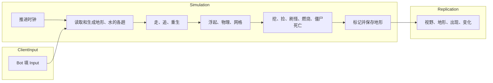
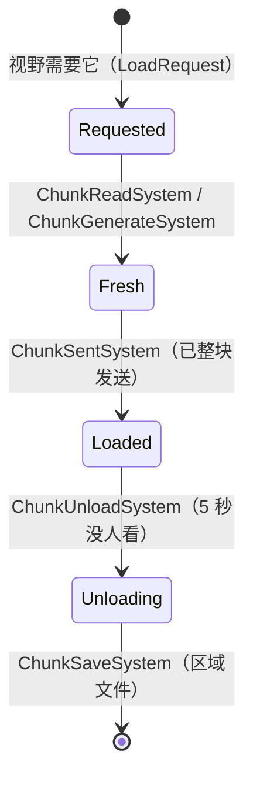
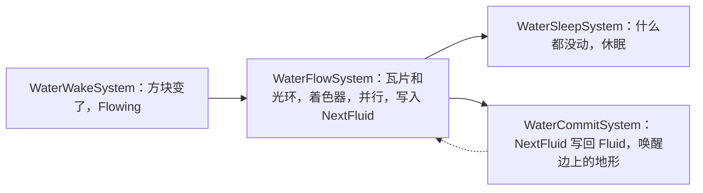

import { Boxes, FlaskConical, Network, Save } from 'lucide-react';

一个仿 Minecraft 服务器的方块世界：每秒 20 tick；玩家周围加载地形，走远后存进区域文件，玩家回来时再读回；水按 Minecraft
的规则扩散和退去，站在水里的东西会被冲走；挖下的方块变成掉落物，谁走过都能捡；僵尸夜里出现，追它看见的玩家，白天在露天会着火；
只把变了的东西发给客户端；服务器停机时存档。50 个 bot 玩一分钟游戏时间。本页所有代码都直接引用自
[`samples/VoxelServer`](https://github.com/JasonXuDeveloper/EasyEcs/tree/master/samples/VoxelServer)。CI 会构建并运行它，
拿输出和下面的结果逐行比对。

它写的是服务器，但里面没有一处只属于服务器：同一个 World 也能放在客户端。客户端跑同样的地形、水和刚体，在服务器的包到达之前先预测；
每个 tick 之后，渲染层读位置和方块画出来。见[客户端与服务器](#client-and-server)。

## 你会学到 [#what-you-learn]

下面每一项都有单独的一节，附上用到它的代码。

- **一个 tick 分三个组**：输入、模拟、同步各是一个[系统组](/zh/docs/guide/systems#system-groups)，各由自己的
  `world.Update<TGroup>()` 运行（[一个 tick](#one-tick)）。
- **一个系统只做一件事**：35 个小系统，每个只响应一份数据（一个标签、一个变了的组件、一个请求实体），再把数据交给下一个；没有系统调用别的系统。
- **地形是实体，它的状态是存在位**：[唯一索引](/zh/docs/guide/indexes-and-relations#unique-keys)找到某个位置的地形，
  [动态缓冲](/zh/docs/guide/dynamic-buffers)装它的方块和水，所有地形都来自同一个带全部标签的[预制体](/zh/docs/guide/prefabs)，
  所以状态变化从不把它搬到另一张表（[地形的一生](#chunks)）。
- **地形跟着玩家走，并且会存下来**：用 [`SaveEntities` 和 `LoadEntities`](/zh/docs/guide/migration-and-unload)
  在遍历之后存下一组实体再读回（[地形的一生](#chunks)）。
- **不轮询的视野管理**：四个系统响应四种变化；谁看得见一片地形通过索引数出来，被销毁的实体在哪里被看见，由一个
  [清理组件](/zh/docs/guide/cleanup-and-disable)留到它的消失包发出为止（[视野](#aoi)）。
- **水按 GPU 的方式分趟算**：一个在网格瓦片上自己加载光环的并行 SIMD 着色器，然后提交；模板跳过干的行，缓冲不清零（[水](#water)）。
- **数据是网格或一列时用 SIMD**：水、高度图，以及[批量方法](/zh/docs/guide/systems#batch-methods)里的火焰伤害（[SIMD](#simd)）。
- **时间和状态都是数据**：冷却、着火、掉落物的存在时间都是它们结束的 tick；挖掘、死亡、重生都是组件和实体（[掉落物](#items)、[僵尸](#zombies)）。
- **自动排好序的排行榜**：按挖掘数索引玩家的[有序索引](/zh/docs/guide/indexes-and-relations#ordered-index)（[排行榜](#leaderboard)）。
- **只下发变了的东西**：[`[Changed<T>]`、`[ChangedAny<..>]`](/zh/docs/guide/change-tracking#changed-any)、
  [`Maybe<T>` 和 `ReadOnlyMaybe<T>`](/zh/docs/guide/systems#maybe)，以及一次[批量移除](/zh/docs/guide/bulk)（[下发](#replication)）。
- **停机存档、不分配的缓冲**：[`SaveWithout` 和 `LoadKeeping`](/zh/docs/guide/saves#restart) 写进一个复用的 writer，
  缓冲池按地形的大小设置（[程序](#program)）。
- **可测量**：[`MeasureSystems` 和 `DescribeSchedule`](/zh/docs/guide/diagnostics)。

## 思路来自哪里 [#ideas]

这个示例借鉴了三个地方。不了解它们也能读懂代码；下面说明每个在这里指什么。

**原版 Minecraft 服务器。** 游戏逻辑照它来：每秒 20 tick（一个 tick 50 ms）；世界切成 16 x 16 列的地形，玩家周围加载，
没人在附近时写进*区域文件*；每片地形一张*高度图*（每一列最高的实心方块，所以“这个方块上面是不是天空”只读一次）；
水位从泉眼往外递减到水流末端的 1；僵尸夜里在 24 格外出现，白天着火。不同之处见[下面](#vanilla)。

**GPU。** 水借用了显卡画图的三个做法：

- *片元着色器*是 GPU 对每个像素运行一次的小函数，所有像素同时算：它从纹理里读像素的邻居，只写自己这个像素。水的一步就是这样一个
  按方块的函数：一个方块的下一个水位，只由它自己和六个邻居的水位决定，别的都不看，所以 16 个方块走一个 `Vector128<byte>`，
  各个地形也能在多个线程上跑。
- *模板（stencil）*是一张遮罩，决定着色器到底在哪些像素上运行。这里一行 16 个方块如果自己、上面和旁边都没有水，就直接跳过：水不可能流进来。
- *乒乓缓冲*：一趟读一个缓冲、写另一个，然后两者交换，所以没有像素会读到同一趟里已经更新过的邻居。这一步读 `Fluid`、写 `NextFluid`，
  等所有地形都走完，提交再把它拷回去。和 GPU 的渲染目标一样，两趟之间都不清零：着色器会写满它之后要读的每个纹素。

**面向数据的 ECS。** “谁在谁附近”是一个从格子到其中实体的索引，由移动它们的系统维护；每次状态变化都是另一个系统响应的数据，而不是一次调用。

## 运行 [#run-it]

```bash
dotnet run -c Release --project samples/VoxelServer                      # 50 个 bot，一分钟游戏时间
dotnet run -c Release --project samples/VoxelServer -- --players 2000    # 一大群人
dotnet run -c Release --project samples/VoxelServer -- --realtime        # 像原版服务器一样每秒 20 tick
dotnet run -c Release --project samples/VoxelServer -- --schedule        # 系统的运行顺序
```

## 一个 tick：三个组 [#one-tick]



一个 tick 分三部分，每部分是一个[系统组](/zh/docs/guide/systems#system-groups)：一个起名用的 struct，加上它的系统上的 `[UpdateInGroup<T>]`。

<include lang="csharp" meta='title="Groups.cs"'>../../../samples/VoxelServer/Groups.cs</include>

宿主按顺序运行这三个组，每组各 Update 一次。真实服务器可以让 `ClientInput` 随包到达就运行，对远处的玩家降低 `Replication` 的频率，
系统一行都不用改。

<include lang="csharp" meta='title="Host/Server.cs"'>../../../samples/VoxelServer/Host/Server.cs#tick</include>

组内的系统按添加顺序运行。系统之间不互相调用：每个系统读写组件，下一个系统看到上一个写下的结果。大多数系统只有几行：做两件事的系统就拆成两个。

<include lang="csharp" meta='title="Program.cs"'>../../../samples/VoxelServer/Program.cs#systems</include>

## 数据 [#data]

组件按世界的各个部分分文件。注释说明每个值的含义和谁来写。地形是实体：它的键 `Chunk` 是
[直接映射](/zh/docs/guide/indexes-and-relations#direct-index)的唯一键（`world.ChunkIndex`，地形的槽位是它的坐标对 64 取模，查找只读一个数组元素），8,192 个方块和对应的水是两个字节缓冲，
水的各趟把自己的数据也放在它上面（`NextFluid`、`FluidStep`）；`Chunk` 也是网格的瓦片形状（`ITile<ChunkPos>`）。

<include lang="csharp" meta='tab="地形"'>../../../samples/VoxelServer/Components/Chunks.cs</include>

<include lang="csharp" meta='tab="水"'>../../../samples/VoxelServer/Components/Water.cs</include>

<include lang="csharp" meta='tab="物体"'>../../../samples/VoxelServer/Components/Bodies.cs</include>

<include lang="csharp" meta='tab="玩家"'>../../../samples/VoxelServer/Components/Players.cs</include>

<include lang="csharp" meta='tab="怪物"'>../../../samples/VoxelServer/Components/Mobs.cs</include>

<include lang="csharp" meta='tab="单例"'>../../../samples/VoxelServer/Components/Singletons.cs</include>

时间也是数据：僵尸的 `Cooldown` 和 `Burning` 记着它们结束的 tick，掉落物的 `Dropped` 记着它掉下的 tick，所以没有什么要每个 tick 倒数。
每个 tick 给每个实体加一减一的值，是系统在白干活；结束的 tick 写一次，到用的时候比较一下就够了。

规则是常量和几个纯函数；地形负责方块的位置、地形的生成，以及所有系统共用的读取。`Nearby` 读取一个物体周围的方块、水和高度图：
它在唯一索引里查一次物体所在的地形，之后同一地形的方块直接从缓冲读，所以物理每个物体只查一次，而不是每个方块查一次。
未加载的地形读出来是石头，所以什么都不会掉出世界。

<include lang="csharp" meta='tab="Rules.cs"'>../../../samples/VoxelServer/Rules.cs</include>

<include lang="csharp" meta='tab="Terrain.cs"'>../../../samples/VoxelServer/Terrain.cs</include>

## 地形的一生 [#chunks]



每一步是一个系统，每个状态是数据。玩家需要的地形由 [`AoiViewSystem`](#aoi) 请求，记成 `LoadRequest` 实体，每片地形一个：
请求带 `[UniqueKey]`，第二个要它的玩家能找到它，就不再重复请求。请求创建时带着 `Saved` 标签，区域文件里没有这片地形时去掉它：
这是存在位，所以所有请求都在同一张表里，保持到来的顺序。遍历期间不能加载或创建实体（EECS041），所以 `ChunkReadSystem`（`With<Saved>`）
和 `ChunkGenerateSystem`（`Without<Saved>`）在遍历之后的 `OnUpdate` 里处理这些请求：每个 tick 各用
[`CollectIds`](/zh/docs/guide/queries#collect-ids) 最多取 `Rules.MaxRequests` 个，只销毁这些，其余的等下一个 tick。卸载过的地形用 `LoadEntities` 从区域文件读回，里面的僵尸和掉落物也一起回来；
从没见过的地形是地形预制体的一个实例，方块通过 `SetCount` 返回的 span 原地写入。

<include lang="csharp" meta='title="Systems/Chunks.cs"'>../../../samples/VoxelServer/Systems/Chunks.cs#load</include>

每片地形都是同一个预制体的实例，这个预制体带着地形以后会有的所有组件和标签，标签处于不存在状态。所以所有地形共用一张表，
读回的地形也一样（它的存档保留了这些列），`Fresh`、`Flowing`、`Unloading` 的来去只是翻[存在位](/zh/docs/guide/structural-changes#during-a-pass)：
地形从不搬到另一张表。这不只是省一次搬动的开销：遍历不会访问开始之后才加入匹配表的实体，一个系统要是唤醒正在访问的地形旁边的地形，
遍历就会漏掉其中一些。

<include lang="csharp" meta='title="Program.cs"'>../../../samples/VoxelServer/Program.cs#prefabs</include>

卸载是反过来的同一套做法。地形的 `Viewers` 记着视野里有它的玩家数，由视野系统维护，并记下它最近一次归零的 tick。
`Slices = 20` 让每个 tick 检查二十分之一的地形，五秒都没人看着的打上 `Unloading` 标签；`ChunkSaveSystem` 再把每片地形连同其中的实体
写成一条记录并销毁，所以没有玩家的地方什么都不跑。有玩家站着的地形（比如刚在那里重生的玩家）不会卸载。区域文件是一个装着类的单例；
[`Host/RegionFiles.cs`](https://github.com/JasonXuDeveloper/EasyEcs/tree/master/samples/VoxelServer/Host/RegionFiles.cs)
代替磁盘，用的是从共享 `ArrayPool` 租来的数组。

<include lang="csharp" meta='title="Systems/Chunks.cs"'>../../../samples/VoxelServer/Systems/Chunks.cs#unload</include>

## 视野 [#aoi]

*视野*（area of interest，AOI）是告诉客户端的范围：这里是它的玩家周围那个正方形里已加载的地形，以及其中的实体。视野是以玩家的
`ViewCenter` 为中心的一个正方形地形范围，所以它是一个值，不是一串地形；不管发生什么，客户端多出和少掉的都是两个正方形的差：
走进下一片地形是一行宽的一条地形，重生则是整个正方形。四个系统响应四种变化：

| 发生了什么 | 客户端收到什么 | 系统 |
| --- | --- | --- |
| 玩家跨进另一片地形，或出现 | 多出的那条地形整块发送，带着其中的实体（没加载的记成 `LoadRequest`）；少掉的那条让客户端忘掉 | `AoiViewSystem`，`[With<Player>, Changed<InChunk>]` |
| 玩家离开 | 它的视野被释放 | `AoiViewSystem`，`[With<Retired>]` |
| 一片地形加载完 | 地形和其中的实体，发给周围的玩家 | `AoiChunkSystem`，`[With<Fresh>]` |
| 实体跨进另一片地形，或刚被创建 | 看得见新地形、看不见旧地形的玩家收到出现包，反过来的收到消失包 | `AoiSpawnSystem`，`[Changed<InChunk>]` |
| 实体被销毁 | 看得见它所在地形的玩家收到消失包 | `AoiDespawnSystem`，`[With<Retired>]` |

谁看得见一片地形是数出来的，从不搜索：每个玩家的视野都是 `Rules.PlayerVision`，所以看得见一片地形的玩家，就是以它为中心的正方形里的
视野中心；`ViewCenter` 带索引，`world.ViewCenterIndex.Count(chunk)` 以 O(1) 数出中心落在某片地形的玩家。待在原地形的实体和玩家
在这里没有任何开销，不管过多少个 tick。刚出现的玩家还没有 `ViewCenter`：[`ReadOnlyMaybe<ViewCenter>`](/zh/docs/guide/systems#read-only-maybe)
在有的时候读它，而且和 `Maybe<T>` 不同，它只能读，所以这个带索引的组件从不被打 tick。

<include lang="csharp" meta='title="Systems/Aoi.cs"'>../../../samples/VoxelServer/Systems/Aoi.cs#aoi</include>

每种变化本来就是数据。`InChunk` 是一个带索引的组件，挂在所有会动的东西上，所以 `world.InChunkIndex.Find(chunk)` 列出一片地形里的实体，
`Count(chunk)` 数出它们。`GridSystem` 让它保持最新：`[Changed<Position>]` 只访问这个 tick 移动过的实体，`SetInChunkIfChanged`
只在实体跨进另一片地形时才写，所以响应 `[Changed<InChunk>]` 的系统每秒只看到几次跨地形。

<include lang="csharp" meta='title="Systems/Movement.cs"'>../../../samples/VoxelServer/Systems/Movement.cs#grid</include>

跨地形时要知道客户端原先在哪片地形看见这个实体；被销毁的实体也要知道，而那时它的组件已经没了。`Visible` 记着这片地形，它是一个
[清理组件](/zh/docs/guide/cleanup-and-disable)：销毁带清理组件的实体时，实体会退休而不是消失，只留下清理组件，直到某个系统去掉最后一个。
`ViewCenter` 也是清理组件，所以离开的玩家会一直处于退休状态，直到它的视野被释放。

`ZombieTargetSystem` 用同一个索引找目标：僵尸 `Vision` 范围内最近的玩家（每个预制体设置自己的范围），从它自己的地形一圈一圈往外走，
走到不可能有更近玩家的那一圈就停。它每秒看两次，每个 tick 只看十分之一的僵尸（`Slices`），所以尸潮再大，每个 tick 的开销也一样。

<include lang="csharp" meta='title="Systems/Zombies.cs"'>../../../samples/VoxelServer/Systems/Zombies.cs#target</include>

## 水 [#water]

水不是一种方块，而是方块旁边的第二个网格：每个方块一个字节的 `DynamicBuffer<Fluid>`，布局与方块相同。规则是 Minecraft 的简化版
（两个泉眼之间不会生出新水源，水向四面扩散而不是流向最近的落差）：水下面的空格变成下落的水；水旁边、脚下踩着实心方块的空格，
水位比它低一级；其余的都变空，所以泉眼没了水就会退。

它像 GPU 画图一样分趟运行（见[思路来自哪里](#ideas)），而且只在打了 `Flowing` 标签、水还可能动的地形上跑：静止的湖在被唤醒之前不会再被访问。
每一趟是一个单独的系统、一个单独的文件（`Systems/Water/`），只做一件事：它们靠数据交接（`NextFluid`、`FluidStep` 和
`Flowing` 标签），从不互相调用。



**唤醒。** 方块一变，不管是谁改的，都会从方块缓冲的变化看到（`[Changed<DynamicBuffer<Block>>]`），所以挖掘本身不用知道水，也不用知道天空。
有两个系统响应它：`HeightMapSystem` 算出地形的高度图，16 个向量，每个 16 列：从下往上，每一层把方块实心的通道改写成这一层的高度，
32 层走完，每个通道就是它那一列的顶，没有分支；`WaterWakeSystem` 给这片地形和四个邻居打上 `Flowing`。

<include lang="csharp" meta='tab="Water/HeightMap.cs"'>../../../samples/VoxelServer/Systems/Water/HeightMap.cs</include>

<include lang="csharp" meta='tab="Water/Wake.cs"'>../../../samples/VoxelServer/Systems/Water/Wake.cs</include>

**各趟。** `WaterFlowSystem` 就是着色器。`Chunk` 是网格的一块[瓦片](/zh/docs/guide/grids)
（`ITile<ChunkPos>`：16 x 16 x 32 个格子，邻居是旁边的地形），所以方法以 `Tile<Fluid, Chunk>` 和 `Tile<Block, Chunk>` 接收地形的水和方块，
生成器每片地形找一次四个邻居。要算的层来自这片地形和邻居的 `FluidCount`（通过 `Beside` 和 `Lookup<FluidCount>`，不用搜索）；
`ExchangeHalo(from, to)` 把这些层填进这个线程的一张纹理，每层外面一圈一格宽的方块取自每个邻居朝向这边的那一行或一列，下面和上面各多一层，
就像 CUDA 的线程块把它的瓦片和光环载入共享内存。循环采样邻居没有边界情况；每行 16 个方块用一个 `Vector128<byte>` 算。
它读到的邻居都是这一遍之前的样子，只写 `NextFluid`，所以是[并行方法](/zh/docs/guide/systems#parallel-methods)。同时流动的地形只有几百个，
每个要花几微秒，远少于写被追踪组件的遍历默认每块的 4,096 行，所以它设了 `ChunkSize = 64`，线程每次领 64 片地形
（[块大小](/zh/docs/guide/threading#chunk-rows)）。字节通道是整数运算：每台机器上的水都一样。

不必清零的都不清零。模板（`Rows(TileStencil.Layer | TileStencil.Above)`）只访问自己、旁边或上面有水的行，其余的行不写：每次提交后这一步的缓冲
就等于水，所以干的行在里面本来就是零。纹理每个线程只分配一次，加载会写满循环要采样的每个纹素。
`NextFluid` 在两步之间保留它的长度，所以 `SetCount` 既不分配也不清零；这一步不算的层本来就是零：之前的各步只在这一步的范围覆盖的层上写过水。

这一步的结果是数据 `FluidStep`：`WaterSleepSystem` 把水什么都没动的地形移出各趟，用 `TrimExcess` 把它们的临时缓冲（`NextFluid`）
还给缓冲池，所以只有还在流动的地形持有它们；它在提交之前运行，所以同一步里刚静下来的地形，仍会被水流到它这里的邻居唤醒。
`WaterCommitSystem` 等所有地形都走完这一步，再把结果拷成水（每片地形都用邻居这一步之前的水来算，与地形的访问顺序无关），
更新 `FluidCount`，并唤醒变化的边旁边的地形。

<include lang="csharp" meta='tab="Water/Flow.cs"'>../../../samples/VoxelServer/Systems/Water/Flow.cs</include>

<include lang="csharp" meta='tab="Water/Sleep.cs"'>../../../samples/VoxelServer/Systems/Water/Sleep.cs</include>

<include lang="csharp" meta='tab="Water/Commit.cs"'>../../../samples/VoxelServer/Systems/Water/Commit.cs</include>

{/* TODO(water overlap): 计划中的推送光环（地形的边变了时推给邻居，而不是每个流动的地形每一步都去收集）和 MPI 式的内部/外圈重叠写在这里，
连同 Flow 的改动；再更新 guide/grids。只拷贝变化过的边测过、已放弃（decisions#d73-survey-items-not-added）。 */}

`FloatSystem` 把站在水里的东西（玩家、僵尸和掉落物）托起来，顺着水面的坡度推向周围更低的水，水位越低推得越弱：泉眼旁边或下落的水里是全力，
水流末端只有八分之一。它遍历地形，按 `FluidCount` 跳过干的地形，其余的通过按地形索引的实体找到其中的物体，所以物体所在方块的水
就是循环自己这一行。

<include lang="csharp" meta='title="Systems/Water/Float.cs"'>../../../samples/VoxelServer/Systems/Water/Float.cs</include>

## 移动 [#movement]

行走把输入变成速度。每一行只依赖它自己，方法也不持有 `World`，所以是并行方法；运行器会给拆分计时，只在它让遍历更快时才保留。

<include lang="csharp" meta='title="Systems/Movement.cs"'>../../../samples/VoxelServer/Systems/Movement.cs#walk</include>

物理让每个物体在方块间移动，通过 `Mut<Position>` 写位置：`SetIfChanged` 只在位置变了时才给这一行打 tick，所以站着不动的物体不会被下发。
静止的物体（站在地上、没有速度、脚下仍有地面）查一次方块就跳过。它留在单线程，因为它通过 `World`（地形索引）读方块，
而并行方法不能持有 World（EECS010）。

<include lang="csharp" meta='title="Systems/Movement.cs"'>../../../samples/VoxelServer/Systems/Movement.cs#physics</include>

## 挖掘与掉落物 [#items]

挖一下，方块变成空气和一个掉落物（像 Minecraft 一样，草变成泥土），挖的人 `Score` 加一（见[排行榜](#leaderboard)）。
缓冲通过 `chunk.Block[slot]` 读、`chunk.WriteBlock()` 写，所以只有挖掘会给地形打 tick，周围的水和高度图都随这次打 tick 更新。

<include lang="csharp" meta='title="Systems/Items.cs"'>../../../samples/VoxelServer/Systems/Items.cs#dig</include>

过了拾取延迟，掉落物归站在它上面的任何玩家，通过它的拾取范围碰到的地形的视野中心索引找到。同类的堆先长满，空格子装剩下的，装不下的留在地上。
先读背包再写，所以背包满了不会被打 tick。掉落物记着它掉下的 tick（`Dropped`），这个组件带有序索引，所以 `ItemExpirySystem`
用 `DroppedIndex.Range(...)` 从最早的掉落物开始走，遇到第一个还没到期的就停：一个 tick 只访问到期的掉落物，而不是所有掉落物。

<include lang="csharp" meta='tab="拾取"'>../../../samples/VoxelServer/Systems/Items.cs#pickup</include>

<include lang="csharp" meta='tab="过期"'>../../../samples/VoxelServer/Systems/Items.cs#expiry</include>

## 僵尸与死亡 [#zombies]

夜里每五秒，每个玩家附近出现一只僵尸，像 Minecraft 一样离玩家 24 到 32 格，站在那一列的顶上、不在水里：僵尸预制体的一个实例，
带着自己的 `Position`。

<include lang="csharp" meta='title="Systems/Zombies.cs"'>../../../samples/VoxelServer/Systems/Zombies.cs#spawn</include>

僵尸走向它追的玩家，靠近了就打；玩家离开了也能发现，因为 `TryGetEntity` 对失效的 id 返回 false。它的 `Cooldown` 是下次能打的 tick，所以等着的僵尸只花一次比较。

<include lang="csharp" meta='tab="追击"'>../../../samples/VoxelServer/Systems/Zombies.cs#chase</include>

<include lang="csharp" meta='tab="攻击"'>../../../samples/VoxelServer/Systems/Zombies.cs#attack</include>

着火是三个系统，各做一件事，都按火的节奏运行（`[UpdateInterval(Rules.BurnEvery)]`）：`SunlightSystem` 白天给露天的僵尸加上 `Burning`
（头上是不是天空由高度图回答），`FireDamageSystem` 给着火的扣血，`ExtinguishSystem` 熄灭烧完的或走进水里的火。`Burning` 在僵尸预制体里，
所以着火只是翻一个存在位。扣血单独成一个系统，是因为 `Health` 被追踪，而批量方法会给它写的整段行打 tick：只在扣血的 tick 写，
下面的死亡系统在其他 tick 就无事可做。

<include lang="csharp" meta='tab="日照"'>../../../samples/VoxelServer/Systems/Zombies.cs#sunlight</include>

<include lang="csharp" meta='tab="燃烧"'>../../../samples/VoxelServer/Systems/Zombies.cs#burn</include>

死亡就是 `Health` 归零，每种实体一个系统处理：僵尸消失，玩家把背包掉在原地然后重生。`Health` 是 `ITracked`，所以两个系统都用
`[Changed<Health>]`，只访问上次运行以来被写过的血量。`Mut<T>` 只为重生的玩家写血量、位置和背包。

<include lang="csharp" meta='title="Systems/Health.cs"'>../../../samples/VoxelServer/Systems/Health.cs</include>

## 数据是网格或一列时用 SIMD [#simd]

这个服务器里有三种数据适合 SIMD：

- **带着色器的网格**：就是上面的水。每个方块的下一个水位都是它邻居的同一个函数，网格又是字节缓冲，所以一条指令算 16 个方块。
- **沿一个轴归约的网格**：高度图，256 列各自的顶，一条指令算 16 列，每层一次 `ConditionalSelect`，没有分支。它的 256 个字节要改写 32 次，
  所以放在栈上，最后一次拷进缓冲：直接在缓冲的数组上读写 32 次要慢一个数量级。
- **一列相同的变化**：火焰伤害给每只着火的僵尸扣一点血。[批量方法](/zh/docs/guide/systems#batch-methods)把一段连续的行当成 span 拿到，
  `Vector<int>` 在 AVX2 上一条指令改 8 个（Arm 上 4 个）。JIT 不会自己把这些循环向量化，所以方法里手写；整数通道在每台机器上结果都一样。

其他系统对每个实体做的事都不一样：物理查每个物体周围的方块，找目标遍历索引，追击读另一个实体的位置。查找加分支的循环用向量帮不上忙，
而位置是 `Vector3`，三个挨着的 float，不是三列。

## 自动排好序的排行榜 [#leaderboard]

`Score` 是玩家挖的方块数，标了 `[LookupKey]`，所以 `world.ScoreIndex` 是按分数索引玩家的[有序索引](/zh/docs/guide/indexes-and-relations#ordered-index)。键可比较，
所以索引能按顺序遍历：`Descending()` 从挖得最多的人开始。`DigSystem` 写分数时索引就保持有序，所以榜首只是走三项，从不对所有玩家排序。

<include lang="csharp" meta='title="Program.cs"'>../../../samples/VoxelServer/Program.cs#leaderboard</include>

同一个索引上的 `Range(from, to)` 列出两个分数之间的玩家，可以做排行榜的分页。

## 下发什么 [#replication]

变了的地形来自
[`[ChangedAny<DynamicBuffer<Block>, DynamicBuffer<Fluid>>]`](/zh/docs/guide/change-tracking#changed-any)：只有自系统上次运行以来方块或水变了的地形，
才会发给视野里有它的玩家（它的 `Viewers`）。`Fresh` 地形已经整块发过；之后 `ChunkSentSystem` 用一次[批量调用](/zh/docs/guide/bulk)
`World.RemoveAll<Fresh>()` 清掉所有地形的这个标签，一次处理一整个字的存在位。

<include lang="csharp" meta='title="Systems/Replication.cs"'>../../../samples/VoxelServer/Systems/Replication.cs#chunks</include>

移动过的实体来自 `[Changed<Position>]`，由上面的 `Mut<Position>` 打 tick。更新里带着有血条的实体的血量：[`Maybe<Health>`](/zh/docs/guide/systems#maybe)
在实体有 `Health` 时读它，所以玩家、僵尸和掉落物由一个方法下发，查询也不要求 `Health`。时钟是模拟组的第一个系统，而不在同步组里，所以同步频率较低的服务器，游戏时间照样正常走。

<include lang="csharp" meta='tab="实体"'>../../../samples/VoxelServer/Systems/Replication.cs#entities</include>

<include lang="csharp" meta='tab="时钟"'>../../../samples/VoxelServer/Systems/Replication.cs#clock</include>

## 程序 [#program]

World 和它的选项：[`MeasureSystems`](/zh/docs/guide/diagnostics) 用来计时（`--schedule` 打印 `DescribeSchedule`）；
[缓冲池](/zh/docs/guide/dynamic-buffers#what-it-costs)大到能放下一片地形的缓冲，所以新加载的地形复用卸载地形的列表，刚唤醒的地形复用刚静下来的地形的列表。

<include lang="csharp" meta='title="Program.cs"'>../../../samples/VoxelServer/Program.cs#options</include>

玩家是玩家预制体的实例，带着自己的客户端编号、位置和地形。tick 循环、bot 和区域文件在
[`Host/`](https://github.com/JasonXuDeveloper/EasyEcs/tree/master/samples/VoxelServer/Host) 里：是管道，不是本课内容。

<include lang="csharp" meta='title="Program.cs"'>../../../samples/VoxelServer/Program.cs#players</include>

停机时存档，但不存预制体和区域文件，它们每次启动都会重新设置（[`SaveWithout`](/zh/docs/guide/saves#restart)）；重启的 World 先设置好它们，
再把存档读进来（`LoadKeeping`）。存档写进一个 `NinoArrayBufferWriter`，`Save` 直接在里面写，不再拷贝；经常存档的服务器留一个反复用。

<include lang="csharp" meta='title="Program.cs"'>../../../samples/VoxelServer/Program.cs#save</include>

## 输出 [#output]

```text
tick   200 (day  ): 50 players, 97 chunks, 4094 water, 0 zombies, 68 items
tick   400 (night): 50 players, 121 chunks, 8506 water, 46 zombies, 107 items
tick   600 (day  ): 50 players, 148 chunks, 9809 water, 127 zombies, 112 items
tick   800 (day  ): 50 players, 157 chunks, 10880 water, 0 zombies, 117 items
tick  1000 (night): 50 players, 168 chunks, 14045 water, 41 zombies, 89 items
tick  1200 (day  ): 50 players, 172 chunks, 12680 water, 123 zombies, 79 items
chunks: 196 generated, 60 unloaded, 36 loaded back
blocks dug: 603; items: 350 picked up, 238 expired
zombies: 250 spawned, 125 burned, 334 hits; player deaths: 35
water: 16069 cells filled, 9952 ticks of bodies carried
view: 4072 chunks sent, 2827 forgotten; 40547 entities came into view, 12605 left it, 21503 despawned
sent: 33714 block updates, 2713660 entity updates (47285 KiB)
top diggers: player 36 (26) player 42 (22) player 48 (21)
restarted from the save: 50 players, 172 chunks, 12680 water, 123 zombies; 24 chunks in the region files
```

世界、泉眼、bot 和刷怪都来自整数哈希，所以每次运行输出都一样。bot 往外走，地形越来越多；留在身后的地形存进区域文件，
bot 回来时再读回。耗时打印到 stderr：平均 tick 与 50 ms 预算的对比，以及每个系统的耗时和分配。

## 和原版服务器的区别 [#vanilla]

- 一天 30 秒，掉落物存在 15 秒，着火扣血的频率是原版的四倍，这样一分钟的运行就能全看到。
- 服务器根据玩家的输入移动玩家；原版服务器信任客户端的移动再做校验。
- 同一个距离决定玩家周围加载和模拟哪些地形，以及它看见哪些实体：它那些地形里的实体。原版服务器按实体种类的范围追踪每个实体，每个 tick 检查。
- 没有刷怪上限、光照等级、远处怪物消失、心跳，也没有玩家加入或离开。

## 没用到的功能，以及原因 [#not-used]

- **按地形 `GroupBy`**。按地形拆表能让“一片地形里的实体”在内存里连续，但实体每跨进另一片地形，它的行就要搬到另一张表，
  每个走动的实体每秒都要搬好几次。`InChunk` 索引在跨地形时只更新一次索引，别的什么都不花。
- **用清理组件在卸载时保存地形**。退休的实体会失去其他组件，缓冲也在其中，到那时已经没东西可存了。地形在销毁之前保存。
  （消失包倒是靠一个清理组件 `Visible` 发的：它要留住的只是一片地形位置。）
- **用销毁日志下发消失**。日志里只有被销毁实体的 id 和时间，没有它在哪里，而消失包要发给看得见它所在地形的玩家。`Visible` 正好把地形留到需要的时候为止。
- **给每个玩家存一份地形或实体集合**。客户端拥有的是它视野中心周围那个正方形里的地形和其中的实体，每人一份集合只是重复正方形和网格，
  还要在附近每次跨地形时都改写：一千人的人群里，每次跨地形就要改一千份。视野中心和索引以 O(1) 数出同样的东西。
- **每个计时器一个计数器**。冷却、着火或掉落物的存在时间每个 tick 倒数一次，就是每个实体每个 tick 写一次；结束的 tick 只写一次，
  有序索引还能找出到期的掉落物，不用访问其他的。
- **并行的物理和找目标**。它们通过 World 的索引读数据，而并行方法不能持有 World（EECS010）。物理试过带着自己的地形查找放到多个线程上，
  测下来并不更快：它的时间花在查找和分支上，多几个核也缩短不了。水能并行，是因为它的着色器只读自己这一行。
- **给碰撞用的实心方块模板**。每个方块一位能让物理几次读取就测完一个包围盒，但每个 tick 维护这张遮罩的开销比它省下的方块读取还多：一个物体只读几个方块。

## 客户端与服务器 [#client-and-server]

联网游戏通常这样分工：服务器掌握世界、下发变化，客户端负责显示。两边都可以用这套 ECS：

- **服务器上**，就像这个示例：系统每个 tick 计算世界，`Send` 系统把变化（`[Changed<T>]`、视野多出和少掉的那条地形、跨地形和退休的实体）编成包。
- **客户端上**，收到的包写进一个组件相同的 World。同样的 `PhysicsSystem` 和 `FloatSystem` 在两个包之间预测本地玩家，
  渲染系统读 `Position` 和地形的方块来画：在 [Godot](/zh/docs/samples/godot) 里，节点在 `_PhysicsProcess` 中
  `World.Update()` 之后立刻绘制。

两边都要用的组件和系统放进一个共享项目，就像 [HotReload 示例](/zh/docs/samples/hot-reload)里的 Contracts。

## 相关页面 [#related]

<Cards>
  <Card icon={<Boxes />} title="动态缓冲" href="/zh/docs/guide/dynamic-buffers">
    每个实体一个列表，比如地形的方块，和普通组件一样被追踪。
  </Card>
  <Card icon={<FlaskConical />} title="变更追踪" href="/zh/docs/guide/change-tracking">
    什么算写入、Mut&lt;T&gt;、ChangedAny。
  </Card>
  <Card icon={<Network />} title="迁移与卸载" href="/zh/docs/guide/migration-and-unload">
    存下一组实体再读回，比如一片地形和里面的东西。
  </Card>
  <Card icon={<Save />} title="存档" href="/zh/docs/guide/saves">
    存下 World、从存档重启、跳过每次启动自己设置的部分。
  </Card>
</Cards>
