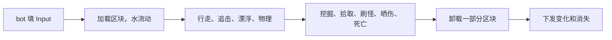

import { Boxes, FlaskConical, Network, Save } from 'lucide-react';

一个仿 Minecraft 服务器的方块世界：每秒 20 tick，玩家周围按需生成区块，走远了就释放；泉眼的水往低处流，站在水里的人会被冲走；
挖下的方块变成掉落物；僵尸夜里出现，天亮就烧死；只把变了的东西发给客户端；服务器停机时存档。50 个 bot 玩一分钟游戏时间。
本页所有代码都直接引用自
[`samples/VoxelServer`](https://github.com/JasonXuDeveloper/EasyEcs/tree/master/samples/VoxelServer)。CI 会构建并运行它，
拿输出和下面的结果逐行比对。

它写的是服务器，但里面没有一处只属于服务器：同一个 World 也能放在客户端。客户端跑同样的区块、水和刚体，在服务器的包到达之前先预测；
每个 tick 之后，渲染层读位置和方块画出来。服务器算世界、下发变化，客户端负责显示。见[客户端与服务器](#client-and-server)。

## 你会学到 [#what-you-learn]

- **区块是实体，方块是缓冲**：[唯一索引](/zh/docs/guide/indexes-and-relations)按坐标找到区块，一个枚举的
  [动态缓冲](/zh/docs/guide/dynamic-buffers)存它的 8,192 个方块。
- **世界跟着玩家走**：每秒创建两次区块（`UpdateInterval`），卸载时每 tick 只看二十分之一（`[ForEach(Slices = 20)]`），
  遍历途中直接做[结构变更](/zh/docs/guide/structural-changes)。
- **水也是数据**：每格水一个实体，是所在区块的子实体（[层级](/zh/docs/guide/hierarchy)）；只有还要扩散的水才带 `Flowing` 组件。
- **视野来自预制体**：每个预制体一个 `Vision`（[预制体](/zh/docs/guide/prefabs)），区块记下有几个玩家看得到它，
  再用按区块分组的玩家[值索引](/zh/docs/guide/indexes-and-relations#value-indexes)给僵尸当眼睛。
- **用标签挑出会漂的**：让玩家和僵尸在水里浮起来的系统带 `[With<Humanoid>]`。
- **只发变了的**：方块和位置用 [`[Changed<T>]` 和 `Mut<T>`](/zh/docs/guide/change-tracking)，消失的实体用
  [销毁日志](/zh/docs/guide/change-tracking#destroy-log)。
- **行彼此独立就上多线程**：[`[ForEach(Parallel = true)]`](/zh/docs/guide/threading)。
- **停机存档**：[`SaveWithout` 和 `LoadKeeping`](/zh/docs/guide/saves#restart)，预制体每次启动重新建。
- **量出来**：[`MeasureSystems` 和 `DescribeSchedule`](/zh/docs/guide/diagnostics)。

## 运行 [#run-it]

```bash
dotnet run -c Release --project samples/VoxelServer                      # 50 bots, one minute of game time
dotnet run -c Release --project samples/VoxelServer -- --players 5000    # a crowd
dotnet run -c Release --project samples/VoxelServer -- --realtime        # 20 ticks a second, like a vanilla server
dotnet run -c Release --project samples/VoxelServer -- --schedule        # the order the systems run in
```

## 一个 tick [#one-tick]



每个框是几个系统，一个系统只做一件事，按这个顺序加在 `Program.cs` 里。系统之间互不调用：各自读写组件，后一个看到前一个写下的结果。

## 数据 [#data]

先是方块、区块和水，再是会动的东西，最后是单例。注释写明每个值的含义和由谁来写。

<include lang="csharp" meta='title="Components.cs"'>../../../samples/VoxelServer/Components.cs</include>

规则是常量加两个纯函数；地形负责方块的位置和区块的生成。系统读方块只走 `BlockAt` 这一个入口，所以没加载的区块处处读成石头。

<include lang="csharp" meta='title="Rules.cs"'>../../../samples/VoxelServer/Rules.cs</include>

<include lang="csharp" meta='title="Terrain.cs"'>../../../samples/VoxelServer/Terrain.cs</include>

## 玩家周围的区块 [#chunks]

`ChunkLoadSystem` 遍历每个玩家视野里的区块：缺的补上，并在每个区块上数清有几个玩家看得到它（`Viewers`）；`ChunkUnloadSystem` 销毁五秒没人看到的区块。`Slices = 20` 让每个 tick
只检查二十分之一：1,300 个区块每 tick 查 65 个，而不是每秒一次查完 1,300 个。销毁区块会连带销毁它的水，因为每格水都是它的子实体。

<include lang="csharp" meta='title="Systems/Chunks.cs"'>../../../samples/VoxelServer/Systems/Chunks.cs</include>

## 视野（AOI） [#aoi]

和 Minecraft 服务器一样，玩家看得到什么，决定了服务器为它做什么：周围哪些区块保持加载、哪些变化要发给它。僵尸看得到什么，
决定了它追谁。视野范围是数据：每个预制体设一个 `Vision`，玩家 32 格，僵尸 16 格。想要一个看得更远的 Boss，多一个预制体就行，
不用写新代码。

- **下发**：加载区块时在每个区块上留下“几个玩家看得到”。挖掉一块、走一步、水漫过来，都只发给这么多玩家，人群挤在一处，
  远处的玩家不受影响。
- **看见**：`GridSystem` 让每个玩家的 `InChunk`（一个带索引的组件）跟着它所在的区块走，只在跨区块时才写。
  `ZombieSightSystem` 对视野覆盖的区块调用 `world.InChunkIndex.Find(chunk)`，留下范围内最近的玩家；每个 tick
  只有十分之一的僵尸去看（`Slices`）。

“谁在谁附近”在 ECS 里的常规做法就是这种网格：一张从格子到格子里实体的索引，由移动它们的系统维护，需要邻居的系统来读。
代码在下面的移动和僵尸两节。

## 水 [#water]

一格水出现五个 tick 后扩散一次：下面是空气就往下流，否则往四周流，离泉眼远一级，平地上最多流七格。扩散完 `Flowing` 就去掉，
`WaterFlowSystem` 再也不会访问它。`FloatSystem` 用 `world.WaterIndex` 找到人形生物脚下的水，把它推离泉眼，离得越近推得越猛。

<include lang="csharp" meta='title="Systems/Water.cs"'>../../../samples/VoxelServer/Systems/Water.cs</include>

## 移动 [#movement]

行走在多个线程上把输入变成速度；物理让每个刚体在方块间移动，并通过 `Mut<Position>` 写位置，没动的刚体不打 tick，也不下发。

<include lang="csharp" meta='title="Systems/Movement.cs"'>../../../samples/VoxelServer/Systems/Movement.cs</include>

## 挖掘、掉落物、僵尸、死亡 [#rules]

挖一下，方块变成空气和一个掉落物；洞旁边的水重新开始流。僵尸是带 `Target` 的预制体实例；目标玩家离开后，旧 id 上的
`TryGetEntity` 会失败，僵尸就知道了。

<include lang="csharp" meta='title="Systems/Items.cs"'>../../../samples/VoxelServer/Systems/Items.cs</include>

<include lang="csharp" meta='title="Systems/Zombies.cs"'>../../../samples/VoxelServer/Systems/Zombies.cs</include>

<include lang="csharp" meta='title="Systems/Health.cs"'>../../../samples/VoxelServer/Systems/Health.cs</include>

## 下发什么 [#replication]

变了的区块和位置来自 `[Changed<T>]`；消失的实体来自销毁日志，从这个系统上次运行的 tick 算起。

<include lang="csharp" meta='title="Systems/Replication.cs"'>../../../samples/VoxelServer/Systems/Replication.cs</include>

## 程序 [#program]

World 和它的选项、单例和预制体、按 tick 顺序排好的系统、玩家，最后停机存档，再从存档重启。tick 循环和 bot 在
[`Host/`](https://github.com/JasonXuDeveloper/EasyEcs/tree/master/samples/VoxelServer/Host) 里：那是搭架子的代码，不是这一课的内容。

<include lang="csharp" meta='title="Program.cs"'>../../../samples/VoxelServer/Program.cs</include>

## 输出 [#output]

```text
tick   200 (day  ): 50 players, 82 chunks, 1961 water, 0 zombies, 0 items
tick   400 (night): 50 players, 119 chunks, 3070 water, 50 zombies, 0 items
tick   600 (day  ): 50 players, 135 chunks, 4322 water, 150 zombies, 0 items
tick   800 (day  ): 50 players, 142 chunks, 4054 water, 0 zombies, 0 items
tick  1000 (night): 50 players, 171 chunks, 5311 water, 50 zombies, 0 items
tick  1200 (day  ): 50 players, 170 chunks, 4774 water, 150 zombies, 0 items
chunks: 232 loaded, 62 unloaded, 25227 sent
blocks dug: 638; items: 638 picked up, 0 expired
zombies: 300 spawned, 150 burned, 361 hits; player deaths: 39
water: 7625 cells poured, 5005 ticks of humanoids carried
sent: 2501294 position updates, 3701 despawns
restarted from the save: 50 players, 170 chunks, 4774 water, 150 zombies
```

世界、泉眼、bot 和刷怪都由整数哈希决定，所以单线程还是多线程，每次输出都一样。bot 往外走，区块就多起来，走过的区块又被释放，
水跟着一起增减；每晚每个玩家身边冒出三只僵尸，天亮一秒后全部烧光。耗时写到 stderr：平均每 tick 用了 50 ms 预算的多少，
以及每个系统的耗时和分配。

## 客户端与服务器 [#client-and-server]

联网游戏通常这样分工：服务器掌握世界、下发变化，客户端负责显示。两边都可以用这套 ECS：

- **服务器上**，就像这个示例：系统每个 tick 计算世界，`Send` 系统把变化（`[Changed<T>]`、销毁日志）编成包。
- **客户端上**，收到的包写进一个组件相同的 World。同样的 `PhysicsSystem` 和 `FloatSystem` 在两个包之间预测本地玩家，
  渲染系统读 `Position` 和区块的方块来画：在 [Godot](/zh/docs/samples/godot) 里，节点在 `_PhysicsProcess` 中
  `World.Update()` 之后立刻绘制。

两边都要用的组件和系统放进一个共享项目，就像 [HotReload 示例](/zh/docs/samples/hot-reload)里的 Contracts。

## 相关页面 [#related]

<Cards>
  <Card icon={<Boxes />} title="动态缓冲" href="/zh/docs/guide/dynamic-buffers">
    每个实体一个列表，比如区块的方块，和普通组件一样被追踪。
  </Card>
  <Card icon={<FlaskConical />} title="变更追踪" href="/zh/docs/guide/change-tracking">
    什么算写入、Mut&lt;T&gt;、销毁日志。
  </Card>
  <Card icon={<Network />} title="示例：战斗服务器" href="/zh/docs/example">
    一个服务器用上所有功能，客户端可以断线追赶。
  </Card>
  <Card icon={<Save />} title="存档" href="/zh/docs/guide/saves">
    存下 World、从存档重启、跳过每次启动自己设置的部分。
  </Card>
</Cards>
