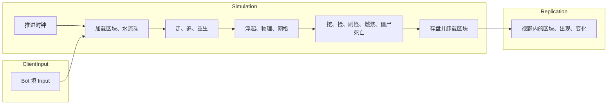

import { Boxes, FlaskConical, Network, Save } from 'lucide-react';

一个仿 Minecraft 服务器的方块世界：每秒 20 tick；玩家周围加载区块，走远后存进区域文件，玩家回来时再读回；水按 Minecraft
的规则扩散和退去，站在水里的东西会被冲走；挖下的方块变成掉落物，谁走过都能捡；僵尸夜里出现，追它看见的玩家，白天在露天会着火；
只把变了的东西发给客户端；服务器停机时存档。50 个 bot 玩一分钟游戏时间。本页所有代码都直接引用自
[`samples/VoxelServer`](https://github.com/JasonXuDeveloper/EasyEcs/tree/master/samples/VoxelServer)。CI 会构建并运行它，
拿输出和下面的结果逐行比对。

它写的是服务器，但里面没有一处只属于服务器：同一个 World 也能放在客户端。客户端跑同样的区块、水和刚体，在服务器的包到达之前先预测；
每个 tick 之后，渲染层读位置和方块画出来。见[客户端与服务器](#client-and-server)。

## 运行 [#run-it]

```bash
dotnet run -c Release --project samples/VoxelServer                      # 50 个 bot，一分钟游戏时间
dotnet run -c Release --project samples/VoxelServer -- --players 2000    # 一大群人
dotnet run -c Release --project samples/VoxelServer -- --realtime        # 像原版服务器一样每秒 20 tick
dotnet run -c Release --project samples/VoxelServer -- --schedule        # 系统的运行顺序
```

## 一个 tick：三个组 [#one-tick]



一个 tick 分三部分，每部分是一个[系统组](/zh/docs/guide/systems#system-groups)：一个起名用的 struct，加上它的系统上的 `[UpdateInGroup<T>]`。

<include lang="csharp" meta='title="Groups.cs"'>../../../samples/VoxelServer/Groups.cs</include>

宿主按顺序运行这三个组，每组各 Update 一次。真实服务器可以让 `ClientInput` 随包到达就运行，对远处的玩家降低 `Replication` 的频率，
系统一行都不用改。

<include lang="csharp" meta='title="Host/Server.cs"'>../../../samples/VoxelServer/Host/Server.cs#tick</include>

组内的系统按添加顺序运行。系统之间不互相调用：每个系统读写组件，下一个系统看到上一个写下的结果。

<include lang="csharp" meta='title="Program.cs"'>../../../samples/VoxelServer/Program.cs#systems</include>

## 数据 [#data]

先是方块、区块和它的水，然后是会动的东西、玩家、僵尸和掉落物，最后是单例。注释说明每个值的含义和谁来写。区块是实体：它的键 `Chunk` 是
[唯一索引](/zh/docs/guide/indexes-and-relations#unique-keys)（`world.ChunkIndex`），8,192 个方块和对应的水是两个字节缓冲。

<include lang="csharp" meta='title="Components.cs"'>../../../samples/VoxelServer/Components.cs</include>

规则是常量和几个纯函数；地形负责方块的位置、区块的生成，以及所有系统共用的读取：`BlockAt`（未加载的区块读出来是石头，
所以什么都不会掉出世界）、`WaterAt`、`TopAt` 和一个点周围的区块。

<include lang="csharp" meta='tab="Rules.cs"'>../../../samples/VoxelServer/Rules.cs</include>

<include lang="csharp" meta='tab="Terrain.cs"'>../../../samples/VoxelServer/Terrain.cs</include>

## 玩家周围的区块 [#chunks]

`ChunkLoadSystem` 只在玩家的视野变了时才看它：`[Changed<InChunk>]` 只访问这个 tick 跨进另一个区块的玩家（以及刚创建的玩家），
把它们周围缺的区块记成 `LoadRequest` 实体，每个区块一个：请求是 `IUniqueIndexed`，第二个要它的玩家能找到它，就不再重复请求。
待在原区块的玩家什么都不请求，所以没有系统轮询视野。它不负责加载：遍历期间
不能加载或保存实体（EECS041），所以由 `ChunkReadSystem` 在遍历之后的 `OnUpdate` 里处理这些请求，每个 tick 最多
`Rules.MaxRequests` 个，只销毁处理过的，其余的等下一个 tick。卸载过的区块用 `LoadEntities` 从区域文件读回，里面的僵尸和掉落物也一起回来；从没见过的区块就生成，方块和水各用一次
`AddRange` 写进缓冲。不管哪种，这个 tick 里它都带着 `Fresh` 标签：客户端会整块收到它（见下文），而不是收到方块变化。

<include lang="csharp" meta='title="Systems/Chunks.cs"'>../../../samples/VoxelServer/Systems/Chunks.cs#load</include>

卸载是反过来的同一套做法。区块的 `Viewers` 记着视野里有它的玩家数，由下面的 `ChunkViewSystem` 随视野变化增减，并记下它最近一次归零的 tick。
`Slices = 20` 让每个 tick 检查二十分之一的区块，五秒都没人看着的打上 `Unloading` 标签；
`ChunkSaveSystem` 再把每个区块连同它网格格子里的实体写成一条记录（`SaveEntities`）并销毁，所以没有玩家的地方什么都不跑。有玩家站着的区块（比如刚在那里重生的玩家）不会卸载。
区域文件是一个装着类的单例；[`Host/RegionFiles.cs`](https://github.com/JasonXuDeveloper/EasyEcs/tree/master/samples/VoxelServer/Host/RegionFiles.cs)
代替磁盘。

<include lang="csharp" meta='title="Systems/Chunks.cs"'>../../../samples/VoxelServer/Systems/Chunks.cs#unload</include>

客户端会保留发给它的区块。`ChunkViewSystem` 在玩家身上记着同一个集合，一个 `DynamicBuffer<InView>`：进入视野的已加载区块整块发送，
离开的就让客户端忘掉。这个集合只在玩家跨进另一个区块、或附近有区块加载完时才变，而这两件事本来就是数据：`GridSystem` 只在跨区块时写
`InChunk`，`InChunk` 又是 `ITracked`，所以 `[Changed<InChunk>]` 只访问跨了区块的玩家；`[With<Fresh>]` 访问这个 tick 加载的区块，
把它们加进附近玩家的集合。没有任何轮询：待在原区块的玩家什么开销都没有，跨区块当个 tick 就能看到。每个进入集合的区块观察者加一，
离开的减一，所以区块的 `Viewers` 每个 tick 都是准确的，而不是隔一段时间数一次。

<include lang="csharp" meta='title="Systems/Chunks.cs"'>../../../samples/VoxelServer/Systems/Chunks.cs#view</include>

## 视野（AOI） [#aoi]

玩家看见的是它的 `Vision` 够得着的那一方块区块：周围加载并发给客户端的区块（上面的 `InView`），以及其中的实体。
没有任何地方给每个玩家存一份实体列表。实体视野只有三种变化，而且每种本来就是数据：

| 发生了什么 | 客户端收到什么 | 在哪里计数 |
| --- | --- | --- |
| 一个区块进入或离开玩家的视野 | 其中实体的出现或消失包 | `ChunkViewSystem`（由网格计数） |
| 一个实体跨进另一个区块，或刚被创建 | 看得见新区块、看不见旧区块的玩家收到出现包，反过来的收到消失包 | `SightSystem.Moved`，`[Changed<InChunk>]` |
| 一个实体被销毁 | 看得见它所在区块的玩家收到消失包 | `SightSystem.Gone`，`[With<Retired>]` |

网格是 `InChunk`，一个带索引的组件，挂在所有会动的东西上，所以 `world.InChunkIndex.Find(chunk)` 列出一个区块里的实体。
`GridSystem` 让它保持最新：`[Changed<Position>]` 只访问这个 tick 移动过的实体，`SetInChunkIfChanged` 只在实体跨进另一个区块时才写，
所以索引和所有响应 `[Changed<InChunk>]` 的系统每秒只看到几次跨区块，而不是每个 tick 都有。

<include lang="csharp" meta='title="Systems/Movement.cs"'>../../../samples/VoxelServer/Systems/Movement.cs#grid</include>

跨区块时要知道客户端原先在哪个区块看见这个实体；被销毁的实体也要知道，而那时它的组件已经没了。`Visible` 记着这个区块，它是一个
[清理组件](/zh/docs/guide/cleanup-and-disable)：销毁带清理组件的实体时，实体会退休而不是消失，只留下清理组件，直到某个系统去掉最后一个。
`SightSystem` 据此发出消失包，再去掉它，实体才被释放。跨区块牵涉的玩家，是视野够得着其中一个区块、够不着另一个的那些，
也就是两个方块之间的一条区块；创建或销毁牵涉的则是区块的 `Viewers`，一次查找。待在原区块的实体在这里没有任何开销，不管过多少个 tick。

<include lang="csharp" meta='title="Systems/Sight.cs"'>../../../samples/VoxelServer/Systems/Sight.cs#sight</include>

僵尸在自己的 `Vision` 范围内追人，35 格（Minecraft 里它的追踪距离）：每个预制体设置自己的，视野更远的 Boss 只是多一个预制体，不用写新代码。

<include lang="csharp" meta='title="Program.cs"'>../../../samples/VoxelServer/Program.cs#prefabs</include>

`ZombieTargetSystem` 通过同一个网格找最近的玩家，只要玩家还在范围内就一直追它，就像原版的怪物保留目标一样。它每秒看两次，
每个 tick 只看十分之一的僵尸（`Slices`），所以尸潮再大，每个 tick 的开销也一样。

<include lang="csharp" meta='title="Systems/Zombies.cs"'>../../../samples/VoxelServer/Systems/Zombies.cs#target</include>

在 ECS 里，“谁在谁附近”的常规答案就是网格：一个从格子到其中实体的索引，由移动它们的系统维护，由需要邻居的系统读取。
这里的格子是区块，因为区块本来就是加载的单位，也是客户端拥有的单位。

## 水 [#water]

水不是一种方块，而是方块旁边的第二个网格：每个方块一个字节的 `DynamicBuffer<Fluid>`。方块一变，不管是谁改的，
这个区块和四个邻居的水都会被唤醒（`Flowing`）：`BlockUpdateSystem` 响应方块缓冲的变化，所以挖掘本身完全不用知道水。

<include lang="csharp" meta='title="Systems/Water.cs"'>../../../samples/VoxelServer/Systems/Water.cs#wake</include>

规则是 Minecraft 的简化版（两个泉眼之间不会生出新水源，水向四面扩散而不是流向最近的落差）：水下面的空格变成下落的水；水旁边、脚下踩着实心方块的空格，水位比它低一级；其余的都变空，所以泉眼没了水就会退。
这是一个模板运算（stencil）：每个方块都用同一套算术，从它的六个邻居算出下一步，正是 GPU 在网格上做的那种计算。区块的一行是 16 个方块，
即一个 `Vector128<byte>`，它的邻居就是同一缓冲里相邻的行。先把区块边界外的邻居复制到一个带填充的副本的外圈（halo），向量循环就没有边界情况；
再用两次向量化搜索（`IndexOfAnyExcept`）把计算限制在有水的那几层。字节通道是整数运算：每台机器上的水都一样。
这一步写进第二个缓冲 `NextFluid`，等所有区块都算完，`WaterCommitSystem` 再把它拷成水，就像 GPU 交替使用两个缓冲：每个区块都用邻居
这一步之前的水来算，与区块的访问顺序无关。
一步下来什么都没变，就去掉 `Flowing`，静止的湖不会再被访问。

<include lang="csharp" meta='title="Systems/Water.cs"'>../../../samples/VoxelServer/Systems/Water.cs#flow</include>

`FloatSystem` 把站在水里的东西（玩家、僵尸和掉落物）托起来，推向周围更低的水，就像 Minecraft 的水流。

<include lang="csharp" meta='title="Systems/Water.cs"'>../../../samples/VoxelServer/Systems/Water.cs#float</include>

## 移动 [#movement]

行走把输入变成速度。每一行只依赖它自己，方法也不持有 `World`，所以是并行方法；运行器会给拆分计时，只在它让遍历更快时才保留。

<include lang="csharp" meta='title="Systems/Movement.cs"'>../../../samples/VoxelServer/Systems/Movement.cs#walk</include>

物理让每个物体在方块间移动，通过 `Mut<Position>` 写位置：`SetIfChanged` 只在位置变了时才给这一行打 tick，所以站着不动的物体不会被下发。
静止的物体（站在地上、没有速度、脚下仍有地面）查一次方块就跳过。它留在单线程，因为它通过 `World`（区块索引）读方块，
而并行方法不能持有 World（EECS010）。水和浮起也是同样的原因。

<include lang="csharp" meta='title="Systems/Movement.cs"'>../../../samples/VoxelServer/Systems/Movement.cs#physics</include>

## 挖掘与掉落物 [#items]

挖一下，方块变成空气和一个掉落物（像 Minecraft 一样，草变成泥土），挖的人 `Score` 加一（见[排行榜](#leaderboard)）。
缓冲通过 `chunk.Block[slot]` 读、`chunk.WriteBlock()` 写，所以只有挖掘会给区块打 tick，周围的水也是通过这次打 tick 被唤醒的。

<include lang="csharp" meta='title="Systems/Items.cs"'>../../../samples/VoxelServer/Systems/Items.cs#dig</include>

掉落物每个 tick 长一岁：批量方法一条指令给 8 个存在时间加一（见 [SIMD](#simd)）。

<include lang="csharp" meta='title="Systems/Items.cs"'>../../../samples/VoxelServer/Systems/Items.cs#age</include>

过了拾取延迟，掉落物归站在它上面的任何玩家，同样通过网格找到。同类的堆先长满，空格子装剩下的，装不下的留在地上。
先读背包再写，所以背包满了不会被打 tick。

<include lang="csharp" meta='tab="拾取"'>../../../samples/VoxelServer/Systems/Items.cs#pickup</include>

<include lang="csharp" meta='tab="过期"'>../../../samples/VoxelServer/Systems/Items.cs#expiry</include>

## 僵尸与死亡 [#zombies]

夜里每五秒，每个玩家附近出现一只僵尸，像 Minecraft 一样离玩家 24 到 32 格，站在那一列的顶上、不在水里：僵尸预制体的一个实例，
带着自己的 `Position`。

<include lang="csharp" meta='title="Systems/Zombies.cs"'>../../../samples/VoxelServer/Systems/Zombies.cs#spawn</include>

僵尸走向它追的玩家，靠近了就打；玩家离开了也能发现，因为 `TryGetEntity` 对过期的 id 返回 false。追、打和冷却是三个系统，各管一件事。

<include lang="csharp" meta='tab="追击"'>../../../samples/VoxelServer/Systems/Zombies.cs#chase</include>

<include lang="csharp" meta='tab="攻击"'>../../../samples/VoxelServer/Systems/Zombies.cs#attack</include>

着火也是数据：`SunlightSystem` 给白天露天的僵尸加上 `Burning`，在水里则去掉；`BurnSystem` 让火烧下去，
`FireDamageSystem` 每 `Rules.BurnEvery` 个 tick 扣一次血（它的 `UpdateInterval`），`ExtinguishSystem` 去掉烧完的火。
扣血单独成一个系统，是因为 `Health` 被追踪，而批量方法会给它写的整段行打 tick：只在扣血的 tick 写，下面的死亡系统在其他 tick 就无事可做。

<include lang="csharp" meta='tab="日照"'>../../../samples/VoxelServer/Systems/Zombies.cs#sunlight</include>

<include lang="csharp" meta='tab="燃烧"'>../../../samples/VoxelServer/Systems/Zombies.cs#burn</include>

死亡就是 `Health` 归零，每种实体一个系统处理：僵尸消失，玩家把背包掉在原地然后重生。`Health` 是 `ITracked`，所以两个系统都用
`[Changed<Health>]`，只访问上次运行以来被写过的血量，也就是刚被打或被烧的实体，而不是每个 tick 遍历所有实体。`Mut<T>` 只为重生的玩家写血量、位置和背包。

<include lang="csharp" meta='title="Systems/Health.cs"'>../../../samples/VoxelServer/Systems/Health.cs</include>

## 数据成列才用 SIMD [#simd]

这个服务器里有两种数据适合 SIMD：

- **带模板运算的网格**：就是上面的水。每个方块的下一个水位是它邻居的同一个函数，网格又是字节缓冲，所以一条指令算 16 个方块。
- **一列计数器**：冷却、掉落物存在时间、着火和火焰伤害（按它自己的 [`UpdateInterval`](/zh/docs/guide/systems#update-interval)）在每个实体上的变化都一样。
  [批量方法](/zh/docs/guide/systems#batch-methods)把一段行当成 span 拿到，`Vector<int>` 在 AVX2 上一条指令改
  8 个（Arm 上 4 个）。JIT 不会自己把这些循环向量化，所以方法里手写；整数通道在每台机器上结果都一样。

其他系统对每个实体做的事都不一样：物理查每个物体周围的方块，找目标遍历索引，追击读另一个实体的位置。查找加分支的循环用向量帮不上忙，
而位置是 `Vector3`，三个挨着的 float，不是三列。批量方法也只在一个线程上跑（EECS010），提速靠的是向量循环，不是多线程。

## 自动排好序的排行榜 [#leaderboard]

`Score` 是玩家挖的方块数，一个 `IIndexed<int>`（见[数据](#data)），所以 `world.ScoreIndex` 是按分数索引玩家的[有序索引](/zh/docs/guide/indexes-and-relations#ordered-index)。键可比较，
所以索引能按顺序遍历：`Descending()` 从挖得最多的人开始。`DigSystem` 写分数时索引就保持有序，所以榜首只是走三项，从不对所有玩家排序。

<include lang="csharp" meta='title="Program.cs"'>../../../samples/VoxelServer/Program.cs#leaderboard</include>

同一个索引上的 `Range(from, to)` 列出两个分数之间的玩家，可以做排行榜的分页。

## 下发什么 [#replication]

变了的区块来自
[`[ChangedAny<DynamicBuffer<Block>, DynamicBuffer<Fluid>>]`](/zh/docs/guide/change-tracking#changed-any)：只有自系统上次运行以来方块或水变了的区块，
才会发给视野里有它的玩家（它的 `Viewers`）。

<include lang="csharp" meta='title="Systems/Replication.cs"'>../../../samples/VoxelServer/Systems/Replication.cs#chunks</include>

移动过的实体来自 `[Changed<Position>]`，由上面的 `Mut<Position>` 打 tick。更新里带着有血条的实体的血量：[`Maybe<Health>`](/zh/docs/guide/systems#maybe)
在实体有 `Health` 时读它，所以玩家、僵尸和掉落物由一个方法下发，查询也不要求 `Health`。时钟是模拟组的第一个系统，而不在同步组里，所以同步频率较低的服务器，游戏时间照样正常走。

<include lang="csharp" meta='tab="实体"'>../../../samples/VoxelServer/Systems/Replication.cs#entities</include>

<include lang="csharp" meta='tab="时钟"'>../../../samples/VoxelServer/Systems/Replication.cs#clock</include>

## 程序 [#program]

World 和它的选项：[`MeasureSystems`](/zh/docs/guide/diagnostics) 用来计时（`--schedule` 打印 `DescribeSchedule`）；缓冲池大到能放下一个区块的方块和水，所以新加载的区块能复用卸载区块的列表。

<include lang="csharp" meta='title="Program.cs"'>../../../samples/VoxelServer/Program.cs#options</include>

玩家是玩家预制体的实例，带着自己的客户端编号、位置和区块。tick 循环、bot 和区域文件在
[`Host/`](https://github.com/JasonXuDeveloper/EasyEcs/tree/master/samples/VoxelServer/Host) 里：是管道，不是本课内容。

<include lang="csharp" meta='title="Program.cs"'>../../../samples/VoxelServer/Program.cs#players</include>

停机时存档，但不存预制体和区域文件，它们每次启动都会重新设置（[`SaveWithout`](/zh/docs/guide/saves#restart)）；重启的 World 先设置好它们，再把存档读进来（`LoadKeeping`）。

<include lang="csharp" meta='title="Program.cs"'>../../../samples/VoxelServer/Program.cs#save</include>

## 输出 [#output]

```text
tick   200 (day  ): 50 players, 84 chunks, 3481 water, 0 zombies, 59 items
tick   400 (night): 50 players, 118 chunks, 6481 water, 43 zombies, 103 items
tick   600 (day  ): 50 players, 146 chunks, 11142 water, 123 zombies, 103 items
tick   800 (day  ): 50 players, 159 chunks, 12865 water, 13 zombies, 100 items
tick  1000 (night): 50 players, 152 chunks, 12156 water, 50 zombies, 82 items
tick  1200 (day  ): 50 players, 154 chunks, 12145 water, 131 zombies, 79 items
chunks: 181 generated, 54 unloaded, 27 loaded back
blocks dug: 585; items: 376 picked up, 230 expired
zombies: 247 spawned, 116 burned, 411 hits; player deaths: 48
water: 15813 cells filled, 17994 ticks of bodies carried
view: 3928 chunks sent, 2678 forgotten; 43490 entities came into view, 11981 left it, 21249 despawned
sent: 34218 block updates, 2790081 entity updates (48523 KiB)
top diggers: player 8 (22) player 37 (21) player 35 (21)
restarted from the save: 50 players, 154 chunks, 12145 water, 131 zombies; 27 chunks in the region files
```

世界、泉眼、bot 和刷怪都来自整数哈希，所以每次运行输出都一样。bot 往外走，区块越来越多；留在身后的区块存进区域文件，
bot 回来时再读回。耗时打印到 stderr：平均 tick 与 50 ms 预算的对比，以及每个系统的耗时和分配。

## 和原版服务器的区别 [#vanilla]

- 一天 30 秒，掉落物存在 15 秒，着火扣血的频率是原版的四倍，这样一分钟的运行就能全看到。
- 服务器根据玩家的输入移动玩家；原版服务器信任客户端的移动再做校验。
- 同一个距离决定玩家周围加载和模拟哪些区块，以及它看见哪些实体：它那些区块里的实体。原版服务器按实体种类的范围追踪每个实体，每个 tick 检查。
- 没有刷怪上限、光照等级、远处怪物消失、心跳，也没有玩家加入或离开。

## 没用到的功能，以及原因 [#not-used]

- **按区块 `GroupBy`**。按区块拆表能让“一个区块里的实体”在内存里连续，但实体每跨一次区块，它的行就要搬到另一张表，
  每个走动的实体每秒都要搬好几次。`InChunk` 索引在跨区块时只更新一次索引，别的什么都不花。
- **用清理组件在卸载时保存区块**。退休的实体会失去其他组件，缓冲也在其中，到那时已经没东西可存了。区块在销毁之前保存。
  （消失包倒是靠一个清理组件 `Visible` 发的：它要留住的只是一个区块位置。）
- **用销毁日志下发消失**。日志里只有被销毁实体的 id 和时间，没有它在哪里，而消失包要发给看得见它所在区块的玩家。`Visible` 正好把区块留到需要的时候为止。
- **给每个玩家存一份实体集合**。客户端看见的是它那些区块里的实体，每人一份集合只是重复网格，还要在附近每次跨区块时都改写：一千人的人群里，每次跨区块就要改一千份。
- **并行的物理、水和找目标**。它们通过 World 的索引读数据，见[移动](#movement)。

## 客户端与服务器 [#client-and-server]

联网游戏通常这样分工：服务器掌握世界、下发变化，客户端负责显示。两边都可以用这套 ECS：

- **服务器上**，就像这个示例：系统每个 tick 计算世界，`Send` 系统把变化（`[Changed<T>]`、`InView` 的差异、跨区块和退休的实体）编成包。
- **客户端上**，收到的包写进一个组件相同的 World。同样的 `PhysicsSystem` 和 `FloatSystem` 在两个包之间预测本地玩家，
  渲染系统读 `Position` 和区块的方块来画：在 [Godot](/zh/docs/samples/godot) 里，节点在 `_PhysicsProcess` 中
  `World.Update()` 之后立刻绘制。

两边都要用的组件和系统放进一个共享项目，就像 [HotReload 示例](/zh/docs/samples/hot-reload)里的 Contracts。

## 相关页面 [#related]

<Cards>
  <Card icon={<Boxes />} title="动态缓冲" href="/zh/docs/guide/dynamic-buffers">
    每个实体一个列表，比如区块的方块，和普通组件一样被追踪。
  </Card>
  <Card icon={<FlaskConical />} title="变更追踪" href="/zh/docs/guide/change-tracking">
    什么算写入、Mut&lt;T&gt;、ChangedAny。
  </Card>
  <Card icon={<Network />} title="迁移与卸载" href="/zh/docs/guide/migration-and-unload">
    存下一组实体再读回，比如一个区块和里面的东西。
  </Card>
  <Card icon={<Save />} title="存档" href="/zh/docs/guide/saves">
    存下 World、从存档重启、跳过每次启动自己设置的部分。
  </Card>
</Cards>
